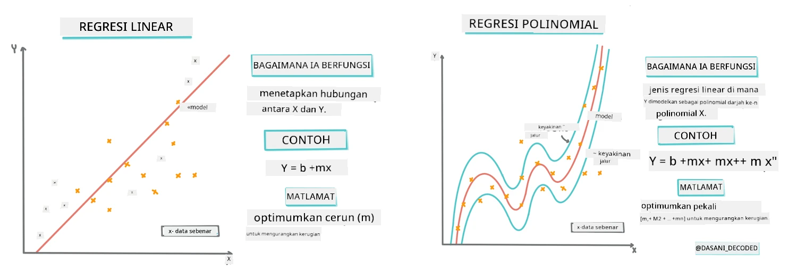
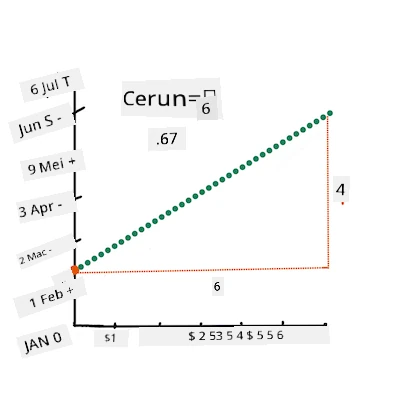
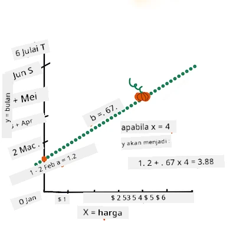
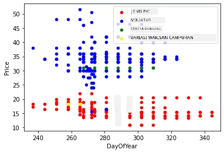

# Membangun model regresi menggunakan Scikit-learn: regresi dengan empat cara

## Nota Pemula

Regresi linear digunakan apabila kita ingin meramalkan **nilai berangka** (contohnya, harga rumah, suhu, atau jualan).  
Ia berfungsi dengan mencari garis lurus yang paling mewakili hubungan antara ciri input dan output.

Dalam pelajaran ini, kita memberi tumpuan kepada memahami konsep sebelum meneroka teknik regresi yang lebih maju.  
  
> Infografik oleh [Dasani Madipalli](https://twitter.com/dasani_decoded)  
## [Kuiz Pra-ceramah](https://ff-quizzes.netlify.app/en/ml/)

> ### [Pelajaran ini juga tersedia dalam R!](../../../../2-Regression/3-Linear/solution/R/lesson_3.html)  
### Pengenalan

Setakat ini anda telah meneroka apa itu regresi dengan data contoh yang diambil dari set data harga labu yang akan kita gunakan sepanjang pelajaran ini. Anda juga telah memvisualisasikannya menggunakan Matplotlib.

Kini anda bersedia untuk menyelami lebih dalam regresi untuk ML. Walaupun visualisasi membolehkan anda memahami data, kuasa sebenar Pembelajaran Mesin datang dari _melatih model_. Model dilatih menggunakan data sejarah untuk secara automatik menangkap pergantungan data, dan membolehkan anda meramalkan hasil bagi data baru yang belum pernah dilihat model sebelum ini.

Dalam pelajaran ini, anda akan belajar lebih lanjut tentang dua jenis regresi: _regresi linear asas_ dan _regresi polinomial_, bersama beberapa matematik yang mendasari teknik-teknik ini. Model-model ini akan membolehkan kita meramalkan harga labu bergantung kepada data input yang berbeza.

[](https://youtu.be/CRxFT8oTDMg "ML for beginners - Understanding Linear Regression")

> 🎥 Klik imej di atas untuk tontonan video ringkas mengenai regresi linear.

> Sepanjang kurikulum ini, kami menganggap pengetahuan matematik yang minima, dan berusaha menjadikannya mudah difahami oleh pelajar yang datang dari bidang lain, jadi perhatikan nota, 🧮 panggilan, rajah, dan alat pembelajaran lain untuk membantu pemahaman.

### Prasyarat

Anda sepatutnya kini sudah biasa dengan struktur data labu yang kita periksa. Anda boleh menemuinya telah dimuat dan dibersihkan dalam fail _notebook.ipynb_ pelajaran ini. Dalam fail tersebut, harga labu dipaparkan per bushel dalam bingkai data baru. Pastikan anda boleh menjalankan nota ini dalam kernel di Visual Studio Code.

### Persediaan

Sebagai peringatan, anda memuatkan data ini untuk menyoal soalan mengenainya.

- Bila masa terbaik untuk membeli labu?  
- Berapakah harga yang boleh saya jangka bagi satu kotak labu mini?  
- Patutkah saya membelinya dalam bakul setengah bushel atau kotak 1 1/9 bushel?  
Mari terus menggali data ini.

Dalam pelajaran sebelum ini, anda telah mencipta bingkai data Pandas dan mengisinya dengan sebahagian daripada set data asal, menstandardkan harga mengikut bushel. Dengan melakukan itu, bagaimanapun, anda hanya dapat mengumpul kira-kira 400 titik data dan hanya bagi bulan musim luruh.

Lihat data yang telah kita muatkan dalam notebook yang disertakan pelajaran ini. Data telah dimuat dan scatterplot awal dipetakan untuk menunjukkan data bulan. Mungkin kita boleh mendapatkan sedikit lebih banyak butiran tentang sifat data dengan membersihkannya lebih lanjut.

## Garis regresi linear

Seperti yang anda pelajari dalam Pelajaran 1, tujuan latihan regresi linear adalah untuk dapat melakar garis untuk:

- **Menunjukkan hubungan pemboleh ubah**. Menunjukkan hubungan antara pemboleh ubah  
- **Membuat ramalan**. Membuat ramalan tepat tentang di mana titik data baru akan jatuh berbanding garis tersebut.

Biasanya, **Regresi Kuasa Dua Terkecil** digunakan untuk melakar jenis garis ini. Istilah "Least-Squares" merujuk kepada proses meminimumkan jumlah ralat dalam model kita. Untuk setiap titik data, kita mengukur jarak menegak (dipanggil residual) antara titik sebenar dan garis regresi kita.

Kita kuasakan jarak ini untuk dua sebab utama:

1. **Magnitud mengatasi Arah:** Kita ingin menganggap ralat -5 sama seperti ralat +5. Pengkuasaan menjadikan semua nilai positif.

2. **Menghukum Nilai Luar:** Pengkuasaan memberikan berat lebih pada ralat yang besar, memaksa garis kekal lebih dekat kepada titik yang jauh.

Kita kemudian menambah semua nilai kuasa dua ini bersama. Matlamat kita adalah untuk mencari garis spesifik di mana jumlah akhir ini adalah paling kecil (nilai terkecil yang boleh)—oleh itu namanya "Least-Squares".

> **🧮 Tunjukkan saya matematiknya**  
>  
> Garis ini, dipanggil _garis kesesuaian terbaik_ boleh dinyatakan oleh [persamaan](https://en.wikipedia.org/wiki/Simple_linear_regression):  
>  
> ```
> Y = a + bX
> ```
>  
> `X` adalah 'pemboleh ubah penjelas'. `Y` adalah 'pemboleh ubah bersandar'. Kecerunan garis ialah `b` dan `a` ialah pintasan-y, iaitu nilai `Y` apabila `X = 0`.  
>  
>  
>  
> Pertama, kira kecerunan `b`. Infografik oleh [Jen Looper](https://twitter.com/jenlooper)  
>  
> Dalam kata lain, dan merujuk kepada soalan asal data labu kita: "membuat ramalan harga labu per bushel mengikut bulan", `X` merujuk kepada harga dan `Y` merujuk kepada bulan jualan.  
>  
>  
>  
> Kira nilai Y. Jika anda membayar sekitar $4, mestilah April! Infografik oleh [Jen Looper](https://twitter.com/jenlooper)  
>  
> Matematik yang mengira garis ini mesti menunjukkan kecerunan garis, yang juga bergantung kepada pintasan, iaitu tempat `Y` terletak apabila `X = 0`.  
>  
> Anda boleh melihat kaedah pengiraan nilai-nilai ini di laman web [Math is Fun](https://www.mathsisfun.com/data/least-squares-regression.html). Juga lawati [kalkulator Least-squares ini](https://www.mathsisfun.com/data/least-squares-calculator.html) untuk melihat bagaimana nilai nombor mempengaruhi garis.

## Korelasi

Satu lagi istilah yang perlu difahami ialah **Pekali Korelasi** antara pemboleh ubah X dan Y yang diberikan. Dengan menggunakan scatterplot, anda boleh segera memvisualisasikan pekali ini. Plot dengan titik data yang bersepah membentuk garis kemas mempunyai korelasi tinggi, manakala plot dengan titik data yang bersepah di mana-mana sahaja antara X dan Y mempunyai korelasi rendah.

Model regresi linear yang baik adalah yang mempunyai Pekali Korelasi yang tinggi (lebih hampir kepada 1 daripada 0) menggunakan kaedah Regresi Least-Squares dengan garis regresi.

✅ Jalankan notebook yang disertakan pelajaran ini dan lihat scatterplot Bulan ke Harga. Adakah data yang mengaitkan Bulan ke Harga bagi jualan labu kelihatan mempunyai korelasi tinggi atau rendah, mengikut tafsiran visual anda terhadap scatterplot tersebut? Adakah ia berubah jika anda menggunakan ukuran yang lebih terperinci daripada `Month`, contohnya *hari dalam tahun* (iaitu bilangan hari sejak awal tahun)?

Dalam kod di bawah, kita akan mengandaikan bahawa kita telah membersihkan data, dan memperoleh bingkai data yang dinamakan `new_pumpkins`, yang serupa dengan berikut:

ID | Bulan | DayOfYear | Jenis | Bandar | Pakej | Harga Rendah | Harga Tinggi | Harga  
---|-------|-----------|---------|------|---------|-----------|------------|-------  
70 | 9 | 267 | JENIS PAI | BALTIMORE | Karton 1 1/9 bushel | 15.0 | 15.0 | 13.636364  
71 | 9 | 267 | JENIS PAI | BALTIMORE | Karton 1 1/9 bushel | 18.0 | 18.0 | 16.363636  
72 | 10 | 274 | JENIS PAI | BALTIMORE | Karton 1 1/9 bushel | 18.0 | 18.0 | 16.363636  
73 | 10 | 274 | JENIS PAI | BALTIMORE | Karton 1 1/9 bushel | 17.0 | 17.0 | 15.454545  
74 | 10 | 281 | JENIS PAI | BALTIMORE | Karton 1 1/9 bushel | 15.0 | 15.0 | 13.636364  

> Kod untuk membersihkan data boleh didapati dalam [`notebook.ipynb`](notebook.ipynb). Kita telah melakukan langkah pembersihan yang sama seperti dalam pelajaran sebelumnya, dan telah mengira lajur `DayOfYear` menggunakan ungkapan berikut:

```python
day_of_year = pd.to_datetime(pumpkins['Date']).apply(lambda dt: (dt-datetime(dt.year,1,1)).days)
```
  
Sekarang bahawa anda memahami matematik di sebalik regresi linear, mari cipta model Regresi untuk melihat jika kita boleh meramalkan pakej mana labu yang akan mempunyai harga labu terbaik. Seseorang yang membeli labu untuk kawasan labu perayaan mungkin mahukan maklumat ini untuk mengoptimumkan pembelian pakej labu mereka.

## Mencari Korelasi

[](https://youtu.be/uoRq-lW2eQo "ML for beginners - Looking for Correlation: The Key to Linear Regression")

> 🎥 Klik imej di atas untuk tontonan video ringkas mengenai korelasi.

Daripada pelajaran sebelum ini anda mungkin telah melihat bahawa harga purata bagi bulan-bulan berbeza kelihatan seperti ini:


Ini mencadangkan bahawa harus ada korelasi tertentu, dan kita boleh cuba melatih model regresi linear untuk meramalkan hubungan antara `Month` dan `Price`, atau antara `DayOfYear` dan `Price`. Berikut adalah scatter plot yang menunjukkan hubungan yang kedua:

  

Mari kita lihat jika terdapat korelasi menggunakan fungsi `corr`:

```python
print(new_pumpkins['Month'].corr(new_pumpkins['Price']))
print(new_pumpkins['DayOfYear'].corr(new_pumpkins['Price']))
```
  
Nampaknya korelasi agak kecil, -0.15 mengikut `Month` dan -0.17 mengikut `DayOfYear`, tetapi mungkin ada hubungan penting lain. Nampaknya terdapat kelompok harga yang berbeza berkaitan dengan pelbagai jenis labu. Untuk mengesahkan hipotesis ini, mari plotkan setiap kategori labu menggunakan warna yang berbeza. Dengan memberikan parameter `ax` kepada fungsi `scatter` kita boleh plot semua titik pada graf yang sama:

```python
ax=None
colors = ['red','blue','green','yellow']
for i,var in enumerate(new_pumpkins['Variety'].unique()):
    df = new_pumpkins[new_pumpkins['Variety']==var]
    ax = df.plot.scatter('DayOfYear','Price',ax=ax,c=colors[i],label=var)
```
  
  

Penyiasatan kita mencadangkan bahawa jenis labu mempunyai lebih kesan ke atas harga keseluruhan daripada tarikh jualan sebenar. Kita dapat lihat ini dengan graf bar:

```python
new_pumpkins.groupby('Variety')['Price'].mean().plot(kind='bar')
```
  
  

Mari kita fokus buat masa ini pada satu jenis labu, iaitu 'jenis pai', dan lihat kesan tarikh ke atas harga:

```python
pie_pumpkins = new_pumpkins[new_pumpkins['Variety']=='PIE TYPE']
pie_pumpkins.plot.scatter('DayOfYear','Price') 
```
  

Jika kita sekarang mengira korelasi antara `Price` dan `DayOfYear` menggunakan fungsi `corr`, kita akan dapat nilai lebih kurang `-0.27` - yang bermakna melatih model ramalan adalah munasabah.

> Sebelum melatih model regresi linear, adalah penting untuk memastikan data kita bersih. Regresi linear tidak berfungsi dengan baik dengan nilai hilang, maka adalah wajar untuk membuang semua sel kosong:

```python
pie_pumpkins.dropna(inplace=True)
pie_pumpkins.info()
```
  
Pendekatan lain adalah mengisi nilai kosong tersebut dengan nilai purata dari lajur yang sepadan.

## Regresi Linear Mudah

[](https://youtu.be/e4c_UP2fSjg "ML for beginners - Linear and Polynomial Regression using Scikit-learn")

> 🎥 Klik imej di atas untuk tontonan video ringkas mengenai regresi linear dan polinomial.

Untuk melatih model Regresi Linear kita, kita akan menggunakan perpustakaan **Scikit-learn**.

```python
from sklearn.linear_model import LinearRegression
from sklearn.metrics import mean_squared_error
from sklearn.model_selection import train_test_split
```
  
Kita mulakan dengan memisahkan nilai input (ciri) dan output yang dijangkakan (label) ke dalam array numpy yang berasingan:

```python
X = pie_pumpkins['DayOfYear'].to_numpy().reshape(-1,1)
y = pie_pumpkins['Price']
```
  
> Perhatikan bahawa kita terpaksa melakukan `reshape` ke atas data input supaya pakej Regresi Linear memahami dengan betul. Regresi Linear mengharapkan array 2D sebagai input, di mana setiap baris array sepadan dengan satu vektor ciri input. Dalam kes kita, kerana kita hanya ada satu input - kita perlukan array dengan bentuk N&times;1, di mana N ialah saiz dataset.

Kemudian, kita perlu membahagikan data ke dalam dataset latihan dan ujian, supaya kita boleh mengesahkan model selepas latihan:

```python
X_train, X_test, y_train, y_test = train_test_split(X, y, test_size=0.2, random_state=0)
```
  
Akhir sekali, melatih model Regresi Linear yang sebenar hanya mengambil dua baris kod. Kita mentakrifkan objek `LinearRegression`, dan memasukannya dengan data kita menggunakan kaedah `fit`:

```python
lin_reg = LinearRegression()
lin_reg.fit(X_train,y_train)
```

Objek `LinearRegression` selepas `fit` mengandungi semua pekali regresi, yang boleh diakses menggunakan sifat `.coef_`. Dalam kes kami, hanya ada satu pekali, yang sepatutnya sekitar `-0.017`. Ini bermakna harga nampaknya menurun sedikit dengan masa, tetapi tidak terlalu banyak, sekitar 2 sen sehari. Kami juga boleh mengakses titik pertemuan regresi dengan paksi Y menggunakan `lin_reg.intercept_` - ia akan sekitar `21` dalam kes kami, menunjukkan harga pada awal tahun.

Untuk melihat sejauh mana tepatnya model kami, kami boleh meramalkan harga pada dataset ujian, dan kemudian mengukur sejauh mana ramalan kami hampir dengan nilai yang dijangka. Ini boleh dilakukan menggunakan metrik ralat kuasa dua purata (RMSE), yang merupakan punca kuasa dua purata semua perbezaan kuasa dua antara nilai dijangka dan diramal.

```python
pred = lin_reg.predict(X_test)

rmse = np.sqrt(mean_squared_error(y_test,pred))
print(f'RMSE: {rmse:3.3} ({rmse/np.mean(pred)*100:3.3}%)')
```

Ralat kami nampaknya sekitar 2 mata, iaitu ~17%. Tidak begitu baik. Penunjuk lain tentang kualiti model adalah **koefisien penentuan**, yang boleh diperoleh seperti berikut:

```python
score = lin_reg.score(X_train,y_train)
print('Model determination: ', score)
```
Jika nilai adalah 0, ia bermakna model tidak mengambil kira data input, dan bertindak sebagai *peramal linear terburuk*, yang hanya nilai purata hasil. Nilai 1 bermaksud kita boleh meramalkan semua output yang dijangka dengan sempurna. Dalam kes kami, koefisien sekitar 0.06, yang agak rendah.

Kami juga boleh memplot data ujian bersama dengan garis regresi untuk lebih jelas melihat bagaimana regresi berfungsi dalam kes kami:

```python
plt.scatter(X_test,y_test)
plt.plot(X_test,pred)
```


## Regresi Polinomial

Satu lagi jenis Regresi Linear ialah Regresi Polinomial. Walaupun kadangkala terdapat hubungan linear antara pembolehubah - semakin besar labu dari segi isi padu, semakin tinggi harga - kadangkala hubungan ini tidak dapat diplot sebagai satah atau garis lurus.

✅ Berikut adalah [beberapa contoh lagi](https://online.stat.psu.edu/stat501/Lesson09#polynomial-regression-examples) data yang boleh menggunakan Regresi Polinomial

Lihat sekali lagi hubungan antara Tarikh dan Harga. Adakah scatterplot ini nampak seperti perlu dianalisis dengan garis lurus? Tidakkah harga boleh berubah-ubah? Dalam kes ini, anda boleh cuba regresi polinomial.

✅ Polinomial ialah ungkapan matematik yang mungkin mengandungi satu atau lebih pembolehubah dan pekali

Regresi polinomial menghasilkan garis melengkung untuk menyesuaikan data taklinear dengan lebih baik. Dalam kes kami, jika kami termasuk pembolehubah `DayOfYear` dikuasakan dua dalam data input, kami sepatutnya dapat menyesuaikan data kami dengan lengkung parabola, yang akan mempunyai minimum pada suatu titik dalam tahun tersebut.

Scikit-learn menyediakan API [pipeline](https://scikit-learn.org/stable/modules/generated/sklearn.pipeline.make_pipeline.html?highlight=pipeline#sklearn.pipeline.make_pipeline) yang berguna untuk menggabungkan beberapa langkah pemprosesan data bersama-sama. **Pipeline** ialah rantai **penganggar**. Dalam kes kami, kami akan membuat pipeline yang pertama-tama menambah ciri polinomial kepada model kami, dan kemudian melatih regresi:

```python
from sklearn.preprocessing import PolynomialFeatures
from sklearn.pipeline import make_pipeline

pipeline = make_pipeline(PolynomialFeatures(2), LinearRegression())

pipeline.fit(X_train,y_train)
```

Menggunakan `PolynomialFeatures(2)` bermakna kami akan memasukkan semua polinomial darjah dua dari data input. Dalam kes kami ia hanya bermakna `DayOfYear`<sup>2</sup>, tetapi diberikan dua pembolehubah input X dan Y, ini akan menambah X<sup>2</sup>, XY dan Y<sup>2</sup>. Kami juga boleh menggunakan polinomial darjah lebih tinggi jika mahu.

Pipeline boleh digunakan sama seperti objek `LinearRegression` asal, iaitu kami boleh `fit` pipeline, dan kemudian menggunakan `predict` untuk mendapatkan hasil ramalan:

```python
pred = pipeline.predict(X_test)

rmse = np.sqrt(mean_squared_error(y_test,pred))
print(f'RMSE: {rmse:3.3} ({rmse/np.mean(pred)*100:3.3}%)')

score = pipeline.score(X_train,y_train)
print('Model determination: ', score)
```

Untuk melukis lengkung anggaran yang licin, kami menggunakan `np.linspace` untuk membuat julat nilai input yang seragam, bukannya melukis terus pada data ujian yang tidak tersusun (yang akan menghasilkan garis bergelombang):

```python
X_range = np.linspace(X_test.min(), X_test.max(), 100).reshape(-1,1)
y_range = pipeline.predict(X_range)

plt.scatter(X_test, y_test)
plt.plot(X_range, y_range)
```

Ini ialah graf yang menunjukkan data ujian, dan lengkung anggaran:


Menggunakan Regresi Polinomial, kami boleh mendapat RMSE yang sedikit lebih rendah dan koefisien penentuan yang lebih tinggi, tetapi tidak signifikan. Kami perlu mengambil kira ciri-ciri lain!

> Anda boleh lihat bahawa harga labu terendah diperhatikan sekitar Halloween. Bagaimana anda boleh menjelaskan ini?

🎃 Tahniah, anda baru sahaja mencipta model yang boleh membantu meramalkan harga labu pai. Anda mungkin boleh mengulangi prosedur yang sama untuk semua jenis labu, tetapi itu akan melecehkan. Mari kita pelajari sekarang bagaimana untuk mengambil kira varieti labu dalam model kami!

## Ciri Kategori

Dalam dunia ideal, kami ingin dapat meramalkan harga untuk pelbagai varieti labu menggunakan model yang sama. Walau bagaimanapun, lajur `Variety` agak berbeza daripada lajur seperti `Month`, kerana ia mengandungi nilai bukan berangka. Lajur seperti ini dipanggil **kategori**.

[](https://youtu.be/DYGliioIAE0 "ML for beginners - Categorical Feature Predictions with Linear Regression")

> 🎥 Klik imej di atas untuk video ringkas mengenai penggunaan ciri kategori.

Di sini anda boleh lihat bagaimana harga purata bergantung pada varieti:


Untuk mengambil kira varieti, kita terlebih dahulu perlu menukarnya kepada bentuk berangka, atau **m encode** ia. Terdapat beberapa cara kita boleh lakukan:

* **Pengekodan berangka** mudah akan membina jadual varieti yang berbeza, dan kemudian menggantikan nama varieti dengan indeks dalam jadual itu. Ini bukan idea terbaik untuk regresi linear, kerana regresi linear mengambil nilai berangka sebenar indeks, dan menambahkannya ke hasil, didarab dengan pekali tertentu. Dalam kes kami, hubungan antara nombor indeks dan harga jelas tidak linear, walaupun kami pastikan indeks diatur dalam sesuatu susunan tertentu.
* **One-hot encoding** akan menggantikan lajur `Variety` dengan 4 lajur berlainan, satu untuk setiap varieti. Setiap lajur akan mengandungi `1` jika baris sepadan adalah varieti tertentu, dan `0` jika tidak. Ini bermakna akan ada empat pekali dalam regresi linear, satu untuk setiap varieti labu, bertanggungjawab untuk "harga permulaan" (atau lebih tepat "harga tambahan") untuk varieti tersebut.

Kod di bawah menunjukkan bagaimana kita boleh one-hot encode varieti:

```python
pd.get_dummies(new_pumpkins['Variety'])
```

 ID | FAIRYTALE | MINIATURE | MIXED HEIRLOOM VARIETIES | PIE TYPE
----|-----------|-----------|--------------------------|----------
70 | 0 | 0 | 0 | 1
71 | 0 | 0 | 0 | 1
... | ... | ... | ... | ...
1738 | 0 | 1 | 0 | 0
1739 | 0 | 1 | 0 | 0
1740 | 0 | 1 | 0 | 0
1741 | 0 | 1 | 0 | 0
1742 | 0 | 1 | 0 | 0

Untuk melatih regresi linear menggunakan varieti yang telah di-one-hot encode sebagai input, kita hanya perlu inisialisasi data `X` dan `y` dengan betul:

```python
X = pd.get_dummies(new_pumpkins['Variety'])
y = new_pumpkins['Price']
```

Baki kod adalah sama seperti yang kami gunakan sebelum ini untuk melatih Regresi Linear. Jika anda mencubanya, anda akan lihat bahawa ralat kuasa dua purata adalah lebih kurang sama, tetapi kami mendapat koefisien penentuan yang jauh lebih tinggi (~77%). Untuk mendapatkan ramalan yang lebih tepat, kita boleh mengambil kira lebih banyak ciri kategori, serta ciri berangka, seperti `Month` atau `DayOfYear`. Untuk mendapatkan satu tatasusunan ciri yang besar, kita boleh gunakan `join`:

```python
X = pd.get_dummies(new_pumpkins['Variety']) \
        .join(new_pumpkins['Month']) \
        .join(pd.get_dummies(new_pumpkins['City'])) \
        .join(pd.get_dummies(new_pumpkins['Package']))
y = new_pumpkins['Price']
```

Di sini kami juga mengambil kira `City` dan jenis `Package`, yang memberikan kami RMSE 2.84 (10.5%), dan koefisien penentuan 0.94!

## Menggabungkan Kesemuanya

Untuk membuat model terbaik, kami boleh gunakan data gabungan (categorical yang di-one-hot encode + data berangka) dari contoh di atas bersama Regresi Polinomial. Berikut adalah kod lengkap untuk kemudahan anda:

```python
# sediakan data latihan
X = pd.get_dummies(new_pumpkins['Variety']) \
        .join(new_pumpkins['Month']) \
        .join(pd.get_dummies(new_pumpkins['City'])) \
        .join(pd.get_dummies(new_pumpkins['Package']))
y = new_pumpkins['Price']

# buat pecahan latih-uji
X_train, X_test, y_train, y_test = train_test_split(X, y, test_size=0.2, random_state=0)

# sediakan dan latih laluan paip
pipeline = make_pipeline(PolynomialFeatures(2), LinearRegression())
pipeline.fit(X_train,y_train)

# ramal keputusan untuk data ujian
pred = pipeline.predict(X_test)

# kira RMSE dan penentuan
rmse = mean_squared_error(y_test, pred, squared=False)
print(f'RMSE: {rmse:3.3} ({rmse/pred.mean()*100:3.3}%)')

score = pipeline.score(X_train,y_train)
print('Model determination: ', score)
```

Ini sepatutnya memberikan koefisien penentuan terbaik hampir 97%, dan RMSE=2.23 (~8% ralat ramalan).

| Model | RMSE | Penentuan |
|-------|-----|-----------|
| Linear `DayOfYear` | 2.77 (17.2%) | 0.07 |
| Polinomial `DayOfYear` | 2.73 (17.0%) | 0.08 |
| Linear `Variety` | 5.24 (19.7%) | 0.77 |
| Linear Semua ciri | 2.84 (10.5%) | 0.94 |
| Polinomial Semua ciri | 2.23 (8.25%) | 0.97 |

🏆 Tahniah! Anda telah mencipta empat model Regresi dalam satu pelajaran, dan meningkatkan kualiti model ke 97%. Dalam bahagian akhir mengenai Regresi, anda akan belajar tentang Regresi Logistik untuk menentukan kategori.

---
## 🚀Cabaran

Uji beberapa pembolehubah berbeza dalam buku nota ini untuk melihat bagaimana korelasi berkait dengan ketepatan model.

## [Kuiz selepas kuliah](https://ff-quizzes.netlify.app/en/ml/)

## Ulasan & Belajar Sendiri

Dalam pelajaran ini kami belajar mengenai Regresi Linear. Terdapat jenis Regresi penting lain. Baca mengenai teknik Stepwise, Ridge, Lasso dan Elasticnet. Kursus yang baik untuk dipelajari bagi mendalami adalah [kursus Pembelajaran Statistik Stanford](https://online.stanford.edu/courses/sohs-ystatslearning-statistical-learning)

## Tugasan

[Bangunkan Model](assignment.md)

---

<!-- CO-OP TRANSLATOR DISCLAIMER START -->
**Penafian**:  
Dokumen ini telah diterjemahkan menggunakan perkhidmatan terjemahan AI [Co-op Translator](https://github.com/Azure/co-op-translator). Walaupun kami berusaha untuk ketepatan, sila ambil maklum bahawa terjemahan automatik mungkin mengandungi kesilapan atau ketidaktepatan. Dokumen asal dalam bahasa asalnya hendaklah dianggap sebagai sumber yang rasmi. Untuk maklumat penting, terjemahan profesional oleh manusia adalah disyorkan. Kami tidak bertanggungjawab atas sebarang salah faham atau salah tafsir yang timbul daripada penggunaan terjemahan ini.
<!-- CO-OP TRANSLATOR DISCLAIMER END -->