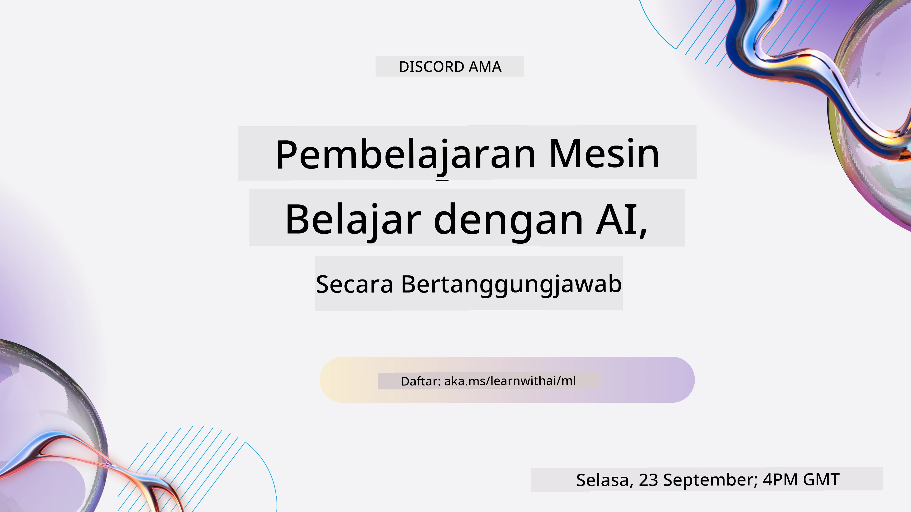
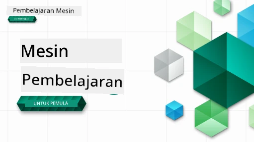

[](https://github.com/microsoft/ML-For-Beginners/blob/master/LICENSE)
[](https://GitHub.com/microsoft/ML-For-Beginners/graphs/contributors/)
[](https://GitHub.com/microsoft/ML-For-Beginners/issues/)
[](https://GitHub.com/microsoft/ML-For-Beginners/pulls/)
[](http://makeapullrequest.com)

[](https://GitHub.com/microsoft/ML-For-Beginners/watchers/)
[](https://GitHub.com/microsoft/ML-For-Beginners/network/)
[](https://GitHub.com/microsoft/ML-For-Beginners/stargazers/)

### 🌐 Sokongan Pelbagai Bahasa

#### Terjemahan dikekalkan dengan [Co-op Translator](https://github.com/Azure/co-op-translator)

<!-- CO-OP TRANSLATOR LANGUAGES TABLE START -->
[Arab](../ar/README.md) | [Bengali](../bn/README.md) | [Bulgaria](../bg/README.md) | [Burmese (Myanmar)](../my/README.md) | [Cina (Ringkas)](../zh-CN/README.md) | [Cina (Tradisional, Hong Kong)](../zh-HK/README.md) | [Cina (Tradisional, Macau)](../zh-MO/README.md) | [Cina (Tradisional, Taiwan)](../zh-TW/README.md) | [Kroasia](../hr/README.md) | [Czech](../cs/README.md) | [Denmark](../da/README.md) | [Belanda](../nl/README.md) | [Estonia](../et/README.md) | [Finland](../fi/README.md) | [Perancis](../fr/README.md) | [Jerman](../de/README.md) | [Greek](../el/README.md) | [Ibrani](../he/README.md) | [Hindi](../hi/README.md) | [Hungary](../hu/README.md) | [Indonesia](../id/README.md) | [Itali](../it/README.md) | [Jepun](../ja/README.md) | [Kannada](../kn/README.md) | [Khmer](../km/README.md) | [Korea](../ko/README.md) | [Lithuania](../lt/README.md) | [Melayu](./README.md) | [Malayalam](../ml/README.md) | [Manipuri (Meitei Mayek)](../mni/README.md) | [Marathi](../mr/README.md) | [Nepali](../ne/README.md) | [Nigeria Pidgin](../pcm/README.md) | [Norwegian](../no/README.md) | [Parsi (Farsi)](../fa/README.md) | [Poland](../pl/README.md) | [Portugis (Brazil)](../pt-BR/README.md) | [Portugis (Portugal)](../pt-PT/README.md) | [Punjabi (Gurmukhi)](../pa/README.md) | [Romania](../ro/README.md) | [Rusia](../ru/README.md) | [Serbia (Sirilik)](../sr/README.md) | [Slovak](../sk/README.md) | [Slovenia](../sl/README.md) | [Sepanyol](../es/README.md) | [Swahili](../sw/README.md) | [Sweden](../sv/README.md) | [Tagalog (Filipina)](../tl/README.md) | [Tamil](../ta/README.md) | [Telugu](../te/README.md) | [Thai](../th/README.md) | [Turki](../tr/README.md) | [Ukrainian](../uk/README.md) | [Urdu](../ur/README.md) | [Vietnamese](../vi/README.md)

> **Lebih suka Salin Secara Tempatan?**
>
> Repositori ini termasuk lebih 50 terjemahan bahasa yang secara signifikan meningkatkan saiz muat turun. Untuk menyalin tanpa terjemahan, gunakan sparse checkout:
>
> **Bash / macOS / Linux:**
> ```bash
> git clone --filter=blob:none --sparse https://github.com/microsoft/ML-For-Beginners.git
> cd ML-For-Beginners
> git sparse-checkout set --no-cone '/*' '!translations' '!translated_images'
> ```
>
> **CMD (Windows):**
> ```cmd
> git clone --filter=blob:none --sparse https://github.com/microsoft/ML-For-Beginners.git
> cd ML-For-Beginners
> git sparse-checkout set --no-cone "/*" "!translations" "!translated_images"
> ```
>
> Ini memberi anda segala yang anda perlukan untuk menyelesaikan kursus dengan muat turun yang lebih cepat.
<!-- CO-OP TRANSLATOR LANGUAGES TABLE END -->

#### Sertai Komuniti Kami

[](https://discord.gg/nTYy5BXMWG)

Kami ada siri Discord belajar dengan AI sedang berjalan, pelajari lebih lanjut dan sertai kami di [Learn with AI Series](https://aka.ms/learnwithai/discord) dari 18 - 30 September, 2025. Anda akan mendapat petua dan trik menggunakan GitHub Copilot untuk Sains Data.



# Pembelajaran Mesin untuk Pemula - Kurikulum

> 🌍 Jelajahi dunia sambil kita meneroka Pembelajaran Mesin melalui budaya dunia 🌍

Para Pemaju Awan di Microsoft dengan gembira menawarkan kurikulum selama 12 minggu, 26 pelajaran yang berkisar tentang **Pembelajaran Mesin**. Dalam kurikulum ini, anda akan belajar mengenai apa yang kadang-kadang dipanggil **pembelajaran mesin klasik**, menggunakan terutamanya perpustakaan Scikit-learn dan mengelakkan pembelajaran mendalam, yang dibahas dalam [kurikulum AI untuk Pemula](https://aka.ms/ai4beginners) kami. Padankan pelajaran ini dengan kurikulum ['Sains Data untuk Pemula'](https://aka.ms/ds4beginners) kami juga!

Jelajahi bersama kami di seluruh dunia ketika kami menerapkan teknik klasik ini pada data dari pelbagai kawasan dunia. Setiap pelajaran termasuk kuiz pra dan pasca pelajaran, arahan bertulis untuk menyelesaikan pelajaran, penyelesaian, tugasan, dan banyak lagi. Pedagogi berasaskan projek kami membolehkan anda belajar sambil membina, cara yang terbukti untuk kemahiran baru ‘melekat’.

**✍️ Terima kasih yang tulus kepada penulis kami** Jen Looper, Stephen Howell, Francesca Lazzeri, Tomomi Imura, Cassie Breviu, Dmitry Soshnikov, Chris Noring, Anirban Mukherjee, Ornella Altunyan, Ruth Yakubu dan Amy Boyd

**🎨 Terima kasih juga kepada ilustrator kami** Tomomi Imura, Dasani Madipalli, dan Jen Looper

**🙏 Terima kasih khas 🙏 kepada Microsoft Student Ambassador penulis, penilai, dan penyumbang kandungan kami**, terutamanya Rishit Dagli, Muhammad Sakib Khan Inan, Rohan Raj, Alexandru Petrescu, Abhishek Jaiswal, Nawrin Tabassum, Ioan Samuila, dan Snigdha Agarwal

**🤩 Penghargaan tambahan kepada Microsoft Student Ambassadors Eric Wanjau, Jasleen Sondhi, dan Vidushi Gupta untuk pelajaran R kami!**

# Memulakan

Ikuti langkah berikut:
1. **Fork Repositori**: Klik butang "Fork" di sudut kanan atas halaman ini.
2. **Salin Repositori**:   `git clone https://github.com/microsoft/ML-For-Beginners.git`

> 💡 **Tip Mula Cepat:** Mahu mula dalam penyemak imbas tanpa memasang Python secara tempatan? Gunakan [GitHub Codespaces](https://github.com/features/codespaces) untuk mencipta persekitaran pembangunan awan bagi fork anda. Buka menu hijau **Code**, pilih **Codespaces**, dan cipta sebuah codespace; pasang setiap kebergantungan pelajaran di dalamnya mengikut keperluan.

> [temui semua sumber tambahan untuk kursus ini dalam koleksi Microsoft Learn kami](https://learn.microsoft.com/en-us/collections/qrqzamz1nn2wx3?WT.mc_id=academic-77952-bethanycheum)

> 🔧 **Perlukan bantuan?** Semak [Panduan Penyelesaian Masalah](TROUBLESHOOTING.md) kami untuk penyelesaian isu biasa mengenai pemasangan, persediaan, dan menjalankan pelajaran.


**[Pelajar](https://aka.ms/student-page)**, untuk menggunakan kurikulum ini, buat fork repo keseluruhan ke akaun GitHub anda dan selesaikan latihan secara sendiri atau dalam kumpulan:

- Mula dengan kuiz pra-ceramah.
- Baca ceramah dan selesaikan aktiviti, berhenti dan fikirkan pada setiap pemeriksaan pengetahuan.
- Cuba buat projek dengan memahami pelajaran bukannya menjalankan kod penyelesaian; namun kod tersebut tersedia dalam folder `/solution` dalam setiap pelajaran berorientasikan projek.
- Ambil kuiz pasca-ceramah.
- Selesaikan cabaran.
- Selesaikan tugasan.
- Selepas melengkapkan kumpulan pelajaran, lawati [Papan Perbincangan](https://github.com/microsoft/ML-For-Beginners/discussions) dan "belajar secara terbuka" dengan mengisi rubrik PAT yang sesuai. 'PAT' adalah Alat Penilaian Kemajuan yang merupakan rubrik yang anda isi untuk meningkatkan pembelajaran. Anda juga boleh memberi reaksi kepada PAT lain supaya kita boleh belajar bersama.

> Untuk pembelajaran lanjut, kami mencadangkan mengikuti modul dan laluan pembelajaran [Microsoft Learn](https://docs.microsoft.com/en-us/users/jenlooper-2911/collections/k7o7tg1gp306q4?WT.mc_id=academic-77952-leestott) ini.

**Guru**, kami telah [menyediakan beberapa cadangan](for-teachers.md) tentang cara menggunakan kurikulum ini.

---

## Video panduan

Beberapa pelajaran tersedia dalam bentuk video ringkas. Anda boleh menemui semua ini selari dalam pelajaran, atau di [senarai main ML untuk Pemula di saluran Microsoft Developer YouTube](https://aka.ms/ml-beginners-videos) dengan mengklik imej di bawah.

[](https://aka.ms/ml-beginners-videos)

---

## Kenali Pasukan

[](https://youtu.be/Tj1XWrDSYJU)

**Gif oleh** [Mohit Jaisal](https://linkedin.com/in/mohitjaisal)

> 🎥 Klik imej di atas untuk video mengenai projek dan orang yang menciptakannya!

---

## Pedagogi

Kami telah memilih dua prinsip pedagogi semasa membina kurikulum ini: memastikan ia berasaskan **projek praktikal** dan termasuk **kuiz kerap**. Di samping itu, kurikulum ini mempunyai **tema** umum untuk memberikan kesatuan.

Dengan memastikan kandungan selaras dengan projek, proses menjadi lebih menarik bagi pelajar dan pengingatan konsep akan bertambah baik. Selain itu, kuiz dengan risiko rendah sebelum kelas menetapkan niat pelajar untuk mempelajari topik, manakala kuiz kedua selepas kelas memastikan pengingatan berterusan. Kurikulum ini direka untuk fleksibel dan menyeronokkan dan boleh diikuti secara keseluruhan atau sebahagian. Projek bermula kecil dan semakin kompleks menjelang akhir kitaran 12 minggu. Kurikulum ini juga termasuk posskrip tentang aplikasi dunia sebenar ML, yang boleh digunakan sebagai kredit tambahan atau asas untuk perbincangan.

> Cari [Kod Etika](CODE_OF_CONDUCT.md), [Menyumbang](CONTRIBUTING.md), [Terjemahan](..), dan garis panduan [Penyelesaian Masalah](TROUBLESHOOTING.md) kami. Kami mengalu-alukan maklum balas yang membina!

## Setiap pelajaran merangkumi

- nota lakaran pilihan
- video tambahan pilihan
- video panduan (hanya beberapa pelajaran)
- [kuiz pemanasan pra-ceramah](https://ff-quizzes.netlify.app/en/ml/)
- pelajaran bertulis
- untuk pelajaran berasaskan projek, panduan langkah demi langkah cara membina projek
- pemeriksaan pengetahuan
- cabaran
- bacaan tambahan
- tugasan
- [kuiz pasca-ceramah](https://ff-quizzes.netlify.app/en/ml/)

> **Nota tentang bahasa**: Pelajaran-pelajaran ini kebanyakannya ditulis dalam Python, tetapi banyak juga tersedia dalam R. Untuk menyelesaikan pelajaran R, pergi ke folder `/solution` dan cari pelajaran R. Mereka termasuk sambungan .rmd yang mewakili fail **R Markdown** yang boleh didefinisikan sebagai gabungan `code chunks` (R atau bahasa lain) dan `YAML header` (yang mengatur bagaimana output seperti PDF diformat) dalam `Markdown document`. Oleh itu, ia berfungsi sebagai rangka kerja penulisan contoh bagi sains data kerana membolehkan anda menggabungkan kod anda, outputnya, dan pemikiran anda dengan menulisnya dalam Markdown. Selain itu, dokumen R Markdown boleh dihasilkan kepada format output seperti PDF, HTML, atau Word.

> **Nota tentang kuiz**: Semua kuiz terdapat dalam [folder Aplikasi Kuiz](../../quiz-app), dengan 52 kuiz sejumlah tiga soalan setiap satu. Mereka dipautkan dari dalam pelajaran tetapi aplikasi kuiz boleh dijalankan secara tempatan; ikut arahan dalam folder `quiz-app` untuk hos tempatan atau penerapan ke Azure.

| Nombor Pelajaran |                             Topik                              |                   Pengelompokan Pelajaran                   | Objektif Pembelajaran                                                                                                             |                                                              Pelajaran Berkaitan                                                               |                        Pengarang                        |
| :-----------: | :------------------------------------------------------------: | :-------------------------------------------------: | ------------------------------------------------------------------------------------------------------------------------------- | :--------------------------------------------------------------------------------------------------------------------------------------: | :--------------------------------------------------: |
|      01       |                Pengenalan kepada pembelajaran mesin                |      [Pengenalan](1-Introduction/README.md)       | Belajar konsep asas di sebalik pembelajaran mesin                                                                                |                                             [Pelajaran](1-Introduction/1-intro-to-ML/README.md)                                             |                       Muhammad                       |
|      02       |                Sejarah pembelajaran mesin                 |      [Pengenalan](1-Introduction/README.md)       | Belajar sejarah yang mendasari bidang ini                                                                                         |                                            [Pelajaran](1-Introduction/2-history-of-ML/README.md)                                            |                     Jen dan Amy                      |
|      03       |                 Keadilan dan pembelajaran mesin                  |      [Pengenalan](1-Introduction/README.md)       | Apakah isu falsafah penting mengenai keadilan yang harus dipertimbangkan oleh pelajar ketika membina dan menggunakan model ML? |                                              [Pelajaran](1-Introduction/3-fairness/README.md)                                               |                        Tomomi                        |
|      04       |                Teknik untuk pembelajaran mesin                 |      [Pengenalan](1-Introduction/README.md)       | Teknik apa yang digunakan oleh penyelidik ML untuk membina model ML?                                                                       |                                          [Pelajaran](1-Introduction/4-techniques-of-ML/README.md)                                           |                    Chris dan Jen                     |
|      05       |                   Pengenalan kepada regresi                   |        [Regresi](2-Regression/README.md)         | Mulakan dengan Python dan Scikit-learn untuk model regresi                                                                  |         [Python](2-Regression/1-Tools/README.md) • [R](../../2-Regression/1-Tools/solution/R/lesson_1.html)         |      Jen • Eric Wanjau       |
|      06       |                Harga labu Amerika Utara 🎃                |        [Regresi](2-Regression/README.md)         | Visualisasikan dan bersihkan data sebagai persiapan untuk ML                                                                                  |          [Python](2-Regression/2-Data/README.md) • [R](../../2-Regression/2-Data/solution/R/lesson_2.html)          |      Jen • Eric Wanjau       |
|      07       |                Harga labu Amerika Utara 🎃                |        [Regresi](2-Regression/README.md)         | Bina model regresi linear dan polinomial                                                                                   |        [Python](2-Regression/3-Linear/README.md) • [R](../../2-Regression/3-Linear/solution/R/lesson_3.html)        |      Jen dan Dmitry • Eric Wanjau       |
|      08       |                Harga labu Amerika Utara 🎃                |        [Regresi](2-Regression/README.md)         | Bina model regresi logistik                                                                                               |     [Python](2-Regression/4-Logistic/README.md) • [R](../../2-Regression/4-Logistic/solution/R/lesson_4.html)      |      Jen • Eric Wanjau       |
|      09       |                          Aplikasi Web 🔌                          |           [Aplikasi Web](3-Web-App/README.md)            | Bina aplikasi web untuk menggunakan model terlatih anda                                                                                       |                                                 [Python](3-Web-App/1-Web-App/README.md)                                                  |                         Jen                          |
|      10       |                 Pengenalan kepada pengelasan                 |    [Pengelasan](4-Classification/README.md)     | Bersihkan, sediakan, dan visualisasikan data anda; pengenalan kepada pengelasan                                                            | [Python](4-Classification/1-Introduction/README.md) • [R](../../4-Classification/1-Introduction/solution/R/lesson_10.html)  | Jen dan Cassie • Eric Wanjau |
|      11       |             Masakan Asia dan India yang lazat 🍜             |    [Pengelasan](4-Classification/README.md)     | Pengenalan kepada pengelas                                                                                                     | [Python](4-Classification/2-Classifiers-1/README.md) • [R](../../4-Classification/2-Classifiers-1/solution/R/lesson_11.html) | Jen dan Cassie • Eric Wanjau |
|      12       |             Masakan Asia dan India yang lazat 🍜             |    [Pengelasan](4-Classification/README.md)     | Pengelas lebih lanjut                                                                                                                | [Python](4-Classification/3-Classifiers-2/README.md) • [R](../../4-Classification/3-Classifiers-2/solution/R/lesson_12.html) | Jen dan Cassie • Eric Wanjau |
|      13       |             Masakan Asia dan India yang lazat 🍜             |    [Pengelasan](4-Classification/README.md)     | Bina aplikasi web pencadangan menggunakan model anda                                                                                    |                                              [Python](4-Classification/4-Applied/README.md)                                              |                         Jen                          |
|      14       |                   Pengenalan kepada pengelompokan                   |        [Pengelompokan](5-Clustering/README.md)         | Bersihkan, sediakan, dan visualisasikan data anda; Pengenalan kepada pengelompokan                                                                |         [Python](5-Clustering/1-Visualize/README.md) • [R](../../5-Clustering/1-Visualize/solution/R/lesson_14.html)         |      Jen • Eric Wanjau       |
|      15       |              Meneroka Selera Muzik Nigeria 🎧              |        [Pengelompokan](5-Clustering/README.md)         | Terokai kaedah pengelompokan K-Means                                                                                           |           [Python](5-Clustering/2-K-Means/README.md) • [R](../../5-Clustering/2-K-Means/solution/R/lesson_15.html)           |      Jen • Eric Wanjau       |
|      16       |        Pengenalan kepada pemprosesan bahasa semulajadi ☕️         |   [Pemprosesan bahasa semulajadi](6-NLP/README.md)    | Belajar asas tentang NLP dengan membina bot mudah                                                                             |                                             [Python](6-NLP/1-Introduction-to-NLP/README.md)                                              |                       Stephen                        |
|      17       |                      Tugas NLP biasa ☕️                      |   [Pemprosesan bahasa semulajadi](6-NLP/README.md)    | Mendalami pengetahuan NLP anda dengan memahami tugas biasa yang diperlukan ketika berurusan dengan struktur bahasa                          |                                                    [Python](6-NLP/2-Tasks/README.md)                                                     |                       Stephen                        |
|      18       |             Terjemahan dan analisis sentimen ♥️              |   [Pemprosesan bahasa semulajadi](6-NLP/README.md)    | Terjemahan dan analisis sentimen dengan Jane Austen                                                                             |                                            [Python](6-NLP/3-Translation-Sentiment/README.md)                                             |                       Stephen                        |
|      19       |                  Hotel romantik di Eropah ♥️                  |   [Pemprosesan bahasa semulajadi](6-NLP/README.md)    | Analisis sentimen menggunakan ulasan hotel 1                                                                                         |                                               [Python](6-NLP/4-Hotel-Reviews-1/README.md)                                                |                       Stephen                        |
|      20       |                  Hotel romantik di Eropah ♥️                  |   [Pemprosesan bahasa semulajadi](6-NLP/README.md)    | Analisis sentimen menggunakan ulasan hotel 2                                                                                         |                                               [Python](6-NLP/5-Hotel-Reviews-2/README.md)                                                |                       Stephen                        |
|      21       |            Pengenalan kepada peramalan siri masa             |        [Siri masa](7-TimeSeries/README.md)        | Pengenalan kepada peramalan siri masa                                                                                         |                                             [Python](7-TimeSeries/1-Introduction/README.md)                                              |                      Francesca                       |
|      22       | ⚡️ Penggunaan Kuasa Dunia ⚡️ - peramalan siri masa dengan ARIMA |        [Siri masa](7-TimeSeries/README.md)        | Peramalan siri masa dengan ARIMA                                                                                              |                                                 [Python](7-TimeSeries/2-ARIMA/README.md)                                                 |                      Francesca                       |
|      23       |  ⚡️ Penggunaan Kuasa Dunia ⚡️ - peramalan siri masa dengan SVR  |        [Siri masa](7-TimeSeries/README.md)        | Peramalan siri masa dengan Support Vector Regressor                                                                           |                                                  [Python](7-TimeSeries/3-SVR/README.md)                                                  |                       Anirban                        |
|      24       |             Pengenalan kepada pembelajaran penguatan             | [Pembelajaran penguatan](8-Reinforcement/README.md) | Pengenalan kepada pembelajaran penguatan dengan Q-Learning                                                                          |                                             [Python](8-Reinforcement/1-QLearning/README.md)                                              |                        Dmitry                        |
|      25       |                 Bantu Peter elak serigala! 🐺                  | [Pembelajaran penguatan](8-Reinforcement/README.md) | Gim pembelajaran penguatan                                                                                                      |                                                [Python](8-Reinforcement/2-Gym/README.md)                                                 |                        Dmitry                        |
|  Catatan Akhir   |            Senario dan aplikasi ML Dunia Sebenar            |      [ML di Luar](9-Real-World/README.md)       | Aplikasi dunia sebenar yang menarik dan mendedahkan pembelajaran mesin klasik                                                               |                                             [Pelajaran](9-Real-World/1-Applications/README.md)                                              |                         Pasukan                         |
|  Catatan Akhir   |            Penyahpepijatan Model dalam ML menggunakan papan pemuka RAI            |      [ML di Luar](9-Real-World/README.md)       | Penyahpepijatan Model dalam Pembelajaran Mesin menggunakan komponen papan pemuka AI Bertanggungjawab                                                              |                                             [Pelajaran](9-Real-World/2-Debugging-ML-Models/README.md)                                              |                     Ruth Yakubu                      |

> [cari semua sumber tambahan untuk kursus ini dalam koleksi Microsoft Learn kami](https://learn.microsoft.com/en-us/collections/qrqzamz1nn2wx3?WT.mc_id=academic-77952-bethanycheum)

## Akses Luar Talian

Anda boleh menjalankan dokumentasi ini secara luar talian dengan menggunakan [Docsify](https://docsify.js.org/#/). Fork repositori ini, [pasang Docsify](https://docsify.js.org/#/quickstart) pada mesin tempatan anda, dan kemudian di folder root repositori ini, taip `docsify serve`. Laman web akan dihidangkan pada port 3000 di localhost anda: `localhost:3000`.

## PDF

Cari pdf kurikulum dengan pautan [di sini](https://microsoft.github.io/ML-For-Beginners/pdf/readme.pdf).


## 🎒 Kursus Lain 

Pasukan kami menghasilkan kursus lain! Semak:

<!-- CO-OP TRANSLATOR OTHER COURSES START -->
### LangChain
[](https://aka.ms/langchain4j-for-beginners)
[](https://aka.ms/langchainjs-for-beginners?WT.mc_id=m365-94501-dwahlin)
[](https://github.com/microsoft/langchain-for-beginners?WT.mc_id=m365-94501-dwahlin)
---

### Azure / Edge / MCP / Ejen
[](https://github.com/microsoft/AZD-for-beginners?WT.mc_id=academic-105485-koreyst)
[](https://github.com/microsoft/edgeai-for-beginners?WT.mc_id=academic-105485-koreyst)
[](https://github.com/microsoft/mcp-for-beginners?WT.mc_id=academic-105485-koreyst)
[](https://github.com/microsoft/ai-agents-for-beginners?WT.mc_id=academic-105485-koreyst)

---
 
### Siri Generative AI
[](https://github.com/microsoft/generative-ai-for-beginners?WT.mc_id=academic-105485-koreyst)
[-9333EA?style=for-the-badge&labelColor=E5E7EB&color=9333EA)](https://github.com/microsoft/Generative-AI-for-beginners-dotnet?WT.mc_id=academic-105485-koreyst)
[-C084FC?style=for-the-badge&labelColor=E5E7EB&color=C084FC)](https://github.com/microsoft/generative-ai-for-beginners-java?WT.mc_id=academic-105485-koreyst)
[-E879F9?style=for-the-badge&labelColor=E5E7EB&color=E879F9)](https://github.com/microsoft/generative-ai-with-javascript?WT.mc_id=academic-105485-koreyst)

---
 
### Pembelajaran Teras
[](https://aka.ms/ml-beginners?WT.mc_id=academic-105485-koreyst)
[](https://aka.ms/datascience-beginners?WT.mc_id=academic-105485-koreyst)
[](https://aka.ms/ai-beginners?WT.mc_id=academic-105485-koreyst)
[](https://github.com/microsoft/Security-101?WT.mc_id=academic-96948-sayoung)
[](https://aka.ms/webdev-beginners?WT.mc_id=academic-105485-koreyst)
[](https://aka.ms/iot-beginners?WT.mc_id=academic-105485-koreyst)
[](https://github.com/microsoft/xr-development-for-beginners?WT.mc_id=academic-105485-koreyst)

---
 
### Siri Copilot
[](https://aka.ms/GitHubCopilotAI?WT.mc_id=academic-105485-koreyst)
[](https://github.com/microsoft/mastering-github-copilot-for-dotnet-csharp-developers?WT.mc_id=academic-105485-koreyst)
[](https://github.com/microsoft/CopilotAdventures?WT.mc_id=academic-105485-koreyst)
<!-- CO-OP TRANSLATOR OTHER COURSES END -->

## Mendapatkan Bantuan

Jika anda tersekat atau mempunyai soalan semasa mempelajari Pembelajaran Mesin atau membina aplikasi AI, jangan risau — bantuan tersedia.

Anda boleh menyertai perbincangan dengan pelajar dan pembangun lain, bertanya soalan, dan berkongsi idea anda dengan komuniti.

- Sertai komuniti untuk bertanya soalan dan belajar bersama orang lain
- Bincangkan konsep dan idea projek Pembelajaran Mesin
- Dapatkan panduan dari pembangun berpengalaman

Komuniti yang menyokong adalah cara terbaik untuk mengembangkan kemahiran anda dan menyelesaikan masalah dengan lebih cepat.

[Komuniti Discord Microsoft Foundry](https://discord.gg/nTYy5BXMWG)

Jika anda menjumpai pepijat, ralat, atau mempunyai cadangan untuk penambahbaikan, anda juga boleh membuka **Isu** dalam repositori ini untuk melaporkan masalah tersebut.

Untuk maklum balas produk atau mencari pos komuniti sedia ada, lawati Forum Pembangun:

[](https://aka.ms/foundry/forum)

## Tips Pembelajaran Tambahan

- Semak buku nota selepas setiap pelajaran untuk pemahaman yang lebih baik.
- Amalkan melaksanakan algoritma sendiri.
- Terokai set data dunia sebenar menggunakan konsep yang dipelajari.

---

<!-- CO-OP TRANSLATOR DISCLAIMER START -->
**Penafian**:
Dokumen ini telah diterjemahkan menggunakan perkhidmatan terjemahan AI [Co-op Translator](https://github.com/Azure/co-op-translator). Walaupun kami berusaha untuk ketepatan, sila ambil maklum bahawa terjemahan automatik mungkin mengandungi kesilapan atau ketidaktepatan. Dokumen asal dalam bahasa asalnya harus dianggap sebagai sumber yang sahih. Untuk maklumat penting, terjemahan oleh manusia profesional adalah disyorkan. Kami tidak bertanggungjawab terhadap sebarang salah faham atau salah tafsir yang timbul daripada penggunaan terjemahan ini.
<!-- CO-OP TRANSLATOR DISCLAIMER END -->