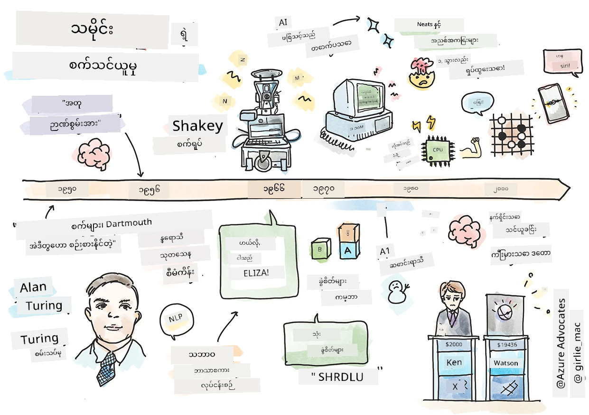
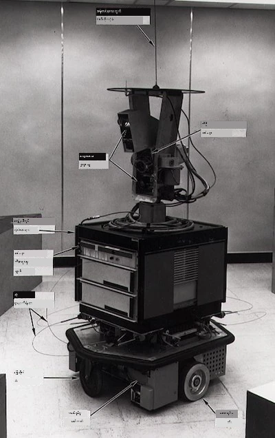
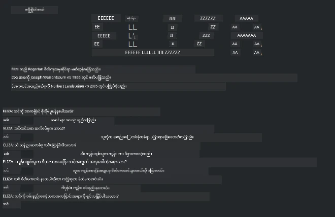

# စက်သင်ယူမှု၏ ရာဇဝင်

> Sketchnote by [Tomomi Imura](https://www.twitter.com/girlie_mac)

## [စာသင်ခန်းမမတိုင်မီ စမ်းသပ်မှု](https://ff-quizzes.netlify.app/en/ml/)

---

> 🎥 ဤသင်ခန်းစာကို ဖြတ်သန်း လေ့လာရန်အတွက် အပေါ်မှ ပုံကို နှိပ်ပါ။

ဤသင်ခန်းစာတွင် သက်ဆိုင်ရာ စက်လေ့လာမှုနှင့် အတုအယောင်အတွင်း ခေတ်ပြိုင်လမ်းကြောင်းအရေးကြီးချက်များကို ခရီးသွားကြမည်ဖြစ်သည်။

အတုအယောင် (AI) ၏ သမိုင်းဟာ စက်လေ့လာမှု၏ သမိုင်းနှင့် ပေါင်းသင်းနေကြသည်၊ စက်လေ့လာမှု၏ အခြေခံသော အဲလ်ဂိုရီသမ်များနှင့် ကြံ့ခိုင်မှုများသည် AI ဖွံ့ဖြိုးတိုးတက်မှုအတွက် အထောက်အပံ့ဖြစ်သည်။ 1950 ခုနှစ်များတွင် သန့်ရှင်းစွာ ခွဲခြားထားသော လေ့လာမှုနယ်ပယ်များ ဖြစ်ပေါ်ခဲ့ပေမယ့် အရေးကြီးသော [အဲလ်ဂိုရီသမ်၊ စာရင်းအင်း၊ သင်္ချာ၊ တွက်ချက်မှုနှင့် နည်းပညာဆိုင်ရာ ရှာဖွေတွေ့ရှိမှုများ](https://wikipedia.org/wiki/Timeline_of_machine_learning) သည် ဤကာလမတိုင်မီ လွန်ခဲ့သည်။ လူတွေသည် [ရာစုနှစ်များစွာ](https://wikipedia.org/wiki/History_of_artificial_intelligence) ကြာအောင် ထိုအကြောင်းအရာများကို စဉ်းစားနေကြသည်။ ဤဆောင်းပါးတွင် 'စဉ်းစားတတ်သော စက်' အကြောင်း၏ သမိုင်းဆိုင်ရာ ဉာဏ်ပညာအခြေခံများအား ဆွေးနွေးထားသည်။

---
## အရေးကြီးသော ရှာဖွေတွေ့ရှိမှုများ

- 1763, 1812 [Bayes Theorem](https://wikipedia.org/wiki/Bayes%27_theorem) နှင့် ၎င်း၏မူလပုံစံများ။ ဤသီအိုရီနှင့် ၎င်း၏အသုံးချမှုများသည် ခန့်မှန်းချက်များ အတွက် အခြေခံဖြစ်ပြီး ဖြစ်နိုင်ခြေများကို ရှင်းပြသည်။
- 1805 ဖရန်စီမြက် သင်္ချာပညာရှင် Adrien-Marie Legendre ၏ [နိမ့်ဆုံး မျဉ်းများအလျှောက် သီအိုရီ](https://wikipedia.org/wiki/Least_squares)။ ဤသီအိုရီကို ကျွန်ုပ်တို့၏ Regression အပိုင်းတွင် လေ့လာမည်ဖြစ်ပြီး ဒေတာကို ကိုက်ညီစေသည်။
- 1913 [Markov Chains](https://wikipedia.org/wiki/Markov_chain) သည် ရုရှား သင်္ချာပညာရှင် Andrey Markov ၏ အမည်ဖြင့် ခေါ်ဆိုပြီး နောက်ဆုံးအခြေအနေပေါ် မူတည်၍ ဖြစ်နိုင်သော ဖြစ်ရပ်လမ်းကြောင်းများကို ဖော်ပြသည်။
- 1957 [Perceptron](https://wikipedia.org/wiki/Perceptron) သည် အမေရိကန် စိတ်ပညာရှင် Frank Rosenblatt က ထုတ်လုပ်တီထွင်ခဲ့သည့် လျှပ်စစ်ကြားမဲ့ကျပ်တည်းသော အသုံးပြုသူအမျိုးအစားဖြစ်ပြီး နက်ရှိုင်းသိမြင်မှု တိုးတက်မှုအတွက် အခြေခံသည်။

---

- 1967 [Nearest Neighbor](https://wikipedia.org/wiki/Nearest_neighbor) သည် မူလအားဖြင့် လမ်းကြောင်း များကို ရှာဖွေဖို့ ဒီဇိုင်းဆွဲထားသော အဲလ်ဂိုရီသမ်ဖြစ်သည်။ ML ပတ်ဝန်းကျင်တွင် မျိုးစုံ ပုံစံများကို ဖော်ထုတ်ရရှိရန် အသုံးပြုသည်။
- 1970 [Backpropagation](https://wikipedia.org/wiki/Backpropagation) သည် [feedforward neural networks](https://wikipedia.org/wiki/Feedforward_neural_network) ကို လေ့ကျင့်ရန် အသုံးပြုသည်။
- 1982 [Recurrent Neural Networks](https://wikipedia.org/wiki/Recurrent_neural_network) သည် feedforward neural networks မှ ထွက်ပေါ်လာသော ကွန်ပျူတာအကြောင်းအရာများစွာကို ဖန်တီးသော အတုအယောင်နယူးရယ် ကြွန်ယက်များဖြစ်သည်။

✅ သင့်စိတ်ဝင်စားရာ အနည်းငယ်သာ ရှာဖွေရန် လေ့လာကြည့်ပါ။ ML နှင့် AI ၏ သမိုင်းဆုံးဖြတ်ရက်များထဲ တွင် ဘာတွေ ထူးခြားသလဲကြည့်ပါ။

---
## 1950: စဉ်းစားတတ်သော စက်များ

20 ရာစု၏ ထိပ်တန်း သိပ္ပံပညာရှင်အဖြစ် 2019 မှာ [ပြည်သူများက မဲပေးခဲ့သော](https://wikipedia.org/wiki/Icons:_The_Greatest_Person_of_the_20th_Century) အံ့သြဖွယ် အတုအယောင်ညာတစ်ဦးဖြစ်သော Alan Turing သည် 'စဉ်းစားတတ်သောစက်' အကြောင်း၏ အခြေခံကို ဖွဲ့စည်းရာတွင် အရေးပါသောသူဖြစ်သည်။ သူသည် ဤအယူအဆအတွက် သက်သေများကို ရှာဖွေမည်ဖြစ်ပြီး [Turing Test](https://www.bbc.com/news/technology-18475646) ကဲ့သို့ စမ်းသပ်မှုကို ဖန်တီးခဲ့သည်၊ ၎င်းအား ကျွန်ုပ်တို့၏ NLP သင်ခန်းစာများတွင် လေ့လာနိုင်မည်။

---
## 1956: Dartmouth နွေရာသီ လေ့လာမှု စီမံကိန်း

"Dartmouth နွေရာသီ လေ့လာမှု စီမံကိန်းသည် အတုအယောင်နယ်ပယ်အတွက် အရေးပါသော ဖြစ်စဉ်တစ်ခုဖြစ်သည်" ဟု ဆိုပြီး ဤနေရာတွင် 'အတုအယောင်' လို့ခေါ်သော စကားလုံးကို စတင်အသုံးချခဲ့သည် ([အရင်းအမြစ်](https://250.dartmouth.edu/highlights/artificial-intelligence-ai-coined-dartmouth))။

> စlearn နည်းနှင့် ဘာတော့တွေအားလုံးကို စက်တစ်လုံးတည်ဆောက်၍ ကိုယ့်အလားအလာအတွက် စက်သည် အတုယူနိုင်အောင် မှန်ကန်စွာ ဖော်ပြနိုင်သည်။

---

ဦးဆောင်သုတေသနဆရာမ ဂျွန် McCarthy သည် " စlearn နည်းနှင့် အဆင့်မြှင့်တာဝန်များအားလုံးကို မှန်ကန်စွာ ဖော်ပြနိုင်မည်ဟု ယုံကြည်ချက်အခြေခံထားပြီး စက်များကို အတုယူစေမည်" ဟူ၍ မျှော်မှန်းခဲ့သည်။ ပါဝင်သူများအနက် Marvin Minsky လည်း ပါဝင်သည်။

ဤလုပ်ရပ်သည် "သင်္ချာဆိုင်ရာ နည်းလမ်းအသစ်များ၊ အကန့်အသတ်ရှိသော နယ်ပယ်များအတွင်း စနစ်များ (အစောပိုင်း ကျွမ်းကျင်သူ စနစ်များ) နှင့် စနစ်ကောင်းမှုများနှင့် လူ့အတွင်းသို့ တိုက်ရိုက်ရောက်ရှိမှုစနစ်များ" စသည့် ဆွေးနွေးမှုများကို စတင် အားပေးအောင်မြင်ခဲ့သည် ဟုဆိုသည် ([အရင်းအမြစ်](https://wikipedia.org/wiki/Dartmouth_workshop))။

---
## 1956 - 1974: "ရွှေသာ ရာစုများ"

1950 ခုနှစ်များမှ 1970 ပြည့်နှစ်များအထိ AI မှာ အလွန်မြင့်မားသော မျှော်လင့်ချက်များဖြစ်ပြီး 1967 တွင် Marvin Minsky က "တစ်မျိုးဆက်အတွင်း... 'အတုအယောင်' ပြဿနာများမှာ အဖြေရှာနိုင်မည်" ဟု ယုံကြည်ချက်ပြုခဲ့သည်။ (Minsky, Marvin (1967), Computation: Finite and Infinite Machines, Englewood Cliffs, N.J.: Prentice-Hall)

သဘာဝဘာသာစကား ကိုင်တွယ်မှု လေ့လာမှုများ တိုးတက်မှုပြင်းပြပြီး ရှာဖွေမှုများ ပို၍ အားကြီးလာကာ 'micro-worlds' ဆိုသော အတွေးအခေါ်များ ဖန်တီးသည်၊ ဤနေရာတွင် လွယ်ကူသော လုပ်ငန်းများကို ကျပိုင်းစာအတိုင်း ပြီးမြောက်သည်။

---

သုတေသန နယ်ပယ်သည် အစိုးရအဖွဲ့အစည်းများမှ ငွေကြေး အထောက်အပံ့ကောင်းစွာ ရရှိကာ တွက်ချက်မှုနှင့် အဲလ်ဂိုရီသမ်များ တိုးတတ်ကာ ရှိသော စက်များကို ဖန်တီးခဲ့သည်။ ထို့အနက်မှာ -

* [Shakey the robot](https://wikipedia.org/wiki/Shakey_the_robot) သည် စက်တစ်လုံးဟာ လမ်းလျှောက်ကစားနိုင်ပြီး ရှေ့နေစွာ နည်းလမ်းရွေးချယ်နိုင်သည်။

    
    > 1972 တွင် Shakey

---

* Eliza သည် ရှေးအချိန် 'ချတိဗော့' တစ်ခုဖြစ်ပြီး လူနှင့် စကားပြောနိုင်ကာ မူလက်ခြင်း ဆေးကုသရေးအဖြစ် လုပ်ဆောင်ခဲ့သည်။ Eliza ကို NLP သင်ခန်းစာများတွင် ပိုမိုလေ့လာမည်။

    
    > Eliza ၏ ဗားရှင်းတစ်ခု၊ chatbot ဖြစ်သည်

---

* "Blocks world" သည် block များကို ထိုးတက်၊ စနစ်တကျ စီစဉ်နိုင်ပြီး စက်များကို ဆုံးဖြတ်ချက်များ လေ့ကျင့်သင်ကြားခြင်းကို စမ်းသပ်နိုင်သော နည်းလမ်းဖြစ်သည်။ [SHRDLU](https://wikipedia.org/wiki/SHRDLU) က စာသား ကိုင်တွယ်မှုကို တိုးတက်စေခဲ့သည်။

    

    > 🎥 အပေါ်ပုံကိုနှိပ်ပြီး ဗီဒီယိုကြည့်ပါ: Blocks world with SHRDLU

---
## 1974 - 1980: "AI ဆောင်းရာသီ"

1970s နောက်ပိုင်းတွင် 'အတုအယောင် စက်များ' အဖွဲ့ကို ဖန်တီးရခြင်းသည် ခက်ခဲမှုများ များပြားလာပြီး စွမ်းအားများလည်း သိသိသာသာ ပြည့်မပြည့်ဖြစ်နေခြင်းကြောင့် လျော့နည်းလာသည်။ ငွေကြေးထောက်ပံ့မှုများလည်း ကာကွယ်ပြီး နယ်ပယ်အပေါ် ယုံကြည်မှုများလည်း နည်းပါးလာသည်။ ယုံကြည်မှုကို ထိခိုက်စေသော အကြောင်းများမှာ -
---
- **ကန့်သတ်ချက်များ**. ကြည့်အားထုတ်လုပ်မှု နှင့်စွမ်းဆောင်မှု နည်းပါးမှု။
- **ပေါင်းစပ် ခြင်း ဆင်ခြင်မှု**. စနစ်များ သင်ကြားရန် လိုအပ်သော အချက်အလက်များ များပြားလာသဖြင့် ကြည့်အားနှင့် စွမ်းဆောင်မှု မတိုးတက်ခြင်း။
- **ဒေတာလျော့ပါးမှု**. စမ်းသပ်မှု၊ ဖွံ့ဖြိုးတိုးတက်မှုနှင့် သတ္တိပြုပြင်မှုကို ကန့်သတ်မှု ရှိသော အချက်အလက်လျော့ပါးမှု။
- **မေးလေရာ ထောက်ပြချက်များ**။ မေးခွန်းများကို ကိုယ်တိုင်မေးခွန်းထဲ တွင် မည်သည့်မေးခွန်းမှန်ကန်သလဲ ဆိုတာကို သုတေသနသူများမှ မေးခွန်းထုတ် စတင်ခဲ့သည်။ 
  - Turing စမ်းသပ်မှုသည် 'ထိပ်ပေါ်အခန်း ကိုးရီးယား' သက်သေများဖြင့် စွပ်စွဲခံရခဲ့ပြီး "ဒစ်ဂျစ်တယ် ကွန်ပျူတာအစီအစဉ်များသည် ဘာသာစကားနားလည်ရန် မည်သို့ဆောင်ရွက်ပေမယ့် တကယ်နားလည်မှု မရှိပဲ ဖော်ပြနိုင်သည်" ဟူ၍ မှော်အား ဆန့်ကျင်ချက်ခံရသည်။ ([အရင်းအမြစ်](https://plato.stanford.edu/entries/chinese-room/))
  - "therapist" ELIZA ကဲ့သို့ အတုအယောင်များအား လူ့အသိုင်းအဝိုင်းထဲ ထည့်သွင်းခြင်း၏ သရုပ်ပြနှင့် အကျိုးဆက်များကို တောင်းဆိုခံခဲ့ရသည်။

---

ထိုအချိန်အတွင်း AI ဆိုင်ရာ အမွေးပညာ အမျိုးမျိုး ဖွဲ့စည်းလာပြီး ["ချော်တက်သော" နဲ့ "စနစ်တကျသော AI"](https://wikipedia.org/wiki/Neats_and_scruffies) ဆိုသော နှစ်ဖက်ခွဲခွားမှု ဖြစ်ပေါ်လာသည်။ _ချော်တက်သော_ လက်စ်များသည် လိုအပ်သည့် ရလဒ်ရအောင် နာရီပေါင်းများစွာ အစီအစဉ်များကို ပြင်ဆင်သည်။ _စနစ်တကျ_ လက်စ်များမှာ "အချက်အလက်နှင့် ပုံမှန် ပြဿနာဖြေရှင်းမှုအပေါ် ဦးတည်သည်"။ ELIZA နှင့် SHRDLU သည် လူသိများ _ချော်တက်သော_ စနစ်များဖြစ်သည်။ 1980s တွင် ML စနစ် ထပ်မံပြုလုပ်နိုင်ရေး တောင်းဆိုလာသောအခါ _စနစ်တကျ_နည်းလမ်းသည် ရလဒ်များ ပို၍ ရှင်းလင်းကောင်းမွန်သဖြင့် ဦးဆောင်လာသည်။

---
## 1980s ကျွမ်းကျင်သူ စနစ်များ

ဤနယ်ပယ် တိုးပွားလာမှုတွင် စီးပွားရေးသုံးနယ်ပယ်အတွက် အကျိုးရှိမှု ပိုမိုသိသာလာကာ 1980s တွင် 'ကျွမ်းကျင်သူ စနစ်များ' ပိုမိုလေဖြတ်လာသည်။ "ကျွမ်းကျင်သူ စနစ်များသည် အတုအယောင်ဆိုင်ရာ သင်္ချာ (AI) ဆော့ဖ်ဝဲမှ အောင်မြင်သည့် ပုံစံများအနက် အထင်ကရဖြစ်သည်" ([အရင်းအမြစ်](https://wikipedia.org/wiki/Expert_system))။

ဤစနစ်များမှာ အစိတ်အပိုင်းတစ်စိတ်တစ်ပိုင်းမှာ စီးပွားရေးလိုအပ်ချက်များ ကို သတ်မှတ်သော စည်းမျဉ်းအစီအစဉ်များနှင့် စည်းမျဉ်းစနစ်ကို အသုံးပြုပြီး ထွက်ရှိသောအချက်များကို ခန့်မှန်းချက် ကိရိယာဖြစ်သော အပိုင်းဖြစ်သည်။

ဤအချိန်ကာလတွင် နယူးရယ်ကြွန်ယက် များအပေါ် ဂရုစိုက်မှု ပိုမိုမြင့်မားလာခဲ့သည်။

---
## 1987 - 1993: AI 'အေးမြသော ကြာချိန်'

ကျွမ်းကျင်သူ စနစ်များဆိုင်ရာ ထုတ်လုပ် ယာဉ်များ တစ်ခုလုံးသည် အထူးပြု နယ်ပယ်များဖြစ်လာခဲ့သည်။ ပုဂ္ဂိုလ်ရေး ကွန်ပျူတာများ၏ ထွက်ပေါ်မှုသည် ဤ ကြီးမားသော နယ်ပယ် အထူးပြု စနစ်များနှင့် ယှဉ်ပြိုင်လာခဲ့ပါသည်။ ကွန်ပျူတာခေတ်သစ်က ယခု Big Data များ၏ တိုးတက်မှု လူထုသိုလှောင်မှုကို ဖွင့်ပေးခဲ့သည်။

---
## 1993 - 2011

ယခုကာလသည် ML နှင့် AI အတွက် ဒေတာနည်းပါးမှုနှင့် ကြည့်အားနည်းမှုကြောင့် ဖြစ်ပေါ်ခဲ့သည့် ပြဿနာများကို ဖြေရှင်းနိုင်ရန် အဆင့်သစ်ဖြစ်လာသည်။ ဒေတာအရေအတွက် မြန်မြန်တိုးလာကာ နေရာအများฝากျားသည့် စမတ်ဖုန်း၏ 2007 ခုနှစ်ထွက်ပေါ်မှုနှင့်အတူ ပိုမိုတွေ့ရှိနိုင်လာသည်။ ကြည့်အားမြင့်မားလာကာ အဲလ်ဂိုရီသမ်များတိုးတတ်လာသည်။ နယ်ပယ်သည် တက်ကြွပျော်ပွဲရက်များသည် အမှန်တကယ် သင်္ချာပညာတစ်ခုအဖြစ် မှန့်မားလာသည်။

---
## ယနေ့

ယနေ့တွင် စက်လေ့လာမှုနှင့် AI သည် ကျွန်ုပ်တို့၏ အနေအထားအားလုံးကို ထိတွေ့သည်။ ဤကာလသည် လူ့ဘဝများပေါ် အန္တရာယ်များနှင့် ထိရောက်မှုများကို သေချာနားလည်ရန် လိုအပ်သည်။ Microsoft ၏ Brad Smith မှပြောကြားသည်၊ "အချက်အလက်နည်းပညာသည် ကိုယ်ရေးသိမ်းဆည်းမှုနှင့် အသံလွတ်လပ်ခွင့်ကဲ့သို့သော လူ့အရေးအခင်းများကို ဆက်စပ်သည်။ ၎င်းအရာများသည် ထုတ်ကုန်ပစ္စည်းများ ဖန်တီးသော နည်းပညာကုမ္ပဏီများအတွက် တာဝန်ကာကွယ်မှု မြင့်စေသည်။ ကျွန်ုပ်တို့အမြင်အရ၊ ၎င်းသည် အစိုးရ၏ ဥပဒေစိုးမိုးမှုနှင့် သင့်လျော်သော အသုံးပြုမှု နည်းစနစ် ဖွံ့ဖြိုးရေးတို့ကို တောင်းဆိုပါသည်" ([အရင်းအမြစ်](https://www.technologyreview.com/2019/12/18/102365/the-future-of-ais-impact-on-society/))။

---

အနာဂတ်ဘာများဖြစ်လာမည်ဆိုတာ မကြာသေးမည်၊ သို့ပေမယ့် ယခုကွန်ပျူတာစနစ်များနှင့်၎င်းတို့စီမံဆောင်ရွက်တဲ့ ဆော့ဖ်ဝဲနှင့် အဲလ်ဂိုရီသမ်များကို နားလည်ရမည်မှာ အရေးကြီးသည်။ ဤသင်တန်းများက သင့်ကို ပိုမိုနားလည်မှု ရရှိစေရန် ကူညီနိုင်မည်ဟု မျှော်လင့်ပါသည်။

> 🎥 အပေါ်ပုံကို နှိပ်၍ ဗီဒီယိုကြည့်ပါ: Yann LeCun က ဤသင်ခန်းစာတွင် နက်ရှိုင်းစွာ လေ့လာမှု၏ သမိုင်းကို ဆွေးနွေးပါသည်

---
## 🚀စိန်ခေါ်မှု

ဤသမိုင်းကာလအချိန်များထဲမှ တစ်ခုခုကို ရှာတွေ့ပြီး အဲဒီအချိန်က အဓိက ပုဂ္ဂိုလ်များအကြောင်း ပိုမိုလေ့လာကြည့်ပါ။ စိတ်ဝင်စားဖွယ်ကောင်းသော လူကြီးမင်းများရှိပြီး သိပ္ပံရှာဖွေတွေ့ရှိမှု မည်သည့် ယဉ်ကျေးမှုဖုံးအုပ်မှုမရှိဘဲ ဖန်တီးဆိုင်းခဲ့သည်။

## [စာသင်ခန်းမပြီးစီးသော စမ်းသပ်မှု](https://ff-quizzes.netlify.app/en/ml/)

---
## ပြန်လည်သုံးသပ်ခြင်းနှင့် ကိုယ်တိုင်လေ့လာမှု

ပြန်လည်ကြည့်ရှုရန်နှင့် ကြားရရန် ယခုအချက်များရှိသည်။

[Amy Boyd က AI ထွန်းကားတိုးတက်မှုအကြောင်း ဆွေးနွေးသော ပေါ့ဒ်ကတ်](http://runasradio.com/Shows/Show/739)

---

## တာဝန်ပေးထားမှု

[အချိန်ဇယား တည်ဆောက်ရန်](assignment.md)

---

<!-- CO-OP TRANSLATOR DISCLAIMER START -->
**ပြောကြားချက်**
ဤစာတမ်းကို AI ဘာသာပြန်ဝန်ဆောင်မှု [Co-op Translator](https://github.com/Azure/co-op-translator) အသုံးပြု၍ ဘာသာပြန်ထားပါသည်။ ကျွန်ုပ်တို့သည် တိကျမှန်ကန်မှုအတွက် ကြိုးပမ်းနေသော်လည်း၊ စက်ကိရိယာဘာသာပြန်ခြင်းများတွင် အမှားများ သို့မဟုတ် မှားယွင်းချက်များ ပါဝင်နိုင်ကြောင်း သတိပြုပါရန် လိုအပ်ပါသည်။ မူလစာတမ်းကို မူရင်းဘာသာဖြင့်သာ ယုံကြည်စိတ်ချရသော အချက်အလက်အဖြစ် သတ်မှတ်သင့်သည်။ အရေးကြီးသည့် သတင်းအချက်အလက်များအတွက် ပရော်ဖက်ရှင်နယ် လူသားဘာသာပြန်သူဝန်ဆောင်မှုကို အကြံပြုပါသည်။ ဤဘာသာပြန်ချက်ကို အသုံးပြုခြင်းမှ ဖြစ်ပေါ်လာသော နားလည်မှုကွာခြားမှုများ သို့မဟုတ် မမှန်ကန်သော အသုံးပြုမှုများအတွက် ကျွန်ုပ်တို့ တာဝန်မခံပါ။
<!-- CO-OP TRANSLATOR DISCLAIMER END -->