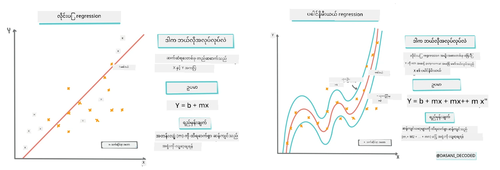
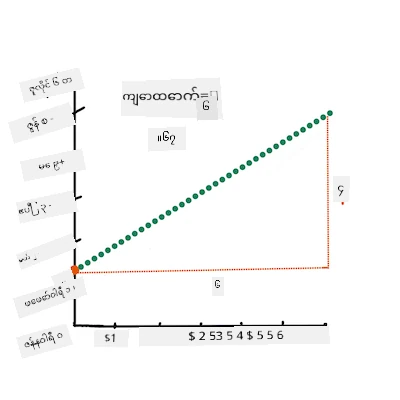
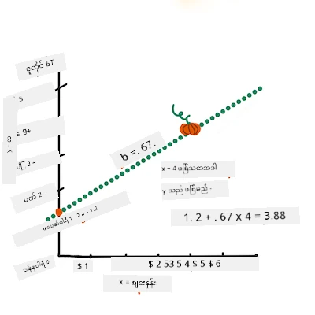
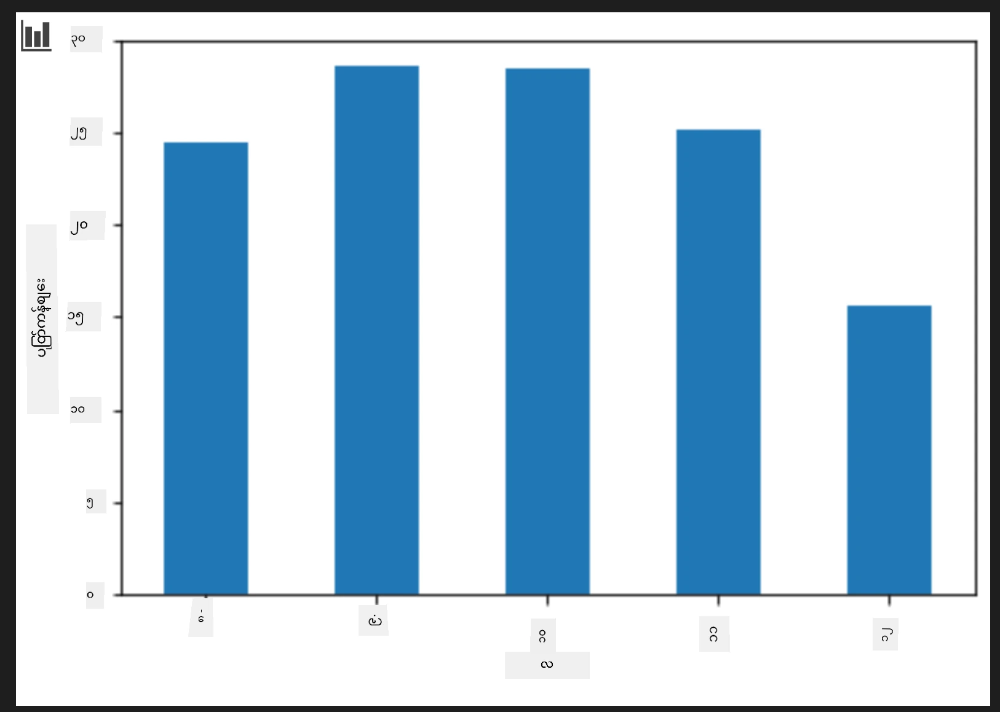
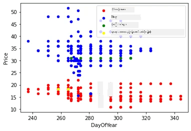

# Scikit-learn ဖြင့် Regression မော်ဒယ်တစ်ခုကို တည်ဆောက်ခြင်း - regression နည်းလမ်းလေးမျိုး

## အစရောက်မှတ်ချက်

Linear regression ကို **ကိန်းဂဏန်းတန်ဖိုး** (ဥပမာ - အိမ်မျှော်မူ၊ အပူချိန် သို့မဟုတ် အရောင်း စသည်) ကို ခန့်မှန်းချင်သောအခါ အသုံးပြုသည်။
ဒါဟာ input features နှင့် output ပေါ်ရှိ ဆက်စပ်မှုကို ကိုယ်စားပြုသော တိတိကျကျ စတိုးတန်းတစ်ခုကို ရှာဖွေခြင်းဖြင့် လည်ပတ်သည်။

ဒီသင်ခန်းစာမှာ ကိစ္စရပ်ကိုနားလည်ခြင်းကို ဦးတည်ပြီး regression နည်းပညာများပိုခက်ဆဲများကို ရှာဖွေဖို့မတိုင်ခင်လေ့လာမှာဖြစ်ပါတယ်။

> [Dasani Madipalli](https://twitter.com/dasani_decoded)၏ infographic

## [Pre-lecture quiz](https://ff-quizzes.netlify.app/en/ml/)

> ### [ဒီသင်ခန်းစာကို R မှာလည်း လေ့လာနိုင်ပါတယ်!](../../../../2-Regression/3-Linear/solution/R/lesson_3.html)
### နိဒါန်း

ယခုအချိန်အထိ သင်သည် regression ဆိုတာဘာလဲဆိုတာကို pumpkin စျေးနှုန်းဒေတာဝန်းကျင်ကနေရယူထားသော နမူနာဒေတာဖြင့် စတင်ကြည့်ရှုပြီး Matplotlib ဖြင့် တွေ့မြင်ကြပါတယ်။

ယခုတွင် ML အတွက် regression ကို ပိုမိုနက်ရှိုင်းစွာ လေ့လာရန်အဆင်ပြေပြီ။ Visualization က data ကိုနားလည်စေရာပေးသော်လည်း Machine Learning ၏ တကယ့်အားကောင်းချက်မှာ _မော်ဒယ်များကို သင်ကြားသည်မှာဖြစ်သည်။_ မော်ဒယ်များဟာ နာမည်ကြီးအတိတ် ဒေတာများကို သင်ကြားခြင်းဖြင့် ဒေတာဆက်စပ်မှုများကို အလိုအလျောက် ဖမ်းဆီးနိုင်ပြီး မော်ဒယ်အသစ် မမြင်ဖူးသည့် ဒေတာများအတွက် ရလဒ်များ ရှာဖွေနိုင်စေသည်။

ဒီသင်ခန်းစာမှာ _အခြေခံ linear regression_ နဲ့ _polynomial regression_ ဆိုတဲ့ regression နှစ်မျိုးကို ထပ်မံလေ့လာပြီး အဲ့ဒီနည်းပညာများအောက်မှာရှိတဲ့ သင်္ချာကိုလည်း တက်ကြွစွာ ဖော်ပြမှာ ဖြစ်ပါတယ်။ အဲဒီမော်ဒယ်တွေက pumpkin စျေးရှိတဲ့ input data အပေါ်မူတည်ပြီး စျေးနှုန်းခန့်မှန်းနိုင်စေပါမယ်။

[](https://youtu.be/CRxFT8oTDMg "ML for beginners - Understanding Linear Regression")

> 🎥 Linear regression အကြောင်း တိုတိုကောက်ကပ်ချုပ် များကို ကြည့်ရန် ပုံကို နှိပ်ပါ။

> ဒီသင်တန်းအစီအစဉ်မှာ သင်္ချာအခြေခံစာမျိုးနည်းနည်းသာ သိရှိထားပေးရန် အဓိကထားပြီး အခြားဘာသာရပ်မှ ကျောင်းသားများအတွက်လည်း လွယ်ကူစေမည့် မှတ်ချက်များ၊ 🧮 သင်္ချာဥပမာများ၊ ပုံပြင်နှင့် အခြားလေ့လာမှုကိရိယာများယူလာထားသည်။

### မပြင်ဆင်မီ မျှော်မှန်းချက် 

ယခုအထိ သင်သည် pumpkin ဒေတာ၏ ဖွဲ့စည်းပုံကို နားလည်ပြီးသား ဖြစ်ရန်လိုအပ်သည်။ ဒေတာကို ဒီသင်ခန်းစာနဲ့ ပတ်သက်သည့် _notebook.ipynb_ ဖိုင်ထဲတွင် ကြိုတင်ထည့်ထားပြီး သန့်စင်ထားပါသည်။ ဖိုင်ထဲတွင် pumpkin စျေးနှုန်းကို bushel တစ်ခုလျှင် ပြသထားပါတယ်။ Visual Studio Code တွင် kernel များကိုသုံးပြီး notebook များကို တက်နိုင်သောကြောင့် စစ်ဆေးပါ။

### ပြင်ဆင်မှု

ရိုးရိုးမှတ်တမ်းအနေနဲ့ ဒေတာကို မေးမြန်းဖို့ယခု ဒေတာကိုဖွင့်ထားတယ်ဆိုတာကို မှတ်ထားပါ။

- ဘယ်အချိန် pumpkin ဝယ်ဖို့အကောင်းဆုံးလဲ?
- miniature pumpkin case တစ်ခုအတွက် မည်သည့်စျေးဈေးမျိုးမျှော်လင့်ရမလဲ?
- pumpkin ကို half-bushel တို့မှာ ဝယ်သင့်သလား၊ 1 1/9 bushel box နဲ့ ဝယ်သင့်သလား?
ဒီဒေတာကို နက်ရှိုင်းစွာလေ့လာဆဲဖြစ်ပါတယ်။

ယခင်သင်ခန်းစာမှာ Pandas data frame တစ်ခု ဖန်တီးပြီး မူလ dataset ၏ အစိတ်အပိုင်းတစ်ခုများဖြင့် bushel အရ စျေးနှုန်းကို အတိုင်းအတာတစ်ခုအဖြစ်ချိန်ညှိခဲ့ပြီဖြစ်ပါတယ်၊ သို့သော် အဲဒါကြောင့် data point များ ၄၀၀ ကျော်၊ အထူးသဖြင့် ဆောင်းရာသီလများအတွက်သာရယူနိုင်ခဲ့ပါတယ်။

ဒီသင်ခန်းစာ notebook တွင် ကြိုတင်ထည့်ထားသည့် ဒေတာကို ကြည့်ရှုပါ။ ဒေတာကြိုထည့်ပြီး မူရင်း scatterplot တစ်ခုကို ပြုလုပ်ပြီး လကို ပြသထားသည်။ ဒေတာဂုဏ်သတ္တိများကို ပိုမိုနက်ရှိုင်းစေဖို့ သန့်စင်ကြည့်စမ်းခြင်းဖြင့် လေ့လာနိုင်မယ်။

## linear regression စတိုးတန်းတစ်ခု

သင်ယူခဲ့ပုံစာရင်းအရ၊ linear regression လေ့လာမှုရဲ့ ရည်ရွယ်ချက်မှာ အောက်ပါအလိုဖြစ်သည်။

- **အချင်းချင်းဆက်စပ်မှုများ ပြသခြင်း။** Variable များအကြား ဆက်စပ်မှုကို ပြသပါ။
- **ခန့်မှန်းချက် ပြုလုပ်ခြင်း။** စတိုးတန်းနဲ့ ယှဉ်ကြည့် သင်ခန့်မှန်းထားသော အချက်အသစ်တစ်ခုမှ စတိုးတန်းအပေါ်မှာ မည်သည့်နေရာတွင် ရှိပါမည်ဆိုသည်ကို မှန်ကန်ပြည့်စုံသော ခန့်မှန်းချက်သုံးပါ။

**Least-Squares Regression** အသုံးပြု၍ ဤအမျိုးအစား စတိုးတန်းဆွဲတတ်သည်။ "Least-Squares" ဆိုသည်မှာ မော်ဒယ်အားလုံးတွင် မှားယွင်းမှုစုစုပေါင်းကို အနည်းဆုံးလုပ်ရန်ဖြစ်သည်။ Data point တစ်ခုစီအတွက်၊ အမှန်တကယ်ရှိသောနေရာနဲ့ regression စတိုးတန်းကြား လျှပ်တလွှာအကွာအဝေး (residual ဟုခေါ်သည်) ကို တိုင်းတာသည်။

distance များကို square လုပ်ခြင်းသည် အဓိက နှစ်ချက်အတွက်ဖြစ်သည် -

1. **လျှောက်လွှာအားနည်းချက်အလိုက် မဟုတ်ဘဲ အမြန်ဖြေရှင်းရန်။** -5 ပမာဏမျှ -5 လိုအတိုင်း ဆက်ဆံလိုသည်။ Square လုပ်လျှင် positive ပမာဏပဲ ဆက်မိသည်။
2. **လွတ်လပ်မှုများကို ပြစ်ဒဏ် ချမှတ်ခြင်း။** Square လုပ်ခြင်းသည် error ကြီးများကို ပိုမိုအလေးပေးကုန်တယ်၊ ပိုမိုဝေးလွန်းသော points များပတ်သက်ထားရန်စတိုးတန်းကို နီးစီးစေသည်။

ပြီးလျှင် square များအားလုံးကို ပေါင်း၍ အနည်းဆုံးတန်ဖိုးရှိသော စတိုးတန်းကိုရှာဖွေသည်။

> **🧮 သင်္ချာကိုပြပါ**  
> 
> ဤစတိုးတန်းကို _line of best fit_ ဟုပြောပြီး [တူညီသောသင်္ချာပြထားသည်](https://en.wikipedia.org/wiki/Simple_linear_regression):  
> 
> ```
> Y = a + bX
> ```
>
> `X` သည် 'explanatory variable' ဖြစ်သည်။ `Y` သည် 'dependent variable' ဖြစ်သည်။ စတိုးတန်း၏ slope ကို `b`၊ y-intercept ကို `a` ဟု ဆိုလိုသည်။ y-intercept သည် `X = 0` ဖြစ်သောအခါ `Y` ၏တန်ဖိုးဖြစ်သည်။  
>
>
>
> slope `b` ကို ဦးစီးတွက်ချက်ခြင်း။ [Jen Looper](https://twitter.com/jenlooper) မှ infographic 
>
> နှင့် အခြားနည်းဖြင့် pumpkin data ၏ မူလမေးခွန်း စကားများမှာ - "pumpkin price ကို month အလိုက် ခန့်မှန်းရေး" ။ အဲဒီမှာ `X` သည် စျေးနှုန်းအား၊ `Y` သည် ရောင်းချနေ့ (month) ကို ကိုယ်စားပြုသည်။  
>
>
>
> Y တန်ဖိုးကိုတွက်ချက်ပါ။ $4 ခန့်ပေးရင် ဆိုတော့ April ဖြစ်မှာပဲ! [Jen Looper](https://twitter.com/jenlooper) infographic
>
> စတိုးတန်း slope ကို တွက်ချက်ရန် သင်္ချာသည် y-intercept နဲ့လည်း ဆက်နွယ်နေသည်၊  `X=0` ဖြစ်သောအခါ `Y` တန်ဖိုးဘယ်နေရာမှာရှိသည်ကို ချပြပါသည်။
>
>  [Math is Fun](https://www.mathsisfun.com/data/least-squares-regression.html) ဆိုဒ်တွင် ကိန်းဂဏန်းတွက်သည့်နည်းပညာကို ကြည့်ရှုနိုင်ပြီး၊ [Least-squares calculator](https://www.mathsisfun.com/data/least-squares-calculator.html) တွင် နံပါတ်တန်ဖိုးများသည် စတိုးတန်းကို ဘယ်လို သက်ရောက်သနည်းကို ကြည့်ရှုပါ။

## Correlation

နောက်ထပ် နားလည်သင့်သည့် စကားလုံးမှာပဲ၊ X နှင့် Y တန်ဖိုးများအကြား **Correlation Coefficient** ဖြစ်သည်။ Scatterplot ကိုသုံး၍ အကောင်းဆုံး သုံးသပ်နိုင်ပါသည်။ တဆင့်တည်း စတိုးတန်းတည်နေရာတွင် ပြသထားသည့် datapoint များသည် correlation အဆင့်မြင့်မှုရှိသည်ဟု ဆိုနိုင်သည်။ သို့သော် datapoint များသည် မည်သည့်နေရာတွင်မဆို ဖြန့်ဝေနေပါက correlation အနည်းငယ်ရှိသည် ဟု ဆိုနိုင်သည်။

အကောင်းဆုံး linear regression မော်ဒယ်မှာ correlation coefficient က (0 ထက် 1 နီးကပ်) မြင့်မားပြီး Least-Squares Regression နည်းဖြင့် အလုပ်လုပ်ပါသည်။

✅ ဒီသင်ခန်းစာနဲ့ဆက်စပ်သားတဲ့ notebook ကို ထည့်Run ထားပြီး Month နှင့် Price Scatterplot ကို ကြည့်ပါ။ Month နဲ့ Price ကို ယှဥ်ကြည့်သော pumpkin အရောင်း ဒေတာတွင် scatterplot အရ correlation က မြင့်မားသလား ၊ နည်းနည်းပေါ့မလား? Month အစား *ေန့ရက်* (စာနှစ်အစောပိုင်းမှရက်အရေအတွက်) အသုံးပြုပါက ဘယ်လိုပြောင်းလဲသလဲ?

အောက်တွင် ကျွန်ုပ်တို့ သန့်စင်ပြီးရရှိထားသော dataframe အမည် `new_pumpkins` ဟုသတ်မှတ်ထားသည်။ ဤအတိုင်းဖြစ်သည် -

ID | Month | DayOfYear | Variety | City | Package | Low Price | High Price | Price
---|-------|-----------|---------|------|---------|-----------|------------|-------
70 | 9 | 267 | PIE TYPE | BALTIMORE | 1 1/9 bushel cartons | 15.0 | 15.0 | 13.636364
71 | 9 | 267 | PIE TYPE | BALTIMORE | 1 1/9 bushel cartons | 18.0 | 18.0 | 16.363636
72 | 10 | 274 | PIE TYPE | BALTIMORE | 1 1/9 bushel cartons | 18.0 | 18.0 | 16.363636
73 | 10 | 274 | PIE TYPE | BALTIMORE | 1 1/9 bushel cartons | 17.0 | 17.0 | 15.454545
74 | 10 | 281 | PIE TYPE | BALTIMORE | 1 1/9 bushel cartons | 15.0 | 15.0 | 13.636364

> ဒေတာသန့်စင် နည်းလမ်းတွေကို [`notebook.ipynb`](notebook.ipynb) ဖိုင်ထဲမှာ ရယူနိုင်ပါတယ်။ ယခင်သင်ခန်းစာနဲ့တူညီသည့် သန့်စင်ခြင်းများကဲ့သို့ ဆောင်ရွက်ပြီး `DayOfYear` ကော်လံကို တွက်ချက်ထားသည်။
  
```python
day_of_year = pd.to_datetime(pumpkins['Date']).apply(lambda dt: (dt-datetime(dt.year,1,1)).days)
```

Linear regression အတွက် သင်္ချာကို နားလည်သွားသည့်အခါ Regression မော်ဒယ်တစ်ခု ဖန်တီး၍ pumpkin package မည်ဟာ ပိုမိုကောင်းမွန်သောစျေးနှုန်းရှိမလဲ ခန့်မှန်းကြည့်ပါ။ စနေတင် праздник pumpkin patch အတွက် pumpkin ဝယ်သူများအတွက် ဝယ်ယူမှုများတွင် အကောင်းဆုံး ဖြစ်စေဖို့ ဤသတင်းအချက်အလက် များလိုအပ်ပါမည်။

## Correlation ရှာဖွေရေး

[](https://youtu.be/uoRq-lW2eQo "ML for beginners - Looking for Correlation: The Key to Linear Regression")

> 🎥 Correlation အကြောင်း တိုတုတ်ကောက်ကြည့်ရှုရန် ဗီဒီယို ကို အသုံးပြုလိုက်ပါ။

ယခင်သင်ခန်းစာဖြတ်သန်းမှုအရ လ အလိုက် ပျမ်းမျှစျေးနှုန်းမှာ အောက်ပါအတိုင်းမြင်ရပါသည် -



ဒါဟာ correlation ရှိတယ်ဆိုတာကို ပြထားပြီး `Month` နဲ့ `Price`, `DayOfYear` နဲ့ `Price` ဆက်စပ်မှုကို predict လုပ်ဖို့ linear regression train/training ပြုလုပ်ကြည့်ရအောင်။ 

အောက်က scatter plot သည် `DayOfYear` နဲ့ `Price` ဆက်စပ်မှုကို ဖော်ပြသည်။

 

`corr` function ကို အသုံးပြုပြီး correlation ရှိ/မရှိ စစ်ဆေးကြည့်ရအောင် -

```python
print(new_pumpkins['Month'].corr(new_pumpkins['Price']))
print(new_pumpkins['DayOfYear'].corr(new_pumpkins['Price']))
```

Correlation က `Month` နှင့် -0.15၊ `DayOfYear` နဲ့ -0.17 ဖြစ်ပြီး ကြီးမားမသိသာသော်။ pumpkin မျိုးစုံပေါ်မူတည်၍ စျေးအမျိုးအစား မတူကြပါသလားဆိုသည့် ရှာဖွေရေးနည်းလမ်း (hypothesis) တစ်ခုရှိပါသည်။ အဆိုပါ အတည်ပြုပြီး အမျိုးအစားအလိုက် အရောင်ကို ခွဲခြား၍ scatterplot တစ်ခု ဖော်ဆောင်လိုက်ရအောင်။ မြေပုံ `scatter` ဖန်တီးသော `ax` parameter ကို ထည့်သုံးပြီး အချက်များအားလုံးကို တစ်ခုတည်းသောပုံတွင် စုစည်းတင်ပြနိုင်ပါသည်။

```python
ax=None
colors = ['red','blue','green','yellow']
for i,var in enumerate(new_pumpkins['Variety'].unique()):
    df = new_pumpkins[new_pumpkins['Variety']==var]
    ax = df.plot.scatter('DayOfYear','Price',ax=ax,c=colors[i],label=var)
```

 

ကျွန်ုပ်များ ရေးရာ အယူအဆမှာ pumpkin variety က စျေးနှုန်း ပိုကြီးစေပါတယ်၊ ရောင်းချသော ရက်စွဲထက် ပိုမိုသက်ရောက်မှုရှိပါတယ်။ ဤအချက်ကို bar graph ဖြင့်တွေ့မြင်ရပါသည် -

```python
new_pumpkins.groupby('Variety')['Price'].mean().plot(kind='bar')
```

 

ယခုအချိန် pumpkin မျိုးစုံ 'pie type' တစ်ခုသာ ရှု့နေပြီး ရက်စွဲသည် စျေးနှုန်းအပေါ် အကျိုးသက်ရောက်မှု ရှိသည်ကို ကြည့်ရှုကြပါစို့။

```python
pie_pumpkins = new_pumpkins[new_pumpkins['Variety']=='PIE TYPE']
pie_pumpkins.plot.scatter('DayOfYear','Price') 
```
 

ယခု `corr` function နှင့် Price နှင့် DayOfYear အကြား correlation တွက်ချက်ပါက `-0.27` ခုခံရပါမည် - predictive မော်ဒယ် တစ်ခုသင်ကြားရန် သေချာသောကြောင်းအတိုင်း ဖြစ်သည်။

> linear regression မော်ဒယ် သင်ကြားမတိုင်မီ ဒေတာ သန့်ရှင်းမှု အရေးကြီးပါသည်။ မဖြည့်ထားသောတန်ဖိုးများစွာရှိပါက linear regression က သူ့လုပ်ငန်းကို မကောင်းစွာလုပ်နိုင်ပါ။ ထို့ကြောင့် အလယ်တန်းရွေ့တားသည့်ကွက်လပ်များကို ဖယ်ရှားသင့်သည်။

```python
pie_pumpkins.dropna(inplace=True)
pie_pumpkins.info()
```

အခြားနည်းလမ်းမှာ ဒီလွတ်လပ်တဲ့တန်ဖိုးများကို ဆိုင်ရာကော်လံမှ ပျမ်းမျှတန်ဖိုးဖြင့် ဖြည့်သွင်းနိုင်သည်။

## Simple Linear Regression

[](https://youtu.be/e4c_UP2fSjg "ML for beginners - Linear and Polynomial Regression using Scikit-learn")

> 🎥 linear နဲ့ polynomial regression အကြောင်း တိုတုတ်ကောက်ချက်များ အတွက် ဗီဒီယိုကို တွေ့ကြည့်ရန် ပုံကိုနှိပ်ပါ။

Linear Regression မော်ဒယ် သင်ကြားမှုအတွက် **Scikit-learn** library ကို အသုံးပြုပါမယ်။

```python
from sklearn.linear_model import LinearRegression
from sklearn.metrics import mean_squared_error
from sklearn.model_selection import train_test_split
```

input များ (features) နဲ့ မျှော်လင့်ထားသော output (label) တို့ကို numpy arrays များအဖြစ် ခွဲထုတ်ပါမယ်-

```python
X = pie_pumpkins['DayOfYear'].to_numpy().reshape(-1,1)
y = pie_pumpkins['Price']
```

> notice that Linear Regression သုံးရန် input data ကို reshape လုပ်ရသည်။ Linear Regression အတွက် input ကို 2D-array ဖြစ်ရမည်၊ အဲဒီမှာ တန်းတိုင်းသည် input feature vector ဖြစ်ရမည်။ ငါတို့တွင် input တစ်ခုသာရှိသောကြောင့် N&times;1 shape ရှိတဲ့ array ဖြင့် data ပေးရန် လိုအပ်သည်။

ပြီးနောက် မော်ဒယ်ကို သင်ကြားမှုပြုလုပ်ပြီးနောက် စစ်ဆေးနိုင်ရန် train & test datasets များခွဲထုတ်ရမည်။

```python
X_train, X_test, y_train, y_test = train_test_split(X, y, test_size=0.2, random_state=0)
```

နောက်ဆုံးမှာ Linear Regression မော်ဒယ်ကို ပြုလုပ်ရန် ၂လိုင်းသာလိုသည်။ `LinearRegression` object ကို သတ်မှတ်ပြီး `fit` method ဖြင့် data ကို သင်ကြားသည်။

```python
lin_reg = LinearRegression()
lin_reg.fit(X_train,y_train)
```

`fit` ပြီးနောက် `LinearRegression` အရာဝတ္ထုတွင် regression ၏ coefficient များအားလုံး ပါရှိပြီး `.coef_` property ကို အသုံးပြု၍ ဝင်ရောက်ကြည့်ရှုနိုင်သည်။ ကျွန်ုပ်တို့၏အတွက် coefficient တစ်ခုတည်းရှိပြီး၊ ၎င်းသည် `-0.017` ဘယ်ဘက်လောက ပတ်လည်ရှိသင့်သည်။ ၎င်းမှာ ကာလကြာမြင့်သလို ပါးလျော့နည်းနည်းကျဆင်းသည်ကို အဓိပ္ပါယ်ရသည်၊ တစ်နေ့လျှင် စင့် ၂ ခန့် ကျဆင်းကြောင်း ဖြစ်သည်။ regression ၏ Y-axis နှင့်ထိတွေ့ရာနေရာကို `lin_reg.intercept_` ဖြင့်လည်း ဝင်ရောက်ကြည့်ရှုနိုင်ပြီး ကျွန်ုပ်တို့အတွက် ၎င်းက `21` ခန့်ရှိပြီး ၂၀၁၉ ခုနှစ်အစ အချိန်တွင်စျေးနှုန်းအဆင့်ကို ဖော်ပြသည်။

ကျွန်ုပ်တို့၏ မော်ဒယ် တိကျမှုကို ကြည့်ရန်၊ စမ်းသပ်ဒေတာ စုစည်းမှုတွင် စျေးနှုန်း များကို ခန့်မှန်းပြီး ခန့်မှန်းချက်များသည် မျှော်မှန်းထားသောတန်ဖိုးများနှင့် မည်မျှ နီးကပ်သလဲ ဆွေးနွေးနိုင်သည်။ ၎င်းကို Root Mean Square Error (RMSE) ကိုအသုံးပြုပြီး ခန့်မှန်းချက်များ နှင့် မျှော်မှန်းတန်ဖိုးများအကြား ကွာခြားချက်များ၏ စတုဂံ၏ မြည်းတေကို ရှာဖွေရန် အသုံးပြုနိုင်သည်။

```python
pred = lin_reg.predict(X_test)

rmse = np.sqrt(mean_squared_error(y_test,pred))
print(f'RMSE: {rmse:3.3} ({rmse/np.mean(pred)*100:3.3}%)')
```
  
ကျွန်ုပ်တို့၏ error သည် ၂ ပွင့်ခန့်ရှိပြီး ~၁၇% ဖြစ်သည်။ မကောင်းပါဘူး။ မော်ဒယ်၏ အရည်အသွေး အနေနဲ့တစ်ခုက **coefficient of determination** ဖြစ်ပြီး အောက်ပါအတိုင်း ရယူနိုင်သည်-

```python
score = lin_reg.score(X_train,y_train)
print('Model determination: ', score)
```
  
တန်ဖိုး 0 ဖြစ်လျှင် မော်ဒယ်သည် input ဒေတာကို လက်မခံဘဲ အလုပ်လုပ်နေပြီး အနုတ်ဆုံး Linear Predictor ဖြစ်သည်ဟု ဆိုလိုသည်၊ ၎င်းအနေဖြင့်ရလဒ်၏ ကြားနာ တန်ဖိုးသာ ဖြစ်သော mean တန်ဖိုးဖြစ်သည်။ 1 ရလဒ်ကနေ အားလုံးကို မှန်ကန်စွာ ခန့်မှန်းနိုင်သည်ကို ဆိုလိုသည်။ ကျွန်ပ်တို့အတွက် တန်ဖိုးက 0.06 ခန့်ရှိပြီး တော်တော်နည်းပါးသည်။

ကျွန်ုပ်တို့သည် စမ်းသပ် ဒေတာနှင့် regression line ကို တိုက်ရိုက်ပုံဆွဲ၍ Regression ၏ အလုပ်လုပ်ပုံကို ကောင်းစွာမြင်နိုင်သည်-

```python
plt.scatter(X_test,y_test)
plt.plot(X_test,pred)
```
  


## Polynomial Regression

Linear Regression ၏ နှစ် 번째 မျိုးကတော့ Polynomial Regression ဖြစ်သည်။ ခဏခဏ variable များအကြား ဆက်စပ်မှုတည်ရှိသောကြောင်း - ဥပမာ ဂဏန်းအရ အပူအကြီးဆုံးပါဝင်သည့် pumpkin ၏ ပမာဏ နှင့် စျေးနှုန်းတို့ အချိန်တည်းရှိခြင်းရှိသော်လည်း - တစ်ခါတစ်ရံတွင် ဒီဆက်စပ်မှုများသည် တန်းတူစတိုင်နယ်လိုင်း သို့ မဟုတ် မှန်းဆနိုင်သော ကွဲပြားမှု မဖြစ်နိုင်ပါ။

✅ [Polynomial Regression အသုံးပြုနိုင်သော ဒေတာများ](https://online.stat.psu.edu/stat501/Lesson09#polynomial-regression-examples) ဥပမာအချို့

Date နှင့် Price အကြား ဆက်နွယ်မှုကို ထပ်မံကြည့်ပါ။ ဒီ scatterplot ကို သို့တိုင်သော တန်းနယ်လိုင်းဖြင့်သာ ခွဲခြားရန် သင်ယူသင့်ပါသလား? စျေးနှုန်းများ တက် ကြွေ့ ရန်လား? ဒီအခြေအနေနှင့် polynomial regression ကို စမ်းကြည့်နိုင်သည်။

✅ Polynomial တွင် များစွာသော variables နှင့် coefficients ပါဝင်နိုင်သည့် သင်္ချာရေးဖော်ပြချက်များဖြစ်သည်။

Polynomial regression သည် nonlinear ဒေတာအသုံးပြုမှုများအတွက် ကွေးလာပုံဖြင့် အလိုက်ဖက်မှု ပိုတိုးစေသည်။ ကျွန်ုပ်တို့အတွက် `DayOfYear` ကို ကျော်သွားပြီး squared variable ကို input data ထဲသို့ ထည့်သွင်းပါက၊ နှစ်တွင်း တည်ရှိသည့် ဥပမာ parabolic curve တစ်ခုကို ချိတ်ဆွဲနိုင်သည်။

Scikit-learn တွင် [pipeline API](https://scikit-learn.org/stable/modules/generated/sklearn.pipeline.make_pipeline.html?highlight=pipeline#sklearn.pipeline.make_pipeline) များပါဝင်ပြီး data processing ၏အဆင့်ဆင့်ကို ပေါင်းစပ်နိုင်သည်။ **pipeline** သည် **estimators** သက်ဆိုင်မှုချိတ်ဆက်မှုတစ်ခု ဖြစ်သည်။ ကျွန်ုပ်တို့အတွက် Pipeline ကိုတည်ဆောက်ပြီး ပထမဦးဆုံး polynomial features များကို မော်ဒယ်ထဲ ထည့်သွင်းပြီး နောက်ဆုံး regression ကိုသင်ကြားမည်-

```python
from sklearn.preprocessing import PolynomialFeatures
from sklearn.pipeline import make_pipeline

pipeline = make_pipeline(PolynomialFeatures(2), LinearRegression())

pipeline.fit(X_train,y_train)
```
  
`PolynomialFeatures(2)` က input data မှ အပေါ်တန်းဒဂရီ များကို ထည့်သွင်းရန် အဓိပ္ပါယ် ရှိသည်။ ကျွန်ုပ်တို့တွင်၎င်းသည် `DayOfYear`<sup>2</sup> ကိုသာ ပါဝင်သော်လည်း input variables နှစ်ခု X နှင့် Y ရှိပါက X<sup>2</sup>, XY နှင့် Y<sup>2</sup> ဖြစ်သည်။ နိမ့်နေ့တန်းဒဂရီ ပိုများလည်း အသုံးပြုနိုင်သည်။

Pipeline များကို `LinearRegression` အတိုင်း အသုံးပြုနိုင်သည်၊ တူညီပြီး pipeline ကို `fit` ပြီး `predict` ဖြင့် ခန့်မှန်းချက် ရယူနိုင်သည်။

```python
pred = pipeline.predict(X_test)

rmse = np.sqrt(mean_squared_error(y_test,pred))
print(f'RMSE: {rmse:3.3} ({rmse/np.mean(pred)*100:3.3}%)')

score = pipeline.score(X_train,y_train)
print('Model determination: ', score)
```
  
Smooth approximation curve ကို ပုံဆွဲရန် `np.linspace` ကို အသုံးပြုကာ input တန်ဖိုး များကို တည်ငြိမ်စေရန်၊ စမ်းသပ် ဒေတာမဟုတ်ဘဲ တိုက်ရိုက် ပုံဆွဲခြင်းက zigzag ဟူသောရိုးလိုင်း ထုတ်ပေးနိုင်သည်။

```python
X_range = np.linspace(X_test.min(), X_test.max(), 100).reshape(-1,1)
y_range = pipeline.predict(X_range)

plt.scatter(X_test, y_test)
plt.plot(X_range, y_range)
```
  
graph သည် စမ်းသပ်ဒေတာနှင့် approximation curve ကို ဖော်ပြထားသည်-


Polynomial Regression သုံးပြီး RMSE နည်းနည်း သာ ပိုနည်းပြီး determination ပိုမြင့်လာ၍ အနည်းငယ်သာပြောင်းလဲသည်။ အခြား features များကိုလည်း ထည့်သွင်းစဉ်းစားရမည်။

> minimal pumpkin စျေးနှုန်း သည် Halloween အနီးတွင် တွေ့ရှိရသည်။ ၎င်းကို မည်သို့ရှင်းလင်းနိုင်သနည်း?

🎃 သင်သည် စျေးနှုန်း ခန့်မှန်းနိုင်သော pie pumpkin မော်ဒယ် တစ်ခု ဖန်တီးထားသဖြင့် ဂုဏ်ပြုသည်။ အခြား pumpkin အမျိုးအစားများအတွက်လည်း ဒီလုပ်နည်းကို ထပ်မံ သုံးနိုင်သည်၊ သို့သော်၎င်းသည် မကြာခဏအလုပ်များသည်။ Pumpkin အမျိုးအစားကို မော်ဒယ်တွင် စဉ်စားဖို့ လေ့လာကြမယ်။

## Categorical Features

Ideal အာကာသတွင် မတူညီသော pumpkin အမျိုးအစားများအတွက် တူညီသော မော်ဒယ် အသုံးပြု၍ စျေးနှုန်းများ ခန့်မှန်းနိုင်စေရန် မျှော်လင့်သည်။ သို့သော် `Variety` ကော်လံသည် `Month` ကဲ့သို့ မျိုးဖြစ်၍၊ ချည်းများကို number မဟုတ်သော တန်ဖိုးများပါရှိသည်။ ယင်းကော်လံများအား **categorical** ဟု ခေါ်သည်။

[](https://youtu.be/DYGliioIAE0 "ML for beginners - Categorical Feature Predictions with Linear Regression")

> 🎥 ပုံနှိပ်ပြီး categorical features အသုံးပြုခြင်းအတွင်း ရှုထောင့်တို video ကြည့်ပါ။

Variety အလိုက် ပျမ်းမျှစျေးနှုန်းကို ကြည့်ရှုပါ-


Variety ကို စဉ်းစားရန် ဦးစွာ ဂဏန်းပုံစံ သို့ပြောင်းရန်(encode) လိုအပ်သည်။ အဖြစ်ဆုံး မြင်သာသည့် နည်းလမ်းမှာ-

* အလွယ်တကူ **numeric encoding** - ရှားစီးပြား Variety များစာရင်းဖြင့်တ Table တည်ဆောက်ပြီး Variety အမည်များကို ထိုစာရင်းအတွင်း အညွှန်း नंबर ဖြင့် ဖြည့်စွက်သည်။ ဒါပေမယ့် linear regression ကလည်း အမှန်တကယ် ဂဏန်းတန်ဖိုးကို အသုံးပြု၍ လုပ်ဆောင်သဖြင့် အညွှန်းနံပါတ်နှင့် စျေးနှုန်း အကြား ဆက်စပ်မှု ပုံမှန်မဖြစ်ပါ၊ နှိုင်းပြောင်မှု မရှိရင်လည်း။
* **One-hot encoding** သည် `Variety` ကို 4 ကော်လံအသစ်တွင် ဖြန့်ဝေပြီး variety တစ်ခုချင်းစီအတွက် column တစ်ခုထားမည်။ အသီးသီးကော်လံများတွင် 해당က variety row ဖြစ်ခဲ့လျှင် `1` ရရှိပြီး မဖြစ်လျှင် `0` ဖြစ်သည်။ ၎င်းသည် liner regression တွင် variety အသီးသီးအတွက် coefficient ၄ ခုရှိမည် ဖြစ်ပြီး pumpkin အမျိုးအစားတစ်ခု၏ စတင်မှု စျေးနှုန်း "သို့မဟုတ်" "ထပ်မံစျေးနှုန်း" ကို ဖော်ပြသည်။

အောက်ပါကုဒ်တွင် variety ကို one-hot encode ပြုလုပ်ခြင်းပြသာနာရှိသည်-

```python
pd.get_dummies(new_pumpkins['Variety'])
```
  
 ID | FAIRYTALE | MINIATURE | MIXED HEIRLOOM VARIETIES | PIE TYPE  
----|-----------|-----------|--------------------------|----------  
70 | 0 | 0 | 0 | 1  
71 | 0 | 0 | 0 | 1  
... | ... | ... | ... | ...  
1738 | 0 | 1 | 0 | 0  
1739 | 0 | 1 | 0 | 0  
1740 | 0 | 1 | 0 | 0  
1741 | 0 | 1 | 0 | 0  
1742 | 0 | 1 | 0 | 0  

one-hot encoded variety ကို input အသုံးပြုပြီး linear regression သပ်မတ်ရန် `X` နှင့် `y` data ကိုမှန်ကန်စွာ initialize လုပ်ရုံပဲ လိုသည်-

```python
X = pd.get_dummies(new_pumpkins['Variety'])
y = new_pumpkins['Price']
```
  
အခြားကုဒ်များသည် အထက်တွင် Linear Regression သင်ကြားသည့်နည်းလမ်း တူညီသည်။ စမ်းသပ်၍ mean squared error တန်ဖိုးတူညီသော်လည်း coefficient of determination သည် (၇၇%) ပိုမြင့်စေသည်။ တိကျမှု ပိုစွမ်းဆောင်ရန် categorical features နောက်ထပ်များ၊ numeric features (ဥပမာ `Month` သို့မဟုတ် `DayOfYear`) များပါ သတ်မှတ်နိုင်သည်။ feature တစ်ခုကို စုစည်းရန် `join` ကို အသုံးပြုနိုင်သည်-

```python
X = pd.get_dummies(new_pumpkins['Variety']) \
        .join(new_pumpkins['Month']) \
        .join(pd.get_dummies(new_pumpkins['City'])) \
        .join(pd.get_dummies(new_pumpkins['Package']))
y = new_pumpkins['Price']
```
   
ဒီမှာ `City` နှင့် `Package` Type ကိုပါ ထည့်သွင်းပြီး RMSE = 2.84 (10.5%), determination = 0.94 ရသည်။

## ပြန်လည်ပေါင်းစပ်ခြင်း

အကောင်းဆုံး မော်ဒယ် ရရှိစေရန် အထက်ပါ စုစုပေါင်း( one-hot encoded categorical + numeric) ဒေတာများကို Polynomial Regression နှင့် ပေါင်းစပ်နိုင်သည်။ အောက်မှာ အကုန်လုံးစုံလင်သော ကုဒ်ဖြစ်သည်-

```python
# လေ့ကျင့်မှုဒေတာကို သတ်မှတ်ပါ
X = pd.get_dummies(new_pumpkins['Variety']) \
        .join(new_pumpkins['Month']) \
        .join(pd.get_dummies(new_pumpkins['City'])) \
        .join(pd.get_dummies(new_pumpkins['Package']))
y = new_pumpkins['Price']

# လေ့ကျင့်မှု-စမ်းသပ်မှု ခွဲခြားပါ
X_train, X_test, y_train, y_test = train_test_split(X, y, test_size=0.2, random_state=0)

# pipeline ကို စီစဉ်ပြီး လေ့ကျင့်ပါ
pipeline = make_pipeline(PolynomialFeatures(2), LinearRegression())
pipeline.fit(X_train,y_train)

# စမ်းသပ်ဒေတာအတွက် မျှော်မှန်းချက်များကို ထုတ်ယူပါ
pred = pipeline.predict(X_test)

# RMSE နှင့် သတ်မှတ်ချက်ကိုတွက်ချက်ပါ
rmse = mean_squared_error(y_test, pred, squared=False)
print(f'RMSE: {rmse:3.3} ({rmse/pred.mean()*100:3.3}%)')

score = pipeline.score(X_train,y_train)
print('Model determination: ', score)
```
   
ဤက ဒါကာမှာ determination coefficient ၉၇% ခန့်ရပြီး RMSE=2.23 (~8% ခန့်ခန့် ခန့်မှန်းမှားယွင်းမှု) ဖြစ်ပါမည်။

| Model | RMSE | Determination |  
|-------|-----|---------------|  
| `DayOfYear` Linear | 2.77 (17.2%) | 0.07 |  
| `DayOfYear` Polynomial | 2.73 (17.0%) | 0.08 |  
| `Variety` Linear | 5.24 (19.7%) | 0.77 |  
| All features Linear | 2.84 (10.5%) | 0.94 |  
| All features Polynomial | 2.23 (8.25%) | 0.97 |  

🏆 ကောင်းပါတယ်! သင်သည် Regression မော်ဒယ် ၄ မျိုးကို တစ်သင်ခန်းစာအတွင်း ဖန်တီးပြီး မော်ဒယ် အရည်အသွေးကို ၉၇% ထိ တိုးတက်စေခဲ့သည်။ Logistic Regression ကို သင်ကြားရန် နောက်ထပ် ကျန်ရှိသည့် Regression အပိုင်းတွင် သင်ယူမည်။

---
## 🚀Challenge

ဒီ Notebook တွင် မတူညီသည့် variables များစမ်းသပ်လေ့လာပြီး correlation နှင့် model တိကျမှုကြား ဆက်စပ်မှုဘယ်လောက်ရှိကြောင်း ခွဲခြားပါ။

## [Post-lecture quiz](https://ff-quizzes.netlify.app/en/ml/)

## Review & Self Study

ဒီသင်ခန်းစာတွင် Linear Regression အကြောင်း သင်ယူခဲ့သည်။ အခြား အရေးပါ Regression မျိုးလည်း ရှိသည်။ Stepwise, Ridge, Lasso နှင့် Elasticnet နည်းပညာများကို လေ့လာပါ။ ပိုမိုလေ့လာလိုသူများအတွက် [Stanford Statistical Learning course](https://online.stanford.edu/courses/sohs-ystatslearning-statistical-learning) သင်တန်းကောင်းတစ်ခု ဖြစ်သည်။

## Assignment 

[Build a Model](assignment.md)

---

<!-- CO-OP TRANSLATOR DISCLAIMER START -->
**ရှင်းလင်းချက်**  
ဤစာရွက်စာတမ်းသည် AI ဘာသာပြန်ဝန်ဆောင်မှု [Co-op Translator](https://github.com/Azure/co-op-translator) ကို အသုံးပြု၍ ဘာသာပြန်ထားခြင်းဖြစ်ပါသည်။ တိကျမှန်ကန်မှုအတွက် ကြိုးပမ်းပါသော်လည်း အလိုအလျောက်ဘာသာပြန်ချက်များတွင် အမှားများ သို့မဟုတ် တိကျမှုနည်းပါးမှုများ ရှိနိုင်ကြောင်း သတိပြုပါရန်။ မူရင်းစာရွက်စာတမ်းကို အစစ်အမှန်အရင်းအမြစ်အဖြစ် အယူခံသင့်ပါသည်။ အရေးကြပ်သောသတင်းအချက်အလက်များအတွက် များသောအားဖြင့် လူ့ဘာသာပြန်သူများ၏ ပညာရှင်ဘာသာပြန်ခြင်းကို အကြံပြုပါသည်။ ဤဘာသာပြန်ချက်ကို အသုံးပြုမှုကြောင့် ဖြစ်ပေါ်လာနိုင်သော်လည်း နားမလည်မှုများ သို့မဟုတ် မှားယွင်းဖော်ပြချက်များအတွက် ကျွန်ုပ်တို့ တာဝန်မယူပါ။
<!-- CO-OP TRANSLATOR DISCLAIMER END -->