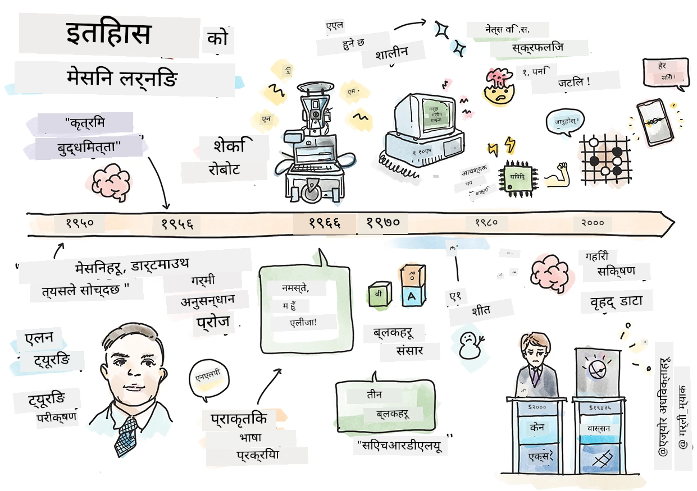
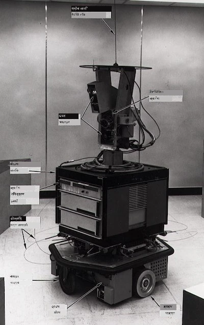
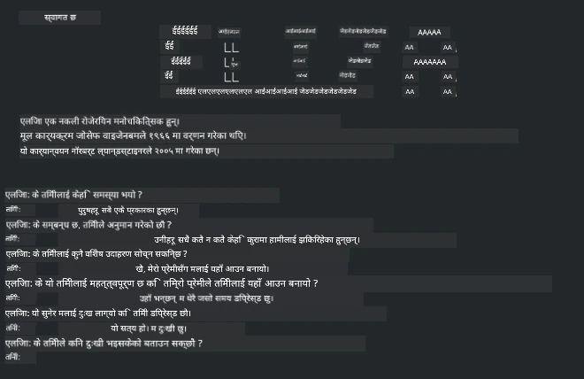

# मेशिन सिकाइको इतिहास

> स्केचनोट द्वारा [Tomomi Imura](https://www.twitter.com/girlie_mac)

## [पूर्व-व्याख्यान क्विज](https://ff-quizzes.netlify.app/en/ml/)

---

> 🎥 यो पाठमा काम गर्दै छोटो भिडियोका लागि माथिको चित्रमा क्लिक गर्नुहोस्।

यस पाठमा, हामी मेसिन सिकाइ र कृत्रिम बुद्धिमत्ताको इतिहासका मुख्य माइलस्टोनहरूमा हिँड्नेछौं।

कृत्रिम बुद्धिमत्ता (AI) को इतिहास मेसिन सिकाइको इतिहाससँग गहिरो रूपमा जोडिएको छ, किनकि एमएललाई आधार बनाउने एल्गोरिदम र कम्प्युटेशनल प्रगतिको विकास AI मा पनि योगदान पुर्‍यायो। यो सम्झनु उपयोगी छ कि, यद्यपि यी क्षेत्रहरू 1950 को दशकमा अलग अनुसन्धान क्षेत्रहरूका रूपमा क्रिस्टलाइज हुन थालेका थिए, महत्वपूर्ण [एल्गोरिदमिक, सांख्यिकीय, गणितीय, कम्प्युटेशनल र प्राविधिक आविष्कारहरू](https://wikipedia.org/wiki/Timeline_of_machine_learning) त्यस युगभन्दा पहिले र त्यस युगसँग ओभरलप गरेका थिए। वास्तवमा, मानिसहरू यी प्रश्नहरूको बारेमा [सयौं वर्ष](https://wikipedia.org/wiki/History_of_artificial_intelligence) देखि सोच्दै आइरहेका छन्: यो लेखले 'सोच्ने मेसिन' को विचारका ऐतिहासिक बौद्धिक आधारहरूलाई छलफल गर्दछ।

---
## उल्लेखनीय आविष्कारहरू

- 1763, 1812 [बेयस प्रमेय](https://wikipedia.org/wiki/Bayes%27_theorem) र यसको पूर्ववर्तीहरू। यो प्रमेय र यसको प्रयोगहरूले पूर्वज्ञानको आधारमा कुनै घटनाको सम्भावना वर्णन गर्ने निरीक्षणको आधार बनाउँछन्।
- 1805 फ्रेन्च गणितज्ञ एड्रियन-मारी लेजेन्द्रेको [Least Square Theory](https://wikipedia.org/wiki/Least_squares)। यो सिद्धान्त, जुन तपाईं हाम्रो Regression एकाइमा सिक्ने छन्, डाटा फिटिंगमा सहयोग गर्छ।
- 1913 रूसी गणितज्ञ एन्ड्रे मार्कोभको नाममा नामाकरण गरिएको [Markov Chains](https://wikipedia.org/wiki/Markov_chain), एक पहिलाको अवस्थाको आधारमा सम्भावित घटनाहरूको अनुक्रम वर्णन गर्न प्रयोग गरिन्छ।
- 1957 अमेरिका मनोवैज्ञानिक फ्र्याँक रोजेनब्ल्याटले आविष्कृत [Perceptron](https://wikipedia.org/wiki/Perceptron) प्रकारको रैखिक वर्गीकरणकर्ता हो जसले डीप लर्निङमा उन्नतिहरू ल्याउँछ।

---

- 1967 मूल रूपमा मार्गहरू नक्शा बनाउन डिजाइन गरिएको [Nearest Neighbor](https://wikipedia.org/wiki/Nearest_neighbor) एल्गोरिदम हो। एमएल सन्दर्भमा यसलाई ढाँचाहरू पत्ता लगाउन प्रयोग गरिन्छ।
- 1970 [Backpropagation](https://wikipedia.org/wiki/Backpropagation) प्रशिक्षण गर्न प्रयोग गरिन्छ [feedforward neural networks](https://wikipedia.org/wiki/Feedforward_neural_network)।
- 1982 [Recurrent Neural Networks](https://wikipedia.org/wiki/Recurrent_neural_network) कृत्रिम न्यूरल नेटवर्कहरू हुन् जसले feedforward न्यूरल नेटवर्कहरूबाट उत्पन्न भएर अस्थायी ग्राफहरू सिर्जना गर्छन्।

✅ अलिकति अनुसन्धान गर्नुहोस्। एमएल र एआईको इतिहासमा अन्य कुन मितिहरू महत्वपूर्ण छन्?

---
## 1950: सोच्ने मेसिनहरू

एलन ट्युरिङ, एक साँच्चिकै अद्भुत व्यक्ति जसलाई २०१९ मा [सार्वजनिक मत](https://wikipedia.org/wiki/Icons:_The_Greatest_Person_of_the_20th_Century) द्वारा २० औं शताब्दीको सबैभन्दा महान वैज्ञानिकको रूपमा चयन गरिएको थियो, 'सोच्नसक्ने मेसिन' को अवधारणा स्थापना गर्न मद्दत पुर्‍याएको मानिन्छ। उनले यस अवधारणाको अनुभवजन्य प्रमाणको आवश्यकतासँगै नकारात्मक विचारधाराका विरुद्ध लड्न [ट्युरिङ परीक्षण](https://www.bbc.com/news/technology-18475646) सिर्जना गरे, जसलाई तपाईं हाम्रो NLP पाठहरूमा अन्वेषण गर्नुहुनेछ।

---
## १९५६: डार्टमाउथ समर रिसर्च प्रोजेक्ट

"कृत्रिम बुद्धिमत्ताको लागि डार्टमाउथ समर रिसर्च प्रोजेक्ट कृत्रिम बुद्धिमत्ता क्षेत्रको लागि एउटा महत्वपूर्ण घटना थियो," र यहीँ 'कृत्रिम बुद्धिमत्ता' शब्दको आविष्कार गरिएको थियो ([source](https://250.dartmouth.edu/highlights/artificial-intelligence-ai-coined-dartmouth))।

> सिकाइको हरेक पक्ष वा बुद्धिमत्ताको कुनै पनि अन्य विशेषता सिद्धान्तमा यति ठीकसँग वर्णन गर्न सकिन्छ कि एउटा मेसिनलाई त्यसको अनुकरण गर्न बनाउन सकिन्छ।

---

मुख्य अनुसन्धानकर्ता, गणितका प्रोफेसर जोन म्याकार्थीले आशा गरेका थिए "सिकाइको हरेक पक्ष वा बुद्धिमत्ताको कुनै पनि अन्य विशेषता सिद्धान्तमा यति ठीकसँग वर्णन गर्न सकिन्छ कि एउटा मेसिनलाई त्यसको अनुकरण गर्न बनाउन सकिन्छ" भन्ने अनुमानको आधारमा अगाडि बढ्न। सहभागीहरूमा फिल्डका अर्को प्रख्यात व्यक्तित्व, मार्विन मिन्स्की पनि समावेश थिए।

यो कार्यशालालाई धेरै छलफलहरू सुरु गर्न र प्रोत्साहन गर्न क्रेडिट दिइन्छ, जसमध्ये "प्रतीकात्मक विधिहरूको उदय, सीमित क्षेत्रमा केन्द्रित प्रणालीहरू (प्रारम्भिक विशेषज्ञ प्रणालीहरू), र व्युत्पन्न प्रणालीहरू विरुद्ध पूर्वानुमान प्रणालीहरू" रहेका थिए। ([source](https://wikipedia.org/wiki/Dartmouth_workshop))।

---
## १९५६ - १९७४: "सुनौलो वर्षहरू"

१९५० को दशकदेखि मध्य '७० सम्म, आशावाद उच्च थियो कि AI ले धेरै समस्याहरू समाधान गर्न सक्छ। १९६७ मा, मार्विन मिन्स्कीले आत्मविश्वासका साथ भने "एक पुस्ताभित्र ... 'कृत्रिम बुद्धिमत्ता' सिर्जना गर्ने समस्या लगभग समाधान हुनेछ।" (मिन्स्की, मार्विन (१९६७), कम्प्युटेशन: फिनाइट र इन्फिनाइट मेसिनहरू, एंग्लवुड क्लिफ्स, N.J.: प्रेन्टिस-हल)

प्राकृतिक भाषा प्रक्रिया अनुसन्धान फलदायी भयो, खोजलाई परिष्कृत र अझ शक्तिशाली बनाइयो, र 'सूक्ष्म-बिश्वहरू' को अवधारणा सिर्जना गरियो, जहाँ सामान्य भाषा निर्देशनहरू प्रयोग गरेर सरल कार्यहरू सम्पन्न गरिन्थ्यो।

---

अनुसन्धानलाई सरकारका एजेन्सीहरूले राम्रोसँग वित्तपोषण गरे, कम्प्युटेसन र एल्गोरिथ्महरूमा प्रगति भयो, र बुद्धिमान मेसिनका प्रोटोटाइपहरू निर्माण गरिएका थिए। यस्ता केही मेसिनहरू समावेश छन्:

* [शाकी रोबोट](https://wikipedia.org/wiki/Shakey_the_robot), जसले चालचलन गर्न र 'बुद्धिमानीपूर्वक' कार्यहरू कसरी गर्ने निर्णय लिन सक्थ्यो।

    
    > १९७२ मा शाकी

---

* एलिजा, प्रारम्भिक 'च्याटरबोट', मानिसहरूसँग कुरा गर्न सक्थ्यो र एक प्राचीन 'थेरेपिस्ट' को रूपमा काम गर्न सक्थ्यो। तपाईं NLP पाठहरूमा एलिजाबारे अझै जान्न सक्नुहुनेछ।

    
    > एलिजाको एक संस्करण, एक च्याटबोट

---

* "ब्लकहरू संसार" एउटा सूक्ष्म-बिश्वको उदाहरण थियो जहाँ ब्लकहरू सिँगार्न र छान्न सकिन्थ्यो, र मेसिनहरूलाई निर्णय लिन सिकाउने प्रयोगहरू परीक्षण गर्न सकिन्थ्यो। [SHRDLU](https://wikipedia.org/wiki/SHRDLU) जस्ता पुस्तकालयहरूसँग बनेको प्रगतिले भाषा प्रक्रियालाई अगाडि बढायो।

    

    > 🎥 माथि छविमा क्लिक गर्नुहोस् भिडियोको लागि: SHRDLU सहित ब्लकहरूको संसार

---
## १९७४ - १९८०: "AI जाडो"

मध्य १९७० सम्ममा, 'बुद्धिमान मेसिनहरू' बनाउने जटिलता कम आँकलन गरिएको र उपलब्ध कम्प्युट पावरको आधारमा यसको आश्वासन बढी भनिएको स्पष्ट भयो। वित्त पोषण सुकेको थियो र क्षेत्रमा विश्वास कम भयो। विश्वासमा असर पार्ने केही समस्याहरूमा समावेश थिए:
---
- **सीमाहरू**। कम्प्युट पावर धेरै सीमित थियो।
- **संयोजनात्मक विस्फोट**। कम्प्युटरहरूदेखि बढी माग भए अनुसार तालिम दिनुपर्ने प्यारामिटरको मात्रा गुणात्मक रूपमा बढ्यो, कम्प्युटिङ शक्ति र क्षमता समानान्तर रूपमा विकास नहुँदा।
- **डाटाको कमी**। डाटा कम हुनुले परीक्षण, विकास, र एल्गोरिथमहरूलाई सुधार गर्ने प्रक्रियामा बाधा पुर्‍यायो।
- **के हामी सही प्रश्नहरू सोध्दैछौं?**। त्यही प्रश्नहरूलाई नै प्रश्न गरिन थाल्यो। अनुसन्धानकर्ताहरूले आफ्नो दृष्टिकोणहरूको आलोचना हुन थाले:
  - ट्यूरिङ परीक्षणहरू 'चिनिज़ रूम सिद्धान्त' जस्ता विचारहरूमार्फत प्रश्नमा परे जसले भन्यो, "डिजिटल कम्प्युटरलाई प्रोग्रामिङ गर्दा भाषा बुझेको देखिन सक्छ तर वास्तविक बुझाइ उत्पन्न गर्न सक्दैन।" ([source](https://plato.stanford.edu/entries/chinese-room/))
  - समाजमा "थेरापिस्ट" एलिजा जस्ता कृत्रिम बुद्धिमत्ताहरूको परिचय गराउने नैतिकतामा चुनौती आयो।

---

सोही समयमा, विभिन्न एआई विचारधाराहरू बन्न थाले। ["अव्यवस्थित" विरुद्ध "सफाइ भएको एआई"](https://wikipedia.org/wiki/Neats_and_scruffies) अभ्यासबीच द्वैत स्थापित भयो। _अव्यवस्थित_ प्रयोगशालाहरूले चाहिने नतिजा नआएसम्म कार्यक्रममा धेरै घण्टा सुधार गरिन्थ्यो। _सफाइ भएको_ प्रयोगशालाहरूले "तर्क र औपचारिक समस्या समाधानमा केन्द्रित" थिए। एलिजा र एसएचआरडीएलयू प्रसिद्ध _अव्यवस्थित_ प्रणालीहरू थिए। १९८० को दशकमा जब एमएल प्रणालीहरू पुनरुत्पादन योग्य बनाउन माग बढ्यो, _सफाइ भएको_ दृष्टिकोण क्रमशः अगाडि आयो किनकि यसको नतिजाहरू बढी व्याख्यायोग्य थिए।

---
## १९८० को दशकका विशेषज्ञ प्रणालीहरू

क्षेत्र बढ्दै गएसँगै, यसको व्यवसायमा फाइदा स्पष्ट भयो, र 1980 को दशकमा त्यस्तै भयो 'विशेषज्ञ प्रणालीहरूको' प्रकोप पनि। "विशेषज्ञ प्रणालीहरू कृत्रिम बुद्धिमत्ताको (AI) पहिलो साँच्चिकै सफल रूपहरूमध्ये एक थिए।" ([source](https://wikipedia.org/wiki/Expert_system))।

यस प्रकारको प्रणाली वास्तवमै _हाइब्रीड_ छ, जसले आंशिक रूपमा व्यापार आवश्यकताहरू परिभाषित गर्ने नियम इन्जिन र नयाँ तथ्यहरू निष्कर्षण गर्न नियम प्रणाली प्रयोग गर्ने अनुमान इन्जिन समेट्छ।

यस युगमा न्यूरल नेटवर्कहरूमा बढ्दो ध्यान पनि देखियो।

---
## 1987 - 1993: एआई 'चिल'

विशेषज्ञ प्रणाली हार्डवेयरको प्रकोपले त्यति धेरै विशेषज्ञता प्राप्त गर्नुको दु:खद प्रभाव भयो। व्यक्तिगत कम्प्युटरहरूको उदयले यी ठूलो, विशेषज्ञ, केन्द्रित प्रणालीहरूसँग प्रतिस्पर्धा गर्यो। कम्प्युटिङको लोकशक्तिकरण सुरु भयो, र यसले अन्ततः ठूलो डाटा विस्फोटको बाटो खोल्यो।

---
## 1993 - 2011

यस युगले एमएल र एआईको लागि नयाँ युग देखायो जसले पहिलेको डाटा र कम्प्युट शक्ति अभावले सिर्जना गरेका केही समस्याहरू समाधान गर्न सके। डाटाको मात्रा छिटो बढ्न थाल्यो र व्यापक रूपमा उपलब्ध हुन थाल्यो, राम्रो र नराम्रो दुबैको लागि, विशेष गरी 2007 आसपास स्मार्टफोनको आगमनसँग। कम्प्युट शक्ति द्रुत रूपमा विस्तार भयो, र एल्गोरिदमहरू पनि विकास भए। क्षेत्रले परिपक्वता तर्फ अघि बढ्न थाल्यो किनकि विगतका स्वतन्त्र दिनहरू साँच्चिकै अनुशासनमा परिणत हुन थाल्यो।

---
## अहिले

आज मेशिन लर्निंग र AI हाम्रो जीवनको लगभग हरेक भागलाई छुन्छ। यो युगले यी एल्गोरिदमहरूले मानव जीवनमा पार्ने जोखिम र सम्भावित प्रभावहरूको सावधानीपूर्वक समझ आवश्यक छ। माइक्रोसफ्टका ब्राड स्मिथले भनेझैं, "सूचना प्रविधिले गोपनीयता र अभिव्यक्तिको स्वतन्त्रता जस्ता मौलिक मानवअधिकार सुरक्षा सम्बन्धी मुद्दाहरू उठाउँछ। यी मुद्दाहरूले ती उत्पादनहरू सिर्जना गर्ने प्रविधि कम्पनीहरूको जिम्मेवारी बढाउँछन्। हाम्रो विचारमा, यसले सोचविचारयुक्त सरकारी नियमहरू र स्वीकार्य प्रयोगहरू वरिपरि मापदण्डहरूको विकासको पनि आह्वान गर्दछ" ([source](https://www.technologyreview.com/2019/12/18/102365/the-future-of-ais-impact-on-society/))।

---

भविष्यले के ल्याउनेछ भन्ने हेर्न बाँकी छ, तर यी कम्प्युटर प्रणालीहरू र तिनीहरू चलाउने सफ्टवेयर र एल्गोरिदमहरू बुझ्नु महत्त्वपूर्ण छ। हामी आशा गर्छौं यो पाठ्यक्रमले तपाईंलाई राम्रो बुझाइ प्राप्त गराउन मद्दत गर्नेछ ताकि तपाईं आफैले निर्णय लिन सक्नुहोस्।

> 🎥 माथिको तस्वीरमा क्लिक गर्नुहोस् भिडियोका लागि: यान लेकुनले यो व्याख्यानमा दीप लर्निंगको इतिहासको बारेमा छलफल गर्नुहुन्छ

---
## 🚀चुनौती

यी ऐतिहासिक क्षणहरू मध्ये कुनै एकलाई गहिरो रूपमा अध्ययन गर्नुहोस् र तिनीहरूका पछाडि रहेका मान्छेहरूबारे थप जान्नुहोस्। त्यहाँ रोचक पात्रहरू छन्, र कुनै पनि वैज्ञानिक आविष्कार सांस्कृतिक शून्यतामा सिर्जित भएको छैन। तपाईंले के पत्ता लगाउनु भयो?

## [व्याख्यानपछिको प्रश्नोत्तरी](https://ff-quizzes.netlify.app/en/ml/)

---
## समीक्षा र आत्मअध्ययन

यहाँ हेर्न र सुन्नका लागि वस्तुहरू छन्:

[यो पोडकास्ट जहाँ एमी बॉइडले AI को विकासबारे चर्चा गर्नुहुन्छ](http://runasradio.com/Shows/Show/739)

---

## असाइन्मेन्ट

[एक समयरेखा बनाउनुहोस्](assignment.md)

---

<!-- CO-OP TRANSLATOR DISCLAIMER START -->
**अस्वीकरण**:
यो दस्तावेज़ AI अनुवाद सेवा [Co-op Translator](https://github.com/Azure/co-op-translator) प्रयोग गरेर अनुवाद गरिएको हो। हामी सही हुन प्रयास गर्छौं, तर कृपया जानकार हुनुस् कि स्वचालित अनुवादमा त्रुटिहरू वा अशुद्धताहरू हुन सक्छन्। मूल दस्तावेज़ यसको मूल भाषामा आधिकारिक स्रोत मानिनुपर्छ। महत्वपूर्ण जानकारीका लागि व्यावसायिक मानव अनुवाद सिफारिस गरिन्छ। यस अनुवादको प्रयोगबाट उत्पन्न कुनै पनि गलत बुझाइ वा त्रुटिको लागि हामी जिम्मेवार छैनौं।
<!-- CO-OP TRANSLATOR DISCLAIMER END -->