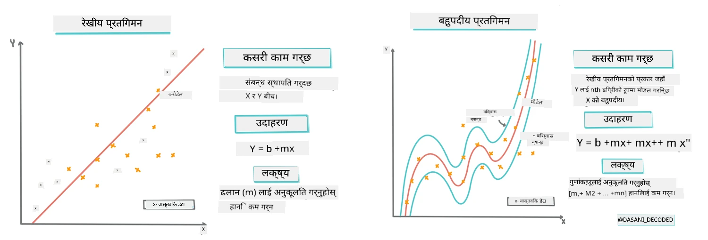
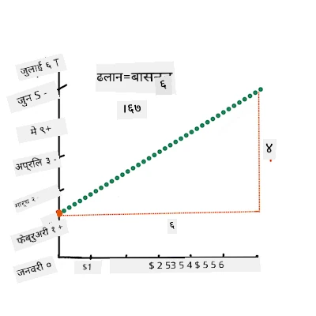
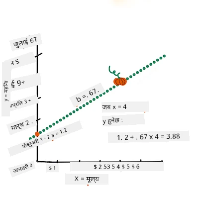
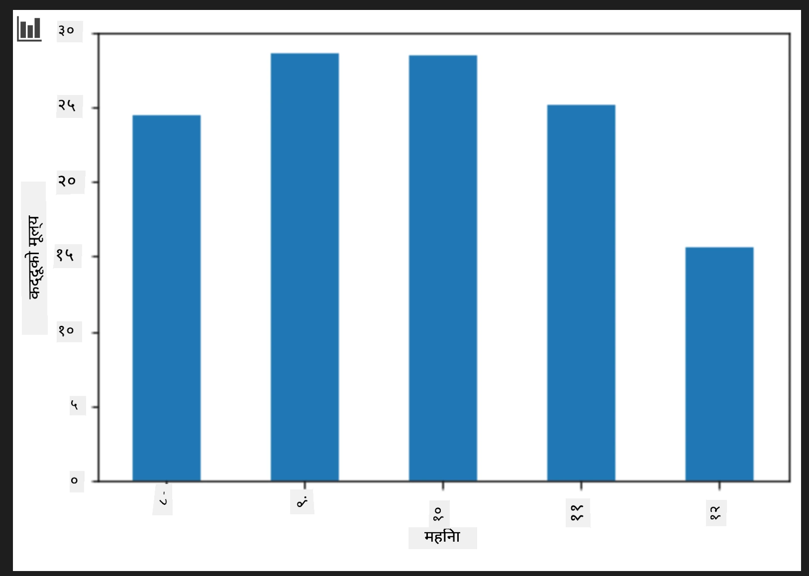
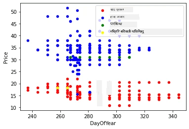

# Scikit-learn प्रयोग गरेर रिग्रेशन मोडेल बनाउने: चार तरिकाले रिग्रेशन

## शुरुवाती नोट

लाइनियर रिग्रेशन तब प्रयोग गरिन्छ जब हामी **संख्यात्मक मान** (उदाहरणका लागि, घरको मूल्य, तापमान, वा बिक्री) भविष्यवाणी गर्न चाहन्छौं।  
यो इनपुट विशेषताहरू र आउटपुट बीचको सम्बन्धलाई सबैभन्दा राम्रो प्रतिनिधित्व गर्ने सिधा रेखा खोजेर काम गर्छ।

यस पाठमा, हामी अवधारणा बुझ्नमा ध्यान केन्द्रित गर्छौं, र थप उन्नत रिग्रेशन प्रविधिहरू अन्वेषण गर्नु अघि।  
  
> इनफोग्राफिक द्वारा [दसानी मडिपल्लि](https://twitter.com/dasani_decoded)

## [पाठ अघि प्रश्नोत्तरी](https://ff-quizzes.netlify.app/en/ml/)

> ### [यो पाठ R मा उपलब्ध छ!](../../../../2-Regression/3-Linear/solution/R/lesson_3.html)

### परिचय

अहिलेसम्म तपाईंले के हो रिग्रेशन भनेर बुझ्नुभयो, र यसलाई कद्दू मूल्य निर्धारण डाटासेटबाट सङ्कलित नमूना डाटासँग प्रयोग गर्नुभयो जुन हामी यस पाठमा प्रयोग गर्दैछौं। तपाईंले Matplotlib प्रयोग गरेर यसको भिजुअलाइजेसन पनि गर्नुभयो।

अब तपाईं ML को लागि रिग्रेशनमा अझ गहिराईमा जान तयार हुनुहुन्छ। भिजुअलाइजेसनले डाटालाई बुझ्न मद्दत गर्छ, तर मेशिन लर्निङको वास्तविक शक्ति _मोडेलहरू ट्रेन्ड_ बाट आउँछ। मोडेलहरू ऐतिहासिक डाटामा ट्रेन्ड गरिन्छन् ताकि तिनीहरू स्वतः डेटा निर्भरताहरू समात्न सकून्, र नयाँ डाटाको लागि भविष्यवाणी गर्न सकून्, जुन मोडेलले पहिले देखेको हुँदैन।

यस पाठमा, तपाईंले दुई प्रकारका रिग्रेशन बारे थप सिक्नु हुनेछ: _बेसिक लाइनियर रिग्रेशन_ र _बहुपद रिग्रेशन_, साथै यी प्रविधिहरू अन्तर्गत केहि गणित पनि। ती मोडेलहरूले हामीलाई कद्दूका मूल्यहरू विभिन्न इनपुट डाटामा निर्भर गर्दै भविष्यवाणी गर्न सक्षम बनाउनेछन्।

[](https://youtu.be/CRxFT8oTDMg "ML for beginners - Understanding Linear Regression")

> 🎥 माथिको छवि क्लिक गरेर लाइनियर रिग्रेशनको छोटो भिडियो अवलोकन हेर्नुहोस्।

> यस पाठ्यक्रमभरि, हामी न्यूनतम गणितीय ज्ञान मान्नेछौं, र अन्य क्षेत्रका विद्यार्थीहरूका लागि सजिलो बनाउन नोटहरू, 🧮 कलआउटहरू, चित्रहरू, र अन्य सिकाइ उपकरणहरू प्रयोग गर्नेछौं।

### पूर्व आवश्यक

तपाईंले अब सम्म कद्दू डाटाको संरचनासँग परिचित हुनु पर्छ जुन हामी जाँच गर्दैछौं। यो डाटा यस पाठको _notebook.ipynb_ फाइलमा प्रीलोड गरिएको र पूर्व-सफा गरिएको छ। उक्त फाइलमा, कद्दूको मूल्य प्रति बसल नयाँ डाटा फ्रेममा देखाइएको छ। Visual Studio Code कोर्नेलहरूमा यी नोटबुकहरू चलाउन सक्नु पर्छ।

### तयारी

बिर्सनु हुँदैन, तपाईं यस डाटा लोड गर्दै हुनु हुन्छ प्रश्न सोध्नको लागि।

- कद्दू किन्ने सबैभन्दा उत्तम समय कहिले हो?  
- मलाई मिनिएचर कद्दूको एक केसको मूल्य कति अपेक्षा गर्न सक्छु?  
- के म तिनीहरूलाई आधा बसल झोला वा १ १/९ बसल बक्समा किन्ने?

हामी यस डाटामा अझ गहिराईमा पत्ता लगाउनेछौं।

अघिल्लो पाठमा, तपाईंले Pandas डाटा फ्रेम सिर्जना गर्नुभयो र मूल डाटासेटको अंशबाट यसलाई भरेर मूल्यलाई बसल अनुसार मानकीकृत गर्नुभयो। तर त्यसले लगभग ४०० डाटापोइन्ट मात्र र पतन महिनाहरूको लागि मात्र सङ्कलन गर्‍यो।

यो पाठ संगै आएको नोटबुकमा प्रीलोड गरिएको डाटा हेरौं। डाटा प्रीलोड गरिएको छ र प्रारम्भिक स्क्याटरप्लट बनाइएको छ जुन महिना डाटालाई देखाउँछ। सायद हामी डाटा अझ सफा गरेर यसको प्रकृतिबारे थोरै थप जानकारी पाउन सक्छौं।

## एक लाइनियर रिग्रेशन लाइन

பाठ्यक्रम 1 मा सिकेझैं, लाइनियर रिग्रेशनको उद्देश्य यस्तो रेखा प्लट गर्नु हो कि:

- **चरहरूको सम्बन्ध देखाउने**। चरहरू बीचको सम्बन्ध देखाउनुहोस्।  
- **भविष्यवाणी गर्ने**। नयाँ डाटापोइन्ट उक्त रेखाको सम्बन्धमा कहाँ पर्छ भनेर सही भविष्यवाणी गर्नुहोस्।  

यो प्रायः **लीस्ट-स्क्वेर्स रिग्रेशन** द्वारा गरिन्छ। "लीस्ट-स्क्वेर्स" शब्दले हाम्रो मोडेलमा कुल त्रुटि न्यूनतम गर्ने क्रममा हो। प्रत्येक डाटापोइन्टमा, हामी वास्तविक बिन्दु र हाम्रो रिग्रेशन रेखा बीचको उर्ध्वाधर दूरी (जिसलाई अवशिष्ट भनिन्छ) मापन गर्छौं।

हामी यी दूरीहरू वर्ग गर्द्छौं दुई मुख्य कारणले:

1. **दिशाको सट्टा परिमाण:** हामी -5 त्रुटिलाई +5 त्रुटि जस्तै व्यवहार गर्न चाहन्छौं। वर्गले सबै मानहरू सकारात्मक बनाउँछ।  
2. **आउट्लायरहरूलाई दण्ड:** वर्गले ठूला त्रुटिहरूलाई बढी तौल दिन्छ, जसले रेखालाई फर्छ तिर नजिक राख्न बाध्य पार्छ।  

अनि हामी यी सबै वर्ग मानहरू जोड्छौं। हाम्रो उद्देश्य त्यो विशिष्ट रेखा फेला पार्नु हो जहाँ यो अन्तिम जम्मा सबैभन्दा कम हुन्छ - त्यसैले यसको नाम "लीस्ट-स्क्वेर्स"।

> **🧮 गणित देखाऊ**  
>  
> यो रेखा, जसलाई _सर्वोत्तम फिट लाइन_ भनिन्छ, [एक समीकरण] (https://en.wikipedia.org/wiki/Simple_linear_regression) द्वारा व्यक्त गर्न सकिन्छ:  
>  
> ```
> Y = a + bX
> ```
>  
> `X` लाई 'व्याख्यात्मक चर' भनिन्छ। `Y` लाई 'निर्भर चर' भनिन्छ। रेखाको ढलान `b` हो र `a` y-अवरोध हो, जुन `X = 0` हुँदा `Y` को मान हो।  
>  
>  
>  
> पहिले, ढलान `b` गणना गर्नुहोस्। इनफोग्राफिक द्वारा [जन लुपर](https://twitter.com/jenlooper)  
>  
> अर्को शब्दमा, हाम्रो कद्दू डाटाको मूल प्रश्नमा सन्दर्भ गर्दै: "महिना अनुसार प्रति बसल कद्दूको मूल्य भविष्यवाणी गर्नुहोस्", यहाँ `X` मूल्य र `Y` बिक्रीको महिना हो।  
>  
>  
>  
> `Y` को मान गणना गर्नुहोस्। यदि तपाईं लगभग $4 तिर्नुहुन्छ भने, त्यो अप्रिल हुनुपर्छ! इनफोग्राफिक द्वारा [जन लुपर](https://twitter.com/jenlooper)  
>  
> रेखा गणनाले ढलान देखाउनु पर्छ, जसले अवरोधमा पनि निर्भर गर्दछ, अर्थात् `X = 0` हुँदा `Y` कहाँ हुन्छ।  
>  
> यी मानहरूको गणनाको विधि तपाईं [Math is Fun](https://www.mathsisfun.com/data/least-squares-regression.html) वेबसाइटमा हेर्न सक्नुहुन्छ। साथै, [यो लीस्ट-स्क्वेर्स क्याल्कुलेटर](https://www.mathsisfun.com/data/least-squares-calculator.html) मा गएर कसरी मानहरूले रेखालाई असर गर्छन् हेर्न सक्नुहुन्छ।

## सहसंबन्ध

अर्को बुझ्न पर्ने शब्द हो **सहसंबन्ध गुणांक (Correlation Coefficient)** दिइएको X र Y चरहरू बीच। स्क्याटरप्लट प्रयोग गरेर तपाईं यो गुणांकलाई छिटो भिजुअलाइज गर्न सक्नुहुन्छ। यदि डाटापोइन्टहरू सिधा रेखामा फैलिएका छन् भने उच्च सहसंबन्ध हुन्छ, तर यदि डाटापोइन्टहरू X र Y बीच जहिले तहाँभर छरिदा तल घटेको हुन्छ।

एक राम्रो लाइनियर रिग्रेशन मोडेलमा उच्च (0 भन्दा 1 नजिक) सहसंबन्ध गुणांक हुने गर्छ, जसले लीस्ट-स्क्वेर्स मेथडको साथ रिग्रेशन लाइन प्रयोग गर्छ।

✅ यस पाठसँगै आएको नोटबुक चलाउनुहोस् र महिना र मूल्यको स्क्याटरप्लट हेर्नुहोस्। तपाईंको दृश्य व्याख्यान अनुसार कद्दू बिक्रीको लागि महिना र मूल्यबीच सहसंबन्ध उच्च हो कि कम? यदि तपाईंले `महिना` सट्टा थप सूक्ष्म मापन (उदाहरणका लागि वर्षको दिन) प्रयोग गर्नुभयो भने के परिवर्तन हुन्छ?

तलको कोडमा, हामी मान्छौं कि डाटा सफा गरेको छौं र `new_pumpkins` नामक डाटा फ्रेम प्राप्त छ, जस्तै निम्न:

ID | Month | DayOfYear | Variety | City | Package | Low Price | High Price | Price  
---|-------|-----------|---------|------|---------|-----------|------------|-------  
70 | 9 | 267 | PIE TYPE | BALTIMORE | 1 1/9 bushel cartons | 15.0 | 15.0 | 13.636364  
71 | 9 | 267 | PIE TYPE | BALTIMORE | 1 1/9 bushel cartons | 18.0 | 18.0 | 16.363636  
72 | 10 | 274 | PIE TYPE | BALTIMORE | 1 1/9 bushel cartons | 18.0 | 18.0 | 16.363636  
73 | 10 | 274 | PIE TYPE | BALTIMORE | 1 1/9 bushel cartons | 17.0 | 17.0 | 15.454545  
74 | 10 | 281 | PIE TYPE | BALTIMORE | 1 1/9 bushel cartons | 15.0 | 15.0 | 13.636364

> डाटा सफा गर्ने कोड [`notebook.ipynb`](notebook.ipynb) मा उपलब्ध छ। हामीले अघिल्लो पाठमा जस्तै सफाइ गरेका छौं, र `DayOfYear` स्तम्भ गणना गर्न तलको अभिव्यक्ति प्रयोग गरेका छौं:

```python
day_of_year = pd.to_datetime(pumpkins['Date']).apply(lambda dt: (dt-datetime(dt.year,1,1)).days)
```
  
अब, तपाईंले लाइनियर रिग्रेशनको पछाडि गणित बुझिसक्नुभएपछि, हामी रिग्रेशन मोडेल सिर्जना गर्नेछौं र हेर्नेछौं कि कुन कद्दू प्याकेजको मूल्य सबैभन्दा राम्रो भविष्यवाणी गर्न सक्छौं कि सक्दैनौं। कसैले पनि छुट्टै कद्दू प्याचका लागि कद्दू खरीद गर्दा यो जानकारी आफ्नो खरिदलाई अनुकूल बनाउन चाहनेछ।

## सहसंबन्ध खोज्दै

[](https://youtu.be/uoRq-lW2eQo "ML for beginners - Looking for Correlation: The Key to Linear Regression")

> 🎥 माथिको छवि क्लिक गरेर सहसंबन्धको छोटो भिडियो अवलोकन हेर्नुहोस्।

अघिल्लो पाठबाट तपाईंले देख्नुभएको होला कि विभिन्न महिनाहरूको औसत मूल्य यसरी देखिन्छ:



यसले केहि सहसंबन्ध हुनुपर्ने संकेत दिन्छ, र हामी `Month` र `Price` बीच, वा `DayOfYear` र `Price` बीचको सम्बन्ध भविष्यवाणी गर्न लाइनियर रिग्रेशन मोडेल ट्रेन्ड गर्ने प्रयास गर्न सक्छौं। यहाँ तलको सम्बन्ध देखाउने स्क्याटर प्लट छ:


`corr` फंक्शन प्रयोग गरेर सहसंबन्ध छ कि छैन जाँचौं:

```python
print(new_pumpkins['Month'].corr(new_pumpkins['Price']))
print(new_pumpkins['DayOfYear'].corr(new_pumpkins['Price']))
```
  
तपाईं देख्न सक्नुहुन्छ सहसंबन्ध सानो छ, `Month` अनुसार -0.15 र `DayOfYear` अनुसार -0.17, तर अर्को महत्त्वपूर्ण सम्बन्ध हुन सक्छ। देखिन्छ मूल्यहरू विभिन्न कद्दू प्रजातिहरूसँग सम्बन्धित विभिन्न क्लस्टरहरूमा छन्। यो प्रमाणीकरणका लागि, प्रत्येक कद्दू वर्गलाई फरक रंगमा प्लट गरौं। `scatter` plotting function मा `ax` प्यारामिटर पास गरेर हामी सबै पोइन्टहरू एउटै ग्राफमा प्लट गर्न सक्छौं:

```python
ax=None
colors = ['red','blue','green','yellow']
for i,var in enumerate(new_pumpkins['Variety'].unique()):
    df = new_pumpkins[new_pumpkins['Variety']==var]
    ax = df.plot.scatter('DayOfYear','Price',ax=ax,c=colors[i],label=var)
```
  


हाम्रो अनुसन्धानले देखाउँछ कि प्रजातिले बिक्री मितिको तुलनामा मूल्यमा बढी प्रभाव पार्छ। हामी बार ग्राफबाट यो देख्न सक्छौं:

```python
new_pumpkins.groupby('Variety')['Price'].mean().plot(kind='bar')
```
  


अहिले हामी केवल 'pie type' कद्दू प्रजातिमा ध्यान केन्द्रित गरौं, र मितिले मूल्यमा कस्तो प्रभाव पार्छ हेर्नुहोस्:

```python
pie_pumpkins = new_pumpkins[new_pumpkins['Variety']=='PIE TYPE']
pie_pumpkins.plot.scatter('DayOfYear','Price') 
```


यदि हामी `Price` र `DayOfYear` बीचको सहसंबन्ध `corr` बाट गणना गर्छौं भने, लगभग `-0.27` पाइन्छ - जुन अर्थ हुन सक्छ कि पूर्वानुमान मोडेल ट्रेनिङ गर्नु उपयुक्त हुन्छ।

> लाइनियर रिग्रेशन मोडेल ट्रेन गर्नु अघि, डाटा सफा हुनु जरूरी छ। लाइनियर रिग्रेशन हराइरहेको मानहरूसँग राम्रो काम गर्दैन, त्यसैले सबै खाली सेलहरू हटाउनु ठीक हुन्छ:

```python
pie_pumpkins.dropna(inplace=True)
pie_pumpkins.info()
```
  
अर्को उपाय भनेको त्यो खाली मानहरूलाई सम्बद्ध स्तम्भको औसत मानले भर्नु हो।

## सरल लाइनियर रिग्रेशन

[](https://youtu.be/e4c_UP2fSjg "ML for beginners - Linear and Polynomial Regression using Scikit-learn")

> 🎥 माथिको छवि क्लिक गरेर लाइनियर र बहुपद रिग्रेशनको छोटो भिडियो अवलोकन हेर्नुहोस्।

हामी हाम्रो लाइनियर रिग्रेशन मोडेल प्रशिक्षित गर्न **Scikit-learn** लाइब्रेरी प्रयोग गर्नेछौं।

```python
from sklearn.linear_model import LinearRegression
from sklearn.metrics import mean_squared_error
from sklearn.model_selection import train_test_split
```
  
हामी इनपुट (विशेषताहरू) र अपेक्षित आउटपुट (लेबल) लाई अलग-अलग numpy arrays मा छुट्याएर शुरू गर्नेछौं:

```python
X = pie_pumpkins['DayOfYear'].to_numpy().reshape(-1,1)
y = pie_pumpkins['Price']
```
  
> ध्यान दिनुहोस्, हामीले इनपुट डाटामा `reshape` गर्नु परेको छ ताकि लाइनियर रिग्रेशन प्याकेजले यसलाई सही रूपमा बुझोस्। लाइनियर रिग्रेशनले 2D-array इनपुट चाहिन्छ, जहाँ प्रत्येक पङ्क्ति इनपुट विशेषता भेक्टर हुन्छ। हाम्रो अवस्थामा एक मात्र इनपुट हुनाले, N×1 आकारको array चाहिन्छ, जहाँ N डाटासेट साइज हो।

त्यसपछि, हामी डाटालाई ट्रेन र टेस्ट डाटासेटमा विभाजित गर्नुपर्छ, ताकि हामी मोडेललाई ट्रेन गरेपछि मान्यता गर्न सकौं:

```python
X_train, X_test, y_train, y_test = train_test_split(X, y, test_size=0.2, random_state=0)
```
  
अन्त्यमा, लाइनियर रिग्रेशन मोडेललाई प्रशिक्षित गर्न दुई लाइन कोड मात्र लग्छ। हामीले `LinearRegression` वस्तु define गर्छौं, र `fit` मेथड प्रयोग गरी डाटामा मोडेललाई फिट गर्छौं:

```python
lin_reg = LinearRegression()
lin_reg.fit(X_train,y_train)
```

`fit` गरेपछि `LinearRegression` वस्तुमा रेग्रेसनका सबै गुणांकहरू हुन्छन्, जुन `.coef_` सम्पत्तिबाट पहुँच गर्न सकिन्छ। हाम्रो केसमा, त्यहाँ एक मात्र गुणांक छ, जुन करिब `-0.017` हुनुपर्छ। यसको अर्थ मूल्यहरू समयसँग केहि घट्ने देखिन्छ, तर धेरै होइन, करिब २ सेन्ट प्रति दिन। हामी रेग्रेसनको Y-अक्षसँगको अतिक्रमण बिन्दु `lin_reg.intercept_` बाट पनि पहुँच गर्न सक्छौं — यो हाम्रो केसमा करिब `21` हुन्छ, जसले वर्षको सुरुवातमा मूल्य जनाउँछ।

हाम्रो मोडेल कति सही छ हेर्नका लागि, हामी परीक्षण डेटासेटमा मूल्यहरू पूर्वानुमान गर्न सक्छौं, र त्यसपछि हाम्रो पूर्वानुमानहरू अपेक्षित मानहरूसँग कति नजिक छन् मापन गर्न सक्छौं। यो रूट मीन स्क्वायर त्रुटि (RMSE) मेट्रिक्स प्रयोग गरेर गर्न सकिन्छ, जुन अपेक्षित र पूर्वानुमान मानबीच सबै वर्गीकृत फरकहरूको मीनको मूलांक हो।

```python
pred = lin_reg.predict(X_test)

rmse = np.sqrt(mean_squared_error(y_test,pred))
print(f'RMSE: {rmse:3.3} ({rmse/np.mean(pred)*100:3.3}%)')
```

हाम्रो त्रुटि करिब २ अङ्क जस्तो देखिन्छ, जुन ~१७% हो। धेरै राम्रो छैन। मोडेल गुणस्तरको अर्को सूचक **निर्धारण गुणांक** हो, जसलाई यसरी प्राप्त गर्न सकिन्छ:

```python
score = lin_reg.score(X_train,y_train)
print('Model determination: ', score)
```
 यदि मान ० छ भने यसको अर्थ मोडेलले इनपुट डेटालाई ध्यानमा लिँदैन, र *सबैभन्दा खराब रेखीय पूर्वानुमानकर्ता* जस्तै व्यवहार गर्छ, जुन केवल नतिजाको माध्य मान हो। मान १ भनेको हामी सबै अपेक्षित नतिजाहरू पूर्णतः पूर्वानुमान गर्न सक्छौं भन्ने हो। हाम्रो केसमा, गुणांक करिब ०.०६ छ, जुन निकै कम हो।

हामी परीक्षण डेटालाई रेग्रेसन लाइनसँग सँगै प्लट गरेर हाम्रो केसमा रेग्रेसन कस्तो काम गर्छ भन्ने कुरा राम्रोसँग देख्न सक्छौं:

```python
plt.scatter(X_test,y_test)
plt.plot(X_test,pred)
```


## बहुपद रेग्रेसन

रेखीय रेग्रेसनको अर्को प्रकार हो बहुपद रेग्रेसन। कहिलेकाहीँ चरहरू बीच रेखीय सम्बन्ध हुन्छ — भोल्युममा ठूलो कद्दु्दा, मूल्य उच्च हुन्छ — तर कहिलेकाहीँ यी सम्बन्धहरुलाई समतल वा सिधा रेखाले चित्रण गर्न सम्भव हुँदैन।

✅ यहाँ [अझ केही उदाहरणहरू](https://online.stat.psu.edu/stat501/Lesson09#polynomial-regression-examples) छन् जसमा बहुपद रेग्रेसन प्रयोग गर्न सकिन्छ।

मिति र मूल्य बीचको सम्बन्धलाई अर्को पटक हेर्नुहोस्। के यो स्क्याटरप्लट अनिवार्य रूपमा सिधा रेखाबाट विश्लेषण गर्नुपर्छ जस्तो लाग्छ? के मूल्यहरू उतारचढाव हुन सक्दैन? यस्तो अवस्थामा बहुपद रेग्रेसन प्रयोग गर्न सकिन्छ।

✅ बहुपदहरू गणितीय अभिव्यक्तिहरू हुन् जसले एक वा बढी चरहरू र गुणांकहरू समावेश गर्न सक्छन्।

बहुपद रेग्रेसनले अमन पर्ने डेटा फिट गर्न वक्र रेखा सिर्जना गर्छ। हाम्रो केसमा, यदि हामीले इनपुट डेटा मा वर्ग गरिएको `DayOfYear` भेरिएबल समावेश गर्यौं भने, हामीले वर्षभित्र एक निश्चित बिन्दुमा न्यूनतम हुने परवलिक वक्र फिट गर्न सक्नेछौं।

Scikit-learnमा उपयोगी [पाइपलाइन API](https://scikit-learn.org/stable/modules/generated/sklearn.pipeline.make_pipeline.html?highlight=pipeline#sklearn.pipeline.make_pipeline) छ जसले डेटा प्रक्रिया गर्ने विभिन्न चरणहरू संयुक्त गर्न मद्दत गर्छ। एक **पाइपलाइन** भनेको **एस्टीमेटरहरू** को श्रृंखला हो। हाम्रो केसमा, हामी एक पाइपलाइन बनाउनेछौं जसले पहिले हाम्रो मोडेलमा बहुपद सुविधाहरू थप्छ, र त्यसपछि रेग्रेसन तालिम दिन्छ:

```python
from sklearn.preprocessing import PolynomialFeatures
from sklearn.pipeline import make_pipeline

pipeline = make_pipeline(PolynomialFeatures(2), LinearRegression())

pipeline.fit(X_train,y_train)
```

`PolynomialFeatures(2)` प्रयोग गर्दा हामीले इनपुट डाटाबाट सबै दोस्रो-डिग्री बहुपदहरू समावेश गर्नेछौं। हाम्रो केसमा यसको अर्थ केवल `DayOfYear`<sup>2</sup> हुनेछ, तर दुई इनपुट भेरिएबल X र Y भएमा, यसले X<sup>2</sup>, XY र Y<sup>2</sup> थप्नेछ। हामी उच्च डिग्रीका बहुपदहरू पनि प्रयोग गर्न सक्छौं यदि चाहनु भयो भने।

पाइपलाइनहरूलाई मूल `LinearRegression` वस्तु जस्तै प्रयोग गर्न सकिन्छ, जसले हामीलाई पाइपलाइन `fit` गर्न र त्यसपछि `predict` प्रयोग गरेर पूर्वानुमान परिणाम प्राप्त गर्न दिन्छ:

```python
pred = pipeline.predict(X_test)

rmse = np.sqrt(mean_squared_error(y_test,pred))
print(f'RMSE: {rmse:3.3} ({rmse/np.mean(pred)*100:3.3}%)')

score = pipeline.score(X_train,y_train)
print('Model determination: ', score)
```

सम चक्रिको वक्र प्लट गर्न, हामी `np.linspace` प्रयोग गर्छौं जसले इनपुट मानहरू को समान दूरीको दायरा बनाउँछ, सिधै अव्यवस्थित परीक्षण डेटामा प्लट नगरि (जसले जिगज्याग रेखा उत्पादन गर्न सक्छ):

```python
X_range = np.linspace(X_test.min(), X_test.max(), 100).reshape(-1,1)
y_range = pipeline.predict(X_range)

plt.scatter(X_test, y_test)
plt.plot(X_range, y_range)
```

यहाँ परीक्षण डेटा र अनुमानित वक्र देखाउने ग्राफ छ:


बहुपद रेग्रेसन प्रयोग गर्दा, हामीले अलि कम RMSE र बढी निर्धारण पाउन सक्छौं, तर उल्लेखनीय रूपमा होइन। हामीले अन्य सुविधाहरूलाई पनि ध्यान दिनु आवश्यक छ!

> तपाईंले देख्न सक्नुहुन्छ कि न्यूनतम कद्दु मूल्यहरू प्रायः हेलोविन नजिक देखिन्छन्। तपाईं यसलाई कसरी व्याख्या गर्नुहुन्छ?

🎃 बधाई छ, तपाईंले एउटा मोडेल सिर्जना गर्नुभयो जुन पाई कद्दुको मूल्य पूर्वानुमान गर्न मद्दत गर्न सक्छ। तपाईं सम्भवतः सबै कद्दु प्रकारहरूका लागि यो प्रक्रिया दोहोर्याउन सक्नुहुन्छ, तर त्यो थोरै श्रोतलाग्दो हुनेछ। अब सिकौँ हामीले हाम्रो मोडेलमा कद्दु विविधतालाई कसरी ध्यानमा राख्ने।

## वर्गीकृत सुविधाहरू

आदर्श संसारमा, हामी एउटै मोडेल प्रयोग गरी विभिन्न कद्दु किसिमहरूका मूल्यहरू पूर्वानुमान गर्न चाहन्छौं। तर, `Variety` स्तम्भ केही फरक हुन्छ `Month` जस्ता स्तम्भहरूबाट किनकि यसमा सङ्ख्यात्मक नभएको मानहरू हुन्छन्। यस्ता स्तम्भहरूलाई **वर्गीकृत (categorical)** भन्दछ।

[](https://youtu.be/DYGliioIAE0 "ML for beginners - Categorical Feature Predictions with Linear Regression")

> 🎥 माथिको तस्वीर क्लिक गरेर वर्गीकृत सुविधाहरूको प्रयोग सम्बन्धी छोटो भिडियो अवलोकन हेर्नुहोस्।

यहाँ तपाईंले विविधतामा आधारित औसत मूल्य हेर्न सक्नुहुन्छ:


विविधतालाई ध्यानमा राख्न, हामीले पहिले यसलाई सङ्ख्यात्मक रूपमा रूपान्तरण गर्नुपर्छ, वा **एन्कोड** गर्नुपर्छ। यसका लागि विभिन्न तरिकाहरू छन्:

* साधारण **सङ्ख्यात्मक एन्कोडिङ** ले विभिन्न किसिमहरूको तालिका बनाउँछ र त्यसपछि विविधता नामलाई तालिकाको अनुक्रमांकले रिप्लेस गर्छ। योlinear regression को लागि उत्तम विकल्प होइन किनकि linear regression ले अनुक्रमांकको वास्तविक सङ्ख्यात्मक मान लिन्छ र नतिजामा कुनै गुणांकले गुण गर्नेछ। हाम्रो केसमा अनुक्रमांक र मूल्यका बीच सम्बन्ध स्पष्ट गैर-रेखीय छ, चाहे हामी अनुक्रमांकहरूलाई कुनै विशेष तरिकाले क्रमबद्ध गरौं।
* **वन-हट एन्कोडिङ** ले `Variety` स्तम्भलाई ४ फरक स्तम्भहरूमा रूपान्तरण गर्छ, प्रत्येक किसिमको लागि एउटा स्तम्भ। प्रत्येक स्तम्भमा १ हुन्छ यदि उक्त पङ्क्ति त्यस किसिमको हो, नत्र ०। यसले linear regression मा चार वटा गुणांक हुनेछ, प्रत्येक कद्दु विविधताको लागि, जुन त्यो विविधताका "शुरुवाती मूल्य" (वा "अतिरिक्त मूल्य") को जिम्मेवारी लिन्छ।

तलको कोडले हामीलाई वन-हट एन्कोड कसरी गर्ने देखाउँछ:

```python
pd.get_dummies(new_pumpkins['Variety'])
```

 ID | FAIRYTALE | MINIATURE | MIXED HEIRLOOM VARIETIES | PIE TYPE
----|-----------|-----------|--------------------------|----------
70 | 0 | 0 | 0 | 1
71 | 0 | 0 | 0 | 1
... | ... | ... | ... | ...
1738 | 0 | 1 | 0 | 0
1739 | 0 | 1 | 0 | 0
1740 | 0 | 1 | 0 | 0
1741 | 0 | 1 | 0 | 0
1742 | 0 | 1 | 0 | 0

वन-हट एन्कोड गरिएको विविधतालाई इनपुटका रूपमा लिएर linear regression तालिम दिन, हामीले `X` र `y` डाटा सही तरिकाले प्रारम्भ गर्नुपर्छ:

```python
X = pd.get_dummies(new_pumpkins['Variety'])
y = new_pumpkins['Price']
```

बाकी कोड पहिले प्रयोग गरेको linear regression तालिम जस्तै नै हो। यदि तपाईं यो प्रयास गर्नु भयो भने, तपाईंले देख्नुहुनेछ कि मीन स्क्वायर त्रुटि लगभग समान छ, तर हामी धेरै उच्च निर्धारण गुणांक (~७७%) प्राप्त गर्छौं। अझै बढी सही भविष्यवाणीका लागि, हामीले अन्य वर्गीकृत सुविधाहरू र सङ्ख्यात्मक सुविधाहरू पनि ध्यानमा लिन सक्दछौं, जस्तै `Month` वा `DayOfYear`। सबै सुविधाहरू एउटै ठूलो एरेमा ल्याउन `join` प्रयोग गर्न सकिन्छ:

```python
X = pd.get_dummies(new_pumpkins['Variety']) \
        .join(new_pumpkins['Month']) \
        .join(pd.get_dummies(new_pumpkins['City'])) \
        .join(pd.get_dummies(new_pumpkins['Package']))
y = new_pumpkins['Price']
```

यहाँ हामीले `City` र `Package` प्रकार पनि ध्यानमा लिएर RMSE 2.84 (10.5%) र निर्धारण 0.94 पाएका छौं।

## सबै कुरा सँगै राख्दै

सबैभन्दा राम्रो मोडेल बनाउन हामी माथि देखाएको संयुक्त (वन-हट एन्कोड गरिएको वर्गीकृत + सङ्ख्यात्मक) डेटा बहुपद रेग्रेसनसँग सँगै प्रयोग गर्न सक्छौं। तपाईंको सुविधाका लागि यहाँ पूर्ण कोड छ:

```python
# तालिम डेटा सेटअप गर्नुहोस्
X = pd.get_dummies(new_pumpkins['Variety']) \
        .join(new_pumpkins['Month']) \
        .join(pd.get_dummies(new_pumpkins['City'])) \
        .join(pd.get_dummies(new_pumpkins['Package']))
y = new_pumpkins['Price']

# ट्रेन-टेस्ट विभाजन गर्नुहोस्
X_train, X_test, y_train, y_test = train_test_split(X, y, test_size=0.2, random_state=0)

# पाइपलाइन सेटअप र तालिम गर्नुहोस्
pipeline = make_pipeline(PolynomialFeatures(2), LinearRegression())
pipeline.fit(X_train,y_train)

# परीक्षण डेटाका लागि परिणाम अनुमान गर्नुहोस्
pred = pipeline.predict(X_test)

# RMSE र निर्धारण गणना गर्नुहोस्
rmse = mean_squared_error(y_test, pred, squared=False)
print(f'RMSE: {rmse:3.3} ({rmse/pred.mean()*100:3.3}%)')

score = pipeline.score(X_train,y_train)
print('Model determination: ', score)
```

यसले हामीलाई लगभग ९७% निर्धारण गुणांक र RMSE=2.23 (~८% पूर्वानुमान त्रुटि) दिनेछ।

| मोडेल | RMSE | निर्धारण |
|-------|-----|----------|
| `DayOfYear` रेखीय | 2.77 (17.2%) | 0.07 |
| `DayOfYear` बहुपद | 2.73 (17.0%) | 0.08 |
| `Variety` रेखीय | 5.24 (19.7%) | 0.77 |
| सबै सुविधाहरू रेखीय | 2.84 (10.5%) | 0.94 |
| सबै सुविधाहरू बहुपद | 2.23 (8.25%) | 0.97 |

🏆 राम्रो गर्नुभयो! तपाईंले एउटै पाठमा चार वटा रेग्रेसन मोडेलहरू सिर्जना गर्नुभयो, र मोडेल गुणस्तर ९७% सम्म सुधार गर्नुभयो। रेग्रेसनको अन्तिम भागमा तपाईंले Logistic Regression सिक्नुहुनेछ जसले वर्गहरू निर्धारण गर्छ।

---
## 🚀 चुनौती

यस नोटबुकमा विभिन्न भेरिएबलहरू परीक्षण गरेर हेर्नुहोस् कि सहसंबन्ध कसरी मोडेलको सटीकताको साथ मेल खान्छ।

## [पाठ पछि क्विज](https://ff-quizzes.netlify.app/en/ml/)

## समीक्षा र आत्म-अध्ययन

यस पाठमा हामीले Linear Regression सिक्यौं। अन्य महत्वपूर्ण प्रकारका Regression पनि छन्। Stepwise, Ridge, Lasso र Elasticnet प्राविधिहरूको बारेमा पढ्नुहोस्। सिक्न राम्रो कोर्स हो [Stanford Statistical Learning course](https://online.stanford.edu/courses/sohs-ystatslearning-statistical-learning)

## असाइनमेन्ट

[मोडेल बनाउनुहोस्](assignment.md)

---

<!-- CO-OP TRANSLATOR DISCLAIMER START -->
**अस्वीकरण**:  
यस कागजातलाई AI अनुवाद सेवा [Co-op Translator](https://github.com/Azure/co-op-translator) प्रयोग गरी अनुवाद गरिएको हो। हामी शुद्धताका लागि प्रयासरत छौं, तथापि कृत्रिम अनुवादमा त्रुटि वा अशुद्धता हुन सक्ने कुरा कृपया बुझ्नुहोस्। मूल कागजात त्यसको मूल भाषामा आधिकारिक स्रोतको रूपमा मानिनेछ। महत्वपूर्ण जानकारीको लागि, व्यावसायिक मानव अनुवाद सिफारिस गरिन्छ। यस अनुवादको प्रयोगबाट उत्पन्न हुने कुनै पनि गलतफहमी वा गलत व्याख्याका लागि हामी उत्तरदायी छैनौं।
<!-- CO-OP TRANSLATOR DISCLAIMER END -->