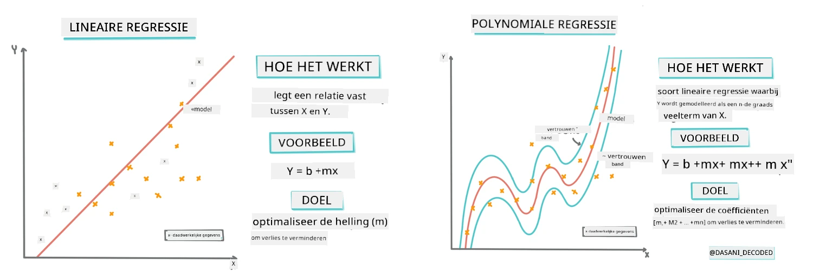
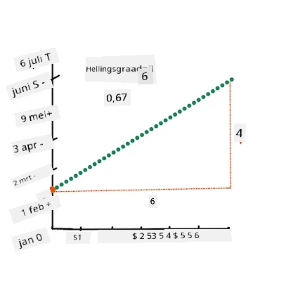
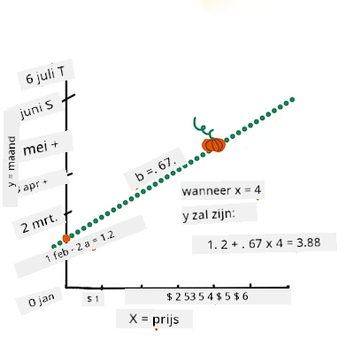
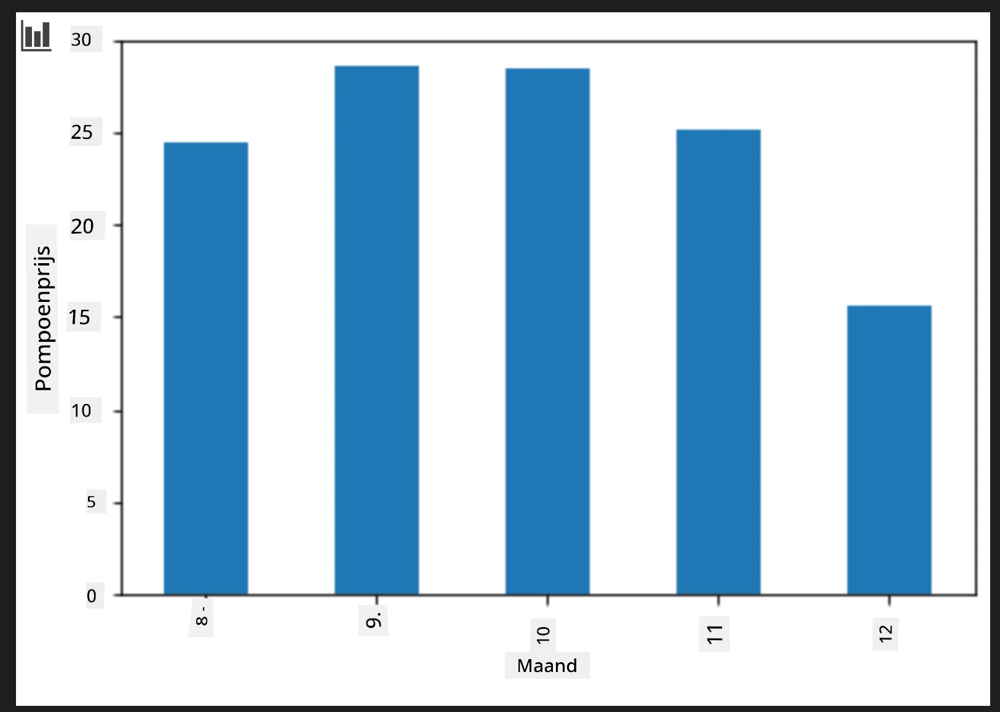
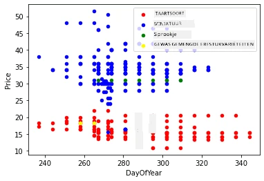

# Bouw een regressiemodel met Scikit-learn: regressie op vier manieren

## Aantekening voor beginners

Lineaire regressie wordt gebruikt wanneer we een **numerieke waarde** willen voorspellen (bijvoorbeeld huisprijs, temperatuur of verkoop).
Het werkt door een rechte lijn te vinden die de relatie tussen invoerkenmerken en de uitvoer het beste weergeeft.

In deze les richten we ons op het begrijpen van het concept voordat we meer geavanceerde regressietechnieken verkennen.

> Infographic door [Dasani Madipalli](https://twitter.com/dasani_decoded)
## [Voorcollege quiz](https://ff-quizzes.netlify.app/en/ml/)

> ### [Deze les is ook beschikbaar in R!](../../../../2-Regression/3-Linear/solution/R/lesson_3.html)
### Introductie

Tot nu toe heb je onderzocht wat regressie is met voorbeeldgegevens verzameld uit de pompoenprijzenset die we door deze les heen zullen gebruiken. Je hebt het ook gevisualiseerd met Matplotlib.

Nu ben je klaar om dieper in regressie voor ML te duiken. Terwijl visualisatie je helpt om gegevens te begrijpen, komt de echte kracht van Machine Learning van het _trainen van modellen_. Modellen worden getraind op historische gegevens om automatisch afhankelijkheden te leren, en ze maken het mogelijk voorspellingen te doen voor nieuwe gegevens die het model nog niet eerder heeft gezien.

In deze les leer je meer over twee types regressie: _basis lineaire regressie_ en _polynomiale regressie_, samen met enige wiskunde die deze technieken ten grondslag ligt. Deze modellen stellen ons in staat pompoenprijzen te voorspellen afhankelijk van verschillende invoergegevens.

[](https://youtu.be/CRxFT8oTDMg "ML voor beginners - Begrip van lineaire regressie")

> 🎥 Klik op de bovenstaande afbeelding voor een korte video-overzicht van lineaire regressie.

> Door deze curriculum heen gaan we uit van minimale wiskundige kennis en willen we het toegankelijk maken voor studenten uit andere vakgebieden, dus let op notities, 🧮 uitleg, diagrammen en andere leermiddelen ter ondersteuning van begrip.

### Vereisten

Je zou nu vertrouwd moeten zijn met de structuur van de pompoengegevens die we analyseren. Je kunt ze vooraf geladen en schoon aangetroffen vinden in het _notebook.ipynb_ bestand bij deze les. In het bestand wordt de pompoenprijs per boerentas weergegeven in een nieuw dataframe. Zorg dat je deze notebooks kunt uitvoeren binnen kernels in Visual Studio Code.

### Voorbereiding

Ter herinnering, je laadt deze gegevens om er vragen over te stellen.

- Wanneer is de beste tijd om pompoenen te kopen?
- Welke prijs kan ik verwachten voor een kistje miniatuurpompoenen?
- Moet ik ze kopen in half-boerentas manden of per doos van 1 1/9 boerentas?
Laten we verder graven in deze data.

In de vorige les heb je een Pandas dataframe gemaakt en gevuld met een deel van de originele dataset, waarbij de prijzen werden gestandaardiseerd per boerentas. Door dat te doen, kon je echter slechts ongeveer 400 data punten verzamelen en alleen voor de herfstmaanden.

Bekijk de gegevens die we vooraf geladen hebben in het bijbehorende notebook van deze les. De gegevens zijn al ingeladen en er is een eerste scatterplot gemaakt om maandgegevens te tonen. Misschien kunnen we meer details over de aard van de data vinden door het beter schoon te maken.

## Een lineaire regressielijn

Zoals je in Les 1 hebt geleerd, is het doel van een lineaire regressie-oefening om een lijn te tekenen om:

- **Variable relaties weergeven**. Toon de relatie tussen variabelen
- **Voorspellingen doen**. Maak nauwkeurige voorspellingen over waar een nieuw datapunt zich zou bevinden ten opzichte van die lijn.

Het is typisch voor de **Least-Squares Regression** om dit soort lijn te tekenen. De term “Least-Squares” verwijst naar het proces van het minimaliseren van de totale fout in ons model. Voor elk datapunt meten we de verticale afstand (genoemd residu) tussen het werkelijke punt en onze regressielijn.

Deze afstanden kwadrateren we om twee hoofdredenen:

1. **Grootte boven Richting:** We willen een fout van -5 hetzelfde behandelen als een fout van +5. Door kwadrateren worden alle waarden positief.

2. **Straffen van Uitschieters:** Kwadrateren geeft meer gewicht aan grotere fouten, waardoor de lijn dichter bij verafgelegen punten blijft.

Dan tellen we al deze gekwadrateerde waarden bij elkaar op. Ons doel is om die specifieke lijn te vinden waarbij deze uiteindelijke som het kleinst is (de kleinst mogelijke waarde)—vandaar de naam "Least-Squares".

> **🧮 Toon mij de wiskunde**
>
> Deze lijn, de _best passende lijn_ genoemd, kan worden uitgedrukt door [een vergelijking](https://en.wikipedia.org/wiki/Simple_linear_regression):
>
> ```
> Y = a + bX
> ```
>
> `X` is de 'verklarende variabele'. `Y` is de 'afhankelijke variabele'. De helling van de lijn is `b` en `a` is het snijpunt met de Y-as, wat verwijst naar de waarde van `Y` wanneer `X = 0`.
>
>
>
> Bereken eerst de helling `b`. Infographic door [Jen Looper](https://twitter.com/jenlooper)
>
> Met andere woorden, en verwijzend naar onze pompoengegevens en de oorspronkelijke vraag: "voorspel de prijs van een pompoen per boerentas per maand", zou `X` verwijzen naar de prijs en `Y` naar de maand van verkoop.
>
>
>
> Bereken de waarde van Y. Als je ongeveer $4 betaalt, moet het april zijn! Infographic door [Jen Looper](https://twitter.com/jenlooper)
>
> De wiskunde die de lijn berekent moet de helling van de lijn aantonen, die ook afhankelijk is van het intercept, oftewel waar `Y` gelegen is als `X = 0`.
>
> Je kunt de berekeningsmethode voor deze waarden bekijken op de [Math is Fun](https://www.mathsisfun.com/data/least-squares-regression.html) website. Bezoek ook [deze Least-squares calculator](https://www.mathsisfun.com/data/least-squares-calculator.html) om te zien hoe de waarde van getallen de lijn beïnvloedt.

## Correlatie

Een andere term die begrepen moet worden is de **Correlatiecoëfficiënt** tussen de gegeven X en Y variabelen. Met een scatterplot kun je deze coëfficiënt snel visualiseren. Een plot met datapoints netjes op een lijn heeft een hoge correlatie, terwijl een plot met punten verspreid over het veld tussen X en Y een lage correlatie heeft.

Een goed lineair regressiemodel is er een met een hoge (dichterbij 1 dan 0) Correlatiecoëfficiënt, gebruikmakend van de Least-Squares Regression-methode met een regressielijn.

✅ Voer de bij deze les behorende notebook uit en bekijk de scatterplot van Maand tot Prijs. Lijkt de data die Maand koppelt aan Prijs voor pompoenverkopen een hoge of lage correlatie te hebben, volgens jouw visuele interpretatie van de scatterplot? Verandert dit als je een fijnmaziger maat gebruikt in plaats van `Month`, bijvoorbeeld *dag van het jaar* (dus het aantal dagen sinds het begin van het jaar)?

In de hieronder volgende code gaan we ervan uit dat we de data hebben opgeschoond en een dataframe `new_pumpkins` hebben verkregen, vergelijkbaar met het volgende:

ID | Maand | DagVanHetJaar | Variëteit | Stad | Verpakking | Laagste Prijs | Hoogste Prijs | Prijs
---|-------|--------------|-----------|------|------------|---------------|---------------|-------
70 | 9 | 267 | PIE TYPE | BALTIMORE | 1 1/9 boerentas kartonnen doos | 15.0 | 15.0 | 13.636364
71 | 9 | 267 | PIE TYPE | BALTIMORE | 1 1/9 boerentas kartonnen doos | 18.0 | 18.0 | 16.363636
72 | 10 | 274 | PIE TYPE | BALTIMORE | 1 1/9 boerentas kartonnen doos | 18.0 | 18.0 | 16.363636
73 | 10 | 274 | PIE TYPE | BALTIMORE | 1 1/9 boerentas kartonnen doos | 17.0 | 17.0 | 15.454545
74 | 10 | 281 | PIE TYPE | BALTIMORE | 1 1/9 boerentas kartonnen doos | 15.0 | 15.0 | 13.636364

> De code om de data op te schonen is te vinden in [`notebook.ipynb`](notebook.ipynb). We hebben dezelfde schoonmaakstappen uitgevoerd als in de vorige les en hebben de kolom `DayOfYear` berekend met de volgende uitdrukking:

```python
day_of_year = pd.to_datetime(pumpkins['Date']).apply(lambda dt: (dt-datetime(dt.year,1,1)).days)
```

Nu je een begrip hebt van de wiskunde achter lineaire regressie, laten we een regressiemodel maken om te zien of we kunnen voorspellen welke verpakking pompoenen de beste pompoenprijzen zal hebben. Iemand die pompoenen koopt voor een pompoenpatch op vakantie zou deze informatie willen om zijn aankopen van pompoenverpakkingen voor de patch te optimaliseren.

## Op zoek naar correlatie

[](https://youtu.be/uoRq-lW2eQo "ML voor beginners - Op zoek naar correlatie: de sleutel tot lineaire regressie")

> 🎥 Klik op de afbeelding hierboven voor een korte video-overzicht van correlatie.

Uit de vorige les heb je waarschijnlijk gezien dat de gemiddelde prijs voor verschillende maanden er zo uitziet:



Dit suggereert dat er enige correlatie moet zijn, en we kunnen proberen een lineair regressiemodel te trainen om de relatie tussen `Month` en `Price` te voorspellen, of tussen `DayOfYear` en `Price`. Hier is de scatterplot die de laatste relatie toont:

 

Laten we kijken of er correlatie is met de functie `corr`:

```python
print(new_pumpkins['Month'].corr(new_pumpkins['Price']))
print(new_pumpkins['DayOfYear'].corr(new_pumpkins['Price']))
```

Het lijkt erop dat de correlatie vrij klein is, -0.15 voor `Month` en -0.17 voor `DayOfYear`, maar er kan een andere belangrijke relatie zijn. Het lijkt erop dat er verschillende clusters van prijzen zijn die overeenkomen met verschillende pompoenvariëteiten. Om deze hypothese te bevestigen, laten we elke pompoencategorie in een andere kleur plotten. Door een `ax`-parameter mee te geven aan de `scatter` functie kunnen we alle punten op dezelfde grafiek weergeven:

```python
ax=None
colors = ['red','blue','green','yellow']
for i,var in enumerate(new_pumpkins['Variety'].unique()):
    df = new_pumpkins[new_pumpkins['Variety']==var]
    ax = df.plot.scatter('DayOfYear','Price',ax=ax,c=colors[i],label=var)
```

 

Ons onderzoek suggereert dat variëteit een grotere invloed heeft op de algehele prijs dan de daadwerkelijke verkoopdatum. We kunnen dit zien met een staafdiagram:

```python
new_pumpkins.groupby('Variety')['Price'].mean().plot(kind='bar')
```

 

Laten we ons voor dit moment alleen richten op één pompoenvariëteit, het 'pie type', en zien wat het effect van de datum op de prijs is:

```python
pie_pumpkins = new_pumpkins[new_pumpkins['Variety']=='PIE TYPE']
pie_pumpkins.plot.scatter('DayOfYear','Price') 
```
 

Als we nu de correlatie tussen `Price` en `DayOfYear` berekenen met de functie `corr`, krijgen we iets als `-0.27` - wat betekent dat het zinvol is een voorspellend model te trainen.

> Voordat we een lineair regressiemodel trainen, is het belangrijk ervoor te zorgen dat onze data schoon is. Lineaire regressie werkt niet goed met ontbrekende waarden, dus het is zinvol om alle lege cellen te verwijderen:

```python
pie_pumpkins.dropna(inplace=True)
pie_pumpkins.info()
```

Een andere aanpak zou zijn om die lege waarden te vullen met gemiddelde waarden uit de overeenkomstige kolom.

## Eenvoudige lineaire regressie

[](https://youtu.be/e4c_UP2fSjg "ML voor beginners - Lineaire en polynomiale regressie met Scikit-learn")

> 🎥 Klik op de afbeelding hierboven voor een korte video-overzicht van lineaire en polynomiale regressie.

Om ons lineaire regressiemodel te trainen, gebruiken we de **Scikit-learn** bibliotheek.

```python
from sklearn.linear_model import LinearRegression
from sklearn.metrics import mean_squared_error
from sklearn.model_selection import train_test_split
```

We beginnen met het scheiden van invoerwaarden (features) en de verwachte uitvoer (label) in aparte numpy-arrays:

```python
X = pie_pumpkins['DayOfYear'].to_numpy().reshape(-1,1)
y = pie_pumpkins['Price']
```

> Merk op dat we `reshape` moesten toepassen op de invoergegevens zodat het Linear Regression-pakket het correct kan begrijpen. Lineaire regressie verwacht een 2D-array als invoer, waarin elke rij overeenkomt met een vector van invoerkenmerken. In ons geval, omdat we maar één invoer hebben, hebben we een array nodig met de vorm N×1, waarbij N de grootte van de dataset is.

Daarna moeten we de data splitsen in train- en testdatasets, zodat we ons model kunnen valideren na het trainen:

```python
X_train, X_test, y_train, y_test = train_test_split(X, y, test_size=0.2, random_state=0)
```

Ten slotte kost het trainen van het eigenlijke lineaire regressiemodel slechts twee regels code. We definiëren het `LinearRegression` object en passen het toe op onze data met de `fit`-methode:

```python
lin_reg = LinearRegression()
lin_reg.fit(X_train,y_train)
```

Het `LinearRegression`-object bevat na het `fit`-ten alle coëfficiënten van de regressie, die kunnen worden benaderd via de `.coef_`-eigenschap. In ons geval is er maar één coëfficiënt, die ongeveer `-0.017` zou moeten zijn. Dit betekent dat de prijzen met de tijd lijken te dalen, maar niet teveel, ongeveer 2 cent per dag. We kunnen ook het snijpunt van de regressie met de Y-as benaderen met `lin_reg.intercept_` - dit zal in ons geval rond de `21` liggen, wat de prijs aan het begin van het jaar aangeeft.

Om te zien hoe nauwkeurig ons model is, kunnen we prijzen voorspellen op een testdataset, en dan meten hoe dicht onze voorspellingen bij de verwachte waarden liggen. Dit kan worden gedaan met behulp van root mean square error (RMSE) metriek, wat de wortel is van het gemiddelde van alle gekwadrateerde verschillen tussen verwachte en voorspelde waarden.

```python
pred = lin_reg.predict(X_test)

rmse = np.sqrt(mean_squared_error(y_test,pred))
print(f'RMSE: {rmse:3.3} ({rmse/np.mean(pred)*100:3.3}%)')
```

Onze fout lijkt ongeveer 2 punten te zijn, wat ~17% is. Niet al te best. Een andere indicator van modelkwaliteit is de **coëfficiënt van determinatie**, die op de volgende manier kan worden verkregen:

```python
score = lin_reg.score(X_train,y_train)
print('Model determination: ', score)
```
Als de waarde 0 is, betekent dit dat het model geen rekening houdt met de invoergegevens en functioneert als de *slechtste lineaire voorspeller*, wat simpelweg een gemiddelde waarde van het resultaat is. Een waarde van 1 betekent dat we perfect alle verwachte uitkomsten kunnen voorspellen. In ons geval is de coëfficiënt ongeveer 0.06, wat vrij laag is.

We kunnen ook de testgegevens samen met de regressielijn plotten om beter te zien hoe regressie in ons geval werkt:

```python
plt.scatter(X_test,y_test)
plt.plot(X_test,pred)
```


## Polynomiale Regressie

Een ander type Lineaire Regressie is Polynomiale Regressie. Hoewel er soms een lineair verband is tussen variabelen - hoe groter de pompoen in volume, hoe hoger de prijs - kunnen deze verbanden soms niet worden uitgezet als een vlak of rechte lijn.

✅ Hier zijn [nog wat meer voorbeelden](https://online.stat.psu.edu/stat501/Lesson09#polynomial-regression-examples) van data die gebruik zouden kunnen maken van Polynomiale Regressie

Kijk nog eens goed naar het verband tussen Datum en Prijs. Lijkt deze scatterplot echt zo dat het noodzakelijk is deze met een rechte lijn te analyseren? Kunnen prijzen niet fluctueren? In dat geval kun je polynomiale regressie proberen.

✅ Polynomen zijn wiskundige uitdrukkingen die uit één of meer variabelen en coëfficiënten kunnen bestaan

Polynomiale regressie maakt een gebogen lijn om beter niet-lineaire data te modelleren. In ons geval, als we een gekwadrateerde `DayOfYear`-variabele opnemen in de invoergegevens, zouden we onze data moeten kunnen benaderen met een parabolische kromme, die een minimum heeft op een bepaald punt in het jaar.

Scikit-learn bevat een handige [pipeline API](https://scikit-learn.org/stable/modules/generated/sklearn.pipeline.make_pipeline.html?highlight=pipeline#sklearn.pipeline.make_pipeline) om verschillende stappen van dataverwerking te combineren. Een **pipeline** is een keten van **estimatoren**. In ons geval maken we een pipeline die eerst polynoomkenmerken toevoegt aan ons model, en daarna de regressie traint:

```python
from sklearn.preprocessing import PolynomialFeatures
from sklearn.pipeline import make_pipeline

pipeline = make_pipeline(PolynomialFeatures(2), LinearRegression())

pipeline.fit(X_train,y_train)
```

Het gebruik van `PolynomialFeatures(2)` betekent dat we alle tweedegraads polynomen van de invoergegevens meenemen. In ons geval betekent dit alleen `DayOfYear`<sup>2</sup>, maar met twee invoervariabelen X en Y zal dit X<sup>2</sup>, XY en Y<sup>2</sup> toevoegen. We kunnen ook hogere graad polynomen gebruiken indien gewenst.

Pipelines kunnen op dezelfde manier worden gebruikt als het originele `LinearRegression`-object, d.w.z. we kunnen de pipeline `fit`-ten en daarna `predict` gebruiken om voorspellingen te krijgen:

```python
pred = pipeline.predict(X_test)

rmse = np.sqrt(mean_squared_error(y_test,pred))
print(f'RMSE: {rmse:3.3} ({rmse/np.mean(pred)*100:3.3}%)')

score = pipeline.score(X_train,y_train)
print('Model determination: ', score)
```

Om de vloeiende benaderingskromme te plotten, gebruiken we `np.linspace` om een uniforme reeks invoerwaarden aan te maken, in plaats van direct te plotten op de ongeordende testdata (wat een zigzaglijn zou opleveren):

```python
X_range = np.linspace(X_test.min(), X_test.max(), 100).reshape(-1,1)
y_range = pipeline.predict(X_range)

plt.scatter(X_test, y_test)
plt.plot(X_range, y_range)
```

Hier is de grafiek die de testdata en de benaderingskromme toont:


Met Polynomiale Regressie kunnen we iets lagere RMSE en hogere determinatie bereiken, maar niet significant. We moeten ook andere kenmerken in overweging nemen!

> Je kunt zien dat de minimale pompoenprijzen ergens rond Halloween voorkomen. Hoe kun je dat verklaren?

🎃 Gefeliciteerd, je hebt zojuist een model gemaakt dat kan helpen de prijs van taartpompoenen te voorspellen. Waarschijnlijk kun je dezelfde procedure herhalen voor alle pompoentypes, maar dat zou tijdrovend zijn. Laten we nu leren hoe we pompoenvariëteit kunnen meenemen in ons model!

## Categorische Kenmerken

In de ideale wereld willen we prijzen voor verschillende pompoenvariëteiten kunnen voorspellen met hetzelfde model. De kolom `Variety` is echter anders dan kolommen zoals `Month`, omdat deze niet-numerieke waarden bevat. Zulke kolommen worden **categorisch** genoemd.

[](https://youtu.be/DYGliioIAE0 "ML voor beginners - Categorical Feature Predictions with Linear Regression")

> 🎥 Klik op de afbeelding hierboven voor een korte video-overzicht over het gebruik van categorische kenmerken.

Hier zie je hoe de gemiddelde prijs afhangt van de variëteit:


Om variëteit mee te nemen moeten we deze eerst omzetten naar numerieke vorm, oftewel **encoder**. Er zijn verschillende manieren om dat te doen:

* Eenvoudige **numerieke codering** bouwt een tabel van verschillende variëteiten en vervangt daarna de variëteitsnaam door een index in die tabel. Dit is niet ideaal voor lineaire regressie, omdat lineaire regressie de numerieke waarde van de index gebruikt en deze vermenigvuldigt met een coëfficiënt om op te tellen bij het resultaat. In ons geval is het verband tussen indexnummer en prijs duidelijk niet-lineair, ook al zorgen we ervoor dat indices op een specifieke manier worden geordend.
* **One-hot encoding** vervangt de `Variety`-kolom door 4 verschillende kolommen, één voor elke variëteit. Elke kolom bevat `1` als de betreffende rij die variëteit heeft, en anders `0`. Dit betekent dat er vier coëfficiënten in de lineaire regressie zijn, één voor elke pompoenvariëteit, verantwoordelijk voor de "startprijs" (of beter gezegd "extra prijs") voor die specifieke variëteit.

De onderstaande code laat zien hoe je een variëteit one-hot kunt encoderen:

```python
pd.get_dummies(new_pumpkins['Variety'])
```

 ID | FAIRYTALE | MINIATURE | MIXED HEIRLOOM VARIETIES | PIE TYPE
----|-----------|-----------|--------------------------|----------
70 | 0 | 0 | 0 | 1
71 | 0 | 0 | 0 | 1
... | ... | ... | ... | ...
1738 | 0 | 1 | 0 | 0
1739 | 0 | 1 | 0 | 0
1740 | 0 | 1 | 0 | 0
1741 | 0 | 1 | 0 | 0
1742 | 0 | 1 | 0 | 0

Om lineaire regressie te trainen met one-hot encoded variëteit als input, hoeven we alleen `X` en `y` correct te initialiseren:

```python
X = pd.get_dummies(new_pumpkins['Variety'])
y = new_pumpkins['Price']
```

De rest van de code is hetzelfde als wat we hierboven gebruikten om Lineaire Regressie te trainen. Als je dit probeert, zul je zien dat de mean squared error ongeveer hetzelfde is, maar we krijgen een veel hogere coëfficiënt van determinatie (~77%). Om nog nauwkeurigere voorspellingen te krijgen kunnen we meer categorische kenmerken meenemen, evenals numerieke kenmerken zoals `Month` of `DayOfYear`. Om één grote features-array te krijgen, kunnen we `join` gebruiken:

```python
X = pd.get_dummies(new_pumpkins['Variety']) \
        .join(new_pumpkins['Month']) \
        .join(pd.get_dummies(new_pumpkins['City'])) \
        .join(pd.get_dummies(new_pumpkins['Package']))
y = new_pumpkins['Price']
```

Hier nemen we ook `City` en het type `Package` mee, wat ons RMSE 2.84 (10.5%) en determinatie 0.94 geeft!

## Alles samenvoegen

Om het beste model te maken kunnen we gecombineerde (one-hot encoded categorisch + numeriek) data van het bovenstaande voorbeeld samen met Polynomiale Regressie gebruiken. Hier is de complete code voor je gemak:

```python
# stel trainingsgegevens in
X = pd.get_dummies(new_pumpkins['Variety']) \
        .join(new_pumpkins['Month']) \
        .join(pd.get_dummies(new_pumpkins['City'])) \
        .join(pd.get_dummies(new_pumpkins['Package']))
y = new_pumpkins['Price']

# maak train-test splitsing
X_train, X_test, y_train, y_test = train_test_split(X, y, test_size=0.2, random_state=0)

# stel de pijplijn in en train deze
pipeline = make_pipeline(PolynomialFeatures(2), LinearRegression())
pipeline.fit(X_train,y_train)

# voorspel resultaten voor testgegevens
pred = pipeline.predict(X_test)

# bereken RMSE en bepaling
rmse = mean_squared_error(y_test, pred, squared=False)
print(f'RMSE: {rmse:3.3} ({rmse/pred.mean()*100:3.3}%)')

score = pipeline.score(X_train,y_train)
print('Model determination: ', score)
```

Dit zou ons de beste determinatiecoëfficiënt van bijna 97% moeten geven, en RMSE=2.23 (~8% voorspellingsfout).

| Model | RMSE | Determinatie |
|-------|-----|--------------|
| `DayOfYear` Linear | 2.77 (17.2%) | 0.07 |
| `DayOfYear` Polynomial | 2.73 (17.0%) | 0.08 |
| `Variety` Linear | 5.24 (19.7%) | 0.77 |
| Alle kenmerken Linear | 2.84 (10.5%) | 0.94 |
| Alle kenmerken Polynomial | 2.23 (8.25%) | 0.97 |

🏆 Goed gedaan! Je hebt vier Regressiemodellen in één les gemaakt en de modelkwaliteit verbeterd tot 97%. In het laatste gedeelte over Regressie leer je over Logistische Regressie om categorieën te bepalen.

---
## 🚀Uitdaging

Test verschillende variabelen in dit notebook om te zien hoe correlatie correspondeert met modelnauwkeurigheid.

## [Quiz na de les](https://ff-quizzes.netlify.app/en/ml/)

## Herziening & Zelfstudie

In deze les leerden we over Lineaire Regressie. Er zijn andere belangrijke soorten Regressie. Lees over Stepwise, Ridge, Lasso en Elasticnet technieken. Een goede cursus om meer te leren is de [Stanford Statistical Learning course](https://online.stanford.edu/courses/sohs-ystatslearning-statistical-learning)

## Opdracht

[Maak een Model](assignment.md)

---

<!-- CO-OP TRANSLATOR DISCLAIMER START -->
**Disclaimer**:  
Dit document is vertaald met behulp van de AI vertaaldienst [Co-op Translator](https://github.com/Azure/co-op-translator). Hoewel we streven naar nauwkeurigheid, dient u er rekening mee te houden dat geautomatiseerde vertalingen fouten of onnauwkeurigheden kunnen bevatten. Het originele document in de oorspronkelijke taal moet als de gezaghebbende bron worden beschouwd. Voor cruciale informatie wordt professionele menselijke vertaling aanbevolen. Wij zijn niet aansprakelijk voor enige misverstanden of verkeerde interpretaties die voortvloeien uit het gebruik van deze vertaling.
<!-- CO-OP TRANSLATOR DISCLAIMER END -->