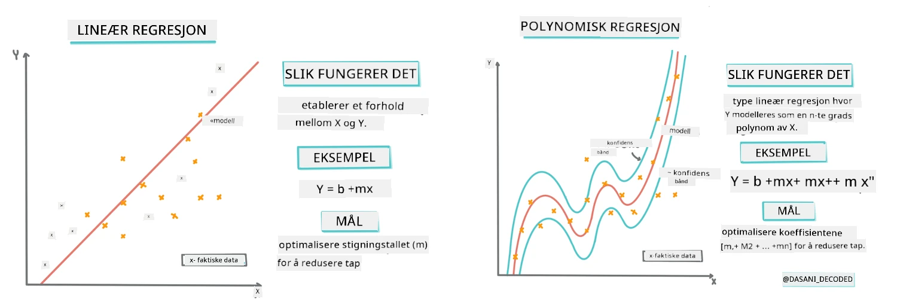
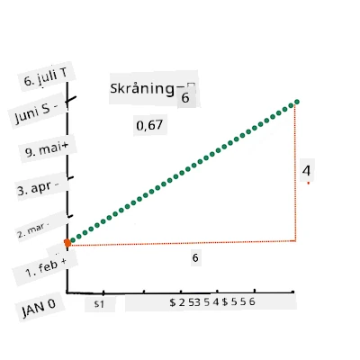
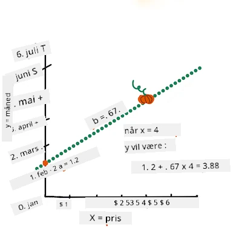
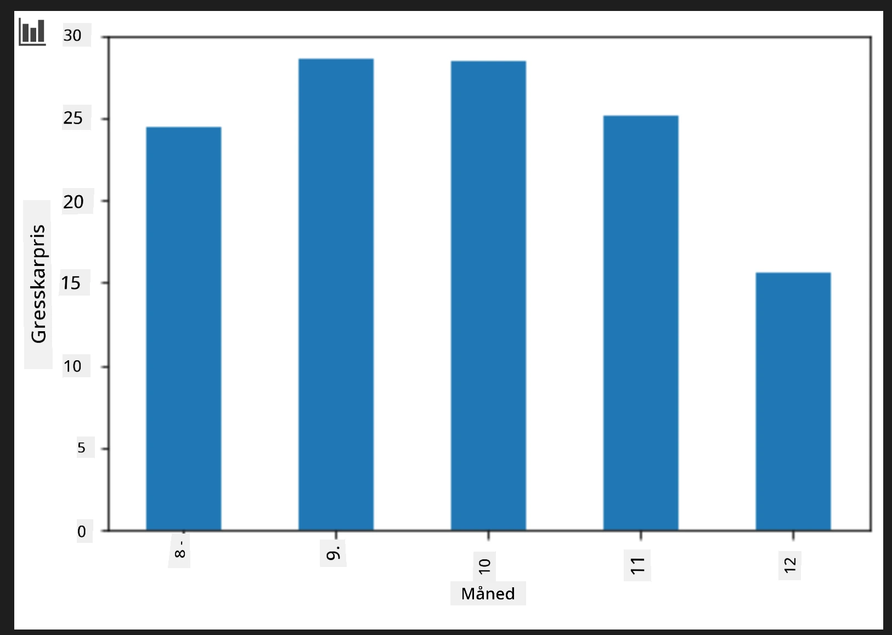
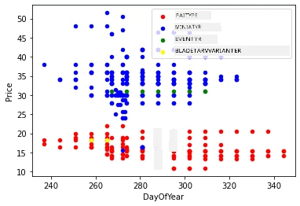

# Lag en regresjonsmodell med Scikit-learn: regresjon på fire måter

## Nybegynnermerknad

Lineær regresjon brukes når vi ønsker å forutsi en **numerisk verdi** (for eksempel huspris, temperatur eller salg).
Den fungerer ved å finne en rett linje som best representerer forholdet mellom inngangsfunksjoner og utdata.

I denne leksjonen fokuserer vi på å forstå konseptet før vi utforsker mer avanserte regresjonsteknikker.

> Infografikk av [Dasani Madipalli](https://twitter.com/dasani_decoded)
## [For-forelesningsquiz](https://ff-quizzes.netlify.app/en/ml/)

> ### [Denne leksjonen er tilgjengelig på R!](../../../../2-Regression/3-Linear/solution/R/lesson_3.html)
### Introduksjon

Så langt har du utforsket hva regresjon er med eksemplardata hentet fra gresskarprisdataene som vi skal bruke gjennom denne leksjonen. Du har også visualisert det ved hjelp av Matplotlib.

Nå er du klar til å fordype deg mer i regresjon for maskinlæring. Mens visualisering gjør at du kan forstå data, kommer den virkelige kraften i maskinlæring fra _trening av modeller_. Modeller trenes på historiske data for automatisk å fange avhengigheter i dataene, og de lar deg forutsi utfall for nye data, som modellen ikke har sett tidligere.

I denne leksjonen vil du lære mer om to typer regresjon: _grunnleggende lineær regresjon_ og _polynomregresjon_, sammen med noe av matematikken som ligger bak disse teknikkene. Disse modellene vil tillate oss å forutsi gresskarpriser avhengig av ulike inngangsdata.

[](https://youtu.be/CRxFT8oTDMg "ML for beginners - Understanding Linear Regression")

> 🎥 Klikk på bildet over for en kort videooversikt over lineær regresjon.

> Gjennom hele dette pensumet antar vi minimal kunnskap om matematikk, og søker å gjøre det tilgjengelig for studenter fra andre fagfelt, så følg med på notater, 🧮 framhevinger, diagrammer og andre læringsverktøy for å hjelpe forståelsen.

### Forutsetning

Du bør nå være kjent med strukturen til gresskardataene vi undersøker. Du finner dem forhåndslastet og forhåndsrenset i denne leksjonens _notebook.ipynb_-fil. I filen vises gresskarprisen per bushel i en ny data frame. Sørg for at du kan kjøre disse notebookene i kjerner i Visual Studio Code.

### Forberedelse

Som en påminnelse laster du inn disse dataene for å kunne stille spørsmål til dem.

- Når er det beste tidspunktet å kjøpe gresskar?
- Hvilken pris kan jeg forvente for en kasse med minigresskar?
- Bør jeg kjøpe dem i halvbushenskurver eller i 1 1/9-bushel-kasser?
La oss grave videre i disse dataene.

I forrige leksjon laget du en Pandas data frame og fylte den med deler av det originale datasettet, og standardiserte prisene etter bushel. Ved å gjøre det, samlet du imidlertid bare inn omtrent 400 datapunkter og bare for høstmånedene.

Ta en titt på dataene vi har forhåndslastet i denne leksjonens tilhørende notebook. Dataene er forhåndslastet og en innledende spredningsgraf er tegnet for å vise månedsdata. Kanskje vi kan få mer detaljert innsikt i dataenes natur ved å rense det mer.

## En lineær regresjonslinje

Som du lærte i leksjon 1, er målet med en lineær regresjonsøvelse å kunne tegne en linje som:

- **Viser variabelrelasjoner**. Viser forholdet mellom variabler
- **Gjøre spådommer**. Lage nøyaktige spådommer om hvor et nytt datapunkt vil falle i forhold til den linjen.

Det er typisk for **minste kvadraters regresjon** å tegne denne typen linje. Begrepet "Minste kvadraters" refererer til prosessen med å minimere den totale feilen i modellen vår. For hvert datapunkt måler vi den vertikale distansen (kalt en residual) mellom det faktiske punktet og vår regresjonslinje.

Vi kvadrerer disse distansene av to hovedårsaker:

1. **Størrelse over retning:** Vi ønsker å behandle en feil på -5 likt som en feil på +5. Kvadrering gjør alle verdier positive.

2. **Straffe uteliggere:** Kvadrering gir større vekt til større feil, og tvinger linjen til å holde seg nærmere punkter som er langt unna.

Vi legger så sammen alle disse kvadrerte verdiene. Målet vårt er å finne den spesifikke linjen hvor denne endelige summen er minst mulig (den minste mulige verdien) — derav navnet "Minste kvadraters".

> **🧮 Vis meg matematikken**
> 
> Denne linjen, kalt _beste tilpasningslinje_, kan uttrykkes med [en ligning](https://en.wikipedia.org/wiki/Simple_linear_regression):
> 
> ```
> Y = a + bX
> ```
>
> `X` er 'forklaringsvariabelen'. `Y` er 'avhengig variabel'. Stigningstallet til linjen er `b` og `a` er y-aksens skjæringspunkt, som viser verdien av `Y` når `X = 0`.
>
>
>
> Først beregner man stigningstallet `b`. Infografikk av [Jen Looper](https://twitter.com/jenlooper)
>
> Med andre ord, og med henvisning til det opprinnelige spørsmålet om gresskardataene: "forutsi prisen på et gresskar per bushel per måned", vil `X` referere til prisen og `Y` vil referere til salgsmåneden.
>
>
>
> Beregn verdien av Y. Hvis du betaler rundt $4, må det være april! Infografikk av [Jen Looper](https://twitter.com/jenlooper)
>
> Matematikk som beregner linjen, må vise stigningstallet, som også er avhengig av skjæringspunktet, eller hvor `Y` er når `X = 0`.
>
> Du kan observere metoden for beregning av disse verdiene på nettsiden [Math is Fun](https://www.mathsisfun.com/data/least-squares-regression.html). Besøk også [denne minste kvadraters-kalkulatoren](https://www.mathsisfun.com/data/least-squares-calculator.html) for å se hvordan tallverdier påvirker linjen.

## Korrelasjon

Et annet begrep å forstå er **korrelasjonskoeffisienten** mellom gitte X- og Y-variabler. Ved hjelp av et spredningsdiagram kan du raskt visualisere denne koeffisienten. Et plott hvor datapunktene er spredt langs en ryddig linje har høy korrelasjon, men et plott hvor datapunktene er spredt overalt mellom X og Y har lav korrelasjon.

En god lineær regresjonsmodell vil ha en høy (nærmere 1 enn 0) korrelasjonskoeffisient ved bruk av minste kvadraters regresjonsmetode med en regresjonslinje.

✅ Kjør notebooken som følger denne leksjonen og se på spredningsdiagrammet for måned mot pris. Virker dataene som assosierer måned og pris for gresskarsalg som om de har høy eller lav korrelasjon, ifølge din visuelle tolkning av spredningsdiagrammet? Endres dette hvis du bruker en mer granulær måling i stedet for `Month`, f.eks. *dag i året* (dvs. antall dager siden begynnelsen av året)?

I koden nedenfor vil vi anta at vi har ryddet dataene, og fått en data frame kalt `new_pumpkins`, lik følgende:

ID | Måned | dagIÅret | Variant | By | Pakke | Lav pris | Høy pris | Pris
---|-------|-----------|---------|------|---------|-----------|------------|-------
70 | 9 | 267 | PIE TYPE | BALTIMORE | 1 1/9 bushel-kartong | 15.0 | 15.0 | 13.636364
71 | 9 | 267 | PIE TYPE | BALTIMORE | 1 1/9 bushel-kartong | 18.0 | 18.0 | 16.363636
72 | 10 | 274 | PIE TYPE | BALTIMORE | 1 1/9 bushel-kartong | 18.0 | 18.0 | 16.363636
73 | 10 | 274 | PIE TYPE | BALTIMORE | 1 1/9 bushel-kartong | 17.0 | 17.0 | 15.454545
74 | 10 | 281 | PIE TYPE | BALTIMORE | 1 1/9 bushel-kartong | 15.0 | 15.0 | 13.636364

> Koden for å rense dataene er tilgjengelig i [`notebook.ipynb`](notebook.ipynb). Vi har utført de samme rengjøringsstegene som i forrige leksjon, og har beregnet kolonnen `DayOfYear` med følgende uttrykk:

```python
day_of_year = pd.to_datetime(pumpkins['Date']).apply(lambda dt: (dt-datetime(dt.year,1,1)).days)
```

Nå som du har forståelse av matematikken bak lineær regresjon, la oss lage en regresjonsmodell for å se om vi kan forutsi hvilken pakke med gresskar som vil ha de beste prisene. Noen som kjøper gresskar til en gresskarutstilling til høytiden, kan ønske denne informasjonen for å kunne optimalisere kjøp av gresskarpakker til utstillingen.

## På jakt etter korrelasjon

[](https://youtu.be/uoRq-lW2eQo "ML for beginners - Looking for Correlation: The Key to Linear Regression")

> 🎥 Klikk på bildet over for en kort videooversikt over korrelasjon.

Fra forrige leksjon har du sannsynligvis sett at gjennomsnittsprisen for forskjellige måneder ser slik ut:



Dette antyder at det bør være noe korrelasjon, og vi kan prøve å trene en lineær regresjonsmodell for å forutsi forholdet mellom `Month` og `Price`, eller mellom `DayOfYear` og `Price`. Her er et spredningsdiagram som viser det siste forholdet:


La oss se om det er korrelasjon med funksjonen `corr`:

```python
print(new_pumpkins['Month'].corr(new_pumpkins['Price']))
print(new_pumpkins['DayOfYear'].corr(new_pumpkins['Price']))
```

Det ser ut til at korrelasjonen er ganske liten, -0,15 for `Month` og -0,17 for `DayOfYear`, men det kan være et annet viktig forhold. Det ser ut som det finnes forskjellige klynger av priser som tilsvarer ulike gresskarvarianter. For å bekrefte denne hypotesen, la oss plotte hver gresskarkategori med ulik farge. Ved å sende en `ax`-parameter til `scatter`-plottefunksjonen kan vi plotte alle punkter på samme graf:

```python
ax=None
colors = ['red','blue','green','yellow']
for i,var in enumerate(new_pumpkins['Variety'].unique()):
    df = new_pumpkins[new_pumpkins['Variety']==var]
    ax = df.plot.scatter('DayOfYear','Price',ax=ax,c=colors[i],label=var)
```



Undersøkelsen vår antyder at variant har mer effekt på totalprisen enn den faktiske salgstidspunktet. Vi kan se dette med et stolpediagram:

```python
new_pumpkins.groupby('Variety')['Price'].mean().plot(kind='bar')
```


La oss fokusere et øyeblikk kun på én gresskarvariant, 'pie type', og se hvilken effekt datoen har på pris:

```python
pie_pumpkins = new_pumpkins[new_pumpkins['Variety']=='PIE TYPE']
pie_pumpkins.plot.scatter('DayOfYear','Price') 
```


Hvis vi nå beregner korrelasjonen mellom `Price` og `DayOfYear` med funksjonen `corr`, vil vi få noe rundt `-0,27` — som betyr at det gir mening å trene en prediksjonsmodell.

> Før vi trener en lineær regresjonsmodell, er det viktig å sikre at dataene våre er rene. Lineær regresjon fungerer ikke godt med manglende verdier, derfor gir det mening å kvitte seg med alle tomme celler:

```python
pie_pumpkins.dropna(inplace=True)
pie_pumpkins.info()
```

En annen tilnærming er å fylle disse tomme verdiene med gjennomsnittsverdier fra tilsvarende kolonne.

## Enkel lineær regresjon

[](https://youtu.be/e4c_UP2fSjg "ML for beginners - Linear and Polynomial Regression using Scikit-learn")

> 🎥 Klikk på bildet over for en kort videooversikt over lineær- og polynomregresjon.

For å trene vår lineære regresjonsmodell vil vi bruke **Scikit-learn**-biblioteket.

```python
from sklearn.linear_model import LinearRegression
from sklearn.metrics import mean_squared_error
from sklearn.model_selection import train_test_split
```

Vi starter med å skille inngangsverdier (egenskaper) og forventet utdata (etikett) i separate numpy-arrays:

```python
X = pie_pumpkins['DayOfYear'].to_numpy().reshape(-1,1)
y = pie_pumpkins['Price']
```

> Merk at vi måtte bruke `reshape` på inngangsdataene for at lineær regresjonspakken skulle forstå det riktig. Lineær regresjon forventer et 2D-array som input, hvor hver rad i arrayet tilsvarer en vektor med inndata-egenskaper. I vårt tilfelle, siden vi bare har én input, trenger vi et array med form N&times;1, hvor N er datasettets størrelse.

Deretter må vi dele opp dataene i trenings- og testsett, slik at vi kan validere modellen etter trening:

```python
X_train, X_test, y_train, y_test = train_test_split(X, y, test_size=0.2, random_state=0)
```

Til slutt tar det bare to linjer å trene den faktiske lineære regresjonsmodellen. Vi definerer `LinearRegression`-objektet, og passer det på dataene våre med metoden `fit`:

```python
lin_reg = LinearRegression()
lin_reg.fit(X_train,y_train)
```

Objektet `LinearRegression` etter å ha blitt tilpasset inneholder alle koeffisientene til regresjonen, som kan nås gjennom `.coef_`-egenskapen. I vårt tilfelle er det bare én koeffisient, som bør være rundt `-0.017`. Det betyr at prisene ser ut til å synke litt med tiden, men ikke for mye, rundt 2 cent per dag. Vi kan også få tilgang til skjæringspunktet til regresjonen med Y-aksen ved å bruke `lin_reg.intercept_` - det vil være rundt `21` i vårt tilfelle, noe som indikerer prisen i begynnelsen av året.

For å se hvor nøyaktig modellen vår er, kan vi forutsi priser på et testdatasett, og deretter måle hvor nær våre prediksjoner er til forventede verdier. Dette kan gjøres ved hjelp av roten av gjennomsnittet av kvadrerte feil (RMSE), som er roten av gjennomsnittet av alle kvadrerte forskjeller mellom forventet og forutsagt verdi.

```python
pred = lin_reg.predict(X_test)

rmse = np.sqrt(mean_squared_error(y_test,pred))
print(f'RMSE: {rmse:3.3} ({rmse/np.mean(pred)*100:3.3}%)')
```

Feilen vår ser ut til å være rundt 2 poeng, noe som er ~17 %. Ikke så bra. En annen indikator på modellkvalitet er **determinajon koeffisienten**, som kan oppnås slik:

```python
score = lin_reg.score(X_train,y_train)
print('Model determination: ', score)
```

Hvis verdien er 0, betyr det at modellen ikke tar hensyn til inndataene, og fungerer som den *verst mulige lineære prediktoren*, som enkelt er gjennomsnittsverdien av resultatet. En verdi på 1 betyr at vi kan perfekt forutsi alle forventede utganger. I vårt tilfelle er koeffisienten rundt 0,06, noe som er ganske lavt.

Vi kan også plotte testdata sammen med regresjonslinjen for å bedre se hvordan regresjonen fungerer i vårt tilfelle:

```python
plt.scatter(X_test,y_test)
plt.plot(X_test,pred)
```


## Polynomisk regresjon

En annen type lineær regresjon er polynomisk regresjon. Selv om det noen ganger eksisterer et lineært forhold mellom variabler - jo større gresskaret er i volum, jo høyere pris - kan det noen ganger hende at disse forholdene ikke kan plottes som et plan eller en rett linje.

✅ Her er [noen flere eksempler](https://online.stat.psu.edu/stat501/Lesson09#polynomial-regression-examples) på data som kan bruke polynomisk regresjon

Ta en titt på forholdet mellom Dato og Pris igjen. Virker det som om denne spredningsdiagrammet nødvendigvis bør analyseres med en rett linje? Kan ikke priser variere? I dette tilfellet kan du prøve polynomisk regresjon.

✅ Polynom er matematiske uttrykk som kan bestå av ett eller flere variabler og koeffisienter

Polynomisk regresjon lager en kurvet linje for bedre å tilpasse ikke-lineære data. I vårt tilfelle, hvis vi inkluderer en kvadratisk `DayOfYear`-variabel i inndataene, bør vi kunne tilpasse dataene våre med en parabolsk kurve, som vil ha et minimum på et visst punkt i løpet av året.

Scikit-learn inkluderer en hjelpsom [pipeline-API](https://scikit-learn.org/stable/modules/generated/sklearn.pipeline.make_pipeline.html?highlight=pipeline#sklearn.pipeline.make_pipeline) for å kombinere forskjellige trinn i databehandlingen. En **pipeline** er en kjede av **estimators**. I vårt tilfelle vil vi lage en pipeline som først legger til polynomiske trekk ved modellen vår, og så trener regresjonen:

```python
from sklearn.preprocessing import PolynomialFeatures
from sklearn.pipeline import make_pipeline

pipeline = make_pipeline(PolynomialFeatures(2), LinearRegression())

pipeline.fit(X_train,y_train)
```

Bruk av `PolynomialFeatures(2)` betyr at vi vil inkludere alle polynomer av andre grad fra inndataene. I vårt tilfelle vil det bare bety `DayOfYear`<sup>2</sup>, men gitt to inndatavariabler X og Y, vil dette legge til X<sup>2</sup>, XY og Y<sup>2</sup>. Vi kan også bruke polynomer av høyere grad hvis vi ønsker det.

Pipelines kan brukes på samme måte som det opprinnelige `LinearRegression`-objektet, dvs. vi kan `fit`e pipeline, og deretter bruke `predict` for å få prediksjonsresultater:

```python
pred = pipeline.predict(X_test)

rmse = np.sqrt(mean_squared_error(y_test,pred))
print(f'RMSE: {rmse:3.3} ({rmse/np.mean(pred)*100:3.3}%)')

score = pipeline.score(X_train,y_train)
print('Model determination: ', score)
```

For å plotte den glatte tilnærmingskurven, bruker vi `np.linspace` for å lage et jevnt intervall av inputverdier, i stedet for å plotte direkte på de uordnede testdataene (som ville produsere en sikksakk-linje):

```python
X_range = np.linspace(X_test.min(), X_test.max(), 100).reshape(-1,1)
y_range = pipeline.predict(X_range)

plt.scatter(X_test, y_test)
plt.plot(X_range, y_range)
```

Her er grafen som viser testdataene og tilnærmingskurven:


Ved å bruke polynomisk regresjon kan vi få litt lavere RMSE og høyere determinajon, men ikke betydelig. Vi må ta hensyn til andre trekk!

> Du kan se at de laveste prisene på gresskar observeres en gang rundt Halloween. Hvordan kan du forklare dette?

🎃 Gratulerer, du har nettopp laget en modell som kan hjelpe med å forutsi prisene på pai-gresskar. Du kan sannsynligvis gjenta den samme prosedyren for alle gresskartyper, men det ville være kjedelig. La oss nå lære hvordan vi tar hensyn til gresskarsort i modellen vår!

## Kategoriske trekk

I en ideell verden ønsker vi å kunne forutsi priser for forskjellige gresskarsorter ved hjelp av den samme modellen. Men kolonnen `Variety` er noe annerledes enn kolonner som `Month`, fordi den inneholder ikke-numeriske verdier. Slike kolonner kalles **kategoriske**.

[](https://youtu.be/DYGliioIAE0 "ML for beginners - Categorical Feature Predictions with Linear Regression")

> 🎥 Klikk på bildet ovenfor for en kort videooversikt om bruk av kategoriske trekk.

Her kan du se hvordan gjennomsnittsprisen avhenger av sort:


For å ta hensyn til sort, må vi først konvertere den til numerisk form, eller **enkode** den. Det finnes flere måter å gjøre dette på:

* Enkel **numerisk koding** lager en tabell over de forskjellige sortene, og erstatter sortnavnet med et indeksnummer i tabellen. Dette er ikke den beste ideen for lineær regresjon, fordi lineær regresjon tar den faktiske numeriske verdien til indeksen, og legger det til resultatet, multiplisert med en koeffisient. I vårt tilfelle er forholdet mellom indeksnummer og pris tydelig ikke-lineært, selv om vi sørger for at indeksene er ordnet på en bestemt måte.
* **One-hot koding** erstatter `Variety`-kolonnen med 4 forskjellige kolonner, en for hver sort. Hver kolonne vil inneholde `1` hvis raden tilsvarer en gitt sort, og `0` ellers. Dette betyr at det vil være fire koeffisienter i lineær regresjon, en for hver gresskarsort, som er ansvarlig for "startpris" (eller heller "tilleggpris") for den aktuelle sorten.

Koden nedenfor viser hvordan vi kan one-hot kode en sort:

```python
pd.get_dummies(new_pumpkins['Variety'])
```

 ID | FAIRYTALE | MINIATURE | MIXED HEIRLOOM VARIETIES | PIE TYPE
----|-----------|-----------|--------------------------|----------
70 | 0 | 0 | 0 | 1
71 | 0 | 0 | 0 | 1
... | ... | ... | ... | ...
1738 | 0 | 1 | 0 | 0
1739 | 0 | 1 | 0 | 0
1740 | 0 | 1 | 0 | 0
1741 | 0 | 1 | 0 | 0
1742 | 0 | 1 | 0 | 0

For å trene lineær regresjon ved bruk av one-hot kodet sort som input må vi bare initialisere `X` og `y` dataene riktig:

```python
X = pd.get_dummies(new_pumpkins['Variety'])
y = new_pumpkins['Price']
```

Resten av koden er den samme som vi brukte ovenfor for å trene lineær regresjon. Hvis du prøver det, vil du se at middelkvadrert feil er omtrent det samme, men vi får mye høyere determinajonskoeffisient (~77%). For å få enda mer nøyaktige prediksjoner, kan vi ta flere kategoriske trekk i betraktning, samt numeriske trekk, som `Month` eller `DayOfYear`. For å få en stor array med alle trekk, kan vi bruke `join`:

```python
X = pd.get_dummies(new_pumpkins['Variety']) \
        .join(new_pumpkins['Month']) \
        .join(pd.get_dummies(new_pumpkins['City'])) \
        .join(pd.get_dummies(new_pumpkins['Package']))
y = new_pumpkins['Price']
```

Her tar vi også hensyn til `City` og `Package` type, noe som gir oss RMSE 2,84 (10,5 %) og determinajon 0,94!

## Alt samlet

For å lage den beste modellen kan vi bruke kombinert (one-hot kodede kategoriske + numeriske) data fra eksempelet over sammen med polynomisk regresjon. Her er hele koden for din bekvemmelighet:

```python
# sett opp treningsdata
X = pd.get_dummies(new_pumpkins['Variety']) \
        .join(new_pumpkins['Month']) \
        .join(pd.get_dummies(new_pumpkins['City'])) \
        .join(pd.get_dummies(new_pumpkins['Package']))
y = new_pumpkins['Price']

# lag trenings- og testdel
X_train, X_test, y_train, y_test = train_test_split(X, y, test_size=0.2, random_state=0)

# sett opp og tren pipelinen
pipeline = make_pipeline(PolynomialFeatures(2), LinearRegression())
pipeline.fit(X_train,y_train)

# forutsi resultater for testdata
pred = pipeline.predict(X_test)

# beregn RMSE og forklaringsgrad
rmse = mean_squared_error(y_test, pred, squared=False)
print(f'RMSE: {rmse:3.3} ({rmse/pred.mean()*100:3.3}%)')

score = pipeline.score(X_train,y_train)
print('Model determination: ', score)
```

Dette bør gi oss den beste determinajonskoeffisienten på nesten 97 %, og RMSE=2,23 (~8 % prediksjonsfeil).

| Modell | RMSE | Determinasjon |
|-------|-----|---------------|
| `DayOfYear` Lineær | 2,77 (17,2 %) | 0,07 |
| `DayOfYear` Polynom | 2,73 (17,0 %) | 0,08 |
| `Variety` Lineær | 5,24 (19,7 %) | 0,77 |
| Alle trekk Lineær | 2,84 (10,5 %) | 0,94 |
| Alle trekk Polynom | 2,23 (8,25 %) | 0,97 |

🏆 Bra jobbet! Du har laget fire regresjonsmodeller i én leksjon, og forbedret modellkvaliteten til 97 %. I det siste avsnittet om regresjon vil du lære om logistisk regresjon for å bestemme kategorier.

---
## 🚀Utfordring

Test flere forskjellige variabler i denne notatboken for å se hvordan korrelasjon tilsvarer modellens nøyaktighet.

## [Quiz etter forelesning](https://ff-quizzes.netlify.app/en/ml/)

## Gjennomgang og egenstudium

I denne leksjonen lærte vi om lineær regresjon. Det finnes andre viktige regresjonstyper. Les om Stepwise, Ridge, Lasso og Elasticnet teknikker. Et godt kurs å studere for å lære mer er [Stanford Statistical Learning course](https://online.stanford.edu/courses/sohs-ystatslearning-statistical-learning)

## Oppgave

[Bygg en modell](assignment.md)

---

<!-- CO-OP TRANSLATOR DISCLAIMER START -->
**Ansvarsfraskrivelse**:  
Dette dokumentet er oversatt ved hjelp av AI-oversettelsestjenesten [Co-op Translator](https://github.com/Azure/co-op-translator). Selv om vi streber etter nøyaktighet, vær oppmerksom på at automatiske oversettelser kan inneholde feil eller unøyaktigheter. Det originale dokumentet på dets opprinnelige språk skal anses som den autoritative kilden. For kritisk informasjon anbefales profesjonell menneskelig oversettelse. Vi er ikke ansvarlige for eventuelle misforståelser eller feiltolkninger som oppstår ved bruk av denne oversettelsen.
<!-- CO-OP TRANSLATOR DISCLAIMER END -->