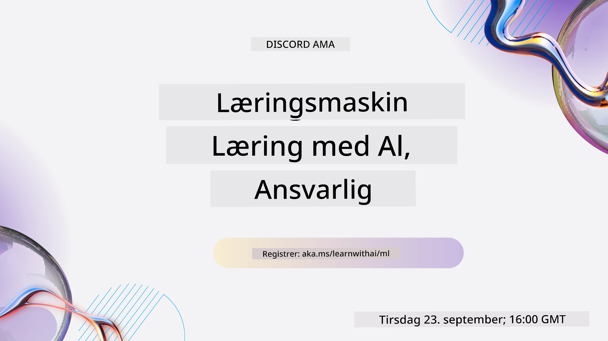
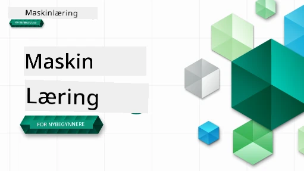

[](https://github.com/microsoft/ML-For-Beginners/blob/master/LICENSE)
[](https://GitHub.com/microsoft/ML-For-Beginners/graphs/contributors/)
[](https://GitHub.com/microsoft/ML-For-Beginners/issues/)
[](https://GitHub.com/microsoft/ML-For-Beginners/pulls/)
[](http://makeapullrequest.com)

[](https://GitHub.com/microsoft/ML-For-Beginners/watchers/)
[](https://GitHub.com/microsoft/ML-For-Beginners/network/)
[](https://GitHub.com/microsoft/ML-For-Beginners/stargazers/)

### 🌐 Flerspråklig støtte

#### Oversettelser vedlikeholdt med [Co-op Translator](https://github.com/Azure/co-op-translator)

<!-- CO-OP TRANSLATOR LANGUAGES TABLE START -->
[Arabisk](../ar/README.md) | [Bengali](../bn/README.md) | [Bulgarsk](../bg/README.md) | [Burmesisk (Myanmar)](../my/README.md) | [Kinesisk (forenklet)](../zh-CN/README.md) | [Kinesisk (tradisjonell, Hong Kong)](../zh-HK/README.md) | [Kinesisk (tradisjonell, Macau)](../zh-MO/README.md) | [Kinesisk (tradisjonell, Taiwan)](../zh-TW/README.md) | [Kroatisk](../hr/README.md) | [Tsjekkisk](../cs/README.md) | [Dansk](../da/README.md) | [Nederlandsk](../nl/README.md) | [Estisk](../et/README.md) | [Finsk](../fi/README.md) | [Fransk](../fr/README.md) | [Tysk](../de/README.md) | [Gresk](../el/README.md) | [Hebraisk](../he/README.md) | [Hindi](../hi/README.md) | [Ungarsk](../hu/README.md) | [Indonesisk](../id/README.md) | [Italiensk](../it/README.md) | [Japansk](../ja/README.md) | [Kannada](../kn/README.md) | [Khmer](../km/README.md) | [Koreansk](../ko/README.md) | [Litauisk](../lt/README.md) | [Malaysisk](../ms/README.md) | [Malayalam](../ml/README.md) | [Manipuri (Meitei Mayek)](../mni/README.md) | [Marathi](../mr/README.md) | [Nepali](../ne/README.md) | [Nigeriansk pidgin](../pcm/README.md) | [Norsk](./README.md) | [Persisk (Farsi)](../fa/README.md) | [Polsk](../pl/README.md) | [Portugisisk (Brasil)](../pt-BR/README.md) | [Portugisisk (Portugal)](../pt-PT/README.md) | [Punjabi (Gurmukhi)](../pa/README.md) | [Rumensk](../ro/README.md) | [Russisk](../ru/README.md) | [Serbisk (kyrillisk)](../sr/README.md) | [Slovakisk](../sk/README.md) | [Slovensk](../sl/README.md) | [Spansk](../es/README.md) | [Swahili](../sw/README.md) | [Svensk](../sv/README.md) | [Tagalog (filippinsk)](../tl/README.md) | [Tamil](../ta/README.md) | [Telugu](../te/README.md) | [Thai](../th/README.md) | [Tyrkisk](../tr/README.md) | [Ukrainsk](../uk/README.md) | [Urdu](../ur/README.md) | [Vietnamansk](../vi/README.md)

> **Foretrekker du å klone lokalt?**
>
> Dette depotet inkluderer over 50 språkoversettelser som betydelig øker nedlastingsstørrelsen. For å klone uten oversettelser, bruk sparse checkout:
>
> **Bash / macOS / Linux:**
> ```bash
> git clone --filter=blob:none --sparse https://github.com/microsoft/ML-For-Beginners.git
> cd ML-For-Beginners
> git sparse-checkout set --no-cone '/*' '!translations' '!translated_images'
> ```
>
> **CMD (Windows):**
> ```cmd
> git clone --filter=blob:none --sparse https://github.com/microsoft/ML-For-Beginners.git
> cd ML-For-Beginners
> git sparse-checkout set --no-cone "/*" "!translations" "!translated_images"
> ```
>
> Dette gir deg alt du trenger for å fullføre kurset med mye raskere nedlasting.
<!-- CO-OP TRANSLATOR LANGUAGES TABLE END -->

#### Bli med i samfunnene våre

[](https://discord.gg/nTYy5BXMWG)

Vi har en Discord-serie kalt learn with AI på gang, lær mer og bli med oss på [Learn with AI Series](https://aka.ms/learnwithai/discord) fra 18. – 30. september 2025. Du vil få tips og triks om bruk av GitHub Copilot for Data Science.



# Maskinlæring for nybegynnere - Et læreplan

> 🌍 Reis rundt i verden mens vi utforsker maskinlæring gjennom verdens kulturer 🌍

Cloud Advocates hos Microsoft er glade for å tilby en 12 ukers, 26-leksjons læreplan om **maskinlæring**. I denne læreplanen vil du lære om det som noen ganger kalles **klassisk maskinlæring**, brukt primært med Scikit-learn som bibliotek og unngå dyp læring, som dekkes i vår [AI for Beginners-læreplan](https://aka.ms/ai4beginners). Kombiner gjerne disse leksjonene med vår ['Data Science for Beginners'-læreplan](https://aka.ms/ds4beginners)!

Reis med oss rundt i verden mens vi anvender disse klassiske teknikkene på data fra mange deler av verden. Hver leksjon inkluderer forhånds- og ettermiddagsquizer, skriftlige instruksjoner for å fullføre leksjonen, en løsning, en oppgave med mer. Vår prosjektbaserte pedagogikk lar deg lære mens du bygger, en bevist metode for å få nye ferdigheter til å «feste seg».

**✍️ Hjertelig takk til våre forfattere** Jen Looper, Stephen Howell, Francesca Lazzeri, Tomomi Imura, Cassie Breviu, Dmitry Soshnikov, Chris Noring, Anirban Mukherjee, Ornella Altunyan, Ruth Yakubu og Amy Boyd

**🎨 Takk også til våre illustratører** Tomomi Imura, Dasani Madipalli, og Jen Looper

**🙏 Spesiell takk 🙏 til våre Microsoft Student Ambassador-forfattere, anmeldere og innholdsbidragsytere**, spesielt Rishit Dagli, Muhammad Sakib Khan Inan, Rohan Raj, Alexandru Petrescu, Abhishek Jaiswal, Nawrin Tabassum, Ioan Samuila, og Snigdha Agarwal

**🤩 Ekstra takk til Microsoft Student Ambassadors Eric Wanjau, Jasleen Sondhi, og Vidushi Gupta for våre R-leksjoner!**

# Komme i gang

Følg disse stegene:
1. **Fork depotet**: Klikk på «Fork»-knappen øverst i høyre hjørne på denne siden.
2. **Clone depotet**:   `git clone https://github.com/microsoft/ML-For-Beginners.git`

> 💡 **Rask start-tips:** Vil du starte i en nettleser uten å sette opp Python lokalt? Bruk [GitHub Codespaces](https://github.com/features/codespaces) for å lage et skybasert utviklingsmiljø for din fork. Åpne den grønne **Code**-menyen, velg **Codespaces**, og opprett en codespace; installer nødvendige avhengigheter for hver leksjon etter behov.

> [finn alle ekstra ressurser for dette kurset i vår Microsoft Learn-samling](https://learn.microsoft.com/en-us/collections/qrqzamz1nn2wx3?WT.mc_id=academic-77952-bethanycheum)

> 🔧 **Trenger du hjelp?** Sjekk vår [Feilsøkingsguide](TROUBLESHOOTING.md) for løsninger på vanlige problemer med installasjon, oppsett og kjøring av leksjoner.


**[Studenter](https://aka.ms/student-page)**, for å bruke denne læreplanen, lag en fork av hele repoen til din egen GitHub-konto og fullfør øvelsene på egen hånd eller sammen med en gruppe:

- Start med en quiz før forelesningen.
- Les forelesningen og fullfør aktivitetene, ta pauser og reflekter ved hver kunnskapsjekk.
- Prøv å lage prosjektene ved å forstå leksjonene, fremfor å kjøre løsningskoden; den koden er imidlertid tilgjengelig i `/solution`-mappene i hver prosjektorienterte leksjon.
- Ta quiz etter forelesningen.
- Fullfør utfordringen.
- Fullfør oppgaven.
- Etter å ha fullført en leksjonsgruppe, besøk [Diskusjonsforumet](https://github.com/microsoft/ML-For-Beginners/discussions) og «lær høyt» ved å fylle ut riktig PAT-rubrik. En 'PAT' er et Progress Assessment Tool, en rubrik du fyller ut for å fremme læringen din. Du kan også reagere på andres PAT-er slik at vi kan lære sammen.

> For videre studier anbefaler vi å følge disse [Microsoft Learn](https://docs.microsoft.com/en-us/users/jenlooper-2911/collections/k7o7tg1gp306q4?WT.mc_id=academic-77952-leestott) modulene og læringsstiene.

**Lærere**, vi har [inkludert noen forslag](for-teachers.md) til hvordan bruke denne læreplanen.

---

## Videogjennomganger

Noen av leksjonene er tilgjengelige som korte videoer. Du kan finne disse direkte i leksjonene, eller på [ML for Beginners-spillelisten på Microsoft Developer YouTube-kanalen](https://aka.ms/ml-beginners-videos) ved å klikke på bildet under.

[](https://aka.ms/ml-beginners-videos)

---

## Møt teamet

[](https://youtu.be/Tj1XWrDSYJU)

**Gif av** [Mohit Jaisal](https://linkedin.com/in/mohitjaisal)

> 🎥 Klikk bildet over for en video om prosjektet og menneskene som laget det!

---

## Pedagogikk

Vi har valgt to pedagogiske prinsipper i utviklingen av denne læreplanen: å sikre at den er praktisk og **prosjektbasert**, samt at den inkluderer **hyppige quizer**. I tillegg har denne læreplanen et felles **tema** for å gi den sammenheng.

Ved å sørge for at innholdet samsvarer med prosjekter, gjøres prosessen mer engasjerende for studentene og konsepter beholdes bedre. En lavterskel-quiz før timen setter studentens intensjon mot å lære et tema, mens en annen quiz etter timen sikrer videre forståelse. Denne læreplanen er designet for å være fleksibel og morsom, og kan tas i sin helhet eller delvis. Prosjektene starter smått og blir stadig mer komplekse gjennom den 12-ukers perioden. Læreplanen inkluderer også et etterspill om virkelige anvendelser av ML, som kan brukes som ekstra kreditt eller som grunnlag for diskusjon.

> Finn våre retningslinjer for [Adferdskodeks](CODE_OF_CONDUCT.md), [Bidrag](CONTRIBUTING.md), [Oversettelser](..), og [Feilsøking](TROUBLESHOOTING.md). Vi setter pris på dine konstruktive tilbakemeldinger!

## Hver leksjon inkluderer

- valgfri sketchnote
- valgfri tilleggsvideo
- videogjennomgang (noen leksjoner)
- [oppvarmingsquiz før forelesning](https://ff-quizzes.netlify.app/en/ml/)
- skriftlig leksjon
- for prosjektbaserte leksjoner, trinnvise guider for hvordan bygge prosjektet
- kunnskapsjekker
- en utfordring
- tilleggslesning
- oppgave
- [quiz etter forelesning](https://ff-quizzes.netlify.app/en/ml/)

> **En notis om språk**: Disse leksjonene er hovedsakelig skrevet i Python, men mange finnes også på R. For å fullføre en R-leksjon, gå til `/solution`-mappen og let etter R-leksjoner. De inkluderer en .rmd-utvidelse som representerer en **R Markdown**-fil, som enkelt kan defineres som en innbedding av `code chunks` (av R eller andre språk) og en `YAML header` (som guider formatering av output som PDF) i en `Markdown document`. Som sådan fungerer det som et eksemplarisk forfatterrammeverk for data science siden det lar deg kombinere koden din, dens output, og tankene dine ved å skrive dem i Markdown. Videre kan R Markdown-dokumenter rendres til output-formater som PDF, HTML, eller Word.

> **En notis om quizer**: Alle quizer finnes i [Quiz App-mappen](../../quiz-app), med totalt 52 quizer med tre spørsmål hver. De er lenket i leksjonene, men quiz-appen kan kjøre lokalt; følg instruksjonen i `quiz-app`-mappen for lokal hosting eller deploy til Azure.

| Lesson Number |                             Topic                              |                   Lesson Grouping                   | Learning Objectives                                                                                                             |                                                              Linked Lesson                                                               |                        Author                        |
| :-----------: | :------------------------------------------------------------: | :-------------------------------------------------: | ------------------------------------------------------------------------------------------------------------------------------- | :--------------------------------------------------------------------------------------------------------------------------------------: | :--------------------------------------------------: |
|      01       |                Introduksjon til maskinlæring                  |      [Introduction](1-Introduction/README.md)       | Lær de grunnleggende konseptene bak maskinlæring                                                                                |                                             [Lesson](1-Introduction/1-intro-to-ML/README.md)                                             |                       Muhammad                       |
|      02       |               Historien om maskinlæring                       |      [Introduction](1-Introduction/README.md)       | Lær historien som ligger til grunn for dette feltet                                                                             |                                            [Lesson](1-Introduction/2-history-of-ML/README.md)                                            |                     Jen and Amy                      |
|      03       |                 Rettferdighet og maskinlæring                 |      [Introduction](1-Introduction/README.md)       | Hva er de viktige filosofiske spørsmålene rundt rettferdighet som studenter bør vurdere når de bygger og bruker ML-modeller?       |                                              [Lesson](1-Introduction/3-fairness/README.md)                                               |                        Tomomi                        |
|      04       |               Teknikker for maskinlæring                      |      [Introduction](1-Introduction/README.md)       | Hvilke teknikker bruker ML-forskere for å bygge ML-modeller?                                                                    |                                          [Lesson](1-Introduction/4-techniques-of-ML/README.md)                                           |                    Chris and Jen                     |
|      05       |                  Introduksjon til regresjon                    |        [Regression](2-Regression/README.md)         | Kom i gang med Python og Scikit-learn for regresjonsmodeller                                                                    |         [Python](2-Regression/1-Tools/README.md) • [R](../../2-Regression/1-Tools/solution/R/lesson_1.html)         |      Jen • Eric Wanjau       |
|      06       |                Nordamerikanske gresskarpriser 🎃               |        [Regression](2-Regression/README.md)         | Visualiser og rens data i forberedelse til ML                                                                                   |          [Python](2-Regression/2-Data/README.md) • [R](../../2-Regression/2-Data/solution/R/lesson_2.html)          |      Jen • Eric Wanjau       |
|      07       |                Nordamerikanske gresskarpriser 🎃               |        [Regression](2-Regression/README.md)         | Bygg lineære og polynomiale regresjonsmodeller                                                                                  |        [Python](2-Regression/3-Linear/README.md) • [R](../../2-Regression/3-Linear/solution/R/lesson_3.html)        |      Jen and Dmitry • Eric Wanjau       |
|      08       |                Nordamerikanske gresskarpriser 🎃               |        [Regression](2-Regression/README.md)         | Bygg en logistisk regresjonsmodell                                                                                              |     [Python](2-Regression/4-Logistic/README.md) • [R](../../2-Regression/4-Logistic/solution/R/lesson_4.html)      |      Jen • Eric Wanjau       |
|      09       |                          En Web App 🔌                         |           [Web App](3-Web-App/README.md)            | Bygg en webapp for å bruke din trente modell                                                                                    |                                                 [Python](3-Web-App/1-Web-App/README.md)                                                  |                         Jen                          |
|      10       |                 Introduksjon til klassifisering               |    [Classification](4-Classification/README.md)     | Rens, forbered og visualiser data; introduksjon til klassifisering                                                             | [Python](4-Classification/1-Introduction/README.md) • [R](../../4-Classification/1-Introduction/solution/R/lesson_10.html)  | Jen and Cassie • Eric Wanjau |
|      11       |             Deilige asiatiske og indiske kjøkken 🍜            |    [Classification](4-Classification/README.md)     | Introduksjon til klassifikatorer                                                                                                 | [Python](4-Classification/2-Classifiers-1/README.md) • [R](../../4-Classification/2-Classifiers-1/solution/R/lesson_11.html) | Jen and Cassie • Eric Wanjau |
|      12       |             Deilige asiatiske og indiske kjøkken 🍜            |    [Classification](4-Classification/README.md)     | Flere klassifikatorer                                                                                                           | [Python](4-Classification/3-Classifiers-2/README.md) • [R](../../4-Classification/3-Classifiers-2/solution/R/lesson_12.html) | Jen and Cassie • Eric Wanjau |
|      13       |             Deilige asiatiske og indiske kjøkken 🍜            |    [Classification](4-Classification/README.md)     | Bygg en anbefalings-webapp ved hjelp av modellen din                                                                             |                                              [Python](4-Classification/4-Applied/README.md)                                              |                         Jen                          |
|      14       |                   Introduksjon til klyngedannelse             |        [Clustering](5-Clustering/README.md)         | Rens, forbered og visualiser data; introduksjon til klyngedannelse                                                             |         [Python](5-Clustering/1-Visualize/README.md) • [R](../../5-Clustering/1-Visualize/solution/R/lesson_14.html)         |      Jen • Eric Wanjau       |
|      15       |             Utforske nigerianske musikksmaker 🎧              |        [Clustering](5-Clustering/README.md)         | Utforsk K-Means klyngemetoden                                                                                                  |           [Python](5-Clustering/2-K-Means/README.md) • [R](../../5-Clustering/2-K-Means/solution/R/lesson_15.html)           |      Jen • Eric Wanjau       |
|      16       |        Introduksjon til naturlig språkbehandling ☕️           |   [Natural language processing](6-NLP/README.md)    | Lær det grunnleggende om NLP ved å bygge en enkel bot                                                                           |                                             [Python](6-NLP/1-Introduction-to-NLP/README.md)                                              |                       Stephen                        |
|      17       |                      Vanlige NLP-oppgaver ☕️                  |   [Natural language processing](6-NLP/README.md)    | Fordyp kunnskapen din om NLP ved å forstå vanlige oppgaver som kreves ved håndtering av språkstrukturer                          |                                                    [Python](6-NLP/2-Tasks/README.md)                                                     |                       Stephen                        |
|      18       |             Oversettelse og sentimentanalyse ♥️                |   [Natural language processing](6-NLP/README.md)    | Oversettelse og sentimentanalyse med Jane Austen                                                                               |                                            [Python](6-NLP/3-Translation-Sentiment/README.md)                                             |                       Stephen                        |
|      19       |                  Romantiske hoteller i Europa ♥️               |   [Natural language processing](6-NLP/README.md)    | Sentimentanalyse med hotellvurderinger 1                                                                                        |                                               [Python](6-NLP/4-Hotel-Reviews-1/README.md)                                                |                       Stephen                        |
|      20       |                  Romantiske hoteller i Europa ♥️               |   [Natural language processing](6-NLP/README.md)    | Sentimentanalyse med hotellvurderinger 2                                                                                        |                                               [Python](6-NLP/5-Hotel-Reviews-2/README.md)                                                |                       Stephen                        |
|      21       |            Introduksjon til tidsseriefremskrivning             |        [Time series](7-TimeSeries/README.md)        | Introduksjon til tidsseriefremskrivning                                                                                        |                                             [Python](7-TimeSeries/1-Introduction/README.md)                                              |                      Francesca                       |
|      22       | ⚡️ Verden strømforbruk ⚡️ - tidsseriefremskrivning med ARIMA |        [Time series](7-TimeSeries/README.md)        | Tidsseriefremskrivning med ARIMA                                                                                                |                                                 [Python](7-TimeSeries/2-ARIMA/README.md)                                                 |                      Francesca                       |
|      23       |  ⚡️ Verden strømforbruk ⚡️ - tidsseriefremskrivning med SVR   |        [Time series](7-TimeSeries/README.md)        | Tidsseriefremskrivning med Support Vector Regressor                                                                            |                                                  [Python](7-TimeSeries/3-SVR/README.md)                                                  |                       Anirban                        |
|      24       |             Introduksjon til forsterkende læring               | [Reinforcement learning](8-Reinforcement/README.md) | Introduksjon til forsterkende læring med Q-Læring                                                                               |                                             [Python](8-Reinforcement/1-QLearning/README.md)                                              |                        Dmitry                        |
|      25       |                 Hjelp Peter å unngå ulven! 🐺                  | [Reinforcement learning](8-Reinforcement/README.md) | Forsterkende læring Gym                                                                                                         |                                                [Python](8-Reinforcement/2-Gym/README.md)                                                 |                        Dmitry                        |
|  Postscript   |            Virkelige ML-scenarier og bruksområder              |      [ML in the Wild](9-Real-World/README.md)       | Interessante og avslørende virkelige bruksområder for klassisk ML                                                               |                                             [Lesson](9-Real-World/1-Applications/README.md)                                              |                         Team                         |
|  Postscript   |            Feilsøking av modeller i ML med RAI-dashboard       |      [ML in the Wild](9-Real-World/README.md)       | Feilsøking av modeller i maskinlæring ved bruk av Responsible AI dashboard-komponenter                                          |                                             [Lesson](9-Real-World/2-Debugging-ML-Models/README.md)                                              |                     Ruth Yakubu                      |

> [finn alle tilleggsmaterialer for dette kurset i vår Microsoft Learn-samling](https://learn.microsoft.com/en-us/collections/qrqzamz1nn2wx3?WT.mc_id=academic-77952-bethanycheum)

## Offline tilgang

Du kan kjøre denne dokumentasjonen offline ved å bruke [Docsify](https://docsify.js.org/#/). Fork dette repoet, [installer Docsify](https://docsify.js.org/#/quickstart) på din lokale maskin, og deretter i rotmappen til dette repoet, skriv `docsify serve`. Nettstedet serveres på port 3000 på din localhost: `localhost:3000`.

## PDF-er

Finn en PDF av læreplanen med linker [her](https://microsoft.github.io/ML-For-Beginners/pdf/readme.pdf).


## 🎒 Andre kurs

Teamet vårt produserer andre kurs! Sjekk ut:

<!-- CO-OP TRANSLATOR OTHER COURSES START -->
### LangChain
[](https://aka.ms/langchain4j-for-beginners)
[](https://aka.ms/langchainjs-for-beginners?WT.mc_id=m365-94501-dwahlin)
[](https://github.com/microsoft/langchain-for-beginners?WT.mc_id=m365-94501-dwahlin)
---

### Azure / Edge / MCP / Agenter
[](https://github.com/microsoft/AZD-for-beginners?WT.mc_id=academic-105485-koreyst)
[](https://github.com/microsoft/edgeai-for-beginners?WT.mc_id=academic-105485-koreyst)
[](https://github.com/microsoft/mcp-for-beginners?WT.mc_id=academic-105485-koreyst)
[](https://github.com/microsoft/ai-agents-for-beginners?WT.mc_id=academic-105485-koreyst)

---
 
### Generativ AI-serie
[](https://github.com/microsoft/generative-ai-for-beginners?WT.mc_id=academic-105485-koreyst)
[-9333EA?style=for-the-badge&labelColor=E5E7EB&color=9333EA)](https://github.com/microsoft/Generative-AI-for-beginners-dotnet?WT.mc_id=academic-105485-koreyst)
[-C084FC?style=for-the-badge&labelColor=E5E7EB&color=C084FC)](https://github.com/microsoft/generative-ai-for-beginners-java?WT.mc_id=academic-105485-koreyst)
[-E879F9?style=for-the-badge&labelColor=E5E7EB&color=E879F9)](https://github.com/microsoft/generative-ai-with-javascript?WT.mc_id=academic-105485-koreyst)

---
 
### Kjerneopplæring
[](https://aka.ms/ml-beginners?WT.mc_id=academic-105485-koreyst)
[](https://aka.ms/datascience-beginners?WT.mc_id=academic-105485-koreyst)
[](https://aka.ms/ai-beginners?WT.mc_id=academic-105485-koreyst)
[](https://github.com/microsoft/Security-101?WT.mc_id=academic-96948-sayoung)
[](https://aka.ms/webdev-beginners?WT.mc_id=academic-105485-koreyst)
[](https://aka.ms/iot-beginners?WT.mc_id=academic-105485-koreyst)
[](https://github.com/microsoft/xr-development-for-beginners?WT.mc_id=academic-105485-koreyst)

---
 
### Copilot-serie
[](https://aka.ms/GitHubCopilotAI?WT.mc_id=academic-105485-koreyst)
[](https://github.com/microsoft/mastering-github-copilot-for-dotnet-csharp-developers?WT.mc_id=academic-105485-koreyst)
[](https://github.com/microsoft/CopilotAdventures?WT.mc_id=academic-105485-koreyst)
<!-- CO-OP TRANSLATOR OTHER COURSES END -->

## Få hjelp

Hvis du står fast eller har spørsmål mens du lærer maskinlæring eller bygger AI-applikasjoner, ikke bekymre deg — hjelp er tilgjengelig.

Du kan bli med i diskusjoner med andre elever og utviklere, stille spørsmål og dele ideene dine med fellesskapet.

- Bli med i fellesskapet for å stille spørsmål og lære sammen med andre
- Diskuter konsepter innen maskinlæring og prosjektideer
- Få veiledning fra erfarne utviklere

Et støttende fellesskap er en flott måte å utvikle ferdighetene dine på og løse problemer raskere.

[Microsoft Foundry Discord Community](https://discord.gg/nTYy5BXMWG)

Hvis du oppdager feil, problemer eller har forslag til forbedringer, kan du også åpne en **Issue** i dette depotet for å rapportere problemet.

For produktfeedback eller for å søke i eksisterende innlegg i fellesskapet, besøk utviklerforumet:

[](https://aka.ms/foundry/forum)

## Ekstra læringstips

- Gå gjennom notatbøker etter hver leksjon for bedre forståelse.
- Øv på å implementere algoritmer på egen hånd.
- Utforsk virkelige datasett ved hjelp av lærte konsepter.

---

<!-- CO-OP TRANSLATOR DISCLAIMER START -->
**Ansvarsfraskrivelse**:
Dette dokumentet er oversatt ved hjelp av AI-oversettelsestjenesten [Co-op Translator](https://github.com/Azure/co-op-translator). Selv om vi streber etter nøyaktighet, vær oppmerksom på at automatiske oversettelser kan inneholde feil eller unøyaktigheter. Det opprinnelige dokumentet på originalspråket skal betraktes som den autoritative kilden. For kritisk informasjon anbefales profesjonell menneskelig oversettelse. Vi er ikke ansvarlige for eventuelle misforståelser eller feiltolkninger som oppstår ved bruk av denne oversettelsen.
<!-- CO-OP TRANSLATOR DISCLAIMER END -->