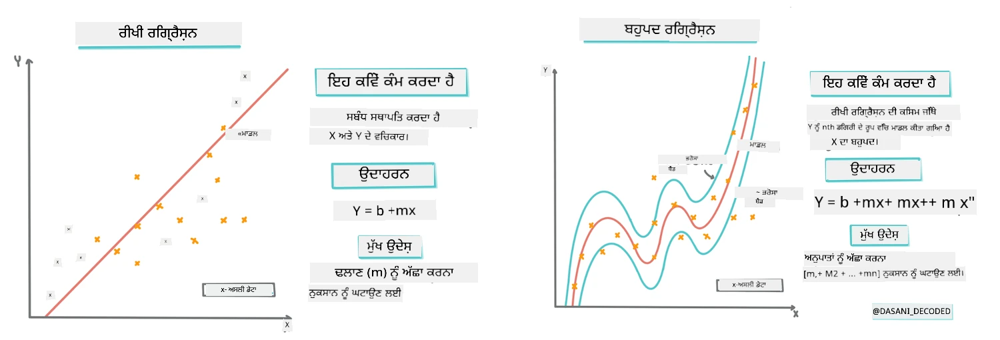
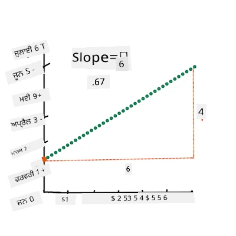
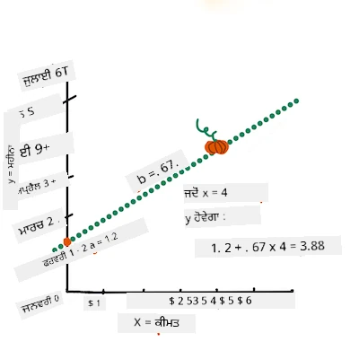
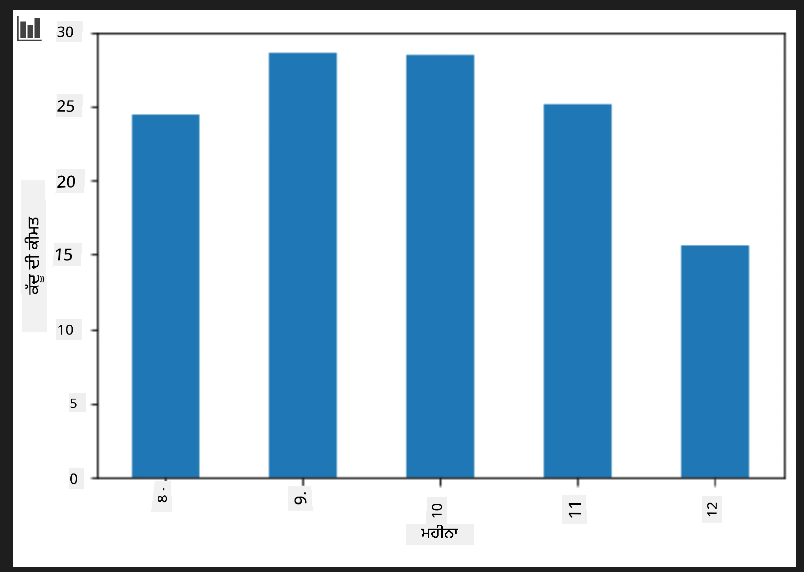
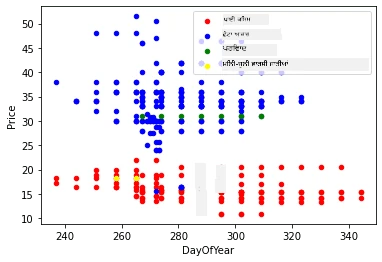

# ਸਕਿਕਿਟ-ਲਰਨ ਦੀ ਵਰਤੋਂ ਕਰਕੇ ਰਿਗ੍ਰੈਸ਼ਨ ਮਾਡਲ ਬਣਾਓ: ਰਿਗ੍ਰੈਸ਼ਨ ਚਾਰ ਤਰੀਕਿਆਂ ਨਾਲ

## ਸ਼ੁਰੂਆਤੀ ਨੋਟ

ਲਾਈਨੀਅਰ ਰਿਗ੍ਰੈਸ਼ਨ ਉਸ ਵੇਲੇ ਵਰਤੀ ਜਾਂਦੀ ਹੈ ਜਦੋਂ ਅਸੀਂ ਇੱਕ **ਸੰਖਿਆਤਮਕ ਮੁੱਲ** ਦੀ ਭਵਿੱਖਬਾਣੀ ਕਰਨੀ ਹੋਵੇ (ਉਦਾਹਰਨ ਲਈ, ਘਰ ਦੀ ਕੀਮਤ, ਤਾਪਮਾਨ, ਜਾਂ ਵਿਕਰੀ)।  
ਇਹ ਇਨਪੁੱਟ ਫੀਚਰਾਂ ਅਤੇ ਆਉਟਪੁੱਟ ਵਿਚਕਾਰ ਸੰਬੰਧ ਨੂੰ ਸਭ ਤੋਂ ਵਧੀਆ ਦਰਸਾਉਣ ਵਾਲੀ ਸਿੱਧੀ ਲਾਈਨ ਲੱਭ ਕੇ ਕੰਮ ਕਰਦੀ ਹੈ।  

ਇਸ ਪਾਠ ਵਿੱਚ, ਅਸੀਂ ਇਸ ਸੰਕਲਪ ਨੂੰ ਸਮਝਣ 'ਤੇ ਧਿਆਨ ਦੇਵਾਂਗੇ ਜਿਸ ਤੋਂ ਬਾਅਦ ਅਸੀਂ ਹੋਰ ਉन्नਤ ਰਿਗ੍ਰੈਸ਼ਨ ਤਕਨੀਕਾਂ ਦੀ ਜਾਂਚ ਕਰਾਂਗੇ।  
  
> ਇਨਫੋਗ੍ਰਾਫਿਕ [ਦਾਸਾਨੀ ਮਦੀਪੱਲੀ](https://twitter.com/dasani_decoded) ਵੱਲੋਂ  
## [ਪ੍ਰੀ-ਲੈਕਚਰ ਕੁਇਜ਼](https://ff-quizzes.netlify.app/en/ml/)

> ### [ਇਹ ਪਾਠ R ਵਿੱਚ ਵੀ ਉਪਲਬਧ ਹੈ!](../../../../2-Regression/3-Linear/solution/R/lesson_3.html)  
### ਪਰਿਚય 

ਹੁਣ ਤੱਕ ਤੁਸੀਂ ਸਮਝਿਆ ਹੈ ਕਿ ਰਿਗ੍ਰੈਸ਼ਨ ਕੀ ਹੈ, ਖਾਸ ਤੌਰ 'ਤੇ ਕਦੂ ਦੀ ਕੀਮਤਾਂ ਵਾਲੇ ਨਮੂਨਾ ਡੇਟਾ ਨਾਲ, ਜਿਸਨੂੰ ਅਸੀਂ ਇਸ ਪਾਠ ਵਿੱਚ ਵਰਤਾਂਗੇ। ਤੁਸੀਂ ਇਸਨੂੰ ਮੈਟਪਲੌਟਲਿਬ ਦੀ ਵਰਤੋਂ ਕਰਕੇ ਵੇਖਿਆ ਵੀ ਹੈ।  

ਹੁਣ ਤੁਸੀਂ ਮਸ਼ੀਨ ਲਰਨਿੰਗ ਲਈ ਰਿਗ੍ਰੈਸ਼ਨ ਵਿੱਚ ਗਹਿਰਾਈ ਵਿੱਚ ਜਾਣ ਲਈ ਤਿਆਰ ਹੋ। ਜਦੋਂ ਕਿ ਵਿਜ਼ੂਅਲਾਈਜੇਸ਼ਨ ਡੇਟਾ ਨੂੰ ਸਮਝਣ ਵਿੱਚ ਮਦਦ ਕਰਦਾ ਹੈ, ਮਸ਼ੀਨ ਲਰਨਿੰਗ ਦੀ ਅਸਲ ਤਾਕਤ _ਮਾਡਲ ਟ੍ਰੇਨਿੰਗ_ ਵਿੱਚ ਹੈ। ਮਾਡਲ ਪੁਰਾਣੇ ਡੇਟਾ ਤੇ ਟ੍ਰੇਨ ਕੀਤੇ ਜਾਂਦੇ ਹਨ ਤਾਂ ਜੋ ਖੁਦ-ਬ-ਖੁਦ ਡੇਟਾ ਦੀਆਂ ਨਿਰਭਰਤਾਵਾਂ ਨੂੰ ਕੈਪਚਰ ਕਰ ਸਕਣ ਅਤੇ ਨਵੇਂ ਡੇਟਾ ਲਈ ਭਵਿੱਖਬਾਣੀ ਕਰ ਸਕਣ ਜੋ ਮਾਡਲ ਨੇ ਪਹਿਲਾਂ ਨਹੀਂ ਵੇਖਿਆ।  

ਇਸ ਪਾਠ ਵਿੱਚ, ਤੁਸੀਂ ਦੋ ਪ੍ਰਕਾਰ ਦੀਆਂ ਰਿਗ੍ਰੈਸ਼ਨ ਸਮਝੋਂਗੇ: _ਮੂਲ ਲਾਈਨੀਅਰ ਰਿਗ੍ਰੈਸ਼ਨ_ ਅਤੇ _ਪੋਲੀਨੋਮਿਯਲ ਰਿਗ੍ਰੈਸ਼ਨ_, ਨਾਲ ਹੀ ਕੁਝ ਮੈਥਮੈਟਿਕਸ ਜੋ ਇਹ ਤਕਨੀਕਾਂ ਸਮਝਾਉਂਦੇ ਹਨ। ਅਜਿਹੇ ਮਾਡਲ ਸਾਡੇ ਲਈ ਵੱਖ-ਵੱਖ ਇਨਪੁੱਟ ਡੇਟਾ ਦੇ ਆਧਾਰ 'ਤੇ ਕਦੂ ਦੀ ਕੀਮਤ ਆਉਟਪੁੱਟ ਕਰਨਗੇ।  

[](https://youtu.be/CRxFT8oTDMg "ML for beginners - Understanding Linear Regression")  

> 🎥 ਲਾਈਨੀਅਰ ਰਿਗ੍ਰੈਸ਼ਨ ਦਾ ਛੋਟਾ ਵੀਡੀਓ ਵੇਖਣ ਲਈ ਉੱਪਰ ਦਿੱਤੀ ਤਸਵੀਰ 'ਤੇ ਕਲਿੱਕ ਕਰੋ।  

> ਇਸ ਕਰੀਕੁਲਮ ਵਿੱਚ, ਅਸੀਂ ਮਿਨੀਮਮ ਮੈਥ ਗਿਆਨ ਮੰਨਦੇ ਹਾਂ, ਅਤੇ ਵਿਦਿਆਰਥੀਆਂ ਲਈ ਜੋ ਹੋਰ ਖੇਤਰਾਂ ਤੋਂ ਆ ਰਹੇ ਹਨ, ਇਸਨੂੰ ਪਹੁੰਚਯੋਗ ਬਣਾਉਣ ਲਈ ਨੋਟ, 🧮 ਕਾਲਆਊਟਸ, ਡਾਇਗ੍ਰਾਮ ਅਤੇ ਹੋਰ ਸਿੱਖਣ ਵਾਲੇ ਸਾਧਨ ਸ਼ਾਮਲ ਕੀਤੇ ਹਨ।  

### ਪੂਰਵ-ਆਵਸ਼੍ਯਕਤਾ

ਹੁਣ ਤੱਕ ਤੁਸੀਂ ਉਸ ਕਦੂ ਡੇਟਾ ਦੀ ਸੰਰਚਨਾ ਨਾਲ ਪਰਚਿਤ ਹੋ ਜੋ ਅਸੀਂ ਜਾਂਚ ਰਹੇ ਹਾਂ। ਇਹ ਡੇਟਾ ਇਸ ਪਾਠ ਦੇ _notebook.ipynb_ ਫਾਈਲ ਵਿੱਚ ਪਹਿਲਾਂ ਲੋਡ ਅਤੇ ਸਾਫ ਸਿੱਧਾ ਕੀਤਾ ਹੋਇਆ ਹੈ। ਫਾਈਲ ਵਿੱਚ, ਕਦੂ ਦੀ ਕੀਮਤ ਸਲਾਨਾ ਪ੍ਰਤੀ ਬੁਸ਼ਲ ਦਰਜ਼ ਕੀਤੀ ਗਈ ਹੈ। ਯਕੀਨੀ ਬਣਾਓ ਕਿ ਤੁਸੀਂ ਇਹ ਨੋਟਬੁੱਕਜ਼ ਵਿਜ਼ੂਅਲ ਸਟੂਡੀਓ ਕੋਡ ਵਿੱਚ ਕਰਨਲਾਂ ਵਿੱਚ ਚਲਾ ਸਕੋ।  

### ਤਿਆਰੀ

ਧਿਆਨ ਰੱਖਣ ਲਈ, ਤੁਸੀਂ ਇਸ ਡੇਟਾ ਨੂੰ ਲੋਡ ਕਰ ਰਹੇ ਹੋ ਤਾਂ ਜੋ ਇਸਦੇ ਬਾਰੇ ਸਵਾਲ ਪੁੱਛ ਸਕੋ।  

- ਕਦੂ ਖਰੀਦਣ ਦਾ ਸਭ ਤੋਂ ਵਧੀਆ ਸਮਾਂ ਕਦੋਂ ਹੈ?  
- ਨanorרות ਕਦੂਆਂ ਦੀ ਇੱਕ ਕੇਸ ਦੀ ਕੀਮਤ ਕੀ ਹੋ ਸਕਦੀ ਹੈ?  
- ਕੀ ਮੈਨੂੰ ਇਹਨਾਂ ਨੂੰ ਅੱਧਾ-ਬੁਸ਼ਲ ਟੋकरਿਆਂ ਵਿੱਚ ਖਰੀਦਣਾ ਚਾਹੀਦਾ ਹੈ ਜਾਂ 1 1/9 ਬੁਸ਼ਲ ਡੱਬੇ ਵਿੱਚ?  
ਆਓ ਇਸ ਡੇਟਾ ਵਿੱਚ ਹੋਰ ਖੋਜ ਕਰੀਏ।  

ਪਿਛਲੇ ਪਾਠ ਵਿੱਚ, ਤੁਸੀਂ ਇੱਕ ਪੈਂਡਾਸ ਡੇਟਾ ਫਰੇਮ ਬਣਾਇਆ ਸੀ ਅਤੇ ਮੂਲ ਡੇਟਾ ਸੈੱਟ ਨੂੰ ਬੁਸ਼ਲ ਦੀ ਕੀਮਤ ਦੇ ਅਨੁਸਾਰ ਪਰਮਾਣਿਤ ਕਰਕੇ ਭਰਿਆ ਸੀ। ਪਰ ਇਸ ਤਰ੍ਹਾਂ, ਤੁਸੀਂ ਕੇਵਲ ਲਗਭਗ 400 ਡੇਟਾਪੌਇੰਟ ਹਾਸਲ ਕੀਤੇ ਜੋ ਸਿਰਫ਼ ਪਤਝੜ ਦੇ ਮਹੀਨਿਆਂ ਲਈ ਸਨ।  

ਇਸ ਪਾਠ ਦੇ ਸਾਥ ਦੇ ਨੋਟਬੁੱਕ ਵਿੱਚ ਪਹਿਲਾਂ ਲੋਡ ਕੀਤੇ ਗਏ ਡੇਟਾ ਨੂੰ ਦੇਖੋ। ਡੇਟਾ ਪਹਿਲਾਂ ਲੋਡ ਕੀਤਾ ਹੋਇਆ ਹੈ ਅਤੇ ਪਹਿਲਾ ਸਕੈਟਰਪਲੌਟ ਦਰਸਾਇਆ ਗਿਆ ਹੈ ਜੋ ਮਹੀਨੇ ਦੇ ਡੇਟਾ ਨੂੰ ਦਰਸਾਉਂਦਾ ਹੈ। ਸ਼ਾਇਦ ਅਸੀਂ ਇਸ ਡੇਟਾ ਦੀ ਕੁਝ ਹੋਰ ਵਿਸਥਾਰ ਜਾਣਣ ਲਈ ਇਸਨੂੰ ਹੋਰ ਸਾਫ ਕਰ ਸਕੀਏ।  

## ਇੱਕ ਲਾਇਨੀਅਰ ਰਿਗ੍ਰੈਸ਼ਨ ਲਾਈਨ

ਜਿਵੇਂ ਕਿ ਤੁਸੀਂ ਪਾਠ 1 ਵਿੱਚ ਸਿਖਿਆ, ਲਾਈਨੀਅਰ ਰਿਗ੍ਰੈਸ਼ਨ ਅਭਿਆਸ ਦਾ ਲਕੜ ਲਾਈਨ ਬਣਾਉਣ ਲਈ ਹੁੰਦਾ ਹੈ ਤਾਂ ਕਿ:  

- **ਵੈਰੀਏਬਲ ਸੰਬੰਧ ਦਰਸਾਓ।** ਵੈਰੀਏਬਲਾਂ ਵਿਚਕਾਰ ਸੰਬੰਧ ਦਰਸਾਓ  
- **ਭਵਿੱਖਬਾਣੀ ਕਰੋ।** ਨਵੇਂ ਡੇਟਾਪੌਇੰਟ ਕਿੱਥੇ ਪੈਂਦੇ ਹਨ, ਇਸਦਾ ਸਹੀ ਅੰਦਾਜ਼ਾ ਲਗਾਓ।  

ਲੈਸਟ-ਸਕੁਆਰਸ ਰਿਗ੍ਰੈਸ਼ਨ ਵਿੱਚ ਆਮ ਤੌਰ 'ਤੇ ਇਸ ਤਰ੍ਹਾਂ ਦੀ ਲਾਈਨ ਖਿੱਚੀ ਜਾਂਦੀ ਹੈ। "ਲੈਸਟ-ਸਕੁਆਰਸ" ਸ਼ਬਦ ਸਾਡੀ ਮਾਡਲ ਵਿੱਚ ਕੁੱਲ ਗਲਤੀ ਘਟਾਉਣ ਦੀ ਪ੍ਰਕਿਰਿਆ ਨੂੰ ਦਰਸਾਉਂਦਾ ਹੈ। ਹਰੇਕ ਡੇਟਾ ਪੁਆਇੰਟ ਲਈ, ਅਸੀਂ ਅਸਲ ਪੁਆਇੰਟ ਅਤੇ ਸਾਡੀ ਰਿਗ੍ਰੈਸ਼ਨ ਲਾਈਨ ਵਿਚਕਾਰ ਖੜ੍ਹੀ ਦੂਰੀ (ਜਿਸਨੂੰ ਰੈਜ਼ਿਡਿਊਅਲ ਕਹਿੰਦੇ ਹਨ) ਮਾਪਦੇ ਹਾਂ।  

ਅਸੀਂ ਇਹ ਦੂਰੀਆਂ ਵਰਗਾ ਕਰਦੇ ਹਾਂ ਦੋ ਮੁੱਖ ਕਾਰਨਾਂ ਕਰਕੇ:  

1. **ਦਿਸ਼ਾ ਦੀ ਬਜਾਏ ਮਾਤਰਾ:** ਅਸੀਂ -5 ਦੀ ਗਲਤੀ ਨੂੰ +5 ਦੀ ਗਲਤੀ ਵਰਗਾ ਹੀ ਦੇਖਣਾ ਚਾਹੁੰਦੇ ਹਾਂ। ਵਰਗਾ ਕਰਨ ਨਾਲ ਸਾਰੇ ਮੁੱਲ ਸਕਾਰਾਤਮਕ ਹੋ ਜਾਂਦੇ ਹਨ।  

2. **ਆਊਟਲਾਇਅਰਜ਼ ਨੂੰ ਸਜ਼ਾ ਦੇਣਾ:** ਵਰਗਾ ਕਰਨ ਨਾਲ ਵੱਡੀਆਂ ਗਲਤੀਆਂ ਨੂੰ ਵੱਧ ਭਾਰ ਮਿਲਦਾ ਹੈ, ਜੋ ਲਾਈਨ ਨੂੰ ਦੂਰਦਰਾਜ਼ ਬਿੰਦੂਆਂ ਦੇ ਨੇੜੇ ਰਹਿਣ ਲਈ ਮਜਬੂਰ ਕਰਦਾ ਹੈ।  

ਫਿਰ ਅਸੀਂ ਇਹ ਸਾਰੇ ਵਰਗੇ ਮੁੱਲ ਜੋੜ ਲੈਂਦੇ ਹਾਂ। ਸਾਡਾ ਲਕੜ ਹੈ ਉਹ ਖ਼ਾਸ ਲਾਈਨ ਲੱਭਣਾ ਜਿਸ ਤੇ ਇਹ ਕੁੱਲ ਜੋੜ ਸਭ ਤੋਂ ਘੱਟ ਹੁੰਦਾ ਹੈ (ਸਭ ਤੋਂ ਛੋਟਾ ਸੰਭਵ ਮੁੱਲ)—ਇਸ ਕਈ ਲਈ ਇਸਨੂੰ "ਲੈਸਟ-ਸਕੁਆਰਸ" ਕਿਹਾ ਜਾਂਦਾ ਹੈ।  

> **🧮 ਮੈਨੂੰ ਗਣਿਤ ਦਿਖਾਓ**  
>  
> ਇਸ ਲਾਈਨ ਨੂੰ _ਸਭ ਤੋਂ ਵਧੀਆ ਫਿੱਟ ਲਾਈਨ_ ਕਹਿੰਦੇ ਹਨ ਅਤੇ ਇਹ [ਇਕ ਸਮੀਕਰਨ](https://en.wikipedia.org/wiki/Simple_linear_regression) ਨਾਲ ਦਰਸਾਈ ਜਾ ਸਕਦੀ ਹੈ:  
>  
> ```
> Y = a + bX
> ```
>  
> `X` 'ਵਿਆਖਿਆਤਮਕ ਵੈਰੀਏਬਲ' ਹੈ। `Y` 'ਨਿਰਭਰ ਵੈਰੀਏਬਲ' ਹੈ। ਲਾਈਨ ਦੀ ਢਲਾਣ `b` ਹੈ ਅਤੇ `a` y-ਇੰਟਰਸੈਪਟ ਹੈ, ਜੋ `X = 0` ਹੋਣ 'ਤੇ `Y` ਦਾ ਮੁੱਲ ਦੱਸਦਾ ਹੈ।  
>  
>  
>  
> ਪਹਿਲਾਂ, ਢਲਾਣ `b` ਦੀ ਗਣਨਾ ਕਰੋ। ਇਨਫੋਗ੍ਰਾਫਿਕ [ਜੇਨ ਲੂਪਰ](https://twitter.com/jenlooper) ਵੱਲੋਂ।  
>  
> ਦੂਜੇ ਸ਼ਬਦਾਂ ਵਿੱਚ, ਸਾਡੇ ਕਦੂ ਡੇਟਾ ਦੇ ਮੂਲ ਸਵਾਲ ਦਾ ਗਿਆਨ ਕਰਦਾ: "ਹਰ ਮਹੀਨੇ ਪ੍ਰਤੀ ਬੁਸ਼ਲ ਕਦੂ ਦੀ ਕੀਮਤ ਦੀ ਭਵਿੱਖਬਾਣੀ ਕਰੋ", `X` ਕੀਮਤ ਨੂੰ ਦਰਸਾਏਗਾ ਅਤੇ `Y` ਵਿਕਰੀ ਦੇ ਮਹੀਨੇ ਨੂੰ।  
>  
>  
>  
> Y ਦਾ ਮੁੱਲ ਕਲਕुलेਟ ਕਰੋ। ਜੇ ਤੁਸੀਂ ਲਗਭਗ $4 ਦੇ ਰਹੇ ਹੋ, ਤਾਂ ਇਹ ਅਪ੍ਰੈਲ ਹੀ ਹੋਣਾ ਚਾਹੀਦਾ ਹੈ! ਇਨਫੋਗ੍ਰਾਫਿਕ [ਜੇਨ ਲੂਪਰ](https://twitter.com/jenlooper) ਵੱਲੋਂ।  
>  
> ਲਾਈਨ ਦੀ ਗਣਨਾ ਢਲਾਣ ਦਰਸਾਉਂਦੀ ਹੈ, ਜੋ ਇੰਟਰਸੈਪਟ 'ਤੇ ਵੀ ਨਿਰਭਰ ਕਰਦੀ ਹੈ, ਜਿੱਥੇ `X = 0` ਹੋਣ 'ਤੇ `Y` ਕਿੱਥੇ ਹੈ।  
>  
> ਤੁਸੀਂ ਇਹ ਮੁੱਲ ਕਿਵੇਂ ਦੀ ਗਣਨਾ ਹੋ ਰਹੀ ਹੈ, [Math is Fun](https://www.mathsisfun.com/data/least-squares-regression.html) ਵੈੱਬਸਾਈਟ 'ਤੇ ਦੇਖ ਸਕਦੇ ਹੋ। ਇਸ ਨਾਲ ਨਾਲ [ਲੈਸਟ-ਸਕੁਆਰਸ ਕੈਲਕੁਲੇਟਰ](https://www.mathsisfun.com/data/least-squares-calculator.html) ਵੀ ਵੇਖੋ, ਜਿੱਥੇ ਨੰਬਰਾਂ ਦਾ ਪ੍ਰਭਾਵ ਲਾਈਨ 'ਤੇ ਦਰਸਾਇਆ ਗਿਆ ਹੈ।  

## ਕੋਰਲੇਸ਼ਨ

ਇੱਕ ਹੋਰ ਸ਼ਬਦ ਜੋ ਸਮਝਣਾ ਲਾਜ਼ਮੀ ਹੈ, ਉਹ ਹੈ ਦਿੱਤੇ ਗਏ X ਅਤੇ Y ਵੈਰੀਏਬਲਾਂ ਵਿਚਕਾਰ ਦਾ **ਕੋਰਲੇਸ਼ਨ ਕੋਇਫੀਸ਼ੀਅਂਟ**। ਸਕੈਟਰਪਲੌਟ ਦੀ ਵਰਤੋਂ ਕਰਕੇ ਤੁਸੀਂ ਇਸ ਕੋਇਫੀਸ਼ੀਅਂਟ ਨੂੰ ਤੁਰੰਤ ਵਿਜ਼ੂਲਾਈਜ਼ ਕਰ ਸਕਦੇ ਹੋ। ਜੇਕਰ ਡੇਟਾਪੌਇੰਟ ਸਿੱਧੀ ਲਾਈਨ 'ਚ ਖਿੜੇ ਹੋਣ, ਤਾਂ ਕੋਰਲੇਸ਼ਨ ਉੱਚਾ ਹੁੰਦਾ ਹੈ, ਪਰ ਜੇ ਪੁਆਇੰਟ ਹਰ ਥਾਂ ਖਿੱਡੇ ਹੋਣ, ਤਾਂ ਕੋਰਲੇਸ਼ਨ ਘੱਟ ਹੁੰਦਾ ਹੈ।  

ਵਧੀਆ ਲਾਈਨੀਅਰ ਰਿਗ੍ਰੈਸ਼ਨ ਮਾਡਲ ਉਹਹੋਂ ਜੋ ਲੈਸਟ-ਸਕੁਆਰਸ ਰਿਗ੍ਰੈਸ਼ਨ ਤਰੀਕੇ ਨਾਲ ਇੱਕ ਲਾਈਨ ਦੇ ਨਾਲ ਉੱਚ (0 ਤੋਂ ਨਜ਼ਦੀਕ 1) ਕੋਰਲੇਸ਼ਨ ਕੋਇਫੀਸ਼ੀਅਂਟ ਰੱਖਦਾ ਹੋਵੇ।  

✅ ਇਸ ਪਾਠ ਦੇ ਨਾਲ ਮਿੱਲਦਾ ਨੋਟਬੁੱਕ ਚਲਾਓ ਅਤੇ ਮਹੀਨੇ ਤੋਂ ਕੀਮਤ ਵਾਲੇ ਸਕੈਟਰਪਲੌਟ ਨੂੰ ਵੇਖੋ। ਤੁਸੀਂ ਵੇਖਦੇ ਹੋ ਕਿ ਮਹੀਨਾ ਅਤੇ ਕੀਮਤ ਦੇ ਸੰਬੰਧ ਵਿੱਚ ਕਦੂ ਵਿਕਰੀ ਲਈ ਉੱਚ ਜਾਂ ਨਿਮਨ ਕੋਰਲੇਸ਼ਨ ਹੈ? ਜੇਕਰ ਤੁਸੀਂ `Month` ਦੀ ਥਾਂ ਕੋਈ ਹੋਰ ਨਜ਼ਦੀਕੀ ਮਾਪ ਵਰਤੋਂ, ਜਿਵੇਂ *ਸਾਲ ਦਾ ਦਿਨ* (ਮਤਲਬ ਸਾਲ ਦੇ ਸ਼ੁਰੂ ਤੋਂ ਗਿਣਤੀ ਕਰਦੇ ਹੋਏ), ਤਾਂ ਕੀ ਇਹ ਬਦਲਦਾ ਹੈ?  

ਹੇਠਾਂ ਦਿੱਤੇ ਕੋਡ ਵਿੱਚ, ਅਸੀਂ ਮੰਨ ਰਹੇ ਹਾਂ ਕਿ ਅਸੀਂ ਡੇਟਾ ਨੂੰ ਸਾਫ ਕਰ ਚੁੱਕੇ ਹਾਂ, ਅਤੇ ਇੱਕ ਡੇਟਾ ਫਰੇਮ `new_pumpkins` ਹਾਸਲ ਕੀਤਾ ਹੈ, ਜੋ ਇਸ ਤਰ੍ਹਾਂ ਹੈ:  

ID | Month | DayOfYear | Variety | City | Package | Low Price | High Price | Price  
---|-------|-----------|---------|------|---------|-----------|------------|-------  
70 | 9 | 267 | PIE TYPE | BALTIMORE | 1 1/9 bushel cartons | 15.0 | 15.0 | 13.636364  
71 | 9 | 267 | PIE TYPE | BALTIMORE | 1 1/9 bushel cartons | 18.0 | 18.0 | 16.363636  
72 | 10 | 274 | PIE TYPE | BALTIMORE | 1 1/9 bushel cartons | 18.0 | 18.0 | 16.363636  
73 | 10 | 274 | PIE TYPE | BALTIMORE | 1 1/9 bushel cartons | 17.0 | 17.0 | 15.454545  
74 | 10 | 281 | PIE TYPE | BALTIMORE | 1 1/9 bushel cartons | 15.0 | 15.0 | 13.636364  

> ਡੇਟਾ ਸਾਫ ਕਰਨ ਦਾ ਕੋਡ [`notebook.ipynb`](notebook.ipynb) ਵਿੱਚ ਉਪਲਬਧ ਹੈ। ਅਸੀਂ ਪਿਛਲੇ ਪਾਠ ਨਾਲ ਮਿਲਦੇ-ਜੁਲਦੇ ਸਾਫ-ਸੁਥਰੇ ਕਦਮ ਕੀਤੇ ਹਨ, ਅਤੇ `DayOfYear` ਕਾਲਮ ਹੇਠਲੀ ਸਮੀਕਰਨ ਨਾਲ ਕੈਲਕੁਲੇਟ ਕੀਤਾ ਹੈ:  

```python
day_of_year = pd.to_datetime(pumpkins['Date']).apply(lambda dt: (dt-datetime(dt.year,1,1)).days)
```
  
ਹੁਣ ਜਦੋਂ ਤੁਸੀਂ ਲਾਈਨੀਅਰ ਰਿਗ੍ਰੈਸ਼ਨ ਦੇ ਮੈਥ ਦੀ ਸਮਝ ਰੱਖਦੇ ਹੋ, ਆਓ ਇੱਕ ਰਿਗ੍ਰੈਸ਼ਨ ਮਾਡਲ ਬਣਾਈਏ ਤਾਂ ਜੋ ਇਹ ਪਤਾ ਲੱਗ ਸਕੇ ਕਿ ਕਿਹੜਾ ਕਦੂ ਪੈਕੇਜ ਸਭ ਤੋਂ ਵਧੀਆ ਕੀਮਤ ਦੇਵੇਗਾ। ਜਿਹੜਾ ਕੋਈ ਅਜਿਹਾ ਛੁੱਟੀਆਂ ਵਾਲਾ ਕਦੂ ਪੈਚ ਲਈ ਕਦੂ ਖਰੀਦਦਾ ਹੈ, ਉਹ ਇਸ ਜਾਣਕਾਰੀ ਨੂੰ ਪੈਚ ਲਈ ਕਦੂ ਪੈਕੇਜਾਂ ਦੀ ਖਰੀਦ ਬਿਹਤਰ ਬਣਾਉਣ ਲਈ ਵਰਤ ਸਕਦਾ ਹੈ।  

## ਕੋਰਲੇਸ਼ਨ ਦੀ ਤਲਾਸ਼

[](https://youtu.be/uoRq-lW2eQo "ML for beginners - Looking for Correlation: The Key to Linear Regression")  

> 🎥 ਉਪਰ ਦਿੱਤੀ ਤਸਵੀਰ 'ਤੇ ਕਲਿੱਕ ਕਰਕੇ ਕੋਰਲੇਸ਼ਨ ਬਾਰੇ ਛੋਟਾ ਵੀਡੀਓ ਵੇਖੋ।  

ਪਿਛਲੇ ਪਾਠ ਤੋਂ ਇਹ ਜਿਹੜਾ ਤੁਸੀਂ ਦੇਖਿਆ ਹੈ ਕਿ ਵੱਖ-ਵੱਖ ਮਹੀਨਿਆਂ ਦੀ ਔਸਤ ਕੀਮਤ ਇਸ ਪ੍ਰਕਾਰ ਹੈ:  

  

ਇਹ ਦਰਸਾਉਂਦਾ ਹੈ ਕਿ ਕੁਝ ਕੋਰਲੇਸ਼ਨ ਹੋਣਾ ਚਾਹੀਦਾ ਹੈ, ਅਤੇ ਅਸੀਂ ਲਾਈਨੀਅਰ ਰਿਗ੍ਰੈਸ਼ਨ ਮਾਡਲ ਟ੍ਰੇਨ ਕਰਨ ਦੀ ਕੋਸ਼ਿਸ਼ ਕਰਾਂਗੇ ਤਾਂ ਜੋ `Month` ਅਤੇ `Price` ਜਾਂ `DayOfYear` ਅਤੇ `Price` ਵਿਚਕਾਰ ਸੰਬੰਧ ਦੀ ਭਵਿੱਖਬਾਣੀ ਕਰ ਸਕੀਏ। ਹੇਠਾਂ ਉਸ ਸੰਬੰਧ ਨੂੰ ਦਰਸਾਉਂਦਾ ਸਕੈਟਰਪਲੌਟ ਹੈ:  

  

ਚਲੋ ਦੇਖੀਏ `corr` ਫੰਕਸ਼ਨ ਦੀ ਵਰਤੋਂ ਕਰਕੇ ਕੋਈ ਕੋਰਲੇਸ਼ਨ ਹੈ:  

```python
print(new_pumpkins['Month'].corr(new_pumpkins['Price']))
print(new_pumpkins['DayOfYear'].corr(new_pumpkins['Price']))
```
  
ਲੱਗਦਾ ਹੈ ਕੋਰਲੇਸ਼ਨ ਕਾਫੀ ਘੱਟ ਹੈ, -0.15 `Month` ਦੇ ਨਾਲ ਅਤੇ -0.17 `DayOfYear` ਦੇ ਨਾਲ, ਪਰ ਹੋਰ ਇੱਕ ਮਹੱਤਵਪੂਰਨ ਸੰਬੰਧ ਹੋ ਸਕਦਾ ਹੈ। ਵੱਖ-ਵੱਖ ਕਦੂ ਕਿਸਮਾਂ ਨਾਲ ਸਬੰਧਤ ਕਈ ਕੀਮਤ ਕਲੱਸਟਰ ਬਣਦੇ ਹਨ। ਇਸ ਨੂੰ ਪੁਸ਼ਟੀ ਕਰਨ ਲਈ, ਅਸੀਂ ਹਰ ਕਦੂ ਸ਼੍ਰੇਣੀ ਨੂੰ ਵੱਖਰੇ ਰੰਗ ਨਾਲ ਦਰਸਾਉਂਦੇ ਹਾਂ। `scatter` ਫੰਕਸ਼ਨ ਨੂੰ `ax` ਪੈਰਾਮੀਟਰ ਦੇ ਕੇ ਸਾਰੇ ਪੁਆਇੰਟ ਇਕੱਠੇ ਇੱਕ ਗ੍ਰਾਫ 'ਤੇ ਪਲੌਟ ਕਰ ਸਕਦੇ ਹਾਂ:  

```python
ax=None
colors = ['red','blue','green','yellow']
for i,var in enumerate(new_pumpkins['Variety'].unique()):
    df = new_pumpkins[new_pumpkins['Variety']==var]
    ax = df.plot.scatter('DayOfYear','Price',ax=ax,c=colors[i],label=var)
```
  
  

ਸਾਡੇ ਅਧਿਐਨ ਮੁਤਾਬਕ, ਕਦੂ ਦੀ ਕਿਸਮ ਦੀ ਵਿਕਰੀ ਦੀ ਮਿਤੀ ਨਾਲੋਂ ਵੱਧ ਪ੍ਰਭਾਵ ਹੁੰਦਾ ਹੈ। ਇਹ ਅਸੀਂ ਇੱਕ ਬਾਰ ਗ੍ਰਾਫ ਨਾਲ ਵੀ ਵੇਖ ਸਕਦੇ ਹਾਂ:  

```python
new_pumpkins.groupby('Variety')['Price'].mean().plot(kind='bar')
```
  
  

ਆਓ ਵਾਰਤੋਂ ਸਿਰਫ਼ ਇੱਕ ਕਦੂ ਕਿਸਮ ‘ਪਾਈ ਟਾਈਪ’ ਤੇ ਧਿਆਨ ਦਿਓ ਅਤੇ ਵੇਖੋ ਕਿ ਮਿਤੀ ਦਾ ਕੀ ਪ੍ਰਭਾਵ ਕੀਮਤ 'ਤੇ ਪੈਂਦਾ ਹੈ:  

```python
pie_pumpkins = new_pumpkins[new_pumpkins['Variety']=='PIE TYPE']
pie_pumpkins.plot.scatter('DayOfYear','Price') 
```
  
  

ਹੁਣ ਜੇ ਅਸੀਂ `corr` ਫੰਕਸ਼ਨ ਦੀ ਵਰਤੋਂ ਕਰ ਕੇ `Price` ਅਤੇ `DayOfYear` ਵਿਚਕਾਰ ਕੋਰਲੇਸ਼ਨ ਕੈਲਕੁਲੇਟ ਕਰੀਏ, ਤਾਂ ਲਗਭਗ `-0.27` ਆਵੇਗਾ - ਜਿਸਦਾ ਮਤਲਬ ਹੈ ਕਿ ਟ੍ਰੇਨਿੰਗ ਲਈ ਮਾਡਲ ਬਣਾਉਣਾ ਸਮਝਦਾਰ ਹੈ।  

> ਲਾਈਨੀਅਰ ਰਿਗ੍ਰੈਸ਼ਨ ਮਾਡਲ ਟ੍ਰੇਨ ਕਰਨ ਤੋਂ ਪਹਿਲਾਂ, ਯਕੀਨੀ ਬਣਾਓ ਕਿ ਸਾਡਾ ਡੇਟਾ ਸਾਫ ਹੈ। ਲਾਈਨੀਅਰ ਰਿਗ੍ਰੈਸ਼ਨ ਗੈਰ-ਮੌਜੂਦ ਮੁੱਲਾਂ ਨਾਲ ਚੰਗੀ ਤਰ੍ਹਾਂ ਕੰਮ ਨਹੀਂ ਕਰਦਾ, ਇਸ ਲਈ ਸਾਰੇ ਖਾਲੀ ਸੈੱਲ ਹਟਾਉਣਾ ਸਹੀ ਹੈ:  

```python
pie_pumpkins.dropna(inplace=True)
pie_pumpkins.info()
```
  
ਇੱਕ ਹੋਰ ਤਰੀਕਾ ਇਹ ਹੋ ਸਕਦਾ ਹੈ ਕਿ ਇਨ੍ਹਾਂ ਖਾਲੀ ਮੁੱਲਾਂ ਨੂੰ ਉਸ ਕਾਲਮ ਦੀ ਸਾਰਥਕ ਔਸਤ ਮੁੱਲ ਨਾਲ ਭਰ ਦਿੱਤਾ ਜਾਵੇ।  

## ਸਧਾਰਣ ਲਾਈਨੀਅਰ ਰਿਗ੍ਰੈਸ਼ਨ

[](https://youtu.be/e4c_UP2fSjg "ML for beginners - Linear and Polynomial Regression using Scikit-learn")  

> 🎥 ਉਪਰ ਦਿੱਤੀ ਤਸਵੀਰ 'ਤੇ ਕਲਿੱਕ ਕਰ ਕੇ ਲਾਈਨੀਅਰ ਅਤੇ ਪੋਲੀਨੋਮਿਯਲ ਰਿਗ੍ਰੈਸ਼ਨ ਦਾ ਛੋਟਾ ਵੀਡੀਓ ਵੇਖੋ।  

ਸਾਡਾ ਲਾਈਨੀਅਰ ਰਿਗ੍ਰੈਸ਼ਨ ਮਾਡਲ ਟ੍ਰੇਨ ਕਰਨ ਲਈ ਅਸੀਂ **Scikit-learn** ਲਾਇਬ੍ਰੇਰੀ ਵਰਤਾਂਗੇ।  

```python
from sklearn.linear_model import LinearRegression
from sklearn.metrics import mean_squared_error
from sklearn.model_selection import train_test_split
```
  
ਸਭ ਤੋਂ ਪਹਿਲਾਂ, ਅਸੀਂ ਇਨਪੁੱਟ ਮੁੱਲਾਂ (ਫੀਚਰਜ਼) ਅਤੇ ਉਮੀਦ ਕੀਤੀ ਗਈ ਆਉਟਪੁੱਟ (ਲੇਬਲ) ਨੂੰ ਵੱਖ-ਵੱਖ ਨੰਪੀ ਐਰੇਜ਼ ਵਿੱਚ ਵੰਡਦੇ ਹਾਂ:  

```python
X = pie_pumpkins['DayOfYear'].to_numpy().reshape(-1,1)
y = pie_pumpkins['Price']
```
  
> ਨੋਟ ਕਰੋ ਕਿ ਸਾਨੂੰ ਇਨਪੁੱਟ ਡੇਟਾ 'ਤੇ `reshape` ਕਰਨੀ ਪਈ ਤਾਂ ਜੋ ਲਾਈਨੀਅਰ ਰਿਗ੍ਰੈਸ਼ਨ ਪੈਕੇਜ ਇਸਨੂੰ ਠੀਕ ਸਮਝ ਸਕੇ। ਲਾਈਨੀਅਰ ਰਿਗ੍ਰੈਸ਼ਨ ਇੱਕ 2D-ਐਰੇ ਦੀ ਉਮੀਦ ਕਰਦਾ ਹੈ, ਜਿੱਥੇ ਐਰੇ ਦੀ ਹਰ ਕਤਾਰ ਇਨਪੁੱਟ ਫੀਚਰ ਦੇ ਵੈਕਟਰ ਦੇ ਬਰਾਬਰ ਹੁੰਦੀ ਹੈ। ਸਾਡੇ ਕੇਸ ਵਿੱਚ, ਜੇ ਸਾਡਾ ਇਕੱਲਾ ਇਨਪੁੱਟ ਹੈ - ਤਾਂ ਸਾਨੂੰ ਇੱਕ ਐਰੇ ਚਾਹੀਦਾ ਹੈ ਜਿਸ ਦਾ ਆਕਾਰ N×1 ਹੋਵੇ, ਜਿੱਥੇ N ਡੇਟਾ ਸੈੱਟ ਦਾ ਆਕਾਰ ਹੈ।  

ਫਿਰ, ਸਾਨੂੰ ਡੇਟਾ ਨੂੰ ਟ੍ਰੇਨ ਅਤੇ ਟੈਸਟ ਸੈੱਟਾਂ ਵਿੱਚ ਵੰਡਣਾ ਪੈਂਦਾ ਹੈ ਤਾਂ ਜੋ ਅਸੀਂ ਮਾਡਲ ਨੂੰ ਟ੍ਰੇਨ ਕਰਨ ਤੋਂ ਬਾਅਦ ਵੈਰੀਫਾਈ ਕਰ ਸਕੀਏ:  

```python
X_train, X_test, y_train, y_test = train_test_split(X, y, test_size=0.2, random_state=0)
```
  
ਆਖਿਰਕਾਰ, ਅਸਲ ਲਾਈਨੀਅਰ ਰਿਗ੍ਰੈਸ਼ਨ ਮਾਡਲ ਟ੍ਰੇਨ ਕਰਨ ਲਈ ਸਿਰਫ ਦੋ ਲਾਈਨਾਂ ਕੋਡ ਲੱਗਦੀਆਂ ਹਨ। ਅਸੀਂ `LinearRegression` ਆਬਜੈਕਟ ਬਣਾਉਂਦੇ ਹਾਂ, ਅਤੇ `fit` ਮੈਥਡ ਨਾਲ ਆਪਣੇ ਡੇਟਾ 'ਤੇ ਫਿੱਟ ਕਰਦੇ ਹਾਂ:  

```python
lin_reg = LinearRegression()
lin_reg.fit(X_train,y_train)
```
  
`LinearRegression` ਓਬਜੈਕਟ `fit` ਕਰਨ ਤੋਂ ਬਾਦ ਰਿਗ੍ਰੈਸ਼ਨ ਦੇ ਸਾਰੇ ਕੋਐਫੀਸ਼ਿਅਂਟ ਸ਼ਾਮਲ ਹੁੰਦੇ ਹਨ, ਜਿਨ੍ਹਾਂ ਨੂੰ `.coef_` ਪ੍ਰਾਪਰਟੀ ਰਾਹੀਂ ਪਹੁੰਚਿਆ ਜਾ ਸਕਦਾ ਹੈ। ਸਾਡੇ ਮਾਮਲੇ ਵਿੱਚ, ਸਿਰਫ ਇਕ ਕੋਐਫੀਸ਼ਿਅਂਟ ਹੈ, ਜੋ ਲਗਭਗ `-0.017` ਹੋਣਾ ਚਾਹੀਦਾ ਹੈ। ਇਸਦਾ ਮਤਲਬ ਹੈ ਕਿ ਕੀਮਤਾਂ ਸਮੇਂ ਨਾਲ ਕੁਝ ਘਟਦੀਆਂ ਹਨ, ਪਰ ਜ਼ਿਆਦਾ ਨਹੀਂ, ਲਗਭਗ 2 ਸੈਂਟ ਪ੍ਰਤੀ ਦਿਨ। ਅਸੀਂ ਵਾਈ-ਆਕਸਿਸ ਨਾਲ ਰਿਗ੍ਰੈਸ਼ਨ ਦੇ ਇੰਟਰਸੈਕਸ਼ਨ ਪੁਆਇੰਟ ਨੂੰ ਵੀ `lin_reg.intercept_` ਰਾਹੀਂ ਪਹੁੰਚ ਸਕਦੇ ਹਾਂ - ਸਾਡੇ ਮਾਮਲੇ ਵਿੱਚ ਇਹ ਲਗਭਗ `21` ਹੋਵੇਗਾ, ਜੋ ਸਾਲ ਦੀ ਸ਼ੁਰੂਆਤ ਵਿੱਚ ਕੀਮਤ ਦਰਸਾਉਂਦਾ ਹੈ।

ਸਾਡਾ ਮਾਡਲ ਕਿੰਨਾ ਠੀਕ ਹੈ, ਇਹ ਵੇਖਣ ਲਈ ਅਸੀਂ ਟੈਸਟ ਡੇਟਾਸੈੱਟ 'ਤੇ ਕੀਮਤਾਂ ਦੀ ਪੇਸ਼ਗੀਬੀ ਕਰ ਸਕਦੇ ਹਾਂ, ਅਤੇ ਫਿਰ ਵੇਖ ਸਕਦੇ ਹਾਂ ਕਿ ਸਾਡੇ ਪੇਸ਼ਗੀਬੀ ਕੀਤੀ ਕੀਮਤਾਂ ਅਦਾਇਗੀ ਕੀਮਤਾਂ ਦੇ ਕਰੀਬ ਕਿੰਨੀ ਹਨ। ਇਹ ਰੂਟ ਮੂਨ ਸਕਵੇਅਰ ਐਰਰ (RMSE) ਮਾਪਦੰਡ ਦੀ ਵਰਤੋਂ ਕਰਕੇ ਕੀਤਾ ਜਾ ਸਕਦਾ ਹੈ, ਜੋ ਕਿ ਉਮੀਦ ਕੀਤੇ ਅਤੇ ਪੇਸ਼ਗੀਬੀ ਕੀਤੇ ਮੁੱਲਾਂ ਵਿਚਕਾਰ ਸਭ ਸਕਵੇਅਰ ਕੀਤੇ ਅੰਤਰਾਂ ਦੇ ਮੂਨ ਦਾ ਰੂਟ ਹੁੰਦਾ ਹੈ।

```python
pred = lin_reg.predict(X_test)

rmse = np.sqrt(mean_squared_error(y_test,pred))
print(f'RMSE: {rmse:3.3} ({rmse/np.mean(pred)*100:3.3}%)')
```

ਸਾਡੇ ਭુલ ਦਾ ਅੰਦਾਜ਼ਾ ਲਗਭਗ 2 ਪੋਇੰਟ ਹੈ, ਜੋ ਕਿ ~17% ਹੈ। ਬਹੁਤ ਚੰਗਾ ਨਹੀਂ। ਮਾਡਲ ਗੁਣਵੱਤਾ ਦਾ ਇੱਕ ਹੋਰ ਸੰਕੇਤ ਹੈ **ਨੀਰਧਾਰਿਤਤਾ ਕੋਇਫ਼ੀਸ਼ਿਅਂਟ** (coefficient of determination), ਜਿਸ ਨੂੰ ਇਨ੍ਹਾਂ ਤਰ੍ਹਾਂ ਪ੍ਰਾਪਤ ਕੀਤਾ ਜਾ ਸਕਦਾ ਹੈ:

```python
score = lin_reg.score(X_train,y_train)
print('Model determination: ', score)
```
ਜੇ ਇਹ ਮੁੱਲ 0 ਹੈ, ਤਾਂ ਇਹ ਮਤਲਬ ਹੈ ਕਿ ਮਾਡਲ ਇਨਪੁੱਟ ਡੇਟਾ ਨੂੰ ਧਿਆਨ ਵਿੱਚ ਨਹੀਂ ਲੈਂਦਾ, ਅਤੇ ਇਹ ਸਭ ਤੋਂ ਮਾੜਾ ਰੇਖੀਅ ਪੇਸ਼ਗੀਬਾਜ਼ ਵਜੋਂ ਕੰਮ ਕਰਦਾ ਹੈ, ਜੋ ਕਿ ਸਿਰਫ਼ ਨਤੀਜੇ ਦਾ ਮੀਨ ਮੁੱਲ ਹੁੰਦਾ ਹੈ। 1 ਦਾ ਮਤਲਬ ਇਹ ਹੈ ਕਿ ਅਸੀਂ ਸਾਰੀਆਂ ਉਮੀਦ ਕੀਤੀਆਂ ਨਤੀਜਿਆਂ ਨੂੰ ਬਿਲਕੁਲ ਸਹੀ ਢੰਗ ਨਾਲ ਪੇਸ਼ਗੀਬੀ ਕਰ ਸਕਦੇ ਹਾਂ। ਸਾਡੇ ਮਾਮਲੇ ਵਿੱਚ, ਕੋਇਫ਼ੀਸ਼ਿਅਂਟ ਲਗਭਗ 0.06 ਹੈ, ਜੋ ਕਾਫ਼ੀ ਘੱਟ ਹੈ।

ਅਸੀਂ ਰਿਗ੍ਰੈਸ਼ਨ ਲਾਈਨ ਦੇ ਨਾਲ ਟੈਸਟ ਡੇਟਾ ਨੂੰ ਵੀ ਪਲਾਟ ਕਰ ਸਕਦੇ ਹਾਂ ਤਾਂ ਜੋ ਵੇਖ ਸਕੀਏ ਕਿ ਸਾਡੇ ਮਾਮਲੇ ਵਿੱਚ ਰਿਗ੍ਰੈਸ਼ਨ ਕਿਵੇਂ ਕੰਮ ਕਰਦਾ ਹੈ:

```python
plt.scatter(X_test,y_test)
plt.plot(X_test,pred)
```


## Polynomial Regression

ਰੈਕ ਸੀਧੇ ਰਿਗ੍ਰੈਸ਼ਨ ਦਾ ਇੱਕ ਹੋਰ ਕਿਸਮ ਪਾਲੀਨੋਮਾਈਅਲ ਰਿਗ੍ਰੈਸ਼ਨ ਹੈ। ਕਈ ਵਾਰੀ ਬਦਲਾਂ ਵਿੱਚ ਰੇਖੀਅ ਸੰਬੰਧ ਹੁੰਦਾ ਹੈ - ਜਿਵੇਂ ਵੌਲਿਊਮ ਵਿੱਚ ਵੱਡਾ ਕਦੂ, ਇਸਦੀ ਕੀਮਤ ਵੱਧ ਹੋਣਾ - ਪਰ ਕਈ ਵਾਰ ਇਹ ਸੰਬੰਧ ਸਿੱਧੀ ਲਾਈਨ ਜਾਂ ਸਮਤਲ ਨਾਲ ਬਿਆਨ ਨਹੀਂ ਕੀਤਾ ਜਾ ਸਕਦਾ।

✅ ਇੱਥੇ ਕੁਝ ਹੋਰ ਉਦਾਹਰਣਾਂ ਹਨ [Polynomial Regression ਲਈ](https://online.stat.psu.edu/stat501/Lesson09#polynomial-regression-examples) ਜੋ ਇਸ ਕਿਸਮ ਦਾ ਡੇਟਾ ਵਰਤ ਸਕਦੇ ਹਨ।

Date ਅਤੇ Price ਵਿੱਚ ਸੰਬੰਧ ਨੂੰ ਫਿਰ ਤੋਂ ਵੇਖੋ। ਕੀ ਇਹ scatterplot ਜ਼ਰੂਰੀ ਤੌਰ ਤੇ ਸਿੱਧੀ ਰੇਖਾ ਵਾਲੀ ਵਿਸ਼ਲੇਸ਼ਣਾ ਲਈ ਹੈ? ਕੀ ਕੀਮਤਾਂ ਫਲਕਟੂਏਟ ਨਹੀਂ ਕਰ ਸਕਦੀਆਂ? ਇਸ ਮਾਮਲੇ ਵਿੱਚ, ਤੁਸੀਂ polynomial regression ਕੋਸ਼ਿਸ਼ ਕਰ ਸਕਦੇ ਹੋ।

✅ ਪਾਲੀਨੋਮ ਸਮੀਕਰਨ ਮੈਥਮੈਟਿਕਲ ਪ੍ਰਗਟਾਵੇ ਹਨ ਜੋ ਇੱਕ ਜਾਂ ਵੱਧ ਵੈਰੀਏਬਲ ਅਤੇ ਕੋਐਫੀਸ਼ਿਅਂਟ ਰੱਖ ਸਕਦੇ ਹਨ

ਪਾਲੀਨੋਮ ਰਿਗ੍ਰੈਸ਼ਨ ਇੱਕ ਘੁੰਮਾਵਦਾਰ ਲਾਈਨ ਬਣਾਉਂਦਾ ਹੈ ਜੋ ਗੈਰ-ਰੇਖੀਅ ਡੇਟਾ ਨੂੰ ਚੰਗੀ ਤਰ੍ਹਾਂ ਫਿੱਟ ਕਰਦਾ ਹੈ। ਸਾਡੇ ਮਾਮਲੇ ਵਿੱਚ, ਜੇ ਅਸੀਂ `DayOfYear` ਦੇ ਵਰਗ `DayOfYear²` ਨੂੰ ਇਨਪੁੱਟ ਡੇਟਾ ਵਿੱਚ ਸ਼ਾਮਲ ਕਰਦੇ ਹਾਂ, ਤਾਂ ਅਸੀਂ ਸਾਡੇ ਡੇਟਾ ਨੂੰ ਇੱਕ ਪਰਾਬੋਲੀਅਕ ਵਕਰੀਆਂ ਨਾਲ ਫਿੱਟ ਕਰ ਸਕਦੇ ਹਾਂ, ਜੋ ਸਾਲ ਦੇ ਇੱਕ ਵਿਸ਼ੇਸ਼ ਬਿੰਦੂ 'ਤੇ ਘੱਟੋ-ਘੱਟ ਹੋਵੇਗਾ।

Scikit-learn ਵਿੱਚ ਇੱਕ ਮਦਦਗਾਰ [pipeline API](https://scikit-learn.org/stable/modules/generated/sklearn.pipeline.make_pipeline.html?highlight=pipeline#sklearn.pipeline.make_pipeline) ਸ਼ਾਮਿਲ ਹੈ ਜੋ ਡੇਟਾ ਪ੍ਰੋਸੈਸਿੰਗ ਦੇ ਵੱਖ-ਵੱਖ ਕਦਮ ਇਕੱਠੇ ਜੋੜਣ ਲਈ ਵਰਤੀ ਜਾਂਦੀ ਹੈ। ਇੱਕ **pipeline** ਇੱਕ ਲੜੀ ਹੁੰਦੀ ਹੈ **estimators** ਦੀ। ਸਾਡੇ ਮਾਮਲੇ ਵਿੱਚ, ਅਸੀਂ ਇੱਕ pipeline ਬਣਾਵਾਂਗੇ ਜੋ ਪਹਿਲਾਂ ਪਾਲੀਨੋਮ ਫੀਚਰਾਂ ਨੂੰ ਜੋੜੇਗਾ ਅਤੇ ਫਿਰ ਰਿਗ੍ਰੈਸ਼ਨ ਨੂੰ ਟ੍ਰੇਨ ਕਰੇਗਾ:

```python
from sklearn.preprocessing import PolynomialFeatures
from sklearn.pipeline import make_pipeline

pipeline = make_pipeline(PolynomialFeatures(2), LinearRegression())

pipeline.fit(X_train,y_train)
```

`PolynomialFeatures(2)` ਦੀ ਵਰਤੋਂ ਦਾ ਅਰਥ ਹੈ ਕਿ ਅਸੀਂ ਇਨਪੁੱਟ ਡੇਟਾ ਦੇ ਸਾਰੇ ਦੂਜਾ ਡਿਗਰੀ ਦੇ ਪਾਲੀਨੋਮ ਸ਼ਾਮਿਲ ਕਰਨਗੇ। ਸਾਡੇ ਮਾਮਲੇ ਵਿੱਚ ਇਹ ਸਿਰਫ਼ `DayOfYear²` ਨੂੰ ਦਰਸਾਏਗਾ, ਪਰ ਜੇ ਦੋ ਵੈਰੀਏਬਲ X ਅਤੇ Y ਹਨ, ਤਾਂ ਇਸ ਨਾਲ X², XY ਅਤੇ Y² ਸ਼ਾਮਿਲ ਹੋਣਗੇ। ਅਸੀਂ ਜੇ ਪਸੰਦ ਕਰੀਏ ਤਾਂ ਵੱਧ ਡਿਗਰੀ ਦੇ ਪਾਲੀਨੋਮ ਵੀ ਸ਼ਾਮਿਲ ਕਰ ਸਕਦੇ ਹਾਂ।

Pipeline ਨੂੰ ਅਸੀਂ ਉਹੋ ਹੀ ਢੰਗ ਨਾਲ ਵਰਤ ਸਕਦੇ ਹਾਂ ਜਿਵੇਂ ਅਸਲ `LinearRegression` ਓਬਜੈਕਟ ਨੂੰ ਵਰਤਦੇ ਹਾਂ, मतलब ਅਸੀਂ pipeline ਨੂੰ `fit` ਕਰਕੇ, ਫਿਰ `predict` ਰਾਹੀਂ ਪੇਸ਼ਗੀਬੀ ਨਤੀਜੇ ਲੈ ਸਕਦੇ ਹਾਂ:

```python
pred = pipeline.predict(X_test)

rmse = np.sqrt(mean_squared_error(y_test,pred))
print(f'RMSE: {rmse:3.3} ({rmse/np.mean(pred)*100:3.3}%)')

score = pipeline.score(X_train,y_train)
print('Model determination: ', score)
```

Smooth approximation curve ਨੂੰ ਪਲਾਟ ਕਰਨ ਲਈ, ਅਸੀਂ ਸੀਧੇ ਅਨਆਰਡਰਡ ਟੈਸਟ ਡੇਟਾ ਉੱਤੇ ਪਲਾਟ ਕਰਨ ਦੀ ਬਜਾਏ, `np.linspace` ਦੀ ਵਰਤੋਂ ਕਰਦੇ ਹਾਂ, ਜੋ ਇਨਪੁੱਟ ਮੁੱਲਾਂ ਦੀ ਇੱਕ ਇਕਸਾਰ ਰੇਂਜ ਬਣਾਉਂਦਾ ਹੈ (ਜ਼ਿੱਗਜ਼ੈਗ ਲਾਈਨ ਬਣਨ ਤੋਂ ਬਚਾਉਂਦਾ ਹੈ):

```python
X_range = np.linspace(X_test.min(), X_test.max(), 100).reshape(-1,1)
y_range = pipeline.predict(X_range)

plt.scatter(X_test, y_test)
plt.plot(X_range, y_range)
```

ਇੱਥੇ ਟੈਸਟ ਡੇਟਾ ਅਤੇ approximation curve ਦੀ ਗ੍ਰਾਫ਼ ਦਿੱਤੀ ਗਈ ਹੈ:


ਪਾਲੀਨੋਮ ਰਿਗ੍ਰੈਸ਼ਨ ਦੀ ਵਰਤੋਂ ਨਾਲ ਅਸੀਂ ਥੋੜ੍ਹਾ ਘਟਾ RMSE ਅਤੇ ਵੱਧ ਨਿਰਧਾਰਿਤਤਾ ਪ੍ਰਾਪਤ ਕਰ ਸਕਦੇ ਹਾਂ, ਪਰ ਇਹ ਵੱਡਾ ਬਦਲਾਅ ਨਹੀਂ ਹੁੰਦਾ। ਸਾਨੂੰ ਹੋਰ ਫੀਚਰਾਂ ਦਾ ਵੀ ਧਿਆਨ ਵਿੱਚ ਲਿਆਉਣਾ ਪਵੇਗਾ!

> ਤੁਸੀਂ ਵੇਖ ਸਕਦੇ ਹੋ ਕਿ ਨਿਊਨਤਮ ਕਦੂ ਦੀ ਕੀਮਤ ਹਾਲੋਵੀਨ ਦੇ ਨੇੜੇ ਹੀ ਹੁੰਦੀ ਹੈ। ਤੁਸੀਂ ਇਹ ਕਿਵੇਂ ਸਮਝਾ ਸਕਦੇ ਹੋ?

🎃 ਵਧਾਈ ਹੋ, ਤੁਸੀਂ ਇੱਕ ਐਸਾ ਮਾਡਲ ਬਣਾਇਆ ਹੈ ਜੋ ਪਾਈ ਕਦੂਆਂ ਦੀ ਕੀਮਤ ਪੇਸ਼ਗੀਬੀ ਕਰਨ ਵਿੱਚ ਮਦਦ ਕਰ ਸਕਦਾ ਹੈ। ਤੁਸੀਂ ਸ਼ਾਇਦ ਇਹੀ ਪ੍ਰਕਿਰਿਆ ਸਾਰੇ ਕਦੂਆਂ ਦੀ ਕਿਸਮਾਂ ਲਈ ਦੁਹਰਾ ਸਕਦੇ ਹੋ, ਪਰ ਇਹ ਥੱਕਾਵਟ ਭਰੀ ਹੋਵੇਗੀ। ਹੁਣ ਚਲੋ ਸਿੱਖਦੇ ਹਾਂ ਕਿ ਮਾਡਲ ਵਿੱਚ ਕਦੂ ਦੀ ਵਿਰਾਇਟੀ ਨੂੰ ਕਿਵੇਂ ਸ਼ਾਮਲ ਕਰਨਾ ਹੈ!

## Categorical Features

ਆਦਰਸ਼ ਦੁਨੀਆ ਵਿੱਚ, ਅਸੀਂ ਇੱਕੋ ਮਾਡਲ ਦੀ ਵਰਤੋਂ ਕਰਕੇ ਵੱਖ-ਵੱਖ ਕਦੂਆਂ ਦੀ ਕਿਸਮਾਂ ਲਈ ਕੀਮਤਾਂ ਦੀ ਪੇਸ਼ਗੀਬੀ ਕਰਨਾ ਚਾਹੁੰਦੇ ਹਾਂ। ਪਰ `Variety` ਕਾਲਮ ਕੁਝ ਵੱਖਰਾ ਹੈ ਜਿਵੇਂ ਕਿ `Month` ਕਾਲਮ, ਕਿਉਂਕਿ ਇਸ ਵਿੱਚ ਗੈਰ-ਸੰਖਿਆਤਮਕ ਮੁੱਲ ਹੁੰਦੇ ਹਨ। ਐਸੇ ਕਾਲਮ ਨੂੰ **categorical** ਕਿਹਾ ਜਾਂਦਾ ਹੈ।

[](https://youtu.be/DYGliioIAE0 "ML for beginners - Categorical Feature Predictions with Linear Regression")

> 🎥 ਇੱਕ ਛੋਟੀ ਵੀਡੀਓ ਦੇਖਣ ਲਈ ਉੱਪਰ ਦਿੱਤੇ ਚਿੱਤਰ 'ਤੇ ਕਲਿੱਕ ਕਰੋ ਜਿਸ ਵਿੱਚ categorical ਫੀਚਰਾਂ ਦੀ ਵਰਤੋਂ ਦੱਸਿਆ ਗਿਆ ਹੈ।

ਇੱਥੇ ਤੁਸੀਂ ਜਾ ਸਕਦੇ ਹੋ ਕਿ ਵੱਖ-ਵੱਖ ਕਿਸਮਾਂ ਦੇ ਅਨੁਸਾਰ ਔਸਤ ਕੀਮਤ ਕਿਵੇਂ ਵੱਖ-ਵੱਖ ਹੁੰਦੀ ਹੈ:


ਕਿਸਮ ਨੂੰ ਧਿਆਨ ਵਿੱਚ ਲੈਣ ਲਈ, ਸਾਨੂੰ ਪਹਿਲਾਂ ਇਸਨੂੰ ਸੰਖਿਆਤਮਕ ਰੂਪ ਵਿੱਚ ਬਦਲਣਾ ਪਵੇਗਾ, ਜਾਂ ਇਸਨੂੰ **encode** ਕਰਨਾ ਪਵੇਗਾ। ਇਹ ਕਰਨ ਦੇ ਕੁਝ ਤਰੀਕੇ ਹਨ:

* ਸਧਾਰਣ **ਨੰਬਰਤਮਕ ਇਨਕੋਡਿੰਗ** ਵਿੱਚ ਵੱਖ-ਵੱਖ ਕਿਸਮਾਂ ਦਾ ਇੱਕ ਟੇਬਲ ਬਣਾਈਦਾ ਹੈ, ਅਤੇ ਫਿਰ ਉਸ ਟੇਬਲ ਵਿੱਚ ਕਿਸਮ ਦੇ ਨਾਮ ਦੀ ਥਾਂ ਉਸਦੀ ਇੰਡੈਕਸ ਰੱਖਦਾ ਹੈ। ਇਹ ਲੀਨੀਅਰ ਰਿਗ੍ਰੈਸ਼ਨ ਲਈ ਵਧੀਆ ਨਹੀਂ ਹੈ ਕਿਉਂਕਿ ਰਿਗ੍ਰੈਸ਼ਨ ਇੰਡੈਕਸ ਦਾ ਅਸਲੀ ਨੰਬਰਤਮਕ ਮੁੱਲ ਲੈਂਦਾ ਹੈ, ਅਤੇ ਨਤੀਜੇ ਵਿੱਚ ਉਸ ਨੂੰ ਕਿਸੇ ਕੋਐਫੀਸ਼ਿਅਂਟ ਨਾਲ ਗੁਣਾ ਕਰਦਾ ਹੈ। ਸਾਡੇ ਮਾਮਲੇ ਵਿੱਚ, ਇੰਡੈਕਸ ਨੰਬਰ ਅਤੇ ਕੀਮਤ ਵਿਚਕਾਰ ਸਬੰਧ ਸਪਸ਼ਟ ਤੌਰ 'ਤੇ ਗੈਰ-ਰੇਖੀਅ ਹੈ, ਭਾਵੇਂ ਸਾਨੂੰ ਇਹ ਯਕੀਨੀ ਬਣਾਉਣਾ ਪੈਦਾ ਹੈ ਕਿ ਇੰਡੈਸ ਮੁਕੱਦਮ ਸਪਸ਼ਟ ਤਰੀਕੇ ਨਾਲ ਆਯੋਜਿਤ ਹੁੰਦੇ ਹਨ।
* **One-hot encoding** `Variety` ਕਾਲਮ ਨੂੰ 4 ਵੱਖਰੇ ਕਾਲਮਾਂ ਵਿੱਚ ਬਦਲ ਦੇਵੇਗਾ, ਹਰ ਕਿਸਮ ਲਈ ਇੱਕ। ਹਰ ਕਾਲਮ ਵਿੱਚ `1` ਹੋਵੇਗਾ ਜੇ उस ਕਿਸੇ ਦਿੱਗੀ ਤਤਰ ਕਿਸਮ ਦਾ ਹੈ, ਨਹੀਂ ਤਾਂ `0`। ਇਸਦਾ ਮਤਲਬ ਹੈ ਕਿ ਲੀਨੀਅਰ ਰਿਗ੍ਰੈਸ਼ਨ ਵਿੱਚ ਚਾਰ ਕੋਐਫ਼ੀਸ਼ਿਅਂਟ ਹੋਣਗੇ, ਹਰ ਕਿਸਮ ਲਈ ਇੱਕ, ਜੋ ਉਸ ਕਿਸਮ ਲਈ "ਆਰੰਭਕ ਕੀਮਤ" ਜਾਂ ਫਿਰ "ਜੋੜਤੋਂ ਕੀਮਤ" ਦੀ ਜ਼ਿੰਮੇਵਾਰੀ ਲਈ ਹੁੰਦਾ ਹੈ।

ਕੋਡ ਹੇਠਾਂ ਦਿਖਾਉਂਦਾ ਹੈ ਕਿ ਕਿਸ ਤਰ੍ਹਾਂ ਅਸੀਂ ਇੱਕ ਕਿਸਮ ਨੂੰ one-hot encode ਕਰ ਸਕਦੇ ਹਾਂ:

```python
pd.get_dummies(new_pumpkins['Variety'])
```

 ID | FAIRYTALE | MINIATURE | MIXED HEIRLOOM VARIETIES | PIE TYPE
----|-----------|-----------|--------------------------|----------
70 | 0 | 0 | 0 | 1
71 | 0 | 0 | 0 | 1
... | ... | ... | ... | ...
1738 | 0 | 1 | 0 | 0
1739 | 0 | 1 | 0 | 0
1740 | 0 | 1 | 0 | 0
1741 | 0 | 1 | 0 | 0
1742 | 0 | 1 | 0 | 0

One-hot encode ਕੀਤੀ ਕਿਸਮ ਨੂੰ ਇਨਪੁੱਟ ਵਜੋਂ ਵਰਤ ਕੇ ਲੀਨੀਅਰ ਰਿਗ੍ਰੈਸ਼ਨ ਟ੍ਰੇਨ ਕਰਨ ਲਈ, ਸਾਨੂੰ ਸਿਰਫ਼ `X` ਅਤੇ `y` ਡੇਟਾ ਨੂੰ ਠੀਕ ਤਰ੍ਹਾਂ ਸ਼ੁਰੂ ਕਰਨਾ ਪੈਂਦਾ ਹੈ:

```python
X = pd.get_dummies(new_pumpkins['Variety'])
y = new_pumpkins['Price']
```

ਕੋਡ ਦਾ ਬਾਕੀ ਹਿੱਸਾ ਉਹੀ ਹੈ ਜੋ ਅਸੀਂ ਪਹਿਲਾਂ ਵਰਤਿਆ ਸੀ ਲੀਨੀਅਰ ਰਿਗ੍ਰੈਸ਼ਨ ਟ੍ਰੇਨ ਕਰਨ ਲਈ। ਜੇ ਤੁਸੀਂ ਇਸਨੂੰ ਕੋਸ਼ਿਸ਼ ਕਰੋਗੇ, ਤਾਂ ਵੇਖੋਗੇ ਕਿ ਮੀਨ ਸਕਵੇਅਰਡ ਐਰਰ ਲਗਭਗ ਵੱਧ ਤੋ ਵੱਧ ਇੱਕੋ ਜਿਹਾ ਹੈ, ਪਰ ਸਾਡੇ ਕੋਲ ਕੋਈ ਹਾਈ ਕੋਇਫ਼ੀਸ਼ਿਅਂਟ ਹੋਵੇਗਾ (~77%)। ਹੋਰ ਸਹੀ ਪੇਸ਼ਗੀਬੀ ਲਈ, ਅਸੀਂ ਹੋਰ ਕੈਟੇਗੌਰਿਕਲ ਫੀਚਰਾਂ ਨਾਲ ਨਾਲ ਸੰਖਿਆਤਮਕ ਫੀਚਰ ਜਿਵੇਂ ਕਿ `Month` ਜਾਂ `DayOfYear` ਵੀ ਧਿਆਨ ਵਿੱਚ ਲੈ ਸਕਦੇ ਹਾਂ। ਇੱਕ ਵੱਡਾ ਐਰੇ ਬਣਾਉਣ ਲਈ, ਅਸੀਂ `join` ਵਰਤ ਸਕਦੇ ਹਾਂ:

```python
X = pd.get_dummies(new_pumpkins['Variety']) \
        .join(new_pumpkins['Month']) \
        .join(pd.get_dummies(new_pumpkins['City'])) \
        .join(pd.get_dummies(new_pumpkins['Package']))
y = new_pumpkins['Price']
```

ਇੱਥੇ ਅਸੀਂ `City` ਅਤੇ `Package` ਕਿਸਮ ਨੂੰ ਵੀ ਸ਼ਾਮਲ ਕਰਦੇ ਹਾਂ, ਜਿਸ ਨਾਲ ਸਾਨੂੰ RMSE 2.84 (10.5%), ਅਤੇ ਨਿਰਧਾਰਿਤਤਾ 0.94 ਮਿਲਦੀ ਹੈ!

## ਸਾਰਿਆਂ ਨੂੰ ਇਕੱਠੇ ਮਿਲਾਉਣਾ

ਸਰਵੋਤਮ ਮਾਡਲ ਬਣਾਉਣ ਲਈ, ਅਸੀਂ ਮਿਸਾਲ ਦੇ ਤੌਰ 'ਤੇ ਜੋੜੇ ਹੋਏ (one-hot encode ਕੀਤੇ categorical + numeric) ਡੇਟਾ ਨੂੰ Polynomial Regression ਨਾਲ ਮਿਲਾ ਸਕਦੇ ਹਾਂ। ਤੁਹਾਡੇ පහਲੈ ਲਈ ਪੂਰਾ ਕੋਡ ਇੱਥੇ ਹੈ:

```python
# ਸਿੱਖਣ ਡੇਟਾ ਸੈੱਟ ਕਰੋ
X = pd.get_dummies(new_pumpkins['Variety']) \
        .join(new_pumpkins['Month']) \
        .join(pd.get_dummies(new_pumpkins['City'])) \
        .join(pd.get_dummies(new_pumpkins['Package']))
y = new_pumpkins['Price']

# ਟ੍ਰੇਨ-ਟੈਸਟ ਸਪਲਿਟ ਬਣਾਓ
X_train, X_test, y_train, y_test = train_test_split(X, y, test_size=0.2, random_state=0)

# ਪਾਈਪਲਾਈਨ ਸੈੱਟਅਪ ਅਤੇ ਟ੍ਰੇਨ ਕਰੋ
pipeline = make_pipeline(PolynomialFeatures(2), LinearRegression())
pipeline.fit(X_train,y_train)

# ਟੈਸਟ ਡੇਟਾ ਲਈ ਨਤੀਜੇ ਭਵਿੱਖਬਾਣੀ ਕਰੋ
pred = pipeline.predict(X_test)

# RMSE ਅਤੇ ਨਿਰਣਯ ਕੀਮਤ ਦੀ ਗਣਨਾ ਕਰੋ
rmse = mean_squared_error(y_test, pred, squared=False)
print(f'RMSE: {rmse:3.3} ({rmse/pred.mean()*100:3.3}%)')

score = pipeline.score(X_train,y_train)
print('Model determination: ', score)
```

ਇਹ ਸਾਨੂੰ ਲਗਭਗ 97% ਦਾ ਸਭ ਤੋਂ ਚੰਗਾ ਨਿਰਧਾਰਿਤਤਾ ਕੋਇਫ਼ੀਸ਼ਿਅਂਟ ਅਤੇ RMSE=2.23 (~8% ਪੇਸ਼ਗੀਬੀ ਗਲਤੀ) ਦੇਵੇਗਾ।

| ਮਾਡਲ | RMSE | ਨਿਰਧਾਰਿਤਤਾ |
|-------|-----|---------------|
| `DayOfYear` Linear | 2.77 (17.2%) | 0.07 |
| `DayOfYear` Polynomial | 2.73 (17.0%) | 0.08 |
| `Variety` Linear | 5.24 (19.7%) | 0.77 |
| ਸਭ ਫੀਚਰ Linear | 2.84 (10.5%) | 0.94 |
| ਸਭ ਫੀਚਰ Polynomial | 2.23 (8.25%) | 0.97 |

🏆 ਸ਼ਾਬਾਸ਼! ਤੁਸੀਂ ਇਕ ਹੀ ਪਾਠ ਵਿੱਚ ਚਾਰ Regression ਮਾਡਲ ਬਣਾਏ ਅਤੇ ਮਾਡਲ ਗੁਣਵੱਤਾ ਨੂੰ 97% ਤੱਕ ਬਿਹਤਰ ਕੀਤਾ। Regression ਦੇ ਅੰਤਿਮ ਭਾਗ ਵਿੱਚ ਤੁਸੀਂ ਲੋਜਿਸਟਿਕ ਰਿਗ੍ਰੈਸ਼ਨ ਬਾਰੇ ਸਿੱਖੋਗੇ, ਜੋ ਕੈਟੇਗਰੀਜ਼ ਨੂੰ ਨਿਰਧਾਰਤ ਕਰਦਾ ਹੈ।

---
## 🚀ਚੁਣੌਤੀ

ਇਸ ਨੋਟਬੁੱਕ ਵਿੱਚ ਕਈ ਵੱਖ-ਵੱਖ ਵੈਰੀਏਬਲ ਟੈਸਟ ਕਰੋ ਅਤੇ ਵੇਖੋ ਕਿ ਸੰਬੰਧ ਮਾਡਲ ਦੀ ਸਹੀਤਾ ਨਾਲ ਕਿਵੇਂ ਮਿਲਦਾ ਹੈ।

## [ਪੋਸਟ-ਲੈਕਚਰ ਕਵਿਜ਼](https://ff-quizzes.netlify.app/en/ml/)

## ਸਮੀਖਿਆ ਅਤੇ ਸਵੈਅਧਿਐਨ

ਇਸ ਪਾਠ ਵਿੱਚ ਅਸੀਂ ਲੀਨੀਅਰ ਰਿਗ੍ਰੈਸ਼ਨ ਬਾਰੇ ਸਿੱਖਿਆ। ਹੋਰ ਮਹੱਤਵਪੂਰਣ ਰਿਗ੍ਰੈਸ਼ਨ ਦੀਆਂ ਕਿਸਮਾਂ ਹਨ। Stepwise, Ridge, Lasso ਅਤੇ Elasticnet ਤਕਨੀਕਾਂ ਬਾਰੇ ਪੜ੍ਹੋ। ਇੱਕ ਚੰਗਾ ਕੋਰਸ ਸਿੱਖਣ ਲਈ ਹੈ [Stanford Statistical Learning ਕੋਰਸ](https://online.stanford.edu/courses/sohs-ystatslearning-statistical-learning)

## ਅਸਾਈਨਮੈਂਟ

[ਮਾਡਲ ਬਣਾਓ](assignment.md)

---

<!-- CO-OP TRANSLATOR DISCLAIMER START -->
**ਅਸਵੀਕਾਰੋਪਣ**:  
ਇਹ ਦਸਤਾਵੇਜ਼ ਏਆਈ ਅਨੁਵਾਦ ਸੇਵਾ [Co-op Translator](https://github.com/Azure/co-op-translator) ਦੀ ਵਰਤੋਂ ਕਰਕੇ ਅਨੁਵਾਦ ਕੀਤਾ ਗਿਆ ਹੈ। ਜਦੋਂ ਕਿ ਅਸੀਂ ਸਹੀਤਾ ਲਈ ਕੋਸ਼ਿਸ਼ ਕਰਦੇ ਹਾਂ, ਕਿਰਪਾ ਕਰਕੇ ਧਿਆਨ ਵਿੱਚ ਰੱਖੋ ਕਿ ਸਵੈਚਾਲਿਤ ਅਨੁਵਾਦਾਂ ਵਿੱਚ ਗ਼ਲਤੀਆਂ ਜਾਂ ਅਸਥਿਰਤਾਵਾਂ ਹੋ ਸਕਦੀਆਂ ਹਨ। ਮੂਲ ਦਸਤਾਵੇਜ਼, ਆਪਣੇ ਮੂਲ ਭਾਸ਼ਾ ਵਿੱਚ, ਅਧਿਕਾਰਿਤ ਸਰੋਤ ਵਜੋਂ ਮੰਨਿਆ ਜਾਣਾ ਚਾਹੀਦਾ ਹੈ। ਮਹੱਤਵਪੂਰਨ ਜਾਣਕਾਰੀ ਲਈ, ਪੇਸ਼ੇਵਰ ਮਨੁੱਖੀ ਅਨੁਵਾਦ ਦੀ ਸਿਫਾਰਿਸ਼ ਕੀਤੀ ਜਾਂਦੀ ਹੈ। ਅਸੀਂ ਇਸ ਅਨੁਵਾਦ ਦੀ ਵਰਤੋਂ ਤੋਂ ਪੈਦਾ ਹੋਣ ਵਾਲੀਆਂ ਕਿਸੇ ਵੀ ਗਲਤਫਹਿਮੀਆਂ ਜਾਂ ਗਲਤ ਵਿਆਖਿਆਵਾਂ ਲਈ ਜ਼ਿੰਮੇਵਾਰ ਨਹੀਂ ਹਾਂ।
<!-- CO-OP TRANSLATOR DISCLAIMER END -->