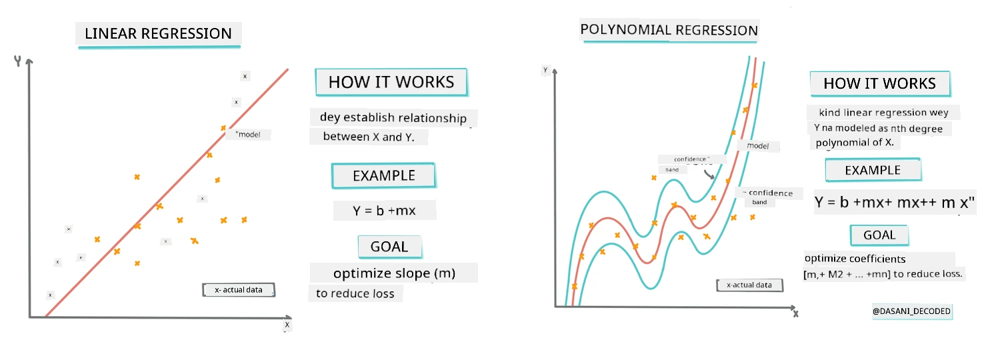
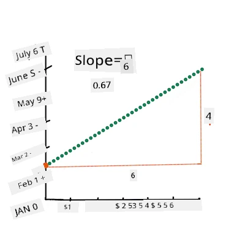
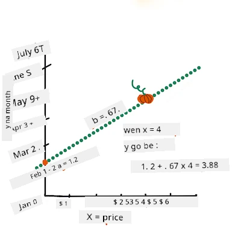
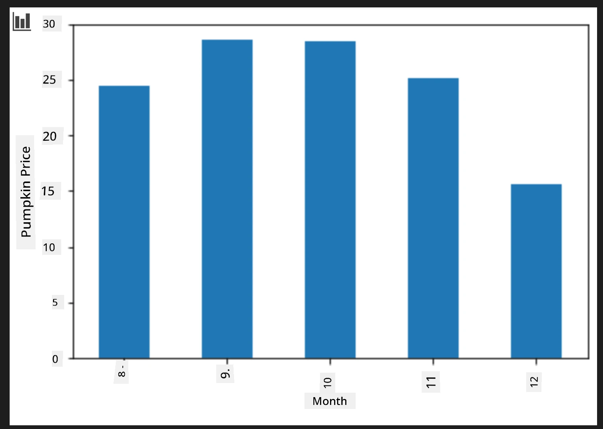
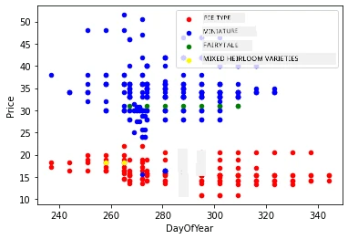

# Build a regression model using Scikit-learn: regression four ways

## Beginner Note

Linear regression na wen we wan predict **numerical value** (for example, house price, temperature, or sales).
E dey work by finding straight line wey go represent beta di relationship between input features and output.

For dis lesson, we go focus on to sabi the concept before we explore more advanced regression techniques.

> Infographic by [Dasani Madipalli](https://twitter.com/dasani_decoded)
## [Pre-lecture quiz](https://ff-quizzes.netlify.app/en/ml/)

> ### [This lesson dey available for R!](../../../../2-Regression/3-Linear/solution/R/lesson_3.html)
### Introduction 

So far, you don explore wetin regression be with sample data wey we gather from pumpkin pricing dataset wey we go take use for dis whole lesson. You don also use Matplotlib do visualisation.

Now you ready to go deeper for regression for ML. Even though visualisation dey help you understand data, the real power of Machine Learning na from _training models_. Models dey trained on historic data to automatically capture data dependencies, and dem allow you predict outcomes for new data, wey model never see before.

For dis lesson, you go learn more about two types of regression: _basic linear regression_ and _polynomial regression_, plus some of di math wey dey behind these techniques. Those models go allow us predict pumpkin prices depending on the different input data. 

[](https://youtu.be/CRxFT8oTDMg "ML for beginners - Understanding Linear Regression")

> 🎥 Click di picture above for short video wey go explain linear regression.

> Throughout dis curriculum, we dey assume say people no too sabi math, and we wan make am easy for students from different fields, so watch for notes, 🧮 callouts, diagrams, and other learning tools wey go help you understand.

### Prerequisite

By now, you suppose don sabi the structure of di pumpkin data we dey look. You fit see am preloaded and pre-cleaned for this lesson's _notebook.ipynb_ file. For di file, pumpkin price dey show per bushel inside new data frame. Make sure say you fit run dis notebook dem for kernels for Visual Studio Code.

### Preparation

Just to remind you, you dey load this data so you fit ask questions about am.

- When be di best time to buy pumpkins?
- Wetin price I fit expect for case of miniature pumpkins?
- Make I buy dem for half-bushel baskets or for the 1 1/9 bushel box?
Make we continue dig this data.

For di previous lesson, you create Pandas data frame and fill am with part of di original dataset, dem standardize price by bushel. But as you do am, you fit only gather about 400 datapoints and na only for fall months.

Make you check di data wey we preloaded inside this lesson's notebook. Di data dey preloaded and initial scatterplot dey show month data. Maybe we fit get small extra detail about di data by cleaning am more.

## A linear regression line

As you learn for Lesson 1, the goal of linear regression exercise na to fit line wey go:

- **Show variable relationships**. Show di relationship between variables
- **Make predictions**. Make correct predictions about where new datapoint fit fall compared to dat line.

E normal for **Least-Squares Regression** to draw line like dis. Di term "Least-Squares" mean say na di process to reduce total error for our model. For every data point, we measure di vertical distance (we go call am residual) between the real point and our regression line.

We dey square these distances for two main reasons:

1. **Magnitude over Direction:** We wan treat error of -5 same as error of +5. Squaring go make all values positive.

2. **Punish Outliers:** Squaring dey put more weight for bigger errors, so di line go stay close to points wey dey far.

Then we put all dis squared values join. Our goal na to find dat line wey get smallest total sum—na why dem call am "Least-Squares".

> **🧮 Show me the math**
> 
> Dis line, wey dem call _line of best fit_ fit express by [equation](https://en.wikipedia.org/wiki/Simple_linear_regression):
> 
> ```
> Y = a + bX
> ```
>
> `X` na di 'explanatory variable'. `Y` na di 'dependent variable'. Di slope of di line na `b` and `a` na y-intercept, wey mean di value of `Y` when `X = 0`.
>
>
>
> First, calculate slope `b`. Infographic by [Jen Looper](https://twitter.com/jenlooper)
>
> For example, regarding our pumpkin data question: "predict price of pumpkin per bushel by month", `X` go mean price, and `Y` go mean di month of sale.
>
>
>
> Calculate di value of Y. If you dey pay around $4, e must be April! Infographic by [Jen Looper](https://twitter.com/jenlooper)
>
> Di math wey calculate di line must show slope of di line, wey also depend on intercept, or di place wey `Y` dey when `X = 0`.
>
> You fit see how to calculate these values from [Math is Fun](https://www.mathsisfun.com/data/least-squares-regression.html) website. You fit also try [this Least-squares calculator](https://www.mathsisfun.com/data/least-squares-calculator.html) to see how numbers fit affect di line.

## Correlation

One more term wey you suppose sabi na **Correlation Coefficient** between X and Y variables. Using scatterplot, you fit quickly see dis coefficient. When datapoints dey scatter nicely for line, e mean high correlation, but if dem scatter everywhere between X and Y, na low correlation.

Good linear regression model go get high (near 1, no be 0) Correlation Coefficient with Least-Squares Regression line.

✅ Run di lesson notebook and check Month to Price scatterplot. Di data wey connect Month to Price for pumpkin sales get high or low correlation, based on how you see di scatterplot? E go change if you use detailed measure instead of `Month`, e.g. *day of the year* (number of days since beginning of year)?

For code below, we assume say data don clean and we get data frame name `new_pumpkins`, similar to di one below:

ID | Month | DayOfYear | Variety | City | Package | Low Price | High Price | Price
---|-------|-----------|---------|------|---------|-----------|------------|-------
70 | 9 | 267 | PIE TYPE | BALTIMORE | 1 1/9 bushel cartons | 15.0 | 15.0 | 13.636364
71 | 9 | 267 | PIE TYPE | BALTIMORE | 1 1/9 bushel cartons | 18.0 | 18.0 | 16.363636
72 | 10 | 274 | PIE TYPE | BALTIMORE | 1 1/9 bushel cartons | 18.0 | 18.0 | 16.363636
73 | 10 | 274 | PIE TYPE | BALTIMORE | 1 1/9 bushel cartons | 17.0 | 17.0 | 15.454545
74 | 10 | 281 | PIE TYPE | BALTIMORE | 1 1/9 bushel cartons | 15.0 | 15.0 | 13.636364

> Code to clean data dey inside [`notebook.ipynb`](notebook.ipynb). We follow same cleaning steps like before and calculate `DayOfYear` column with this expression: 

```python
day_of_year = pd.to_datetime(pumpkins['Date']).apply(lambda dt: (dt-datetime(dt.year,1,1)).days)
```

Now we don understand the math behind linear regression, make we create Regression model to see if we fit predict which pumpkin package go get best price. Person wey wan buy pumpkins for holiday pumpkin patch fit like get this info to optimise their pumpkin package purchases.

## Looking for Correlation

[](https://youtu.be/uoRq-lW2eQo "ML for beginners - Looking for Correlation: The Key to Linear Regression")

> 🎥 Click di picture above for quick video overview of correlation.

From the previous lesson, you don notice say average price for different months look like dis:



Dis one mean say correlation dey, and we fit try train linear regression model to predict di relationship between `Month` and `Price`, or between `DayOfYear` and `Price`. Below na scatter plot wey show dat latter relation:


Let’s check if correlation dey using `corr` function:

```python
print(new_pumpkins['Month'].corr(new_pumpkins['Price']))
print(new_pumpkins['DayOfYear'].corr(new_pumpkins['Price']))
```

E be like say correlation small, -0.15 by `Month` and -0.17 by `DayOfYear`, but maybe another important connection dey. E be like different price clusters dey based on pumpkin varieties. To confirm, make we plot each pumpkin category with different color. By passing `ax` parameter to `scatter` function, we fit plot all points for same graph:

```python
ax=None
colors = ['red','blue','green','yellow']
for i,var in enumerate(new_pumpkins['Variety'].unique()):
    df = new_pumpkins[new_pumpkins['Variety']==var]
    ax = df.plot.scatter('DayOfYear','Price',ax=ax,c=colors[i],label=var)
```



Our observation show say variety get more effect on price than di day wey dem sell am. We fit see am with bar graph:

```python
new_pumpkins.groupby('Variety')['Price'].mean().plot(kind='bar')
```


Make we focus for while on one pumpkin variety, 'pie type', to see how date dey affect price:

```python
pie_pumpkins = new_pumpkins[new_pumpkins['Variety']=='PIE TYPE']
pie_pumpkins.plot.scatter('DayOfYear','Price') 
```


If we calculate correlation between `Price` and `DayOfYear` with `corr` function, e fit be about `-0.27`—which mean training model make sense.

> Before you train linear regression model, make sure data clean well. Linear regression no dey work well with missing values, so e good to clear all empty cells:

```python
pie_pumpkins.dropna(inplace=True)
pie_pumpkins.info()
```

Another way na to fill them empty cells with mean values of di column.

## Simple Linear Regression

[](https://youtu.be/e4c_UP2fSjg "ML for beginners - Linear and Polynomial Regression using Scikit-learn")

> 🎥 Click di picture above for short video about linear and polynomial regression.

To train our Linear Regression model, we go use **Scikit-learn** library.

```python
from sklearn.linear_model import LinearRegression
from sklearn.metrics import mean_squared_error
from sklearn.model_selection import train_test_split
```

We start by separating input values (features) and expected output (label) into separate numpy arrays:

```python
X = pie_pumpkins['DayOfYear'].to_numpy().reshape(-1,1)
y = pie_pumpkins['Price']
```

> Note say we do `reshape` on the input data so that Linear Regression package go understand am well. Linear Regression expect 2D-array as input, where each row be vector of input features. For our case, we get only one input so we need array with shape N×1, where N be dataset size.

Then, we wan split data into train and test datasets, so we fit validate our model after training:

```python
X_train, X_test, y_train, y_test = train_test_split(X, y, test_size=0.2, random_state=0)
```

Finally, training the actual Linear Regression model dey only take two lines of code. We define `LinearRegression` object, then fit am to data using `fit` method:

```python
lin_reg = LinearRegression()
lin_reg.fit(X_train,y_train)
```

Di `LinearRegression` object afta `fit`-ting get all di coefficients of di regression, we fit access wit `.coef_` property. For our case, e get just one coefficient wey suppose dey around `-0.017`. E mean say di prices dey like dey drop small wit time, but no too much, like 2 cents per day. We fit also access di intersection point of di regression wit Y-axis wit `lin_reg.intercept_` - e go be like `21` for our case, wey mean di price for di beginning of di year.

To see how correct our model be, we fit predict prices for test dataset, den measure how near our predictions be to di values wey we suppose get. Dis one fit use root mean square error (RMSE) metrics, wey be di root of di mean of all squared difference between di expected and predicted value.

```python
pred = lin_reg.predict(X_test)

rmse = np.sqrt(mean_squared_error(y_test,pred))
print(f'RMSE: {rmse:3.3} ({rmse/np.mean(pred)*100:3.3}%)')
```

Our error dey around 2 points, wey be ~17%. No too good. Another sign of model quality na di **coefficient of determination**, wey fit get like dis:

```python
score = lin_reg.score(X_train,y_train)
print('Model determination: ', score)
```
If di value be 0, e mean say di model no dey consider di input data at all, e dey behave as di *worst linear predictor*, wey be just mean value of di result. If di value be 1, e mean say we fit predict di expected outputs perfectly. For our case, di coefficient dey around 0.06, wey low well well.

We fit plot di test data togida wit di regression line make we fit see well how di regression dey work for our case:

```python
plt.scatter(X_test,y_test)
plt.plot(X_test,pred)
```


## Polynomial Regression

Another Kind of Linear Regression na Polynomial Regression. Sometimes, di relationship between variables be linear - di bigger di pumpkin volume, di higher di price - but sometimes di relationship no dey fit plot as plane or straight line. 

✅ Here be [some more examples](https://online.stat.psu.edu/stat501/Lesson09#polynomial-regression-examples) of data wey Polynomial Regression fit use

Make you check di relationship between Date and Price again. Dis scatterplot be like e suppose analyze by straight line? Prices no fit dey change? For dis kain case, you fit try polynomial regression.

✅ Polynomials na mathematical expressions wey fit get one or more variables and coefficients

Polynomial regression dey create curved line to fit nonlinear data better. For our case, if we add squared `DayOfYear` variable inside input data, we suppose fit plot our data with parabolic curve, wey get minimum point somewhere inside di year.

Scikit-learn get beta [pipeline API](https://scikit-learn.org/stable/modules/generated/sklearn.pipeline.make_pipeline.html?highlight=pipeline#sklearn.pipeline.make_pipeline) wey combine different steps of data processing together. A **pipeline** na chain of **estimators**. For our case, we go create pipeline wey first add polynomial features to our model, then train di regression:

```python
from sklearn.preprocessing import PolynomialFeatures
from sklearn.pipeline import make_pipeline

pipeline = make_pipeline(PolynomialFeatures(2), LinearRegression())

pipeline.fit(X_train,y_train)
```

Using `PolynomialFeatures(2)` mean say we go include all second-degree polynomials from di input data. For our case, e mean `DayOfYear`<sup>2</sup>, but if we get two variables X and Y, e go add X<sup>2</sup>, XY, and Y<sup>2</sup>. We fit still use higher degree polynomials if we want.

Pipelines fit work same way as original `LinearRegression` object, so we fit `fit` di pipeline, and then use `predict` to get prediction results:

```python
pred = pipeline.predict(X_test)

rmse = np.sqrt(mean_squared_error(y_test,pred))
print(f'RMSE: {rmse:3.3} ({rmse/np.mean(pred)*100:3.3}%)')

score = pipeline.score(X_train,y_train)
print('Model determination: ', score)
```

To plot smooth approximation curve, we dey use `np.linspace` to create uniform input values range, no just plot directly on unordered test data (wey fit produce zigzag line):

```python
X_range = np.linspace(X_test.min(), X_test.max(), 100).reshape(-1,1)
y_range = pipeline.predict(X_range)

plt.scatter(X_test, y_test)
plt.plot(X_range, y_range)
```

Na here di graph wey show test data, plus di approximation curve:


Using Polynomial Regression, we fit get small lower RMSE and higher determination but no too much. We need consider other features!

> You fit see say di minimal pumpkin prices dey around Halloween. How you fit explain dis?

🎃 Congrats! You just create model wey fit predict pie pumpkin price. You fit do same for all pumpkin types but e go hard. Make we learn now how pumpkin variety fit enter our model!

## Categorical Features

For perfect world, we wan fit predict prices for different pumpkin varieties inside di same model. But di `Variety` column different small from columns like `Month`, because e get non-numeric values. Such column dem dey call **categorical**.

[](https://youtu.be/DYGliioIAE0 "ML for beginners - Categorical Feature Predictions with Linear Regression")

> 🎥 Click di picture above to watch short video about using categorical features.

Here you fit see how di average price depend on variety:


To take variety enter account, we first gats convert am to numeric form, or **encode** am. We get some ways to do am:

* Simple **numeric encoding** go build table of different varieties, then replace di variety name wit index for dat table. Dis no be good plan for linear regression, because linear regression go take actual numeric value of index, den add am to result, wey dem go multiply by some coefficient. For our case, di relationship between index number and price no linear, even if we arrange di indices in one specific order.
* **One-hot encoding** go replace di `Variety` column wit 4 different columns, one for each variety. Each column go contain `1` if dat row belong to dat particular variety, else `0`. Dis mean say di linear regression go get four coefficients, one for each pumpkin variety, wey dey responsible for "starting price" (or "additional price") for dat variety.

Code below show how to one-hot encode variety:

```python
pd.get_dummies(new_pumpkins['Variety'])
```

 ID | FAIRYTALE | MINIATURE | MIXED HEIRLOOM VARIETIES | PIE TYPE
----|-----------|-----------|--------------------------|----------
70 | 0 | 0 | 0 | 1
71 | 0 | 0 | 0 | 1
... | ... | ... | ... | ...
1738 | 0 | 1 | 0 | 0
1739 | 0 | 1 | 0 | 0
1740 | 0 | 1 | 0 | 0
1741 | 0 | 1 | 0 | 0
1742 | 0 | 1 | 0 | 0

To train linear regression wit one-hot encoded variety as input, we just need initialize `X` and `y` data well:

```python
X = pd.get_dummies(new_pumpkins['Variety'])
y = new_pumpkins['Price']
```

Rest of di code be di same as we use before to train Linear Regression. If you try am, you go see say mean squared error still about de same, but we get much higher coefficient of determination (~77%). To get more accurate predictions, we fit also take more categorical features into account, plus numeric features like `Month` or `DayOfYear`. To get one big features array, we fit use `join`:

```python
X = pd.get_dummies(new_pumpkins['Variety']) \
        .join(new_pumpkins['Month']) \
        .join(pd.get_dummies(new_pumpkins['City'])) \
        .join(pd.get_dummies(new_pumpkins['Package']))
y = new_pumpkins['Price']
```

Here we also consider `City` and `Package` type, wey give RMSE 2.84 (10.5%), and determination 0.94!

## Put am all together

To make di best model, we fit use combined (one-hot encoded categorical + numeric) data from di example above together wit Polynomial Regression. Here na complete code for your convenience:

```python
# set up training data
X = pd.get_dummies(new_pumpkins['Variety']) \
        .join(new_pumpkins['Month']) \
        .join(pd.get_dummies(new_pumpkins['City'])) \
        .join(pd.get_dummies(new_pumpkins['Package']))
y = new_pumpkins['Price']

# make train-test split
X_train, X_test, y_train, y_test = train_test_split(X, y, test_size=0.2, random_state=0)

# setup and train the pipeline
pipeline = make_pipeline(PolynomialFeatures(2), LinearRegression())
pipeline.fit(X_train,y_train)

# predict results for test data
pred = pipeline.predict(X_test)

# calculate RMSE and determination
rmse = mean_squared_error(y_test, pred, squared=False)
print(f'RMSE: {rmse:3.3} ({rmse/pred.mean()*100:3.3}%)')

score = pipeline.score(X_train,y_train)
print('Model determination: ', score)
```

Dis one suppose give best determination coefficient close to 97%, and RMSE=2.23 (~8% error for prediction).

| Model | RMSE | Determination |
|-------|-----|---------------|
| `DayOfYear` Linear | 2.77 (17.2%) | 0.07 |
| `DayOfYear` Polynomial | 2.73 (17.0%) | 0.08 |
| `Variety` Linear | 5.24 (19.7%) | 0.77 |
| All features Linear | 2.84 (10.5%) | 0.94 |
| All features Polynomial | 2.23 (8.25%) | 0.97 |

🏆 Well done! You create four Regression models inside one lesson, and improve model quality to 97%. For final section about Regression, you go learn Logistic Regression to find categories. 

---
## 🚀Challenge

Try different variables inside dis notebook to see how correlation relate to model accuracy.

## [Post-lecture quiz](https://ff-quizzes.netlify.app/en/ml/)

## Review & Self Study

For dis lesson, we learn about Linear Regression. Other important Regression types dey. Read about Stepwise, Ridge, Lasso and Elasticnet techniques. One good course to study na di [Stanford Statistical Learning course](https://online.stanford.edu/courses/sohs-ystatslearning-statistical-learning)

## Assignment 

[Build a Model](assignment.md)

---

<!-- CO-OP TRANSLATOR DISCLAIMER START -->
**Disclaimer**:  
Dis document don be translated by AI translation service wey dem dey call [Co-op Translator](https://github.com/Azure/co-op-translator). Even though we dey try make am correct, abeg sabi say automated translation fit get some error or mistake. The original document for im own language na im be the correct and original source. For important mata, e better make person wey sabi do professional human translation look am. We no go responsible for any kasala or misunderstanding wey fit happen because of how dis translation be.
<!-- CO-OP TRANSLATOR DISCLAIMER END -->