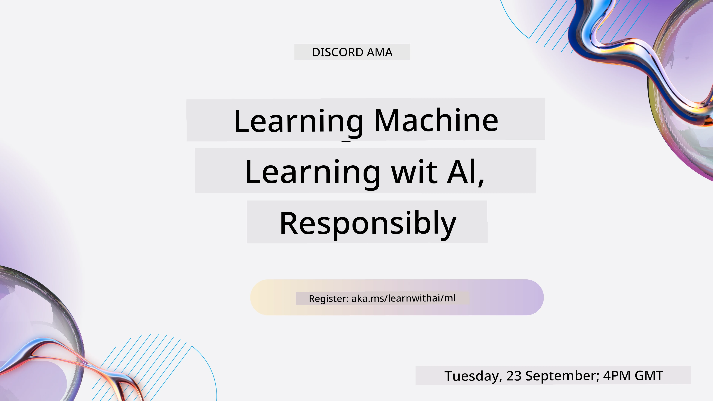
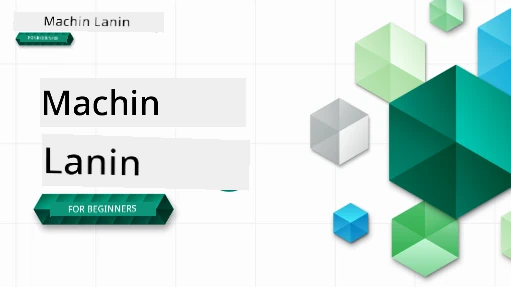

[](https://github.com/microsoft/ML-For-Beginners/blob/master/LICENSE)
[](https://GitHub.com/microsoft/ML-For-Beginners/graphs/contributors/)
[](https://GitHub.com/microsoft/ML-For-Beginners/issues/)
[](https://GitHub.com/microsoft/ML-For-Beginners/pulls/)
[](http://makeapullrequest.com)

[](https://GitHub.com/microsoft/ML-For-Beginners/watchers/)
[](https://GitHub.com/microsoft/ML-For-Beginners/network/)
[](https://GitHub.com/microsoft/ML-For-Beginners/stargazers/)

### 🌐 Multi-Language Support

#### Translations maintained with [Co-op Translator](https://github.com/Azure/co-op-translator)

<!-- CO-OP TRANSLATOR LANGUAGES TABLE START -->
[Arabic](../ar/README.md) | [Bengali](../bn/README.md) | [Bulgarian](../bg/README.md) | [Burmese (Myanmar)](../my/README.md) | [Chinese (Simplified)](../zh-CN/README.md) | [Chinese (Traditional, Hong Kong)](../zh-HK/README.md) | [Chinese (Traditional, Macau)](../zh-MO/README.md) | [Chinese (Traditional, Taiwan)](../zh-TW/README.md) | [Croatian](../hr/README.md) | [Czech](../cs/README.md) | [Danish](../da/README.md) | [Dutch](../nl/README.md) | [Estonian](../et/README.md) | [Finnish](../fi/README.md) | [French](../fr/README.md) | [German](../de/README.md) | [Greek](../el/README.md) | [Hebrew](../he/README.md) | [Hindi](../hi/README.md) | [Hungarian](../hu/README.md) | [Indonesian](../id/README.md) | [Italian](../it/README.md) | [Japanese](../ja/README.md) | [Kannada](../kn/README.md) | [Khmer](../km/README.md) | [Korean](../ko/README.md) | [Lithuanian](../lt/README.md) | [Malay](../ms/README.md) | [Malayalam](../ml/README.md) | [Manipuri (Meitei Mayek)](../mni/README.md) | [Marathi](../mr/README.md) | [Nepali](../ne/README.md) | [Nigerian Pidgin](./README.md) | [Norwegian](../no/README.md) | [Persian (Farsi)](../fa/README.md) | [Polish](../pl/README.md) | [Portuguese (Brazil)](../pt-BR/README.md) | [Portuguese (Portugal)](../pt-PT/README.md) | [Punjabi (Gurmukhi)](../pa/README.md) | [Romanian](../ro/README.md) | [Russian](../ru/README.md) | [Serbian (Cyrillic)](../sr/README.md) | [Slovak](../sk/README.md) | [Slovenian](../sl/README.md) | [Spanish](../es/README.md) | [Swahili](../sw/README.md) | [Swedish](../sv/README.md) | [Tagalog (Filipino)](../tl/README.md) | [Tamil](../ta/README.md) | [Telugu](../te/README.md) | [Thai](../th/README.md) | [Turkish](../tr/README.md) | [Ukrainian](../uk/README.md) | [Urdu](../ur/README.md) | [Vietnamese](../vi/README.md)

> **Prefer to Clone Locally?**
>
> This repository includes 50+ language translations which significantly increases the download size. To clone without translations, use sparse checkout:
>
> **Bash / macOS / Linux:**
> ```bash
> git clone --filter=blob:none --sparse https://github.com/microsoft/ML-For-Beginners.git
> cd ML-For-Beginners
> git sparse-checkout set --no-cone '/*' '!translations' '!translated_images'
> ```
>
> **CMD (Windows):**
> ```cmd
> git clone --filter=blob:none --sparse https://github.com/microsoft/ML-For-Beginners.git
> cd ML-For-Beginners
> git sparse-checkout set --no-cone "/*" "!translations" "!translated_images"
> ```
>
> This gives you everything you need to complete the course with a much faster download.
<!-- CO-OP TRANSLATOR LANGUAGES TABLE END -->

#### Join Our Community

[](https://discord.gg/nTYy5BXMWG)

We get Discord learn with AI series wey dey go on, learn more and join us for [Learn with AI Series](https://aka.ms/learnwithai/discord) from 18 - 30 September, 2025. You go see tips and tricks for how to use GitHub Copilot for Data Science.



# Machine Learning for Beginners - A Curriculum

> 🌍 Travel around di world as we explore Machine Learning by means of world cultures 🌍

Cloud Advocates for Microsoft dem happy to offer 12-week, 26-lesson curriculum wey dey all about **Machine Learning**. For dis curriculum, you go learn about wetin dem sometimes dey call **classic machine learning**, wey use mainly Scikit-learn as library plus we no go put deep learning, wey e dey for our [AI for Beginners' curriculum](https://aka.ms/ai4beginners). Make you use dis lessons plus our ['Data Science for Beginners' curriculum](https://aka.ms/ds4beginners), too!

Travel with us around di world as we apply dis classic techniques to data from plenty parts of di world. Each lesson get pre- and post-lesson quizzes, written instructions to finish di lesson, solution, assignment, and more. Our project-based method dey allow you learn while you dey build, na better way for new skills to stay for mind.

**✍️ Big thanks to our authors** Jen Looper, Stephen Howell, Francesca Lazzeri, Tomomi Imura, Cassie Breviu, Dmitry Soshnikov, Chris Noring, Anirban Mukherjee, Ornella Altunyan, Ruth Yakubu and Amy Boyd

**🎨 Thanks too to our illustrators** Tomomi Imura, Dasani Madipalli, and Jen Looper

**🙏 Special thanks 🙏 to our Microsoft Student Ambassador authors, reviewers, and content contributors**, especially Rishit Dagli, Muhammad Sakib Khan Inan, Rohan Raj, Alexandru Petrescu, Abhishek Jaiswal, Nawrin Tabassum, Ioan Samuila, and Snigdha Agarwal

**🤩 Extra big thanks to Microsoft Student Ambassadors Eric Wanjau, Jasleen Sondhi, and Vidushi Gupta for our R lessons!**

# Getting Started

Follow these steps:
1. **Fork the Repository**: Click di "Fork" button for top-right corner of dis page.
2. **Clone the Repository**:   `git clone https://github.com/microsoft/ML-For-Beginners.git`

> 💡 **Quick Start Tip:** You wan start inside browser without setup Python local? Use [GitHub Codespaces](https://github.com/features/codespaces) to create cloud development environment for your fork. Open green **Code** menu, select **Codespaces**, and create codespace; install each lesson’s needed dependencies inside am as e dey needed.

> [find all other resources for dis course for our Microsoft Learn collection](https://learn.microsoft.com/en-us/collections/qrqzamz1nn2wx3?WT.mc_id=academic-77952-bethanycheum)

> 🔧 **Need help?** Check our [Troubleshooting Guide](TROUBLESHOOTING.md) for solutions to common wahalas with installation, setup, and running lessons.


**[Students](https://aka.ms/student-page)**, to use dis curriculum, fork di whole repo to your own GitHub account and finish di exercises by yourself or with group:

- Start with pre-lecture quiz.
- Read di lecture and finish di activities, pause and think for each knowledge check.
- Try build di projects by understanding di lessons instead of just running di solution code; but di code dey inside the `/solution` folders for each project lesson.
- Take post-lecture quiz.
- Finish di challenge.
- Finish di assignment.
- After you finish lesson group, go [Discussion Board](https://github.com/microsoft/ML-For-Beginners/discussions) and "learn out loud" by filling di correct PAT rubric. 'PAT' na Progress Assessment Tool wey you fill to move your learning forward. You fit also react to other PATs so we go fit learn together.

> For more study, we recommend follow these [Microsoft Learn](https://docs.microsoft.com/en-us/users/jenlooper-2911/collections/k7o7tg1gp306q4?WT.mc_id=academic-77952-leestott) modules and learning paths.

**Teachers**, we don [include some suggestions](for-teachers.md) on how to use dis curriculum.

---

## Video walkthroughs

Some lessons dey available as short form video. You fit find all dis inside di lessons, or for [ML for Beginners playlist for Microsoft Developer YouTube channel](https://aka.ms/ml-beginners-videos) by clicking di image below.

[](https://aka.ms/ml-beginners-videos)

---

## Meet the Team

[](https://youtu.be/Tj1XWrDSYJU)

**Gif by** [Mohit Jaisal](https://linkedin.com/in/mohitjaisal)

> 🎥 Click di image above for video about di project and di people wey create am!

---

## Pedagogy

We choose two teaching principles as we build dis curriculum: make sure say e be hands-on **project-based** and say e get **plenty quizzes**. Besides dat, dis curriculum get common **theme** to give am better connection.

By making sure say di content dey linked to projects, di process go sweet for students and dem go remember tins well. Also, small quiz before class dey set student mind for how to learn di subject, while second quiz after class go make dem remember more. Dis curriculum dey flexible and fun, you fit take all or to part. Projects start small and dey get harder as di 12-week cycle near end. Dis curriculum still get postscript on how ML dey work for real world, wey fit be extra credit or talk point.

> Find our [Code of Conduct](CODE_OF_CONDUCT.md), [Contributing](CONTRIBUTING.md), [Translations](..), and [Troubleshooting](TROUBLESHOOTING.md) rules. We dey welcome your good feedback!

## Everything each lesson get

- optional sketchnote
- optional extra video
- video walkthrough (some lessons only)
- [pre-lecture warmup quiz](https://ff-quizzes.netlify.app/en/ml/)
- written lesson
- for project-based lessons, step-by-step guides on how to build di project
- knowledge checks
- challenge
- extra reading
- assignment
- [post-lecture quiz](https://ff-quizzes.netlify.app/en/ml/)

> **Note about languages**: These lessons primarily di write for Python, but plenty dey also in R. To finish R lesson, go `/solution` folder and find R lessons. Dem get .rmd extension wey mean **R Markdown** file wey fit be define as embedding of `code chunks` (for R or other languages) and `YAML header` (wey show how to format outputs like PDF) for one `Markdown document`. So, e dey serve as good authoring framework for data science cos e allow you join your code, output, plus your thoughts by writing dem for Markdown. Plus, R Markdown documents fit render to output formats like PDF, HTML, or Word.

> **Note about quizzes**: All quizzes dey for [Quiz App folder](../../quiz-app), total 52 quizzes wey get three questions each. Dem dey link from lessons but quiz app fit run local; follow di instruction for `quiz-app` folder to host local or put am for Azure.

| Lesson Number |                             Topic                              |                   Lesson Grouping                   | Learning Objectives                                                                                                             |                                                              Linked Lesson                                                               |                        Author                        |
| :-----------: | :------------------------------------------------------------: | :-------------------------------------------------: | ------------------------------------------------------------------------------------------------------------------------------- | :--------------------------------------------------------------------------------------------------------------------------------------: | :--------------------------------------------------: |
|      01       |                Introduction to machine learning                |      [Introduction](1-Introduction/README.md)       | Learn the basic concepts behind machine learning                                                                                |                                             [Lesson](1-Introduction/1-intro-to-ML/README.md)                                             |                       Muhammad                       |
|      02       |                The History of machine learning                 |      [Introduction](1-Introduction/README.md)       | Learn the history underlying this field                                                                                         |                                            [Lesson](1-Introduction/2-history-of-ML/README.md)                                            |                     Jen and Amy                      |
|      03       |                 Fairness and machine learning                  |      [Introduction](1-Introduction/README.md)       | What are the important philosophical issues around fairness that students should consider when building and applying ML models? |                                              [Lesson](1-Introduction/3-fairness/README.md)                                               |                        Tomomi                        |
|      04       |                Techniques for machine learning                 |      [Introduction](1-Introduction/README.md)       | What techniques do ML researchers use to build ML models?                                                                       |                                          [Lesson](1-Introduction/4-techniques-of-ML/README.md)                                           |                    Chris and Jen                     |
|      05       |                   Introduction to regression                   |        [Regression](2-Regression/README.md)         | Get started with Python and Scikit-learn for regression models                                                                  |         [Python](2-Regression/1-Tools/README.md) • [R](../../2-Regression/1-Tools/solution/R/lesson_1.html)         |      Jen • Eric Wanjau       |
|      06       |                North American pumpkin prices 🎃                |        [Regression](2-Regression/README.md)         | Visualize and clean data in preparation for ML                                                                                  |          [Python](2-Regression/2-Data/README.md) • [R](../../2-Regression/2-Data/solution/R/lesson_2.html)          |      Jen • Eric Wanjau       |
|      07       |                North American pumpkin prices 🎃                |        [Regression](2-Regression/README.md)         | Build linear and polynomial regression models                                                                                   |        [Python](2-Regression/3-Linear/README.md) • [R](../../2-Regression/3-Linear/solution/R/lesson_3.html)        |      Jen and Dmitry • Eric Wanjau       |
|      08       |                North American pumpkin prices 🎃                |        [Regression](2-Regression/README.md)         | Build a logistic regression model                                                                                               |     [Python](2-Regression/4-Logistic/README.md) • [R](../../2-Regression/4-Logistic/solution/R/lesson_4.html)      |      Jen • Eric Wanjau       |
|      09       |                          A Web App 🔌                          |           [Web App](3-Web-App/README.md)            | Build a web app to use your trained model                                                                                       |                                                 [Python](3-Web-App/1-Web-App/README.md)                                                  |                         Jen                          |
|      10       |                 Introduction to classification                 |    [Classification](4-Classification/README.md)     | Clean, prep, and visualize your data; introduction to classification                                                            | [Python](4-Classification/1-Introduction/README.md) • [R](../../4-Classification/1-Introduction/solution/R/lesson_10.html)  | Jen and Cassie • Eric Wanjau |
|      11       |             Delicious Asian and Indian cuisines 🍜             |    [Classification](4-Classification/README.md)     | Introduction to classifiers                                                                                                     | [Python](4-Classification/2-Classifiers-1/README.md) • [R](../../4-Classification/2-Classifiers-1/solution/R/lesson_11.html) | Jen and Cassie • Eric Wanjau |
|      12       |             Delicious Asian and Indian cuisines 🍜             |    [Classification](4-Classification/README.md)     | More classifiers                                                                                                                | [Python](4-Classification/3-Classifiers-2/README.md) • [R](../../4-Classification/3-Classifiers-2/solution/R/lesson_12.html) | Jen and Cassie • Eric Wanjau |
|      13       |             Delicious Asian and Indian cuisines 🍜             |    [Classification](4-Classification/README.md)     | Build a recommender web app using your model                                                                                    |                                              [Python](4-Classification/4-Applied/README.md)                                              |                         Jen                          |
|      14       |                   Introduction to clustering                   |        [Clustering](5-Clustering/README.md)         | Clean, prep, and visualize your data; Introduction to clustering                                                                |         [Python](5-Clustering/1-Visualize/README.md) • [R](../../5-Clustering/1-Visualize/solution/R/lesson_14.html)         |      Jen • Eric Wanjau       |
|      15       |              Exploring Nigerian Musical Tastes 🎧              |        [Clustering](5-Clustering/README.md)         | Explore the K-Means clustering method                                                                                           |           [Python](5-Clustering/2-K-Means/README.md) • [R](../../5-Clustering/2-K-Means/solution/R/lesson_15.html)           |      Jen • Eric Wanjau       |
|      16       |        Introduction to natural language processing ☕️         |   [Natural language processing](6-NLP/README.md)    | Learn the basics about NLP by building a simple bot                                                                             |                                             [Python](6-NLP/1-Introduction-to-NLP/README.md)                                              |                       Stephen                        |
|      17       |                      Common NLP Tasks ☕️                      |   [Natural language processing](6-NLP/README.md)    | Deepen your NLP knowledge by understanding common tasks required when dealing with language structures                          |                                                    [Python](6-NLP/2-Tasks/README.md)                                                     |                       Stephen                        |
|      18       |             Translation and sentiment analysis ♥️              |   [Natural language processing](6-NLP/README.md)    | Translation and sentiment analysis with Jane Austen                                                                             |                                            [Python](6-NLP/3-Translation-Sentiment/README.md)                                             |                       Stephen                        |
|      19       |                  Romantic hotels of Europe ♥️                  |   [Natural language processing](6-NLP/README.md)    | Sentiment analysis with hotel reviews 1                                                                                         |                                               [Python](6-NLP/4-Hotel-Reviews-1/README.md)                                                |                       Stephen                        |
|      20       |                  Romantic hotels of Europe ♥️                  |   [Natural language processing](6-NLP/README.md)    | Sentiment analysis with hotel reviews 2                                                                                         |                                               [Python](6-NLP/5-Hotel-Reviews-2/README.md)                                                |                       Stephen                        |
|      21       |            Introduction to time series forecasting             |        [Time series](7-TimeSeries/README.md)        | Introduction to time series forecasting                                                                                         |                                             [Python](7-TimeSeries/1-Introduction/README.md)                                              |                      Francesca                       |
|      22       | ⚡️ World Power Usage ⚡️ - time series forecasting with ARIMA |        [Time series](7-TimeSeries/README.md)        | Time series forecasting with ARIMA                                                                                              |                                                 [Python](7-TimeSeries/2-ARIMA/README.md)                                                 |                      Francesca                       |
|      23       |  ⚡️ World Power Usage ⚡️ - time series forecasting with SVR  |        [Time series](7-TimeSeries/README.md)        | Time series forecasting with Support Vector Regressor                                                                           |                                                  [Python](7-TimeSeries/3-SVR/README.md)                                                  |                       Anirban                        |
|      24       |             Introduction to reinforcement learning             | [Reinforcement learning](8-Reinforcement/README.md) | Introduction to reinforcement learning with Q-Learning                                                                          |                                             [Python](8-Reinforcement/1-QLearning/README.md)                                              |                        Dmitry                        |
|      25       |                 Help Peter avoid the wolf! 🐺                  | [Reinforcement learning](8-Reinforcement/README.md) | Reinforcement learning Gym                                                                                                      |                                                [Python](8-Reinforcement/2-Gym/README.md)                                                 |                        Dmitry                        |
|  Postscript   |            Real-World ML scenarios and applications            |      [ML in the Wild](9-Real-World/README.md)       | Interesting and revealing real-world applications of classical ML                                                               |                                             [Lesson](9-Real-World/1-Applications/README.md)                                              |                         Team                         |
|  Postscript   |            Model Debugging in ML using RAI dashboard            |      [ML in the Wild](9-Real-World/README.md)       | Model Debugging in Machine Learning using Responsible AI dashboard components                                                              |                                             [Lesson](9-Real-World/2-Debugging-ML-Models/README.md)                                              |                     Ruth Yakubu                      |

> [find all additional resources for this course in our Microsoft Learn collection](https://learn.microsoft.com/en-us/collections/qrqzamz1nn2wx3?WT.mc_id=academic-77952-bethanycheum)

## Offline access

You fit run dis documentation offline by using [Docsify](https://docsify.js.org/#/). Fork dis repo, [install Docsify](https://docsify.js.org/#/quickstart) for your local machine, then for inside di root folder of dis repo, type `docsify serve`. Di website go dey serve for port 3000 for your localhost: `localhost:3000`.

## PDFs

Find pdf of di curriculum wit links [here](https://microsoft.github.io/ML-For-Beginners/pdf/readme.pdf).


## 🎒 Other Courses 

Our team dey produce other courses! Check am out:

<!-- CO-OP TRANSLATOR OTHER COURSES START -->
### LangChain
[](https://aka.ms/langchain4j-for-beginners)
[](https://aka.ms/langchainjs-for-beginners?WT.mc_id=m365-94501-dwahlin)
[](https://github.com/microsoft/langchain-for-beginners?WT.mc_id=m365-94501-dwahlin)
---

### Azure / Edge / MCP / Agents
[](https://github.com/microsoft/AZD-for-beginners?WT.mc_id=academic-105485-koreyst)
[](https://github.com/microsoft/edgeai-for-beginners?WT.mc_id=academic-105485-koreyst)
[](https://github.com/microsoft/mcp-for-beginners?WT.mc_id=academic-105485-koreyst)
[](https://github.com/microsoft/ai-agents-for-beginners?WT.mc_id=academic-105485-koreyst)

---
 
### Generative AI Series
[](https://github.com/microsoft/generative-ai-for-beginners?WT.mc_id=academic-105485-koreyst)
[-9333EA?style=for-the-badge&labelColor=E5E7EB&color=9333EA)](https://github.com/microsoft/Generative-AI-for-beginners-dotnet?WT.mc_id=academic-105485-koreyst)
[-C084FC?style=for-the-badge&labelColor=E5E7EB&color=C084FC)](https://github.com/microsoft/generative-ai-for-beginners-java?WT.mc_id=academic-105485-koreyst)
[-E879F9?style=for-the-badge&labelColor=E5E7EB&color=E879F9)](https://github.com/microsoft/generative-ai-with-javascript?WT.mc_id=academic-105485-koreyst)

---
 
### Core Learning
[](https://aka.ms/ml-beginners?WT.mc_id=academic-105485-koreyst)
[](https://aka.ms/datascience-beginners?WT.mc_id=academic-105485-koreyst)
[](https://aka.ms/ai-beginners?WT.mc_id=academic-105485-koreyst)
[](https://github.com/microsoft/Security-101?WT.mc_id=academic-96948-sayoung)
[](https://aka.ms/webdev-beginners?WT.mc_id=academic-105485-koreyst)
[](https://aka.ms/iot-beginners?WT.mc_id=academic-105485-koreyst)
[](https://github.com/microsoft/xr-development-for-beginners?WT.mc_id=academic-105485-koreyst)

---
 
### Copilot Series
[](https://aka.ms/GitHubCopilotAI?WT.mc_id=academic-105485-koreyst)
[](https://github.com/microsoft/mastering-github-copilot-for-dotnet-csharp-developers?WT.mc_id=academic-105485-koreyst)
[](https://github.com/microsoft/CopilotAdventures?WT.mc_id=academic-105485-koreyst)
<!-- CO-OP TRANSLATOR OTHER COURSES END -->

## Getting Help

If you jam problem or get question while you dey learn Machine Learning or you dey build AI apps, no wahala — help dey.

You fit join discussions with other learners and developers, ask question, and share your ideas wit di community.

- Join di community to ask question and learn wit others
- Discuss Machine Learning concepts and project ideas
- Get guidance from experienced developers

Supportive community na beta way to grow your skills and solve problems quick.

[Microsoft Foundry Discord Community](https://discord.gg/nTYy5BXMWG)

If you see bugs, errors, or get suggestions for betterment, you fit also open **Issue** for dis repository to report di problem.

For product feedback or if you want check existing community posts, visit di Developer Forum:

[](https://aka.ms/foundry/forum)

## Additional Learning Tips

- Review notebooks after each lesson to understand well well.
- Practice how to implement algorithms by yourself.
- Explore real-world datasets using learned concepts.

---

<!-- CO-OP TRANSLATOR DISCLAIMER START -->
**Disclaimer**:
Dis document don translate wit AI translation service [Co-op Translator](https://github.com/Azure/co-op-translator). Even tho we dey try make am correct, abeg make you know say automated translation fit get errors or mistakes. Di original document for dia own language na im be di correct source. For important info, make person wey sabi human translation do am. We no go responsible for any misunderstanding or wrong understanding wey fit happen because of dis translation.
<!-- CO-OP TRANSLATOR DISCLAIMER END -->