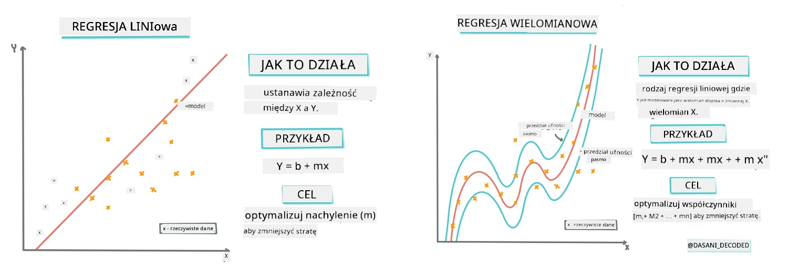
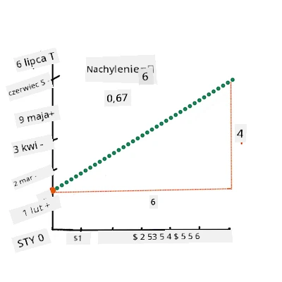
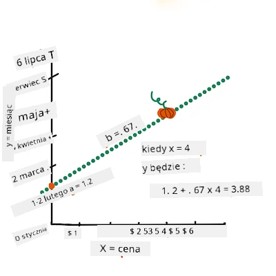
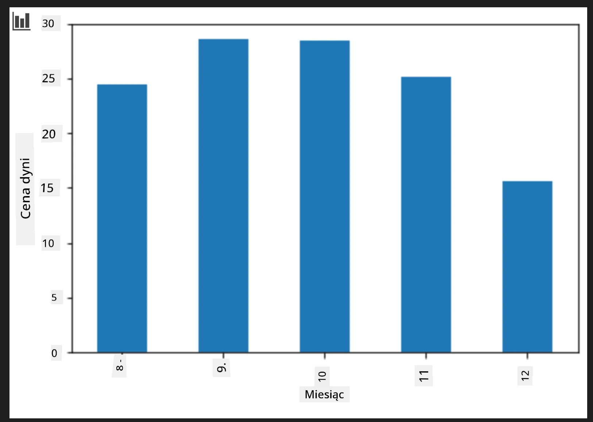
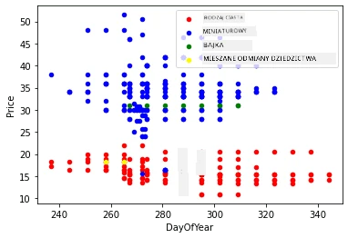

# Budowanie modelu regresji za pomocą Scikit-learn: cztery sposoby regresji

## Notatka dla początkujących

Regresja liniowa jest używana, gdy chcemy przewidzieć **wartość liczbową** (na przykład cenę domu, temperaturę lub sprzedaż).
Działa przez znalezienie prostej, która najlepiej reprezentuje zależność między cechami wejściowymi a wyjściem.

W tej lekcji skupimy się na zrozumieniu koncepcji, zanim przejdziemy do bardziej zaawansowanych technik regresji.

> Infografika autorstwa [Dasani Madipalli](https://twitter.com/dasani_decoded)
## [Quiz przed wykładem](https://ff-quizzes.netlify.app/en/ml/)

> ### [Ta lekcja jest też dostępna w R!](../../../../2-Regression/3-Linear/solution/R/lesson_3.html)
### Wprowadzenie

Do tej pory zapoznaliście się z tym, czym jest regresja na podstawie przykładowych danych z zestawu danych o cenach dyni, który będziemy wykorzystywać w całej lekcji. Wizualizowaliście je również za pomocą Matplotlib.

Teraz jesteście gotowi, by zagłębić się w regresję w ML. Podczas gdy wizualizacja pozwala zrozumieć dane, prawdziwa moc uczenia maszynowego pochodzi z _trenowania modeli_. Modele są trenowane na danych historycznych, aby automatycznie uchwycić zależności danych, i pozwalają przewidywać wyniki dla nowych danych, których model wcześniej nie widział.

W tej lekcji poznacie dwa typy regresji: _podstawową regresję liniową_ i _regresję wielomianową_, wraz z częścią matematyki leżącej u podstaw tych technik. Te modele pozwolą nam przewidywać ceny dyni w zależności od różnych danych wejściowych. 

[](https://youtu.be/CRxFT8oTDMg "ML for beginners - Understanding Linear Regression")

> 🎥 Kliknij powyższy obraz, aby obejrzeć krótki film podsumowujący regresję liniową.

> W całym kursie zakładamy minimalną znajomość matematyki i staramy się uczynić go dostępnym dla studentów z innych dziedzin, więc zwracaj uwagę na notatki, 🧮 uwagi, diagramy i inne narzędzia pomagające zrozumieć materiał.

### Wymagania wstępne

Powinieneś już znać strukturę danych o dyniach, które badamy. Znajdziesz je wstępnie załadowane i wyczyszczone w pliku _notebook.ipynb_ dołączonym do tej lekcji. W pliku cena dyni jest wyświetlana za kosz (bushel) w nowej ramce danych. Upewnij się, że potrafisz uruchomić te notatniki w kernelach w Visual Studio Code.

### Przygotowanie

Przypominamy, że ładujesz te dane, aby móc zadawać im pytania.

- Kiedy jest najlepszy czas na zakup dyń?
- Jaką cenę mogę się spodziewać za opakowanie mini dyń?
- Czy powinienem kupować je w połowie kosza (half-bushel), czy w kartonie 1 1/9 bushel?
Zanurzmy się głębiej w te dane.

W poprzedniej lekcji utworzyłeś ramkę danych Pandas i wypełniłeś ją częścią oryginalnego zestawu, standaryzując ceny za kosz. Jednak uzyskałeś wtedy tylko około 400 punktów danych i tylko za miesiące jesienne.

Spójrz na dane, które wstępnie załadowaliśmy do notatnika towarzyszącego tej lekcji. Dane są wczytane, a na wykresie punktowym pokazano dane miesięczne. Może uda się uzyskać więcej szczegółów na temat charakteru danych, czyszcząc je bardziej.

## Linia regresji liniowej

Jak się nauczyłeś w Lekcji 1, celem ćwiczenia z regresji liniowej jest możliwość narysowania linii, która:

- **Pokazuje zależności zmiennych**. Pokazuje związek między zmiennymi
- **Dokonuje prognoz**. Dokonuje dokładnych przewidywań, gdzie nowy punkt danych będzie się znajdował względem tej linii.

Typową metodą do rysowania takiej linii jest **Regresja najmniejszych kwadratów**. Termin "najmniejsze kwadraty" odnosi się do procesu minimalizowania całkowitego błędu w naszym modelu. Dla każdego punktu danych mierzymy pionową odległość (zwaną resztą) między rzeczywistym punktem a naszą linią regresji.

Kwadratujemy te odległości z dwóch głównych powodów:

1. **Wielkość zamiast kierunku:** Chcemy traktować błąd -5 tak samo jak błąd +5. Kwadratując, wszystkie wartości stają się dodatnie.

2. **Karzemy wartości odstające:** Kwadratowanie daje większą wagę większym błędom, zmuszając linię, aby była bliżej punktów odległych.

Następnie sumujemy wszystkie te wartości kwadratowe. Naszym celem jest znalezienie konkretnej linii, dla której ta suma jest najmniejsza (najmniejsza możliwa wartość) — stąd nazwa "najmniejszych kwadratów". 

> **🧮 Pokaż mi matematykę** 
> 
> Ta linia, nazywana _linią najlepszego dopasowania_, może być wyrażona za pomocą [równania](https://en.wikipedia.org/wiki/Simple_linear_regression): 
> 
> ```
> Y = a + bX
> ```
>
> `X` to 'zmienna objaśniająca'. `Y` to 'zmienna zależna'. Nachylenie linii to `b`, a `a` to punkt przecięcia z osią y, czyli wartość `Y` gdy `X = 0`. 
>
>
>
> Najpierw obliczamy nachylenie `b`. Infografika autorstwa [Jen Looper](https://twitter.com/jenlooper)
>
> Innymi słowy, odnosząc się do oryginalnego pytania dla danych o dyniach: "przewidzieć cenę dyni za kosz według miesiąca", `X` oznacza cenę, a `Y` miesiąc sprzedaży.
>
>
>
> Oblicz wartość Y. Jeśli płacisz około 4 dolarów, to musi być kwiecień! Infografika autorstwa [Jen Looper](https://twitter.com/jenlooper)
>
> Matematyka obliczająca linię musi uwzględniać nachylenie linii, które zależy również od punktu przecięcia, czyli gdzie `Y` znajduje się gdy `X = 0`.
>
> Możesz zobaczyć sposób obliczeń tych wartości na stronie [Math is Fun](https://www.mathsisfun.com/data/least-squares-regression.html). Odwiedź też [ten kalkulator najmniejszych kwadratów](https://www.mathsisfun.com/data/least-squares-calculator.html), aby zobaczyć, jak wartości liczb wpływają na linię.

## Korelacja

Jeszcze jedno pojęcie do zrozumienia to **współczynnik korelacji** między danymi zmiennymi X i Y. Na wykresie punktowym można szybko zwizualizować ten współczynnik. Wykres z punktami ułożonymi w zgrabną linię ma wysoką korelację, natomiast wykres z punktami rozrzuconymi wszędzie między X a Y ma niską korelację.

Dobry model regresji liniowej będzie miał wysoki (bliższy 1 niż 0) współczynnik korelacji, korzystając z metody regresji najmniejszych kwadratów z linią regresji.

✅ Uruchom notatnik towarzyszący tej lekcji i spójrz na wykres rozrzutu Miesiąc do Cena. Czy dane łączące Miesiąc z Ceną za dynie wydają się mieć wysoką czy niską korelację, według Twojej wizualnej interpretacji wykresu? Czy to się zmienia, jeśli użyjesz bardziej szczegółowej miary zamiast `Month`, np. *dnia roku* (czyli liczby dni od początku roku)?

W poniższym kodzie założymy, że dane zostały wyczyszczone i otrzymaliśmy ramkę danych `new_pumpkins`, podobną do następującej:

ID | Month | DayOfYear | Variety | City | Package | Low Price | High Price | Price
---|-------|-----------|---------|------|---------|-----------|------------|-------
70 | 9 | 267 | RODZAJ NA CIASTO | BALTIMORE | Kartony 1 1/9 bushel | 15.0 | 15.0 | 13.636364
71 | 9 | 267 | RODZAJ NA CIASTO | BALTIMORE | Kartony 1 1/9 bushel | 18.0 | 18.0 | 16.363636
72 | 10 | 274 | RODZAJ NA CIASTO | BALTIMORE | Kartony 1 1/9 bushel | 18.0 | 18.0 | 16.363636
73 | 10 | 274 | RODZAJ NA CIASTO | BALTIMORE | Kartony 1 1/9 bushel | 17.0 | 17.0 | 15.454545
74 | 10 | 281 | RODZAJ NA CIASTO | BALTIMORE | Kartony 1 1/9 bushel | 15.0 | 15.0 | 13.636364

> Kod do wyczyszczenia danych jest dostępny w [`notebook.ipynb`](notebook.ipynb). Wykonaliśmy te same kroki czyszczenia co w poprzedniej lekcji i obliczyliśmy kolumnę `DayOfYear` za pomocą następującego wyrażenia: 

```python
day_of_year = pd.to_datetime(pumpkins['Date']).apply(lambda dt: (dt-datetime(dt.year,1,1)).days)
```

Teraz, gdy rozumiesz matematykę stojącą za regresją liniową, stwórzmy model regresji, aby zobaczyć, czy możemy przewidzieć, które opakowanie dyń będzie miało najlepsze ceny. Osoba kupująca dynie na świąteczną plantację może chcieć te informacje, aby zoptymalizować swoje zakupy opakowań dyni na tę plantację.

## Szukanie korelacji

[](https://youtu.be/uoRq-lW2eQo "ML for beginners - Looking for Correlation: The Key to Linear Regression")

> 🎥 Kliknij powyższy obraz, aby obejrzeć krótki film o korelacji.

Z poprzedniej lekcji prawdopodobnie zauważyłeś, że średnia cena w różnych miesiącach wygląda tak:



To sugeruje, że powinno istnieć pewne powiązanie, i możemy spróbować wytrenować model regresji liniowej, aby przewidzieć zależność między `Month` a `Price`, lub między `DayOfYear` a `Price`. Oto wykres punktowy pokazujący tę ostatnią zależność:

 

Sprawdźmy korelację za pomocą funkcji `corr`:

```python
print(new_pumpkins['Month'].corr(new_pumpkins['Price']))
print(new_pumpkins['DayOfYear'].corr(new_pumpkins['Price']))
```

Wygląda na to, że korelacja jest dość mała, -0.15 przy `Month` i -0.17 przy `DayOfYear`, ale może istnieć inna ważna zależność. Wydaje się, że istnieją różne klastry cen odpowiadające różnym odmianom dyni. Aby potwierdzić tę hipotezę, narysujmy każdą kategorię dyni innym kolorem. Przekazując parametr `ax` do funkcji `scatter`, możemy narysować wszystkie punkty na tym samym wykresie:

```python
ax=None
colors = ['red','blue','green','yellow']
for i,var in enumerate(new_pumpkins['Variety'].unique()):
    df = new_pumpkins[new_pumpkins['Variety']==var]
    ax = df.plot.scatter('DayOfYear','Price',ax=ax,c=colors[i],label=var)
```

 

Nasze badania sugerują, że odmiana ma większy wpływ na ostateczną cenę niż faktyczna data sprzedaży. Widać to także na wykresie słupkowym:

```python
new_pumpkins.groupby('Variety')['Price'].mean().plot(kind='bar')
```

 

Skupmy się teraz tylko na jednej odmianie dyni, „rodzaj na ciasto” i zobaczmy, jaki wpływ na cenę ma data:

```python
pie_pumpkins = new_pumpkins[new_pumpkins['Variety']=='PIE TYPE']
pie_pumpkins.plot.scatter('DayOfYear','Price') 
```
 

Jeśli teraz obliczymy korelację między `Price` a `DayOfYear` używając funkcji `corr`, otrzymamy coś około `-0.27` - co oznacza, że trenowanie modelu predykcyjnego ma sens.

> Przed trenowaniem modelu regresji liniowej ważne jest, aby nasze dane były czyste. Regresja liniowa nie działa dobrze z brakującymi wartościami, więc warto pozbyć się wszystkich pustych komórek:

```python
pie_pumpkins.dropna(inplace=True)
pie_pumpkins.info()
```

Innym podejściem byłoby zastąpienie pustych wartości średnimi wartościami z danej kolumny.

## Prosta regresja liniowa

[](https://youtu.be/e4c_UP2fSjg "ML for beginners - Linear and Polynomial Regression using Scikit-learn")

> 🎥 Kliknij powyższy obraz, aby obejrzeć krótki film podsumowujący regresję liniową i wielomianową.

Aby wytrenować nasz model regresji liniowej, użyjemy biblioteki **Scikit-learn**.

```python
from sklearn.linear_model import LinearRegression
from sklearn.metrics import mean_squared_error
from sklearn.model_selection import train_test_split
```

Zaczynamy od rozdzielenia wartości wejściowych (cech) oraz oczekiwanego wyniku (etykiety) do osobnych tablic numpy:

```python
X = pie_pumpkins['DayOfYear'].to_numpy().reshape(-1,1)
y = pie_pumpkins['Price']
```

> Zauważ, że musieliśmy wykonać `reshape` na danych wejściowych, aby pakiet regresji liniowej poprawnie zrozumiał dane. Regresja liniowa oczekuje tablicy 2-wymiarowej, w której każdy wiersz odpowiada wektorowi cech wejściowych. W naszym przypadku, ponieważ mamy tylko jedno wejście - potrzebujemy tablicy o kształcie N&times;1, gdzie N to rozmiar zbioru danych.

Następnie musimy podzielić dane na zestawy treningowe i testowe, aby po treningu zweryfikować nasz model:

```python
X_train, X_test, y_train, y_test = train_test_split(X, y, test_size=0.2, random_state=0)
```

Na koniec trenowanie właściwego modelu regresji liniowej zajmuje tylko dwie linijki kodu. Definiujemy obiekt `LinearRegression` i dopasowujemy go do naszych danych za pomocą metody `fit`:

```python
lin_reg = LinearRegression()
lin_reg.fit(X_train,y_train)
```

Obiekt `LinearRegression` po dopasowaniu (`fit`) zawiera wszystkie współczynniki regresji, do których można uzyskać dostęp za pomocą właściwości `.coef_`. W naszym przypadku jest tylko jeden współczynnik, który powinien mieć wartość około `-0.017`. Oznacza to, że ceny wydają się nieznacznie spadać wraz z upływem czasu, ale niezbyt dużo, około 2 centów dziennie. Możemy również uzyskać punkt przecięcia regresji z osią Y za pomocą `lin_reg.intercept_` - w naszym przypadku będzie to około `21`, co wskazuje na cenę na początku roku.

Aby zobaczyć, jak dokładny jest nasz model, możemy przewidzieć ceny na zbiorze testowym, a następnie zmierzyć, jak bliskie są nasze prognozy wartościom oczekiwanym. Można to zrobić za pomocą wskaźnika błędu średniokwadratowego pierwiastkowego (RMSE), który jest pierwiastkiem z średniej wszystkich kwadratów różnic między wartością oczekiwaną a przewidywaną.

```python
pred = lin_reg.predict(X_test)

rmse = np.sqrt(mean_squared_error(y_test,pred))
print(f'RMSE: {rmse:3.3} ({rmse/np.mean(pred)*100:3.3}%)')
```

Nasz błąd wydaje się wynosić około 2 punkty, czyli ~17%. Niezbyt dobrze. Innym wskaźnikiem jakości modelu jest **współczynnik determinacji**, który można otrzymać w ten sposób:

```python
score = lin_reg.score(X_train,y_train)
print('Model determination: ', score)
```
Jeśli wartość wynosi 0, oznacza to, że model nie uwzględnia danych wejściowych i działa jako *najgorszy liniowy predyktor*, którym jest po prostu średnia wartość wyniku. Wartość 1 oznacza, że możemy perfekcyjnie przewidzieć wszystkie oczekiwane wyniki. W naszym przypadku współczynnik wynosi około 0.06, co jest dość niskie.

Możemy także narysować dane testowe razem z linią regresji, aby lepiej zobaczyć, jak działa regresja w naszym przypadku:

```python
plt.scatter(X_test,y_test)
plt.plot(X_test,pred)
```


## Regresja wielomianowa

Innym typem regresji liniowej jest regresja wielomianowa. Choć czasem między zmiennymi zachodzi liniowa zależność – im większa dynia pod względem objętości, tym wyższa cena – czasami takie zależności nie mogą być przedstawione jako płaszczyzna czy linia prosta.

✅ Oto [kilka kolejnych przykładów](https://online.stat.psu.edu/stat501/Lesson09#polynomial-regression-examples) danych, które mogą wymagać regresji wielomianowej

Spójrz jeszcze raz na związek między Datą a Ceną. Czy ten wykres punktowy musi koniecznie być analizowany za pomocą linii prostej? Czy ceny nie mogą się wahać? W takim przypadku można spróbować regresji wielomianowej.

✅ Wielomiany to wyrażenia matematyczne, które mogą składać się z jednej lub więcej zmiennych i współczynników

Regresja wielomianowa tworzy krzywą linię, aby lepiej dopasować dane nieliniowe. W naszym przypadku, jeśli do danych wejściowych dodamy zmienną `DayOfYear`<sup>2</sup>, powinniśmy być w stanie dopasować dane krzywą paraboliczną, która będzie miała minimum w pewnym momencie w ciągu roku.

Scikit-learn zawiera przydatne [API pipeline](https://scikit-learn.org/stable/modules/generated/sklearn.pipeline.make_pipeline.html?highlight=pipeline#sklearn.pipeline.make_pipeline) do łączenia różnych etapów przetwarzania danych razem. **Pipeline** to łańcuch **estimatorów**. W naszym przypadku stworzymy pipeline, który najpierw dodaje cechy wielomianowe do naszego modelu, a następnie trenuje regresję:

```python
from sklearn.preprocessing import PolynomialFeatures
from sklearn.pipeline import make_pipeline

pipeline = make_pipeline(PolynomialFeatures(2), LinearRegression())

pipeline.fit(X_train,y_train)
```

Użycie `PolynomialFeatures(2)` oznacza, że uwzględnimy wszystkie wielomiany drugiego stopnia z danych wejściowych. W naszym przypadku będzie to po prostu `DayOfYear`<sup>2</sup>, ale mając dwie zmienne wejściowe X i Y, dodane zostaną X<sup>2</sup>, XY oraz Y<sup>2</sup>. Możemy także użyć wielomianów wyższych stopni, jeśli chcemy.

Pipelines można używać w taki sam sposób, jak oryginalny obiekt `LinearRegression`, tzn. możemy wywołać `fit` na pipeline, a następnie użyć `predict`, aby uzyskać wyniki prognozy:

```python
pred = pipeline.predict(X_test)

rmse = np.sqrt(mean_squared_error(y_test,pred))
print(f'RMSE: {rmse:3.3} ({rmse/np.mean(pred)*100:3.3}%)')

score = pipeline.score(X_train,y_train)
print('Model determination: ', score)
```

Aby narysować gładką krzywą aproksymacyjną, używamy `np.linspace` do utworzenia jednolitego zakresu wartości wejściowych, zamiast bezpośrednio wykreślać na nieuporządkowanych danych testowych (co dałoby zygzakowatą linię):

```python
X_range = np.linspace(X_test.min(), X_test.max(), 100).reshape(-1,1)
y_range = pipeline.predict(X_range)

plt.scatter(X_test, y_test)
plt.plot(X_range, y_range)
```

Oto wykres pokazujący dane testowe oraz krzywą aproksymacyjną:


Wykorzystując regresję wielomianową, możemy uzyskać nieco niższe RMSE i wyższy współczynnik determinacji, ale niezbyt znacząco. Musimy wziąć pod uwagę inne cechy!

> Możesz zauważyć, że minimalne ceny dyni występują gdzieś wokół Halloween. Jak możesz to wyjaśnić?

🎃 Gratulacje, właśnie stworzyłeś model, który może pomóc przewidzieć cenę dyni na ciasto. Prawdopodobnie możesz powtórzyć tę samą procedurę dla wszystkich rodzajów dyni, ale byłoby to żmudne. Nauczmy się teraz, jak uwzględnić odmianę dyni w naszym modelu!

## Cechy kategoryczne

W idealnym świecie chcemy móc przewidywać ceny dla różnych odmian dyni przy użyciu tego samego modelu. Jednak kolumna `Variety` jest nieco inna niż kolumny takie jak `Month`, ponieważ zawiera wartości nienumeryczne. Takie kolumny nazywamy **kategorycznymi**.

[](https://youtu.be/DYGliioIAE0 "ML dla początkujących - przewidywania cech kategorycznych za pomocą regresji liniowej")

> 🎥 Kliknij powyższy obraz, aby zobaczyć krótki film o używaniu cech kategorycznych.

Tu widać, jak średnia cena zależy od odmiany:


Aby uwzględnić odmianę, najpierw musimy ją przekonwertować na formę numeryczną, czyli **zakodować**. Istnieje kilka sposobów, aby to zrobić:

* Proste **kodowanie numeryczne** tworzy tabelę różnych odmian, a następnie zastępuje nazwę odmiany indeksem w tej tabeli. Nie jest to najlepszy pomysł dla regresji liniowej, ponieważ regresja linearna bierze pod uwagę rzeczywistą wartość numeryczną indeksu, mnoży ją przez jakiś współczynnik i dodaje do wyniku. W naszym przypadku zależność między numerem indeksu a ceną jest wyraźnie nieliniowa, nawet jeśli uporządkujemy indeksy w określony sposób.
* **Kodowanie one-hot** zastąpi kolumnę `Variety` przez 4 różne kolumny, każdą dla innej odmiany. Każda kolumna będzie zawierać `1`, jeśli wiersz jest danej odmiany, a `0` w przeciwnym razie. Oznacza to, że w regresji liniowej będą cztery współczynniki, po jednym dla każdej odmiany dyni, odpowiedzialne za "cenę startową" (a raczej "dodatkową cenę") dla tej konkretnej odmiany.

Poniższy kod pokazuje, jak możemy zakodować odmianę one-hot:

```python
pd.get_dummies(new_pumpkins['Variety'])
```

 ID | FAIRYTALE | MINIATURE | MIXED HEIRLOOM VARIETIES | PIE TYPE
----|-----------|-----------|--------------------------|----------
70 | 0 | 0 | 0 | 1
71 | 0 | 0 | 0 | 1
... | ... | ... | ... | ...
1738 | 0 | 1 | 0 | 0
1739 | 0 | 1 | 0 | 0
1740 | 0 | 1 | 0 | 0
1741 | 0 | 1 | 0 | 0
1742 | 0 | 1 | 0 | 0

Aby wytrenować regresję liniową przy użyciu one-hot zakodowanej odmiany jako danych wejściowych, wystarczy poprawnie zainicjalizować dane `X` i `y`:

```python
X = pd.get_dummies(new_pumpkins['Variety'])
y = new_pumpkins['Price']
```

Reszta kodu jest taka sama, jak użyta wcześniej do trenowania regresji liniowej. Jeśli spróbujesz, zobaczysz, że średni błąd kwadratowy jest mniej więcej taki sam, ale uzyskujemy znacznie wyższy współczynnik determinacji (~77%). Aby uzyskać jeszcze dokładniejsze przewidywania, możemy uwzględnić więcej cech kategorycznych, jak również cechy liczbowe, takie jak `Month` czy `DayOfYear`. Aby utworzyć jedną dużą macierz cech, możemy użyć `join`:

```python
X = pd.get_dummies(new_pumpkins['Variety']) \
        .join(new_pumpkins['Month']) \
        .join(pd.get_dummies(new_pumpkins['City'])) \
        .join(pd.get_dummies(new_pumpkins['Package']))
y = new_pumpkins['Price']
```

Tutaj uwzględniamy również `City` i typ `Package`, co daje nam RMSE 2.84 (10.5%) oraz determinację 0.94!

## Łączenie wszystkiego razem

Aby stworzyć najlepszy model, możemy wykorzystać połączone (one-hot zakodowane kategorie + dane liczbowe) dane z powyższego przykładu wraz z regresją wielomianową. Oto kompletny kod dla wygody:

```python
# ustaw dane treningowe
X = pd.get_dummies(new_pumpkins['Variety']) \
        .join(new_pumpkins['Month']) \
        .join(pd.get_dummies(new_pumpkins['City'])) \
        .join(pd.get_dummies(new_pumpkins['Package']))
y = new_pumpkins['Price']

# wykonaj podział na zbiór treningowy i testowy
X_train, X_test, y_train, y_test = train_test_split(X, y, test_size=0.2, random_state=0)

# skonfiguruj i trenuj potok
pipeline = make_pipeline(PolynomialFeatures(2), LinearRegression())
pipeline.fit(X_train,y_train)

# przewiduj wyniki dla danych testowych
pred = pipeline.predict(X_test)

# oblicz RMSE i współczynnik determinacji
rmse = mean_squared_error(y_test, pred, squared=False)
print(f'RMSE: {rmse:3.3} ({rmse/pred.mean()*100:3.3}%)')

score = pipeline.score(X_train,y_train)
print('Model determination: ', score)
```

Powinno to dać nam najlepszy współczynnik determinacji prawie 97% oraz RMSE=2.23 (~8% błąd prognozy).

| Model | RMSE | Determinacja |
|-------|-----|---------------|
| `DayOfYear` Liniowy | 2.77 (17.2%) | 0.07 |
| `DayOfYear` Wielomianowy | 2.73 (17.0%) | 0.08 |
| `Variety` Liniowy | 5.24 (19.7%) | 0.77 |
| Wszystkie cechy Liniowy | 2.84 (10.5%) | 0.94 |
| Wszystkie cechy Wielomianowy | 2.23 (8.25%) | 0.97 |

🏆 Świetna robota! Stworzyłeś cztery modele regresji w jednej lekcji i poprawiłeś jakość modelu do 97%. W ostatniej części o regresji nauczysz się o regresji logistycznej do wyznaczania kategorii.

---
## 🚀Wyzwanko

Przetestuj kilka różnych zmiennych w tym notatniku, aby zobaczyć, jak korelacja odpowiada dokładności modelu.

## [Quiz po wykładzie](https://ff-quizzes.netlify.app/en/ml/)

## Przegląd i samodzielna nauka

W tej lekcji nauczyliśmy się o regresji liniowej. Istnieją inne ważne typy regresji. Przeczytaj o technikach Stepwise, Ridge, Lasso i Elasticnet. Dobrym kursem do nauki jest [Stanford Statistical Learning course](https://online.stanford.edu/courses/sohs-ystatslearning-statistical-learning)

## Zadanie

[Zbuduj model](assignment.md)

---

<!-- CO-OP TRANSLATOR DISCLAIMER START -->
**Oświadczenie**:  
Ten dokument został przetłumaczony za pomocą usługi tłumaczenia AI [Co-op Translator](https://github.com/Azure/co-op-translator). Chociaż staramy się zapewnić dokładność, prosimy pamiętać, że automatyczne tłumaczenia mogą zawierać błędy lub nieścisłości. Oryginalny dokument w jego rodzimym języku powinien być uważany za źródło autorytatywne. W przypadku informacji krytycznych zalecane jest skorzystanie z profesjonalnego tłumaczenia wykonanego przez człowieka. Nie ponosimy odpowiedzialności za ewentualne nieporozumienia lub błędne interpretacje wynikające z użycia tego tłumaczenia.
<!-- CO-OP TRANSLATOR DISCLAIMER END -->