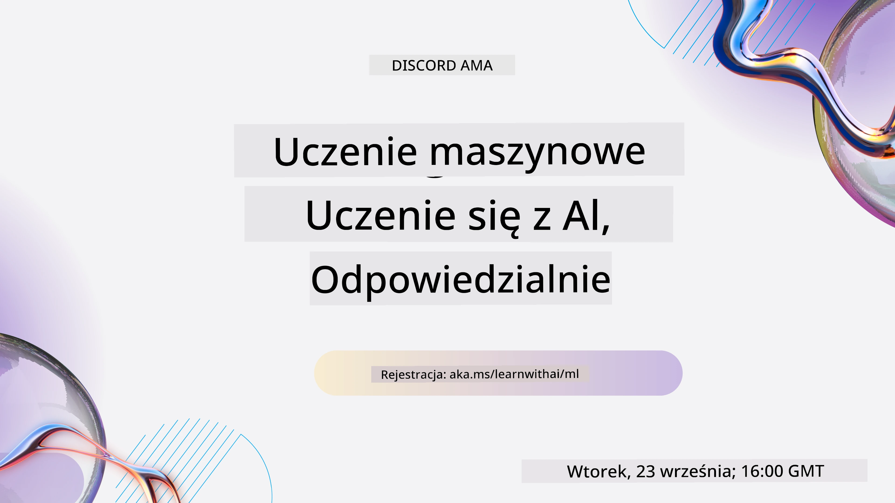
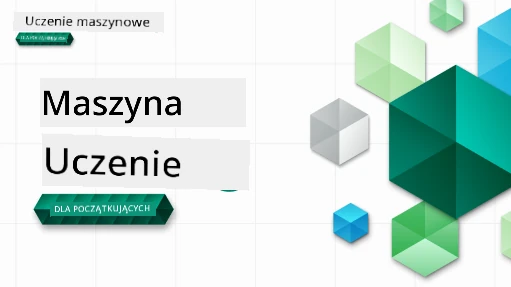

[](https://github.com/microsoft/ML-For-Beginners/blob/master/LICENSE)
[](https://GitHub.com/microsoft/ML-For-Beginners/graphs/contributors/)
[](https://GitHub.com/microsoft/ML-For-Beginners/issues/)
[](https://GitHub.com/microsoft/ML-For-Beginners/pulls/)
[](http://makeapullrequest.com)

[](https://GitHub.com/microsoft/ML-For-Beginners/watchers/)
[](https://GitHub.com/microsoft/ML-For-Beginners/network/)
[](https://GitHub.com/microsoft/ML-For-Beginners/stargazers/)

### 🌐 Wsparcie Wielojęzyczne

#### Tłumaczenia utrzymywane za pomocą [Co-op Translator](https://github.com/Azure/co-op-translator)

<!-- CO-OP TRANSLATOR LANGUAGES TABLE START -->
[Arabski](../ar/README.md) | [Bengalski](../bn/README.md) | [Bułgarski](../bg/README.md) | [Birmański (Myanmar)](../my/README.md) | [Chiński (uproszczony)](../zh-CN/README.md) | [Chiński (tradycyjny, Hongkong)](../zh-HK/README.md) | [Chiński (tradycyjny, Makau)](../zh-MO/README.md) | [Chiński (tradycyjny, Tajwan)](../zh-TW/README.md) | [Chorwacki](../hr/README.md) | [Czeski](../cs/README.md) | [Duński](../da/README.md) | [Holenderski](../nl/README.md) | [Estoński](../et/README.md) | [Fiński](../fi/README.md) | [Francuski](../fr/README.md) | [Niemiecki](../de/README.md) | [Grecki](../el/README.md) | [Hebrajski](../he/README.md) | [Hindi](../hi/README.md) | [Węgierski](../hu/README.md) | [Indonezyjski](../id/README.md) | [Włoski](../it/README.md) | [Japoński](../ja/README.md) | [Kannada](../kn/README.md) | [Khmerski](../km/README.md) | [Koreański](../ko/README.md) | [Litewski](../lt/README.md) | [Malajski](../ms/README.md) | [Malajalam](../ml/README.md) | [Manipuri (Meitei Mayek)](../mni/README.md) | [Marathi](../mr/README.md) | [Nepalski](../ne/README.md) | [Nigeryjski pidżyn](../pcm/README.md) | [Norweski](../no/README.md) | [Perski (Farsi)](../fa/README.md) | [Polski](./README.md) | [Portugalski (Brazylia)](../pt-BR/README.md) | [Portugalski (Portugalia)](../pt-PT/README.md) | [Pendżabski (Gurmukhi)](../pa/README.md) | [Rumuński](../ro/README.md) | [Rosyjski](../ru/README.md) | [Serbski (cyrylica)](../sr/README.md) | [Słowacki](../sk/README.md) | [Słoweński](../sl/README.md) | [Hiszpański](../es/README.md) | [Suahili](../sw/README.md) | [Szwedzki](../sv/README.md) | [Tagalog (Filipiński)](../tl/README.md) | [Tamilski](../ta/README.md) | [Telugu](../te/README.md) | [Tajski](../th/README.md) | [Turecki](../tr/README.md) | [Ukraiński](../uk/README.md) | [Urdu](../ur/README.md) | [Wietnamski](../vi/README.md)

> **Wolisz klonować lokalnie?**
>
> To repozytorium zawiera ponad 50 tłumaczeń językowych, co znacznie zwiększa rozmiar pobrania. Aby sklonować bez tłumaczeń, użyj sparse checkout:
>
> **Bash / macOS / Linux:**
> ```bash
> git clone --filter=blob:none --sparse https://github.com/microsoft/ML-For-Beginners.git
> cd ML-For-Beginners
> git sparse-checkout set --no-cone '/*' '!translations' '!translated_images'
> ```
>
> **CMD (Windows):**
> ```cmd
> git clone --filter=blob:none --sparse https://github.com/microsoft/ML-For-Beginners.git
> cd ML-For-Beginners
> git sparse-checkout set --no-cone "/*" "!translations" "!translated_images"
> ```
>
> To zapewnia wszystko, co potrzebujesz, by ukończyć kurs, przy znacznie szybszym pobieraniu.
<!-- CO-OP TRANSLATOR LANGUAGES TABLE END -->

#### Dołącz do naszej społeczności

[](https://discord.gg/nTYy5BXMWG)

Prowadzimy serię "Learn with AI" na Discordzie, dowiedz się więcej i dołącz do nas na [Learn with AI Series](https://aka.ms/learnwithai/discord) od 18 do 30 września 2025. Otrzymasz wskazówki i triki dotyczące korzystania z GitHub Copilot dla Data Science.



# Machine Learning dla początkujących - Program nauczania

> 🌍 Podróżuj po świecie, eksplorując uczenie maszynowe przez pryzmat kultur świata 🌍

Cloud Advocates w Microsoft z radością oferują 12-tygodniowy, 26-lekcyjny program nauczania poświęcony **uczeniu maszynowemu**. W tym programie poznasz to, co czasami nazywa się **klasycznym uczeniem maszynowym**, używając głównie biblioteki Scikit-learn i unikając głębokiego uczenia, które omawiamy w naszym [programie AI dla początkujących](https://aka.ms/ai4beginners). Połącz te lekcje z naszym ['Data Science dla początkujących'](https://aka.ms/ds4beginners)!

Podróżuj z nami po świecie, stosując klasyczne techniki do danych z różnych regionów. Każda lekcja zawiera quizy przed i po lekcji, pisemne instrukcje, rozwiązanie, zadanie i więcej. Nasza projektowa pedagogia pozwala uczyć się poprzez praktykę, co jest sprawdzoną metodą utrwalania nowych umiejętności.

**✍️ Serdeczne podziękowania dla naszych autorów** Jen Looper, Stephen Howell, Francesca Lazzeri, Tomomi Imura, Cassie Breviu, Dmitry Soshnikov, Chris Noring, Anirban Mukherjee, Ornella Altunyan, Ruth Yakubu i Amy Boyd

**🎨 Podziękowania dla naszych ilustratorów** Tomomi Imura, Dasani Madipalli i Jen Looper

**🙏 Szczególne podziękowania 🙏 dla naszych autorów, recenzentów i kontrybutorów studentów Microsoft, zwłaszcza Rishit Dagli, Muhammad Sakib Khan Inan, Rohan Raj, Alexandru Petrescu, Abhishek Jaiswal, Nawrin Tabassum, Ioan Samuila i Snigdha Agarwal**

**🤩 Dodatkowa wdzięczność dla ambasadorów studentów Microsoft Eric Wanjau, Jasleen Sondhi i Vidushi Gupta za lekcje R!**

# Pierwsze kroki

Wykonaj te kroki:
1. **Rozgałęź repozytorium (Fork)**: Kliknij przycisk "Fork" w prawym górnym rogu tej strony.
2. **Sklonuj repozytorium**:   `git clone https://github.com/microsoft/ML-For-Beginners.git`

> 💡 **Szybka porada:** Chcesz zacząć w przeglądarce bez lokalnej instalacji Pythona? Użyj [GitHub Codespaces](https://github.com/features/codespaces), aby utworzyć chmurowe środowisko programistyczne dla swojego forka. Otwórz zielone menu **Code**, wybierz **Codespaces** i utwórz codespace; zainstaluj w nim wymagane zależności dla każdej lekcji.

> [znajdź wszystkie dodatkowe materiały do tego kursu w naszej kolekcji Microsoft Learn](https://learn.microsoft.com/en-us/collections/qrqzamz1nn2wx3?WT.mc_id=academic-77952-bethanycheum)

> 🔧 **Potrzebujesz pomocy?** Sprawdź nasz [Przewodnik rozwiązywania problemów](TROUBLESHOOTING.md) z rozwiązaniami powszechnych problemów z instalacją, konfiguracją i uruchamianiem lekcji.


**[Studenci](https://aka.ms/student-page)**, aby korzystać z tego programu, zrób fork całego repozytorium na swoje konto GitHub i wykonuj ćwiczenia samodzielnie lub w grupie:

- Zacznij od quizu przed wykładem.
- Przeczytaj wykład i wykonaj zadania, zatrzymując się na każdej kontroli wiedzy.
- Staraj się tworzyć projekty poprzez zrozumienie lekcji, a nie uruchamianie kodu rozwiązania; jednak ten kod jest dostępny w folderach `/solution` w każdej lekcji projektowej.
- Rozwiąż quiz po wykładzie.
- Wykonaj wyzwanie.
- Wykonaj zadanie.
- Po zakończeniu grupy lekcji odwiedź [Tablicę dyskusji](https://github.com/microsoft/ML-For-Beginners/discussions) i „ucz się na głos”, wypełniając odpowiednią rubricę PAT. 'PAT' to narzędzie oceny postępu, które wypełniasz, by pogłębić naukę. Możesz też reagować na inne PAT-y, abyśmy uczyli się razem.

> Do dalszej nauki polecamy moduły i ścieżki edukacyjne z [Microsoft Learn](https://docs.microsoft.com/en-us/users/jenlooper-2911/collections/k7o7tg1gp306q4?WT.mc_id=academic-77952-leestott).

**Nauczyciele**, zamieściliśmy [kilka sugestii](for-teachers.md) dotyczących korzystania z tego programu.

---

## Materiały wideo

Niektóre lekcje są dostępne jako krótkie filmy. Znajdziesz je osadzone w lekcjach lub na [playliście ML dla początkujących na kanale Microsoft Developer na YouTube](https://aka.ms/ml-beginners-videos), klikając obraz poniżej.

[](https://aka.ms/ml-beginners-videos)

---

## Poznaj zespół

[](https://youtu.be/Tj1XWrDSYJU)

**Gif autorstwa** [Mohit Jaisal](https://linkedin.com/in/mohitjaisal)

> 🎥 Kliknij powyższy obraz, aby obejrzeć film o projekcie i jego twórcach!

---

## Pedagogika

Podczas tworzenia tego programu wybraliśmy dwa założenia pedagogiczne: zapewnienie, że jest to praktyczny, **projektowy** program oraz że zawiera **częste quizy**. Dodatkowo program posiada wspólny **motyw przewodni** dla spójności.

Zapewnienie, że treść jest powiązana z projektami, zwiększa zaangażowanie uczniów i utrwalenie koncepcji. Niskostawkowy quiz przed lekcją nastawia ucznia mentalnie na naukę tematu, a kolejny po lekcji wzmacnia utrwalenie wiedzy. Program został zaprojektowany tak, by był elastyczny i przyjemny, można go realizować w całości lub częściowo. Projekty zaczynają się od prostych i stopniowo rosną do bardziej złożonych w ciągu 12 tygodni. Program zawiera też posłowie o rzeczywistych zastosowaniach ML, które mogą być dodatkową punktacją lub podstawą do dyskusji.

> Znajdź nasze wytyczne: [Kodeks postępowania](CODE_OF_CONDUCT.md), [Wkład](CONTRIBUTING.md), [Tłumaczenia](..) i [Rozwiązywanie problemów](TROUBLESHOOTING.md). Czekamy na konstruktywną opinię!

## Każda lekcja zawiera

- opcjonalną notatkę graficzną (sketchnote)
- opcjonalny film uzupełniający
- filmowy przewodnik (niektóre lekcje)
- [rozgrzewkowy quiz przed wykładem](https://ff-quizzes.netlify.app/en/ml/)
- pisemną lekcję
- dla lekcji projektowych: krok po kroku przewodniki budowy projektu
- kontrole wiedzy
- wyzwanie
- uzupełniające materiały do czytania
- zadanie domowe
- [quiz po wykładzie](https://ff-quizzes.netlify.app/en/ml/)

> **Uwaga o językach**: Lekcje są głównie w Pythonie, ale wiele jest też dostępnych w R. Aby wykonać lekcję w R, przejdź do folderu `/solution` i poszukaj lekcji R. Zawierają one rozszerzenie .rmd, oznaczające plik **R Markdown**, który jest połączeniem `code chunks` (R lub innych języków) i `YAML header` (wskazującego sposób formatowania wyników, np. PDF) w ramach `Markdown document`. To ułatwia tworzenie dokumentów data science, pozwalając łączyć kod, jego wynik i komentarze w Markdown. Dokumenty R Markdown można konwertować do formatów PDF, HTML lub Word.

> **Uwaga o quizach**: Wszystkie quizy znajdują się w [folderze Quiz App](../../quiz-app), jest ich 52, po trzy pytania każdy. Są powiązane z lekcjami, ale aplikację quizów można uruchomić lokalnie; postępuj zgodnie z instrukcją w folderze `quiz-app`, aby uruchomić lokalnie lub wdrożyć na Azure.

| Numer Lekcji |                             Temat                              |                   Grupa Lekcji                   | Cele Nauki                                                                                                                      |                                                              Powiązana Lekcja                                                               |                        Autor                        |
| :-----------: | :------------------------------------------------------------: | :-------------------------------------------------: | ------------------------------------------------------------------------------------------------------------------------------- | :--------------------------------------------------------------------------------------------------------------------------------------: | :--------------------------------------------------: |
|      01       |                Wprowadzenie do uczenia maszynowego                |      [Wprowadzenie](1-Introduction/README.md)       | Poznaj podstawowe pojęcia uczenia maszynowego                                                                                |                                             [Lekcja](1-Introduction/1-intro-to-ML/README.md)                                             |                       Muhammad                       |
|      02       |                Historia uczenia maszynowego                 |      [Wprowadzenie](1-Introduction/README.md)       | Poznaj historię leżącą u podstaw tej dziedziny                                                                                         |                                            [Lekcja](1-Introduction/2-history-of-ML/README.md)                                            |                     Jen i Amy                      |
|      03       |                 Sprawiedliwość i uczenie maszynowe                  |      [Wprowadzenie](1-Introduction/README.md)       | Jakie są ważne kwestie filozoficzne dotyczące sprawiedliwości, które studenci powinni uwzględnić przy tworzeniu i stosowaniu modeli ML? |                                              [Lekcja](1-Introduction/3-fairness/README.md)                                               |                        Tomomi                        |
|      04       |                Techniki uczenia maszynowego                 |      [Wprowadzenie](1-Introduction/README.md)       | Jakich technik używają badacze ML do budowy modeli ML?                                                                       |                                          [Lekcja](1-Introduction/4-techniques-of-ML/README.md)                                           |                    Chris i Jen                     |
|      05       |                   Wprowadzenie do regresji                   |        [Regresja](2-Regression/README.md)         | Zacznij z Pythonem i Scikit-learn dla modeli regresji                                                                  |         [Python](2-Regression/1-Tools/README.md) • [R](../../2-Regression/1-Tools/solution/R/lesson_1.html)         |      Jen • Eric Wanjau       |
|      06       |                Ceny dyni w Ameryce Północnej 🎃                |        [Regresja](2-Regression/README.md)         | Wizualizuj i oczyszczaj dane w przygotowaniu do ML                                                                                  |          [Python](2-Regression/2-Data/README.md) • [R](../../2-Regression/2-Data/solution/R/lesson_2.html)          |      Jen • Eric Wanjau       |
|      07       |                Ceny dyni w Ameryce Północnej 🎃                |        [Regresja](2-Regression/README.md)         | Buduj modele regresji liniowej i wielomianowej                                                                                   |        [Python](2-Regression/3-Linear/README.md) • [R](../../2-Regression/3-Linear/solution/R/lesson_3.html)        |      Jen i Dmitry • Eric Wanjau       |
|      08       |                Ceny dyni w Ameryce Północnej 🎃                |        [Regresja](2-Regression/README.md)         | Buduj model regresji logistycznej                                                                                               |     [Python](2-Regression/4-Logistic/README.md) • [R](../../2-Regression/4-Logistic/solution/R/lesson_4.html)      |      Jen • Eric Wanjau       |
|      09       |                          Aplikacja Webowa 🔌                          |           [Aplikacja Webowa](3-Web-App/README.md)            | Stwórz aplikację webową, aby używać swojego wytrenowanego modelu                                                                                       |                                                 [Python](3-Web-App/1-Web-App/README.md)                                                  |                         Jen                          |
|      10       |                 Wprowadzenie do klasyfikacji                 |    [Klasyfikacja](4-Classification/README.md)     | Oczyść, przygotuj i wizualizuj dane; wprowadzenie do klasyfikacji                                                            | [Python](4-Classification/1-Introduction/README.md) • [R](../../4-Classification/1-Introduction/solution/R/lesson_10.html)  | Jen i Cassie • Eric Wanjau |
|      11       |             Pyszne kuchnie azjatyckie i indyjskie 🍜             |    [Klasyfikacja](4-Classification/README.md)     | Wprowadzenie do klasyfikatorów                                                                                                     | [Python](4-Classification/2-Classifiers-1/README.md) • [R](../../4-Classification/2-Classifiers-1/solution/R/lesson_11.html) | Jen i Cassie • Eric Wanjau |
|      12       |             Pyszne kuchnie azjatyckie i indyjskie 🍜             |    [Klasyfikacja](4-Classification/README.md)     | Więcej klasyfikatorów                                                                                                                | [Python](4-Classification/3-Classifiers-2/README.md) • [R](../../4-Classification/3-Classifiers-2/solution/R/lesson_12.html) | Jen i Cassie • Eric Wanjau |
|      13       |             Pyszne kuchnie azjatyckie i indyjskie 🍜             |    [Klasyfikacja](4-Classification/README.md)     | Stwórz polecaną aplikację webową za pomocą swojego modelu                                                                                    |                                              [Python](4-Classification/4-Applied/README.md)                                              |                         Jen                          |
|      14       |                   Wprowadzenie do klasteryzacji                   |        [Klasteryzacja](5-Clustering/README.md)         | Oczyść, przygotuj i wizualizuj dane; Wprowadzenie do klasteryzacji                                                                |         [Python](5-Clustering/1-Visualize/README.md) • [R](../../5-Clustering/1-Visualize/solution/R/lesson_14.html)         |      Jen • Eric Wanjau       |
|      15       |              Odkrywanie nigeryjskich gustów muzycznych 🎧              |        [Klasteryzacja](5-Clustering/README.md)         | Poznaj metodę klasteryzacji K-średnich                                                                                           |           [Python](5-Clustering/2-K-Means/README.md) • [R](../../5-Clustering/2-K-Means/solution/R/lesson_15.html)           |      Jen • Eric Wanjau       |
|      16       |        Wprowadzenie do przetwarzania języka naturalnego ☕️         |   [Przetwarzanie języka naturalnego](6-NLP/README.md)    | Poznaj podstawy NLP tworząc prostego bota                                                                             |                                             [Python](6-NLP/1-Introduction-to-NLP/README.md)                                              |                       Stephen                        |
|      17       |                      Typowe zadania NLP ☕️                      |   [Przetwarzanie języka naturalnego](6-NLP/README.md)    | Pogłęb swoją wiedzę o NLP, rozumiejąc typowe zadania wymagane przy pracy ze strukturami językowymi                          |                                                    [Python](6-NLP/2-Tasks/README.md)                                                     |                       Stephen                        |
|      18       |             Tłumaczenie i analiza sentymentu ♥️              |   [Przetwarzanie języka naturalnego](6-NLP/README.md)    | Tłumaczenie i analiza sentymentu z Jane Austen                                                                             |                                            [Python](6-NLP/3-Translation-Sentiment/README.md)                                             |                       Stephen                        |
|      19       |                  Romantyczne hotele w Europie ♥️                  |   [Przetwarzanie języka naturalnego](6-NLP/README.md)    | Analiza sentymentu na podstawie recenzji hoteli 1                                                                                         |                                               [Python](6-NLP/4-Hotel-Reviews-1/README.md)                                                |                       Stephen                        |
|      20       |                  Romantyczne hotele w Europie ♥️                  |   [Przetwarzanie języka naturalnego](6-NLP/README.md)    | Analiza sentymentu na podstawie recenzji hoteli 2                                                                                         |                                               [Python](6-NLP/5-Hotel-Reviews-2/README.md)                                                |                       Stephen                        |
|      21       |            Wprowadzenie do prognozowania szeregów czasowych             |        [Szeregi czasowe](7-TimeSeries/README.md)        | Wprowadzenie do prognozowania szeregów czasowych                                                                                         |                                             [Python](7-TimeSeries/1-Introduction/README.md)                                              |                      Francesca                       |
|      22       | ⚡️ Zużycie energii na świecie ⚡️ - prognozowanie szeregów czasowych z ARIMA |        [Szeregi czasowe](7-TimeSeries/README.md)        | Prognozowanie szeregów czasowych metodą ARIMA                                                                                              |                                                 [Python](7-TimeSeries/2-ARIMA/README.md)                                                 |                      Francesca                       |
|      23       |  ⚡️ Zużycie energii na świecie ⚡️ - prognozowanie szeregów czasowych z SVR  |        [Szeregi czasowe](7-TimeSeries/README.md)        | Prognozowanie szeregów czasowych metodą regresji wektorów nośnych                                                                           |                                                  [Python](7-TimeSeries/3-SVR/README.md)                                                  |                       Anirban                        |
|      24       |             Wprowadzenie do uczenia ze wzmocnieniem             | [Uczenie ze wzmocnieniem](8-Reinforcement/README.md) | Wprowadzenie do uczenia ze wzmocnieniem z Q-Learning                                                                          |                                             [Python](8-Reinforcement/1-QLearning/README.md)                                              |                        Dmitry                        |
|      25       |                 Pomóż Peterowi uniknąć wilka! 🐺                  | [Uczenie ze wzmocnieniem](8-Reinforcement/README.md) | Ćwiczenia z uczenia ze wzmocnieniem w Gym                                                                                                      |                                                [Python](8-Reinforcement/2-Gym/README.md)                                                 |                        Dmitry                        |
|  Posłowie   |            Rzeczywiste scenariusze i zastosowania ML            |      [ML w praktyce](9-Real-World/README.md)       | Ciekawe i pouczające rzeczywiste zastosowania klasycznego uczenia maszynowego                                                               |                                             [Lekcja](9-Real-World/1-Applications/README.md)                                              |                         Zespół                         |
|  Posłowie   |            Debugowanie modeli w ML za pomocą kokpitu RAI            |      [ML w praktyce](9-Real-World/README.md)       | Debugowanie modeli uczenia maszynowego z wykorzystaniem komponentów kokpitu Responsible AI                                                              |                                             [Lekcja](9-Real-World/2-Debugging-ML-Models/README.md)                                              |                     Ruth Yakubu                      |

> [znajdź wszystkie dodatkowe materiały do tego kursu w naszej kolekcji Microsoft Learn](https://learn.microsoft.com/en-us/collections/qrqzamz1nn2wx3?WT.mc_id=academic-77952-bethanycheum)

## Dostęp offline

Możesz korzystać z tej dokumentacji offline, używając [Docsify](https://docsify.js.org/#/). Wykonaj fork tego repozytorium, [zainstaluj Docsify](https://docsify.js.org/#/quickstart) na swoim lokalnym komputerze, a następnie w folderze głównym tego repozytorium wpisz `docsify serve`. Strona będzie dostępna na porcie 3000 na twoim localhost: `localhost:3000`.

## Pliki PDF

Znajdź pdf z programem nauczania wraz z linkami [tutaj](https://microsoft.github.io/ML-For-Beginners/pdf/readme.pdf).


## 🎒 Inne kursy

Nasz zespół tworzy również inne kursy! Sprawdź:

<!-- CO-OP TRANSLATOR OTHER COURSES START -->
### LangChain
[](https://aka.ms/langchain4j-for-beginners)
[](https://aka.ms/langchainjs-for-beginners?WT.mc_id=m365-94501-dwahlin)
[](https://github.com/microsoft/langchain-for-beginners?WT.mc_id=m365-94501-dwahlin)
---

### Azure / Edge / MCP / Agenci
[](https://github.com/microsoft/AZD-for-beginners?WT.mc_id=academic-105485-koreyst)
[](https://github.com/microsoft/edgeai-for-beginners?WT.mc_id=academic-105485-koreyst)
[](https://github.com/microsoft/mcp-for-beginners?WT.mc_id=academic-105485-koreyst)
[](https://github.com/microsoft/ai-agents-for-beginners?WT.mc_id=academic-105485-koreyst)

---
 
### Seria Generatywnej AI
[](https://github.com/microsoft/generative-ai-for-beginners?WT.mc_id=academic-105485-koreyst)
[-9333EA?style=for-the-badge&labelColor=E5E7EB&color=9333EA)](https://github.com/microsoft/Generative-AI-for-beginners-dotnet?WT.mc_id=academic-105485-koreyst)
[-C084FC?style=for-the-badge&labelColor=E5E7EB&color=C084FC)](https://github.com/microsoft/generative-ai-for-beginners-java?WT.mc_id=academic-105485-koreyst)
[-E879F9?style=for-the-badge&labelColor=E5E7EB&color=E879F9)](https://github.com/microsoft/generative-ai-with-javascript?WT.mc_id=academic-105485-koreyst)

---
 
### Podstawowe szkolenie
[](https://aka.ms/ml-beginners?WT.mc_id=academic-105485-koreyst)
[](https://aka.ms/datascience-beginners?WT.mc_id=academic-105485-koreyst)
[](https://aka.ms/ai-beginners?WT.mc_id=academic-105485-koreyst)
[](https://github.com/microsoft/Security-101?WT.mc_id=academic-96948-sayoung)
[](https://aka.ms/webdev-beginners?WT.mc_id=academic-105485-koreyst)
[](https://aka.ms/iot-beginners?WT.mc_id=academic-105485-koreyst)
[](https://github.com/microsoft/xr-development-for-beginners?WT.mc_id=academic-105485-koreyst)

---
 
### Seria Copilot
[](https://aka.ms/GitHubCopilotAI?WT.mc_id=academic-105485-koreyst)
[](https://github.com/microsoft/mastering-github-copilot-for-dotnet-csharp-developers?WT.mc_id=academic-105485-koreyst)
[](https://github.com/microsoft/CopilotAdventures?WT.mc_id=academic-105485-koreyst)
<!-- CO-OP TRANSLATOR OTHER COURSES END -->

## Uzyskanie pomocy

Jeśli utkniesz lub masz pytania podczas nauki uczenia maszynowego lub tworzenia aplikacji AI, nie martw się — pomoc jest dostępna.

Możesz dołączyć do dyskusji z innymi uczącymi się i deweloperami, zadawać pytania i dzielić się swoimi pomysłami ze społecznością.

- Dołącz do społeczności, aby zadawać pytania i uczyć się razem z innymi
- Dyskutuj o konceptach uczenia maszynowego i pomysłach na projekty
- Uzyskaj wsparcie od doświadczonych deweloperów

Wspierająca społeczność to świetny sposób na rozwijanie umiejętności i szybsze rozwiązywanie problemów.

[Społeczność Microsoft Foundry Discord](https://discord.gg/nTYy5BXMWG)

Jeśli napotkasz błędy, problemy lub masz sugestie dotyczące ulepszeń, możesz także otworzyć **Issue** w tym repozytorium, aby zgłosić problem.

W celu opinii o produkcie lub wyszukiwania istniejących postów społeczności odwiedź Forum Deweloperów:

[](https://aka.ms/foundry/forum)

## Dodatkowe wskazówki do nauki

- Przeglądaj notatniki po każdej lekcji, aby lepiej zrozumieć materiał.
- Ćwicz samodzielne wdrażanie algorytmów.
- Eksploruj rzeczywiste zbiory danych za pomocą poznanych koncepcji.

---

<!-- CO-OP TRANSLATOR DISCLAIMER START -->
**Zastrzeżenie**:
Niniejszy dokument został przetłumaczony za pomocą usługi tłumaczenia AI [Co-op Translator](https://github.com/Azure/co-op-translator). Choć dążymy do dokładności, prosimy pamiętać, że automatyczne tłumaczenia mogą zawierać błędy lub niedokładności. Oryginalny dokument w jego języku źródłowym należy uznawać za autorytatywne źródło. W przypadku informacji krytycznych zalecane jest skorzystanie z profesjonalnego tłumaczenia wykonanego przez człowieka. Nie ponosimy odpowiedzialności za jakiekolwiek nieporozumienia lub błędne interpretacje wynikające z użycia tego tłumaczenia.
<!-- CO-OP TRANSLATOR DISCLAIMER END -->