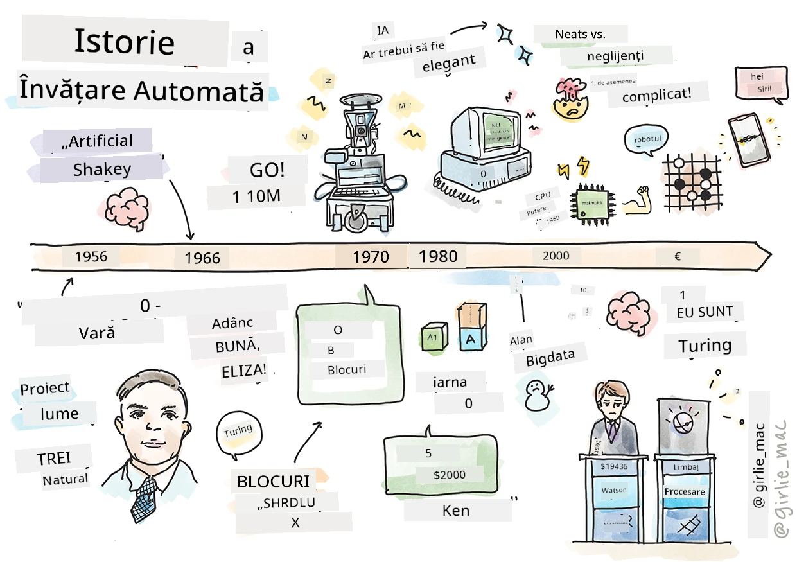
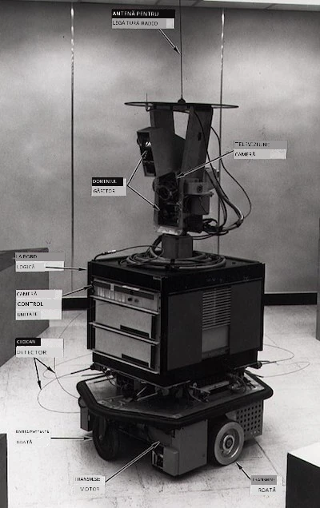
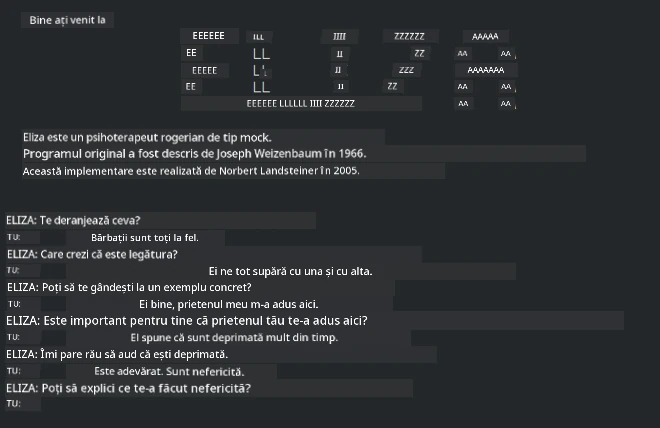

# Istoria învățării automate

> Sketchnote de [Tomomi Imura](https://www.twitter.com/girlie_mac)

## [Chestionar înainte de lecție](https://ff-quizzes.netlify.app/en/ml/)

---

> 🎥 Click pe imaginea de mai sus pentru un videoclip scurt care parcurge această lecție.

În această lecție, vom parcurge principalele repere din istoria învățării automate și a inteligenței artificiale.

Istoria inteligenței artificiale (IA) ca domeniu este împletită cu istoria învățării automate, deoarece algoritmii și progresele computaționale care stau la baza ML au contribuit la dezvoltarea IA. Este util să ne amintim că, deși aceste domenii ca arii distincte de cercetare au început să se cristalizeze în anii 1950, descoperiri importante [algoritmice, statistice, matematice, computaționale și tehnice](https://wikipedia.org/wiki/Timeline_of_machine_learning) au precedat și s-au suprapus cu această eră. De fapt, oamenii au reflectat asupra acestor întrebări de [sute de ani](https://wikipedia.org/wiki/History_of_artificial_intelligence): acest articol discută fundamentele intelectuale istorice ale ideii unei „mașini gânditoare”.

---
## Descoperiri notabile

- 1763, 1812 [Teorema lui Bayes](https://wikipedia.org/wiki/Bayes%27_theorem) și predecesorii săi. Această teoremă și aplicațiile ei stau la baza inferenței, descriind probabilitatea apariției unui eveniment pe baza cunoștințelor anterioare.
- 1805 [Teoria celor mai mici pătrate](https://wikipedia.org/wiki/Least_squares) de matematicianul francez Adrien-Marie Legendre. Această teorie, pe care o vei învăța în unitatea noastră de Regressie, ajută la potrivirea datelor.
- 1913 [Lanțurile Markov](https://wikipedia.org/wiki/Markov_chain), numite după matematicianul rus Andrey Markov, sunt folosite pentru a descrie o succesiune de evenimente posibile pe baza unui stat anterior.
- 1957 [Perceptronul](https://wikipedia.org/wiki/Perceptron) este un tip de clasificator liniar inventat de psihologul american Frank Rosenblatt, care stă la baza progreselor în învățarea profundă.

---

- 1967 [Cel mai apropiat vecin](https://wikipedia.org/wiki/Nearest_neighbor) este un algoritm inițial conceput pentru cartografierea traseelor. În context ML este folosit pentru detectarea modelelor.
- 1970 [Backpropagation](https://wikipedia.org/wiki/Backpropagation) este folosit pentru antrenarea rețelelor neuronale [feedforward](https://wikipedia.org/wiki/Feedforward_neural_network).
- 1982 [Rețele neuronale recurente](https://wikipedia.org/wiki/Recurrent_neural_network) sunt rețele neuronale artificiale derivate din rețelele neuronale feedforward care creează grafice temporale.

✅ Efectuează o mică cercetare. Ce alte date ți se par esențiale în istoria ML și IA?

---
## 1950: Mașini care gândesc

Alan Turing, o persoană cu adevărat remarcabilă, care a fost votat [de public în 2019](https://wikipedia.org/wiki/Icons:_The_Greatest_Person_of_the_20th_Century) ca cel mai mare om de știință al secolului XX, este creditat pentru că a ajutat la punerea bazelor conceptului de „mașină care poate gândi.” El s-a confruntat cu sceptici și cu nevoia sa proprie de dovezi empirice ale acestui concept parțial prin crearea [Testului Turing](https://www.bbc.com/news/technology-18475646), pe care îl vei explora în lecțiile noastre de NLP.

---
## 1956: Proiectul de cercetare de vară Dartmouth

„Proiectul de cercetare de vară Dartmouth asupra inteligenței artificiale a fost un eveniment seminal pentru inteligența artificială ca domeniu,” și aici a fost creat termenul de „inteligență artificială” ([sursă](https://250.dartmouth.edu/highlights/artificial-intelligence-ai-coined-dartmouth)).

> Fiecare aspect al învățării sau orice altă caracteristică a inteligenței poate fi în principiu descrisă atât de precis încât o mașină să poată fi făcută să o simuleze.

---

Cercetătorul principal, profesorul de matematică John McCarthy, spera „să procedeze pe baza ipotezei că fiecare aspect al învățării sau orice altă caracteristică a inteligenței poate fi în principiu descrisă atât de precis încât o mașină să poată fi făcută să o simuleze.” Participanții au inclus un alt ilustru în domeniu, Marvin Minsky.

Atelierul este creditat că a inițiat și a încurajat mai multe discuții, inclusiv „apariția metodelor simbolice, sistemelor focalizate pe domenii limitate (primele sisteme expert) și sistemelor deductive versus inductive.” ([sursă](https://wikipedia.org/wiki/Dartmouth_workshop)).

---
## 1956 - 1974: „Anii de aur”

Din anii 1950 până la mijlocul anilor '70, optimismul era ridicat privind speranța că IA ar putea rezolva multe probleme. În 1967, Marvin Minsky a afirmat cu încredere că „Într-o generație ... problema creării 'inteligenței artificiale' va fi soluționată substanțial.” (Minsky, Marvin (1967), Computație: Mașini finite și infinite, Englewood Cliffs, N.J.: Prentice-Hall)

Cercetarea procesării limbajului natural a înflorit, căutarea a fost rafinată și făcută mai puternică, iar conceptul de „micro-lumi” a fost creat, unde sarcini simple erau duse la îndeplinire folosind instrucțiuni în limbaj simplu.

---

Cercetarea a fost bine finanțată de agenții guvernamentale, s-au făcut progrese în calcul și algoritmi, iar prototipuri de mașini inteligente au fost construite. Unele dintre aceste mașini includ:

* [Shakey robotul](https://wikipedia.org/wiki/Shakey_the_robot), care putea manevra și decide cum să îndeplinească sarcini „inteligent”.

    
    > Shakey în 1972

---

* Eliza, un „chatbot” timpuriu, putea conversa cu oamenii și acționa ca un „terapeut” primitiv. Vei învăța mai multe despre Eliza în lecțiile de NLP.

    
    > O versiune a Eliza, un chatbot

---

* „Lumea blocurilor” a fost un exemplu de micro-lume unde blocurile puteau fi stivuite și sortate, iar experimentele în instruirea mașinilor pentru luarea deciziilor puteau fi testate. Progresul realizat cu biblioteci precum [SHRDLU](https://wikipedia.org/wiki/SHRDLU) a ajutat la impulsionarea procesării limbajului.

    

    > 🎥 Click pe imaginea de mai sus pentru un video: Lumea blocurilor cu SHRDLU

---
## 1974 - 1980: „Iarna IA”

Până în mijlocul anilor 1970, devenea clar că complexitatea de a face „mașini inteligente” fusese subestimată și că promisiunea sa, dată puterea de calcul disponibilă, fusese supraestimată. Finanțarea s-a uscat iar încrederea în domeniu a încetinit. Unele probleme care au afectat încrederea includ:
---
- **Limitări**. Puterea de calcul era prea limitată.
- **Explozie combinatorie**. Numărul de parametri de antrenat creștea exponențial pe măsură ce cereai mai multe de la calculatoare, fără o evoluție paralelă a puterii și capacității de calcul.
- **Lipsa datelor**. Lipsa de date a împiedicat procesul de testare, dezvoltare și rafinare a algoritmilor.
- **Punem întrebările potrivite?**. Însuși subiectul întrebărilor a început să fie pus sub semnul întrebării. Cercetătorii au fost criticați pentru abordările lor:
  - Testele Turing au fost contestate prin diverse idei, printre care „teoria camerei chinezești” care susținea că „programarea unui calculator digital poate face să pară că înțelege limbajul, dar nu poate produce o înțelegere reală.” ([sursă](https://plato.stanford.edu/entries/chinese-room/))
  - Etica introducerii inteligențelor artificiale precum „terapeutul” ELIZA în societate a fost pusă sub semnul întrebării.

---

În același timp, au început să se formeze diferite școli de gândire în IA. S-a stabilit o dicotomie între practici de IA ["scruffy" vs. "neat"](https://wikipedia.org/wiki/Neats_and_scruffies). Laboratoarele _scruffy_ ajustau programele ore întregi până obțineau rezultatele dorite. Laboratoarele _neat_ „se concentrau pe logică și rezolvarea formală a problemelor”. ELIZA și SHRDLU erau sisteme _scruffy_ cunoscute. În anii 1980, pe măsură ce a apărut cerința de reproducere a sistemelor ML, abordarea _neat_ a devenit treptat dominantă, deoarece rezultatele ei sunt mai explicabile.

---
## Anii 1980: Sisteme expert

Pe măsură ce domeniul a crescut, beneficiile sale pentru afaceri au devenit mai clare, iar în anii 1980 s-a văzut proliferarea „sistemelor expert”. „Sistemele expert au fost printre primele forme cu adevărat reușite de software de inteligență artificială (IA).” ([sursă](https://wikipedia.org/wiki/Expert_system)).

Acest tip de sistem este, de fapt, _hibrid_, constând parțial dintr-un motor de reguli care definește cerințele de afaceri și un motor de inferență care folosește sistemul de reguli pentru a deduce noi fapte.

Această epocă a adus și o atenție sporită acordată rețelelor neuronale.

---
## 1987 - 1993: „Răcirea” IA

Proliferarea hardware-ului specializat pentru sisteme expert a avut efectul nefericit de a deveni prea specializată. Apariția computerelor personale a concurat cu aceste sisteme mari, specializate și centralizate. Democratizarea calculatoarelor a început și a pregătit terenul pentru explozia modernă a big data.

---
## 1993 - 2011

Această epocă a marcat o nouă eră pentru ML și IA, capabile să rezolve unele probleme apărute mai înainte din lipsa de date și putere de calcul. Cantitatea de date a început să crească rapid și să devină mai larg accesibilă, pentru bine și pentru rău, mai ales odată cu apariția smartphone-ului în jurul anului 2007. Puterea de calcul a crescut exponențial, iar algoritmii au evoluat în paralel. Domeniul a început să capete maturitate pe măsură ce zilele libere ale trecutului s-au cristalizat într-o disciplină reală.

---
## Acum

Astăzi, învățarea automată și IA ating aproape fiecare parte a vieților noastre. Această eră cere o înțelegere atentă a riscurilor și posibilelor efecte ale acestor algoritmi asupra vieților umane. Așa cum a declarat Brad Smith de la Microsoft, „Tehnologia informației ridică probleme care ating fundamental protecțiile drepturilor omului precum intimitatea și libertatea de exprimare. Aceste probleme sporesc responsabilitatea companiilor tech care creează aceste produse. Din punctul nostru de vedere, ele cer și o reglementare atentă din partea guvernului și dezvoltarea de norme privind utilizările acceptabile” ([sursă](https://www.technologyreview.com/2019/12/18/102365/the-future-of-ais-impact-on-society/)).

---

Rămâne de văzut ce va aduce viitorul, dar este important să înțelegem aceste sisteme informatice și software-ul și algoritmii care le rulează. Sperăm că această curriculă te va ajuta să dobândești o înțelegere mai bună pentru a putea decide singur.

> 🎥 Click pe imaginea de mai sus pentru un video: Yann LeCun discută istoria învățării profunde în această prelegere

---
## 🚀Provocare

Cercetează un moment istoric dintre acestea și află mai multe despre oamenii din spatele lor. Există personaje fascinante, iar nicio descoperire științifică nu a fost creată într-un vid cultural. Ce descoperi?

## [Chestionar după lecție](https://ff-quizzes.netlify.app/en/ml/)

---
## Recapitulare & Studiu individual

Iată câteva materiale de urmărit și ascultat:

[Acest podcast în care Amy Boyd discută evoluția IA](http://runasradio.com/Shows/Show/739)

---

## Temă

[Creează o cronologie](assignment.md)

---

<!-- CO-OP TRANSLATOR DISCLAIMER START -->
**Declinare a responsabilității**:
Acest document a fost tradus folosind serviciul de traducere AI [Co-op Translator](https://github.com/Azure/co-op-translator). În timp ce ne străduim pentru acuratețe, vă rugăm să rețineți că traducerile automate pot conține erori sau inexactități. Documentul original în limba sa nativă trebuie considerat sursa autorizată. Pentru informații critice, se recomandă traducerea profesională realizată de un om. Nu ne asumăm responsabilitatea pentru eventualele neînțelegeri sau interpretări greșite care decurg din utilizarea acestei traduceri.
<!-- CO-OP TRANSLATOR DISCLAIMER END -->