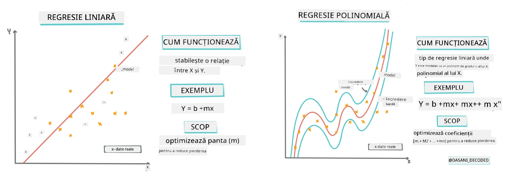
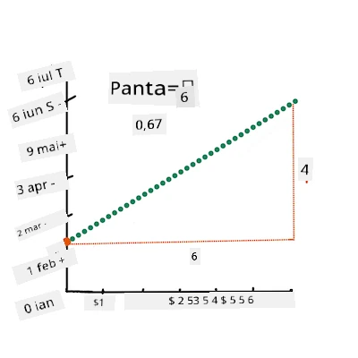
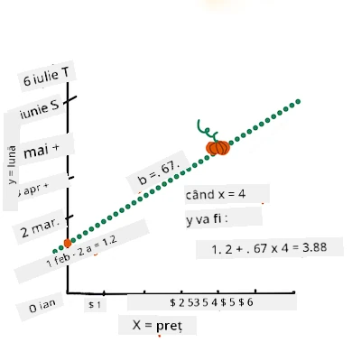
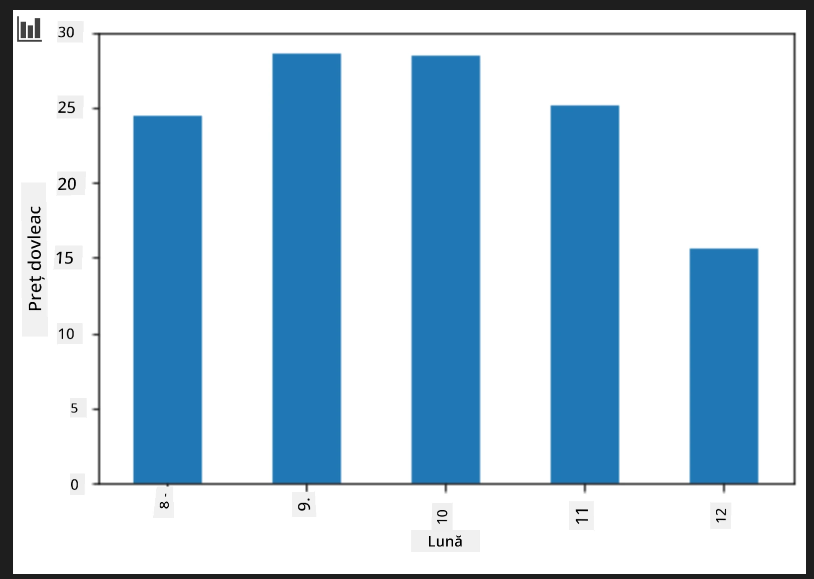
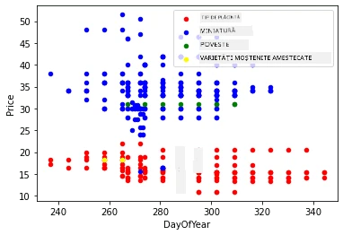

# Construiește un model de regresie folosind Scikit-learn: regresie în patru moduri

## Notă pentru începători

Regresia liniară este folosită atunci când vrem să prezicem o **valoare numerică** (de exemplu, prețul unei case, temperatura sau vânzările).
Aceasta funcționează prin găsirea unei drepte care reprezintă cel mai bine relația dintre variabilele de intrare și ieșire.

În această lecție, ne concentrăm pe înțelegerea conceptului înainte de a explora tehnici de regresie mai avansate.

> Infografic de [Dasani Madipalli](https://twitter.com/dasani_decoded)
## [Chestionar pre-lectură](https://ff-quizzes.netlify.app/en/ml/)

> ### [Această lecție este disponibilă în R!](../../../../2-Regression/3-Linear/solution/R/lesson_3.html)
### Introducere

Până acum ai explorat ce este regresia folosind un set de date despre prețurile dovlecilor pe care îl vom folosi pe parcursul acestei lecții. Ai vizualizat, de asemenea, datele folosind Matplotlib.

Acum ești pregătit să aprofundezi regresia pentru ML. În timp ce vizualizarea te ajută să înțelegi datele, adevărata putere a învățării automate vine din _antrenarea modelelor_. Modelele sunt antrenate pe date istorice pentru a captura automat dependențele din date și îți permit să prezici rezultate pentru date noi, pe care modelul nu le-a văzut înainte.

În această lecție vei învăța mai multe despre două tipuri de regresie: _regresia liniară de bază_ și _regresia polinomială_, împreună cu unele dintre conceptele matematice din spatele acestor tehnici. Aceste modele ne vor permite să prezicem prețurile dovlecilor în funcție de diferiți parametri de intrare.

[](https://youtu.be/CRxFT8oTDMg "ML for beginners - Understanding Linear Regression")

> 🎥 Apasă pe imaginea de mai sus pentru un scurt videoclip despre regresia liniară.

> Pe tot parcursul acestui curriculum, presupunem cunoștințe minimale de matematică și căutăm să le facem accesibile studenților veniți din alte domenii, așa că urmărește notele, 🧮 explicațiile, diagramele și alte unelte de învățare pentru a ușura înțelegerea.

### Prerechizite

Ar trebui să fii familiarizat acum cu structura datelor despre dovleci pe care le examinăm. Le poți găsi preîncărcate și preprocesate în fișierul _notebook.ipynb_ din această lecție. În fișier, prețul dovlecilor este afișat per bushel într-un nou data frame. Asigură-te că poți rula aceste notebook-uri în kerneluri în Visual Studio Code.

### Pregătire

Ca reminder, încarci aceste date ca să pui întrebări despre ele.

- Care este cel mai bun moment să cumperi dovleci?
- Ce preț pot să aștept pentru o cutie de dovleci miniatură?
- Ar trebui să îi cumpăr în coșuri de jumătate de bushel sau în cutii de 1 1/9 bushel?
Să continuăm să analizăm aceste date.

În lecția anterioară ai creat un Pandas data frame și l-ai populat cu o parte din setul original de date, standardizând prețul per bushel. Prin asta, însă, ai putut colecta doar vreo 400 de puncte de date și doar pentru lunile de toamnă.

Aruncă o privire la datele preîncărcate în notebook-ul din această lecție. Datele sunt preîncărcate și un grafic de dispersie inițial este generat pentru a arăta datele lunii. Poate putem obține puțin mai multe detalii despre natura datelor printr-un proces suplimentar de curățare.

## O linie de regresie liniară

Așa cum ai învățat în Lecția 1, scopul unui exercițiu de regresie liniară este să poți trasa o linie care să:

- **Arate relațiile dintre variabile**. Să arate relația dintre variabile
- **Facă predicții**. Să facă predicții corecte despre unde s-ar plasa un punct nou în raport cu acea linie.

Este tipic pentru **Regresia cu Cele Mai Mici Pătrate** să se deseneze acest tip de linie. Termenul "Cele Mai Mici Pătrate" se referă la procesul de a minimiza eroarea totală din modelul nostru. Pentru fiecare punct de date, măsurăm distanța verticală (numită reziduală) dintre punctul real și linia noastră de regresie.

Aceste distanțe sunt pătrate din două motive principale:

1. **Magnitudine și nu Direcție:** Vrem să tratăm o eroare de -5 la fel ca o eroare de +5. Pătratul face toate valorile pozitive.

2. **Penalizarea Outlierilor:** Pătratul dă o greutate mai mare erorilor mari, forțând linia să fie mai aproape de punctele care sunt îndepărtate.

Apoi adunăm toate aceste valori pătrate. Obiectivul nostru este să găsim linia specifică pentru care această sumă finală este cea mai mică (valoarea posibilă minimă) — de aici și numele "Cele Mai Mici Pătrate".

> **🧮 Arată-mi matematica**
> 
> Această linie, numită _linia de potrivire cea mai bună_ poate fi exprimată prin [o ecuație](https://en.wikipedia.org/wiki/Simple_linear_regression): 
> 
> ```
> Y = a + bX
> ```
>
> `X` este 'variabila explicativă'. `Y` este 'variabila dependentă'. Panta liniei este `b` iar `a` este ordonata la origine (intersectia cu axa y), care indică valoarea lui `Y` când `X = 0`.
>
>
>
> Mai întâi, calculează panta `b`. Infografic de [Jen Looper](https://twitter.com/jenlooper)
>
> Cu alte cuvinte, referindu-ne la întrebarea originală legată de datele despre dovleci: "predic prețul unui dovleac pe bushel în funcție de lună", `X` se referă la preț iar `Y` la luna vânzării.
>
>
>
> Calculează valoarea lui Y. Dacă plătești în jur de 4 dolari, trebuie să fie aprilie! Infografic de [Jen Looper](https://twitter.com/jenlooper)
>
> Matematica care calculează linia trebuie să demonstreze panta liniei, care depinde și de ordonata la origine, sau locul unde se află `Y` când `X = 0`.
>
> Poți observa metoda de calcul a acestor valori pe site-ul [Math is Fun](https://www.mathsisfun.com/data/least-squares-regression.html). Vizitează și [acest calculator pentru Cele Mai Mici Pătrate](https://www.mathsisfun.com/data/least-squares-calculator.html) ca să vezi cum valorile numerice influențează linia.

## Corelația

Un termen în plus de înțeles este **Coeficientul de Corelație** între variabilele date X și Y. Folosind un grafic în puncte (scatterplot), poți vizualiza rapid acest coeficient. Un grafic cu punctele împrăștiate într-o linie ordonată are o corelație mare, dar un grafic cu punctele răspândite oriunde între X și Y are o corelație scăzută.

Un model bun de regresie liniară este acela care are un Coeficient de Corelație ridicat (mai aproape de 1 decât de 0) folosind metoda Regresiei cu Cele Mai Mici Pătrate și o linie de regresie.

✅ Rulează notebook-ul care însoțește această lecție și uită-te la graficul scatter Month to Price. Datele care asociază Luna cu Prețul pentru vânzările de dovleci par să aibă o corelație mare sau mică, conform interpretării tale vizuale a scatterplotului? Se modifică răspunsul dacă folosești o măsură mai detaliată în loc de `Month`, de exemplu *ziua anului* (adică numărul de zile de la începutul anului)?

În codul de mai jos, vom presupune că am curățat datele și am obținut un data frame numit `new_pumpkins`, similar cu următorul:

ID | Month | DayOfYear | Variety | City | Package | Low Price | High Price | Price
---|-------|-----------|---------|------|---------|-----------|------------|-------
70 | 9 | 267 | PIE TYPE | BALTIMORE | 1 1/9 bushel cartons | 15.0 | 15.0 | 13.636364
71 | 9 | 267 | PIE TYPE | BALTIMORE | 1 1/9 bushel cartons | 18.0 | 18.0 | 16.363636
72 | 10 | 274 | PIE TYPE | BALTIMORE | 1 1/9 bushel cartons | 18.0 | 18.0 | 16.363636
73 | 10 | 274 | PIE TYPE | BALTIMORE | 1 1/9 bushel cartons | 17.0 | 17.0 | 15.454545
74 | 10 | 281 | PIE TYPE | BALTIMORE | 1 1/9 bushel cartons | 15.0 | 15.0 | 13.636364

> Codul pentru curățarea datelor este disponibil în [`notebook.ipynb`](notebook.ipynb). Am efectuat aceiași pași de curățare ca în lecția precedentă și am calculat coloana `DayOfYear` folosind expresia următoare: 

```python
day_of_year = pd.to_datetime(pumpkins['Date']).apply(lambda dt: (dt-datetime(dt.year,1,1)).days)
```

Acum că ai o înțelegere a matematicii din spatele regresiei liniare, să creăm un model de Regresie ca să vedem dacă putem prezice care pachet de dovleci va avea cele mai bune prețuri. Cineva care cumpără dovleci pentru un patch de dovleci de sărbători ar vrea aceste informații pentru a-și optimiza achizițiile.

## Căutând Corelații

[](https://youtu.be/uoRq-lW2eQo "ML for beginners - Looking for Correlation: The Key to Linear Regression")

> 🎥 Apasă pe imaginea de mai sus pentru un scurt videoclip despre corelație.

Din lecția anterioară probabil ai văzut că prețul mediu pentru diferite luni arată așa:



Acest lucru sugerează că ar trebui să existe o corelație și putem încerca să antrenăm un model de regresie liniară pentru a prezice relația dintre `Month` și `Price`, sau dintre `DayOfYear` și `Price`. Iată graficul scatter care arată relația din urmă:


Să vedem dacă există o corelație folosind funcția `corr`:

```python
print(new_pumpkins['Month'].corr(new_pumpkins['Price']))
print(new_pumpkins['DayOfYear'].corr(new_pumpkins['Price']))
```

Se pare că corelația este destul de mică, -0.15 pentru `Month` și -0.17 pentru `DayOfYear`, dar ar putea exista o altă relație importantă. Se pare că există diferite clustere de prețuri corespunzătoare unor varietăți diferite de dovleci. Ca să confirmăm această ipoteză, să afișăm fiecare categorie de dovleac cu o culoare diferită. Prin adăugarea unui parametru `ax` în funcția `scatter` putem desena toate punctele pe același grafic:

```python
ax=None
colors = ['red','blue','green','yellow']
for i,var in enumerate(new_pumpkins['Variety'].unique()):
    df = new_pumpkins[new_pumpkins['Variety']==var]
    ax = df.plot.scatter('DayOfYear','Price',ax=ax,c=colors[i],label=var)
```



Investigația noastră sugerează că varietatea are un efect mai mare asupra prețului total decât data vânzării. Putem vedea asta și pe un grafic bara:

```python
new_pumpkins.groupby('Variety')['Price'].mean().plot(kind='bar')
```


Să ne concentrăm pentru moment doar pe o singură varietate de dovleci, tipul 'pie', și să vedem ce efect are data asupra prețului:

```python
pie_pumpkins = new_pumpkins[new_pumpkins['Variety']=='PIE TYPE']
pie_pumpkins.plot.scatter('DayOfYear','Price') 
```


Dacă acum calculăm corelația dintre `Price` și `DayOfYear` folosind funcția `corr`, vom obține ceva de genul `-0.27` - ceea ce înseamnă că are sens să antrenăm un model predictiv.

> Înainte de a antrena un model de regresie liniară, este important să ne asigurăm că datele noastre sunt curate. Regresia liniară nu funcționează bine cu valori lipsă, deci este logic să eliminăm toate celulele goale:

```python
pie_pumpkins.dropna(inplace=True)
pie_pumpkins.info()
```

O altă abordare ar fi să completăm acele valori goale cu valori medii din coloana corespunzătoare.

## Regresie Liniară Simplă

[](https://youtu.be/e4c_UP2fSjg "ML for beginners - Linear and Polynomial Regression using Scikit-learn")

> 🎥 Apasă pe imaginea de mai sus pentru un scurt videoclip despre regresia liniară și polinomială.

Pentru a antrena modelul nostru de regresie liniară, vom folosi biblioteca **Scikit-learn**.

```python
from sklearn.linear_model import LinearRegression
from sklearn.metrics import mean_squared_error
from sklearn.model_selection import train_test_split
```

Începem prin a separa valorile de intrare (caracteristicile) și ieșirea așteptată (eticheta) în matrice numpy separate:

```python
X = pie_pumpkins['DayOfYear'].to_numpy().reshape(-1,1)
y = pie_pumpkins['Price']
```

> Observă că a trebuit să facem `reshape` asupra datelor de intrare pentru ca pachetul de Regresie Liniară să le înțeleagă corect. Regresia Liniară așteaptă o matrice 2D ca intrare, unde fiecare rând al matricei corespunde unui vector de caracteristici de intrare. În cazul nostru, pentru că avem o singură intrare, avem nevoie de o matrice cu forma N&times;1, unde N este dimensiunea datasetului.

Apoi, trebuie să împărțim datele în seturi de antrenare și test, pentru a putea valida modelul după antrenare:

```python
X_train, X_test, y_train, y_test = train_test_split(X, y, test_size=0.2, random_state=0)
```

În final, antrenarea modelului efectiv de Regresie Liniară ia doar două linii de cod. Definim obiectul `LinearRegression` și îl potrivim pe date utilizând metoda `fit`:

```python
lin_reg = LinearRegression()
lin_reg.fit(X_train,y_train)
```

Obiectul `LinearRegression` după ce a fost `fit`-at conține toți coeficienții regresiei, care pot fi accesati folosind proprietatea `.coef_`. În cazul nostru, există doar un coeficient, care ar trebui să fie în jur de `-0.017`. Asta înseamnă că prețurile par să scadă puțin în timp, dar nu prea mult, în jur de 2 cenți pe zi. Putem accesa și punctul de intersecție al regresiei cu axa Y folosind `lin_reg.intercept_` - acesta va fi în jur de `21` în cazul nostru, indicând prețul la începutul anului.

Pentru a vedea cât de precis este modelul nostru, putem prezice prețurile pe un set de date de test și apoi măsura cât de aproape sunt predicțiile noastre de valorile așteptate. Acest lucru poate fi făcut folosind metrica eroarea pătratică medie rădăcină (RMSE), care este rădăcina mediei tuturor diferențelor pătrate dintre valorile așteptate și cele prezise.

```python
pred = lin_reg.predict(X_test)

rmse = np.sqrt(mean_squared_error(y_test,pred))
print(f'RMSE: {rmse:3.3} ({rmse/np.mean(pred)*100:3.3}%)')
```

Eroarea noastră pare să fie în jur de 2 puncte, ceea ce reprezintă aproximativ ~17%. Nu foarte bine. Un alt indicator al calității modelului este **coeficientul de determinare**, care poate fi obținut astfel:

```python
score = lin_reg.score(X_train,y_train)
print('Model determination: ', score)
```
Dacă valoarea este 0, înseamnă că modelul nu ia în considerare datele de intrare și acționează ca *cel mai slab predictor liniar*, adică un simplu mediu al rezultatelor. Valoarea 1 înseamnă că putem prezice perfect toate valorile așteptate. În cazul nostru, coeficientul este în jur de 0.06, ceea ce este destul de scăzut.

Putem, de asemenea, să reprezentăm grafic datele de test împreună cu linia de regresie pentru a vedea mai bine cum funcționează regresia în cazul nostru:

```python
plt.scatter(X_test,y_test)
plt.plot(X_test,pred)
```


## Regresie polinomială

Un alt tip de Regresie Liniară este Regresia Polinomială. Deși uneori există o relație liniară între variabile - cu cât dovleacul este mai mare ca volum, cu atât prețul este mai mare - uneori aceste relații nu pot fi reprezentate printr-o plană sau o linie dreaptă.

✅ Iată [câteva exemple în plus](https://online.stat.psu.edu/stat501/Lesson09#polynomial-regression-examples) de date care pot folosi Regresia Polinomială

Priviți din nou relația dintre Data și Preț. Acest diagramă de dispersie pare că trebuie neapărat să fie analizată printr-o linie dreaptă? Nu pot prețurile să fluctueze? În acest caz, puteți încerca regresia polinomială.

✅ Polinoamele sunt expresii matematice care pot consta din una sau mai multe variabile și coeficienți

Regresia polinomială creează o curbă pentru a se potrivi mai bine datelor neliniare. În cazul nostru, dacă includem o variabilă `DayOfYear` la pătrat în datele de intrare, ar trebui să putem potrivi datele cu o curbă parabolică, care va avea un minim într-un anumit punct din an.

Scikit-learn include un API util [pipeline](https://scikit-learn.org/stable/modules/generated/sklearn.pipeline.make_pipeline.html?highlight=pipeline#sklearn.pipeline.make_pipeline) pentru a combina diferitele etape de procesare a datelor împreună. Un **pipeline** este un lanț de **estimatori**. În cazul nostru, vom crea un pipeline care adaugă mai întâi caracteristici polinomiale modelului, apoi antrenează regresia:

```python
from sklearn.preprocessing import PolynomialFeatures
from sklearn.pipeline import make_pipeline

pipeline = make_pipeline(PolynomialFeatures(2), LinearRegression())

pipeline.fit(X_train,y_train)
```

Folosind `PolynomialFeatures(2)` înseamnă că vom include toți polinomii de gradul al doilea din datele de intrare. În cazul nostru, asta va însemna doar `DayOfYear`<sup>2</sup>, dar având două variabile de intrare X și Y, se vor adăuga X<sup>2</sup>, XY și Y<sup>2</sup>. Putem folosi și polinoame de grad mai mare dacă dorim.

Pipeline-urile pot fi folosite în același mod ca obiectul original `LinearRegression`, adică putem `fit` pipeline-ul și apoi folosi `predict` pentru a obține rezultatele predicției:

```python
pred = pipeline.predict(X_test)

rmse = np.sqrt(mean_squared_error(y_test,pred))
print(f'RMSE: {rmse:3.3} ({rmse/np.mean(pred)*100:3.3}%)')

score = pipeline.score(X_train,y_train)
print('Model determination: ', score)
```

Pentru a reprezenta grafic curba de aproximare netedă, folosim `np.linspace` pentru a crea un interval uniform de valori de intrare, în loc să reprezentăm direct datele nesortate de test (care ar produce o linie zigzag):

```python
X_range = np.linspace(X_test.min(), X_test.max(), 100).reshape(-1,1)
y_range = pipeline.predict(X_range)

plt.scatter(X_test, y_test)
plt.plot(X_range, y_range)
```

Iată graficul care arată datele de test și curba de aproximare:


Folosind Regresie Polinomială, putem obține o eroare RMSE ușor mai mică și un coeficient de determinare mai mare, însă nu semnificativ. Trebuie să luăm în calcul și alte caracteristici!

> Se observă că prețurile minime ale dovlecilor se găsesc în jurul Halloween-ului. Cum explicați acest lucru? 

🎃 Felicitări, tocmai ați creat un model care poate ajuta la predicția prețului pentru dovlecii de placintă. Probabil puteți repeta aceeași procedură pentru toate tipurile de dovleci, dar ar fi obositor. Haideți să învățăm acum cum să luăm în considerare soiul dovleacului în modelul nostru!

## Caracteristici categorice

În lumea ideală, vrem să putem prezice prețurile pentru diferite soiuri de dovleac folosind același model. Totuși, coloana `Variety` este puțin diferită față de coloane precum `Month`, deoarece conține valori non-numerice. Astfel de coloane se numesc **categorice**.

[](https://youtu.be/DYGliioIAE0 "ML pentru începători - Predicții pentru caracteristici categorice folosind regresia liniară")

> 🎥 Click pe imaginea de mai sus pentru un scurt video despre folosirea caracteristicilor categorice.

Aici vedeți cum prețul mediu depinde de soi:


Pentru a lua în calcul soiul, mai întâi trebuie să îl convertim în formă numerică sau să îl **encodăm**. Există mai multe metode prin care putem face asta:

* Simplul **cod numeric** va construi un tabel cu diferite soiuri, apoi va înlocui numele soiului cu un index în acel tabel. Aceasta nu este cea mai bună idee pentru regresia liniară, deoarece regresia liniară ia valoarea numerică efectivă a indexului și o adaugă la rezultat, multiplicând cu un coeficient. În cazul nostru, relația dintre numărul indexului și preț este clar neliniară, chiar dacă ne asigurăm că indicii sunt ordonați într-un anume mod.
* **One-hot encoding** va înlocui coloana `Variety` cu 4 coloane diferite, câte una pentru fiecare soi. Fiecare coloană va conține `1` dacă rândul corespunzător e dintr-un anumit soi, și `0` altfel. Aceasta înseamnă că vor exista patru coeficienți în regresia liniară, câte unul pentru fiecare soi de dovleac, care răspund pentru "prețul de pornire" (sau mai bine zis "prețul suplimentar") pentru acel soi particular.

Codul de mai jos arată cum putem face one-hot encoding pentru un soi:

```python
pd.get_dummies(new_pumpkins['Variety'])
```

 ID | FAIRYTALE | MINIATURE | MIXED HEIRLOOM VARIETIES | PIE TYPE
----|-----------|-----------|--------------------------|----------
70 | 0 | 0 | 0 | 1
71 | 0 | 0 | 0 | 1
... | ... | ... | ... | ...
1738 | 0 | 1 | 0 | 0
1739 | 0 | 1 | 0 | 0
1740 | 0 | 1 | 0 | 0
1741 | 0 | 1 | 0 | 0
1742 | 0 | 1 | 0 | 0

Pentru a antrena regresia liniară folosind variabila codificată one-hot ca intrare, trebuie doar să inițializăm corect datele `X` și `y`:

```python
X = pd.get_dummies(new_pumpkins['Variety'])
y = new_pumpkins['Price']
```

Restul codului este același pe care l-am folosit mai sus pentru antrenarea regresiei liniare. Dacă încercați, veți vedea că eroarea pătratică medie este aproximativ aceeași, dar coeficientul de determinare este mult mai mare (~77%). Pentru predicții și mai precise, putem lua în calcul mai multe caracteristici categorice, precum și caracteristici numerice, cum ar fi `Month` sau `DayOfYear`. Pentru a obține un singur array mare de caracteristici, putem folosi `join`:

```python
X = pd.get_dummies(new_pumpkins['Variety']) \
        .join(new_pumpkins['Month']) \
        .join(pd.get_dummies(new_pumpkins['City'])) \
        .join(pd.get_dummies(new_pumpkins['Package']))
y = new_pumpkins['Price']
```

Aici luăm în considerare și `City` și tipul `Package`, ceea ce ne oferă RMSE 2.84 (10.5%) și determinare 0.94!

## Punând totul cap la cap

Pentru a face cel mai bun model, putem folosi date combinate (categorice codificate one-hot + numerice) din exemplul de mai sus împreună cu regresia polinomială. Iată codul complet pentru comoditatea dvs.:

```python
# configurează datele de antrenament
X = pd.get_dummies(new_pumpkins['Variety']) \
        .join(new_pumpkins['Month']) \
        .join(pd.get_dummies(new_pumpkins['City'])) \
        .join(pd.get_dummies(new_pumpkins['Package']))
y = new_pumpkins['Price']

# realizează împărțirea antrenament-test
X_train, X_test, y_train, y_test = train_test_split(X, y, test_size=0.2, random_state=0)

# configurează și antrenează fluxul de procesare
pipeline = make_pipeline(PolynomialFeatures(2), LinearRegression())
pipeline.fit(X_train,y_train)

# prezice rezultatele pentru datele de test
pred = pipeline.predict(X_test)

# calculează RMSE și coeficientul de determinare
rmse = mean_squared_error(y_test, pred, squared=False)
print(f'RMSE: {rmse:3.3} ({rmse/pred.mean()*100:3.3}%)')

score = pipeline.score(X_train,y_train)
print('Model determination: ', score)
```

Acest model ar trebui să ne dea cel mai bun coeficient de determinare de aproape 97% și RMSE=2.23 (~8% eroare de predicție).

| Model | RMSE | Determinare |
|-------|-----|-------------|
| `DayOfYear` Liniar | 2.77 (17.2%) | 0.07 |
| `DayOfYear` Polinomial | 2.73 (17.0%) | 0.08 |
| `Variety` Liniar | 5.24 (19.7%) | 0.77 |
| Toate caracteristicile Liniar | 2.84 (10.5%) | 0.94 |
| Toate caracteristicile Polinomial | 2.23 (8.25%) | 0.97 |

🏆 Bravo! Ați creat patru modele de regresie într-o singură lecție și ați îmbunătățit calitatea modelului la 97%. În secțiunea finală despre regresie, veți învăța despre regresia logistică pentru determinarea categoriilor.

---
## 🚀Provocare

Testați mai multe variabile diferite în acest notebook pentru a vedea cum corelația corespunde acurateții modelului.

## [Chestionar după lecție](https://ff-quizzes.netlify.app/en/ml/)

## Recapitulare și Auto-studiu

În această lecție am învățat despre regresia liniară. Există și alte tipuri importante de regresie. Citiți despre tehnicile Stepwise, Ridge, Lasso și Elasticnet. Un curs bun de studiat pentru a învăța mai mult este [cursul de Învățare Statistică de la Stanford](https://online.stanford.edu/courses/sohs-ystatslearning-statistical-learning)

## Tema

[Construiți un model](assignment.md)

---

<!-- CO-OP TRANSLATOR DISCLAIMER START -->
**Declinare a responsabilității**:  
Acest document a fost tradus folosind serviciul de traducere AI [Co-op Translator](https://github.com/Azure/co-op-translator). Deși ne străduim pentru acuratețe, vă rugăm să fiți conștienți că traducerile automate pot conține erori sau inexactități. Documentul original în limba sa nativă trebuie considerat sursa autorizată. Pentru informații critice, se recomandă traducerea profesională realizată de un specialist uman. Nu ne asumăm nicio responsabilitate pentru eventualele neînțelegeri sau interpretări greșite care pot rezulta din utilizarea acestei traduceri.
<!-- CO-OP TRANSLATOR DISCLAIMER END -->