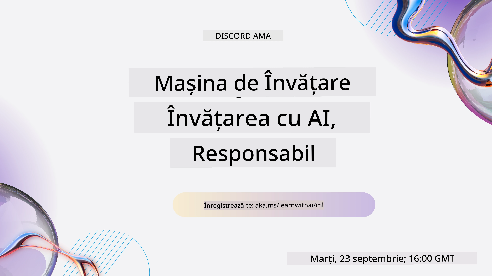
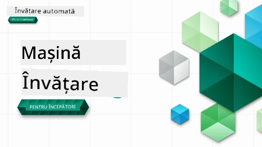

[](https://github.com/microsoft/ML-For-Beginners/blob/master/LICENSE)
[](https://GitHub.com/microsoft/ML-For-Beginners/graphs/contributors/)
[](https://GitHub.com/microsoft/ML-For-Beginners/issues/)
[](https://GitHub.com/microsoft/ML-For-Beginners/pulls/)
[](http://makeapullrequest.com)

[](https://GitHub.com/microsoft/ML-For-Beginners/watchers/)
[](https://GitHub.com/microsoft/ML-For-Beginners/network/)
[](https://GitHub.com/microsoft/ML-For-Beginners/stargazers/)

### 🌐 Suport Multi-Limbaj

#### Traduceri menținute cu [Co-op Translator](https://github.com/Azure/co-op-translator)

<!-- CO-OP TRANSLATOR LANGUAGES TABLE START -->
[Arabă](../ar/README.md) | [Bengaleză](../bn/README.md) | [Bulgară](../bg/README.md) | [Birmaneză (Myanmar)](../my/README.md) | [Chineză (Simplificată)](../zh-CN/README.md) | [Chineză (Tradițională, Hong Kong)](../zh-HK/README.md) | [Chineză (Tradițională, Macau)](../zh-MO/README.md) | [Chineză (Tradițională, Taiwan)](../zh-TW/README.md) | [Croată](../hr/README.md) | [Cehă](../cs/README.md) | [Daneză](../da/README.md) | [Olandeză](../nl/README.md) | [Estonă](../et/README.md) | [Finlandeză](../fi/README.md) | [Franceză](../fr/README.md) | [Germană](../de/README.md) | [Greacă](../el/README.md) | [Ebraică](../he/README.md) | [Hindi](../hi/README.md) | [Maghiară](../hu/README.md) | [Indoneziană](../id/README.md) | [Italiană](../it/README.md) | [Japoneză](../ja/README.md) | [Kannada](../kn/README.md) | [Khmeră](../km/README.md) | [Coreeană](../ko/README.md) | [Lituaniană](../lt/README.md) | [Malaieză](../ms/README.md) | [Malalayam](../ml/README.md) | [Manipuri (Meitei Mayek)](../mni/README.md) | [Marathi](../mr/README.md) | [Nepaleză](../ne/README.md) | [Pidjin Nigerian](../pcm/README.md) | [Norvegiană](../no/README.md) | [Persană (Farsi)](../fa/README.md) | [Poloneză](../pl/README.md) | [Portugheză (Brazilia)](../pt-BR/README.md) | [Portugheză (Portugalia)](../pt-PT/README.md) | [Panjabi (Gurmukhi)](../pa/README.md) | [Română](./README.md) | [Rusă](../ru/README.md) | [Sârbă (Chirilică)](../sr/README.md) | [Slovacă](../sk/README.md) | [Slovenă](../sl/README.md) | [Spaniolă](../es/README.md) | [Swahili](../sw/README.md) | [Suedeză](../sv/README.md) | [Tagalog (Filipineză)](../tl/README.md) | [Tamil](../ta/README.md) | [Telugu](../te/README.md) | [Thailandeză](../th/README.md) | [Turcă](../tr/README.md) | [Ucraineană](../uk/README.md) | [Urdu](../ur/README.md) | [Vietnameză](../vi/README.md)

> **Preferi să clonezi local?**
>
> Acest depozit include traduceri în peste 50 de limbi, ceea ce mărește semnificativ dimensiunea descărcării. Pentru a clona fără traduceri, folosește verificarea sparsa:
>
> **Bash / macOS / Linux:**
> ```bash
> git clone --filter=blob:none --sparse https://github.com/microsoft/ML-For-Beginners.git
> cd ML-For-Beginners
> git sparse-checkout set --no-cone '/*' '!translations' '!translated_images'
> ```
>
> **CMD (Windows):**
> ```cmd
> git clone --filter=blob:none --sparse https://github.com/microsoft/ML-For-Beginners.git
> cd ML-For-Beginners
> git sparse-checkout set --no-cone "/*" "!translations" "!translated_images"
> ```
>
> Aceasta îți oferă tot ce ai nevoie pentru a finaliza cursul cu o descărcare mult mai rapidă.
<!-- CO-OP TRANSLATOR LANGUAGES TABLE END -->

#### Alătură-te Comunității Noastre

[](https://discord.gg/nTYy5BXMWG)

Avem o serie Discord „Învățare cu AI” în desfășurare, află mai multe și alătură-te la [Learn with AI Series](https://aka.ms/learnwithai/discord) în perioada 18 - 30 septembrie 2025. Vei primi sfaturi și trucuri despre folosirea GitHub Copilot pentru Știința Datelor.



# Învățarea Automată pentru Începători - Un Curriculum

> 🌍 Călătorește în jurul lumii în timp ce explorăm Învățarea Automată prin prisma culturilor lumii 🌍

Avocații Cloud de la Microsoft sunt încântați să ofere un curriculum de 12 săptămâni, cu 26 de lecții toate despre **Învățarea Automată**. În acest curriculum, vei învăța despre ceea ce uneori este numit **învățare automată clasică**, folosind în principal biblioteca Scikit-learn și evitând învățarea profundă, care este acoperită în curriculumul nostru [AI pentru Începători](https://aka.ms/ai4beginners). Îmbină aceste lecții cu curriculumul nostru ['Știința Datelor pentru Începători'](https://aka.ms/ds4beginners) și mai ales!

Călătorește cu noi în jurul lumii pe măsură ce aplicăm aceste tehnici clasice pe date din multe regiuni ale lumii. Fiecare lecție include teste înainte și după lecție, instrucțiuni scrise pentru finalizarea lecției, o soluție, o sarcină și altele. Pedagogia noastră bazată pe proiecte îți permite să înveți construind, o metodă dovedită ca reținerea noilor abilități este mai eficientă.

**✍️ Mulțumiri călduroase autorilor noștri** Jen Looper, Stephen Howell, Francesca Lazzeri, Tomomi Imura, Cassie Breviu, Dmitry Soshnikov, Chris Noring, Anirban Mukherjee, Ornella Altunyan, Ruth Yakubu și Amy Boyd

**🎨 Mulțumiri și ilustratorilor noștri** Tomomi Imura, Dasani Madipalli și Jen Looper

**🙏 Mulțumiri speciale 🙏 autorilor, recenzorilor și colaboratorilor la conținut ai Microsoft Student Ambassador**, în special Rishit Dagli, Muhammad Sakib Khan Inan, Rohan Raj, Alexandru Petrescu, Abhishek Jaiswal, Nawrin Tabassum, Ioan Samuila și Snigdha Agarwal

**🤩 Mulțumiri suplimentare pentru Microsoft Student Ambassadors Eric Wanjau, Jasleen Sondhi și Vidushi Gupta pentru lecțiile noastre în R!**

# Începutul

Urmează acești pași:
1. **Fă Fork la Depozit**: Apasă butonul „Fork” din colțul din dreapta sus al acestei pagini.
2. **Clonează Depozitul**:   `git clone https://github.com/microsoft/ML-For-Beginners.git`

> 💡 **Sfat de începere rapidă:** Vrei să începi din browser fără să instalezi Python local? Folosește [GitHub Codespaces](https://github.com/features/codespaces) pentru a crea un mediu de dezvoltare în cloud pentru fork-ul tău. Deschide meniul verde **Code**, selectează **Codespaces** și creează un codespace; instalează în el dependențele necesare pentru fiecare lecție, după caz.

> [găsește toate resursele suplimentare pentru acest curs în colecția noastră Microsoft Learn](https://learn.microsoft.com/en-us/collections/qrqzamz1nn2wx3?WT.mc_id=academic-77952-bethanycheum)

> 🔧 **Ai nevoie de ajutor?** Consultă ghidul nostru de depanare [Troubleshooting Guide](TROUBLESHOOTING.md) pentru soluții la probleme obișnuite legate de instalare, configurare și rularea lecțiilor.


**[Studenți](https://aka.ms/student-page)**, pentru a folosi acest curriculum, fă fork întregului depozit în contul vostru GitHub și executați exercițiile individual sau în grup:

- Începe cu un test de pre-lectură.
- Citește lecția și completează activitățile, făcând pauze și reflectând la fiecare verificare a cunoștințelor.
- Încearcă să creezi proiectele înțelegând lecțiile mai degrabă decât rulând codul soluției; totuși codul este disponibil în folderele `/solution` din fiecare lecție orientată pe proiect.
- Fă testul de post-lectură.
- Completează provocarea.
- Finalizează tema.
- După finalizarea unui grup de lecții, vizitează [Discussion Board](https://github.com/microsoft/ML-For-Beginners/discussions) și „învăță cu voce tare” completând rubrica PAT corespunzătoare. Un PAT este un Instrument de Evaluare a Progresului care este o rubrică pe care o completezi pentru a-ți avansa învățarea. Poți, de asemenea, să reacționezi la alte PAT-uri pentru a învăța împreună.

> Pentru studiu suplimentar, recomandăm urmarea acestor module și căi de învățare [Microsoft Learn](https://docs.microsoft.com/en-us/users/jenlooper-2911/collections/k7o7tg1gp306q4?WT.mc_id=academic-77952-leestott).

**Profesori**, am [inclus câteva sugestii](for-teachers.md) despre cum puteți folosi acest curriculum.

---

## Tutoriale video

Unele dintre lecții sunt disponibile ca videoclipuri scurte. Le poți găsi integrate în lecții sau pe [playlistul ML for Beginners de pe canalul Microsoft Developer YouTube](https://aka.ms/ml-beginners-videos) făcând clic pe imaginea de mai jos.

[](https://aka.ms/ml-beginners-videos)

---

## Cunoaște Echipa

[](https://youtu.be/Tj1XWrDSYJU)

**Gif de** [Mohit Jaisal](https://linkedin.com/in/mohitjaisal)

> 🎥 Apasă imaginea de mai sus pentru un videoclip despre proiect și oamenii care l-au creat!

---

## Pedagogie

Am ales două principii pedagogice în construirea acestui curriculum: asigurarea faptului că este **bazat pe proiecte practice** și că include **teste frecvente**. În plus, acest curriculum are o **temă** comună pentru a-i da coeziune.

Prin alinierea conținutului cu proiectele, procesul devine mai captivant pentru studenți, iar reținerea conceptelor este îmbunătățită. În plus, un test cu miză redusă înaintea unei clase stabilește intenția studentului de a învăța un subiect, în timp ce un al doilea test după clasă asigură o reținere suplimentară. Acest curriculum a fost conceput să fie flexibil și distractiv și poate fi urmat integral sau parțial. Proiectele încep mici și devin din ce în ce mai complexe până la sfârșitul ciclului de 12 săptămâni. Curriculumul include de asemenea un postscript despre aplicații reale ale ML, care poate fi folosit ca credit suplimentar sau ca bază pentru discuții.

> Găsește regulile noastre de [Cod de Conduită](CODE_OF_CONDUCT.md), [Contribuții](CONTRIBUTING.md), [Traduceri](..), și [Depanare](TROUBLESHOOTING.md). Așteptăm cu interes feedback-ul tău constructiv!

## Fiecare lecție include

- schiță opțională
- videoclip suplimentar opțional
- tutorial video (doar pentru unele lecții)
- [test pre-lectură de încălzire](https://ff-quizzes.netlify.app/en/ml/)
- lecție scrisă
- pentru lecții bazate pe proiecte, ghiduri pas cu pas pentru construirea proiectului
- verificări ale cunoștințelor
- o provocare
- lectură suplimentară
- temă
- [test post-lectură](https://ff-quizzes.netlify.app/en/ml/)

> **O notă despre limbi**: Aceste lecții sunt scrise în principal în Python, dar multe sunt disponibile și în R. Pentru a realiza o lecție în R, mergi în folderul `/solution` și caută lecții în R. Acestea includ o extensie .rmd care reprezintă un fișier **R Markdown**, ce poate fi definit simplu ca o încorporare de `code chunks` (de R sau alte limbaje) și un `YAML header` (care ghidează formatul output-ului cum ar fi PDF) într-un `Markdown document`. Astfel, servește ca un cadru exemplu de creare de documente pentru știința datelor deoarece îți permite să combini codul tău, output-ul său și gândurile tale scriindu-le în Markdown. Mai mult, documentele R Markdown pot fi generate în formate output cum ar fi PDF, HTML sau Word.

> **O notă despre teste**: Toate testele sunt conținute în folderul [Quiz App](../../quiz-app), totalizând 52 de teste cu câte trei întrebări fiecare. Ele sunt legate din interiorul lecțiilor, dar aplicația de teste poate fi rulată local; urmărește instrucțiunile din folderul `quiz-app` pentru a găzdui local sau a implementa pe Azure.

| Numărul lecției |                             Subiect                              |                   Gruparea lecției                   | Obiective de învățare                                                                                                             |                                                              Lecția legată                                                                |                        Autor                        |
| :-----------: | :------------------------------------------------------------: | :-------------------------------------------------: | ------------------------------------------------------------------------------------------------------------------------------- | :--------------------------------------------------------------------------------------------------------------------------------------: | :--------------------------------------------------: |
|      01       |                Introducere în învățarea automată                |      [Introducere](1-Introduction/README.md)       | Învață conceptele de bază din spatele învățării automate                                                                           |                                             [Lecție](1-Introduction/1-intro-to-ML/README.md)                                             |                       Muhammad                       |
|      02       |                Istoria învățării automate                 |      [Introducere](1-Introduction/README.md)       | Învață istoria acestui domeniu                                                                                                   |                                            [Lecție](1-Introduction/2-history-of-ML/README.md)                                            |                     Jen și Amy                      |
|      03       |                 Echitatea și învățarea automată                  |      [Introducere](1-Introduction/README.md)       | Care sunt problemele filosofice importante legate de echitate pe care studenții ar trebui să le ia în considerare când construiesc și aplică modele ML? |                                              [Lecție](1-Introduction/3-fairness/README.md)                                               |                        Tomomi                        |
|      04       |                Tehnici pentru învățarea automată                 |      [Introducere](1-Introduction/README.md)       | Ce tehnici folosesc cercetătorii ML pentru a construi modele ML?                                                                |                                          [Lecție](1-Introduction/4-techniques-of-ML/README.md)                                           |                    Chris și Jen                     |
|      05       |                   Introducere în regresie                   |        [Regresie](2-Regression/README.md)         | Începe cu Python și Scikit-learn pentru modele de regresie                                                                       |         [Python](2-Regression/1-Tools/README.md) • [R](../../2-Regression/1-Tools/solution/R/lesson_1.html)         |      Jen • Eric Wanjau       |
|      06       |                Prețurile dovlecilor din America de Nord 🎃                |        [Regresie](2-Regression/README.md)         | Vizualizează și curăță date pentru pregătirea ML                                                                                 |          [Python](2-Regression/2-Data/README.md) • [R](../../2-Regression/2-Data/solution/R/lesson_2.html)          |      Jen • Eric Wanjau       |
|      07       |                Prețurile dovlecilor din America de Nord 🎃                |        [Regresie](2-Regression/README.md)         | Construiește modele de regresie liniară și polinomială                                                                          |        [Python](2-Regression/3-Linear/README.md) • [R](../../2-Regression/3-Linear/solution/R/lesson_3.html)        |      Jen și Dmitry • Eric Wanjau       |
|      08       |                Prețurile dovlecilor din America de Nord 🎃                |        [Regresie](2-Regression/README.md)         | Construiește un model de regresie logistică                                                                                      |     [Python](2-Regression/4-Logistic/README.md) • [R](../../2-Regression/4-Logistic/solution/R/lesson_4.html)      |      Jen • Eric Wanjau       |
|      09       |                          O aplicație web 🔌                          |           [Aplicație Web](3-Web-App/README.md)            | Construiește o aplicație web pentru a folosi modelul antrenat                                                                    |                                                 [Python](3-Web-App/1-Web-App/README.md)                                                  |                         Jen                          |
|      10       |                 Introducere în clasificare                 |    [Clasificare](4-Classification/README.md)     | Curăță, pregătește, și vizualizează-ți datele; introducere în clasificare                                                        | [Python](4-Classification/1-Introduction/README.md) • [R](../../4-Classification/1-Introduction/solution/R/lesson_10.html)  | Jen și Cassie • Eric Wanjau |
|      11       |             Bucătării delicioase asiatice și indiene 🍜             |    [Clasificare](4-Classification/README.md)     | Introducere în clasificatori                                                                                                      | [Python](4-Classification/2-Classifiers-1/README.md) • [R](../../4-Classification/2-Classifiers-1/solution/R/lesson_11.html) | Jen și Cassie • Eric Wanjau |
|      12       |             Bucătării delicioase asiatice și indiene 🍜             |    [Clasificare](4-Classification/README.md)     | Mai mulți clasificatori                                                                                                           | [Python](4-Classification/3-Classifiers-2/README.md) • [R](../../4-Classification/3-Classifiers-2/solution/R/lesson_12.html) | Jen și Cassie • Eric Wanjau |
|      13       |             Bucătării delicioase asiatice și indiene 🍜             |    [Clasificare](4-Classification/README.md)     | Construiește o aplicație web de recomandări folosind modelul tău                                                                |                                              [Python](4-Classification/4-Applied/README.md)                                              |                         Jen                          |
|      14       |                   Introducere în clustering                   |        [Clustering](5-Clustering/README.md)         | Curăță, pregătește și vizualizează datele; introducere în clustering                                                             |         [Python](5-Clustering/1-Visualize/README.md) • [R](../../5-Clustering/1-Visualize/solution/R/lesson_14.html)         |      Jen • Eric Wanjau       |
|      15       |              Explorarea gusturilor muzicale nigeriene 🎧              |        [Clustering](5-Clustering/README.md)         | Explorează metoda de clustering K-Means                                                                                          |           [Python](5-Clustering/2-K-Means/README.md) • [R](../../5-Clustering/2-K-Means/solution/R/lesson_15.html)           |      Jen • Eric Wanjau       |
|      16       |        Introducere în procesarea limbajului natural ☕️         |   [Procesarea limbajului natural](6-NLP/README.md)    | Învață bazele NLP construind un bot simplu                                                                                        |                                             [Python](6-NLP/1-Introduction-to-NLP/README.md)                                              |                       Stephen                        |
|      17       |                      Sarcini comune NLP ☕️                      |   [Procesarea limbajului natural](6-NLP/README.md)    | Adâncește-ți cunoștințele NLP înțelegând sarcini comune necesare pentru a lucra cu structuri de limbaj                            |                                                    [Python](6-NLP/2-Tasks/README.md)                                                     |                       Stephen                        |
|      18       |             Traducere și analiză a sentimentelor ♥️              |   [Procesarea limbajului natural](6-NLP/README.md)    | Traducere și analiza sentimentelor cu Jane Austen                                                                                |                                            [Python](6-NLP/3-Translation-Sentiment/README.md)                                             |                       Stephen                        |
|      19       |                  Hoteluri romantice din Europa ♥️                  |   [Procesarea limbajului natural](6-NLP/README.md)    | Analiza sentimentelor cu recenzii de hoteluri 1                                                                                  |                                               [Python](6-NLP/4-Hotel-Reviews-1/README.md)                                                |                       Stephen                        |
|      20       |                  Hoteluri romantice din Europa ♥️                  |   [Procesarea limbajului natural](6-NLP/README.md)    | Analiza sentimentelor cu recenzii de hoteluri 2                                                                                  |                                               [Python](6-NLP/5-Hotel-Reviews-2/README.md)                                                |                       Stephen                        |
|      21       |            Introducere în prognoza seriilor de timp             |        [Serii de timp](7-TimeSeries/README.md)        | Introducere în prognoza seriilor de timp                                                                                         |                                             [Python](7-TimeSeries/1-Introduction/README.md)                                              |                      Francesca                       |
|      22       | ⚡️ Consumul mondial de energie ⚡️ - prognoza seriilor de timp cu ARIMA |        [Serii de timp](7-TimeSeries/README.md)        | Prognoză cu ARIMA a seriilor de timp                                                                                             |                                                 [Python](7-TimeSeries/2-ARIMA/README.md)                                                 |                      Francesca                       |
|      23       |  ⚡️ Consumul mondial de energie ⚡️ - prognoza seriilor de timp cu SVR  |        [Serii de timp](7-TimeSeries/README.md)        | Prognoza seriilor de timp cu Support Vector Regressor                                                                            |                                                  [Python](7-TimeSeries/3-SVR/README.md)                                                  |                       Anirban                        |
|      24       |             Introducere în învățarea prin întărire             | [Învățarea prin întărire](8-Reinforcement/README.md) | Introducere în învățarea prin întărire cu Q-Learning                                                                             |                                             [Python](8-Reinforcement/1-QLearning/README.md)                                              |                        Dmitry                        |
|      25       |                 Ajută-l pe Peter să evite lupul! 🐺                  | [Învățarea prin întărire](8-Reinforcement/README.md) | Învățare prin întărire Gym                                                                                                       |                                                [Python](8-Reinforcement/2-Gym/README.md)                                                 |                        Dmitry                        |
|  Postscript   |            Scenarii și aplicații ML din lumea reală            |      [ML în sălbăticie](9-Real-World/README.md)       | Aplicații reale interesante și revelatoare ale ML clasice                                                                         |                                             [Lecție](9-Real-World/1-Applications/README.md)                                              |                         Echipa                         |
|  Postscript   |            Depanare modele în ML folosind panoul RAI            |      [ML în sălbăticie](9-Real-World/README.md)       | Depanare modele în învățarea automată folosind componentele panoului Responsible AI                                             |                                             [Lecție](9-Real-World/2-Debugging-ML-Models/README.md)                                              |                     Ruth Yakubu                      |

> [găsiți toate resursele suplimentare pentru acest curs în colecția noastră Microsoft Learn](https://learn.microsoft.com/en-us/collections/qrqzamz1nn2wx3?WT.mc_id=academic-77952-bethanycheum)

## Acces offline

Poți rula această documentație offline folosind [Docsify](https://docsify.js.org/#/). Fă un fork la acest repo, [instalează Docsify](https://docsify.js.org/#/quickstart) pe calculatorul tău local, apoi în dosarul rădăcină al acestui repo scrie `docsify serve`. Site-ul va fi servit la portul 3000 pe localhost-ul tău: `localhost:3000`.

## PDF-uri

Găsește un pdf al curriculum-ului cu linkuri [aici](https://microsoft.github.io/ML-For-Beginners/pdf/readme.pdf).


## 🎒 Alte cursuri 

Echipa noastră produce și alte cursuri! Aruncă o privire la:

<!-- CO-OP TRANSLATOR OTHER COURSES START -->
### LangChain
[](https://aka.ms/langchain4j-for-beginners)
[](https://aka.ms/langchainjs-for-beginners?WT.mc_id=m365-94501-dwahlin)
[](https://github.com/microsoft/langchain-for-beginners?WT.mc_id=m365-94501-dwahlin)
---

### Azure / Edge / MCP / Agenți
[](https://github.com/microsoft/AZD-for-beginners?WT.mc_id=academic-105485-koreyst)
[](https://github.com/microsoft/edgeai-for-beginners?WT.mc_id=academic-105485-koreyst)
[](https://github.com/microsoft/mcp-for-beginners?WT.mc_id=academic-105485-koreyst)
[](https://github.com/microsoft/ai-agents-for-beginners?WT.mc_id=academic-105485-koreyst)

---
 
### Seria Generative AI
[](https://github.com/microsoft/generative-ai-for-beginners?WT.mc_id=academic-105485-koreyst)
[-9333EA?style=for-the-badge&labelColor=E5E7EB&color=9333EA)](https://github.com/microsoft/Generative-AI-for-beginners-dotnet?WT.mc_id=academic-105485-koreyst)
[-C084FC?style=for-the-badge&labelColor=E5E7EB&color=C084FC)](https://github.com/microsoft/generative-ai-for-beginners-java?WT.mc_id=academic-105485-koreyst)
[-E879F9?style=for-the-badge&labelColor=E5E7EB&color=E879F9)](https://github.com/microsoft/generative-ai-with-javascript?WT.mc_id=academic-105485-koreyst)

---
 
### Învățare de bază
[](https://aka.ms/ml-beginners?WT.mc_id=academic-105485-koreyst)
[](https://aka.ms/datascience-beginners?WT.mc_id=academic-105485-koreyst)
[](https://aka.ms/ai-beginners?WT.mc_id=academic-105485-koreyst)
[](https://github.com/microsoft/Security-101?WT.mc_id=academic-96948-sayoung)
[](https://aka.ms/webdev-beginners?WT.mc_id=academic-105485-koreyst)
[](https://aka.ms/iot-beginners?WT.mc_id=academic-105485-koreyst)
[](https://github.com/microsoft/xr-development-for-beginners?WT.mc_id=academic-105485-koreyst)

---
 
### Seria Copilot
[](https://aka.ms/GitHubCopilotAI?WT.mc_id=academic-105485-koreyst)
[](https://github.com/microsoft/mastering-github-copilot-for-dotnet-csharp-developers?WT.mc_id=academic-105485-koreyst)
[](https://github.com/microsoft/CopilotAdventures?WT.mc_id=academic-105485-koreyst)
<!-- CO-OP TRANSLATOR OTHER COURSES END -->

## Obținerea ajutorului

Dacă întâmpini dificultăți sau ai întrebări în timpul învățării Machine Learning sau construirii de aplicații AI, nu-ți face griji — ajutorul este disponibil.

Poți participa la discuții cu alți cursanți și dezvoltatori, poți pune întrebări și împărtăși ideile tale cu comunitatea.

- Alătură-te comunității pentru a pune întrebări și a învăța împreună cu alții
- Discută concepte și idei de proiecte din Machine Learning
- Primește îndrumare de la dezvoltatori cu experiență

O comunitate susținătoare este o modalitate excelentă de a-ți dezvolta aptitudinile și de a rezolva problemele mai rapid.

[Comunitatea Discord Microsoft Foundry](https://discord.gg/nTYy5BXMWG)

Dacă întâlnești erori, bug-uri sau ai sugestii pentru îmbunătățiri, poți deschide și un **Issue** în acest depozit pentru a raporta problema.

Pentru feedback despre produs sau pentru a căuta în postările comunității existente, vizitează Forumul Dezvoltatorilor:

[](https://aka.ms/foundry/forum)

## Sfaturi suplimentare de învățare

- Revizuiește caietele după fiecare lecție pentru o mai bună înțelegere.
- Exersează implementarea algoritmilor pe cont propriu.
- Explorează seturi de date din lumea reală folosind concepte învățate.

---

<!-- CO-OP TRANSLATOR DISCLAIMER START -->
**Declinare a responsabilității**:
Acest document a fost tradus folosind serviciul de traducere AI [Co-op Translator](https://github.com/Azure/co-op-translator). În timp ce ne străduim pentru acuratețe, vă rugăm să rețineți că traducerile automate pot conține erori sau inexactități. Documentul original în limba sa nativă trebuie considerat sursa autorizată. Pentru informații critice, se recomandă traducerea profesională realizată de un om. Nu ne asumăm responsabilitatea pentru eventualele neînțelegeri sau interpretări greșite care decurg din utilizarea acestei traduceri.
<!-- CO-OP TRANSLATOR DISCLAIMER END -->