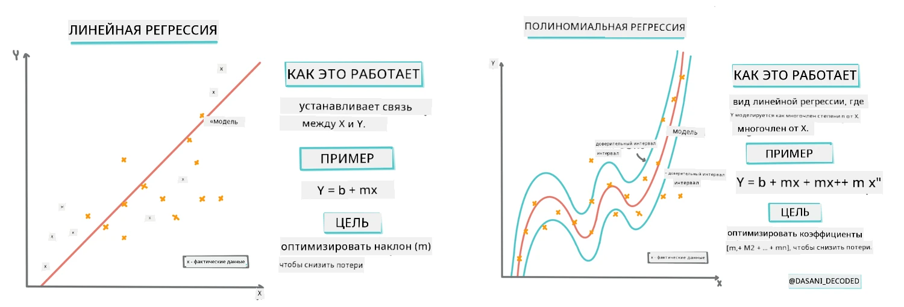
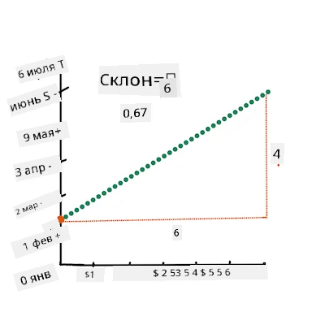
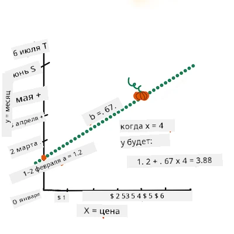
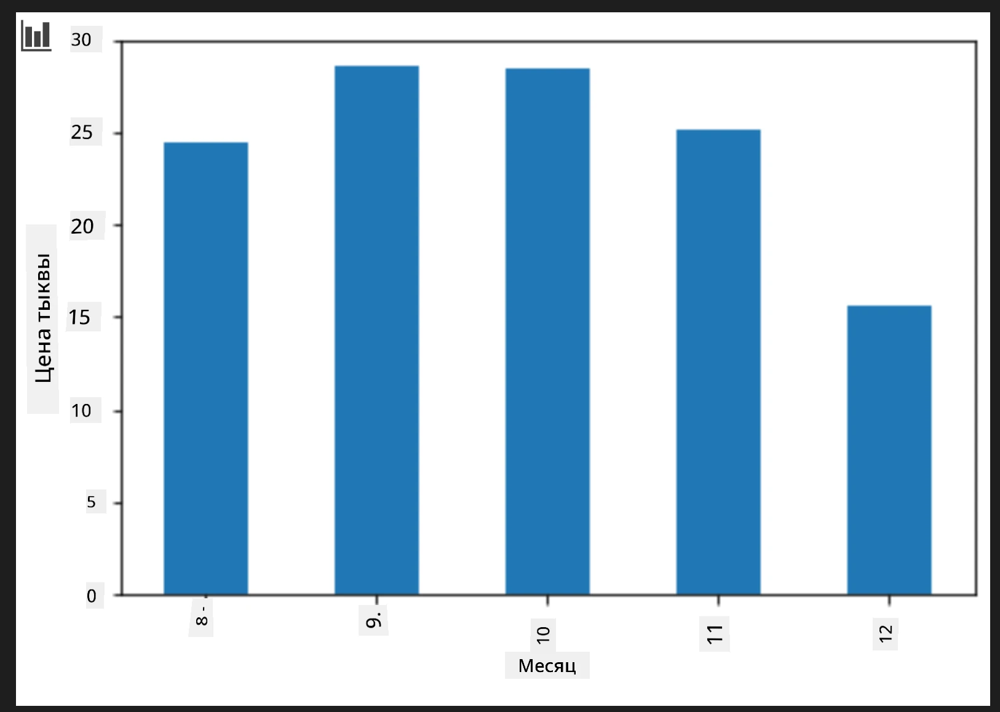
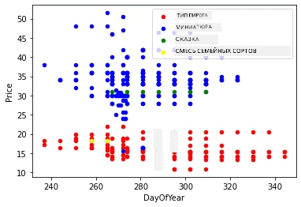

# Построение модели регрессии с использованием Scikit-learn: регрессия четырьмя способами

## Заметка для начинающих

Линейная регрессия используется, когда мы хотим предсказать **числовое значение** (например, цену на дом, температуру или продажи).
Она работает, находя прямую линию, которая лучше всего отражает зависимость между входными признаками и выходным значением.

В этом уроке мы сосредоточимся на понимании концепции, прежде чем изучать более продвинутые методы регрессии.

> Инфографика от [Dasani Madipalli](https://twitter.com/dasani_decoded)
## [Прекурс по уроку](https://ff-quizzes.netlify.app/en/ml/)

> ### [Этот урок доступен на R!](../../../../2-Regression/3-Linear/solution/R/lesson_3.html)
### Введение 

До сих пор вы изучали, что такое регрессия, используя пример с данными по ценам на тыквы, которые мы будем использовать в течение всего урока. Вы также визуализировали эти данные с помощью Matplotlib.

Теперь вы готовы углубиться в регрессию для машинного обучения. В то время как визуализация помогает понять данные, настоящая сила машинного обучения заключается в _обучении моделей_. Модели обучаются на исторических данных, чтобы автоматически улавливать зависимости, и позволяют предсказывать результаты для новых данных, которых модель ранее не видела.

В этом уроке вы узнаете больше о двух типах регрессии: _базовой линейной регрессии_ и _полиномиальной регрессии_, а также о математике, лежащей в основе этих методов. Эти модели позволят нам предсказывать цены на тыквы в зависимости от различных входных данных. 

[](https://youtu.be/CRxFT8oTDMg "ML for beginners - Understanding Linear Regression")

> 🎥 Нажмите на изображение выше, чтобы посмотреть короткое видеообзор линейной регрессии.

> В течение всего курса мы предполагаем минимальные знания математики и стараемся сделать его доступным для студентов из других областей, поэтому внимательнее следите за заметками, 🧮 подсказками, диаграммами и другими учебными материалами для облегчения понимания.

### Предварительные знания

Вы уже должны быть знакомы со структурой данных о тыквах, которую мы рассматриваем. Вы можете найти их предварительно загруженными и очищенными в файле _notebook.ipynb_, прилагающемся к этому уроку. В этом файле цена тыквы отображается за бушель в новом датафрейме. Убедитесь, что вы можете запускать эти ноутбуки в ядрах Visual Studio Code.

### Подготовка

Напоминаем, что вы загружаете эти данные, чтобы задавать вопросы.

- Когда лучше всего покупать тыквы?
- Какую цену можно ожидать за коробку миниатюрных тыкв?
- Нужно ли покупать их в корзинах на полбушеля или в ящиках 1 1/9 бушеля?
Продолжим изучать эти данные.

В предыдущем уроке вы создали Pandas DataFrame и заполнили его частью исходного набора данных, стандартизировав цены за бушель. Однако при этом вы получили около 400 точек данных и только за осенние месяцы.

Посмотрите на данные, которые мы предварительно загрузили в прилагаемом к уроку ноутбуке. Данные загружены, а также построен начальный диаграмма рассеяния по месяцам. Возможно, стоит очистить данные более тщательно, чтобы получить больше информации о природе данных.

## Линейная регрессионная линия

Как вы узнали в Уроке 1, целью упражнения линейной регрессии является построение линии, чтобы:

- **Показать взаимосвязи переменных**. Показать связь между переменными
- **Делать предсказания**. Точно предсказывать, где окажется новая точка данных относительно этой линии.

Обычно для этого рисуют линию методом **наименьших квадратов**. Термин «наименьших квадратов» относится к процессу минимизации общей ошибки в нашей модели. Для каждой точки данных мы измеряем вертикальное расстояние (называемое остатком) между фактической точкой и линией регрессии.

Мы возводим эти расстояния в квадрат по двум причинам:

1. **Размер, а не направление:** Мы хотим, чтобы ошибка -5 рассматривалась так же, как ошибка +5. Возведение в квадрат делает все значения положительными.

2. **Штраф за выбросы:** Возведение в квадрат придаёт больший вес большим ошибкам, заставляя линию ближе подходить к точкам, которые сильно отклоняются.

Затем мы суммируем все эти квадраты. Цель – найти такую линию, где эта сумма будет минимальной — отсюда и название "Метод наименьших квадратов".

> **🧮 Покажите математику** 
> 
> Эта линия, называемая _линией наилучшего соответствия_, может быть выражена [уравнением](https://en.wikipedia.org/wiki/Simple_linear_regression): 
> 
> ```
> Y = a + bX
> ```
>
> `X` — это «объясняющая переменная». `Y` — «зависимая переменная». Наклон линии обозначен как `b`, а `a` — это y-перехват, то есть значение `Y` при `X = 0`.
>
>
>
> Сначала вычислите наклон `b`. Инфографика от [Jen Looper](https://twitter.com/jenlooper)
>
> Другими словами, и ссылаясь на исходный вопрос нашего набора данных о тыквах: "предсказать цену тыквы за бушель по месяцу", `X` будет означать месяц, а `Y` — цену.
>
>
>
> Вычислите значение Y. Если вы платите около $4, должно быть, сейчас апрель! Инфографика от [Jen Looper](https://twitter.com/jenlooper)
>
> Математика, которая вычисляет линию, должна демонстрировать наклон линии, зависящий также от перехвата, то есть того, где `Y` расположен при `X = 0`.
>
> Вы можете посмотреть метод расчёта этих значений на сайте [Math is Fun](https://www.mathsisfun.com/data/least-squares-regression.html). Также посетите [этот калькулятор наименьших квадратов](https://www.mathsisfun.com/data/least-squares-calculator.html), чтобы увидеть, как значения чисел влияют на линию.

## Корреляция

Еще один термин, который нужно понять — это **коэффициент корреляции** между переменными X и Y. Используя диаграмму рассеяния, можно быстро визуализировать этот коэффициент. Если точки на графике располагаются вдоль четкой линии, корреляция высокая, а если точки «разбросаны» повсюду, корреляция низкая.

Хорошая модель линейной регрессии — это та, у которой высокий (ближе к 1, чем к 0) коэффициент корреляции, рассчитанный методом наименьших квадратов с линией регрессии.

✅ Запустите ноутбук, прилагающийся к этому уроку, и посмотрите на диаграмму рассеяния «Месяц — Цена». Кажется ли вам, что данные, связывающие месяц с ценой продажи тыкв, имеют высокую или низкую корреляцию, по вашему визуальному восприятию диаграммы рассеяния? Изменится ли это, если использовать более детальную меру вместо `Месяца`, например, *номер дня в году* (количество дней с начала года)?

В приведённом ниже коде будем считать, что мы очистили данные и получили DataFrame под названием `new_pumpkins`, примерно такого вида:

ID | Month | DayOfYear | Variety | City | Package | Low Price | High Price | Price
---|-------|-----------|---------|------|---------|-----------|------------|-------
70 | 9 | 267 | PIE TYPE | BALTIMORE | 1 1/9 bushel cartons | 15.0 | 15.0 | 13.636364
71 | 9 | 267 | PIE TYPE | BALTIMORE | 1 1/9 bushel cartons | 18.0 | 18.0 | 16.363636
72 | 10 | 274 | PIE TYPE | BALTIMORE | 1 1/9 bushel cartons | 18.0 | 18.0 | 16.363636
73 | 10 | 274 | PIE TYPE | BALTIMORE | 1 1/9 bushel cartons | 17.0 | 17.0 | 15.454545
74 | 10 | 281 | PIE TYPE | BALTIMORE | 1 1/9 bushel cartons | 15.0 | 15.0 | 13.636364

> Код очистки данных доступен в файле [`notebook.ipynb`](notebook.ipynb). Мы выполнили те же шаги очистки, что и в предыдущем уроке, и рассчитали столбец `DayOfYear` с помощью следующего выражения:

```python
day_of_year = pd.to_datetime(pumpkins['Date']).apply(lambda dt: (dt-datetime(dt.year,1,1)).days)
```

Теперь, когда вы понимаете математику, лежащую в основе линейной регрессии, давайте создадим регрессионную модель, чтобы проверить, можем ли мы предсказывать, какой пакет тыкв будет иметь лучшую цену. Кто-то, покупающий тыквы для праздничного тыквенного огорода, может захотеть эту информацию, чтобы оптимизировать покупку пакетов тыкв для своей грядки.

## Поиск корреляции

[](https://youtu.be/uoRq-lW2eQo "ML for beginners - Looking for Correlation: The Key to Linear Regression")

> 🎥 Нажмите на изображение выше, чтобы посмотреть короткое видеообзор корреляции.

Из предыдущего урока вы, вероятно, видели, что средняя цена по месяцам выглядит так:



Это говорит о том, что должна быть некоторая корреляция, и мы можем попробовать обучить модель линейной регрессии для предсказания связи между `Месяц` и `Ценой`, или между `День года` и `Ценой`. Ниже приведена диаграмма рассеяния, показывающая последнее взаимосвязь:

 

Давайте посмотрим, есть ли корреляция, используя функцию `corr`:

```python
print(new_pumpkins['Month'].corr(new_pumpkins['Price']))
print(new_pumpkins['DayOfYear'].corr(new_pumpkins['Price']))
```

Похоже, корреляция довольно низкая: -0.15 для `Месяца` и -0.17 для `Дня года`, но возможно существует другая важная взаимосвязь. Похоже, существуют разные кластеры цен, соответствующие разным сортам тыкв. Чтобы подтвердить гипотезу, давайте нанесём каждую категорию тыкв своим цветом. Передавая параметр `ax` функции `scatter`, мы можем нарисовать все точки на одном графике:

```python
ax=None
colors = ['red','blue','green','yellow']
for i,var in enumerate(new_pumpkins['Variety'].unique()):
    df = new_pumpkins[new_pumpkins['Variety']==var]
    ax = df.plot.scatter('DayOfYear','Price',ax=ax,c=colors[i],label=var)
```

 

Наше исследование показывает, что сорт больше влияет на общую цену, чем фактическая дата продажи. Это видно на столбчатой диаграмме:

```python
new_pumpkins.groupby('Variety')['Price'].mean().plot(kind='bar')
```

 

Давайте пока сосредоточимся только на одном сорте тыкв, «pie type», и посмотрим, какое влияние дата оказывает на цену:

```python
pie_pumpkins = new_pumpkins[new_pumpkins['Variety']=='PIE TYPE']
pie_pumpkins.plot.scatter('DayOfYear','Price') 
```
 

Если теперь вычислить корреляцию между `Price` и `DayOfYear` с помощью функции `corr`, мы получим примерно `-0.27` — что означает, что обучение предсказательной модели имеет смысл.

> Перед обучением модели линейной регрессии важно убедиться, что данные чисты. Линейная регрессия плохо работает с отсутствующими значениями, поэтому имеет смысл удалить все пустые ячейки:

```python
pie_pumpkins.dropna(inplace=True)
pie_pumpkins.info()
```

Другой подход — заполнить отсутствующие значения средними значениями соответствующего столбца.

## Простая линейная регрессия

[](https://youtu.be/e4c_UP2fSjg "ML for beginners - Linear and Polynomial Regression using Scikit-learn")

> 🎥 Нажмите на изображение выше, чтобы посмотреть короткое видеообзор линейной и полиномиальной регрессии.

Для обучения модели линейной регрессии мы будем использовать библиотеку **Scikit-learn**.

```python
from sklearn.linear_model import LinearRegression
from sklearn.metrics import mean_squared_error
from sklearn.model_selection import train_test_split
```

Начинаем с разделения входных значений (признаков) и ожидаемого выхода (меток) на отдельные numpy-массивы:

```python
X = pie_pumpkins['DayOfYear'].to_numpy().reshape(-1,1)
y = pie_pumpkins['Price']
```

> Обратите внимание, что нам пришлось выполнить `reshape` для входных данных, чтобы пакет Linear Regression правильно воспринял их. Линейная регрессия ожидает вход в виде 2D-массива, где каждая строка — это вектор входных признаков. В нашем случае, поскольку у нас только один признак, нужен массив формы N×1, где N — размер набора данных.

Далее нам нужно разделить данные на обучающую и тестовую выборки, чтобы проверить модель после обучения:

```python
X_train, X_test, y_train, y_test = train_test_split(X, y, test_size=0.2, random_state=0)
```

Наконец, обучение самой модели линейной регрессии занимает всего две строчки кода. Мы создаём объект `LinearRegression` и обучаем его на данных с помощью метода `fit`:

```python
lin_reg = LinearRegression()
lin_reg.fit(X_train,y_train)
```

Объект `LinearRegression` после выполнения `fit` содержит все коэффициенты регрессии, к которым можно получить доступ с помощью свойства `.coef_`. В нашем случае есть только один коэффициент, который должен быть примерно `-0.017`. Это означает, что цены, похоже, немного падают со временем, но не слишком сильно, примерно на 2 цента в день. Также мы можем получить точку пересечения регрессии с осью Y с помощью `lin_reg.intercept_` — в нашем случае это будет около `21`, что указывает на цену в начале года.

Чтобы оценить точность нашей модели, мы можем спрогнозировать цены на тестовом наборе данных, а затем измерить, насколько близки наши прогнозы к ожидаемым значениям. Это можно сделать с помощью метрики корня из средней квадратичной ошибки (RMSE), которая является квадратным корнем из среднего по всем квадратам разностей между ожидаемым и предсказанным значением.

```python
pred = lin_reg.predict(X_test)

rmse = np.sqrt(mean_squared_error(y_test,pred))
print(f'RMSE: {rmse:3.3} ({rmse/np.mean(pred)*100:3.3}%)')
```

Наша ошибка составляет примерно 2 балла, что около ~17%. Не слишком хорошо. Еще одним показателем качества модели является **коэффициент детерминации**, который можно получить следующим образом:

```python
score = lin_reg.score(X_train,y_train)
print('Model determination: ', score)
```
Если значение равно 0, значит модель не учитывает входные данные и выступает как *худший линейный предсказатель*, то есть просто среднее значение результата. Значение 1 означает, что мы можем идеально предсказать все ожидаемые выходные данные. В нашем случае коэффициент около 0.06, что довольно низко.

Мы также можем построить график тестовых данных вместе с линией регрессии, чтобы лучше увидеть, как работает регрессия в нашем случае:

```python
plt.scatter(X_test,y_test)
plt.plot(X_test,pred)
```


## Полиномиальная регрессия

Другим типом линейной регрессии является полиномиальная регрессия. Хотя иногда между переменными есть линейная зависимость — чем больше объем тыквы, тем выше цена — иногда эти зависимости нельзя представить как плоскость или прямую линию.

✅ Вот [еще несколько примеров](https://online.stat.psu.edu/stat501/Lesson09#polynomial-regression-examples) данных, для которых можно использовать полиномиальную регрессию

Еще раз взгляните на зависимость между датой и ценой. Кажется ли вам, что эту диаграмму рассеяния обязательно нужно анализировать с помощью прямой линии? Разве цены не могут колебаться? В таком случае можно попробовать полиномиальную регрессию.

✅ Полиномы — это математические выражения, которые могут состоять из одной или нескольких переменных и коэффициентов

Полиномиальная регрессия создает кривую линию, чтобы лучше подогнать нелинейные данные. В нашем случае, если мы добавим в данные входа переменную `DayOfYear` в квадрате, мы сможем подогнать данные параболической кривой, которая будет иметь минимум в определенной точке в течение года.

В Scikit-learn есть полезный [pipeline API](https://scikit-learn.org/stable/modules/generated/sklearn.pipeline.make_pipeline.html?highlight=pipeline#sklearn.pipeline.make_pipeline), который позволяет объединять разные этапы обработки данных вместе. **Pipeline** — это цепочка **оценивателей**. В нашем случае мы создадим pipeline, который сначала добавит полиномиальные признаки в нашу модель, а затем обучит регрессию:

```python
from sklearn.preprocessing import PolynomialFeatures
from sklearn.pipeline import make_pipeline

pipeline = make_pipeline(PolynomialFeatures(2), LinearRegression())

pipeline.fit(X_train,y_train)
```

Использование `PolynomialFeatures(2)` означает, что мы включим все полиномы второй степени из входных данных. В нашем случае это будет просто `DayOfYear`<sup>2</sup>, но если у нас есть две переменные X и Y, это добавит X<sup>2</sup>, XY и Y<sup>2</sup>. Можно также использовать полиномы более высокой степени.

Pipeline можно использовать так же, как исходный объект `LinearRegression`: мы можем выполнить `fit` для pipeline, а затем использовать `predict` для получения результатов прогноза:

```python
pred = pipeline.predict(X_test)

rmse = np.sqrt(mean_squared_error(y_test,pred))
print(f'RMSE: {rmse:3.3} ({rmse/np.mean(pred)*100:3.3}%)')

score = pipeline.score(X_train,y_train)
print('Model determination: ', score)
```

Для построения гладкой кривой аппроксимации мы используем `np.linspace`, чтобы создать равномерный диапазон входных значений, а не рисовать напрямую на неупорядоченных тестовых данных (что дало бы зигзагообразную линию):

```python
X_range = np.linspace(X_test.min(), X_test.max(), 100).reshape(-1,1)
y_range = pipeline.predict(X_range)

plt.scatter(X_test, y_test)
plt.plot(X_range, y_range)
```

Вот график с тестовыми данными и аппроксимационной кривой:


Используя полиномиальную регрессию, мы можем получить немного меньшую RMSE и более высокий коэффициент детерминации, но не значительно. Нужно учитывать и другие признаки!

> Вы можете заметить, что минимальные цены на тыквы-пай наблюдаются где-то около Хэллоуина. Как вы это объясните?

🎃 Поздравляем, вы только что создали модель, которая может помочь предсказывать цену на тыквы для пирога. Вероятно, вы сможете проделать ту же процедуру для всех типов тыкв, но это будет утомительно. Давайте теперь научимся учитывать сорт тыквы в нашей модели!

## Категориальные признаки

В идеале мы хотим иметь возможность предсказывать цены для разных сортов тыкв с помощью одной и той же модели. Однако столбец `Variety` несколько отличается от таких, как `Month`, потому что он содержит нечисловые значения. Подобные столбцы называются **категориальными**.

[](https://youtu.be/DYGliioIAE0 "ML for beginners - Categorical Feature Predictions with Linear Regression")

> 🎥 Щелкните по изображению выше для краткого видеообзора использования категориальных признаков.

Здесь вы можете увидеть, как средняя цена зависит от сорта:


Чтобы учесть сорт, сначала нужно преобразовать его в числовой формат, то есть **закодировать**. Есть несколько способов сделать это:

* Простое **числовое кодирование** создаст таблицу различных сортов, а затем заменит название сорта индексом в этой таблице. Это не лучшая идея для линейной регрессии, потому что линейная регрессия воспринимает фактическое числовое значение индекса и добавляет его к результату, умножая на некоторый коэффициент. В нашем случае связь между номером индекса и ценой явно нелинейна, даже если индексы упорядочены каким-то определённым образом.
* **One-hot кодирование** заменит столбец `Variety` на 4 разных столбца, по одному для каждого сорта. Каждый столбец будет содержать `1`, если соответствующая строка относится к этому сорту, и `0` в противном случае. Это означает, что в линейной регрессии будет четыре коэффициента, по одному для каждого сорта тыквы, отвечающих за «начальную цену» (или скорее «дополнительную цену») для данного сорта.

Пример кода ниже показывает, как мы можем закодировать сорт с помощью one-hot:

```python
pd.get_dummies(new_pumpkins['Variety'])
```

 ID | FAIRYTALE | MINIATURE | MIXED HEIRLOOM VARIETIES | PIE TYPE
----|-----------|-----------|--------------------------|----------
70 | 0 | 0 | 0 | 1
71 | 0 | 0 | 0 | 1
... | ... | ... | ... | ...
1738 | 0 | 1 | 0 | 0
1739 | 0 | 1 | 0 | 0
1740 | 0 | 1 | 0 | 0
1741 | 0 | 1 | 0 | 0
1742 | 0 | 1 | 0 | 0

Чтобы обучить линейную регрессию с one-hot кодировкой сорта в качестве входных данных, нам нужно просто правильно инициализировать данные `X` и `y`:

```python
X = pd.get_dummies(new_pumpkins['Variety'])
y = new_pumpkins['Price']
```

Остальная часть кода такая же, как и выше для обучения линейной регрессии. Если вы попробуете это, то увидите, что среднеквадратичная ошибка примерно та же, но коэффициент детерминации значительно выше (~77%). Чтобы получить еще более точные прогнозы, можно учесть больше категориальных признаков, а также числовые, такие как `Month` или `DayOfYear`. Чтобы получить один большой массив признаков, можно использовать `join`:

```python
X = pd.get_dummies(new_pumpkins['Variety']) \
        .join(new_pumpkins['Month']) \
        .join(pd.get_dummies(new_pumpkins['City'])) \
        .join(pd.get_dummies(new_pumpkins['Package']))
y = new_pumpkins['Price']
```

Здесь мы также учитываем `City` и тип `Package`, что дает нам RMSE 2.84 (10.5%) и коэффициент детерминации 0.94!

## Итог

Чтобы создать лучшую модель, мы можем использовать объединённые данные (one-hot кодированные категориальные + числовые) из приведенного выше примера вместе с полиномиальной регрессией. Вот полный код для вашего удобства:

```python
# подготовить тренировочные данные
X = pd.get_dummies(new_pumpkins['Variety']) \
        .join(new_pumpkins['Month']) \
        .join(pd.get_dummies(new_pumpkins['City'])) \
        .join(pd.get_dummies(new_pumpkins['Package']))
y = new_pumpkins['Price']

# сделать разделение на обучающую и тестовую выборки
X_train, X_test, y_train, y_test = train_test_split(X, y, test_size=0.2, random_state=0)

# настроить и обучить конвейер
pipeline = make_pipeline(PolynomialFeatures(2), LinearRegression())
pipeline.fit(X_train,y_train)

# предсказать результаты для тестовых данных
pred = pipeline.predict(X_test)

# вычислить RMSE и коэффициент детерминации
rmse = mean_squared_error(y_test, pred, squared=False)
print(f'RMSE: {rmse:3.3} ({rmse/pred.mean()*100:3.3}%)')

score = pipeline.score(X_train,y_train)
print('Model determination: ', score)
```

Это должно дать нам лучший коэффициент детерминации почти 97% и RMSE=2.23 (~8% ошибки предсказания).

| Модель | RMSE | Коэффициент детерминации |
|-------|-----|--------------------------|
| `DayOfYear` Линейная | 2.77 (17.2%) | 0.07 |
| `DayOfYear` Полиномиальная | 2.73 (17.0%) | 0.08 |
| `Variety` Линейная | 5.24 (19.7%) | 0.77 |
| Все признаки Линейная | 2.84 (10.5%) | 0.94 |
| Все признаки Полиномиальная | 2.23 (8.25%) | 0.97 |

🏆 Отлично! Вы создали четыре модели регрессии за один урок и улучшили качество модели до 97%. В заключительном разделе про регрессию вы узнаете о логистической регрессии для определения категорий.

---
## 🚀Задание

Попробуйте несколько разных переменных в этой тетрадке, чтобы увидеть, как корреляция соответствует точности модели.

## [Викторина после лекции](https://ff-quizzes.netlify.app/en/ml/)

## Обзор и самостоятельное изучение

В этом уроке мы узнали о линейной регрессии. Существуют и другие важные виды регрессии. Изучите методы Stepwise, Ridge, Lasso и Elasticnet. Хорошим курсом для изучения является [курс по статистическому обучению в Стэнфорде](https://online.stanford.edu/courses/sohs-ystatslearning-statistical-learning)

## Домашнее задание

[Построить модель](assignment.md)

---

<!-- CO-OP TRANSLATOR DISCLAIMER START -->
**Отказ от ответственности**:  
Этот документ был переведен с помощью сервиса машинного перевода [Co-op Translator](https://github.com/Azure/co-op-translator). Несмотря на наши усилия по обеспечению точности, имейте в виду, что автоматический перевод может содержать ошибки или неточности. Оригинальный документ на его родном языке следует считать авторитетным источником. Для критически важной информации рекомендуется профессиональный человеческий перевод. Мы не несем ответственности за любые недоразумения или неправильные толкования, возникшие в результате использования этого перевода.
<!-- CO-OP TRANSLATOR DISCLAIMER END -->