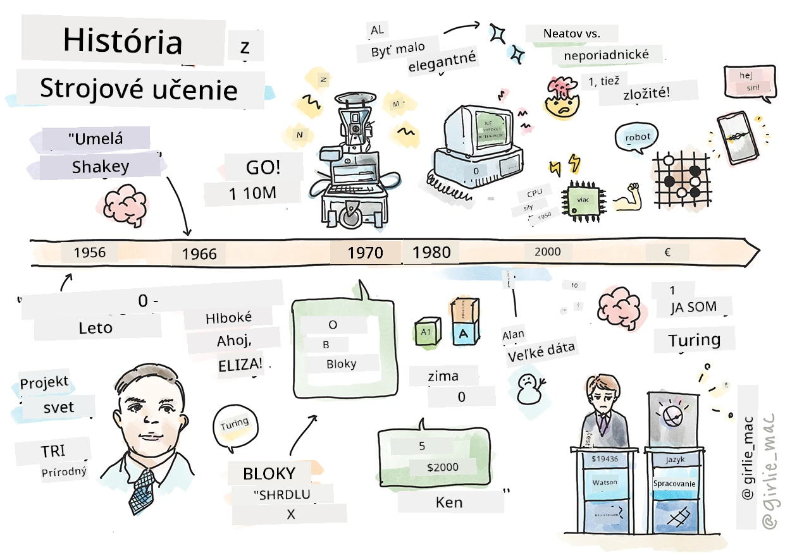
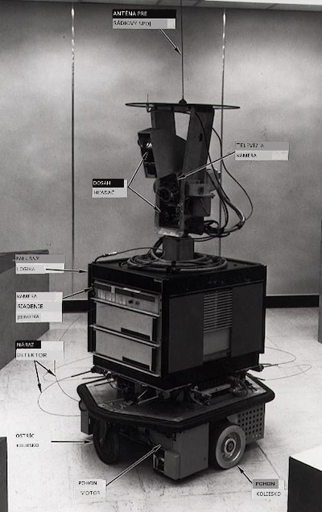
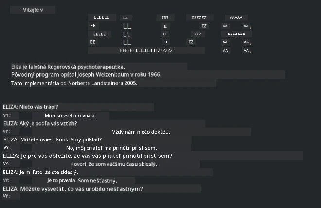

# História strojového učenia

> Sketchnote od [Tomomi Imura](https://www.twitter.com/girlie_mac)

## [Prednáškový kvíz](https://ff-quizzes.netlify.app/en/ml/)

---

> 🎥 Kliknite na obrázok vyššie pre krátke video, ktoré prejde touto lekciou.

V tejto lekcii si prejdeme hlavné míľniky v histórii strojového učenia a umelej inteligencie.

História umelej inteligencie (AI) ako odboru je prepojená s históriou strojového učenia, pretože algoritmy a výpočtové pokroky, ktoré sú základom ML, prispeli k rozvoju AI. Je užitočné si zapamätať, že hoci sa tieto oblasti ako samostatné oblasti skúmania začali formovať v 50. rokoch 20. storočia, dôležité [algoritmické, štatistické, matematické, výpočtové a technické objavy](https://wikipedia.org/wiki/Timeline_of_machine_learning) predchádzali a prekrývali toto obdobie. V skutočnosti ľudia premýšľajú o týchto otázkach už [stovky rokov](https://wikipedia.org/wiki/History_of_artificial_intelligence): tento článok diskutuje o historických intelektuálnych základoch myšlienky „mysliaceho stroja“.

---
## Významné objavy

- 1763, 1812 [Bayesova veta](https://wikipedia.org/wiki/Bayes%27_theorem) a jej predchodcovia. Táto veta a jej aplikácie stoja za inferenciou, opisuje pravdepodobnosť výskytu udalosti na základe predchádzajúcich znalostí.
- 1805 [Teória najmenších štvorcov](https://wikipedia.org/wiki/Least_squares) francúzskeho matematika Adriena-Marie Legendrea. Túto teóriu, o ktorej sa dozviete v našej sade o regresii, pomáha pri prispôsobovaní údajov.
- 1913 [Markovove reťazce](https://wikipedia.org/wiki/Markov_chain), pomenované podľa ruského matematika Andreja Markova, sa používajú na opis sekvencie možných udalostí na základe predchádzajúceho stavu.
- 1957 [Perceptrón](https://wikipedia.org/wiki/Perceptron) je typ lineárneho klasifikátora, ktorý vynašiel americký psychológ Frank Rosenblatt a stojí za pokrokom v hlbokom učení.

---

- 1967 [Najbližší sused](https://wikipedia.org/wiki/Nearest_neighbor) je algoritmus pôvodne navrhnutý na mapovanie ciest. V kontexte ML sa používa na detekciu vzorov.
- 1970 [Spätné šírenie chyby](https://wikipedia.org/wiki/Backpropagation) sa používa na trénovanie [dopredných neurónových sietí](https://wikipedia.org/wiki/Feedforward_neural_network).
- 1982 [Rekurentné neurónové siete](https://wikipedia.org/wiki/Recurrent_neural_network) sú umelé neurónové siete odvodené od dopredných neurónových sietí, ktoré vytvárajú časové grafy.

✅ Urobte si malý prieskum. Ktoré ďalšie dátumy v histórii ML a AI považujete za kľúčové?

---
## 1950: Stroje, ktoré myslia

Alan Turing, naozaj pozoruhodná osobnosť, ktorá bola [verejnosťou v roku 2019](https://wikipedia.org/wiki/Icons:_The_Greatest_Person_of_the_20th_Century) zvolená za najväčšieho vedca 20. storočia, je pripisovaný zásluhy za pomoc pri položení základov konceptu „stroja, ktorý môže myslieť.“ Bojoval s odporcami a vlastnou potrebou empirických dôkazov tohto konceptu čiastočne vytvorením [Turingovho testu](https://www.bbc.com/news/technology-18475646), ktorý preskúmate v našich lekciách o NLP.

---
## 1956: Letný výskumný projekt Dartmouth

„Letný výskumný projekt Dartmouth na umelú inteligenciu bol prielomovou udalosťou pre oblasť umelej inteligencie,“ a práve tu vznikol termín 'umelá inteligencia' ([zdroj](https://250.dartmouth.edu/highlights/artificial-intelligence-ai-coined-dartmouth)).

> Každý aspekt učenia alebo akákoľvek iná vlastnosť inteligencie môže byť v princípe tak presne opísaná, že stroj ju môže simulovať.

---

Vedúci výskumník, profesor matematiky John McCarthy, dúfal „postupovať na základe predpokladu, že každý aspekt učenia alebo akákoľvek iná vlastnosť inteligencie môže byť v princípe tak presne opísaná, že stroj ju bude schopný simulovať.“ Účastníkmi bol ďalší významný odborník v odbore, Marvin Minsky.

Workshop je pripisovaný za iniciovanie a podporu niekoľkých diskusií vrátane „vzostupu symbolických metód, systémov zameraných na obmedzené oblasti (raných expertných systémov) a deduktívnych systémov verzus induktívne systémy.“ ([zdroj](https://wikipedia.org/wiki/Dartmouth_workshop)).

---
## 1956 - 1974: „Zlaté roky“

Od 50. rokov do polovice 70. rokov panoval veľký optimizmus, že AI dokáže vyriešiť mnohé problémy. V roku 1967 Marvin Minsky smelo vyhlásil, že „Do jednej generácie ... bude problém vytvorenia 'umelej inteligencie' do veľkej miery vyriešený.“ (Minsky, Marvin (1967), Computation: Finite and Infinite Machines, Englewood Cliffs, N.J.: Prentice-Hall)

Výskum spracovania prirodzeného jazyka kvitol, vyhľadávanie bolo zdokonalené a zosilnené a vznikol koncept „mikrosvetov,“ kde sa jednoduché úlohy vykonávali pomocou jednoduchých jazykových pokynov.

---

Výskum bol dobre financovaný vládnymi agentúrami, urobili sa pokroky v počítačovej technike a algoritmoch a boli postavené prototypy inteligentných strojov. Medzi tieto stroje patrili:

* [Shakey, robot](https://wikipedia.org/wiki/Shakey_the_robot), ktorý sa dokázal pohybovať a rozhodovať, ako vykonať úlohy 'inteligentne'.

    
    > Shakey v roku 1972

---

* Eliza, jeden z prvých „chatterbotov“, dokázala viesť rozhovor s ľuďmi a vystupovať ako prímityvny „terapeut“. O Elize sa naučíte viac v lekciách NLP.

    
    > Verzia Elizy, chatbot

---

* „Svet blokov“ bol príkladom mikrosveta, kde sa bloky mohli ukladať na seba a triediť a kde sa dali testovať experimenty so strojmi, ktoré sa učia robiť rozhodnutia. Pokroky vytvorené pomocou knižníc ako [SHRDLU](https://wikipedia.org/wiki/SHRDLU) pomohli posunúť spracovanie jazyka vpred.

    

    > 🎥 Kliknite na obrázok vyššie pre video: Svet blokov so SHRDLU

---
## 1974 - 1980: „Zima AI“

Do polovice 70. rokov sa ukázalo, že zložitosť vytvárania „inteligentných strojov“ bola podceňovaná a sľuby, berúc do úvahy dostupný výpočtový výkon, boli nadmerne nadhodnotené. Financovanie vyschlo a dôvera v odbor oslabila. Niektoré problémy, ktoré ovplyvnili dôveru, zahŕňali:
---
- **Obmedzenia**. Výpočtový výkon bol príliš obmedzený.
- **Kombinatorický výbuch**. Množstvo parametrov, ktoré bolo potrebné trénovať, rástlo exponenciálne, ako sa na počítače kládli vyššie požiadavky, bez paralelného vývoja výpočtovej kapacity a schopností.
- **Nedostatok dát**. Nedostatok dát bránil procesu testovania, vývoja a zdokonaľovania algoritmov.
- **Pýtame sa správne otázky?**. Začali sa spochybňovať samotné otázky, ktoré sa kládli. Výskumníci čelili kritike svojich prístupov:
  - Turingove testy boli spochybnené napríklad teóriou „čínskej miestnosti“, ktorá tvrdila, že „programovanie digitálneho počítača môže pôsobiť, že rozumie jazyku, ale nemôže vytvoriť skutočné porozumenie.“ ([zdroj](https://plato.stanford.edu/entries/chinese-room/))
  - Výzva na etiku zavádzania umelej inteligencie ako „terapeuta“ ELIZA do spoločnosti.

---

Súčasne sa začali formovať rôzne školy myslenia AI. Vznikla dichotómia medzi ["špinavou" a "upratanou AI"](https://wikipedia.org/wiki/Neats_and_scruffies) praxou. _Špinavé_ laboratória upravovali programy hodiny až dosiahli požadované výsledky. _Upratané_ laboratóriá „sa zameriavali na logiku a formálne riešenie problémov.“ ELIZA a SHRDLU boli známe _špinavé_ systémy. V 80. rokoch, keď sa objavila potreba spraviť ML systémy reprodukovateľné, sa postupne dostal do popredia _uprataný_ prístup, pretože jeho výsledky sú viac vysvetliteľné.

---
## 80. roky: Expertné systémy

S rastom odboru bolo čoraz jasnejšie jeho využitie v podnikaní a v 80. rokoch sa rozšírili „expertné systémy“. „Expertné systémy boli medzi prvými skutočne úspešnými formami softvéru umelej inteligencie (AI).“ ([zdroj](https://wikipedia.org/wiki/Expert_system)).

Tento typ systému je vlastne _hybridný_, čiastočne pozostávajúci z pravidlového motora definujúceho obchodné požiadavky a záverného motora, ktorý využíval pravidlový systém na odvodenie nových faktov.

Táto éra tiež priniesla zvýšenú pozornosť venovanú neurónovým sieťam.

---
## 1987 - 1993: „Chladenie“ AI

Rozmach špecializovaného hardvéru pre expertné systémy mal nešťastný efekt prílišnej špecializácie. Vzostup osobných počítačov tiež konkuroval týmto veľkým, špecializovaným, centralizovaným systémom. Demokratizácia výpočtovej techniky sa začala a nakoniec pripravila cestu pre moderný výbuch veľkých dát.

---
## 1993 - 2011

Táto epocha priniesla novú éru pre ML a AI, ktoré dokázali vyriešiť niektoré problémy, ktoré predtým vznikli kvôli nedostatku dát a výpočtového výkonu. Množstvo dát začalo rýchlo rásť a stalo sa dostupnejším, na dobré aj zlé, najmä s príchodom smartfónov okolo roku 2007. Výpočtový výkon rástol exponenciálne a algoritmy sa vyvíjali paralelne. Odbor začal zrieť, keď sa dni voľného experimentovania z minulosti začali premieňať na skutočnú disciplínu.

---
## Teraz

Dnes sa strojové učenie a umelá inteligencia dotýkajú takmer každej časti nášho života. Táto éra si vyžaduje dôkladné porozumenie rizík a potenciálnych dopadov týchto algoritmov na ľudské životy. Ako uviedol Brad Smith z Microsoftu, „Informačné technológie prinášajú otázky, ktoré zasahujú do základných ochrán ľudských práv, ako sú súkromie a sloboda prejavu. Tieto otázky zvyšujú zodpovednosť technologických spoločností, ktoré vytvárajú tieto produkty. Z nášho pohľadu tiež vyžadujú uváženú vládnu reguláciu a rozvoj noriem o prijateľných využitiach“ ([zdroj](https://www.technologyreview.com/2019/12/18/102365/the-future-of-ais-impact-on-society/)).

---

Zostáva otázkou, čo prinesie budúcnosť, ale je dôležité rozumieť týmto počítačovým systémom a softvéru a algoritmom, ktoré v nich bežia. Dúfame, že tento učebný plán vám pomôže lepšie porozumieť, aby ste si mohli vytvoriť vlastný názor.

> 🎥 Kliknite na obrázok vyššie pre video: Yann LeCun diskutuje históriu hlbokého učenia v tejto prednáške

---
## 🚀Výzva

Ponorte sa do jedného z týchto historických momentov a zistite viac o ľuďoch za nimi. Sú to fascinujúce osobnosti a žiadny vedecký objav nebol vytvorený v kultúrnej vákuu. Čo zistíte?

## [Kvíz po prednáške](https://ff-quizzes.netlify.app/en/ml/)

---
## Prehľad a samostatné štúdium

Tu sú položky na sledovanie a počúvanie:

[Tento podcast, kde Amy Boyd diskutuje o evolúcii AI](http://runasradio.com/Shows/Show/739)

---

## Zadanie

[Vytvorte časovú os](assignment.md)

---

<!-- CO-OP TRANSLATOR DISCLAIMER START -->
**Vyhlásenie o zodpovednosti**:
Tento dokument bol preložený pomocou AI prekladateľskej služby [Co-op Translator](https://github.com/Azure/co-op-translator). Hoci sa snažíme o presnosť, vezmite prosím na vedomie, že automatické preklady môžu obsahovať chyby alebo nepresnosti. Pôvodný dokument v jeho natívnom jazyku by mal byť považovaný za autoritatívny zdroj. Pre kritické informácie sa odporúča profesionálny ľudský preklad. Nie sme zodpovední za žiadne nedorozumenia alebo nesprávne interpretácie vyplývajúce z použitia tohto prekladu.
<!-- CO-OP TRANSLATOR DISCLAIMER END -->