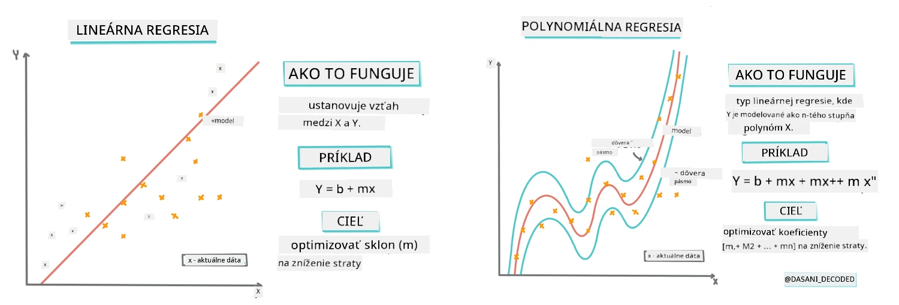
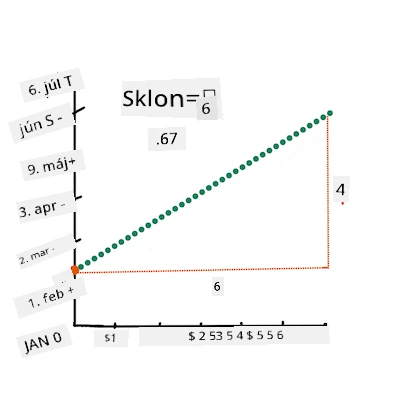
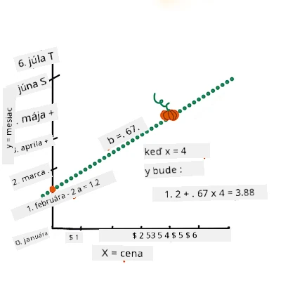
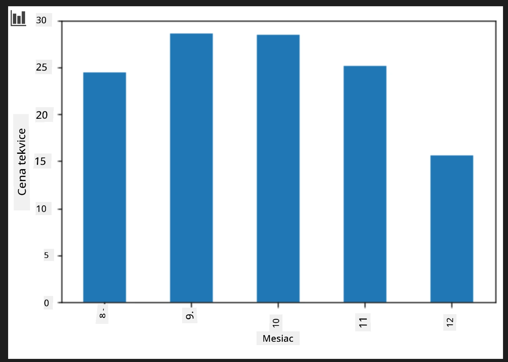
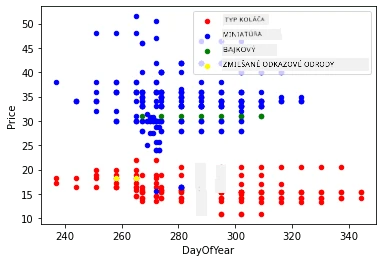

# Vytvorte regresný model pomocou Scikit-learn: štyri spôsoby regresie

## Poznámka pre začiatočníkov

Lineárna regresia sa používa, keď chceme predpovedať **číselnú hodnotu** (napríklad cenu domu, teplotu alebo predaj).
Funguje tým, že nájde priamku, ktorá najlepšie reprezentuje vzťah medzi vstupnými vlastnosťami a výstupom.

V tejto lekcii sa zameriavame na pochopenie konceptu pred tým, ako preskúmame pokročilejšie techniky regresie.

> Infografika od [Dasani Madipalli](https://twitter.com/dasani_decoded)
## [Prednáškový kvíz](https://ff-quizzes.netlify.app/en/ml/)

> ### [Táto lekcia je dostupná aj v R!](../../../../2-Regression/3-Linear/solution/R/lesson_3.html)
### Úvod

Doteraz ste preskúmali, čo je regresia na vzorke dát zo súboru údajov o cenách tekvíc, ktorý budeme používať počas tejto lekcie. Tiež ste ich vizualizovali pomocou Matplotlib.

Teraz ste pripravení ponoriť sa hlbšie do regresie pre strojové učenie. Kým vizualizácia vám umožní pochopiť dáta, skutočná sila strojového učenia spočíva v _trénovaní modelov_. Modely sa trénujú na historických údajoch, aby automaticky zachytili závislosti v dátach, a umožňujú vám predpovedať výsledky pre nové dáta, ktoré model ešte nevidel.

V tejto lekcii sa dozviete viac o dvoch typoch regresie: _základná lineárna regresia_ a _polynomiálna regresia_, spolu s niektorou matematikou, ktorá stojí za týmito technikami. Tieto modely nám umožnia predpovedať ceny tekvíc v závislosti od rôznych vstupných dát.

[](https://youtu.be/CRxFT8oTDMg "ML pre začiatočníkov - Pochopenie lineárnej regresie")

> 🎥 Kliknite na obrázok vyššie pre krátky video prehľad lineárnej regresie.

> Počas celého tohto kurzu predpokladáme minimálne matematické znalosti a snažíme sa ich sprístupniť študentom z iných oblastí, preto sledujte poznámky, 🧮 upozornenia, diagramy a ďalšie učebné pomôcky, ktoré pomôžu s porozumením.

### Predpoklady

Teraz by ste už mali byť oboznámení so štruktúrou údajov o tekviciach, ktoré skúmame. Môžete ich nájsť prednačítané a predspracované v súbore _notebook.ipynb_ tejto lekcie. V súbore je cena tekvice zobrazená za každý korc (bushel) v novom dátovom rámci. Uistite sa, že tieto notebooky môžete spustiť v prostredí Visual Studio Code.

### Príprava

Ako pripomienku, načítavate tieto dáta, aby ste mohli klásť otázky.

- Kedy je najlepší čas na kúpu tekvíc?
- Akú cenu môžem očakávať za balík mini tekvíc?
- Mali by som ich kupovať v polkorcových košíkoch alebo v krabici s objemom 1 1/9 korca?
Poďme sa ďalej venovať týmto dátam.

V predchádzajúcej lekcii ste vytvorili Pandas dátový rámec a naplnili ho časťou pôvodného datasetu, pričom ste štandardizovali ceny podľa korca. Týmto spôsobom ste však získali len asi 400 dátových bodov a iba za jesenné mesiace.

Pozrite sa na údaje, ktoré sme prednačítali v sprevádzajúcom notebooku tejto lekcie. Dáta sú prednačítané a je vytvorený úvodný bodový graf, ktorý zobrazuje údaje podľa mesiacov. Možno dokážeme získať viac detailov o povahe dát ich dôkladnejším vyčistením.

## Priama regresná čiara

Ako ste sa naučili v lekcii 1, cieľom lineárnej regresie je nakresliť priamku, ktorá:

- **Zobrazuje vzťahy medzi premennými**. Ukazuje vzťah medzi premennými
- **Predpovedá**. Presne predpovedá, kde by sa nový dátový bod mohol nachádzať vzhľadom na túto priamku.

Bežne sa na toto používa **Least-Squares Regression (regresia metódou najmenších štvorcov)**. Výraz "Least-Squares" sa vzťahuje na proces minimalizácie celkovej chyby v našom modeli. Pre každý dátový bod meriame vertikálnu vzdialenosť (nazývanú reziduál) medzi skutočným bodom a našou regresnou priamkou.

Tieto vzdialenosti umocníme na druhú moc z dvoch hlavných dôvodov:

1. **Veľkosť nad smerom:** Chceme, aby chyba -5 bola rovnako vážená ako chyba +5. Umocnením na druhú dostaneme všetky hodnoty kladné.

2. **Penalizácia odľahlých hodnôt:** Umocnenie na druhú dáva väčšiu váhu väčším chybám a núti čiaru byť bližšie k bodom, ktoré sú ďaleko.

Tieto umocnené hodnoty potom sčítame. Naším cieľom je nájsť konkrétnu priamku, pre ktorú je tento súčet najmenej možný — odtiaľ názov „Least-Squares“ (najmenších štvorcov).

> **🧮 Ukážte matematiku** 
> 
> Táto čiara, nazývaná _čiara najlepšieho prispôsobenia_ môže byť vyjadrená [rovnicou](https://en.wikipedia.org/wiki/Simple_linear_regression): 
> 
> ```
> Y = a + bX
> ```
>
> `X` je 'vysvetľujúca premenná'. `Y` je 'závislá premenná'. Sklon čiary je `b` a `a` je priesečník s osou y, ktorý udáva hodnotu `Y`, keď `X = 0`.
>
>
>
> Najskôr vypočítajte sklon `b`. Infografika od [Jen Looper](https://twitter.com/jenlooper)
>
> Inými slovami, a vzhľadom na pôvodnú otázku našich údajov o tekviciach: „predpovedať cenu tekvice za bushel podľa mesiaca“, `X` by označoval cenu a `Y` by označoval mesiac predaja.
>
>
>
> Vypočítajte hodnotu y. Ak platíte okolo 4 dolárov, musí to byť apríl! Infografika od [Jen Looper](https://twitter.com/jenlooper)
>
> Matematika, ktorá vypočítava čiaru, musí demonštrovať sklon priamky, ktorý tiež závisí od priesečníka, teda kde je `Y` umiestnené, keď `X = 0`.
>
> Metódu výpočtu týchto hodnôt môžete pozorovať na stránke [Math is Fun](https://www.mathsisfun.com/data/least-squares-regression.html). Navštívte tiež [tento kalkulátor najmenších štvorcov](https://www.mathsisfun.com/data/least-squares-calculator.html) a pozrite, ako hodnoty čísel ovplyvňujú čiaru.

## Korelácia

Ešte jeden termín, ktorý treba pochopiť, je **Korelačný koeficient** medzi danými premennými X a Y. Pomocou bodového grafu môžete rýchlo vizualizovať tento koeficient. Graf, v ktorom sú body usporiadané v peknej priamke, má vysokú koreláciu, zatiaľ čo bodový graf s bodmi roztrúsenými všade medzi X a Y má nízku koreláciu.

Dobrý lineárny regresný model bude ten, ktorého Korelačný koeficient je vysoký (bližšie k 1 než k 0) pri použití metódy Least-Squares Regression s regresnou priamkou.

✅ Spustite notebook sprevádzajúci túto lekciu a pozrite sa na bodový graf Mesiac verzus Cena. Zdá sa vám, že údaje o vzťahu Mesiac k Cene predaja tekvíc majú vysokú alebo nízku koreláciu podľa vašej vizuálnej interpretácie bodového grafu? Zmení sa to, ak použijete detailnejšie meranie namiesto `Mesiac`, napr. *deň v roku* (napríklad počet dní od začiatku roka)?

V nasledujúcom kóde predpokladáme, že sme dáta vyčistili a získali dátový rámec nazvaný `new_pumpkins`, podobný nasledujúcemu:

ID | Mesiac | DeňVRoku | Odroda | Mesto | Balenie | Nízka cena | Vysoká cena | Cena
---|-------|-----------|---------|------|---------|-----------|------------|-------
70 | 9 | 267 | TYP NA KOLÁČ | BALTIMORE | kartóny 1 1/9 korca | 15.0 | 15.0 | 13.636364
71 | 9 | 267 | TYP NA KOLÁČ | BALTIMORE | kartóny 1 1/9 korca | 18.0 | 18.0 | 16.363636
72 | 10 | 274 | TYP NA KOLÁČ | BALTIMORE | kartóny 1 1/9 korca | 18.0 | 18.0 | 16.363636
73 | 10 | 274 | TYP NA KOLÁČ | BALTIMORE | kartóny 1 1/9 korca | 17.0 | 17.0 | 15.454545
74 | 10 | 281 | TYP NA KOLÁČ | BALTIMORE | kartóny 1 1/9 korca | 15.0 | 15.0 | 13.636364

> Kód na vyčistenie dát je dostupný v [`notebook.ipynb`](notebook.ipynb). Použili sme rovnaké čistiace kroky ako v predchádzajúcej lekcii a vypočítali sme stĺpec `DayOfYear` pomocou nasledujúceho výrazu:

```python
day_of_year = pd.to_datetime(pumpkins['Date']).apply(lambda dt: (dt-datetime(dt.year,1,1)).days)
```

Teraz keď máte pochopenie matematiky za lineárnou regresiou, vytvorme regresný model, aby sme zistili, či môžeme predpovedať, ktoré balenie tekvíc bude mať najlepšie ceny tekvíc. Niekto, kto kupuje tekvice na jesennú tekvicovú výzdobu, by mohol túto informáciu využiť na optimalizáciu svojich nákupov balení tekvíc.

## Hľadanie korelácie

[](https://youtu.be/uoRq-lW2eQo "ML pre začiatočníkov - Hľadanie korelácie: Kľúč k lineárnej regresii")

> 🎥 Kliknite na obrázok vyššie pre krátky video prehľad korelácie.

Z predchádzajúcej lekcie ste pravdepodobne videli, že priemerná cena za rôzne mesiace vyzerá takto:



To naznačuje, že by tu mala byť nejaká korelácia, a môžeme skúsiť vytrénovať lineárny regresný model, ktorý predpovie vzťah medzi `Mesiac` a `Cena` alebo medzi `DeňVRoku` a `Cena`. Tu je bodový graf, ktorý zobrazuje druhý vzťah:

 

Pozrime sa, či tu existuje korelácia pomocou funkcie `corr`:

```python
print(new_pumpkins['Month'].corr(new_pumpkins['Price']))
print(new_pumpkins['DayOfYear'].corr(new_pumpkins['Price']))
```

Zdá sa, že korelácia je pomerne malá, -0,15 podľa `Mesiac` a -0,17 podľa `DeňVRoku`, ale mohla by tu byť ďalšia dôležitá závislosť. Zdá sa, že existujú rôzne skupiny cien zodpovedajúce rôznym odrodám tekvíc. Aby sme túto hypotézu potvrdili, nakreslime každú kategóriu tekvíc použitím inej farby. Pri odovzdaní parametra `ax` do funkcie `scatter` môžeme všetky body vykresliť do rovnakého grafu:

```python
ax=None
colors = ['red','blue','green','yellow']
for i,var in enumerate(new_pumpkins['Variety'].unique()):
    df = new_pumpkins[new_pumpkins['Variety']==var]
    ax = df.plot.scatter('DayOfYear','Price',ax=ax,c=colors[i],label=var)
```

 

Náš výskum naznačuje, že druh tekvice má väčší vplyv na celkovú cenu než samotné dátum predaja. Vidíme to aj na stĺpcovom grafe:

```python
new_pumpkins.groupby('Variety')['Price'].mean().plot(kind='bar')
```

 

Zamerajme sa na moment len na jednu odrodu tekvice, 'pie type', a pozrime sa na vplyv dátumu na cenu:

```python
pie_pumpkins = new_pumpkins[new_pumpkins['Variety']=='PIE TYPE']
pie_pumpkins.plot.scatter('DayOfYear','Price') 
```
 

Ak teraz vypočítame koreláciu medzi `Cena` a `DeňVRoku` pomocou funkcie `corr`, dostaneme hodnotu približne `-0,27` — čo znamená, že trénovať predikčný model dáva zmysel.

> Pred trénovaním lineárneho regresného modelu je dôležité sa uistiť, že naše dáta sú čisté. Lineárna regresia nefunguje dobre s chýbajúcimi hodnotami, preto je dobré odstrániť všetky prázdne bunky:

```python
pie_pumpkins.dropna(inplace=True)
pie_pumpkins.info()
```

Iným prístupom by bolo vyplniť tieto prázdne hodnoty priemernými hodnotami z príslušného stĺpca.

## Jednoduchá lineárna regresia

[](https://youtu.be/e4c_UP2fSjg "ML pre začiatočníkov - Lineárna a polynomiálna regresia pomocou Scikit-learn")

> 🎥 Kliknite na obrázok vyššie pre krátky video prehľad lineárnej a polynomiálnej regresie.

Na natrénovanie nášho lineárneho regresného modelu použijeme knižnicu **Scikit-learn**.

```python
from sklearn.linear_model import LinearRegression
from sklearn.metrics import mean_squared_error
from sklearn.model_selection import train_test_split
```

Začneme oddelením vstupných hodnôt (vlastností) a očakávaného výstupu (označenia) do samostatných numpy polí:

```python
X = pie_pumpkins['DayOfYear'].to_numpy().reshape(-1,1)
y = pie_pumpkins['Price']
```

> Upozorňujeme, že sme museli upraviť tvar vstupných údajov pomocou `reshape`, aby ich balík Linear Regression správne pochopil. Lineárna regresia očakáva vstup vo forme 2D poľa, kde každý riadok predstavuje vektor vstupných vlastností. V našom prípade, keďže máme len jeden vstup, potrebujeme pole tvaru N&times;1, kde N je veľkosť datasetu.

Ďalej musíme rozdeliť dáta na trénovaciu a testovaciu množinu, aby sme po tréningu mohli overiť náš model:

```python
X_train, X_test, y_train, y_test = train_test_split(X, y, test_size=0.2, random_state=0)
```

Nakoniec samotné trénovanie lineárneho regresného modelu zaberie len dva riadky kódu. Definujeme objekt `LinearRegression` a prispôsobíme ho našim dátam pomocou metódy `fit`:

```python
lin_reg = LinearRegression()
lin_reg.fit(X_train,y_train)
```

Objekt `LinearRegression` po natrénovaní obsahuje všetky koeficienty regresie, ku ktorým môžeme pristupovať pomocou vlastnosti `.coef_`. V našom prípade je len jeden koeficient, ktorý by mal byť približne `-0.017`. To znamená, že ceny sa zdajú postupne trochu znižovať s časom, ale nie príliš, asi o 2 centy za deň. Môžeme tiež získať priesečník regresie s osou Y pomocou `lin_reg.intercept_` – v našom prípade to bude približne `21`, čo naznačuje cenu na začiatku roka.

Aby sme videli, aká je naša modelová presnosť, môžeme predpovedať ceny na testovacej množine a potom zmerať, ako sú naše predpovede blízke očakávaným hodnotám. To môžeme urobiť pomocou metriky strednej kvadratickej chyby (RMSE), ktorá je odmocninou strednej hodnoty všetkých štvorcov rozdielov medzi očakávanou a predpovedanou hodnotou.

```python
pred = lin_reg.predict(X_test)

rmse = np.sqrt(mean_squared_error(y_test,pred))
print(f'RMSE: {rmse:3.3} ({rmse/np.mean(pred)*100:3.3}%)')
```
  
Naša chyba sa zdá byť okolo 2 bodov, čo je približne 17%. Nie veľmi dobré. Ďalším ukazovateľom kvality modelu je **koeficient determinácie**, ktorý môžeme získať takto:

```python
score = lin_reg.score(X_train,y_train)
print('Model determination: ', score)
```
  
Ak je hodnota 0, znamená to, že model nezohľadňuje vstupné údaje a správa sa ako *najhorší lineárny prediktor*, ktorým je jednoducho priemerná hodnota výsledku. Hodnota 1 znamená, že môžeme perfektne predpovedať všetky očakávané výstupy. V našom prípade je koeficient okolo 0,06, čo je pomerne nízke.

Môžeme tiež vykresliť testovacie dáta spolu s regresnou čiarou, aby sme lepšie videli, ako regresia funguje v našom prípade:

```python
plt.scatter(X_test,y_test)
plt.plot(X_test,pred)
```
  


## Polynomická regresia

Ďalším typom lineárnej regresie je polynomická regresia. Zatiaľ čo niekedy existuje lineárny vzťah medzi premennými — čím väčšia tekvica objemom, tým vyššia cena — niekedy tieto vzťahy nemožno zobraziť rovinnou alebo priamkou.

✅ Tu je [niekoľko ďalších príkladov](https://online.stat.psu.edu/stat501/Lesson09#polynomial-regression-examples) údajov, ktoré by mohli využiť polynomickú regresiu.

Pozrite sa znova na vzťah medzi Dátumom a Cenou. Zdá sa, že tento rozptylový graf by určite mal byť analyzovaný priamkou? Nemôžu ceny kolísať? V takom prípade môžete skúsiť polynomickú regresiu.

✅ Polynómy sú matematické výrazy, ktoré môžu obsahovať jednu alebo viac premenných a koeficientov.

Polynomická regresia vytvára zakrivenú čiaru, aby lepšie vystihla nelineárne údaje. V našom prípade, ak do vstupných údajov zahrnieme aj druhú mocninu `DayOfYear`, mali by sme byť schopní prispôsobiť naše dáta parabolickej krivke, ktorá bude mať minimum v určitom bode v rámci roka.

Scikit-learn obsahuje užitočné [API pipeline](https://scikit-learn.org/stable/modules/generated/sklearn.pipeline.make_pipeline.html?highlight=pipeline#sklearn.pipeline.make_pipeline), ktoré umožňuje kombinovať rôzne kroky spracovania dát. **Pipeline** je reťazec **estimatorov**. V našom prípade vytvoríme pipeline, ktorá najskôr pridá polynomické príznaky do modelu a potom natrénuje regresiu:

```python
from sklearn.preprocessing import PolynomialFeatures
from sklearn.pipeline import make_pipeline

pipeline = make_pipeline(PolynomialFeatures(2), LinearRegression())

pipeline.fit(X_train,y_train)
```
  
Použitie `PolynomialFeatures(2)` znamená, že zahrnieme všetky polynómy druhého stupňa zo vstupných dát. V našom prípade to bude len `DayOfYear`<sup>2</sup>, ale ak by sme mali dve vstupné premenné X a Y, pridalo by to X<sup>2</sup>, XY a Y<sup>2</sup>. Môžeme použiť aj vyššie stupne polynómov, ak chceme.

Pipeliny môžeme použiť rovnako ako pôvodný objekt `LinearRegression`, t. j. môžeme `fit`-nuť pipeline a potom použiť `predict` na získanie predpovedí:

```python
pred = pipeline.predict(X_test)

rmse = np.sqrt(mean_squared_error(y_test,pred))
print(f'RMSE: {rmse:3.3} ({rmse/np.mean(pred)*100:3.3}%)')

score = pipeline.score(X_train,y_train)
print('Model determination: ', score)
```
  
Na vykreslenie hladkej aproximačnej krivky použijeme `np.linspace` na vytvorenie rovnomerného rozsahu vstupných hodnôt, namiesto priameho vykreslenia na neusporiadanej testovacej množine (čo by viedlo k zygzakovej čiare):

```python
X_range = np.linspace(X_test.min(), X_test.max(), 100).reshape(-1,1)
y_range = pipeline.predict(X_range)

plt.scatter(X_test, y_test)
plt.plot(X_range, y_range)
```
  
Tu je graf zobrazujúci testovacie dáta a aproximačnú krivku:


Použitím polynomickej regresie môžeme získať o niečo nižší RMSE a vyšší koeficient determinácie, ale nie významne. Musíme zohľadniť aj ďalšie vlastnosti!

> Vidíte, že minimálne ceny tekvíc sú pozorované niekde okolo Halloweenu. Ako by ste to vysvetlili?

🎃 Gratulujeme, práve ste vytvorili model, ktorý môže pomôcť predpovedať cenu tekvíc na koláč. Pravdepodobne tú istú procedúru môžete zopakovať pre všetky druhy tekvíc, ale to by bolo zdĺhavé. Teraz sa naučíme, ako do modelu zahrnúť odrodu tekvíc!

## Kategorické vlastnosti

V ideálnom svete chceme vedieť predpovedať ceny pre rôzne odrody tekvíc pomocou rovnakého modelu. Avšak stĺpec `Variety` sa trochu líši od stĺpcov ako `Month`, pretože obsahuje nečíselné hodnoty. Takéto stĺpce sa nazývajú **kategorické**.

[](https://youtu.be/DYGliioIAE0 "ML for beginners - Categorical Feature Predictions with Linear Regression")

> 🎥 Kliknite na obrázok vyššie pre krátke video o používaní kategórií vo vlastnostiach.

Tu vidíte, ako priemerná cena závisí od odrody:


Aby sme zohľadnili odrodu, najskôr ju musíme previesť na numerickú formu, teda **zakódovať** ju. Existuje niekoľko spôsobov, ako to môžeme urobiť:

* Jednoduché **číselné kódovanie** vytvorí tabuľku rôznych odrôd a potom nahradí názov odrody indexom v tejto tabuľke. To nie je najlepšie riešenie pre lineárnu regresiu, pretože lineárna regresia zoberie skutočnú číselnú hodnotu indexu a pridá ju k výsledku vynásobenú nejakým koeficientom. V našom prípade je vzťah medzi číslom indexu a cenou jasne nelineárny, aj keď zabezpečíme, že indexy budú usporiadané nejako špecificky.
* **One-hot encoding** nahradí stĺpec `Variety` štyrmi rôznymi stĺpcami, každý pre jednu odrodu. Každý stĺpec bude obsahovať `1`, ak je daný riadok danej odrody, a `0` v opačnom prípade. To znamená, že lineárna regresia bude mať štyri koeficienty, jeden pre každú odrodu tekvíc, ktoré určujú "východiskovú cenu" (alebo skôr "prídavok k cene") pre túto konkrétnu odrodu.

Nižšie je kód, ktorý ukazuje použitie one-hot encoding pre odrodu:

```python
pd.get_dummies(new_pumpkins['Variety'])
```
  
 ID | FAIRYTALE | MINIATURE | MIXED HEIRLOOM VARIETIES | PIE TYPE  
----|-----------|-----------|--------------------------|----------  
70 | 0 | 0 | 0 | 1  
71 | 0 | 0 | 0 | 1  
... | ... | ... | ... | ...  
1738 | 0 | 1 | 0 | 0  
1739 | 0 | 1 | 0 | 0  
1740 | 0 | 1 | 0 | 0  
1741 | 0 | 1 | 0 | 0  
1742 | 0 | 1 | 0 | 0  

Aby sme natrénovali lineárnu regresiu s one-hot encoded odrodou ako vstupom, stačí správne inicializovať dáta `X` a `y`:

```python
X = pd.get_dummies(new_pumpkins['Variety'])
y = new_pumpkins['Price']
```
  
Zvyšok kódu je rovnaký ako ten, ktorý sme použili vyššie na trénovanie lineárnej regresie. Ak to vyskúšate, uvidíte, že stredná kvadratická chyba je približne rovnaká, no koeficient determinácie je oveľa vyšší (~77 %). Pre ešte presnejšie predpovede môžeme zohľadniť aj ďalšie kategórie, ako aj numerické vlastnosti ako `Month` alebo `DayOfYear`. Na získanie jednej veľkej matice príznakov môžeme použiť `join`:

```python
X = pd.get_dummies(new_pumpkins['Variety']) \
        .join(new_pumpkins['Month']) \
        .join(pd.get_dummies(new_pumpkins['City'])) \
        .join(pd.get_dummies(new_pumpkins['Package']))
y = new_pumpkins['Price']
```
  
Tu tiež berieme do úvahy `City` a typ `Package`, čo nám dáva RMSE 2.84 (10.5 %) a koeficient determinácie 0.94!

## Kompletný model

Na vytvorenie najlepšieho modelu môžeme použiť kombinované (one-hot encoded kategórie + numerické) dáta z vyššie uvedeného príkladu spolu s polynomickou regresiou. Tu je kompletný kód pre vaše pohodlie:

```python
# nastaviť trénovacie údaje
X = pd.get_dummies(new_pumpkins['Variety']) \
        .join(new_pumpkins['Month']) \
        .join(pd.get_dummies(new_pumpkins['City'])) \
        .join(pd.get_dummies(new_pumpkins['Package']))
y = new_pumpkins['Price']

# vykonať rozdelenie na trénovaciu a testovaciu množinu
X_train, X_test, y_train, y_test = train_test_split(X, y, test_size=0.2, random_state=0)

# nastaviť a trénovať pipeline
pipeline = make_pipeline(PolynomialFeatures(2), LinearRegression())
pipeline.fit(X_train,y_train)

# predpovedať výsledky pre testovacie dáta
pred = pipeline.predict(X_test)

# vypočítať RMSE a koeficient determinácie
rmse = mean_squared_error(y_test, pred, squared=False)
print(f'RMSE: {rmse:3.3} ({rmse/pred.mean()*100:3.3}%)')

score = pipeline.score(X_train,y_train)
print('Model determination: ', score)
```
  
To by nám malo dať najlepší koeficient determinácie takmer 97 % a RMSE=2.23 (~8 % chyba predpovede).

| Model | RMSE | Koeficient determinácie |  
|-------|-----|-------------------------|  
| `DayOfYear` Lineárny | 2.77 (17.2%) | 0.07 |  
| `DayOfYear` Polynomický | 2.73 (17.0%) | 0.08 |  
| `Variety` Lineárny | 5.24 (19.7%) | 0.77 |  
| Všetky vlastnosti Lineárny | 2.84 (10.5%) | 0.94 |  
| Všetky vlastnosti Polynomický | 2.23 (8.25%) | 0.97 |  

🏆 Výborne! Vytvorili ste štyri regresné modely v jednej lekcii a vylepšili kvalitu modelu na 97 %. V záverečnej časti o regresii sa naučíte o logistickej regresii na určenie kategórií.

---
## 🚀Výzva

Otestujte niekoľko rôznych premenných v tomto notebooku, aby ste videli, ako korelácia súvisí s presnosťou modelu.

## [Kvíz po prednáške](https://ff-quizzes.netlify.app/en/ml/)

## Prehľad a samostatné štúdium

V tejto lekcii sme sa naučili o lineárnej regresii. Existujú však aj iné dôležité typy regresie. Prečítajte si o technikách Stepwise, Ridge, Lasso a Elasticnet. Dobrou študijnou pomôckou je [Stanfordský kurz štatistického učenia](https://online.stanford.edu/courses/sohs-ystatslearning-statistical-learning)

## Zadanie

[Vytvorte model](assignment.md)

---

<!-- CO-OP TRANSLATOR DISCLAIMER START -->
**Vyhlásenie o zodpovednosti**:  
Tento dokument bol preložený pomocou automatizovanej prekladateľskej služby AI [Co-op Translator](https://github.com/Azure/co-op-translator). Aj keď usilujeme o presnosť, buďte prosím informovaní, že automatizované preklady môžu obsahovať chyby alebo nepresnosti. Originálny dokument v jeho pôvodnom jazyku by mal byť považovaný za autoritatívny zdroj. Pre kritické informácie sa odporúča profesionálny ľudský preklad. Nepreberáme zodpovednosť za akékoľvek nedorozumenia alebo nesprávne interpretácie vyplývajúce z použitia tohto prekladu.
<!-- CO-OP TRANSLATOR DISCLAIMER END -->