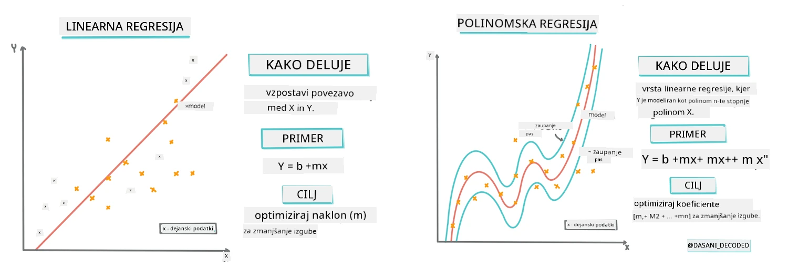
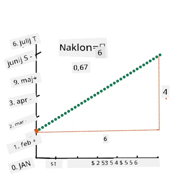
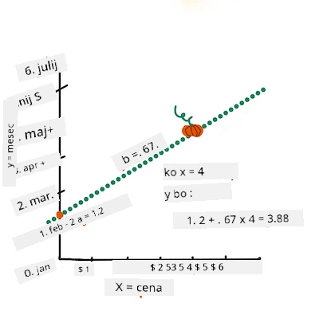
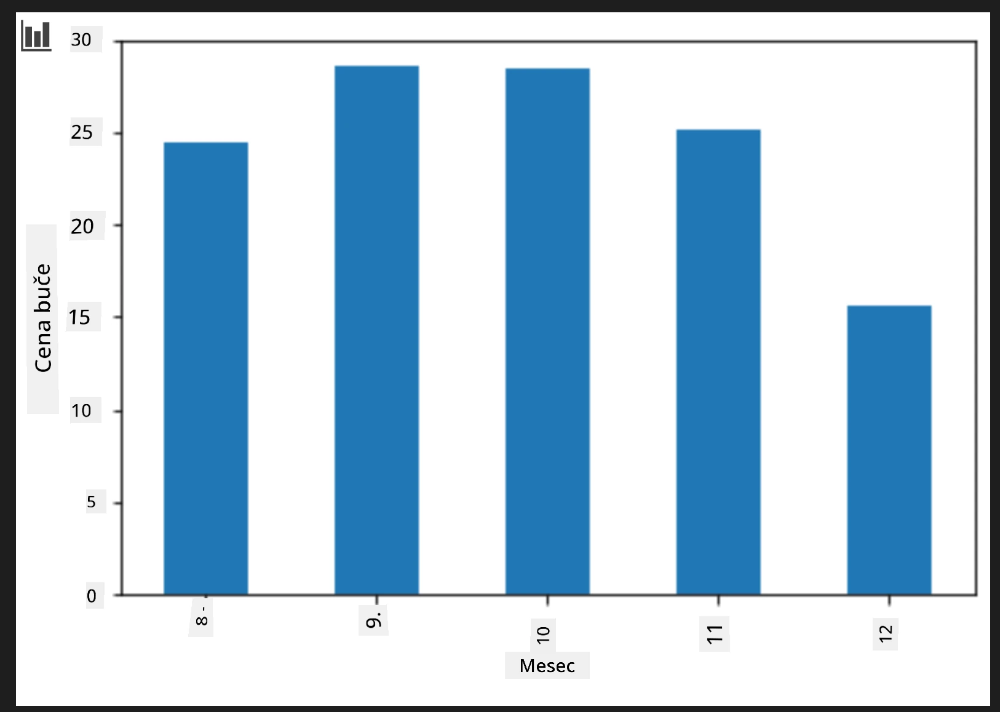
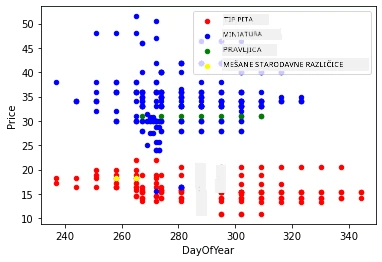

# Izgradnja regresijskega modela s Scikit-learn: štiri načini regresije

## Opomba za začetnike

Linearna regresija se uporablja, ko želimo napovedati **številsko vrednost** (na primer cena hiše, temperatura ali prodaja). 
Deluje tako, da najde premico, ki najbolje prikazuje odnos med vhodnimi značilnostmi in izhodom.

V tej lekciji se osredotočamo na razumevanje koncepta, preden raziščemo bolj napredne regresijske tehnike.

> Infografika avtorja [Dasani Madipalli](https://twitter.com/dasani_decoded)
## [Pre-razpredavalni kviz](https://ff-quizzes.netlify.app/en/ml/)

> ### [Ta lekcija je na voljo tudi v R-ju!](../../../../2-Regression/3-Linear/solution/R/lesson_3.html)
### Uvod

Do zdaj ste raziskali, kaj je regresija, na vzorčnih podatkih iz nabora podatkov o cenah buč, ki jih bomo uporabili skozi to lekcijo. Prav tako ste jih vizualizirali z uporabo Matplotlib.

Zdaj ste pripravljeni, da se poglobite v regresijo za strojno učenje (ML). Medtem ko vizualizacija omogoča razumevanje podatkov, prava moč strojnega učenja prihaja iz _učenja modelov_. Modele se trenira na zgodovinskih podatkih, da samodejno zajamejo odvisnosti podatkov, in omogočajo napovedovanje rezultatov za nove podatke, ki jih model še ni videl.

V tej lekciji boste izvedeli več o dveh vrstah regresije: _osnovna linearna regresija_ in _polinomska regresija_, skupaj z nekaj matematike, ki leži za tema tehnikama. Ti modeli nam bodo omogočili napovedati cene buč glede na različne vhodne podatke.

[](https://youtu.be/CRxFT8oTDMg "ML za začetnike - Razumevanje linearne regresije")

> 🎥 Kliknite na zgornjo sliko za kratek video pregled linearne regresije.

> V celotnem temeljitem programu predpostavljamo minimalno znanje matematike in si prizadevamo, da bi bilo dostopno študentom iz drugih področij, zato bodite pozorni na opombe, 🧮 izpostavitve, diagrame in druga učna orodja, ki pomagajo pri razumevanju.

### Predpogoj

Do zdaj bi morali biti seznanjeni s strukturo podatkov o bučah, ki jih pregledujemo. Naloženi in očiščeni so v datoteki _notebook.ipynb_ te lekcije. V datoteki je prikazana cena buče na bushel v novem podatkovnem okviru. Prepričajte se, da lahko zaženete te zvezke v jederih v Visual Studio Code.

### Priprava

Za opomnik, te podatke nalagate, da zastavite vprašanja z njimi.

- Kdaj je najboljši čas za nakup buč?
- Kakšno ceno lahko pričakujem za paket mini buč?
- Ali naj jih kupim v košarah s polovičnim bushelom ali v škatlah 1 1/9 bushel?
Poglejmo še naprej v te podatke.

V prejšnji lekciji ste ustvarili Pandas podatkovni okvir in vanj naložili del izvornega nabora podatkov ter standardizirali cene na bushel. S tem ste zbrali približno 400 podatkovnih točk in to le za jesenske mesece.

Oglejte si podatke, ki smo jih naložili v spremnem zvezku te lekcije. Podatki so naloženi in prikazan je začetni raztreseni diagram, ki kaže mesečne podatke. Morda lahko z dodatnim čiščenjem podatkov pridobimo več podrobnosti o naravi podatkov.

## Premica linearne regresije

Kot ste se naučili v Lekciji 1, je cilj linearne regresije lahko narisan premico, ki:

- **Prikaže odnos med spremenljivkami**. Prikaže povezavo med spremenljivkami
- **Omogoči napovedi**. Naredi natančne napovedi, kje se bo nova podatkovna točka uvrstila glede na to premico.

Tipična za **metodo najmanjših kvadratov** je risanje take premice. Izraz "metoda najmanjših kvadratov" se nanaša na postopek minimizacije skupne napake v našem modelu. Za vsako podatkovno točko izmerimo vertikalno razdaljo (imenovano residuum) med dejansko točko in našo regresijsko premico.

Te razdalje kvadriramo z dvema glavnima razlogoma:

1. **Velikost pred smerjo:** Želimo enako obravnavati napako -5 kot napako +5. Kvadriranje naredi vse vrednosti pozitivne.

2. **Kaznovanje odstopanj:** Kvadriranje daje večjo težo večjim napakam, kar sili premico, da ostane bližje daleč oddaljenim točkam.

Nato vse te kvadrirane vrednosti seštejemo. Naš cilj je najti specifično premico, kjer je ta končni vsota najmanjša (najmanjša možna vrednost)—od tod tudi ime "najmanjših kvadratov".

> **🧮 Pokaži mi matematiko**
>
> Ta premica, imenovana _premica najboljšega prileganja_, je izražena z [enačbo](https://en.wikipedia.org/wiki/Simple_linear_regression):
>
> ```
> Y = a + bX
> ```
>
> `X` je 'razlagateljska spremenljivka'. `Y` je 'odvisna spremenljivka'. Naklon premice je `b`, `a` pa je y-presečišče, kar pomeni vrednost `Y`, kadar je `X = 0`.
>
>
>
> Najprej izračunajte naklon `b`. Infografika avtorice [Jen Looper](https://twitter.com/jenlooper)
>
> Z drugimi besedami, pri originalnem vprašanju naših podatkov o bučah: "napovedovati ceno buče na bushel po mesecih", `X` bi pomenil mesec, `Y` pa ceno.
>
>
>
> Izračunajte vrednost Y. Če plačujete okoli 4 $, mora biti april! Infografika avtorice [Jen Looper](https://twitter.com/jenlooper)
>
> Matematika, ki izračuna premico, mora pokazati naklon premice, ki je odvisen tudi od presečišča, torej kjer je `Y`, ko je `X = 0`.
>
> Metode izračuna teh vrednosti si lahko ogledate na spletni strani [Math is Fun](https://www.mathsisfun.com/data/least-squares-regression.html). Prav tako obiščite [ta kalkulator najmanjših kvadratov](https://www.mathsisfun.com/data/least-squares-calculator.html), da vidite, kako vrednosti števil vplivajo na premico.

## Korelacija

Še en izraz, ki ga je treba razumeti, je **korelacijski koeficient** med danima spremenljivkama X in Y. Z uporabo raztresenega diagrama lahko hitro vizualizirate ta koeficient. Graf z raztresenimi točkami, ki tvorijo urejeno premico, ima visoko korelacijo, medtem ko graf z raztresenimi točkami povsod med X in Y ima nizko korelacijo.

Dober model linearne regresije bo tisti, ki ima visoko (bližje 1 kot 0) korelacijski koeficient po metodi najmanjših kvadratov z regresijsko premico.

✅ Zaženite zvezek, ki spremlja to lekcijo, in poglejte scatterplot med mesecem in ceno. Ali se zdi, da podatki o povezanosti meseca in cene buč kažejo visoko ali nizko korelacijo, glede na vašo vizualno interpretacijo scatterplot-a? Se to spremeni, če uporabite natančnejšo meritev namesto `Month`, npr. *dan v letu* (tj. število dni od začetka leta)?

V spodnji kodi predpostavljamo, da smo podatke očistili in dobili podatkovni okvir z imenom `new_pumpkins`, podoben naslednjemu:

ID | Month | DayOfYear | Variety | City | Package | Low Price | High Price | Price
---|-------|-----------|---------|------|---------|-----------|------------|-------
70 | 9 | 267 | PIE TYPE | BALTIMORE | 1 1/9 bushel cartons | 15.0 | 15.0 | 13.636364
71 | 9 | 267 | PIE TYPE | BALTIMORE | 1 1/9 bushel cartons | 18.0 | 18.0 | 16.363636
72 | 10 | 274 | PIE TYPE | BALTIMORE | 1 1/9 bushel cartons | 18.0 | 18.0 | 16.363636
73 | 10 | 274 | PIE TYPE | BALTIMORE | 1 1/9 bushel cartons | 17.0 | 17.0 | 15.454545
74 | 10 | 281 | PIE TYPE | BALTIMORE | 1 1/9 bushel cartons | 15.0 | 15.0 | 13.636364

> Koda za čiščenje podatkov je na voljo v [`notebook.ipynb`](notebook.ipynb). Opravili smo enake korake čiščenja kot v prejšnji lekciji in izračunali stolpec `DayOfYear` z naslednjim izrazom:

```python
day_of_year = pd.to_datetime(pumpkins['Date']).apply(lambda dt: (dt-datetime(dt.year,1,1)).days)
```

Zdaj, ko imate razumevanje matematike za linearno regresijo, ustvarimo regresijski model, da preverimo, ali lahko napovemo, kateri paket buč bo imel najboljše cene. Nekdo, ki kupuje buče za praznično bučno njivo, bi morda želel te informacije, da bi optimiziral nakup paketov buč za njivo.

## Iskanje korelacije

[](https://youtu.be/uoRq-lW2eQo "ML za začetnike - Iskanje korelacije: ključ do linearne regresije")

> 🎥 Kliknite na zgornjo sliko za kratek video pregled korelacije.

Iz prejšnje lekcije ste verjetno videli, da povprečna cena po mesecih izgleda takole:



To nakazuje, da bi morala biti nekakšna korelacija, in lahko poskusimo s treniranjem linearnega regresijskega modela, ki napoveduje zvezo med `Month` in `Price` ali med `DayOfYear` in `Price`. Tukaj je scatterplot, ki kaže drugo zvezo:


Poglejmo, ali obstaja korelacija z uporabo funkcije `corr`:

```python
print(new_pumpkins['Month'].corr(new_pumpkins['Price']))
print(new_pumpkins['DayOfYear'].corr(new_pumpkins['Price']))
```

Zdi se, da je korelacija dokaj majhna, -0,15 za `Month` in -0,17 za `DayOfYear`, a obstaja lahko še ena pomembna zveza. Videti je, da obstajajo različni skupki cen, povezani z različnimi vrstami buč. Da potrdimo to hipotezo, narišimo vsako kategorijo buč z drugačno barvo. Z uporabo parametra `ax` v funkciji `scatter` lahko narišemo vse točke na isti graf:

```python
ax=None
colors = ['red','blue','green','yellow']
for i,var in enumerate(new_pumpkins['Variety'].unique()):
    df = new_pumpkins[new_pumpkins['Variety']==var]
    ax = df.plot.scatter('DayOfYear','Price',ax=ax,c=colors[i],label=var)
```



Naše raziskovanje nakazuje, da ima sorta večji vpliv na skupno ceno kot dejanski datum prodaje. To lahko vidiš tudi z stolpčnim diagramom:

```python
new_pumpkins.groupby('Variety')['Price'].mean().plot(kind='bar')
```


Za zdaj se osredotočimo samo na eno sorto buč, na 'pie type', in poglejmo, kakšen vpliv ima datum na ceno:

```python
pie_pumpkins = new_pumpkins[new_pumpkins['Variety']=='PIE TYPE']
pie_pumpkins.plot.scatter('DayOfYear','Price') 
```


Če zdaj izračunamo korelacijo med `Price` in `DayOfYear` z uporabo funkcije `corr`, dobimo nekaj takega kot `-0,27` - kar pomeni, da ima smisel trenirati napovedni model.

> Pred treniranjem linearnega regresijskega modela je pomembno poskrbeti, da so naši podatki čisti. Linearna regresija ne deluje dobro z manjkajočimi vrednostmi, zato je smiselno odstraniti vse prazne celice:

```python
pie_pumpkins.dropna(inplace=True)
pie_pumpkins.info()
```

Drugi pristop bi bil zapolniti te prazne vrednosti s povprečnimi vrednostmi iz pripadajočega stolpca.

## Preprosta linearna regresija

[](https://youtu.be/e4c_UP2fSjg "ML za začetnike - Linearna in polinomska regresija s Scikit-learn")

> 🎥 Kliknite na zgornjo sliko za kratek video pregled linearne in polinomske regresije.

Za treniranje našega linearnega regresijskega modela bomo uporabili knjižnico **Scikit-learn**.

```python
from sklearn.linear_model import LinearRegression
from sklearn.metrics import mean_squared_error
from sklearn.model_selection import train_test_split
```

Začnemo s ločevanjem vhodnih vrednosti (značilnosti) in pričakovanih izhodov (oznaka) v ločene numpy matrike:

```python
X = pie_pumpkins['DayOfYear'].to_numpy().reshape(-1,1)
y = pie_pumpkins['Price']
```

> Upoštevajte, da smo morali na vhodne podatke uporabiti `reshape`, da jih paket Linearne regresije pravilno razume. Linearna regresija pričakuje 2D-matriko kot vhod, kjer vsak vrstica predstavlja vektor vhodnih značilnosti. V našem primeru, ker imamo le en vhod, potrebujemo matriko oblike N×1, kjer je N velikost nabora podatkov.

Nato moramo podatke razdeliti na učni in testni nabor, da lahko preverimo naš model po učenju:

```python
X_train, X_test, y_train, y_test = train_test_split(X, y, test_size=0.2, random_state=0)
```

Na koncu učenje samega linearnega regresijskega modela traja zgolj dve vrstici kode. Definiramo objekt `LinearRegression` in ga prilegamo na naše podatke z metodo `fit`:

```python
lin_reg = LinearRegression()
lin_reg.fit(X_train,y_train)
```

Objekt `LinearRegression` po izvedbi `fit` vsebuje vse koeficiente regresije, do katerih lahko dostopamo z lastnostjo `.coef_`. V našem primeru imamo le en koeficient, ki bi moral biti približno `-0.017`. To pomeni, da cene sčasoma nekoliko upadajo, vendar ne preveč, približno 2 centa na dan. Do presečišča regresije z Y-osjo lahko dostopamo z `lin_reg.intercept_` - v našem primeru bo to približno `21`, kar kaže na ceno na začetku leta.

Da vidimo, kako točen je naš model, lahko napovemo cene na testnem naboru podatkov in nato izmerimo, kako blizu so naše napovedi pričakovanim vrednostim. To lahko storimo z metrično napako srednje kvadratne napake (RMSE), ki je koren povprečja vseh kvadratov razlik med pričakovano in napovedano vrednostjo.

```python
pred = lin_reg.predict(X_test)

rmse = np.sqrt(mean_squared_error(y_test,pred))
print(f'RMSE: {rmse:3.3} ({rmse/np.mean(pred)*100:3.3}%)')
```

Naša napaka je približno 2 točki, kar je ~17 %. Ni prav dobro. Drugi pokazatelj kakovosti modela je **koeficient determinacije**, ki ga lahko pridobimo tako:

```python
score = lin_reg.score(X_train,y_train)
print('Model determination: ', score)
```
Če je vrednost 0, pomeni, da model ne upošteva vhodnih podatkov in deluje kot *najslabši linearen napovedovalec*, kar je preprosto povprečna vrednost rezultata. Vrednost 1 pomeni, da lahko popolnoma napovemo vse pričakovane izhode. V našem primeru je koeficient okoli 0,06, kar je dokaj nizko.

Testne podatke lahko tudi narišemo skupaj z regresijsko linijo, da bolje vidimo, kako regresija deluje v našem primeru:

```python
plt.scatter(X_test,y_test)
plt.plot(X_test,pred)
```


## Polinomska regresija

Druga vrsta linearne regresije je polinomska regresija. Medtem ko včasih obstaja linearna povezava med spremenljivkami – večja kot je buča v volumenu, višja je cena – včasih takšnih povezav ni mogoče opisati z ravnino ali ravno črto.

✅ Tukaj je [nekaj dodatnih primerov](https://online.stat.psu.edu/stat501/Lesson09#polynomial-regression-examples) podatkov, ki bi jih lahko obravnavali s polinomsko regresijo.

Poglejmo še enkrat razmerje med datumom in ceno. Ali ta razpršeni graf nujno zahteva analizo z ravno črto? Se cene ne morejo spreminjati? V takem primeru lahko poskusite polinomsko regresijo.

✅ Polinomi so matematični izrazi, ki lahko vsebujejo eno ali več spremenljivk in koeficientov.

Polinomska regresija ustvari ukrivljeno linijo, da bolje prilega nelinearne podatke. V našem primeru, če vključimo spremenljivko \( \text{DayOfYear}^2 \) v vhodne podatke, bi morali z ukrivljeno parabolo dobro prilagoditi naše podatke, parabola bo imela minimum nekje v letu.

Scikit-learn vključuje uporaben [pipeline API](https://scikit-learn.org/stable/modules/generated/sklearn.pipeline.make_pipeline.html?highlight=pipeline#sklearn.pipeline.make_pipeline) za kombiniranje različnih korakov obdelave podatkov. **Pipeline** je veriga **ocenjevalcev**. V našem primeru bomo ustvarili pipeline, ki najprej doda polinomske značilnosti v naš model, nato pa izvede regresijo:

```python
from sklearn.preprocessing import PolynomialFeatures
from sklearn.pipeline import make_pipeline

pipeline = make_pipeline(PolynomialFeatures(2), LinearRegression())

pipeline.fit(X_train,y_train)
```

Uporaba `PolynomialFeatures(2)` pomeni, da bomo vključili vse polinome druge stopnje iz vhodnih podatkov. V našem primeru bo to zgolj \( \text{DayOfYear}^2 \), medtem ko bi pri dveh vhodnih spremenljivkah X in Y to dodalo \( X^2 \), XY in \( Y^2 \). Po želji lahko uporabimo tudi višje stopnje polinomov.

Pipeline se lahko uporablja enako kot izvirni objekt `LinearRegression`, torej lahko izvedemo `fit` na pipeline in nato uporabimo `predict` za napoved rezultatov:

```python
pred = pipeline.predict(X_test)

rmse = np.sqrt(mean_squared_error(y_test,pred))
print(f'RMSE: {rmse:3.3} ({rmse/np.mean(pred)*100:3.3}%)')

score = pipeline.score(X_train,y_train)
print('Model determination: ', score)
```

Za risanje gladke aproksimacijske krivulje uporabimo `np.linspace` za ustvarjanje enakomerno razporejenih vhodnih vrednosti, namesto da bi risali neposredno na neurejenih testnih podatkih (kar bi dalo cikelasto črto):

```python
X_range = np.linspace(X_test.min(), X_test.max(), 100).reshape(-1,1)
y_range = pipeline.predict(X_range)

plt.scatter(X_test, y_test)
plt.plot(X_range, y_range)
```

Tukaj je graf, ki prikazuje testne podatke in aproksimacijsko krivuljo:


Z uporabo polinomske regresije lahko pridobimo nekoliko nižji RMSE in višji koeficient determinacije, vendar ne občutno. Treba je upoštevati še druge značilnosti!

> Vidite lahko, da so minimalne cene buč nekje okoli noči čarovnic. Kako to razložite?

🎃 Čestitamo, pravkar ste ustvarili model, ki lahko napove ceno buč za pito. Najverjetneje lahko isto proceduro ponovite za vse vrste buč, vendar bi bilo to zamudno. Naučimo se zdaj, kako upoštevati sorto buč v našem modelu!

## Kategorne značilnosti

V idealnem svetu želimo lahko napovedovati cene za različne sorte buč z istim modelom. Stolpec `Variety` pa je nekoliko drugačen od stolpcev, kot je `Month`, saj vsebuje nenumerične vrednosti. Takšni stolpci se imenujejo **kategorni**.

[](https://youtu.be/DYGliioIAE0 "ML for beginners - Categorical Feature Predictions with Linear Regression")

> 🎥 Kliknite na zgornjo sliko za kratek video pregled uporabe kategornih značilnosti.

Tukaj lahko vidite, kako povprečna cena zavisi od sorte:


Da upoštevamo sorto, jo moramo najprej pretvoriti v numerično obliko, torej jo **kodirati**. Obstaja več načinov, kako to lahko naredimo:

* Preprosta **numerična kodiranja** ustvari tabelo različnih sort in nato ime sorte zamenja z indeksom v tej tabeli. To ni najboljši pristop za linearno regresijo, ker linearna regresija dejansko vzame numerično vrednost indeksa in jo pomnoži z nekim koeficientom. V našem primeru je razmerje med številom indeksa in ceno očitno nelinearno, tudi če indekse uredimo na nek specifičen način.
* **One-hot kodiranje** nadomesti stolpec `Variety` s štirimi različnimi stolpci, po enim za vsako sorto. Vsak stolpec vsebuje `1`, če je vrstica določene sorte, in `0` sicer. To pomeni, da bodo štirje koeficienti v linearni regresiji, po en za vsako sorto buč, ki predstavljajo "začetno ceno" (oz. natančneje "dodatno ceno") za prav to sorto.

Spodnja koda prikaže, kako lahko izvedemo one-hot kodiranje sorte:

```python
pd.get_dummies(new_pumpkins['Variety'])
```

 ID | FAIRYTALE | MINIATURE | MIXED HEIRLOOM VARIETIES | PIE TYPE
----|-----------|-----------|--------------------------|----------
70 | 0 | 0 | 0 | 1
71 | 0 | 0 | 0 | 1
... | ... | ... | ... | ...
1738 | 0 | 1 | 0 | 0
1739 | 0 | 1 | 0 | 0
1740 | 0 | 1 | 0 | 0
1741 | 0 | 1 | 0 | 0
1742 | 0 | 1 | 0 | 0

Za učenje linearne regresije z one-hot kodirano sorto kot vhodom, moramo samo pravilno inicializirati podatke `X` in `y`:

```python
X = pd.get_dummies(new_pumpkins['Variety'])
y = new_pumpkins['Price']
```

Preostali del kode je enak kot tisti, ki smo ga uporabili za učenje linearne regresije zgoraj. Če poskusite, boste videli, da je napaka srednjega kvadrata približno enaka, a dobimo veliko višji koeficient determinacije (~77 %). Za še natančnejše napovedi lahko upoštevamo več kategornih značilnosti, pa tudi numerične, kot sta `Month` ali `DayOfYear`. Za združitev vseh značilnosti uporabimo `join`:

```python
X = pd.get_dummies(new_pumpkins['Variety']) \
        .join(new_pumpkins['Month']) \
        .join(pd.get_dummies(new_pumpkins['City'])) \
        .join(pd.get_dummies(new_pumpkins['Package']))
y = new_pumpkins['Price']
```

Tukaj upoštevamo tudi `City` in vrsto embalaže `Package`, kar nam da RMSE 2.84 (10.5 %) in determinacijo 0.94!

## Vse skupaj

Za najboljši model lahko kombiniramo (one-hot kodirane kategorne + numerične) podatke iz zgornjega primera skupaj s polinomsko regresijo. Tukaj je celotna koda za vašo udobnost:

```python
# nastavi podatke za učenje
X = pd.get_dummies(new_pumpkins['Variety']) \
        .join(new_pumpkins['Month']) \
        .join(pd.get_dummies(new_pumpkins['City'])) \
        .join(pd.get_dummies(new_pumpkins['Package']))
y = new_pumpkins['Price']

# naredi delitev na učno in testno množico
X_train, X_test, y_train, y_test = train_test_split(X, y, test_size=0.2, random_state=0)

# nastavi in nauči cevovod
pipeline = make_pipeline(PolynomialFeatures(2), LinearRegression())
pipeline.fit(X_train,y_train)

# napovej rezultate za testne podatke
pred = pipeline.predict(X_test)

# izračunaj RMSE in koeficient determinacije
rmse = mean_squared_error(y_test, pred, squared=False)
print(f'RMSE: {rmse:3.3} ({rmse/pred.mean()*100:3.3}%)')

score = pipeline.score(X_train,y_train)
print('Model determination: ', score)
```

To nam naj bi dalo najboljši koeficient determinacije – skoraj 97 % in RMSE=2.23 (~8 % napaka napovedi).

| Model | RMSE | Determinacija |
|-------|-----|---------------|
| Linearno z `DayOfYear` | 2.77 (17.2 %) | 0.07 |
| Polinomsko z `DayOfYear` | 2.73 (17.0 %) | 0.08 |
| Linearno z `Variety` | 5.24 (19.7 %) | 0.77 |
| Linearno z vsemi značilnostmi | 2.84 (10.5 %) | 0.94 |
| Polinomsko z vsemi značilnostmi | 2.23 (8.25 %) | 0.97 |

🏆 Odlično! V eni lekciji ste ustvarili štiri modele regresije in izboljšali kvaliteto modela na 97 %. V zaključnem delu o regresiji se boste naučili o logistični regresiji za določanje kategorij.

---
## 🚀Izziv

Testirajte več različnih spremenljivk v tem zvezku in preverite, kako korelacija vpliva na natančnost modela.

## [Kvizi po predavanju](https://ff-quizzes.netlify.app/en/ml/)

## Pregled in samostojno učenje

V tej lekciji smo se naučili o linearni regresiji. Obstajajo še druge pomembne vrste regresije. Preberite o tehnikah korak-po-korak (stepwise), Ridge, Lasso in Elasticnet. Dobro učno gradivo je [Stanfordov tečaj o statističnem učenju](https://online.stanford.edu/courses/sohs-ystatslearning-statistical-learning)

## Naloga

[Ustvarite model](assignment.md)

---

<!-- CO-OP TRANSLATOR DISCLAIMER START -->
**Omejitev odgovornosti**:
Ta dokument je bil preveden z uporabo AI prevajalske storitve [Co-op Translator](https://github.com/Azure/co-op-translator). Čeprav si prizadevamo za natančnost, vas prosimo, da upoštevate, da avtomatizirani prevodi lahko vsebujejo napake ali netočnosti. Izvirni dokument v njegovem maternem jeziku je treba šteti za avtoritativni vir. Za kritične informacije priporočamo strokovni človeški prevod. Ne odgovarjamo za morebitna nesporazume ali napačne interpretacije, ki izhajajo iz uporabe tega prevoda.
<!-- CO-OP TRANSLATOR DISCLAIMER END -->