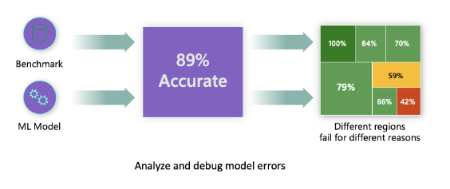
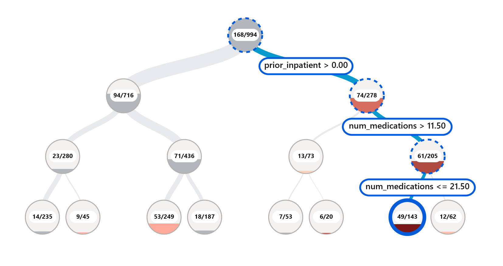
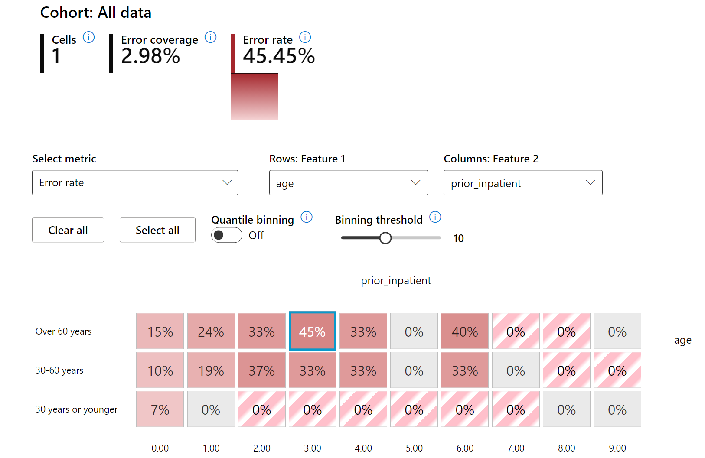
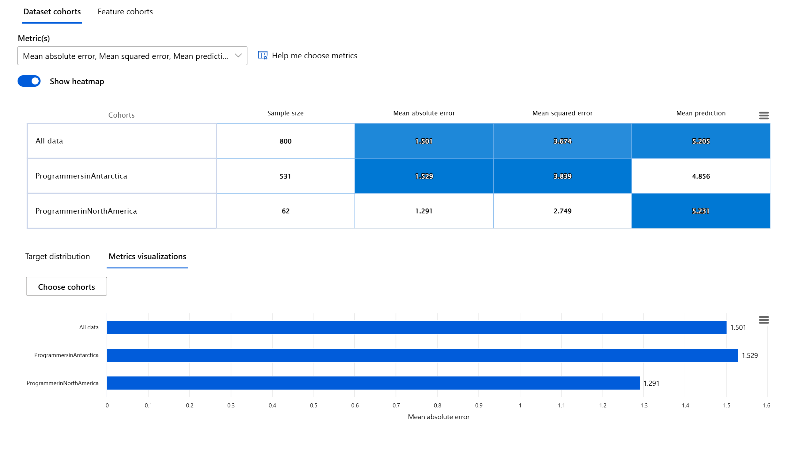
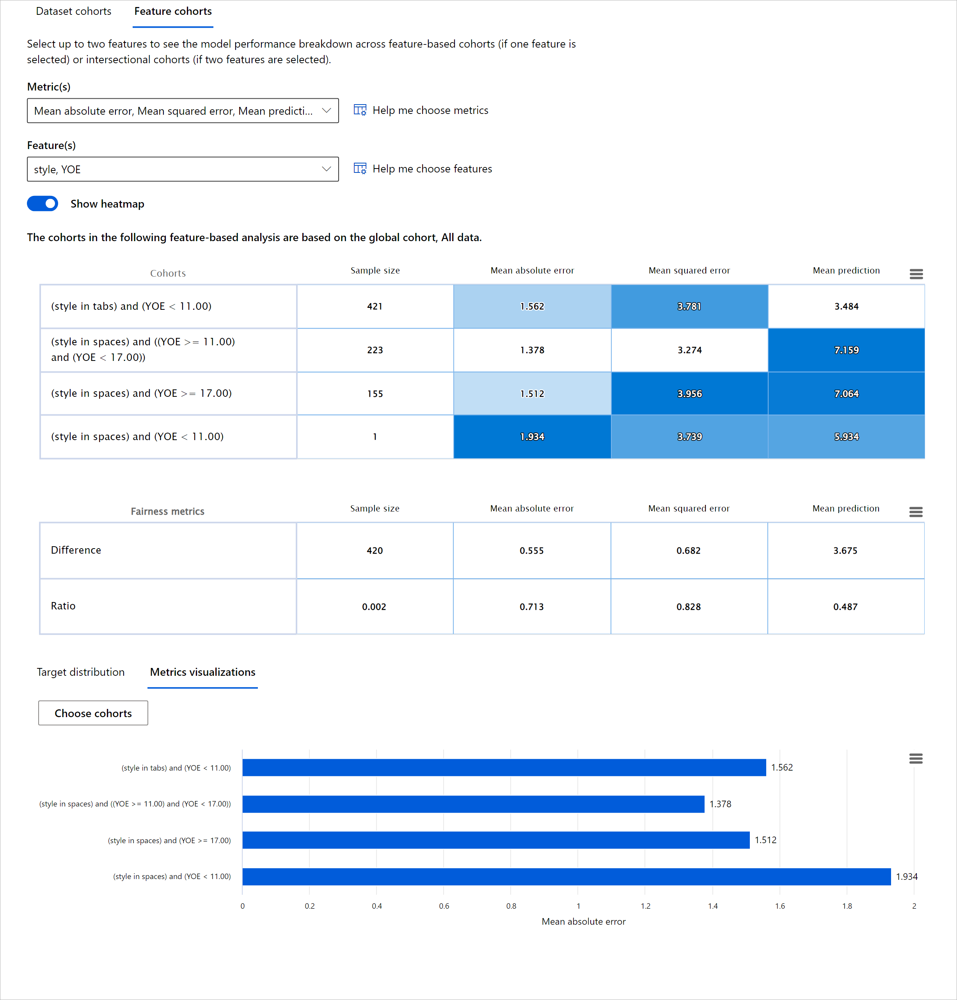
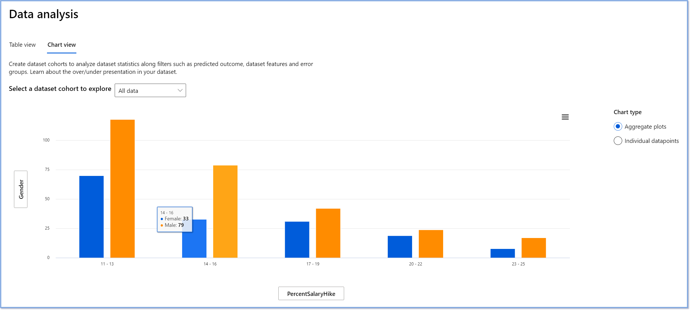
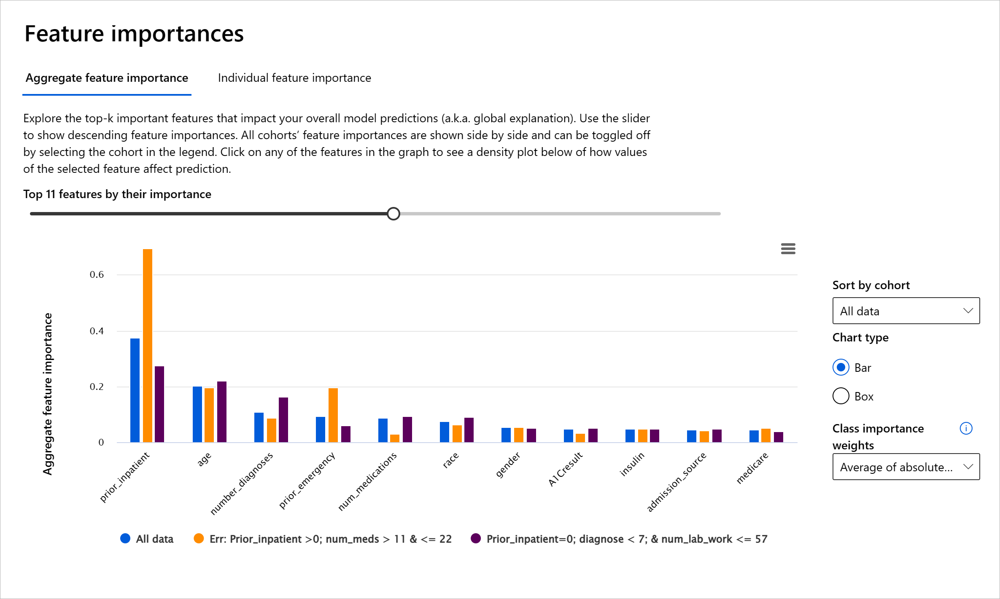
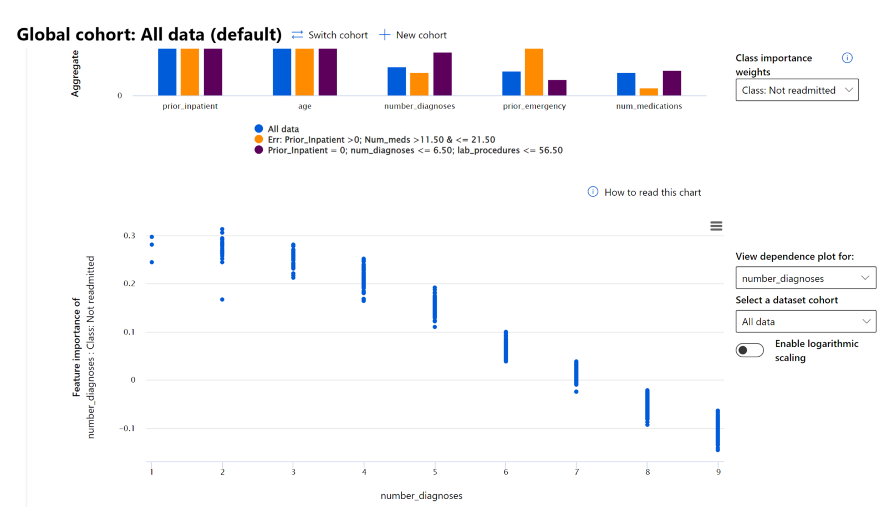

# Postscript: Odpravljanje napak modelov strojnega učenja z uporabo komponent nadzorne plošče za odgovorno umetno inteligenco

## [Predavanje kviz](https://ff-quizzes.netlify.app/en/ml/)

## Uvod

Strojno učenje vpliva na naša vsakodnevna življenja. Umetna inteligenca (UI) se vključuje v nekatere najpomembnejše sisteme, ki vplivajo na nas kot posameznike in na našo družbo, od zdravstva, financ, izobraževanja do zaposlovanja. Na primer, sistemi in modeli sodelujejo pri vsakodnevnih odločitvah, kot so zdravstvene diagnoze ali odkrivanje goljufij. Posledično so napredki v UI skupaj s pospešeno uporabo soočeni z razvijajočimi se družbenimi pričakovanji in naraščajočo regulacijo. Nenehno opažamo področja, kjer sistemi UI ne izpolnjujejo pričakovanj, razkrivajo nove izzive, in vlade začenjajo regulirati rešitve UI. Zato je pomembno, da so ti modeli analizirani, da zagotovijo pravične, zanesljive, vključujoče, pregledne in odgovorne rezultate za vse.

V tem učnem načrtu bomo raziskali praktična orodja, ki jih lahko uporabimo za oceno, ali ima model težave z odgovorno UI. Tradicionalne tehnike odpravljanja napak pri strojnem učenju so običajno osnovane na kvantitativnih izračunih, kot so združena natančnost ali povprečna izguba napake. Predstavljajte si, kaj se lahko zgodi, ko podatki, ki jih uporabljate za gradnjo teh modelov, ne vključujejo določenih demografskih skupin, kot so rasa, spol, politično prepričanje, religija, ali pa te demografske skupine nesorazmerno predstavljajo. Kaj pa, če je izhod modela interpretiran tako, da daje prednost določeni demografski skupini? To lahko povzroči prekomerno ali nezadostno zastopanost teh občutljivih skupin, kar vodi do vprašanj pravičnosti, vključenosti ali zanesljivosti modela. Drug dejavnik je, da so modeli strojnega učenja pogosto obravnavani kot "črne škatle", kar otežuje razumevanje in razlago, kaj vpliva na napovedi modela. Vse to so izzivi, s katerimi se soočajo podatkovni znanstveniki in razvijalci UI, kadar nimajo ustreznih orodij za odpravljanje napak ali ocenjevanje pravičnosti in zanesljivosti modela.

V tej lekciji se boste naučili odpravljati napake v svojih modelih z uporabo:

- **Analize napak**: prepoznajte, kje v porazdelitvi podatkov ima model visoke stopnje napak.
- **Pregleda modela**: izvedite primerjalno analizo med različnimi kohortami podatkov, da odkrijete razlike v metrikah uspešnosti modela.
- **Analize podatkov**: raziščite, kje bi lahko prišlo do prekomerne ali nezadostne zastopanosti podatkov, kar lahko povzroči, da model daje prednost eni demografski skupini pred drugo.
- **Pomembnosti značilnosti**: razumite, katere značilnosti vplivajo na napovedi modela na globalni ali lokalni ravni.

## Predpogoj

Kot predpogoj si oglejte [Orodja za odgovorno UI za razvijalce](https://www.microsoft.com/ai/ai-lab-responsible-ai-dashboard)

> 

## Analiza napak

Tradicionalne metrike uspešnosti modelov, ki se uporabljajo za merjenje natančnosti, so večinoma izračuni, osnovani na pravilnih in nepravilnih napovedih. Na primer, določitev, da je model natančen 89 % časa z izgubo napake 0,001, se lahko šteje za dobro uspešnost. Napake pa pogosto niso enakomerno porazdeljene v osnovnem naboru podatkov. Lahko dosežete 89 % natančnost modela, vendar ugotovite, da obstajajo različni deli vaših podatkov, kjer model odpove 42 % časa. Posledice teh vzorcev napak pri določenih skupinah podatkov lahko vodijo do vprašanj pravičnosti ali zanesljivosti. Ključno je razumeti področja, kjer model deluje dobro ali ne. Področja podatkov, kjer je veliko netočnosti modela, se lahko izkažejo za pomembne demografske skupine podatkov.

Komponenta za analizo napak na nadzorni plošči RAI prikazuje, kako so napake modela porazdeljene med različnimi kohortami s pomočjo vizualizacije drevesa. To je uporabno za prepoznavanje značilnosti ali področij, kjer je stopnja napak v vašem naboru podatkov visoka. Z opazovanjem, od kod prihaja večina netočnosti modela, lahko začnete raziskovati osnovni vzrok. Prav tako lahko ustvarite kohorte podatkov za izvedbo analize. Te kohorte podatkov pomagajo pri odpravljanju napak, da ugotovite, zakaj je uspešnost modela dobra v eni kohorti, a napačna v drugi.

Vizualni kazalniki na zemljevidu drevesa pomagajo hitreje locirati problematična področja. Na primer, temnejši odtenek rdeče barve na vozlišču drevesa pomeni višjo stopnjo napak.

Toplotni zemljevid je še ena funkcionalnost vizualizacije, ki jo uporabniki lahko uporabijo za raziskovanje stopnje napak z uporabo ene ali dveh značilnosti, da najdejo prispevek k napakam modela v celotnem naboru podatkov ali kohortah.

Uporabite analizo napak, kadar potrebujete:

* Globoko razumevanje, kako so napake modela porazdeljene po naboru podatkov in po več vhodnih in značilnostnih dimenzijah.
* Razčlenitev združenih metrik uspešnosti za samodejno odkrivanje napačnih kohort, da obvestite svoje ciljno usmerjene korake za odpravljanje težav.

## Pregled modela

Ocenjevanje uspešnosti modela strojnega učenja zahteva celostno razumevanje njegovega vedenja. To je mogoče doseči z analizo več kot ene metrike, kot so stopnja napak, natančnost, priklic, natančnost ali MAE (povprečna absolutna napaka), da bi odkrili razlike med metrikami uspešnosti. Ena metrika uspešnosti se lahko zdi odlična, vendar lahko netočnosti razkrije druga metrika. Poleg tega primerjava metrik za razlike v celotnem naboru podatkov ali kohortah pomaga osvetliti, kje model deluje dobro ali ne. To je še posebej pomembno pri opazovanju uspešnosti modela med občutljivimi in neobčutljivimi značilnostmi (npr. rasa, spol ali starost pacienta), da bi odkrili morebitno nepravičnost modela. Na primer, odkritje, da je model bolj napačen v kohorti z občutljivimi značilnostmi, lahko razkrije morebitno nepravičnost modela.

Komponenta Pregled modela na nadzorni plošči RAI pomaga ne le pri analizi metrik uspešnosti predstavitve podatkov v kohorti, temveč uporabnikom omogoča tudi primerjavo vedenja modela med različnimi kohortami.

Funkcionalnost analize, osnovane na značilnostih, omogoča uporabnikom, da zožijo podskupine podatkov znotraj določene značilnosti, da prepoznajo anomalije na bolj podrobni ravni. Na primer, nadzorna plošča ima vgrajeno inteligenco za samodejno ustvarjanje kohort za uporabniško izbrano značilnost (npr. *"čas_v_bolnišnici < 3"* ali *"čas_v_bolnišnici >= 7"*). To omogoča uporabniku, da izolira določeno značilnost iz večje skupine podatkov, da preveri, ali je ključni dejavnik napačnih rezultatov modela.

Komponenta Pregled modela podpira dva razreda metrik razlik:

**Razlike v uspešnosti modela**: Ti nabori metrik izračunajo razlike v vrednostih izbrane metrike uspešnosti med podskupinami podatkov. Tukaj je nekaj primerov:

* Razlike v stopnji natančnosti
* Razlike v stopnji napak
* Razlike v natančnosti
* Razlike v priklicu
* Razlike v povprečni absolutni napaki (MAE)

**Razlike v stopnji izbire**: Ta metrika vsebuje razliko v stopnji izbire (ugodna napoved) med podskupinami. Primer tega je razlika v stopnjah odobritve posojil. Stopnja izbire pomeni delež podatkovnih točk v vsakem razredu, ki so razvrščene kot 1 (pri binarni klasifikaciji) ali porazdelitev vrednosti napovedi (pri regresiji).

## Analiza podatkov

> "Če dovolj dolgo mučite podatke, bodo priznali karkoli." - Ronald Coase

Ta izjava se sliši skrajna, vendar drži, da je mogoče podatke manipulirati, da podpirajo katerikoli zaključek. Takšna manipulacija se lahko včasih zgodi nenamerno. Kot ljudje imamo vsi pristranskosti in pogosto je težko zavestno vedeti, kdaj vnašamo pristranskost v podatke. Zagotavljanje pravičnosti v UI in strojnem učenju ostaja kompleksen izziv.

Podatki so velika slepa pega za tradicionalne metrike uspešnosti modelov. Lahko imate visoke ocene natančnosti, vendar to ne odraža vedno osnovne pristranskosti podatkov, ki bi lahko bila prisotna v vašem naboru podatkov. Na primer, če ima nabor podatkov o zaposlenih 27 % žensk na izvršnih položajih v podjetju in 73 % moških na isti ravni, lahko model za oglaševanje delovnih mest, usposobljen na teh podatkih, cilja predvsem na moško občinstvo za višje položaje. Ta neuravnoteženost v podatkih je izkrivila napoved modela, da daje prednost enemu spolu. To razkriva vprašanje pravičnosti, kjer je v modelu UI prisotna spolna pristranskost.

Komponenta Analiza podatkov na nadzorni plošči RAI pomaga prepoznati področja, kjer je v naboru podatkov prisotna prekomerna ali nezadostna zastopanost. Uporabnikom pomaga diagnosticirati osnovni vzrok napak in vprašanj pravičnosti, ki so posledica neuravnoteženosti podatkov ali pomanjkanja zastopanosti določene skupine podatkov. To uporabnikom omogoča vizualizacijo naborov podatkov na podlagi napovedanih in dejanskih rezultatov, skupin napak in specifičnih značilnosti. Včasih lahko odkritje premalo zastopane skupine podatkov razkrije tudi, da se model ne uči dobro, kar vodi do visokih netočnosti. Model, ki ima pristranskost v podatkih, ni le vprašanje pravičnosti, temveč kaže, da model ni vključujoč ali zanesljiv.

Uporabite analizo podatkov, kadar potrebujete:

* Raziskovanje statistike vašega nabora podatkov z izbiro različnih filtrov za razdelitev podatkov na različne dimenzije (znane tudi kot kohorte).
* Razumevanje porazdelitve vašega nabora podatkov med različnimi kohortami in skupinami značilnosti.
* Določitev, ali so vaša odkritja, povezana s pravičnostjo, analizo napak in vzročnostjo (pridobljena iz drugih komponent nadzorne plošče), posledica porazdelitve vašega nabora podatkov.
* Odločitev, na katerih področjih zbrati več podatkov za zmanjšanje napak, ki izhajajo iz težav z zastopanostjo, šuma oznak, šuma značilnosti, pristranskosti oznak in podobnih dejavnikov.

## Razložljivost modela

Modeli strojnega učenja so pogosto obravnavani kot "črne škatle". Razumevanje, katere ključne značilnosti podatkov vplivajo na napovedi modela, je lahko zahtevno. Pomembno je zagotoviti preglednost, zakaj model poda določeno napoved. Na primer, če sistem UI napove, da je diabetični pacient v nevarnosti ponovne hospitalizacije v manj kot 30 dneh, bi moral biti sposoben zagotoviti podporne podatke, ki so privedli do te napovedi. Imati podporne kazalnike podatkov prinaša preglednost, ki pomaga zdravnikom ali bolnišnicam sprejemati dobro informirane odločitve. Poleg tega omogočanje razlage, zakaj je model podal določeno napoved za posameznega pacienta, omogoča odgovornost v skladu z zdravstvenimi predpisi. Ko uporabljate modele strojnega učenja na načine, ki vplivajo na življenja ljudi, je ključno razumeti in razložiti, kaj vpliva na vedenje modela. Razložljivost in interpretacija modela pomagata odgovoriti na vprašanja v scenarijih, kot so:

* Odpravljanje napak modela: Zakaj je moj model naredil to napako? Kako lahko izboljšam svoj model?
* Sodelovanje človek-UI: Kako lahko razumem in zaupam odločitvam modela?
* Skladnost s predpisi: Ali moj model izpolnjuje zakonske zahteve?

Komponenta Pomembnost značilnosti na nadzorni plošči RAI vam pomaga odpravljati napake in pridobiti celovito razumevanje, kako model podaja napovedi. Prav tako je uporabno orodje za strokovnjake za strojno učenje in odločevalce, da razložijo in pokažejo dokaze o značilnostih, ki vplivajo na vedenje modela, za skladnost s predpisi. Nato lahko uporabniki raziskujejo tako globalne kot lokalne razlage, da preverijo, katere značilnosti vplivajo na napovedi modela. Globalne razlage navajajo glavne značilnosti, ki so vplivale na splošno napoved modela. Lokalne razlage prikazujejo, katere značilnosti so privedle do napovedi modela za posamezen primer. Sposobnost ocenjevanja lokalnih razlag je prav tako koristna pri odpravljanju napak ali reviziji določenega primera, da bi bolje razumeli in interpretirali, zakaj je model podal pravilno ali napačno napoved.

* Globalne razlage: Na primer, katere značilnosti vplivajo na splošno vedenje modela za ponovno hospitalizacijo diabetikov?
* Lokalne razlage: Na primer, zakaj je bil diabetični pacient, starejši od 60 let, z več prejšnjimi hospitalizacijami napovedan, da bo ponovno hospitaliziran ali ne v 30 dneh?

V procesu odpravljanja napak pri pregledu uspešnosti modela med različnimi kohortami Pomembnost značilnosti prikazuje, kakšen vpliv ima značilnost na kohorte. Pomaga razkriti anomalije pri primerjavi ravni vpliva značilnosti na napačne napovedi modela. Komponenta Pomembnost značilnosti lahko pokaže, katere vrednosti v značilnosti so pozitivno ali negativno vplivale na izid modela. Na primer, če je model podal napačno napoved, komponenta omogoča podrobno analizo in prepoznavanje, katere značilnosti ali vrednosti značilnosti so vplivale na napoved. Ta raven podrobnosti pomaga ne le pri odpravljanju napak, temveč zagotavlja preglednost in odgovornost v revizijskih situacijah. Na koncu lahko komponenta pomaga prepoznati vprašanja pravičnosti. Na primer, če občutljiva značilnost, kot je etnična pripadnost ali spol, močno vpliva na napoved modela, bi to lahko bil znak rasne ali spolne pristranskosti v modelu.

Uporabite razložljivost, kadar potrebujete:

* Določiti, kako zanesljive so napovedi vašega sistema UI, z razumevanjem, katere značilnosti so najpomembnejše za napovedi.
* Pristopiti k odpravljanju napak modela tako, da ga najprej razumete in ugotovite, ali model uporablja ustrezne značilnosti ali zgolj napačne korelacije.
* Razkriti morebitne vire nepravičnosti z razumevanjem, ali model temelji na občutljivih značilnostih ali na značil
- **Prekomerna ali nezadostna zastopanost**. Ideja je, da določena skupina ni vidna v določenem poklicu, in vsaka storitev ali funkcija, ki to še naprej spodbuja, prispeva k škodi.

### Azure RAI nadzorna plošča

[Azure RAI nadzorna plošča](https://learn.microsoft.com/en-us/azure/machine-learning/concept-responsible-ai-dashboard?WT.mc_id=aiml-90525-ruyakubu) temelji na odprtokodnih orodjih, ki so jih razvile vodilne akademske institucije in organizacije, vključno z Microsoftom. Ta orodja so ključna za podatkovne znanstvenike in razvijalce umetne inteligence, da bolje razumejo vedenje modelov, odkrijejo in odpravijo neželene težave v modelih umetne inteligence.

- Naučite se uporabljati različne komponente tako, da si ogledate dokumentacijo nadzorne plošče RAI [docs.](https://learn.microsoft.com/en-us/azure/machine-learning/how-to-responsible-ai-dashboard?WT.mc_id=aiml-90525-ruyakubu)

- Oglejte si nekaj primerov zvezkov nadzorne plošče RAI [sample notebooks](https://github.com/Azure/RAI-vNext-Preview/tree/main/examples/notebooks) za odpravljanje težav pri bolj odgovornem scenariju umetne inteligence v Azure Machine Learning.

---
## 🚀 Izziv

Da bi preprečili uvajanje statističnih ali podatkovnih pristranskosti, moramo:

- zagotoviti raznolikost ozadij in perspektiv med ljudmi, ki delajo na sistemih
- vlagati v podatkovne nabore, ki odražajo raznolikost naše družbe
- razviti boljše metode za zaznavanje in odpravljanje pristranskosti, ko se pojavi

Razmislite o resničnih scenarijih, kjer je nepoštenost očitna pri gradnji in uporabi modelov. Kaj bi še morali upoštevati?

## [Kvizi po predavanju](https://ff-quizzes.netlify.app/en/ml/)
## Pregled in samostojno učenje

V tej lekciji ste spoznali nekaj praktičnih orodij za vključevanje odgovorne umetne inteligence v strojno učenje.

Oglejte si ta delavnico za poglobitev v teme:

- Nadzorna plošča odgovorne umetne inteligence: Celovita rešitev za operacionalizacijo RAI v praksi, avtorja Besmira Nushi in Mehrnoosh Sameki

> 🎥 Kliknite zgornjo sliko za video: Nadzorna plošča odgovorne umetne inteligence: Celovita rešitev za operacionalizacijo RAI v praksi, avtorja Besmira Nushi in Mehrnoosh Sameki

Oglejte si naslednje materiale, da se naučite več o odgovorni umetni inteligenci in kako graditi bolj zaupanja vredne modele:

- Microsoftova orodja nadzorne plošče RAI za odpravljanje težav pri modelih strojnega učenja: [Viri orodij odgovorne umetne inteligence](https://aka.ms/rai-dashboard)

- Raziščite orodja odgovorne umetne inteligence: [Github](https://github.com/microsoft/responsible-ai-toolbox)

- Microsoftov center virov za RAI: [Viri odgovorne umetne inteligence – Microsoft AI](https://www.microsoft.com/en-us/ai/tools-practices)

- Microsoftova raziskovalna skupina FATE: [FATE: Pravičnost, odgovornost, transparentnost in etika v umetni inteligenci - Microsoft Research](https://www.microsoft.com/research/theme/fate/)

## Naloga

[Raziščite nadzorno ploščo RAI](assignment.md)

---

**Omejitev odgovornosti**:  
Ta dokument je bil preveden z uporabo storitve za strojno prevajanje [Co-op Translator](https://github.com/Azure/co-op-translator). Čeprav si prizadevamo za natančnost, vas prosimo, da upoštevate, da lahko avtomatizirani prevodi vsebujejo napake ali netočnosti. Izvirni dokument v njegovem izvirnem jeziku je treba obravnavati kot avtoritativni vir. Za ključne informacije priporočamo strokovno človeško prevajanje. Ne prevzemamo odgovornosti za morebitna nesporazumevanja ali napačne razlage, ki izhajajo iz uporabe tega prevoda.