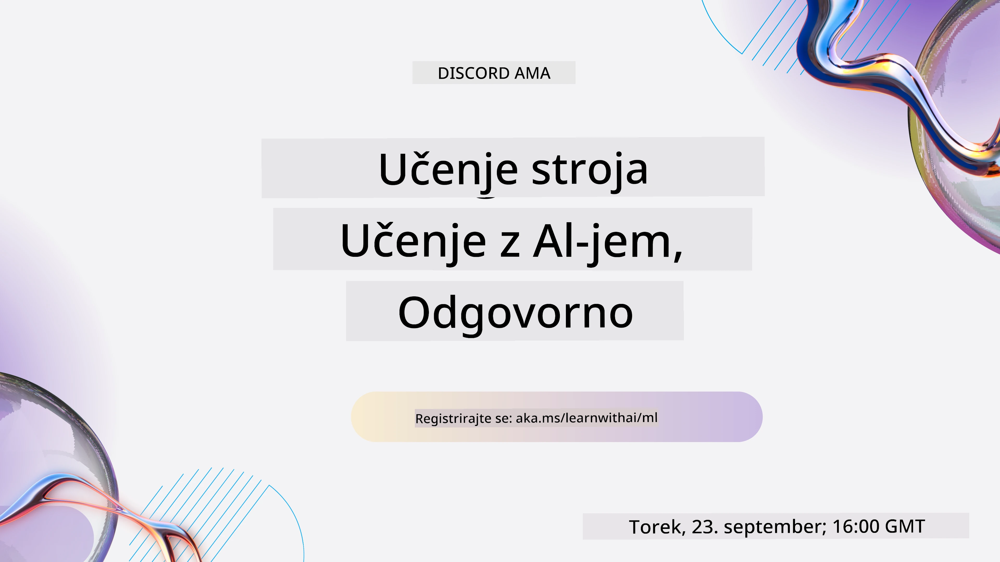
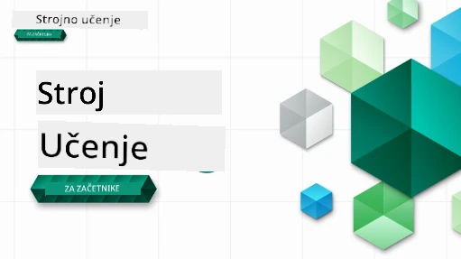

[](https://github.com/microsoft/ML-For-Beginners/blob/master/LICENSE)
[](https://GitHub.com/microsoft/ML-For-Beginners/graphs/contributors/)
[](https://GitHub.com/microsoft/ML-For-Beginners/issues/)
[](https://GitHub.com/microsoft/ML-For-Beginners/pulls/)
[](http://makeapullrequest.com)

[](https://GitHub.com/microsoft/ML-For-Beginners/watchers/)
[](https://GitHub.com/microsoft/ML-For-Beginners/network/)
[](https://GitHub.com/microsoft/ML-For-Beginners/stargazers/)

### 🌐 Podpora za več jezikov

#### Prevajanja vzdržuje [Co-op Translator](https://github.com/Azure/co-op-translator)

<!-- CO-OP TRANSLATOR LANGUAGES TABLE START -->
[Arabic](../ar/README.md) | [Bengali](../bn/README.md) | [Bulgarian](../bg/README.md) | [Burmese (Myanmar)](../my/README.md) | [Chinese (Simplified)](../zh-CN/README.md) | [Chinese (Traditional, Hong Kong)](../zh-HK/README.md) | [Chinese (Traditional, Macau)](../zh-MO/README.md) | [Chinese (Traditional, Taiwan)](../zh-TW/README.md) | [Croatian](../hr/README.md) | [Czech](../cs/README.md) | [Danish](../da/README.md) | [Dutch](../nl/README.md) | [Estonian](../et/README.md) | [Finnish](../fi/README.md) | [French](../fr/README.md) | [German](../de/README.md) | [Greek](../el/README.md) | [Hebrew](../he/README.md) | [Hindi](../hi/README.md) | [Hungarian](../hu/README.md) | [Indonesian](../id/README.md) | [Italian](../it/README.md) | [Japanese](../ja/README.md) | [Kannada](../kn/README.md) | [Khmer](../km/README.md) | [Korean](../ko/README.md) | [Lithuanian](../lt/README.md) | [Malay](../ms/README.md) | [Malayalam](../ml/README.md) | [Manipuri (Meitei Mayek)](../mni/README.md) | [Marathi](../mr/README.md) | [Nepali](../ne/README.md) | [Nigerian Pidgin](../pcm/README.md) | [Norwegian](../no/README.md) | [Persian (Farsi)](../fa/README.md) | [Polish](../pl/README.md) | [Portuguese (Brazil)](../pt-BR/README.md) | [Portuguese (Portugal)](../pt-PT/README.md) | [Punjabi (Gurmukhi)](../pa/README.md) | [Romanian](../ro/README.md) | [Russian](../ru/README.md) | [Serbian (Cyrillic)](../sr/README.md) | [Slovak](../sk/README.md) | [Slovenian](./README.md) | [Spanish](../es/README.md) | [Swahili](../sw/README.md) | [Swedish](../sv/README.md) | [Tagalog (Filipino)](../tl/README.md) | [Tamil](../ta/README.md) | [Telugu](../te/README.md) | [Thai](../th/README.md) | [Turkish](../tr/README.md) | [Ukrainian](../uk/README.md) | [Urdu](../ur/README.md) | [Vietnamese](../vi/README.md)

> **Raje klonirate lokalno?**
>
> Ta repozitorij vključuje prevode v več kot 50 jezikih, kar znatno poveča velikost prenosa. Če želite klonirati brez prevodov, uporabite redčen checkout:
>
> **Bash / macOS / Linux:**
> ```bash
> git clone --filter=blob:none --sparse https://github.com/microsoft/ML-For-Beginners.git
> cd ML-For-Beginners
> git sparse-checkout set --no-cone '/*' '!translations' '!translated_images'
> ```
>
> **CMD (Windows):**
> ```cmd
> git clone --filter=blob:none --sparse https://github.com/microsoft/ML-For-Beginners.git
> cd ML-For-Beginners
> git sparse-checkout set --no-cone "/*" "!translations" "!translated_images"
> ```
>
> To vam omogoča, da dobite vse, kar potrebujete za dokončanje tečaja, z veliko hitrejšim prenosom.
<!-- CO-OP TRANSLATOR LANGUAGES TABLE END -->

#### Pridružite se naši skupnosti

[](https://discord.gg/nTYy5BXMWG)

Naš Discord serija "Learn with AI" je v teku, več o njej in kako se pridružiti najdete na [Learn with AI Series](https://aka.ms/learnwithai/discord) od 18. do 30. septembra 2025. Dobili boste nasvete in trike za uporabo GitHub Copilot za podatkovno znanost.



# Strojno učenje za začetnike - Kurikulum

> 🌍 Potujmo po svetu in raziskujmo strojno učenje skozi svetovne kulture 🌍

Zagotavljalci oblakov pri Microsoftu z veseljem ponujajo 12-tedenski, 26-lekcijski kurikulum o **strojnega učenja**. V tem kurikulumu boste spoznali t.i. **klasično strojno učenje**, ki uporablja predvsem Scikit-learn kot knjižnico, med tem ko se globoko učenje obravnava v našem [kurikulumu AI za začetnike](https://aka.ms/ai4beginners). Kombinirajte te lekcije tudi z našim [kurikulumom podatkovne znanosti za začetnike](https://aka.ms/ds4beginners)!

Potujte z nami po svetu, ko klasične tehnike uporabljamo na podatkih iz mnogih delov sveta. Vsaka lekcija vključuje pred- in po-izpite, pisna navodila za dokončanje lekcije, rešitev, nalogo in še več. Naša pedagogika temelji na projektih, ki omogoča učenje med gradnjo, preverjena metoda za boljše razumevanje.

**✍️ Iskrena zahvala našim avtorjem** Jen Looper, Stephen Howell, Francesca Lazzeri, Tomomi Imura, Cassie Breviu, Dmitry Soshnikov, Chris Noring, Anirban Mukherjee, Ornella Altunyan, Ruth Yakubu in Amy Boyd

**🎨 Zahvala tudi našim ilustratorjem** Tomomi Imura, Dasani Madipalli in Jen Looper

**🙏 Posebna zahvala 🙏 našim Microsoft Student Ambasadorjem avtorjem, recenzentom in prispevkarjem vsebin**, zlasti Rishit Dagli, Muhammad Sakib Khan Inan, Rohan Raj, Alexandru Petrescu, Abhishek Jaiswal, Nawrin Tabassum, Ioan Samuila in Snigdha Agarwal

**🤩 Dodatna hvala Microsoft Student Ambasadorjem Eric Wanjau, Jasleen Sondhi in Vidushi Gupta za naše lekcije v R!**

# Začetek

Sledite tem korakom:
1. **Razvezi Repozitorij**: Kliknite gumb "Fork" v zgornjem desnem kotu te strani.
2. **Klonirajte repozitorij**:   `git clone https://github.com/microsoft/ML-For-Beginners.git`

> 💡 **Hitri nasvet:** Želite začeti v brskalniku brez lokalne namestitve Pythona? Uporabite [GitHub Codespaces](https://github.com/features/codespaces) za ustvarjanje oblačnega razvojnega okolja za vaš fork. Odprite zeleni meni **Code**, izberite **Codespaces** in ustvarite kodo; nato po potrebi namestite zahtevane odvisnosti za vsako lekcijo.

> [Poiščite vse dodatne vire za ta tečaj v naši zbirki Microsoft Learn](https://learn.microsoft.com/en-us/collections/qrqzamz1nn2wx3?WT.mc_id=academic-77952-bethanycheum)

> 🔧 **Potrebujete pomoč?** Preverite naš [Vodnik za odpravljanje težav](TROUBLESHOOTING.md) za rešitve pogostih težav z namestitvijo, nastavkom in izvajanjem lekcij.


**[Študenti](https://aka.ms/student-page)**, za uporabo tega kurikuluma razvejite celoten repozitorij na svoj GitHub račun in samostojno ali v skupini izpolnite vaje:

- Začnite s predavanjevim kvizom.
- Preberite lekcijo in dokončajte aktivnosti, občasno se ustavite in premislite ob preverjanjih znanja.
- Poskusite ustvariti projekte tako, da razumete lekcije, namesto da samo zaženete kodo rešitve; vendar je ta koda na voljo v `/solution` mapah v vsaki projektnemu usmerjeni lekciji.
- Rešite popredavateljski kviz.
- Dokončajte izziv.
- Dokončajte nalogo.
- Po dokončanju skupine lekcij obiščite [Diskusijski forum](https://github.com/microsoft/ML-For-Beginners/discussions) in "učite na glas" z izpolnitvijo ustrezne PAT rubric. 'PAT' je Orodje za ocenjevanje napredka, ki je rubrika, ki jo izpolnjujete za izboljšanje učenja. Lahko se tudi odzovete na druge PAT-rubrike, da se skupaj učimo.

> Za nadaljnje učenje priporočamo sledenje tem [Microsoft Learn](https://docs.microsoft.com/en-us/users/jenlooper-2911/collections/k7o7tg1gp306q4?WT.mc_id=academic-77952-leestott) modulom in učnim potem.

**Učitelji**, priložili smo [nekatere predloge](for-teachers.md), kako uporabljati ta kurikulum.

---

## Video vodiči

Nekatere lekcije so na voljo kot kratki video posnetki. Vse jih lahko najdete v lekcijah ali na [ML for Beginners seznamu predvajanja na YouTube kanalu Microsoft Developer](https://aka.ms/ml-beginners-videos), če kliknete spodnjo sliko.

[](https://aka.ms/ml-beginners-videos)

---

## Spoznajte ekipo

[](https://youtu.be/Tj1XWrDSYJU)

**Gif avtor** [Mohit Jaisal](https://linkedin.com/in/mohitjaisal)

> 🎥 Kliknite zgornjo sliko za video o projektu in ljudeh, ki so ga ustvarili!

---

## Pedagogika

Pri gradnji tega kurikuluma smo izbrali dva pedagoška načela: zagotoviti, da je praktičen in **projektno usmerjen** ter da vključuje **pogoste kvize**. Poleg tega ima ta kurikulum skupno **temo**, ki mu daje kohezijo.

S tem, ko zagotovimo, da je vsebina usklajena s projekti, je proces za študente bolj zanimiv, zadrževanje konceptov pa se poveča. Poleg tega nastavitev nizko tvegani kviz pred predavanjem usmeri študenta k učenju teme, medtem ko drugi kviz po predavanju zagotavlja nadaljnje zadrževanje. Ta kurikulum je zasnovan kot prilagodljiv in zabaven in ga je mogoče vzeti v celoti ali delno. Projekti se začnejo majhni in se do konca 12-tedenskega cikla postopoma zapletejo. Kurikulum vključuje tudi dodatek o resničnih uporabah strojenega učenja, ki se lahko uporablja kot dodatna točka ali kot osnova za razpravo.

> Najdite naše [Pravila vedenja](CODE_OF_CONDUCT.md), [Prispevanje](CONTRIBUTING.md), [Prevajanja](..) in [Odpravljanje težav](TROUBLESHOOTING.md) smernice. Veselimo se vaših konstruktivnih povratnih informacij!

## Vsaka lekcija vključuje

- neobvezno skiciranje
- neobvezni dodatni video
- video vodnik (samo nekatere lekcije)
- [predpredavalni ogrevalni kviz](https://ff-quizzes.netlify.app/en/ml/)
- pisna lekcija
- za lekcije, usmerjene v projekte, korak za korakom vodiči, kako zgraditi projekt
- preverjanja znanja
- izziv
- dodatno branje
- naloga
- [popredavalni kviz](https://ff-quizzes.netlify.app/en/ml/)

> **Opomba o jezikih**: Te lekcije so večinoma napisane v Pythonu, vendar je veliko njih na voljo tudi v R. Za dokončanje lekcije v R pojdite v mapo `/solution` in poiščite R lekcije. Vsebujejo pripono .rmd, ki predstavlja datoteko **R Markdown**, kar je preprosto definirano kot vstavljanje `code chunks` (programskega jezika R ali drugih jezikov) in `YAML header` (ki vodi, kako oblikovati izhode, kot je PDF) v `Markdown document`. Tako služi kot odličen avtorski okvir za podatkovno znanost, saj omogoča združevanje kode, njenih izhodov in vaših misli z zapisovanjem v Markdown. Poleg tega je mogoče R Markdown dokumente izvoziti v izhodne formate, kot so PDF, HTML ali Word.

> **Opomba o kvizih**: Vsi kvizi so v [Quiz App mapi](../../quiz-app), skupno 52 kvizov s po tremi vprašanji. Povezani so znotraj lekcij, vendar lahko kvizno aplikacijo zaženete tudi lokalno; sledite navodilom v mapi `quiz-app` za lokalno gostovanje ali razmestitev v Azure.

| Št. lekcije |                              Tema                               |                   Skupina lekcij                   | Cilji učenja                                                                                                                   |                                                              Povezana lekcija                                                               |                        Avtor                        |
| :-----------: | :------------------------------------------------------------: | :-------------------------------------------------: | ------------------------------------------------------------------------------------------------------------------------------- | :--------------------------------------------------------------------------------------------------------------------------------------: | :--------------------------------------------------: |
|      01       |                Uvod v strojno učenje                          |      [Uvod](1-Introduction/README.md)       | Spoznajte osnovne koncepte strojnega učenja                                                                                     |                                             [Lekcija](1-Introduction/1-intro-to-ML/README.md)                                             |                       Muhammad                       |
|      02       |                Zgodovina strojnega učenja                     |      [Uvod](1-Introduction/README.md)       | Spoznajte zgodovino tega področja                                                                                               |                                            [Lekcija](1-Introduction/2-history-of-ML/README.md)                                            |                     Jen in Amy                      |
|      03       |                 Pravičnost in strojno učenje                  |      [Uvod](1-Introduction/README.md)       | Kateri so pomembni filozofski problemi okoli pravičnosti, ki jih študenti morajo upoštevati pri gradnji in uporabi ML modelov?    |                                              [Lekcija](1-Introduction/3-fairness/README.md)                                               |                        Tomomi                        |
|      04       |                Tehnike za strojno učenje                      |      [Uvod](1-Introduction/README.md)       | Katere tehnike raziskovalci ML uporabljajo za izdelavo ML modelov?                                                              |                                          [Lekcija](1-Introduction/4-techniques-of-ML/README.md)                                           |                    Chris in Jen                     |
|      05       |                   Uvod v regresijo                             |        [Regresija](2-Regression/README.md)         | Začnite z Python in Scikit-learn za regresijske modele                                                                          |         [Python](2-Regression/1-Tools/README.md) • [R](../../2-Regression/1-Tools/solution/R/lesson_1.html)         |      Jen • Eric Wanjau       |
|      06       |                Cene buč v Severni Ameriki 🎃                   |        [Regresija](2-Regression/README.md)         | Vizualizirajte in očistite podatke v pripravah na ML                                                                             |          [Python](2-Regression/2-Data/README.md) • [R](../../2-Regression/2-Data/solution/R/lesson_2.html)          |      Jen • Eric Wanjau       |
|      07       |                Cene buč v Severni Ameriki 🎃                   |        [Regresija](2-Regression/README.md)         | Ustvarite linearne in polinomske regresijske modele                                                                             |        [Python](2-Regression/3-Linear/README.md) • [R](../../2-Regression/3-Linear/solution/R/lesson_3.html)        |      Jen in Dmitry • Eric Wanjau       |
|      08       |                Cene buč v Severni Ameriki 🎃                   |        [Regresija](2-Regression/README.md)         | Ustvarite logistični regresijski model                                                                                         |     [Python](2-Regression/4-Logistic/README.md) • [R](../../2-Regression/4-Logistic/solution/R/lesson_4.html)      |      Jen • Eric Wanjau       |
|      09       |                          Spletna aplikacija 🔌                 |           [Spletna aplikacija](3-Web-App/README.md)            | Ustvarite spletno aplikacijo za uporabo vašega usposobljenega modela                                                            |                                                 [Python](3-Web-App/1-Web-App/README.md)                                                  |                         Jen                          |
|      10       |                 Uvod v klasifikacijo                          |    [Klasifikacija](4-Classification/README.md)     | Očistite, pripravite in vizualizirajte svoje podatke; uvod v klasifikacijo                                                       | [Python](4-Classification/1-Introduction/README.md) • [R](../../4-Classification/1-Introduction/solution/R/lesson_10.html)  | Jen in Cassie • Eric Wanjau |
|      11       |             Slavne azijske in indijske kuhinje 🍜              |    [Klasifikacija](4-Classification/README.md)     | Uvod v klasifikatorje                                                                                                            | [Python](4-Classification/2-Classifiers-1/README.md) • [R](../../4-Classification/2-Classifiers-1/solution/R/lesson_11.html) | Jen in Cassie • Eric Wanjau |
|      12       |             Slavne azijske in indijske kuhinje 🍜              |    [Klasifikacija](4-Classification/README.md)     | Več klasifikatorjev                                                                                                             | [Python](4-Classification/3-Classifiers-2/README.md) • [R](../../4-Classification/3-Classifiers-2/solution/R/lesson_12.html) | Jen in Cassie • Eric Wanjau |
|      13       |             Slavne azijske in indijske kuhinje 🍜              |    [Klasifikacija](4-Classification/README.md)     | Ustvarite spletno aplikacijo za priporočanje z uporabo vašega modela                                                             |                                              [Python](4-Classification/4-Applied/README.md)                                              |                         Jen                          |
|      14       |                   Uvod v gručenje                              |        [Gručenje](5-Clustering/README.md)         | Očistite, pripravite in vizualizirajte svoje podatke; uvod v gručenje                                                          |         [Python](5-Clustering/1-Visualize/README.md) • [R](../../5-Clustering/1-Visualize/solution/R/lesson_14.html)         |      Jen • Eric Wanjau       |
|      15       |              Raziskovanje nigerijskih glasbenih okusov 🎧       |        [Gručenje](5-Clustering/README.md)         | Raziščite metodo gručenja K-sredin                                                                                            |           [Python](5-Clustering/2-K-Means/README.md) • [R](../../5-Clustering/2-K-Means/solution/R/lesson_15.html)           |      Jen • Eric Wanjau       |
|      16       |        Uvod v obdelavo naravnega jezika ☕️                    |   [Obdelava naravnega jezika](6-NLP/README.md)    | Naučite se osnov NLP z gradnjo preprostega bota                                                                                 |                                             [Python](6-NLP/1-Introduction-to-NLP/README.md)                                              |                       Stephen                        |
|      17       |                      Pogoste naloge NLP ☕️                    |   [Obdelava naravnega jezika](6-NLP/README.md)    | Poglabljajte znanje NLP z razumevanjem pogostih nalog pri delu z jezikovnimi strukturami                                       |                                                    [Python](6-NLP/2-Tasks/README.md)                                                     |                       Stephen                        |
|      18       |             Prevajanje in analiza sentimenta ♥️                |   [Obdelava naravnega jezika](6-NLP/README.md)    | Prevajanje in analiza sentimenta z Jane Austen                                                                                  |                                            [Python](6-NLP/3-Translation-Sentiment/README.md)                                             |                       Stephen                        |
|      19       |                  Romantični hoteli v Evropi ♥️                 |   [Obdelava naravnega jezika](6-NLP/README.md)    | Analiza sentimenta s pregledi hotelov 1                                                                                        |                                               [Python](6-NLP/4-Hotel-Reviews-1/README.md)                                                |                       Stephen                        |
|      20       |                  Romantični hoteli v Evropi ♥️                 |   [Obdelava naravnega jezika](6-NLP/README.md)    | Analiza sentimenta s pregledi hotelov 2                                                                                        |                                               [Python](6-NLP/5-Hotel-Reviews-2/README.md)                                                |                       Stephen                        |
|      21       |            Uvod v napovedovanje časovnih vrst                  |        [Časovne vrste](7-TimeSeries/README.md)        | Uvod v napovedovanje časovnih vrst                                                                                              |                                             [Python](7-TimeSeries/1-Introduction/README.md)                                              |                      Francesca                       |
|      22       | ⚡️ Poraba električne energije na svetu ⚡️ - napovedovanje časovnih vrst z ARIMA |        [Časovne vrste](7-TimeSeries/README.md)        | Napovedovanje časovnih vrst z ARIMA                                                                                              |                                                 [Python](7-TimeSeries/2-ARIMA/README.md)                                                 |                      Francesca                       |
|      23       |  ⚡️ Poraba električne energije na svetu ⚡️ - napovedovanje časovnih vrst s SVR  |        [Časovne vrste](7-TimeSeries/README.md)        | Napovedovanje časovnih vrst s podporniški vektor regresorjem                                                                    |                                                  [Python](7-TimeSeries/3-SVR/README.md)                                                  |                       Anirban                        |
|      24       |             Uvod v okrepljeno učenje                           | [Okrepljeno učenje](8-Reinforcement/README.md) | Uvod v okrepljeno učenje z Q-učenjem                                                                                            |                                             [Python](8-Reinforcement/1-QLearning/README.md)                                              |                        Dmitry                        |
|      25       |                 Pomoč Petru, da se izogne volku! 🐺            | [Okrepljeno učenje](8-Reinforcement/README.md) | Okrepljeno učenje z Gimom                                                                                                       |                                                [Python](8-Reinforcement/2-Gym/README.md)                                                 |                        Dmitry                        |
|  Zadnji zapis  |            Resnični scenariji in aplikacije ML                 |      [ML v naravi](9-Real-World/README.md)       | Zanimive in razkrivajoče resnične aplikacije klasičnega ML                                                                      |                                             [Lekcija](9-Real-World/1-Applications/README.md)                                              |                         Ekipa                         |
|  Zadnji zapis  |           Odpravljanje napak modela v ML z RAI nadzorno ploščo|      [ML v naravi](9-Real-World/README.md)       | Odpravljanje napak modela v strojni učenju z uporabo komponent RAI nadzorne plošče                                              |                                             [Lekcija](9-Real-World/2-Debugging-ML-Models/README.md)                                              |                     Ruth Yakubu                      |

> [poiščite vse dodatne vire za ta tečaj v naši zbirki Microsoft Learn](https://learn.microsoft.com/en-us/collections/qrqzamz1nn2wx3?WT.mc_id=academic-77952-bethanycheum)

## Dostop brez povezave

To dokumentacijo lahko zaženete brez povezave z uporabo [Docsify](https://docsify.js.org/#/). Razvejajte to repozitorij, [namestite Docsify](https://docsify.js.org/#/quickstart) na vaš lokalni računalnik, nato pa v korenski mapi te repozitorij vnesite `docsify serve`. Spletna stran bo na voljo na vratih 3000 na vašem localhost: `localhost:3000`.

## PDF-ji

Poiščite pdf učnega načrta s povezavami [tukaj](https://microsoft.github.io/ML-For-Beginners/pdf/readme.pdf).


## 🎒 Drugi tečaji

Naša ekipa proizvaja tudi druge tečaje! Oglejte si:

<!-- CO-OP TRANSLATOR OTHER COURSES START -->
### LangChain
[](https://aka.ms/langchain4j-for-beginners)
[](https://aka.ms/langchainjs-for-beginners?WT.mc_id=m365-94501-dwahlin)
[](https://github.com/microsoft/langchain-for-beginners?WT.mc_id=m365-94501-dwahlin)
---

### Azure / Edge / MCP / Agentje
[](https://github.com/microsoft/AZD-for-beginners?WT.mc_id=academic-105485-koreyst)
[](https://github.com/microsoft/edgeai-for-beginners?WT.mc_id=academic-105485-koreyst)
[](https://github.com/microsoft/mcp-for-beginners?WT.mc_id=academic-105485-koreyst)
[](https://github.com/microsoft/ai-agents-for-beginners?WT.mc_id=academic-105485-koreyst)

---
 
### Serija generativne umetne inteligence
[](https://github.com/microsoft/generative-ai-for-beginners?WT.mc_id=academic-105485-koreyst)
[-9333EA?style=for-the-badge&labelColor=E5E7EB&color=9333EA)](https://github.com/microsoft/Generative-AI-for-beginners-dotnet?WT.mc_id=academic-105485-koreyst)
[-C084FC?style=for-the-badge&labelColor=E5E7EB&color=C084FC)](https://github.com/microsoft/generative-ai-for-beginners-java?WT.mc_id=academic-105485-koreyst)
[-E879F9?style=for-the-badge&labelColor=E5E7EB&color=E879F9)](https://github.com/microsoft/generative-ai-with-javascript?WT.mc_id=academic-105485-koreyst)

---
 
### Osnovno učenje
[](https://aka.ms/ml-beginners?WT.mc_id=academic-105485-koreyst)
[](https://aka.ms/datascience-beginners?WT.mc_id=academic-105485-koreyst)
[](https://aka.ms/ai-beginners?WT.mc_id=academic-105485-koreyst)
[](https://github.com/microsoft/Security-101?WT.mc_id=academic-96948-sayoung)
[](https://aka.ms/webdev-beginners?WT.mc_id=academic-105485-koreyst)
[](https://aka.ms/iot-beginners?WT.mc_id=academic-105485-koreyst)
[](https://github.com/microsoft/xr-development-for-beginners?WT.mc_id=academic-105485-koreyst)

---
 
### Serija Copilot
[](https://aka.ms/GitHubCopilotAI?WT.mc_id=academic-105485-koreyst)
[](https://github.com/microsoft/mastering-github-copilot-for-dotnet-csharp-developers?WT.mc_id=academic-105485-koreyst)
[](https://github.com/microsoft/CopilotAdventures?WT.mc_id=academic-105485-koreyst)
<!-- CO-OP TRANSLATOR OTHER COURSES END -->

## Pridobivanje pomoči

Če naletite na težave ali imate vprašanja med učenjem strojnega učenja ali gradnjo AI aplikacij, ne skrbite — pomoč je na voljo.

Lahko se pridružite razpravami z drugimi učenci in razvijalci, postavljate vprašanja ter delite svoje ideje s skupnostjo.

- Pridružite se skupnosti za postavljanje vprašanj in učenje z drugimi
- Razpravljajte o konceptih strojnega učenja in idejah za projekte
- Prejmite nasvete izkušenih razvijalcev

Podporna skupnost je odličen način za rast vaših veščin in hitrejše reševanje problemov.

[Microsoft Foundry Discord Skupnost](https://discord.gg/nTYy5BXMWG)

Če naletite na hrošče, napake ali imate predloge za izboljšave, lahko v tem repozitoriju odprete **Zahtevek** za poročanje o težavi.

Za povratne informacije o izdelku ali iskanje obstoječih objav v skupnosti obiščite Forum razvijalcev:

[](https://aka.ms/foundry/forum)

## Dodatni nasveti za učenje

- Po lekciji si oglejte beležnice za boljše razumevanje.
- Vadite izvajanje algoritmov samostojno.
- Raziščite resnične nabor podatkov z uporabo naučenih konceptov.

---

<!-- CO-OP TRANSLATOR DISCLAIMER START -->
**Omejitev odgovornosti**:
Ta dokument je bil preveden z uporabo AI prevajalske storitve [Co-op Translator](https://github.com/Azure/co-op-translator). Čeprav si prizadevamo za natančnost, vas prosimo, da upoštevate, da avtomatizirani prevodi lahko vsebujejo napake ali netočnosti. Izvirni dokument v njegovem izvirnem jeziku je treba obravnavati kot avtoritativni vir. Za kritične informacije je priporočljiv strokovni človeški prevod. Ne odgovarjamo za morebitna nesporazume ali napačne interpretacije, ki izhajajo iz uporabe tega prevoda.
<!-- CO-OP TRANSLATOR DISCLAIMER END -->