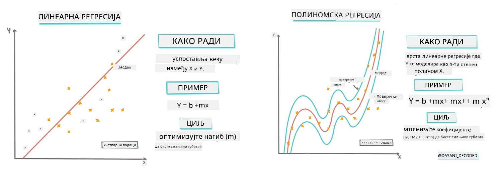
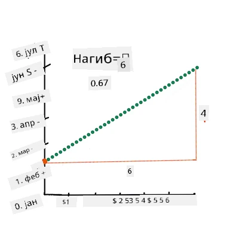
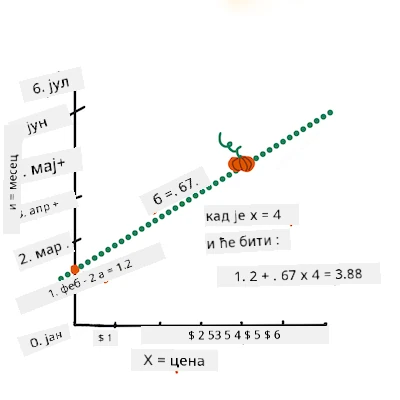
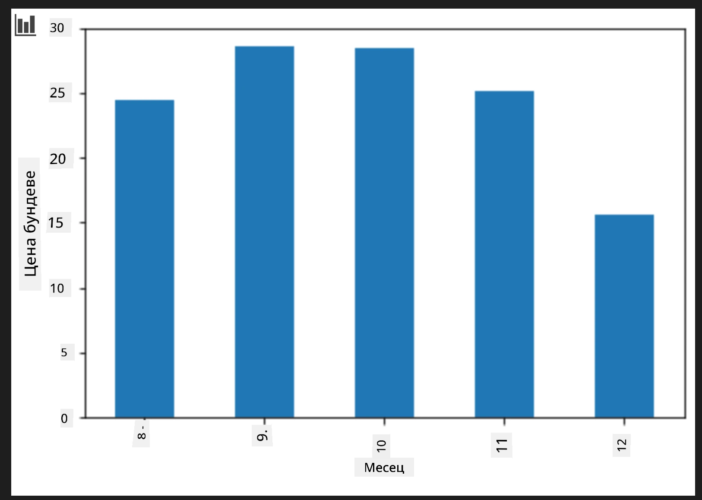
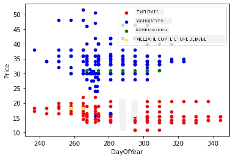

# Направите регресиони модел користећи Scikit-learn: регресија на четири начина

## Напомена за почетнике

Линеарна регресија се користи када желимо да предвидимо **нумеричку вредност** (на пример, цену куће, температуру или продају).
Ради тако што налази најбољу праву линију која представља везу између улазних карактеристика и излаза.

У овој лекцији се фокусирамо на разумевање концепта пре него што истражимо напредније технике регресије.

> Инфографик од [Dasani Madipalli](https://twitter.com/dasani_decoded)
## [Квиз пре предавања](https://ff-quizzes.netlify.app/en/ml/)

> ### [Ова лекција је доступна и у R!](../../../../2-Regression/3-Linear/solution/R/lesson_3.html)
### Увод

До сада сте истраживали шта је регресија на примеру података сакупљених из скупа података о ценама бундеве који ћемо користити током ове лекције. Такође сте приказали податке користећи Matplotlib.

Сада сте спремни да дубље зароните у регресију за машинско учење. Док визуелизација омогућава разумевање података, права снага машинског учења долази из _тренинга модела_. Модели се тренирају на историјским подацима како би аутоматски ухватили зависности у подацима и омогућили предвиђање исхода за нове податке које модел до тада није видео.

У овој лекцији научићете више о две врсте регресије: _основна линеарна регресија_ и _полиномна регресија_, заједно са неким математичким основама ових техника. Ови модели ће нам омогућити да предвидимо цене бундеве зависно од различитих улазних података.

[](https://youtu.be/CRxFT8oTDMg "ML за почетнике - Разумевање линеарне регресије")

> 🎥 Кликните на слику изнад за кратак видео преглед линеарне регресије.

> Током овог курикулума претпостављамо минимално познавање математике и трудимо се да буде приступачна студентима из других области, па обратите пажњу на напомене, 🧮 илустрације, дијаграме и друге алате за учење који помажу у разумевању.

### Претпоставка

До сада бисте требали бити упознати са структуром података о бундевама које прегледамо. Они су унапред учитани и очишћени у датотеци _notebook.ipynb_ ове лекције. У датотеци је цена бундеве приказана по бушелу у новом DataFrame-у. Уверите се да можете покренути ове нотебуке у Visual Studio Code окружењу.

### Припрема

Као подсетник, учитавате ове податке како бисте могли да им постављате питања.

- Када је најбоље време за куповину бундеве?
- Коју цену могу очекивати за кутију минијатурних бундевa?
- Да ли треба да их купим у корпама од пола бушела или у кутијама од 1 1/9 бушела?
Хајде да наставимо да истражујемо ове податке.

У претходној лекцији креирали сте Pandas DataFrame и употпунили га делом оригиналног скупа података, стандардизујући цене по бушелу. Међутим, тад сте могли скупити око 400 тачака података и само за јесење месеце.

Погледајте податке које смо учитали у нотебук ове лекције. Податак је учитан унапред и приказан је почетни scatterplot који показује податке по месецу. Можда можемо добити детаљније информације о природи података ако их додатно очистимо.

## Линеарна линија регресије

Као што сте научили у Лекцији 1, циљ линеарне регресије је да се прикаже линија која:

- **Показује релације између варијабли**. Приказује однос између варијабли
- **Прави предвиђања**. Прецизно предвиђа где би нова тачка могла пасти у односу на ту линију.

Типично је за **Линијску регресију најмањих квадрата** да се црта оваква линија. Појам „најмањих квадрата“ односи се на процес минимизације укупне грешке у моделу. За сваку тачку мере се вертикална удаљеност (названа резидуала) између стварне тачке и наше регресионе линије.

Ове удаљености квадратујемо из два главна разлога:

1. **Величина над правцем:** Желимо да посматрамо грешку од -5 као исту као и грешку од +5. Квадрирање претвара све вредности у позитивне.

2. **Кажњавање екстрема:** Квадрирање даје већу тежину већим грешкама, приморавајући линију да буде ближе удаљеним тачкама.

Онда сабирамо све ове квадрате. Циљ нам је да нађемо прецизну линију где је овај збир најмањи (најмања могућа вредност) — отуда и назив „најмањих квадрата“.

> **🧮 Покажи ми математику**  
>  
> Ова линија, названа _линија најбољег уклапања_, може се изразити [једначином](https://en.wikipedia.org/wiki/Simple_linear_regression):  
>  
> ```
> Y = a + bX
> ```
>
> `X` је 'објашњавајућа варијабла'. `Y` је 'зависна варијабла'. Нагиб линије је `b` а `a` је y-пресек, што означава вредност `Y` када је `X = 0`.  
>
>
>
> Прво израчунати нагиб `b`. Инфографик од [Jen Looper](https://twitter.com/jenlooper)
>
> Другим речима, и у вези са питањем о ценама бундеве: „предвидети цену бундеве по бушелу по месецу“, `X` би се односило на цену а `Y` на месец продаје.
>
>
>
> Израчунајте вредност Y. Ако плаћате око 4 долара, мора да је април! Инфографик од [Jen Looper](https://twitter.com/jenlooper)
>
> Математика која израчунава линију мора да прикаже нагиб линије, који такође зависи од пресека, односно где се `Y` налази када је `X = 0`.
>
> Метод за израчунавање ових вредности можете погледати на веб сајту [Math is Fun](https://www.mathsisfun.com/data/least-squares-regression.html). Такође посетите [овај калкулатор најмањих квадрата](https://www.mathsisfun.com/data/least-squares-calculator.html) да видите како вредности утичу на линију.

## Корелација

Један још термин који треба разумети је **коефицијент корелације** између датоих X и Y варијабли. Коришћењем scatterplot-а можете брзо визуелизовати овај коефицијент. График са тачкама распоређеним у лепој линији има високу корелацију, али график са тачкама распрсканим свуда између X и Y има ниску корелацију.

Добар линеарни регресиони модел имаће висок (ближи 1 него 0) коефицијент корелације користећи методу линијске регресије најмањих квадрата.

✅ Покрените нотебук који иде уз ову лекцију и погледајте scatterplot везе између Месеца и Цене. Да ли вам подаци који повезују Месец и Цену продаје бундеве делују као да имају високу или ниску корелацију, према вашем визуелном тумачењу графика? Да ли се то мења ако користите прецизнију меру уместо `Month`, нпр. *дан у години* (тј. број дана од почетка године)?

У дољем коду претпоставићемо да смо очистили податке и добили DataFrame под називом `new_pumpkins`, сличан овом:

ID | Month | DayOfYear | Variety | City | Package | Low Price | High Price | Price  
---|-------|-----------|---------|------|---------|-----------|------------|-------  
70 | 9 | 267 | PIE TYPE | BALTIMORE | 1 1/9 bushel cartons | 15.0 | 15.0 | 13.636364  
71 | 9 | 267 | PIE TYPE | BALTIMORE | 1 1/9 bushel cartons | 18.0 | 18.0 | 16.363636  
72 | 10 | 274 | PIE TYPE | BALTIMORE | 1 1/9 bushel cartons | 18.0 | 18.0 | 16.363636  
73 | 10 | 274 | PIE TYPE | BALTIMORE | 1 1/9 bushel cartons | 17.0 | 17.0 | 15.454545  
74 | 10 | 281 | PIE TYPE | BALTIMORE | 1 1/9 bushel cartons | 15.0 | 15.0 | 13.636364  

> Код за очишћавање података доступан је у [`notebook.ipynb`](notebook.ipynb). Урадили смо исте кораке чишћења као у претходној лекцији и израчунали колону `DayOfYear` овим изразом: 

```python
day_of_year = pd.to_datetime(pumpkins['Date']).apply(lambda dt: (dt-datetime(dt.year,1,1)).days)
```

Сада када разумете математику иза линеарне регресије, направимо регресиони модел да видимо можемо ли предвидети који пакет бундеве ће имати најбоље цене. Неко ко купује бундеве за празнично место можда ће желети ову информацију да оптимизује своје куповине.

## Тражење корелације

[](https://youtu.be/uoRq-lW2eQo "ML за почетнике - Тражење корелације: Кључ линеарне регресије")

> 🎥 Кликните на слику изнад за кратак видео преглед корелације.

Из претходне лекције вероватно сте видели да просечна цена за различите месеце изгледа овако:



Ово указује да постоји нека корелација, и можемо покушати да обучимо линеарни регресиони модел да предвиди везу између `Month` и `Price` или између `DayOfYear` и `Price`. Ево scatterplot који показује ову другу везу:

 

Погледајмо да ли постоји корелација користећи функцију `corr`:

```python
print(new_pumpkins['Month'].corr(new_pumpkins['Price']))
print(new_pumpkins['DayOfYear'].corr(new_pumpkins['Price']))
```

Изгледа да је корелација релативно мала, -0.15 по `Month` и -0.17 по `DayOfYear`, али може постојати нека друга важна веза. Изгледа да постоје различити кластери цена који одговарају различитим врстама бундеве. Да бисмо потврдили ову хипотезу, прикажимо сваку категорију бундеве у другој боји. Прослеђивањем параметра `ax` функцији за цртање `scatter` можемо приказати све тачке на истом графику:

```python
ax=None
colors = ['red','blue','green','yellow']
for i,var in enumerate(new_pumpkins['Variety'].unique()):
    df = new_pumpkins[new_pumpkins['Variety']==var]
    ax = df.plot.scatter('DayOfYear','Price',ax=ax,c=colors[i],label=var)
```

 

Наша истрага указује да врста има већи утицај на укупну цену од самог датума продаје. Ово можемо искусити на графикону:

```python
new_pumpkins.groupby('Variety')['Price'].mean().plot(kind='bar')
```

 

Фокусирајмо се за сада само на једну врсту бундеве, 'pie type', и видимо каквог утицаја датум има на цену:

```python
pie_pumpkins = new_pumpkins[new_pumpkins['Variety']=='PIE TYPE']
pie_pumpkins.plot.scatter('DayOfYear','Price') 
```
 

Ако сада израчунамо корелацију између `Price` и `DayOfYear` користећи функцију `corr`, добићемо нешто као `-0.27` - што значи да има смисла тренирати предиктивни модел.

> Пре тренинга линеарног регресионог модела, важно је уверити се да су наши подаци чисти. Линеарна регресија не ради добро са недостајућим вредностима, па има смисла уклонити све празне ћелије:

```python
pie_pumpkins.dropna(inplace=True)
pie_pumpkins.info()
```

Друга опција би била да се празне вредности попуне просечним вредностима из одговарајуће колоне.

## Једноставна линеарна регресија

[](https://youtu.be/e4c_UP2fSjg "ML за почетнике - Линеарна и полиномна регресија користећи Scikit-learn")

> 🎥 Кликните на слику изнад за кратак видео преглед линеарне и полиномне регресије.

За тренирање нашег линеарног регресионог модела користићемо библиотеку **Scikit-learn**.

```python
from sklearn.linear_model import LinearRegression
from sklearn.metrics import mean_squared_error
from sklearn.model_selection import train_test_split
```

Започињемо раздвајањем улазних вредности (карактеристика) и очекиваног излаза (ознака) у одвојене numpy низове:

```python
X = pie_pumpkins['DayOfYear'].to_numpy().reshape(-1,1)
y = pie_pumpkins['Price']
```

> Имајте на уму да смо морали користити `reshape` на улазним подацима како би пакет Линеарне регресије правилно разумео унос. Линеарна регресија очекује 2D низ као улаз, где сваки ред одговара вектору улазних карактеристика. У нашем случају, јер имамо само један улаз, треба нам низ облика N&times;1, где је N величина скупа података.

Затим морамо поделити податке на тренинг и тест групе, како бисмо могли да валидирамо наш модел након тренинга:

```python
X_train, X_test, y_train, y_test = train_test_split(X, y, test_size=0.2, random_state=0)
```

Коначно, само тренирање Линеарног регресионог модела траје само две линије кода. Дефинишемо објекат `LinearRegression`, и обучавамо га помоћу методе `fit`:

```python
lin_reg = LinearRegression()
lin_reg.fit(X_train,y_train)
```

Објекат `LinearRegression` након `fit` метода садржи све коефицијенте регресије, којима се може приступити помоћу својства `.coef_`. У нашем случају постоји само један коефицијент, који би требало да буде око `-0.017`. То значи да цене изгледа да мало падају са временом, али не превише, око 2 цента дневно. Можемо такође приступити пресеку регресије са Y-осом помоћу `lin_reg.intercept_` - он ће у нашем случају бити око `21`, што указује на цену на почетку године.

Да видимо колико је наш модел прецизан, можемо предвидети цене на тест сету, а затим измерити колико су наше предвиђања близу очекиваних вредности. Ово се може урадити коришћењем метрике корена средње квадратне грешке (RMSE), која представља корен из средње вредности свих квадратних разлика између очекиване и предвиђене вредности.

```python
pred = lin_reg.predict(X_test)

rmse = np.sqrt(mean_squared_error(y_test,pred))
print(f'RMSE: {rmse:3.3} ({rmse/np.mean(pred)*100:3.3}%)')
```

Наша грешка изгледа да је око 2 поена, што је ~17%. Није превише добро. Други показатељ квалитета модела је **коефицијент детерминације**, који се добија овако:

```python
score = lin_reg.score(X_train,y_train)
print('Model determination: ', score)
```
Ако је вредност 0, то значи да модел не узима у обзир улазне податке и понаша се као *најгору линеарну претпоставку*, која је једноставно средња вредност резултата. Вредност 1 значи да можемо савршено предвидети све очекиване излазе. У нашем случају коефицијент је око 0.06, што је прилично ниско.

Такође можемо нацртати тест податке заједно са регресионом линијом како бисмо боље видели како регресија ради у нашем случају:

```python
plt.scatter(X_test,y_test)
plt.plot(X_test,pred)
```


## Полиномијална регресија

Још један тип линеарне регресије је полиномијална регресија. Иако повремено постоји линеарна веза између променљивих – што већа запремина бундеве, то је цена виша – понекад се ове везе не могу приказати као раван или права линија.

✅ Ево [још неких примера](https://online.stat.psu.edu/stat501/Lesson09#polynomial-regression-examples) података који би могли користити полиномијалну регресију

Погледајте поново везу између датума и цене. Да ли овај расејни график делује као да би га нужно требало анализирати правом линијом? Зар цене не могу да варирају? У овом случају можете покушати полиномијалну регресију.

✅ Полиноми су математички изрази који могу садржати једну или више променљивих и коефицијената

Полиномијална регресија креира закривљену линију да боље прилагоди нелинеарне податке. У нашем случају, ако укључимо квадратну променљиву `DayOfYear` у улазне податке, требало би да можемо да прилагодимо наше податке параболичном кривом која ће имати минимум у некој тачки у години.

Scikit-learn укључује корисни [pipeline API](https://scikit-learn.org/stable/modules/generated/sklearn.pipeline.make_pipeline.html?highlight=pipeline#sklearn.pipeline.make_pipeline) за комбиновање различитих корака обраде података. **Pipeline** је ланац **ентиматора (estimators)**. У нашем случају ћемо направити pipeline који прво додаје полиномијалне карактеристике нашем моделу, а затим тренира регресију:

```python
from sklearn.preprocessing import PolynomialFeatures
from sklearn.pipeline import make_pipeline

pipeline = make_pipeline(PolynomialFeatures(2), LinearRegression())

pipeline.fit(X_train,y_train)
```

Коришћење `PolynomialFeatures(2)` значи да ћемо укључити све полиноме другог степена из улазних података. У нашем случају то ће само значити `DayOfYear`<sup>2</sup>, али ако имамо две улазне променљиве X и Y, то ће додати X<sup>2</sup>, XY и Y<sup>2</sup>. Такође можемо користити полиноме виших степени ако желимо.

Pipeline-ови се могу користити на исти начин као и оригинални `LinearRegression` објекат, односно можемо `fit`-овати pipeline, а затим користити `predict` за добијање резултата предвиђања:

```python
pred = pipeline.predict(X_test)

rmse = np.sqrt(mean_squared_error(y_test,pred))
print(f'RMSE: {rmse:3.3} ({rmse/np.mean(pred)*100:3.3}%)')

score = pipeline.score(X_train,y_train)
print('Model determination: ', score)
```

За цртање глатке апроксимационе криве користимо `np.linspace` да створимо равномерни опсег улазних вредности, уместо да цртамо директно на неуређеним тест подацима (што би произвело зигзаг линију):

```python
X_range = np.linspace(X_test.min(), X_test.max(), 100).reshape(-1,1)
y_range = pipeline.predict(X_range)

plt.scatter(X_test, y_test)
plt.plot(X_range, y_range)
```

Ево графика који приказује тест податке и апроксимациону криву:


Коришћењем полиномијалне регресије можемо добити благо нижу RMSE и виши коефицијент детерминације, али не значајно. Морамо узети у обзир и друге карактеристике!

> Можете видети да се минималне цене бундеве посматрају негде око Ноћи вештица. Како то објашњавате?

🎃 Честитамо, управо сте креирали модел који може помоћи у предвиђању цене пумпкин пита. Вероватно можете поновити исти поступак за све врсте бундеве, али то би било заморно. Хајде сада да сазнамо како да рачунамо са разним врстама бундеве у нашем моделу!

## Категоријалне карактеристике

У идеалном свету желимо бити у могућности да предвидимо цене за различите врсте бундеве користећи исти модел. Међутим, колона `Variety` је нешто другачија од колона као што је `Month`, јер садржи нумерички неприхватљиве вредности. Такве колоне се зову **категоријалне**.

[](https://youtu.be/DYGliioIAE0 "ML за почетнике - предвиђања категоријалних карактеристика помоћу линеарне регресије")

> 🎥 Кликните на слику изнад за кратак видео преглед коришћења категоријалних карактеристика.

Овде можете видети како просечна цена зависи од врсте:


Да бисмо узели у обзир врсту, прво морамо да је конвертујемо у нумерички облик, односно да је **енкодујемо**. Постоји неколико начина да то урадимо:

* Једноставна **нумеричка енкодација** ће направити табелу различитих врста, а затим заменити име врсте индексом у тој табели. Ово није најбоља идеја за линеарну регресију, јер линеарна регресија узима стварну нумеричку вредност индекса и додаје је у резултат, множећи неким коефицијентом. У нашем случају, однос између броја индекса и цене је очигледно нелинеаран, чак и ако бисмо осигурали да су индекси поређани на неки специфичан начин.
* **One-hot енкодација** ће заменити колону `Variety` са 4 различите колоне, по једна за сваку врсту. Свака колона ће садржати `1` ако је одговарајући ред дате врсте, а `0` у супротном. То значи да ће у линеарној регресији постојати четири коефицијента, по један за сваку врсту бундеве, одговорни за „почетну цену“ (или боље речено „додатну цену“) за ту конкретну врсту.

Код у наставку показује како можемо обавити one-hot енкодацију врсте:

```python
pd.get_dummies(new_pumpkins['Variety'])
```

 ID | FAIRYTALE | MINIATURE | MIXED HEIRLOOM VARIETIES | PIE TYPE
----|-----------|-----------|--------------------------|----------
70 | 0 | 0 | 0 | 1
71 | 0 | 0 | 0 | 1
... | ... | ... | ... | ...
1738 | 0 | 1 | 0 | 0
1739 | 0 | 1 | 0 | 0
1740 | 0 | 1 | 0 | 0
1741 | 0 | 1 | 0 | 0
1742 | 0 | 1 | 0 | 0

Да бисмо обучили линеарну регресију користећи one-hot енкодовану врсту као улаз, само треба правилно иницијализовати податке `X` и `y`:

```python
X = pd.get_dummies(new_pumpkins['Variety'])
y = new_pumpkins['Price']
```

Остатак кода је исти као онај који смо користили горе за обуку Линеарне регресије. Ако покушате, видећете да је средња квадратна грешка отприлике иста, али добијамо много већи коефицијент детерминације (~77%). Да бисмо добили још прецизнија предвиђања, можемо узети у обзир више категоријалних карактеристика као и нумеричке карактеристике, попут `Month` или `DayOfYear`. Да бисмо добили један велики низ карактеристика, можемо користити `join`:

```python
X = pd.get_dummies(new_pumpkins['Variety']) \
        .join(new_pumpkins['Month']) \
        .join(pd.get_dummies(new_pumpkins['City'])) \
        .join(pd.get_dummies(new_pumpkins['Package']))
y = new_pumpkins['Price']
```

Овде такође узимамо у обзир `City` и тип `Package`, што нам даје RMSE 2.84 (10.5%) и коефицијент детерминације 0.94!

## Све заједно

Да бисмо направили најбољи модел, можемо користити комбиноване (one-hot енкодиране категоријалне + нумеричке) податке из горњег примера заједно са полиномијалном регресијом. Ево потпуног кода за вашу удобност:

```python
# подесите податке за обуку
X = pd.get_dummies(new_pumpkins['Variety']) \
        .join(new_pumpkins['Month']) \
        .join(pd.get_dummies(new_pumpkins['City'])) \
        .join(pd.get_dummies(new_pumpkins['Package']))
y = new_pumpkins['Price']

# направите подјелу на тренинг и тест
X_train, X_test, y_train, y_test = train_test_split(X, y, test_size=0.2, random_state=0)

# подесите и обучите стеам
pipeline = make_pipeline(PolynomialFeatures(2), LinearRegression())
pipeline.fit(X_train,y_train)

# предвидите резултате за тест податке
pred = pipeline.predict(X_test)

# израчунати RMSE и коефицијент детерминације
rmse = mean_squared_error(y_test, pred, squared=False)
print(f'RMSE: {rmse:3.3} ({rmse/pred.mean()*100:3.3}%)')

score = pipeline.score(X_train,y_train)
print('Model determination: ', score)
```

Ово би нам требало дати најбољи коефицијент детерминације од скоро 97% и RMSE = 2.23 (~8% грешке предвиђања).

| Модел | RMSE | Детерминација |
|-------|-----|---------------|
| Линеарни `DayOfYear` | 2.77 (17.2%) | 0.07 |
| Полиномијални `DayOfYear` | 2.73 (17.0%) | 0.08 |
| Линеарни `Variety` | 5.24 (19.7%) | 0.77 |
| Линеарни сви подаци | 2.84 (10.5%) | 0.94 |
| Полиномијални сви подаци | 2.23 (8.25%) | 0.97 |

🏆 Браво! Направили сте четири регресиона модела у једном часу и побољшали квалитет модела на 97%. У завршном делу о регресији научићете о логистичкој регресији за одређивање категорија.

---
## 🚀Изазов

Тестирајте неколико различитих променљивих у овом нотебоок-у да видите како корелација одговара тачности модела.

## [Квиз после предавања](https://ff-quizzes.netlify.app/en/ml/)

## Ревизија и самостални рад

У овом часу смо научили о линеарној регресији. Постоје и други важни типови регресије. Прочитајте о Stepwise, Ridge, Lasso и Elasticnet техникама. Добар курс за учење више је [Stanford Statistical Learning курс](https://online.stanford.edu/courses/sohs-ystatslearning-statistical-learning)

## Задатак

[Направите модел](assignment.md)

---

<!-- CO-OP TRANSLATOR DISCLAIMER START -->
**Одрицање од одговорности**:  
Овај документ је преведен коришћењем AI сервиса за превод [Co-op Translator](https://github.com/Azure/co-op-translator). Иако се трудимо да превод буде тачан, имајте у виду да аутоматски преводи могу садржати грешке или нетачности. Првобитни документ на његовом изворном језику треба сматрати ауторитетом. За важне информације се препоручује професионални људски превод. Нисмо одговорни за било какве неспоразуме или погрешне тумачења настала коришћењем овог превода.
<!-- CO-OP TRANSLATOR DISCLAIMER END -->