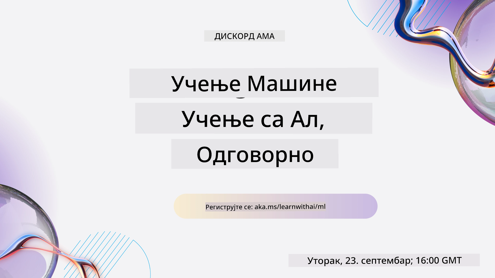
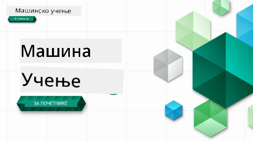

[](https://github.com/microsoft/ML-For-Beginners/blob/master/LICENSE)
[](https://GitHub.com/microsoft/ML-For-Beginners/graphs/contributors/)
[](https://GitHub.com/microsoft/ML-For-Beginners/issues/)
[](https://GitHub.com/microsoft/ML-For-Beginners/pulls/)
[](http://makeapullrequest.com)

[](https://GitHub.com/microsoft/ML-For-Beginners/watchers/)
[](https://GitHub.com/microsoft/ML-For-Beginners/network/)
[](https://GitHub.com/microsoft/ML-For-Beginners/stargazers/)

### 🌐 Подршка за више језика

#### Преводи одржавани уз помоћ [Co-op Translator](https://github.com/Azure/co-op-translator)

<!-- CO-OP TRANSLATOR LANGUAGES TABLE START -->
[арапски](../ar/README.md) | [енглески](../bn/README.md) | [бугарски](../bg/README.md) | [бурмански (Мјанмар)](../my/README.md) | [кинески (поједностављени)](../zh-CN/README.md) | [кинески (традиционални, Хонг Конг)](../zh-HK/README.md) | [кинески (традиционални, Макао)](../zh-MO/README.md) | [кинески (традиционални, Тајван)](../zh-TW/README.md) | [хрватски](../hr/README.md) | [чешки](../cs/README.md) | [дански](../da/README.md) | [холандски](../nl/README.md) | [естонски](../et/README.md) | [фински](../fi/README.md) | [француски](../fr/README.md) | [немачки](../de/README.md) | [грчки](../el/README.md) | [хебрејски](../he/README.md) | [хинди](../hi/README.md) | [мађарски](../hu/README.md) | [индонежански](../id/README.md) | [италијански](../it/README.md) | [јапански](../ja/README.md) | [каннада](../kn/README.md) | [кмерски](../km/README.md) | [корејски](../ko/README.md) | [литвански](../lt/README.md) | [малајски](../ms/README.md) | [малајалам](../ml/README.md) | [манипури (Меитеи Мајек)](../mni/README.md) | [маратхи](../mr/README.md) | [непалски](../ne/README.md) | [нигеријски пиджин](../pcm/README.md) | [норвешки](../no/README.md) | [персијски (фарси)](../fa/README.md) | [пољски](../pl/README.md) | [португалски (Бразил)](../pt-BR/README.md) | [португалски (Португал)](../pt-PT/README.md) | [пунџабски (Гурумухи)](../pa/README.md) | [румунски](../ro/README.md) | [руски](../ru/README.md) | [српски (ћирилица)](./README.md) | [словачки](../sk/README.md) | [словеначки](../sl/README.md) | [шпански](../es/README.md) | [свахили](../sw/README.md) | [шведски](../sv/README.md) | [тагалог (филипински)](../tl/README.md) | [тамилски](../ta/README.md) | [телугу](../te/README.md) | [тајски](../th/README.md) | [турски](../tr/README.md) | [украјински](../uk/README.md) | [урду](../ur/README.md) | [вијетнамски](../vi/README.md)

> **Волите да клоните локално?**
>
> Овај репозиторјум укључује више од 50 превода што значајно повећава величину преузимања. Да бисте клонали без превода, користите sparse checkout:
>
> **Bash / macOS / Linux:**
> ```bash
> git clone --filter=blob:none --sparse https://github.com/microsoft/ML-For-Beginners.git
> cd ML-For-Beginners
> git sparse-checkout set --no-cone '/*' '!translations' '!translated_images'
> ```
>
> **CMD (Windows):**
> ```cmd
> git clone --filter=blob:none --sparse https://github.com/microsoft/ML-For-Beginners.git
> cd ML-For-Beginners
> git sparse-checkout set --no-cone "/*" "!translations" "!translated_images"
> ```
>
> Ово вам даје све што вам је потребно за завршетак курса уз много брже преузимање.
<!-- CO-OP TRANSLATOR LANGUAGES TABLE END -->

#### Придружите се нашој заједници

[](https://discord.gg/nTYy5BXMWG)

Имамо текући Discord серијал научи са АИ, сазнајте више и придружите нам се на [Learn with AI Series](https://aka.ms/learnwithai/discord) од 18. до 30. септембра 2025. Добит ћете савете и трикове о коришћењу GitHub Copilot за Data Science.



# Машинско учење за почетнике - План наставе

> 🌍 Путујте око света док истражујемо машинско учење кроз културе света 🌍

Cloud Advocates у Microsoft-у са задовољством нуде 12-недељни, 26-лекција план наставе који се бави **машинским учењем**. У овом курикулуму ћете научити о ономе што се понекад зове **класично машинско учење**, користећи углавном библиотеку Scikit-learn и избегавајући дубоко учење, које је обрађено у нашем [AI for Beginners' curriculum](https://aka.ms/ai4beginners). Комбинујте ове лекције са нашим ['Data Science for Beginners' curriculum](https://aka.ms/ds4beginners)!

Путујте са нама око света примењујући ове класичне методе на податке из различитих крајева света. Свакa лекцијa укључује квиз пре и после лекције, писане инструкције за овај садржај, решење, задатак и још много тога. Наша педагогија заснована на пројектима омогућава вам учење кроз израду, што је докузан начин да нове вештине остану са вама.

**✍️ Срдачна захвалност нашим ауторима** Џен Лупер, Стивен Хауел, Франческа Лаццери, Томоми Имура, Кеси Бревију, Дмитриј Сошников, Крис Норинг, Анирбан Мукерџи, Орнела Алтуњан, Рут Јакубу и Ејми Бојд

**🎨 Захвалност илустраторима** Томоми Имура, Дасани Мадипали и Џен Лупер

**🙏 Посебна захвалност 🙏 Microsoft Student Ambassador ауторима, рецензентима и доприносиоцима садржаја**, нарочито Ришит Дагли, Мухамад Сакиб Кан Инан, Рохан Рај, Александру Петреску, Абхишек Џаисвал, Наврин Табасум, Јоан Самуила и Снигдха Агарвал

**🤩 Посебна захвалност Microsoft Student Ambassador-има Ерик Вањау, Јаслин Сонди и Видуши Гупта за наше R лекције!**

# Почетак рада

Пратите ове кораке:
1. **Разгранајте репозиторјум**: Кликните на дугме "Fork" у горњем десном углу ове странице.
2. **Клонирајте репозиторјум**: `git clone https://github.com/microsoft/ML-For-Beginners.git`

> 💡 **Брзи савет:** Желите да започнете у претраживачу без подешавања Python-а локално? Користите [GitHub Codespaces](https://github.com/features/codespaces) за креирање окружења за развој у облаку за ваш fork. Отворите зелени мени **Code**, изаберите **Codespaces** и направите кодспејс; инсталирајте сваки потребан зависни пакет за лекцију како је потребно.

> [пронађите све додатне ресурсе за овај курс у нашој Microsoft Learn колекцији](https://learn.microsoft.com/en-us/collections/qrqzamz1nn2wx3?WT.mc_id=academic-77952-bethanycheum)

> 🔧 **Треба вам помоћ?** Погледајте наш [Водич за решавање проблема](TROUBLESHOOTING.md) за решења уобичајених проблема са инсталацијом, подешавањем и покретањем лекција.


**[Студенти](https://aka.ms/student-page)**, да бисте користили овај курикулум, разгранајте цео репозиторјум на свој GitHub налог и радите на вежбама сами или у групи:

- Почните квизом пре предавања.
- Прочитајте предавање и извршите активности, правећи паузе за размишљање на сваки проверач знања.
- Покушајте да сами направите пројекте разумејући лекције уместо да само покрећете решења; иако су решења доступна у `/solution` фасциклама у свакој лекцији која је усмерена ка пројектима.
- Урадите квиз после предавања.
- Урадите изазов.
- Завршите задатак.
- Након завршетка групе лекција, посетите [Discussion Board](https://github.com/microsoft/ML-For-Beginners/discussions) и "учите наглас" попуњавајући одговарајућу PAT рубрику. PAT је алат за процену напретка који попуњавате за дубље учење. Можете се и реактивирати на друге PAT-ове како бисмо заједно учили.

> За даље изучавање препоручујемо ове [Microsoft Learn](https://docs.microsoft.com/en-us/users/jenlooper-2911/collections/k7o7tg1gp306q4?WT.mc_id=academic-77952-leestott) модуле и учењске путеве.

**Наставници**, укључили смо [неколико предлога](for-teachers.md) како да користите овај курикулум.

---

## Видео туторијали

Неке лекције су доступне као кратки видео снимци. Све их можете пронаћи у оквиру лекција или на [ML for Beginners плејлисти на Microsoft Developer YouTube каналу](https://aka.ms/ml-beginners-videos) кликом на слику испод.

[](https://aka.ms/ml-beginners-videos)

---

## Упознајте тим

[](https://youtu.be/Tj1XWrDSYJU)

**GIF од** [Mohit Jaisal](https://linkedin.com/in/mohitjaisal)

> 🎥 Кликните на слику изнад за видео о пројекту и људима који су га креирали!

---

## Педагогија

Изабрали смо два педагошка начела приликом креирања овог курикулума: обезбеђивање да буде практичан и заснован на **пројектима** и да укључује **честе квизове**. Поред тога, овај курикулум има заједничку **тему** која му даје кохезију.

Обезбеђивањем да садржај буде усаглашен са пројектима, процес је занимљивији за студенте и повећава задржавање појмова. Поред тога, квиз са малим улогом пре часова поставља намјеру студента да учи тему, док други квиз после часа осигурава даље задржавање. Овај курикулум је дизајниран да буде флексибилан и занимљив и може се учити у целини или делимично. Пројекти почињу једноставно и постају све сложенији до краја 12-недељног циклуса. Курикулум укључује и постскриптум о применама машинског учења у стварном свету, који се може кориситити као додатни кредит или основа за дискусију.

> Пронађите наше смернице [Code of Conduct](CODE_OF_CONDUCT.md), [Contributing](CONTRIBUTING.md), [Translations](..) и [Troubleshooting](TROUBLESHOOTING.md). Радујемо се вашим конструктивним повратним информацијама!

## Свако предавање укључује

- опционални скич или белешку
- опционални додатни видео
- видео туторијал (само неке лекције)
- [квиз за загревање пре предавања](https://ff-quizzes.netlify.app/en/ml/)
- писане лекције
- за лекције засноване на пројектима, корак по корак упутства како направити пројекат
- провере знања
- изазов
- додатна литература
- задатак
- [квиз после предавања](https://ff-quizzes.netlify.app/en/ml/)

> **Напомена о језицима**: Ове лекције су углавном написане на Python-у, али многе су доступне и на R-у. Да бисте завршили R лекцију, идите у `/solution` фолдер и тражите R лекције. Оне имају .rmd екстензију која представља **R Markdown** фајл који се може једноставно дефинисати као уградња `code chunks` (R или других језика) и `YAML header` (којим се води форматирање излаза попут PDF-a) у `Markdown document`. Као такви, служе као узоран оквир за ауторство у Data Science јер вам омогућавају да комбинујете свој код, излаз и своје размишљање кроз писање у Markdown-у. Штавише, R Markdown документи могу бити извезени у формате као што су PDF, HTML или Word.

> **Напомена о квизовима**: Сви квизови се налазе у [Quiz App фасцикли](../../quiz-app), укупно 52 квиза од по три питања. Они су повезани унутар лекција, али се апликација за квиз може покренути и локално; пратите упутства у `quiz-app` фасцикли за локални хостинг или распоређивање на Azure.

| Број лекције |                             Тема                              |                   Груписање лекције                   | Циљеви учења                                                                                                             |                                                              Повезана лекција                                                               |                        Аутор                        |
| :-----------: | :------------------------------------------------------------: | :-------------------------------------------------: | ------------------------------------------------------------------------------------------------------------------------------- | :--------------------------------------------------------------------------------------------------------------------------------------: | :--------------------------------------------------: |
|      01       |                Увод у машинско учење                |      [Увод](1-Introduction/README.md)       | Научите основне концепте машинског учења                                                                                |                                             [Лекција](1-Introduction/1-intro-to-ML/README.md)                                             |                       Мухаммад                       |
|      02       |                Историја машинског учења                 |      [Увод](1-Introduction/README.md)       | Упознајте се са историјом коју ова област обухвата                                                                                         |                                            [Лекција](1-Introduction/2-history-of-ML/README.md)                                            |                     Џен и Ејми                      |
|      03       |                 Праведност и машинско учење                  |      [Увод](1-Introduction/README.md)       | Која су важна филозофска питања о праведности која студенти треба да размотре приликом изградње и примене ML модела? |                                              [Лекција](1-Introduction/3-fairness/README.md)                                               |                        Томоми                        |
|      04       |                Технике машинског учења                 |      [Увод](1-Introduction/README.md)       | Које технике истраживачи ML користе за изградњу ML модела?                                                                       |                                          [Лекција](1-Introduction/4-techniques-of-ML/README.md)                                           |                    Крис и Џен                     |
|      05       |                   Увод у регресију                   |        [Регресија](2-Regression/README.md)         | Започните са Python и Scikit-learn за регресионе моделе                                                                  |         [Python](2-Regression/1-Tools/README.md) • [R](../../2-Regression/1-Tools/solution/R/lesson_1.html)         |      Џен • Ерик Вањау       |
|      06       |                Цене тикви у Северној Америци 🎃                |        [Регресија](2-Regression/README.md)         | Визуелизујте и очистите податке у припреми за ML                                                                                  |          [Python](2-Regression/2-Data/README.md) • [R](../../2-Regression/2-Data/solution/R/lesson_2.html)          |      Џен • Ерик Вањау       |
|      07       |                Цене тикви у Северној Америци 🎃                |        [Регресија](2-Regression/README.md)         | Направите линеарне и полиномијалне регресионе моделе                                                                                   |        [Python](2-Regression/3-Linear/README.md) • [R](../../2-Regression/3-Linear/solution/R/lesson_3.html)        |      Џен и Дмитриј • Ерик Вањау       |
|      08       |                Цене тикви у Северној Америци 🎃                |        [Регресија](2-Regression/README.md)         | Направите логистички регресионни модел                                                                                               |     [Python](2-Regression/4-Logistic/README.md) • [R](../../2-Regression/4-Logistic/solution/R/lesson_4.html)      |      Џен • Ерик Вањау       |
|      09       |                          Веб апликација 🔌                          |           [Веб апликација](3-Web-App/README.md)            | Направите веб апликацију да користите обучени модел                                                                                       |                                                 [Python](3-Web-App/1-Web-App/README.md)                                                  |                         Џен                          |
|      10       |                 Увод у класификацију                 |    [Класификација](4-Classification/README.md)     | Очистите, припремите и визуализујте ваше податке; увод у класификацију                                                            | [Python](4-Classification/1-Introduction/README.md) • [R](../../4-Classification/1-Introduction/solution/R/lesson_10.html)  | Џен и Каси • Ерик Вањау |
|      11       |             Укусне азијске и индијске кухиње 🍜             |    [Класификација](4-Classification/README.md)     | Увод у класификаторе                                                                                                     | [Python](4-Classification/2-Classifiers-1/README.md) • [R](../../4-Classification/2-Classifiers-1/solution/R/lesson_11.html) | Џен и Каси • Ерик Вањау |
|      12       |             Укусне азијске и индијске кухиње 🍜             |    [Класификација](4-Classification/README.md)     | Више класификатора                                                                                                                | [Python](4-Classification/3-Classifiers-2/README.md) • [R](../../4-Classification/3-Classifiers-2/solution/R/lesson_12.html) | Џен и Каси • Ерик Вањау |
|      13       |             Укусне азијске и индијске кухиње 🍜             |    [Класификација](4-Classification/README.md)     | Направите препоручивачку веб апликацију користећи ваш модел                                                                                    |                                              [Python](4-Classification/4-Applied/README.md)                                              |                         Џен                          |
|      14       |                   Увод у кластеровање                   |        [Кластеровање](5-Clustering/README.md)         | Очистите, припремите и визуализујте ваше податке; Увод у кластеровање                                                                |         [Python](5-Clustering/1-Visualize/README.md) • [R](../../5-Clustering/1-Visualize/solution/R/lesson_14.html)         |      Џен • Ерик Вањау       |
|      15       |              Истраживање музичких укуса у Нигерији 🎧              |        [Кластеровање](5-Clustering/README.md)         | Истражите K-знакова метода кластеровања                                                                                           |           [Python](5-Clustering/2-K-Means/README.md) • [R](../../5-Clustering/2-K-Means/solution/R/lesson_15.html)           |      Џен • Ерик Вањау       |
|      16       |        Увод у обраду природног језика ☕️         |   [Обрада природног језика](6-NLP/README.md)    | Научите основе NLP прављењем једноставног бота                                                                             |                                             [Python](6-NLP/1-Introduction-to-NLP/README.md)                                              |                       Стивен                        |
|      17       |                      Уобичајени задаци NLP ☕️                      |   [Обрада природног језика](6-NLP/README.md)    | Продубите знање о NLP разумевањем уобичајених задатака који су потребни при раду са језичким структурама                          |                                                    [Python](6-NLP/2-Tasks/README.md)                                                     |                       Стивен                        |
|      18       |             Превод и анализа сентимента ♥️              |   [Обрада природног језика](6-NLP/README.md)    | Превод и анализа сентимента са Џејн Остином                                                                             |                                            [Python](6-NLP/3-Translation-Sentiment/README.md)                                             |                       Стивен                        |
|      19       |                  Романтични хотели Европе ♥️                  |   [Обрада природног језика](6-NLP/README.md)    | Анализа сентимента са рецензијама хотела 1                                                                                         |                                               [Python](6-NLP/4-Hotel-Reviews-1/README.md)                                                |                       Стивен                        |
|      20       |                  Романтични хотели Европе ♥️                  |   [Обрада природног језика](6-NLP/README.md)    | Анализа сентимента са рецензијама хотела 2                                                                                         |                                               [Python](6-NLP/5-Hotel-Reviews-2/README.md)                                                |                       Стивен                        |
|      21       |            Увод у прогнозирање временских серија             |        [Временске серије](7-TimeSeries/README.md)        | Увод у прогнозирање временских серија                                                                                         |                                             [Python](7-TimeSeries/1-Introduction/README.md)                                              |                      Франческа                       |
|      22       | ⚡️ Потрошња електричне енергије у свету ⚡️ - прогнозирање временских серија помоћу ARIMA |        [Временске серије](7-TimeSeries/README.md)        | Прогнозирање временских серија помоћу ARIMA                                                                                              |                                                 [Python](7-TimeSeries/2-ARIMA/README.md)                                                 |                      Франческа                       |
|      23       |  ⚡️ Потрошња електричне енергије у свету ⚡️ - прогнозирање временских серија помоћу SVR  |        [Временске серије](7-TimeSeries/README.md)        | Прогнозирање временских серија помоћу регресије векторских машина                                                                           |                                                  [Python](7-TimeSeries/3-SVR/README.md)                                                  |                       Анирбан                        |
|      24       |             Увод у учење појачањем             | [Учење појачањем](8-Reinforcement/README.md) | Увод у учење појачањем са Q-Learning                                                                          |                                             [Python](8-Reinforcement/1-QLearning/README.md)                                              |                        Дмитриј                        |
|      25       |                 Помозите Петеру да избегне вука! 🐺                  | [Учење појачањем](8-Reinforcement/README.md) | Gym за учење појачањем                                                                                                      |                                                [Python](8-Reinforcement/2-Gym/README.md)                                                 |                        Дмитриј                        |
|  Постскрипт   |            Реални сценарији и примене ML            |      [ML у дивљини](9-Real-World/README.md)       | Занимљиве и откривајуће примене класичног ML у стварном свету                                                               |                                             [Лекција](9-Real-World/1-Applications/README.md)                                              |                         Тим                         |
|  Постскрипт   |            Дебаговање модела у ML користећи RAI контролну таблу            |      [ML у дивљини](9-Real-World/README.md)       | Дебаговање модела у машинском учењу користећи компоненте одговорног AI контролне табле                                                              |                                             [Лекција](9-Real-World/2-Debugging-ML-Models/README.md)                                              |                     Рут Јакубу                      |

> [пронађите све додатне ресурсе за овај курс у нашој колекцији Microsoft Learn](https://learn.microsoft.com/en-us/collections/qrqzamz1nn2wx3?WT.mc_id=academic-77952-bethanycheum)

## Приступ офлајн

Можете да покренете ову документацију офлајн помоћу [Docsify](https://docsify.js.org/#/). Форкујте овај репозиторијум, [инсталирајте Docsify](https://docsify.js.org/#/quickstart) на вашем локалном рачунару, и у коренском фолдеру овог репозиторијума укуцајте `docsify serve`. Вебсајт ће се сервирати на порту 3000 на вашем локалхосту: `localhost:3000`.

## PDF-ови

Пронађите PDF наставног плана са линковима [овде](https://microsoft.github.io/ML-For-Beginners/pdf/readme.pdf).


## 🎒 Остали курсеви 

Наш тим производи и друге курсеве! Погледајте:

<!-- CO-OP TRANSLATOR OTHER COURSES START -->
### LangChain
[](https://aka.ms/langchain4j-for-beginners)
[](https://aka.ms/langchainjs-for-beginners?WT.mc_id=m365-94501-dwahlin)
[](https://github.com/microsoft/langchain-for-beginners?WT.mc_id=m365-94501-dwahlin)
---

### Azure / Edge / MCP / Агенти
[](https://github.com/microsoft/AZD-for-beginners?WT.mc_id=academic-105485-koreyst)
[](https://github.com/microsoft/edgeai-for-beginners?WT.mc_id=academic-105485-koreyst)
[](https://github.com/microsoft/mcp-for-beginners?WT.mc_id=academic-105485-koreyst)
[](https://github.com/microsoft/ai-agents-for-beginners?WT.mc_id=academic-105485-koreyst)

---
 
### Сериија о генеративној вештачкој интелигенцији
[](https://github.com/microsoft/generative-ai-for-beginners?WT.mc_id=academic-105485-koreyst)
[-9333EA?style=for-the-badge&labelColor=E5E7EB&color=9333EA)](https://github.com/microsoft/Generative-AI-for-beginners-dotnet?WT.mc_id=academic-105485-koreyst)
[-C084FC?style=for-the-badge&labelColor=E5E7EB&color=C084FC)](https://github.com/microsoft/generative-ai-for-beginners-java?WT.mc_id=academic-105485-koreyst)
[-E879F9?style=for-the-badge&labelColor=E5E7EB&color=E879F9)](https://github.com/microsoft/generative-ai-with-javascript?WT.mc_id=academic-105485-koreyst)

---
 
### Основно учење
[](https://aka.ms/ml-beginners?WT.mc_id=academic-105485-koreyst)
[](https://aka.ms/datascience-beginners?WT.mc_id=academic-105485-koreyst)
[](https://aka.ms/ai-beginners?WT.mc_id=academic-105485-koreyst)
[](https://github.com/microsoft/Security-101?WT.mc_id=academic-96948-sayoung)
[](https://aka.ms/webdev-beginners?WT.mc_id=academic-105485-koreyst)
[](https://aka.ms/iot-beginners?WT.mc_id=academic-105485-koreyst)
[](https://github.com/microsoft/xr-development-for-beginners?WT.mc_id=academic-105485-koreyst)

---
 
### Сериија Copilot
[](https://aka.ms/GitHubCopilotAI?WT.mc_id=academic-105485-koreyst)
[](https://github.com/microsoft/mastering-github-copilot-for-dotnet-csharp-developers?WT.mc_id=academic-105485-koreyst)
[](https://github.com/microsoft/CopilotAdventures?WT.mc_id=academic-105485-koreyst)
<!-- CO-OP TRANSLATOR OTHER COURSES END -->

## Добијање помоћи

Ако заглавите или имате питања док учите машинско учење или правите AI апликације, не брините — помоћ је доступна.

Можете да се придружите разговорима са другим ученицима и програмерима, постављате питања и делите идеје са заједницом.

- Придружите се заједници да постављате питања и учите са другима
- Разговарајте о концептима машинског учења и идејама пројеката
- Добијте упутства од искусних програмера

Подржавајућа заједница је одличан начин да унапредите вештине и брже решавате проблеме.

[Microsoft Foundry Discord заједница](https://discord.gg/nTYy5BXMWG)

Ако наиђете на грешке, проблеме или имате предлоге за побољшања, можете отворити **Issue** у овом репозиторијуму да пријавите проблем.

За повратне информације о производу или претрагу постојећих постова у заједници посетите Форум за програмере:

[](https://aka.ms/foundry/forum)

## Додатни савети за учење

- Прегледајте свеске након сваке лекције ради бољег разумевања.
- Вежбајте самостално имплементацију алгоритама.
- Истражите стварне скупове података користећи научене концепте.

---

<!-- CO-OP TRANSLATOR DISCLAIMER START -->
**Изјава о одрицању одговорности**:
Овај документ је преведен коришћењем услуге за аутоматски превод [Co-op Translator](https://github.com/Azure/co-op-translator). Иако тежимо тачности, имајте у виду да аутоматски преводи могу садржати грешке или нетачности. Оригинални документ на његовом изворном језику треба сматрати ауторитативним извором. За критичне информације препоручује се професионални људски превод. Нисмо одговорни за било каква неспоразума или погрешна тумачења која произилазе из коришћења овог превода.
<!-- CO-OP TRANSLATOR DISCLAIMER END -->