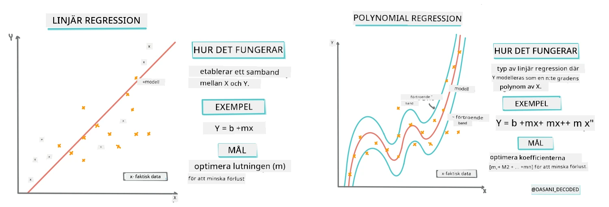
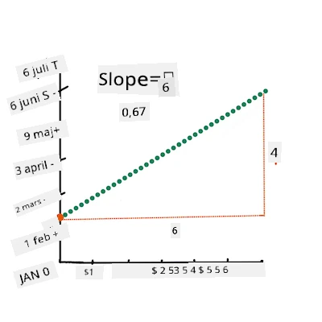
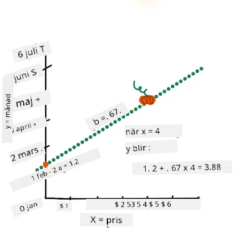
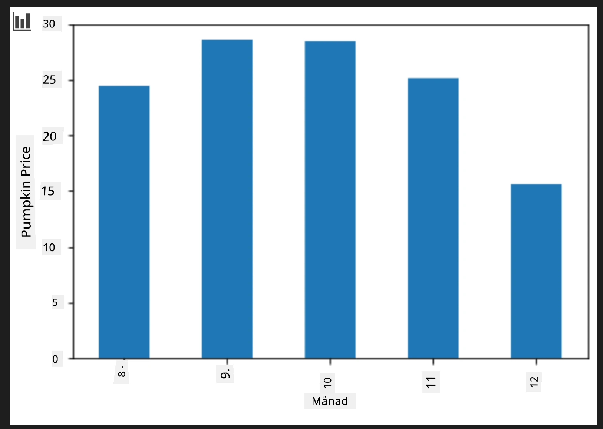
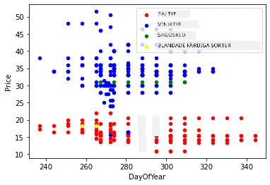
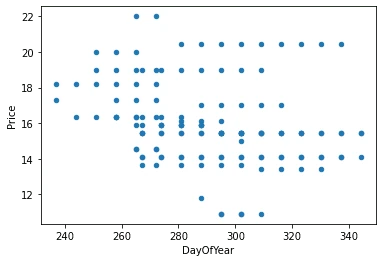

# Bygg en regressionsmodell med Scikit-learn: regression på fyra sätt

## Nybörjarnotering

Linjära regression används när vi vill förutsäga ett **numeriskt värde** (till exempel huspris, temperatur eller försäljning).  
Den fungerar genom att hitta en rät linje som bäst representerar sambandet mellan ingångsegenskaper och utdata.

I den här lektionen fokuserar vi på att förstå konceptet innan vi utforskar mer avancerade regressionstekniker.  
  
> Infografik av [Dasani Madipalli](https://twitter.com/dasani_decoded)  
## [Förföreläsningsquiz](https://ff-quizzes.netlify.app/en/ml/)

> ### [Den här lektionen finns tillgänglig i R!](../../../../2-Regression/3-Linear/solution/R/lesson_3.html)  
### Introduktion  

Hittills har du utforskat vad regression är med exempeldata från pumpapriser som vi kommer att använda under hela lektionen. Du har också visualiserat det med Matplotlib.

Nu är du redo att dyka djupare in i regression för maskininlärning. Medan visualisering låter dig förstå data, kommer den verkliga kraften i maskininlärning från _träning av modeller_. Modeller tränas på historisk data för att automatiskt fånga databas beroenden, och de låter dig förutsäga utfall för ny data som modellen inte sett tidigare.

I den här lektionen kommer du att lära dig mer om två typer av regression: _grundläggande linjär regression_ och _polynomregression_, tillsammans med en del matte som ligger bakom dessa tekniker. Dessa modeller gör det möjligt för oss att förutsäga pumpapriser beroende på olika indata.  

[](https://youtu.be/CRxFT8oTDMg "ML for beginners - Understanding Linear Regression")

> 🎥 Klicka på bilden ovan för en kort videogenomgång av linjär regression.

> Genom hela detta kursmaterial antar vi minimal mattebakgrund, och vill göra det tillgängligt för studenter från andra områden, så följ med på notiser, 🧮 utskick, diagram och andra lärverktyg för att underlätta förståelsen.

### Förkunskaper

Du bör nu vara bekant med strukturen för pumpadata som vi undersöker. Du kan hitta den förladdad och förberedd i lektionens _notebook.ipynb_-fil. I filen visas pumpapriset per skäppa i en ny dataram. Se till att du kan köra dessa notebooks i kärnor i Visual Studio Code.

### Förberedelse

Som en påminnelse laddar du denna data för att kunna ställa frågor om den.  

- När är det bästa tillfället att köpa pumpor?  
- Vilket pris kan jag förvänta mig för en låda med miniatyrpumpor?  
- Bör jag köpa dem i halva skäppor eller i 1 1/9 skäppors lådor?  
Låt oss fortsätta gräva i denna data.

I föregående lektion skapade du en Pandas-dataram och fyllde den med en del av den ursprungliga datasetet, där priserna standardiserades per skäppa. Genom att göra detta fick du dock bara cirka 400 datapunkter och endast för höstmånaderna.

Ta en titt på data som vi förladdat i denna lektions medföljande notebook. Datat är förladdat och en initial scatterplot är ritad för att visa månadsdata. Kanske kan vi få lite mer detaljer om datats natur genom att städa det mer.

## En linjär regressionslinje

Som du lärde dig i Lektion 1, är målet med en linjär regressionsövning att kunna rita en linje för att:

- **Visa variabelrelationer**. Visa sambandet mellan variabler  
- **Göra förutsägelser**. Göra noggranna förutsägelser om var en ny datapunkt skulle hamna i förhållande till den linjen.  

Det är typiskt för **minsta kvadratmetoden (Least-Squares Regression)** att dra denna typ av linje. Begreppet "Least-Squares" avser processen att minimera den totala felet i vår modell. För varje datapunkt mäter vi det vertikala avståndet (kallat residual) mellan den faktiska punkten och vår regressionslinje.

Vi kvadrerar dessa avstånd av två huvudsakliga skäl:  

1. **Storlek över riktning:** Vi vill behandla ett fel på -5 lika som ett fel på +5. Kvadrering gör alla värden positiva.  

2. **Straffa avvikare:** Kvadrering ger större vikt åt större fel, vilket tvingar linjen att ligga närmare punkter som är långt bort.  

Sedan lägger vi ihop alla dessa kvadrerade värden. Vårt mål är att hitta den specifika linje där denna slutgiltiga summa är som lägst (det minsta möjliga värdet)—därav namnet "minsta kvadrater".

> **🧮 Visa mig matten**  
>  
> Denna linje, kallad _bästa passande linje_, kan uttryckas med [en ekvation](https://en.wikipedia.org/wiki/Simple_linear_regression):  
>  
> ```
> Y = a + bX
> ```
>  
> `X` är den 'förklarande variabeln'. `Y` är den 'beroende variabeln'. Lutningen av linjen är `b` och `a` är y-axelns skärningspunkt, vilket avser värdet på `Y` när `X = 0`.  
>  
>  
>  
> Börja med att beräkna lutningen `b`. Infografik av [Jen Looper](https://twitter.com/jenlooper)  
>  
> Med andra ord, och hämtat från vår pumpadatas ursprungliga fråga: "förutse priset på en pumpa per skäppa efter månad", skulle `X` avse priset och `Y` månad för försäljning.  
>  
>  
>  
> Beräkna värdet av Y. Om du betalar runt 4 dollar måste det vara april! Infografik av [Jen Looper](https://twitter.com/jenlooper)  
>  
> Den matematik som beräknar linjen måste visa lutningen på linjen, som också är beroende av skärningspunkten, eller var `Y` ligger när `X = 0`.  
>  
> Du kan studera metoden för beräkning av dessa värden på webbplatsen [Math is Fun](https://www.mathsisfun.com/data/least-squares-regression.html). Besök även [denna minsta kvadratberäknare](https://www.mathsisfun.com/data/least-squares-calculator.html) för att se hur talen påverkar linjen.

## Korrelation

En term till att förstå är **korrelationskoefficienten** mellan givna X och Y variabler. Med en spridningsdiagram kan du snabbt visualisera denna koefficient. Ett diagram med datapunkter utspridda längs en prydlig linje har hög korrelation, medan ett diagram med datapunkter utspridda överallt mellan X och Y har låg korrelation.

En bra linjär regressionsmodell är en modell med hög (nära 1 snarare än 0) korrelationskoefficient med hjälp av metoden minsta kvadrater och en regressionslinje.

✅ Kör notebooken som hör till denna lektion och titta på spridningsdiagrammet Month till Price. Verkar datat som kopplar Månad till Pris för pumpaförsäljningen ha hög eller låg korrelation, enligt din visuella tolkning av spridningsdiagrammet? Ändras det om du använder en mer detaljerad mätning istället för `Month`, t.ex. *dag på året* (det vill säga antal dagar sedan årets början)?

I koden nedan antar vi att vi har rensat datat och fått en dataram som heter `new_pumpkins`, ungefär som följande:

ID | Month | DayOfYear | Variety | City | Package | Low Price | High Price | Price  
---|-------|-----------|---------|------|---------|-----------|------------|-------  
70 | 9 | 267 | PIE TYPE | BALTIMORE | 1 1/9 bushel cartons | 15.0 | 15.0 | 13.636364  
71 | 9 | 267 | PIE TYPE | BALTIMORE | 1 1/9 bushel cartons | 18.0 | 18.0 | 16.363636  
72 | 10 | 274 | PIE TYPE | BALTIMORE | 1 1/9 bushel cartons | 18.0 | 18.0 | 16.363636  
73 | 10 | 274 | PIE TYPE | BALTIMORE | 1 1/9 bushel cartons | 17.0 | 17.0 | 15.454545  
74 | 10 | 281 | PIE TYPE | BALTIMORE | 1 1/9 bushel cartons | 15.0 | 15.0 | 13.636364  

> Koden för att rengöra datat finns tillgänglig i [`notebook.ipynb`](notebook.ipynb). Vi har utfört samma rengöringssteg som i föregående lektion och har beräknat `DayOfYear`-kolumnen med följande uttryck:  

```python
day_of_year = pd.to_datetime(pumpkins['Date']).apply(lambda dt: (dt-datetime(dt.year,1,1)).days)
```
  
Nu när du har förstått matten bakom linjär regression, låt oss skapa en regressionsmodell för att se om vi kan förutsäga vilken pumpapåses förpackning som har de bästa pumpapriserna. Någon som köper pumpor till ett pumpafält inför en högtid kan vilja ha denna information för att optimera sina köp av pumpapaket till fältet.

## Leta efter korrelation

[](https://youtu.be/uoRq-lW2eQo "ML for beginners - Looking for Correlation: The Key to Linear Regression")

> 🎥 Klicka på bilden ovan för en kort videogenomgång av korrelation.

Från föregående lektion har du förmodligen sett att medelpriset för olika månader ser ut så här:



Detta antyder att det borde finnas någon korrelation, och vi kan försöka träna en linjär regressionsmodell för att förutsäga sambandet mellan `Month` och `Price`, eller mellan `DayOfYear` och `Price`. Här är scatterplottet som visar det senare sambandet:

 

Låt oss se om det finns en korrelation med `corr`-funktionen:

```python
print(new_pumpkins['Month'].corr(new_pumpkins['Price']))
print(new_pumpkins['DayOfYear'].corr(new_pumpkins['Price']))
```
  
Det verkar som att korrelationen är ganska liten, -0,15 för `Month` och -0,17 för `DayOfYear`, men det kan finnas ett annat viktigt samband. Det verkar som det finns olika kluster av priser som motsvarar olika pumpasorter. För att bekräfta denna hypotes, låt oss rita varje pumpkategori med en annan färg. Genom att skicka med en `ax`-parameter till `scatter`-plotfunktionen kan vi rita alla punkter i samma diagram:

```python
ax=None
colors = ['red','blue','green','yellow']
for i,var in enumerate(new_pumpkins['Variety'].unique()):
    df = new_pumpkins[new_pumpkins['Variety']==var]
    ax = df.plot.scatter('DayOfYear','Price',ax=ax,c=colors[i],label=var)
```
  
 

Vår undersökning antyder att sort har större påverkan på det totala priset än det faktiska försäljningsdatumet. Det kan vi se med ett stapeldiagram:

```python
new_pumpkins.groupby('Variety')['Price'].mean().plot(kind='bar')
```
  
 

Låt oss för tillfället fokusera på en pumpasort, "pie type", och se vilken effekt datumet har på priset:

```python
pie_pumpkins = new_pumpkins[new_pumpkins['Variety']=='PIE TYPE']
pie_pumpkins.plot.scatter('DayOfYear','Price') 
```
 

Om vi nu beräknar korrelationen mellan `Price` och `DayOfYear` med `corr`-funktionen får vi något som `-0.27` – vilket innebär att det är meningsfullt att träna en prediktiv modell.

> Innan vi tränar en linjär regressionsmodell är det viktigt att se till att vårt data är rent. Linjär regression fungerar inte bra med saknade värden, så det är vettigt att ta bort alla tomma celler:

```python
pie_pumpkins.dropna(inplace=True)
pie_pumpkins.info()
```
  
Ett annat alternativ är att fylla dessa tomma värden med medelvärden från den motsvarande kolumnen.

## Enkel linjär regression

[](https://youtu.be/e4c_UP2fSjg "ML for beginners - Linear and Polynomial Regression using Scikit-learn")

> 🎥 Klicka på bilden ovan för en kort videogenomgång av linjär och polynomregression.

För att träna vår linjära regressionsmodell använder vi biblioteket **Scikit-learn**.

```python
from sklearn.linear_model import LinearRegression
from sklearn.metrics import mean_squared_error
from sklearn.model_selection import train_test_split
```
  
Vi börjar med att separera ingångsvärden (egenskaper) och den förväntade utdata (etikett) i separata numpy-arrayer:

```python
X = pie_pumpkins['DayOfYear'].to_numpy().reshape(-1,1)
y = pie_pumpkins['Price']
```
  
> Observera att vi var tvungna att göra en `reshape` på indata för att linjär regressionspaketet ska förstå den korrekt. Linjär regression förväntar sig ett 2D-array som indata, där varje rad motsvarar en vektor av ingångsegenskaper. I vårt fall, eftersom vi bara har en ingång, behöver vi en array med formen N×1, där N är datasetets storlek.

Sedan måste vi dela upp datat i tränings- och testdataset för att kunna validera vår modell efter träning:

```python
X_train, X_test, y_train, y_test = train_test_split(X, y, test_size=0.2, random_state=0)
```
  
Slutligen tar själva träningsdelen av linjär regressionsmodell bara två kodrader. Vi definierar ett `LinearRegression`-objekt och anpassar det till vår data med `fit`-metoden:

```python
lin_reg = LinearRegression()
lin_reg.fit(X_train,y_train)
```

Objektet `LinearRegression` efter att ha blivit `fit`-tat innehåller alla koefficienter för regressionen, vilka kan nås med egenskapen `.coef_`. I vårt fall finns det bara en koefficient, som borde vara runt `-0.017`. Det betyder att priser verkar sjunka lite med tiden, men inte för mycket, ungefär 2 cent per dag. Vi kan också nå skärningspunkten för regressionen med Y-axeln med `lin_reg.intercept_` - den kommer att vara runt `21` i vårt fall, vilket indikerar priset i början av året.

För att se hur noggrann vår modell är kan vi förutsäga priser på en testdatasats och sedan mäta hur nära våra förutsägelser är de förväntade värdena. Detta kan göras med root mean square error (RMSE) metriken, vilket är roten ur medelvärdet av alla kvadrerade skillnader mellan förväntat och förutspått värde.

```python
pred = lin_reg.predict(X_test)

rmse = np.sqrt(mean_squared_error(y_test,pred))
print(f'RMSE: {rmse:3.3} ({rmse/np.mean(pred)*100:3.3}%)')
```

Vårt fel verkar ligga runt 2 poäng, vilket är ~17%. Inte så bra. En annan indikator på modellkvalitet är **bestämningskoefficienten**, som kan fås så här:

```python
score = lin_reg.score(X_train,y_train)
print('Model determination: ', score)
```
 Om värdet är 0 betyder det att modellen inte tar hänsyn till indata och agerar som den *sämsta linjära prediktorn*, vilket helt enkelt är medelvärdet av resultatet. Värdet 1 betyder att vi kan perfekt förutsäga alla förväntade utgångar. I vårt fall är koefficienten runt 0.06, vilket är ganska lågt.

Vi kan också plotta testdata tillsammans med regressionslinjen för att bättre se hur regression fungerar i vårt fall:

```python
plt.scatter(X_test,y_test)
plt.plot(X_test,pred)
```


## Polynomial Regression

En annan typ av linjär regression är polynomregression. Även om det ibland finns ett linjärt samband mellan variabler - ju större pumpa i volym, desto högre pris - kan dessa samband ibland inte plottas som ett plan eller en rät linje. 

✅ Här är [några fler exempel](https://online.stat.psu.edu/stat501/Lesson09#polynomial-regression-examples) på data som kan använda polynomregression

Ta en närmare titt på sambandet mellan Datum och Pris. Verkar denna spridningsdiagram nödvändigtvis måste analyseras med en rak linje? Kan inte priserna fluktuera? I detta fall kan du prova polynomregression.

✅ Polynom är matematiska uttryck som kan bestå av en eller flera variabler och koefficienter

Polynomregression skapar en böjd linje för att bättre anpassa icke-linjära data. I vårt fall, om vi inkluderar en kvadrerad `DayOfYear`-variabel i indata, borde vi kunna anpassa våra data med en parabolisk kurva, som kommer ha ett minimum vid en viss punkt under året.

Scikit-learn inkluderar en hjälpsam [pipeline-API](https://scikit-learn.org/stable/modules/generated/sklearn.pipeline.make_pipeline.html?highlight=pipeline#sklearn.pipeline.make_pipeline) för att kombinera olika steg i databehandlingen. En **pipeline** är en kedja av **estimators**. I vårt fall skapar vi en pipeline som först lägger till polynomegenskaper i vår modell och sedan tränar regressionen:

```python
from sklearn.preprocessing import PolynomialFeatures
from sklearn.pipeline import make_pipeline

pipeline = make_pipeline(PolynomialFeatures(2), LinearRegression())

pipeline.fit(X_train,y_train)
```

Att använda `PolynomialFeatures(2)` betyder att vi kommer att inkludera alla andra gradens polynom från indatan. I vårt fall betyder det bara `DayOfYear`<sup>2</sup>, men givet två indatavariabler X och Y, lägger detta till X<sup>2</sup>, XY och Y<sup>2</sup>. Vi kan också använda polynom av högre grad om vi vill.

Pipelines kan användas på samma sätt som det ursprungliga `LinearRegression`-objektet, dvs vi kan `fit` pipelinen och sedan använda `predict` för att få prediktionsresultaten:

```python
pred = pipeline.predict(X_test)

rmse = np.sqrt(mean_squared_error(y_test,pred))
print(f'RMSE: {rmse:3.3} ({rmse/np.mean(pred)*100:3.3}%)')

score = pipeline.score(X_train,y_train)
print('Model determination: ', score)
```

För att plotta den jämna approximationskurvan använder vi `np.linspace` för att skapa ett jämnt intervall av indata, i stället för att plotta direkt på den oordnade testdatan (vilket skulle ge en zick-zack-linje):

```python
X_range = np.linspace(X_test.min(), X_test.max(), 100).reshape(-1,1)
y_range = pipeline.predict(X_range)

plt.scatter(X_test, y_test)
plt.plot(X_range, y_range)
```

Här är grafen som visar testdata och approximationskurvan:


Med polynomregression kan vi få något lägre RMSE och högre bestämning, men inte signifikant. Vi behöver ta hänsyn till fler egenskaper!

> Du kan se att de lägsta pumpapriserna observeras någonstans runt Halloween. Hur kan du förklara detta? 

🎃 Grattis, du har just skapat en modell som kan hjälpa till att förutsäga priset på pajpumpor. Du kan förmodligen göra samma procedur för alla typer av pumpor, men det skulle vara tråkigt. Låt oss nu lära oss hur vi kan ta pumpa-sort i beaktande i vår modell!

## Kategoriska egenskaper

I en ideal värld vill vi kunna förutsäga priser för olika pumpasorter med samma modell. Men kolumnen `Variety` skiljer sig något från kolumner som `Month`, eftersom den innehåller icke-numeriska värden. Sådana kolumner kallas **kategoriska**.

[](https://youtu.be/DYGliioIAE0 "ML for beginners - Categorical Feature Predictions with Linear Regression")

> 🎥 Klicka på bilden ovan för en kort videoöversikt om att använda kategoriska egenskaper.

Här kan du se hur genomsnittspriset beror på sorten:


För att ta hänsyn till sorten behöver vi först konvertera den till numerisk form, eller **koda** den. Det finns flera sätt att göra detta:

* Enkel **numerisk kodning** skapar en tabell över olika sorter och ersätter sedan sortnamnet med ett index i den tabellen. Detta är inte bästa metoden för linjär regression eftersom linjär regression tar det faktiska numeriska värdet på indexet och lägger till det i resultatet multiplicerat med någon koefficient. I vårt fall är sambandet mellan indexnummer och pris tydligt icke-linjärt, även om vi ser till att indexen är ordnade på något specifikt sätt.
* **One-hot encoding** ersätter `Variety` kolumnen med 4 olika kolumner, en för varje sort. Varje kolumn innehåller `1` om motsvarande rad är av en viss sort, och `0` annars. Detta innebär att det finns fyra koefficienter i linjär regression, en för varje pumpasort, som ansvarar för "startpris" (eller snarare "tilläggspris") för just den sorten.

Koden nedan visar hur vi kan one-hot koda sorten:

```python
pd.get_dummies(new_pumpkins['Variety'])
```

 ID | FAIRYTALE | MINIATURE | MIXED HEIRLOOM VARIETIES | PIE TYPE
----|-----------|-----------|--------------------------|----------
70 | 0 | 0 | 0 | 1
71 | 0 | 0 | 0 | 1
... | ... | ... | ... | ...
1738 | 0 | 1 | 0 | 0
1739 | 0 | 1 | 0 | 0
1740 | 0 | 1 | 0 | 0
1741 | 0 | 1 | 0 | 0
1742 | 0 | 1 | 0 | 0

För att träna linjär regression med one-hot kodad sort som indata behöver vi bara initiera `X` och `y` korrekt:

```python
X = pd.get_dummies(new_pumpkins['Variety'])
y = new_pumpkins['Price']
```

Resten av koden är densamma som vi använde ovan för att träna linjär regression. Om du provar detta kommer du se att medelkvadratfelet är ungefär detsamma, men vi får en mycket högre bestämningskoefficient (~77%). För att få ännu mer noggranna förutsägelser kan vi ta hänsyn till fler kategoriska egenskaper samt numeriska egenskaper, som `Month` eller `DayOfYear`. För att få en stor matris av egenskaper kan vi använda `join`:

```python
X = pd.get_dummies(new_pumpkins['Variety']) \
        .join(new_pumpkins['Month']) \
        .join(pd.get_dummies(new_pumpkins['City'])) \
        .join(pd.get_dummies(new_pumpkins['Package']))
y = new_pumpkins['Price']
```

Här tar vi dessutom hänsyn till `City` och `Package`-typ, vilket ger oss RMSE 2.84 (10.5%) och bestämning 0.94!

## Att sätta ihop allt

För att göra den bästa modellen kan vi använda kombinerad (one-hot kodad kategorisk + numerisk) data från exemplet ovan tillsammans med polynomregression. Här är den kompletta koden för din bekvämlighet:

```python
# förbered träningsdata
X = pd.get_dummies(new_pumpkins['Variety']) \
        .join(new_pumpkins['Month']) \
        .join(pd.get_dummies(new_pumpkins['City'])) \
        .join(pd.get_dummies(new_pumpkins['Package']))
y = new_pumpkins['Price']

# gör träningstestuppdelning
X_train, X_test, y_train, y_test = train_test_split(X, y, test_size=0.2, random_state=0)

# konfigurera och träna pipelinen
pipeline = make_pipeline(PolynomialFeatures(2), LinearRegression())
pipeline.fit(X_train,y_train)

# förutsäg resultat för testdata
pred = pipeline.predict(X_test)

# beräkna RMSE och förklaringsgrad
rmse = mean_squared_error(y_test, pred, squared=False)
print(f'RMSE: {rmse:3.3} ({rmse/pred.mean()*100:3.3}%)')

score = pipeline.score(X_train,y_train)
print('Model determination: ', score)
```

Detta borde ge oss den bästa bestämningskoefficienten på nästan 97% och RMSE=2.23 (~8% fel i förutsägelsen).

| Modell | RMSE | Bestämning |
|-------|-----|---------------|
| `DayOfYear` Linjär | 2.77 (17.2%) | 0.07 |
| `DayOfYear` Polynom | 2.73 (17.0%) | 0.08 |
| `Variety` Linjär | 5.24 (19.7%) | 0.77 |
| Alla egenskaper Linjär | 2.84 (10.5%) | 0.94 |
| Alla egenskaper Polynom | 2.23 (8.25%) | 0.97 |

🏆 Bra jobbat! Du skapade fyra regressionsmodeller i en lektion och förbättrade modellkvaliteten till 97%. I den sista delen om regression kommer du att lära dig om logistisk regression för att bestämma kategorier. 

---
## 🚀Utmaning

Testa flera olika variabler i denna anteckningsbok för att se hur korrelationen motsvarar modellegenskaper.

## [Quiz efter lektionen](https://ff-quizzes.netlify.app/en/ml/)

## Översikt & Självstudier

I denna lektion lärde vi oss om linjär regression. Det finns andra viktiga typer av regression. Läs om Stepwise, Ridge, Lasso och Elasticnet tekniker. En bra kurs för vidare studier är [Stanford Statistical Learning course](https://online.stanford.edu/courses/sohs-ystatslearning-statistical-learning)

## Uppgift

[Bygg en modell](assignment.md)

---

<!-- CO-OP TRANSLATOR DISCLAIMER START -->
**Ansvarsfriskrivning**:  
Detta dokument har översatts med AI-översättningstjänsten [Co-op Translator](https://github.com/Azure/co-op-translator). Även om vi strävar efter noggrannhet, var vänlig observera att automatiska översättningar kan innehålla fel eller brister. Det ursprungliga dokumentet på dess modersmål bör betraktas som den auktoritativa källan. För kritisk information rekommenderas professionell mänsklig översättning. Vi ansvarar inte för några missförstånd eller feltolkningar som uppstår vid användning av denna översättning.
<!-- CO-OP TRANSLATOR DISCLAIMER END -->