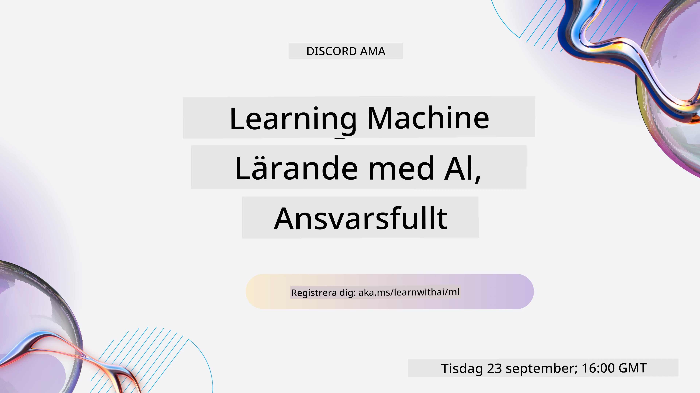
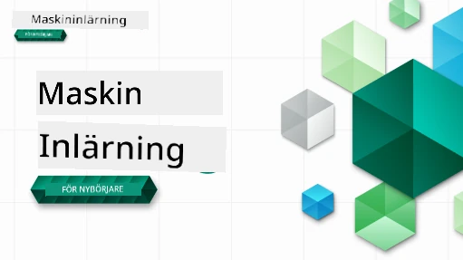

[](https://github.com/microsoft/ML-For-Beginners/blob/master/LICENSE)
[](https://GitHub.com/microsoft/ML-For-Beginners/graphs/contributors/)
[](https://GitHub.com/microsoft/ML-For-Beginners/issues/)
[](https://GitHub.com/microsoft/ML-For-Beginners/pulls/)
[](http://makeapullrequest.com)

[](https://GitHub.com/microsoft/ML-For-Beginners/watchers/)
[](https://GitHub.com/microsoft/ML-For-Beginners/network/)
[](https://GitHub.com/microsoft/ML-For-Beginners/stargazers/)

### 🌐 Fler språkstöd

#### Översättningar underhålls med [Co-op Translator](https://github.com/Azure/co-op-translator)

<!-- CO-OP TRANSLATOR LANGUAGES TABLE START -->
[Arabiska](../ar/README.md) | [Bengali](../bn/README.md) | [Bulgarska](../bg/README.md) | [Burmese (Myanmar)](../my/README.md) | [Kinesiska (Förenklad)](../zh-CN/README.md) | [Kinesiska (Traditionell, Hongkong)](../zh-HK/README.md) | [Kinesiska (Traditionell, Macau)](../zh-MO/README.md) | [Kinesiska (Traditionell, Taiwan)](../zh-TW/README.md) | [Kroatiska](../hr/README.md) | [Tjeckiska](../cs/README.md) | [Danska](../da/README.md) | [Holländska](../nl/README.md) | [Estniska](../et/README.md) | [Finska](../fi/README.md) | [Franska](../fr/README.md) | [Tyska](../de/README.md) | [Grekiska](../el/README.md) | [Hebreiska](../he/README.md) | [Hindi](../hi/README.md) | [Ungerska](../hu/README.md) | [Indonesiska](../id/README.md) | [Italienska](../it/README.md) | [Japanska](../ja/README.md) | [Kannada](../kn/README.md) | [Khmer](../km/README.md) | [Koreanska](../ko/README.md) | [Litauiska](../lt/README.md) | [Malajiska](../ms/README.md) | [Malayalam](../ml/README.md) | [Manipuri (Meitei Mayek)](../mni/README.md) | [Marathi](../mr/README.md) | [Nepali](../ne/README.md) | [Nigeriansk pidgin](../pcm/README.md) | [Norska](../no/README.md) | [Persiska (Farsi)](../fa/README.md) | [Polska](../pl/README.md) | [Portugisiska (Brasilien)](../pt-BR/README.md) | [Portugisiska (Portugal)](../pt-PT/README.md) | [Punjabiska (Gurmukhi)](../pa/README.md) | [Rumänska](../ro/README.md) | [Ryska](../ru/README.md) | [Serbiska (Kyrilliska)](../sr/README.md) | [Slovakiska](../sk/README.md) | [Slovenska](../sl/README.md) | [Spanska](../es/README.md) | [Swahili](../sw/README.md) | [Svenska](./README.md) | [Tagalog (Filippinska)](../tl/README.md) | [Tamil](../ta/README.md) | [Telugu](../te/README.md) | [Thailändska](../th/README.md) | [Turkiska](../tr/README.md) | [Ukrainska](../uk/README.md) | [Urdu](../ur/README.md) | [Vietnamesiska](../vi/README.md)

> **Föredrar du att klona lokalt?**
>
> Detta arkiv innehåller över 50 språköversättningar som avsevärt ökar nedladdningsstorleken. För att klona utan översättningar, använd sparse checkout:
>
> **Bash / macOS / Linux:**
> ```bash
> git clone --filter=blob:none --sparse https://github.com/microsoft/ML-For-Beginners.git
> cd ML-For-Beginners
> git sparse-checkout set --no-cone '/*' '!translations' '!translated_images'
> ```
>
> **CMD (Windows):**
> ```cmd
> git clone --filter=blob:none --sparse https://github.com/microsoft/ML-For-Beginners.git
> cd ML-For-Beginners
> git sparse-checkout set --no-cone "/*" "!translations" "!translated_images"
> ```
>
> Detta ger dig allt du behöver för att slutföra kursen med en mycket snabbare nedladdning.
<!-- CO-OP TRANSLATOR LANGUAGES TABLE END -->

#### Gå med i vår gemenskap

[](https://discord.gg/nTYy5BXMWG)

Vi har en pågående Discord-serie "Lär dig med AI", lär dig mer och delta i [Learn with AI Series](https://aka.ms/learnwithai/discord) från 18 - 30 september 2025. Du får tips och tricks för att använda GitHub Copilot för Data Science.



# Maskininlärning för nybörjare - En läroplan

> 🌍 Res runt om i världen när vi utforskar maskininlärning genom världens kulturer 🌍

Cloud Advocates på Microsoft är glada att erbjuda en 12-veckors, 26-lektions läroplan helt om **Maskininlärning**. I denna läroplan kommer du att lära dig om det som ibland kallas **klassisk maskininlärning**, huvudsakligen med Scikit-learn som bibliotek och undviker djupinlärning, som täcks i vår [AI för nybörjare-läroplan](https://aka.ms/ai4beginners). Kombinera dessa lektioner med vår ['Data Science för nybörjare'-läroplan](https://aka.ms/ds4beginners) också!

Res med oss runt om i världen när vi tillämpar dessa klassiska tekniker på data från många delar av världen. Varje lektion inkluderar för- och efter-lektionsquiz, skriftliga instruktioner för att slutföra lektionen, en lösning, en uppgift och mer. Vår projektbaserade pedagogik låter dig lära medan du bygger, ett beprövat sätt för nya färdigheter att 'fästa'.

**✍️ Hjärtligt tack till våra författare** Jen Looper, Stephen Howell, Francesca Lazzeri, Tomomi Imura, Cassie Breviu, Dmitry Soshnikov, Chris Noring, Anirban Mukherjee, Ornella Altunyan, Ruth Yakubu och Amy Boyd

**🎨 Tack också till våra illustratörer** Tomomi Imura, Dasani Madipalli och Jen Looper

**🙏 Stort tack 🙏 till våra Microsoft Student Ambassador-författare, granskare och innehållsbidragare**, särskilt Rishit Dagli, Muhammad Sakib Khan Inan, Rohan Raj, Alexandru Petrescu, Abhishek Jaiswal, Nawrin Tabassum, Ioan Samuila och Snigdha Agarwal

**🤩 Extra tacksamhet till Microsoft Student Ambassadors Eric Wanjau, Jasleen Sondhi och Vidushi Gupta för våra R-lektioner!**

# Kom igång

Följ dessa steg:
1. **Forka arkivet**: Klicka på "Fork" knappen uppe till höger på denna sida.
2. **Klona arkivet**:   `git clone https://github.com/microsoft/ML-For-Beginners.git`

> 💡 **Snabbstartstips:** Vill du starta i en webbläsare utan att installera Python lokalt? Använd [GitHub Codespaces](https://github.com/features/codespaces) för att skapa en molnutvecklingsmiljö för din fork. Öppna den gröna **Code**-menyn, välj **Codespaces** och skapa en codespace; installera varje lektionens nödvändiga beroenden inuti efter behov.

> [hitta alla ytterligare resurser för denna kurs i vår Microsoft Learn-samling](https://learn.microsoft.com/en-us/collections/qrqzamz1nn2wx3?WT.mc_id=academic-77952-bethanycheum)

> 🔧 **Behöver du hjälp?** Kolla vår [Felsökningsguide](TROUBLESHOOTING.md) för lösningar på vanliga problem med installation, setup och körning av lektioner.


**[Studenter](https://aka.ms/student-page)**, för att använda denna läroplan, forka hela repot till ditt eget GitHub-konto och slutför övningarna själv eller i grupp:

- Börja med ett förlektionsquiz.
- Läs lektionen och gör aktiviteterna, pausa och reflektera vid varje kunskapskontroll.
- Försök skapa projekten genom att förstå lektionerna snarare än att köra lösningskoden; dock finns den koden tillgänglig i `/solution` mapparna i varje projektorienterad lektion.
- Gör efterlektionsquiz.
- Slutför utmaningen.
- Slutför uppgiften.
- Efter att ha slutfört en lektion grupp, besök [Diskussionsforumet](https://github.com/microsoft/ML-For-Beginners/discussions) och "lär högt" genom att fylla i lämpligt PAT-betyg. En 'PAT' är ett Framstegsbedömningsverktyg som är en bedömning du fyller i för att främja ditt lärande. Du kan också reagera på andra PATs så att vi kan lära oss tillsammans.

> För vidare studier rekommenderar vi att följa dessa [Microsoft Learn](https://docs.microsoft.com/en-us/users/jenlooper-2911/collections/k7o7tg1gp306q4?WT.mc_id=academic-77952-leestott) moduler och lärvägar.

**Lärare**, vi har [inkluderat några förslag](for-teachers.md) på hur man använder denna läroplan.

---

## Videogenomgångar

Några av lektionerna finns som korta videoklipp. Du kan hitta alla dessa i linje i lektionerna, eller på [ML for Beginners spellistan på Microsoft Developer YouTube-kanal](https://aka.ms/ml-beginners-videos) genom att klicka på bilden nedan.

[](https://aka.ms/ml-beginners-videos)

---

## Möt teamet

[](https://youtu.be/Tj1XWrDSYJU)

**Gif av** [Mohit Jaisal](https://linkedin.com/in/mohitjaisal)

> 🎥 Klicka på bilden ovan för en video om projektet och personerna som skapade det!

---

## Pedagogik

Vi har valt två pedagogiska principer när vi byggde denna läroplan: att säkerställa att den är praktiskt **projektbaserad** och att den innehåller **frekventa quiz**. Dessutom har denna läroplan ett gemensamt **tema** för att ge sammanhang.

Genom att säkerställa att innehållet stämmer överens med projekt, görs processen mer engagerande för studenter och begreppsbehållning kommer att förbättras. Dessutom sätter ett låg-riskquiz före en lektion studentens avsikt mot att lära sig ett ämne, medan ett andra quiz efter lektionen säkerställer ytterligare behållning. Denna läroplan är designad för att vara flexibel och rolig och kan genomföras helt eller delvis. Projekten börjar små och blir alltmer komplexa i slutet av 12-veckorscykeln. Denna läroplan inkluderar även ett efterord om verkliga tillämpningar av ML, vilket kan användas som extrapoäng eller som diskussionsunderlag.

> Hitta vår [Uppförandekod](CODE_OF_CONDUCT.md), [Bidragsriktlinjer](CONTRIBUTING.md), [Översättningspolicy](..) och [Felsökningsguide](TROUBLESHOOTING.md). Vi uppskattar din konstruktiva feedback!

## Varje lektion inkluderar

- valfri sketchnote
- valfri kompletterande video
- videogenomgång (vissa lektioner endast)
- [för-lektions uppvärmningsquiz](https://ff-quizzes.netlify.app/en/ml/)
- skriftlig lektion
- för projektbaserade lektioner, steg-för-steg guider om hur man bygger projektet
- kunskapskontroller
- en utmaning
- kompletterande läsning
- uppgift
- [efter-lektions quiz](https://ff-quizzes.netlify.app/en/ml/)

> **En not om språk**: Dessa lektioner är främst skrivna i Python, men många finns även tillgängliga i R. För att slutföra en R-lektion, gå till `/solution` mappen och leta efter R-lektioner. De har en .rmd-tillägg som representerar en **R Markdown**-fil som enkelt kan definieras som en inbäddning av `code chunks` (av R eller andra språk) och en `YAML header` (som styr hur utdata formateras som PDF) i en `Markdown document`. Som sådan fungerar den som ett utmärkt verktyg för författarskap inom data science eftersom det låter dig kombinera din kod, dess utdata och dina tankar genom att skriva dem i Markdown. Dessutom kan R Markdown-dokument renderas till outputformat som PDF, HTML eller Word.

> **En not om quiz**: Alla quiz finns i [Quiz App-mappen](../../quiz-app), totalt 52 quiz med tre frågor vardera. De är länkade från lektionerna men quizappen kan köras lokalt; följ instruktionen i `quiz-app` mappen för att hosta lokalt eller distribuera till Azure.

| Lesson Number |                             Topic                              |                   Lesson Grouping                   | Learning Objectives                                                                                                             |                                                              Linked Lesson                                                               |                        Author                        |
| :-----------: | :------------------------------------------------------------: | :-------------------------------------------------: | ------------------------------------------------------------------------------------------------------------------------------- | :--------------------------------------------------------------------------------------------------------------------------------------: | :--------------------------------------------------: |
|      01       |                Introduction to machine learning                |      [Introduction](1-Introduction/README.md)       | Lär dig grunderna bakom maskininlärning                                                                                        |                                             [Lesson](1-Introduction/1-intro-to-ML/README.md)                                             |                       Muhammad                       |
|      02       |                The History of machine learning                 |      [Introduction](1-Introduction/README.md)       | Lär dig historien bakom detta område                                                                                            |                                            [Lesson](1-Introduction/2-history-of-ML/README.md)                                            |                     Jen and Amy                      |
|      03       |                 Fairness and machine learning                  |      [Introduction](1-Introduction/README.md)       | Vilka är de viktiga filosofiska frågorna kring rättvisa som studenter bör tänka på när de bygger och tillämpar ML-modeller?      |                                              [Lesson](1-Introduction/3-fairness/README.md)                                               |                        Tomomi                        |
|      04       |                Techniques for machine learning                 |      [Introduction](1-Introduction/README.md)       | Vilka tekniker använder ML-forskare för att bygga ML-modeller?                                                                   |                                          [Lesson](1-Introduction/4-techniques-of-ML/README.md)                                           |                    Chris and Jen                     |
|      05       |                   Introduction to regression                   |        [Regression](2-Regression/README.md)         | Kom igång med Python och Scikit-learn för regressionsmodeller                                                                   |         [Python](2-Regression/1-Tools/README.md) • [R](../../2-Regression/1-Tools/solution/R/lesson_1.html)         |      Jen • Eric Wanjau       |
|      06       |                North American pumpkin prices 🎃                |        [Regression](2-Regression/README.md)         | Visualisera och rengör data inför ML                                                                                             |          [Python](2-Regression/2-Data/README.md) • [R](../../2-Regression/2-Data/solution/R/lesson_2.html)          |      Jen • Eric Wanjau       |
|      07       |                North American pumpkin prices 🎃                |        [Regression](2-Regression/README.md)         | Bygg linjära och polynomregressionsmodeller                                                                                     |        [Python](2-Regression/3-Linear/README.md) • [R](../../2-Regression/3-Linear/solution/R/lesson_3.html)        |      Jen and Dmitry • Eric Wanjau       |
|      08       |                North American pumpkin prices 🎃                |        [Regression](2-Regression/README.md)         | Bygg en logistisk regressionsmodell                                                                                             |     [Python](2-Regression/4-Logistic/README.md) • [R](../../2-Regression/4-Logistic/solution/R/lesson_4.html)      |      Jen • Eric Wanjau       |
|      09       |                          A Web App 🔌                          |           [Web App](3-Web-App/README.md)            | Bygg en webbapp för att använda din tränade modell                                                                             |                                                 [Python](3-Web-App/1-Web-App/README.md)                                                  |                         Jen                          |
|      10       |                 Introduction to classification                 |    [Classification](4-Classification/README.md)     | Rengör, förbered och visualisera din data; introduktion till klassificering                                                    | [Python](4-Classification/1-Introduction/README.md) • [R](../../4-Classification/1-Introduction/solution/R/lesson_10.html)  | Jen and Cassie • Eric Wanjau |
|      11       |             Delicious Asian and Indian cuisines 🍜             |    [Classification](4-Classification/README.md)     | Introduktion till klassificerare                                                                                                | [Python](4-Classification/2-Classifiers-1/README.md) • [R](../../4-Classification/2-Classifiers-1/solution/R/lesson_11.html) | Jen and Cassie • Eric Wanjau |
|      12       |             Delicious Asian and Indian cuisines 🍜             |    [Classification](4-Classification/README.md)     | Fler klassificerare                                                                                                             | [Python](4-Classification/3-Classifiers-2/README.md) • [R](../../4-Classification/3-Classifiers-2/solution/R/lesson_12.html) | Jen and Cassie • Eric Wanjau |
|      13       |             Delicious Asian and Indian cuisines 🍜             |    [Classification](4-Classification/README.md)     | Bygg en rekommenderande webbapp med din modell                                                                                 |                                              [Python](4-Classification/4-Applied/README.md)                                              |                         Jen                          |
|      14       |                   Introduction to clustering                   |        [Clustering](5-Clustering/README.md)         | Rengör, förbered och visualisera din data; Introduktion till klustring                                                        |         [Python](5-Clustering/1-Visualize/README.md) • [R](../../5-Clustering/1-Visualize/solution/R/lesson_14.html)         |      Jen • Eric Wanjau       |
|      15       |              Exploring Nigerian Musical Tastes 🎧              |        [Clustering](5-Clustering/README.md)         | Utforska K-Means klustringsmetod                                                                                                |           [Python](5-Clustering/2-K-Means/README.md) • [R](../../5-Clustering/2-K-Means/solution/R/lesson_15.html)           |      Jen • Eric Wanjau       |
|      16       |        Introduction to natural language processing ☕️         |   [Natural language processing](6-NLP/README.md)    | Lär dig grunderna i NLP genom att bygga en enkel bot                                                                            |                                             [Python](6-NLP/1-Introduction-to-NLP/README.md)                                              |                       Stephen                        |
|      17       |                      Common NLP Tasks ☕️                      |   [Natural language processing](6-NLP/README.md)    | Fördjupa din NLP-kunskap genom att förstå vanliga uppgifter kopplade till språkliga strukturer                                   |                                                    [Python](6-NLP/2-Tasks/README.md)                                                     |                       Stephen                        |
|      18       |             Translation and sentiment analysis ♥️              |   [Natural language processing](6-NLP/README.md)    | Översättning och sentimentanalys med Jane Austen                                                                                |                                            [Python](6-NLP/3-Translation-Sentiment/README.md)                                             |                       Stephen                        |
|      19       |                  Romantic hotels of Europe ♥️                  |   [Natural language processing](6-NLP/README.md)    | Sentimentanalys med hotellrecensioner 1                                                                                        |                                               [Python](6-NLP/4-Hotel-Reviews-1/README.md)                                                |                       Stephen                        |
|      20       |                  Romantic hotels of Europe ♥️                  |   [Natural language processing](6-NLP/README.md)    | Sentimentanalys med hotellrecensioner 2                                                                                        |                                               [Python](6-NLP/5-Hotel-Reviews-2/README.md)                                                |                       Stephen                        |
|      21       |            Introduction to time series forecasting             |        [Time series](7-TimeSeries/README.md)        | Introduktion till tidsserieprognoser                                                                                           |                                             [Python](7-TimeSeries/1-Introduction/README.md)                                              |                      Francesca                       |
|      22       | ⚡️ World Power Usage ⚡️ - time series forecasting with ARIMA |        [Time series](7-TimeSeries/README.md)        | Tidsserieprognoser med ARIMA                                                                                                   |                                                 [Python](7-TimeSeries/2-ARIMA/README.md)                                                 |                      Francesca                       |
|      23       |  ⚡️ World Power Usage ⚡️ - time series forecasting with SVR  |        [Time series](7-TimeSeries/README.md)        | Tidsserieprognoser med Support Vector Regressor                                                                                |                                                  [Python](7-TimeSeries/3-SVR/README.md)                                                  |                       Anirban                        |
|      24       |             Introduction to reinforcement learning             | [Reinforcement learning](8-Reinforcement/README.md) | Introduktion till förstärkningsinlärning med Q-Learning                                                                         |                                             [Python](8-Reinforcement/1-QLearning/README.md)                                              |                        Dmitry                        |
|      25       |                 Help Peter avoid the wolf! 🐺                  | [Reinforcement learning](8-Reinforcement/README.md) | Förstärkningsinlärningsgym                                                                                                     |                                                [Python](8-Reinforcement/2-Gym/README.md)                                                 |                        Dmitry                        |
|  Postscript   |            Real-World ML scenarios and applications            |      [ML in the Wild](9-Real-World/README.md)       | Intressanta och avslöjande verkliga tillämpningar av klassisk ML                                                               |                                             [Lesson](9-Real-World/1-Applications/README.md)                                              |                         Team                         |
|  Postscript   |            Model Debugging in ML using RAI dashboard            |      [ML in the Wild](9-Real-World/README.md)       | Modellfelsökning i maskininlärning med Responsible AI-dashboardkomponenter                                                     |                                             [Lesson](9-Real-World/2-Debugging-ML-Models/README.md)                                              |                     Ruth Yakubu                      |

> [find all additional resources for this course in our Microsoft Learn collection](https://learn.microsoft.com/en-us/collections/qrqzamz1nn2wx3?WT.mc_id=academic-77952-bethanycheum)

## Offline access

Du kan köra denna dokumentation offline med [Docsify](https://docsify.js.org/#/). Forka detta repo, [installera Docsify](https://docsify.js.org/#/quickstart) på din lokala maskin, och skriv sedan `docsify serve` i rotmappen för detta repo. Webbplatsen kommer att serveras på port 3000 på din localhost: `localhost:3000`.

## PDFs

Hitta en pdf av kursplanen med länkar [här](https://microsoft.github.io/ML-For-Beginners/pdf/readme.pdf).


## 🎒 Andra Kurser 

Vårt team producerar andra kurser! Kolla in:

<!-- CO-OP TRANSLATOR OTHER COURSES START -->
### LangChain
[](https://aka.ms/langchain4j-for-beginners)
[](https://aka.ms/langchainjs-for-beginners?WT.mc_id=m365-94501-dwahlin)
[](https://github.com/microsoft/langchain-for-beginners?WT.mc_id=m365-94501-dwahlin)
---

### Azure / Edge / MCP / Agents
[](https://github.com/microsoft/AZD-for-beginners?WT.mc_id=academic-105485-koreyst)
[](https://github.com/microsoft/edgeai-for-beginners?WT.mc_id=academic-105485-koreyst)
[](https://github.com/microsoft/mcp-for-beginners?WT.mc_id=academic-105485-koreyst)
[](https://github.com/microsoft/ai-agents-for-beginners?WT.mc_id=academic-105485-koreyst)

---
 
### Generative AI Series
[](https://github.com/microsoft/generative-ai-for-beginners?WT.mc_id=academic-105485-koreyst)
[-9333EA?style=for-the-badge&labelColor=E5E7EB&color=9333EA)](https://github.com/microsoft/Generative-AI-for-beginners-dotnet?WT.mc_id=academic-105485-koreyst)
[-C084FC?style=for-the-badge&labelColor=E5E7EB&color=C084FC)](https://github.com/microsoft/generative-ai-for-beginners-java?WT.mc_id=academic-105485-koreyst)
[-E879F9?style=for-the-badge&labelColor=E5E7EB&color=E879F9)](https://github.com/microsoft/generative-ai-with-javascript?WT.mc_id=academic-105485-koreyst)

---
 
### Core Learning
[](https://aka.ms/ml-beginners?WT.mc_id=academic-105485-koreyst)
[](https://aka.ms/datascience-beginners?WT.mc_id=academic-105485-koreyst)
[](https://aka.ms/ai-beginners?WT.mc_id=academic-105485-koreyst)
[](https://github.com/microsoft/Security-101?WT.mc_id=academic-96948-sayoung)
[](https://aka.ms/webdev-beginners?WT.mc_id=academic-105485-koreyst)
[](https://aka.ms/iot-beginners?WT.mc_id=academic-105485-koreyst)
[](https://github.com/microsoft/xr-development-for-beginners?WT.mc_id=academic-105485-koreyst)

---
 
### Copilot Series
[](https://aka.ms/GitHubCopilotAI?WT.mc_id=academic-105485-koreyst)
[](https://github.com/microsoft/mastering-github-copilot-for-dotnet-csharp-developers?WT.mc_id=academic-105485-koreyst)
[](https://github.com/microsoft/CopilotAdventures?WT.mc_id=academic-105485-koreyst)
<!-- CO-OP TRANSLATOR OTHER COURSES END -->

## Getting Help

Om du fastnar eller har frågor när du lär dig maskininlärning eller bygger AI-applikationer, oroa dig inte — hjälp finns tillgänglig.

Du kan delta i diskussioner med andra lärande och utvecklare, ställa frågor och dela dina idéer med gemenskapen.

- Gå med i gemenskapen för att ställa frågor och lära med andra
- Diskutera maskininlärningskoncept och projektidéer
- Få vägledning från erfarna utvecklare

En stödjande gemenskap är ett utmärkt sätt att utveckla dina färdigheter och lösa problem snabbare.

[Microsoft Foundry Discord Community](https://discord.gg/nTYy5BXMWG)

Om du stöter på buggar, fel eller har förslag på förbättringar kan du också öppna ett **Issue** i detta repository för att rapportera problemet.

För produktfeedback eller för att söka i befintliga gemenskapsposter, besök Developer Forum:

[](https://aka.ms/foundry/forum)

## Additional Learning Tips

- Gå igenom anteckningsböcker efter varje lektion för bättre förståelse.
- Öva på att implementera algoritmer på egen hand.
- Utforska verkliga datamängder med hjälp av inlärda koncept.

---

<!-- CO-OP TRANSLATOR DISCLAIMER START -->
**Ansvarsfriskrivning**:
Detta dokument har översatts med hjälp av AI-översättningstjänsten [Co-op Translator](https://github.com/Azure/co-op-translator). Även om vi strävar efter noggrannhet, var vänlig notera att automatiska översättningar kan innehålla fel eller brister. Det ursprungliga dokumentet på dess modersmål bör betraktas som den auktoritativa källan. För kritisk information rekommenderas professionell mänsklig översättning. Vi ansvarar inte för några missförstånd eller feltolkningar som uppstår till följd av användningen av denna översättning.
<!-- CO-OP TRANSLATOR DISCLAIMER END -->