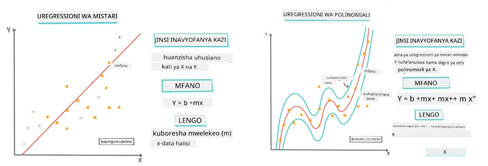
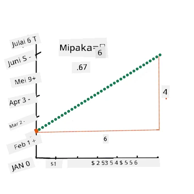
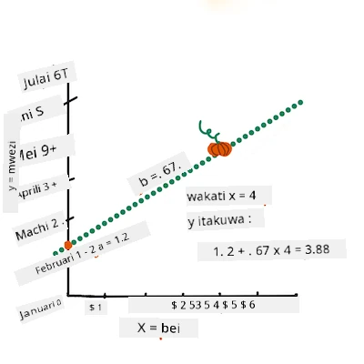
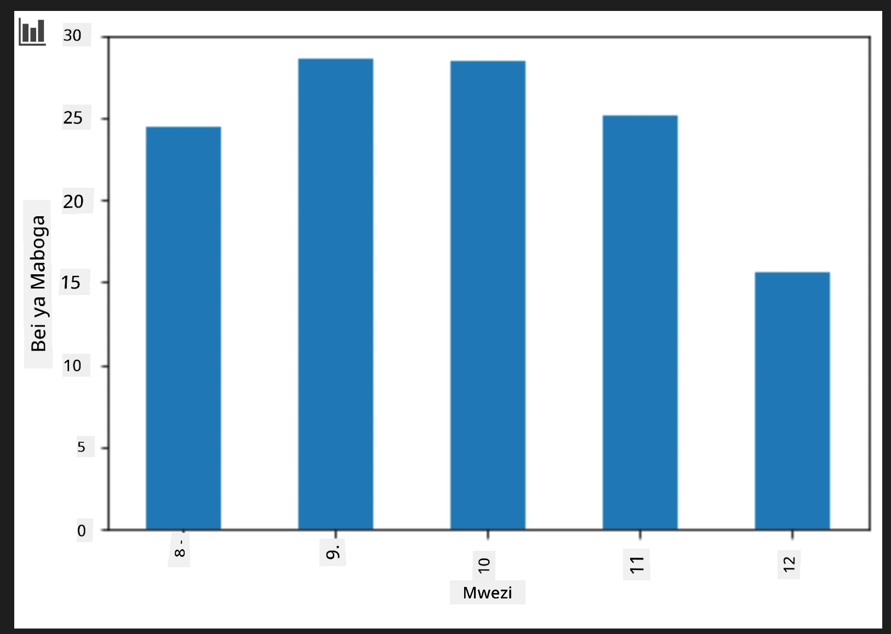
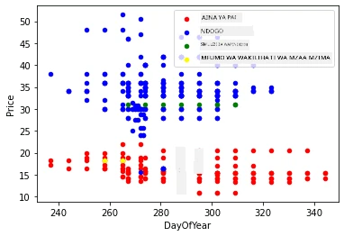
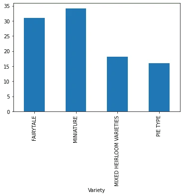

# Jenga mfano wa urekebishaji ukitumia Scikit-learn: urekebishaji kwa njia nne

## Kumbuka kwa Mwanafunzi Mwanzo

Urekebishaji wa mstari hutumiwa tunapotaka kutabiri **thamani ya nambari** (kwa mfano, bei ya nyumba, halijoto, au mauzo).
Hufanya kazi kwa kupata mstari wa moja kwa moja unaowakilisha vyema uhusiano kati ya vipengele vya ingizo na matokeo.

Katika somo hili, tunazingatia kuelewa dhana kabla ya kuchunguza mbinu za urekebishaji za juu zaidi.

> Infografiki na [Dasani Madipalli](https://twitter.com/dasani_decoded)
## [Jaribio kabla ya somo](https://ff-quizzes.netlify.app/en/ml/)

> ### [Somo hili linapatikana kwa R!](../../../../2-Regression/3-Linear/solution/R/lesson_3.html)
### Utangulizi 

Hadi sasa umechunguza nini urekebishaji kwa kutumia sampuli za data zilizokusanywa kutoka kwenye dataset ya bei za malenge ambayo tutatumia katika somo hili. Pia umeonyesha kwa kutumia Matplotlib.

Sasa uko tayari kuzama zaidi katika urekebishaji kwa ML. Wakati uonyeshaji unaoruhusu kuelewa data, nguvu halisi ya Kujifunza kwa Mashine hutokana na _mafunzo ya mifano_. Mifano hufunzwa kwa data ya kihistoria ili moja kwa moja kushika utegemezi wa data, na huruhusu kutabiri matokeo kwa data mpya, ambayo mfano haujawahi kuona kabla.

Katika somo hili, utajifunza zaidi kuhusu aina mbili za urekebishaji: _urekebishaji wa mstari wa msingi_ na _urekebishaji wa polynomial_, pamoja na baadhi ya hesabu zinazohusiana na mbinu hizi. Mifano hiyo itatuwezesha kutabiri bei za malenge kulingana na data mbalimbali za ingizo. 

[](https://youtu.be/CRxFT8oTDMg "ML kwa wanaoanza - Kuelewa Urekebishaji wa Mstari")

> 🎥 Bonyeza picha hapo juu kwa video fupi inayotoa muhtasari wa urekebishaji wa mstari.

> Katika mtaala huu mzima, tunadhani maarifa madogo ya hesabu, na tunalenga kuufanya ufikike kwa wanafunzi kutoka nyanja nyingine, hivyo angalia kwa makini noti, 🧮 maelezo ya ziada, michoro, na zana nyingine za kujifunzia kusaidia kuelewa.

### Msingi

Unapaswa kuwa umezoea sasa muundo wa data ya malenge tunayoichunguza. Unaweza kuipata tayari imepandishwa na kusafishwa kwenye faili la _notebook.ipynb_ la somo hili. Katika faili hiyo, bei ya malenge inaonyeshwa kwa kila kikapu katika fremu mpya ya data. Hakikisha unaweza kuendesha daftari hizi kwenye kernels za Visual Studio Code.

### Maandalizi

Kama ukumbusho, unapakua data hii ili kuiuliza maswali.

- Ni wakati gani bora wa kununua malenge? 
- Bei gani naweza kutegemea kwa kesi ya malenge madogo?
- Je, ninapaswa kuyununua katika vikapu vya nusu kikapu au sanduku la 1 1/9 kikapu?
Baki tuchunguze data hii zaidi.

Katika somo la awali, ulitengeneza fremu ya data ya Pandas na kuijaza na sehemu ya dataset ya awali, ukibadilisha bei kwa mujibu wa kikapu. Hata hivyo, kwa kufanya hivyo, uliweza kukusanya takriban pointi 400 za data tu na kwa miezi ya vuli tu.

Tazama data ambayo tumepandisha tayari katika daftari la somo hili linaloambatana. Data imepandishwa tayari na mchoro wa awali wa pointi umepangwa kuonyesha data ya mwezi. Labda tunaweza kupata maelezo zaidi kuhusu asili ya data kwa kuisafisha zaidi.

## Mstari wa urekebishaji wa mstari

Kama ulivyojifunza katika Somo la 1, lengo la zoezi la urekebishaji wa mstari ni kupata uwezo wa kuchora mstari ili:

- **Kuonyesha uhusiano wa tofauti.** Onyesha uhusiano kati ya tofauti
- **Kutabiri.** Tengeneza utabiri sahihi wa mahali ambapo nukta mpya itapangwa kulingana na mstari huo.

Ni kawaida kwa **Urekebishaji wa Sqare Ndogo** kuvuta mstari huu. Neno "Least-Squares" linahusu mchakato wa kupunguza jumla ya makosa katika mfano wetu. Kwa kila nukta ya data, tunapima umbali wima (ujulikanayo kama resti) kati ya nukta halisi na mstari wetu wa urekebishaji.

Tunapanga mraba umbali huu kwa sababu mbili kuu:

1. **Ukubwa juu ya Mwelekeo:** Tunataka kushughulikia kosa la -5 sawa na kosa la +5. Kufanya mraba kunafanya thamani zote kuwa chanya.

2. **Kuweka adhabu kwa Tofauti Kubwa:** Kufanya mraba kunatoa uzito zaidi kwa makosa makubwa, na kulazimisha mstari kubaki karibu na pointi zilizo mbali.

Kisha tunaongeza thamani hizi za mraba pamoja. Lengo letu ni kupata mstari maalum ambapo jumla hii ni ndogo zaidi (thamani ndogo kabisa) - ndio maana linaitwa "Least-Squares".

> **🧮 Nionyeshe hesabu** 
> 
> Mstari huu, unaoitwa _mstari wa kufaa vyema_ unaweza kuonyeshwa kwa [mlinganyo](https://en.wikipedia.org/wiki/Simple_linear_regression): 
> 
> ```
> Y = a + bX
> ```
>
> `X` ni ‘tofauti ya kuelezea’. `Y` ni ‘tofauti inayotegemea’. Pembe ya mstari ni `b` na `a` ni kitovu cha y, kinachoashiria thamani ya `Y` wakati `X = 0`.
>
>
>
> Kwanza, hesabu pembe `b`. Infografiki na [Jen Looper](https://twitter.com/jenlooper)
>
> Kwa maneno mengine na kurejelea swali la asili la data yetu ya malenge: "tabiri bei ya malenge kwa kila kikapu kwa mwezi", `X` itarejelea bei na `Y` itarejelea mwezi wa mauzo. 
>
>
>
> Hesabu thamani ya Y. Ikiwa unalipa karibu $4, lazima iwe Aprili! Infografiki na [Jen Looper](https://twitter.com/jenlooper)
>
> Hesabu inayoonyesha mstari lazima ionyeshe pembe ya mstari, ambayo pia inategemea kitovu, au mahali `Y` ilipo wakati `X = 0`.
>
> Unaweza kuona njia ya hesabu ya thamani hizi kwenye tovuti ya [Math is Fun](https://www.mathsisfun.com/data/least-squares-regression.html). Pia tembelea [kalkuleta ya least-squares](https://www.mathsisfun.com/data/least-squares-calculator.html) ili kuona jinsi thamani za nambari zinavyoathiri mstari.

## Uhusiano (Correlation)

Neno moja zaidi la kuelewa ni **Kiwango cha Uhusiano** kati ya tofauti za X na Y. Ukiweka mchoro wa pointi, unaweza haraka kuona kiwango hiki. Mchoro wenye pointi zilizo pangiliwa kwenye mstari mzuri una uhusiano mkubwa, lakini mchoro wenye pointi zilizoenea kila mahali kati ya X na Y una uhusiano mdogo.

Mfano mzuri wa urekebishaji wa mstari utakuwa ule wenye Kiwango cha Uhusiano kwa kiwango cha juu (karibu 1 badala ya 0) ukitumia Mbinu ya Least-Squares Regression na mstari wa urekebishaji.

✅ Endesha daftari la mazoezi linaloambatana na somo hili na tazama mchoro wa Month to Price scatterplot. Je, data inayounganisha Mwezi na Bei kwa mauzo ya malenge inaonekana kuwa na uhusiano mkubwa au mdogo, kulingana na tafsiri yako ya kuona ya scatterplot? Je, hiyo hubadilika ikiwa unatumia kipimo cha kina zaidi badala ya `Month`, kwa mfano *siku ya mwaka* (yaani idadi ya siku tangu mwanzo wa mwaka)?

Katika msimbo hapa chini, tutadhani kwamba tumesafisha data, na kupata fremu ya data inayoitwa `new_pumpkins`, zinazofanana na yafuatayo:

ID | Mwezi | SikuYaMwaka | Aina | Jiji | Pakiti | Bei Ndogo | Bei Kubwa | Bei
---|-------|-------------|-------|------|---------|-----------|-----------|------
70 | 9 | 267 | AINA YA PIE | BALTIMORE | 1 1/9 kartoni za kikapu | 15.0 | 15.0 | 13.636364
71 | 9 | 267 | AINA YA PIE | BALTIMORE | 1 1/9 kartoni za kikapu | 18.0 | 18.0 | 16.363636
72 | 10 | 274 | AINA YA PIE | BALTIMORE | 1 1/9 kartoni za kikapu | 18.0 | 18.0 | 16.363636
73 | 10 | 274 | AINA YA PIE | BALTIMORE | 1 1/9 kartoni za kikapu | 17.0 | 17.0 | 15.454545
74 | 10 | 281 | AINA YA PIE | BALTIMORE | 1 1/9 kartoni za kikapu | 15.0 | 15.0 | 13.636364

> Msimbo wa kusafisha data upo katika [`notebook.ipynb`](notebook.ipynb). Tumefanya hatua sawa za usafi kama katika somo lililopita, na tumekokotoa safu ya `DayOfYear` kwa kutumia maelezo ifuatayo:

```python
day_of_year = pd.to_datetime(pumpkins['Date']).apply(lambda dt: (dt-datetime(dt.year,1,1)).days)
```

Sasa kwamba unaelewa hesabu nyuma ya urekebishaji wa mstari, hebu tujenge Mfano wa Urekebishaji kuona kama tunaweza kutabiri pakiti ambayo ya malenge itakuwa na bei bora za malenge. Mtu anayenunua malenge kwa ajili ya shamba la malenge ya sikukuu anaweza kutaka taarifa hii ili aweze kuboresha ununuzi wao wa pakiti za malenge kwa shamba.

## Kutafuta Uhusiano

[](https://youtu.be/uoRq-lW2eQo "ML kwa wanaoanza - Kutafuta Uhusiano: Ufunguo wa Urekebishaji wa Mstari")

> 🎥 Bonyeza picha hapo juu kwa video fupi inayotoa muhtasari wa uhusiano.

Kutoka somo lililopita huenda umeona kuwa bei ya wastani kwa miezi tofauti inaonekana kama hii:



Hii inaonyesha kwamba kunapaswa kuwepo na uhusiano fulani, na tunaweza jaribu kufunza mfano wa urekebishaji wa mstari kutabiri uhusiano kati ya `Month` na `Price`, au kati ya `DayOfYear` na `Price`. Hapa kuna mchoro wa pointi unaonyesha uhusiano wa mwisho:

 

Tuchunguze kama kuna uhusiano kutumia kipengele cha `corr`:

```python
print(new_pumpkins['Month'].corr(new_pumpkins['Price']))
print(new_pumpkins['DayOfYear'].corr(new_pumpkins['Price']))
```

Inaonekana kama uhusiano ni mdogo, -0.15 kwa `Month` na -0.17 kwa `DayOfYear`, lakini kunaweza kuwa na uhusiano mwingine muhimu. Inaonekana kuna makundi tofauti ya bei yanayohusiana na aina tofauti za malenge. Ili kuthibitisha dhana hii, tuchore kila aina ya malenge kwa rangi tofauti. Kwa kupitisha parameter ya `ax` kwenye kazi ya kuchora `scatter` tunaweza kuchora pointi zote kwenye mchoro mmoja:

```python
ax=None
colors = ['red','blue','green','yellow']
for i,var in enumerate(new_pumpkins['Variety'].unique()):
    df = new_pumpkins[new_pumpkins['Variety']==var]
    ax = df.plot.scatter('DayOfYear','Price',ax=ax,c=colors[i],label=var)
```

 

Uchunguzi wetu unaonyesha kwamba aina ina athari zaidi kwenye bei kwa ujumla kuliko tarehe halisi ya mauzo. Tunaweza kuona hili kwa chati ya barua:

```python
new_pumpkins.groupby('Variety')['Price'].mean().plot(kind='bar')
```

 

Tuzingatie kwa sasa aina moja tu ya malenge, aina ya 'pie', na tuone athari ya tarehe kwenye bei:

```python
pie_pumpkins = new_pumpkins[new_pumpkins['Variety']=='PIE TYPE']
pie_pumpkins.plot.scatter('DayOfYear','Price') 
```
 

Kama sasa tutapima uhusiano kati ya `Price` na `DayOfYear` kwa kutumia kipengele cha `corr`, tutapata kitu kama `-0.27` - ambayo inamaanisha kwamba kufunza mfano wa utabiri kuna mantiki.

> Kabla ya kufunza mfano wa urekebishaji wa mstari, ni muhimu kuhakikisha data yetu ni safi. Urekebishaji wa mstari hauendani vizuri na thamani zisizokuwepo, hivyo ni busara kuondoa seli zote tupu:

```python
pie_pumpkins.dropna(inplace=True)
pie_pumpkins.info()
```

Njia nyingine itakuwa kujaza thamani hizo tupu na thamani za wastani kutoka safu husika.

## Urekebishaji wa Mstari Msingi

[](https://youtu.be/e4c_UP2fSjg "ML kwa wanaoanza - Urekebishaji wa Mstari na Polynomial ukitumia Scikit-learn")

> 🎥 Bonyeza picha hapo juu kwa video fupi inayotoa muhtasari wa urekebishaji wa mstari na polynomial.

Ili kufunza Mfano wetu wa Urekebishaji wa Mstari, tutatumia maktaba ya **Scikit-learn**.

```python
from sklearn.linear_model import LinearRegression
from sklearn.metrics import mean_squared_error
from sklearn.model_selection import train_test_split
```

Tunaanza kwa kutenganisha thamani za ingizo (vipengele) na matokeo yanayotarajiwa (lebeli) katika safu za numpy tofauti:

```python
X = pie_pumpkins['DayOfYear'].to_numpy().reshape(-1,1)
y = pie_pumpkins['Price']
```

> Kumbuka tulilazimika kufanya `reshape` kwa data ya ingizo ili kifurushi cha Urekebishaji wa Mstari kiielewe ipasavyo. Urekebishaji wa Mstari unatarajia safu ya 2D kama ingizo, ambapo kila safu ya safu ni vekta ya vipengele vya ingizo. Katika kesi yetu, kwa kuwa tuna ingizo moja tu - tunahitaji safu yenye umbo N×1, ambapo N ni ukubwa wa dataset.

Kisha, tunapaswa kugawanya data kuwa sehemu ya mafunzo na sehemu ya majaribio, ili tuweze kuthibitisha mfano wetu baada ya mafunzo:

```python
X_train, X_test, y_train, y_test = train_test_split(X, y, test_size=0.2, random_state=0)
```

Mwishowe, kufunza mfano halisi wa Urekebishaji wa Mstari huchukua mistari miwili tu ya msimbo. Tunafafanua kitu cha `LinearRegression`, na kuifunga kwenye data yetu kwa kutumia njia ya `fit`:

```python
lin_reg = LinearRegression()
lin_reg.fit(X_train,y_train)
```

Kitu cha `LinearRegression` baada ya `fit`-ting kina coefficients zote za regression, ambazo zinaweza kupatikana kwa kutumia mali ya `.coef_`. Katika kesi yetu, kuna coefficient moja tu, ambayo inapaswa kuwa karibu na `-0.017`. Hii ina maana kuwa bei zinaonekana kushuka kidogo kwa muda, lakini sio kwa kiasi kikubwa, karibu senti 2 kwa siku. Tunaweza pia kupata kituo cha mkusanyiko wa regression na mhimili wa Y kwa kutumia `lin_reg.intercept_` - itakuwa karibu na `21` katika kesi yetu, ikiashiria bei mwanzoni mwa mwaka.

Ili kuona usahihi wa mfano wetu, tunaweza kutabiri bei kwenye seti ya majaribio, kisha kupima jinsi makisio yetu yanavyokaribia thamani zinazotarajiwa. Hii inaweza kufanywa kwa kutumia kipimo cha root mean square error (RMSE), ambayo ni mzizi wa wastani wa tofauti zote zilizopangwa mraba kati ya thamani zinazotarajiwa na zinazotabiriwa.

```python
pred = lin_reg.predict(X_test)

rmse = np.sqrt(mean_squared_error(y_test,pred))
print(f'RMSE: {rmse:3.3} ({rmse/np.mean(pred)*100:3.3}%)')
```

Kosa letu linaonekana kuwa karibu na pointi 2, ambayo ni ~17%. Siyo nzuri sana. Kiashiria kingine cha ubora wa mfano ni **coefficient of determination**, ambacho kinaweza kupatikana hivi:

```python
score = lin_reg.score(X_train,y_train)
print('Model determination: ', score)
```
Ikiwa thamani ni 0, ina maana kuwa mfano hauzingatii data ya pembejeo, na hutenda kama *mtabiri mbaya kabisa wa mstari*, ambaye ni thamani ya wastani tu ya matokeo. Thamani ya 1 ina maana kwamba tunaweza kutabiri vyema matokeo yote yanayotarajiwa. Katika kesi yetu, coefficient ni karibu 0.06, ambayo ni ya chini kabisa.

Tunaweza pia kuchora data za majaribio pamoja na mstari wa regression kuona bora jinsi regression inavyofanya kazi katika kesi yetu:

```python
plt.scatter(X_test,y_test)
plt.plot(X_test,pred)
```


## Polynomial Regression

Aina nyingine ya Linear Regression ni Polynomial Regression. Ingawa wakati mwingine kuna uhusiano wa mstari kati ya vigezo - kadri buibui linavyokuwa kubwa kwa kiasi, ndivyo bei inavyokuwa juu - wakati mwingine uhusiano huu hauwezi kuchorwa kama usawa au mstari wa moja kwa moja.

✅ Hapa kuna [mifano zaidi](https://online.stat.psu.edu/stat501/Lesson09#polynomial-regression-examples) ya data ambayo inaweza kutumia Polynomial Regression

Tazama tena uhusiano kati ya Tarehe na Bei. Je, mchoro huu wa points unaonekana kama unapaswa kuchambuliwa kwa kutumia mstari wa moja kwa moja? Je, bei hasi zinaweza kubadilika? Katika kesi hii, unaweza kujaribu polynomial regression.

✅ Polynomials ni maelezo ya kihesabu ambayo yanaweza kuwa na variables moja au zaidi na coefficients

Polynomial regression huunda mstari wa mviringo ili kufaa vizuri data zisizo za mstari. Katika kesi yetu, ikiwa tutajumuisha `DayOfYear` kwa mraba kuwa variable ya pembejeo, tunapaswa kuweza kufaa data zetu na mviringo wa parabolic, ambao utakuwa na chini ya thamani mahali fulani ndani ya mwaka.

Scikit-learn inajumuisha API yenye msaada ya [pipeline](https://scikit-learn.org/stable/modules/generated/sklearn.pipeline.make_pipeline.html?highlight=pipeline#sklearn.pipeline.make_pipeline) kuunganisha hatua tofauti za usindikaji data pamoja. **pipeline** ni mnyororo wa **estimators**. Katika kesi yetu, tutaunda pipeline ambayo kwanza itaongeza sifa za polynomial kwenye mfano wetu, kisha itafunza regression:

```python
from sklearn.preprocessing import PolynomialFeatures
from sklearn.pipeline import make_pipeline

pipeline = make_pipeline(PolynomialFeatures(2), LinearRegression())

pipeline.fit(X_train,y_train)
```

Kutumia `PolynomialFeatures(2)` kunamaanisha kwamba tutajumuisha polynomials zote za daraja la pili kutoka kwenye data za pembejeo. Katika kesi yetu itamaanisha tu `DayOfYear`<sup>2</sup>, lakini ikitolewa variables mbili za pembejeo X na Y, hii itaongeza X<sup>2</sup>, XY na Y<sup>2</sup>. Tunaweza pia kutumia polynomials za daraja kubwa zaidi ikiwa tunataka.

Pipelines zinaweza kutumika kwa njia ile ile kama kitu cha awali cha `LinearRegression`, yaani tunaweza `fit` pipeline, na kisha kutumia `predict` kupata matokeo ya utabiri:

```python
pred = pipeline.predict(X_test)

rmse = np.sqrt(mean_squared_error(y_test,pred))
print(f'RMSE: {rmse:3.3} ({rmse/np.mean(pred)*100:3.3}%)')

score = pipeline.score(X_train,y_train)
print('Model determination: ', score)
```

Ili kuchora mviringo laini wa makadirio, tunatumia `np.linspace` kuunda safu sawa ya thamani za pembejeo, badala ya kuchora moja kwa moja kwenye data za majaribio zisizo na mpangilio (ambazo zingetengeneza mstari wa mviringo-mviringo):

```python
X_range = np.linspace(X_test.min(), X_test.max(), 100).reshape(-1,1)
y_range = pipeline.predict(X_range)

plt.scatter(X_test, y_test)
plt.plot(X_range, y_range)
```

Hapa ni mchoro unaoonyesha data za majaribio, na mviringo wa makadirio:


Kutumia Polynomial Regression, tunaweza kupata RMSE kidogo chini na coefficient ya determination kubwa zaidi, lakini si kwa kiasi kikubwa. Tunahitaji kuzingatia sifa zingine pia!

> Unaweza kuona kuwa bei ndogo za buibui hupatikana karibu na Halloween. Unaelewaje hili?

🎃 Hongera, umeunda mfano unaoweza kusaidia kutabiri bei ya buibui za pie. Huenda ukaweza kurudia hatua hii kwa aina zote za buibui, lakini hiyo itakuwa ngumu. Hebu tujifunze sasa jinsi ya kuzingatia aina ya buibui katika mfano wetu!

## Sifa za Kategorikali

Katika dunia bora, tunataka kuwa na uwezo wa kutabiri bei za aina tofauti za buibui kwa kutumia mfano mmoja. Hata hivyo, safu ya `Variety` ni tofauti kidogo na safu kama `Month`, kwa sababu inajumuisha thamani zisizo za nambari. Safu kama hizi huitwa **kategorikali**.

[](https://youtu.be/DYGliioIAE0 "ML kwa waanzilishi - Utabiri wa Sifa za Kategorikali kwa Linear Regression")

> 🎥 Bonyeza picha hapo juu kwa muhtasari mfupi wa video kuhusu kutumia sifa za kategorikali.

Hapa unaweza kuona jinsi bei ya wastani inavyotegemea aina:


Ili kuzingatia aina, kwanza tunahitaji kuibadilisha kuwa nambari, au **kuandika msimbo**. Kuna njia kadhaa za kufanya hivyo:

* **Kuandika msimbo wa nambari wa kawaida** kutaunda jedwali la aina tofauti, kisha kubadilisha jina la aina kuwa nambari katika jedwali hilo. Hii si wazo bora kwa regression ya mstari, kwa sababu regression ya mstari huchukua thamani halisi ya nambari ya index, na kuiongeza matokeo, ikizidishwa na coefficient fulani. Katika kesi yetu, uhusiano kati ya nambari ya index na bei ni wazi si mstari, hata kama tunahakikisha kwamba indices zipo kwa mpangilio maalum.
* **One-hot encoding** itabadilisha safu ya `Variety` kuwa safu 4 tofauti, moja kwa kila aina. Kila safu itakuwa na `1` ikiwa safu husika ni ya aina hiyo, na `0` vinginevyo. Hii ina maana kuwa kutakuwa na coefficients nne katika regression ya mstari, moja kwa kila aina ya buibui, inayohusika na "bei ya kuanzia" (au badala yake "bei ya ziada") kwa aina hiyo.

Msimbo hapa chini unaonyesha jinsi ya kufanya one-hot encode kwa aina:

```python
pd.get_dummies(new_pumpkins['Variety'])
```

 ID | FAIRYTALE | MINIATURE | MIXED HEIRLOOM VARIETIES | PIE TYPE
----|-----------|-----------|--------------------------|----------
70 | 0 | 0 | 0 | 1
71 | 0 | 0 | 0 | 1
... | ... | ... | ... | ...
1738 | 0 | 1 | 0 | 0
1739 | 0 | 1 | 0 | 0
1740 | 0 | 1 | 0 | 0
1741 | 0 | 1 | 0 | 0
1742 | 0 | 1 | 0 | 0

Ili kufunza regression ya mstari kwa kutumia aina iliyowekwa one-hot encoded kama data ya pembejeo, tunahitaji tu kuanzisha data za `X` na `y` kwa usahihi:

```python
X = pd.get_dummies(new_pumpkins['Variety'])
y = new_pumpkins['Price']
```

Msimbo wa ziada ni ule ule tulioitumia hapo juu kufunza Linear Regression. Ukijaribu, utaona kuwa msemo wa wastani wa makosa ya mraba ni karibu sawa, lakini tunapata coefficient ya determination ya juu zaidi (~77%). Ili kupata makadirio sahihi zaidi, tunaweza kuzingatia sifa za kategorikali zaidi, pamoja na sifa za nambari kama `Month` au `DayOfYear`. Ili kupata safu kubwa ya sifa, tunaweza kutumia `join`:

```python
X = pd.get_dummies(new_pumpkins['Variety']) \
        .join(new_pumpkins['Month']) \
        .join(pd.get_dummies(new_pumpkins['City'])) \
        .join(pd.get_dummies(new_pumpkins['Package']))
y = new_pumpkins['Price']
```

Hapa pia tunazingatia `City` na aina ya `Package`, ambayo hutoa RMSE 2.84 (10.5%), na determination 0.94!

## Kuweka yote Pamoja

Ili kutengeneza mfano bora zaidi, tunaweza kutumia data zilizojumuishwa (sifa za kategorikali zilizowekwa one-hot encoded + sifa za nambari) kutoka mfano wa juu pamoja na Polynomial Regression. Hapa ni msimbo kamili kwa urahisi wako:

```python
# andaa data ya mafunzo
X = pd.get_dummies(new_pumpkins['Variety']) \
        .join(new_pumpkins['Month']) \
        .join(pd.get_dummies(new_pumpkins['City'])) \
        .join(pd.get_dummies(new_pumpkins['Package']))
y = new_pumpkins['Price']

# fanya mgawanyo wa mafunzo-na-mtihani
X_train, X_test, y_train, y_test = train_test_split(X, y, test_size=0.2, random_state=0)

# andaa na fundisha mchakato
pipeline = make_pipeline(PolynomialFeatures(2), LinearRegression())
pipeline.fit(X_train,y_train)

# tabiri matokeo kwa data ya mtihani
pred = pipeline.predict(X_test)

# hesabu RMSE na uamuzi
rmse = mean_squared_error(y_test, pred, squared=False)
print(f'RMSE: {rmse:3.3} ({rmse/pred.mean()*100:3.3}%)')

score = pipeline.score(X_train,y_train)
print('Model determination: ', score)
```

Hii inapaswa kutuletea coefficient bora zaidi ya determination karibu 97%, na RMSE=2.23 (~8% kosa la utabiri).

| Mfano | RMSE | Determination |
|-------|-----|---------------|
| `DayOfYear` Linear | 2.77 (17.2%) | 0.07 |
| `DayOfYear` Polynomial | 2.73 (17.0%) | 0.08 |
| `Variety` Linear | 5.24 (19.7%) | 0.77 |
| Sifa Zote Linear | 2.84 (10.5%) | 0.94 |
| Sifa Zote Polynomial | 2.23 (8.25%) | 0.97 |

🏆 Hongera! Umeunda mifano minne ya Regression katika somo moja, na kuboresha ubora wa mfano hadi 97%. Katika sehemu ya mwisho kuhusu Regression, utajifunza kuhusu Logistic Regression kuamua makundi.

---
## 🚀Changamoto

Jaribu vigezo tofauti katika daftari hili kuona jinsi uhusiano unavyohusiana na usahihi wa mfano.

## [Mtihani baada ya somo](https://ff-quizzes.netlify.app/en/ml/)

## Mapitio na Kujifunza Binafsi

Katika somo hili tulijifunza kuhusu Linear Regression. Kuna aina nyingine muhimu za Regression. Soma kuhusu mbinu za Stepwise, Ridge, Lasso na Elasticnet. Kozi nzuri ya kusoma zaidi ni [kozi ya Stanford Statistical Learning](https://online.stanford.edu/courses/sohs-ystatslearning-statistical-learning)

## Kazi ya Nyumbani

[Jenga Mfano](assignment.md)

---

<!-- CO-OP TRANSLATOR DISCLAIMER START -->
**Kiaruhusi cha kutokuwa na dhamana**:  
Hati hii imetafsiriwa kwa kutumia huduma ya tafsiri ya AI [Co-op Translator](https://github.com/Azure/co-op-translator). Ingawa tunajitahidi kwa usahihi, tafadhali fahamu kwamba tafsiri za moja kwa moja zinaweza kuwa na makosa au kasoro. Hati ya asili katika lugha yake ya asili inapaswa kuchukuliwa kama chanzo cha mamlaka. Kwa taarifa muhimu, tafsiri ya kitaalamu ya binadamu inapendekezwa. Hatuwajibiki kwa kutoelewana au tafsiri potofu zinazotokana na matumizi ya tafsiri hii.
<!-- CO-OP TRANSLATOR DISCLAIMER END -->