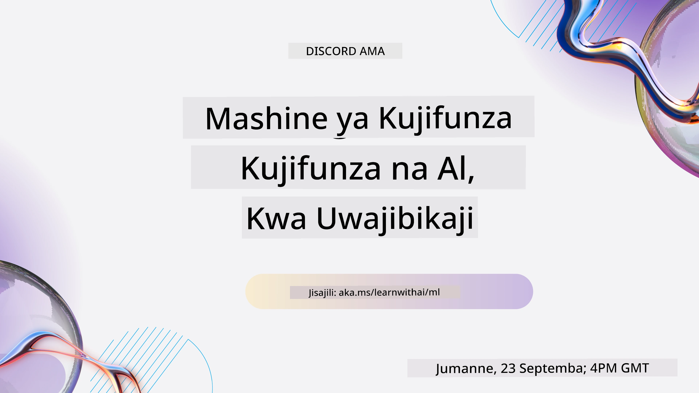
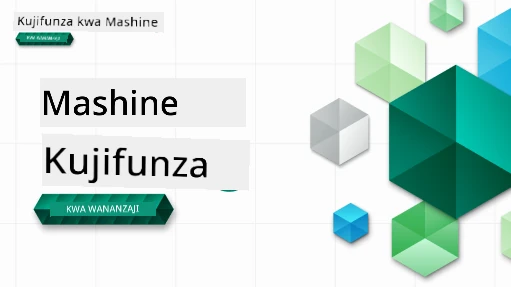
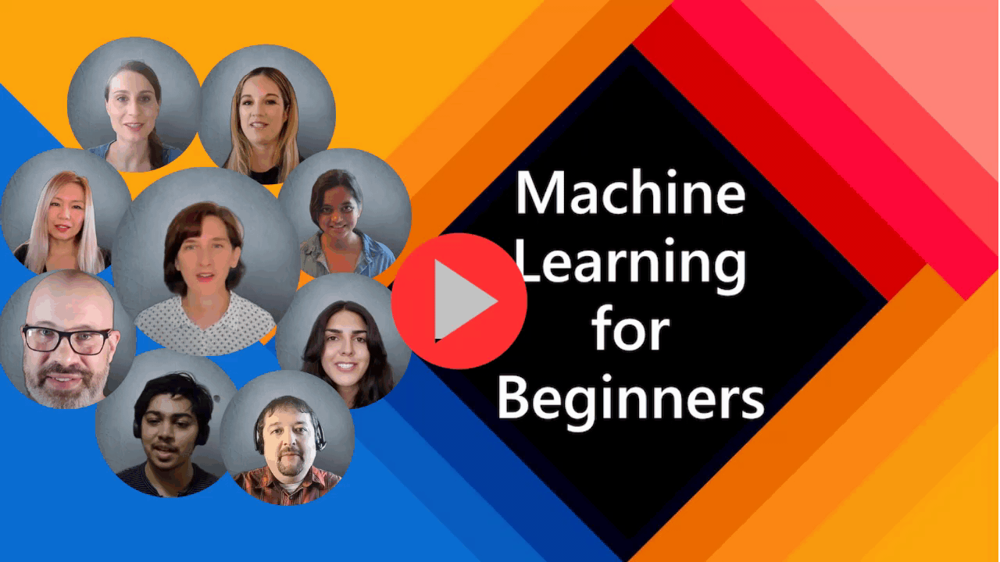

[](https://github.com/microsoft/ML-For-Beginners/blob/master/LICENSE)
[](https://GitHub.com/microsoft/ML-For-Beginners/graphs/contributors/)
[](https://GitHub.com/microsoft/ML-For-Beginners/issues/)
[](https://GitHub.com/microsoft/ML-For-Beginners/pulls/)
[](http://makeapullrequest.com)

[](https://GitHub.com/microsoft/ML-For-Beginners/watchers/)
[](https://GitHub.com/microsoft/ML-For-Beginners/network/)
[](https://GitHub.com/microsoft/ML-For-Beginners/stargazers/)

### 🌐 Msaada wa Lugha Nyingi

#### Tafsiri zinahifadhiwa na [Mtafsiri wa Ushirikiano](https://github.com/Azure/co-op-translator)

<!-- CO-OP TRANSLATOR LANGUAGES TABLE START -->
[Kiarabu](../ar/README.md) | [Kibengali](../bn/README.md) | [Kibulgaria](../bg/README.md) | [Kirumi (Myanmar)](../my/README.md) | [Kichina (Rahisi)](../zh-CN/README.md) | [Kichina (Kawaida, Hong Kong)](../zh-HK/README.md) | [Kichina (Kawaida, Makao)](../zh-MO/README.md) | [Kichina (Kawaida, Taiwan)](../zh-TW/README.md) | [Kirumi](../hr/README.md) | [Kicheki](../cs/README.md) | [Kidanima](../da/README.md) | [Kiholanzi](../nl/README.md) | [Kiestonia](../et/README.md) | [Kifini](../fi/README.md) | [Kifaransa](../fr/README.md) | [Kijerumani](../de/README.md) | [Kiegiriki](../el/README.md) | [Kiebrania](../he/README.md) | [Kihindi](../hi/README.md) | [Kihungari](../hu/README.md) | [Kiindonesia](../id/README.md) | [Kiitaliano](../it/README.md) | [Kijapani](../ja/README.md) | [Kikannada](../kn/README.md) | [Kikime](../km/README.md) | [Kikorea](../ko/README.md) | [Kilithuania](../lt/README.md) | [Kimelayu](../ms/README.md) | [Kimalayalam](../ml/README.md) | [Kimanipur (Meitei Mayek)](../mni/README.md) | [Kimarathi](../mr/README.md) | [Kinepali](../ne/README.md) | [Kipidgin cha Nigeria](../pcm/README.md) | [Kinorwe](../no/README.md) | [Kiajemi (Farsi)](../fa/README.md) | [Kipolanzi](../pl/README.md) | [Kireno (Brazil)](../pt-BR/README.md) | [Kireno (Ureno)](../pt-PT/README.md) | [Kipunji (Gurmukhi)](../pa/README.md) | [Kiromaniani](../ro/README.md) | [Kirusi](../ru/README.md) | [Kiserbia (Kisiliriki)](../sr/README.md) | [Kislovakia](../sk/README.md) | [Kislovenia](../sl/README.md) | [Kihispania](../es/README.md) | [Kiswahili](./README.md) | [Kiswidi](../sv/README.md) | [Kitagalog (Kifilipino)](../tl/README.md) | [Kitamili](../ta/README.md) | [Kitelugu](../te/README.md) | [Kithai](../th/README.md) | [Kituruki](../tr/README.md) | [Kiukraini](../uk/README.md) | [Kiurdu](../ur/README.md) | [Kivietinamu](../vi/README.md)

> **Unapendelea Kukopa Kwenye Kifaa Chako?**
>
> Hifadhidata hii inajumuisha tafsiri za lugha zaidi ya 50 ambazo huongeza kwa kiasi kikubwa ukubwa wa kupakua. Ili kukopa bila tafsiri, tumia sparse checkout:
>
> **Bash / macOS / Linux:**
> ```bash
> git clone --filter=blob:none --sparse https://github.com/microsoft/ML-For-Beginners.git
> cd ML-For-Beginners
> git sparse-checkout set --no-cone '/*' '!translations' '!translated_images'
> ```
>
> **CMD (Windows):**
> ```cmd
> git clone --filter=blob:none --sparse https://github.com/microsoft/ML-For-Beginners.git
> cd ML-For-Beginners
> git sparse-checkout set --no-cone "/*" "!translations" "!translated_images"
> ```
>
> Hii inakupa kila kitu unachohitaji kukamilisha kozi kwa upakuaji wa haraka zaidi.
<!-- CO-OP TRANSLATOR LANGUAGES TABLE END -->

#### Jiunge na Jumuiya Yetu

[](https://discord.gg/nTYy5BXMWG)

Tuna mfululizo wa kujifunza kwa Discord unaoendelea, jifunze zaidi na jiunge nasi katika [Mfululizo wa Kujifunza na AI](https://aka.ms/learnwithai/discord) kuanzia 18 - 30 Septemba, 2025. Utapata vidokezo na mbinu za kutumia GitHub Copilot kwa Sayansi ya Data.



# Kujifunza Mashine kwa Waanzilishi - Mtaala

> 🌍 Safiri kote ulimwenguni tunapochunguza Kujifunza Mashine kupitia tamaduni za dunia 🌍

Wakili wa Mawingu wa Microsoft wanafurahia kutoa mtaala wa wiki 12, masomo 26 yote kuhusu **Kujifunza Mashine**. Katika mtaala huu, utajifunza kuhusu kinachoitwa mara nyingine **kujifunza mashine cha kawaida**, ukitumia hasa maktaba ya Scikit-learn na kuepuka kujifunza kwa kina, ambacho kinashughulikiwa katika [mtaala wetu wa AI kwa Waanzilishi](https://aka.ms/ai4beginners). Pia sambaza masomo haya na mtaala wetu wa ['Sayansi ya Data kwa Waanzilishi'](https://aka.ms/ds4beginners)!

Safiri nasi kote ulimwenguni tunapotumia mbinu hizi za kawaida kwa data kutoka sehemu mbalimbali duniani. Kila somo linajumuisha maswali ya kabla na baada ya somo, maelekezo ya maandishi ya kukamilisha somo, suluhisho, kazi za nyumbani, na zaidi. Mbinu yetu ya kufundisha inayotegemea miradi inakuwezesha kujifunza huku ukiunda, njia iliyothibitishwa kufanikisha ujuzi mpya 'kubaki'.

**✍️ Shukrani za dhati kwa waandishi wetu** Jen Looper, Stephen Howell, Francesca Lazzeri, Tomomi Imura, Cassie Breviu, Dmitry Soshnikov, Chris Noring, Anirban Mukherjee, Ornella Altunyan, Ruth Yakubu na Amy Boyd

**🎨 Pia shukrani kwa wachoraji wetu** Tomomi Imura, Dasani Madipalli, na Jen Looper

**🙏 Shukrani maalum 🙏 kwa waandishi, wakaguzi, na wachangiaji wa maudhui wa Microsoft Student Ambassador**, hasa Rishit Dagli, Muhammad Sakib Khan Inan, Rohan Raj, Alexandru Petrescu, Abhishek Jaiswal, Nawrin Tabassum, Ioan Samuila, na Snigdha Agarwal

**🤩 Shukrani za ziada kwa Microsoft Student Ambassadors Eric Wanjau, Jasleen Sondhi, na Vidushi Gupta kwa masomo yetu ya R!**

# Anza

Fuata hatua hizi:
1. **Shika Hifadhidata**: Bonyeza kitufe cha "Fork" upande wa juu kulia wa ukurasa huu.
2. **Kopa Hifadhidata**:   `git clone https://github.com/microsoft/ML-For-Beginners.git`

> 💡 **Vidokezo vya Kuanzisha Haraka:** Unataka kuanza kwenye kivinjari bila kusanidi Python mahali pako? Tumia [GitHub Codespaces](https://github.com/features/codespaces) kuunda mazingira ya maendeleo ya wingu kwa fork yako. Fungua menyu ya kijani **Code**, chagua **Codespaces**, na unda codespace; sakinisha kila tegemezi la somo ndani yake kama inahitajika.

> [tafuta rasilimali zote za ziada kwa kozi hii katika mkusanyiko wa Microsoft Learn](https://learn.microsoft.com/en-us/collections/qrqzamz1nn2wx3?WT.mc_id=academic-77952-bethanycheum)

> 🔧 **Unahitaji msaada?** Angalia [Mwongozo wa Utatuzi](TROUBLESHOOTING.md) kwa suluhisho za matatizo ya kawaida ya usanikishaji, usanidi, na kuendesha masomo.


**[Wanafunzi](https://aka.ms/student-page)**, kutumia mtaala huu, shika hifadhidata yote kwa akaunti yako ya GitHub na kamilisha mazoezi peke yako au na kundi:

- Anza na mtihani wa kabla ya somo.
- Soma somo na kamilisha shughuli, simama na fikiria baada ya kila ukaguzi wa maarifa.
- Jaribu kuunda miradi kwa kuelewa masomo badala ya kuendesha msimbo wa suluhisho; hata hivyo msimbo huo upo kwenye folda za `/solution` katika kila somo linalolenga mradi.
- Chukua mtihani wa baada ya somo.
- Kamilisha changamoto.
- Kamilisha kazi ya nyumbani.
- Baada ya kukamilisha kundi la masomo, tembelea [Bodi ya Majadiliano](https://github.com/microsoft/ML-For-Beginners/discussions) na "jifunze kwa sauti" kwa kujaza rubriki ya PAT inayofaa. PAT ni Zana ya Tathmini ya Maendeleo ambayo ni rubriki unayoijaza ili kuendeleza kujifunza. Pia unaweza kufanya maoni kwa PAT zingine ili tufanye kwa pamoja.

> Kwa masomo zaidi, tunapendekeza kufuatilia moduli na njia za kujifunza za [Microsoft Learn](https://docs.microsoft.com/en-us/users/jenlooper-2911/collections/k7o7tg1gp306q4?WT.mc_id=academic-77952-leestott).

**Mwalimu**, tumetoa [pendekezo kadhaa](for-teachers.md) juu ya jinsi ya kutumia mtaala huu.

---

## Video za maelezo

Baadhi ya masomo yanapatikana kama video fupi. Unaweza kuyapata yote yiwe ndani ya masomo, au kwenye [orodha ya ML kwa Waanzilishi kwenye chaneli ya Microsoft Developer YouTube](https://aka.ms/ml-beginners-videos) kwa kubonyeza picha ifuatayo.

[](https://aka.ms/ml-beginners-videos)

---

## Kutana na Timu

[](https://youtu.be/Tj1XWrDSYJU)

**Gif na** [Mohit Jaisal](https://linkedin.com/in/mohitjaisal)

> 🎥 Bonyeza picha hapo juu kwa video kuhusu mradi na watu waliouunda!

---

## Pedagojia

Tumebaini misingi miwili ya kufundisha wakati wa kujenga mtaala huu: kuhakikisha kuwa ni ya vitendo **kutegemea miradi** na inajumuisha **maswali ya mara kwa mara**. Zaidi ya hayo, mtaala huu una **mandhari** ya pamoja kuipa mshikamano.

Kwa kuhakikisha maudhui yanahusiana na miradi, mchakato huwa wa kuvutia kwa wanafunzi na kuwezesha kumbukumbu ya dhana. Aidha, mtihani mdogo kabla ya darasa huweka nia ya mwanafunzi kuelekea kujifunza mada, wakati mtihani wa pili baada ya darasa huimarisha kumbukumbu zaidi. Mtaala huu umeundwa kuwa na ufanisi na kufurahisha na unaweza kuchukuliwa kwa jumla au sehemu. Miradi huanza kuwa midogo na kuzidi ugumu mwishoni mwa mzunguko wa wiki 12. Mtaala huu pia una postscript kuhusu matumizi halisi ya ML, ambayo inaweza kutumika kama alama za ziada au kama msingi wa majadiliano.

> Pata [Kanuni za Maadili](CODE_OF_CONDUCT.md), [Kushiriki](CONTRIBUTING.md), [Tafsiri](..), na [Mwongozo wa Utatuzi](TROUBLESHOOTING.md). Tunakaribisha maoni yako ya kujenga!

## Kila somo linajumuisha

- mchoro wa hiari
- video ya ziada hiari
- video ya maelezo (masomo machache tu)
- [mtihani wa moto kabla ya somo](https://ff-quizzes.netlify.app/en/ml/)
- somo la maandishi
- kwa masomo yanayolenga miradi, mwongozo wa hatua kwa hatua wa jinsi ya kujenga mradi
- ukaguzi wa maarifa
- changamoto
- kusoma kwa ziada
- kazi ya nyumbani
- [mtihani wa baada ya somo](https://ff-quizzes.netlify.app/en/ml/)

> **Kumbuka kuhusu lugha**: Masomo haya kwa kawaida yameandikwa kwa Python, lakini mengi pia yapo kwa R. Kukamilisha somo la R, nenda kwenye folda ya `/solution` na tafuta masomo ya R. Yana sehemu ya .rmd inayoashiria faili la **R Markdown** ambalo linaweza kufafanuliwa kama kuingiza `code chunks` (ya R au lugha nyingine) na `YAML header` (linaloelekeza jinsi ya kupangilia matokeo kama PDF) ndani ya `Markdown document`. Hivyo, hutumika kama mfumo bora wa kuunda maandishi kwa sayansi ya data kwa sababu huruhusu kuunganisha msimbo wako, matokeo yake, na mawazo yako kwa kuandika kwa Markdown. Zaidi ya hayo, hati za R Markdown zinaweza kubadilishwa kuwa muundo wa matokeo kama PDF, HTML, au Word.

> **Kumbuka kuhusu mitihani**: Mitihani yote ipo katika [folda ya Quiz App](../../quiz-app), yenye jumla ya mitihani 52 ya maswali matatu kila moja. Imekushika kwenye masomo lakini app ya mtihani inaweza kuendeshwa ndani ya kifaa; fuata maelekezo kwenye folda ya `quiz-app` ili kuiendesha ndani au kuipeleka Azure.

| Nambari ya Somo |                             Mada                              |                   Kundi la Somo                   | Malengo ya Kujifunza                                                                                                             |                                                              Somo Linalohusiana                                                               |                        Mwandishi                        |
| :-----------: | :------------------------------------------------------------: | :-------------------------------------------------: | ------------------------------------------------------------------------------------------------------------------------------- | :--------------------------------------------------------------------------------------------------------------------------------------: | :--------------------------------------------------: |
|      01       |                Utangulizi wa kujifunza mashine                |      [Utangulizi](1-Introduction/README.md)       | Jifunze dhana msingi nyuma ya kujifunza mashine                                                                                |                                             [Somo](1-Introduction/1-intro-to-ML/README.md)                                             |                       Muhammad                       |
|      02       |                Historia ya kujifunza mashine                   |      [Utangulizi](1-Introduction/README.md)       | Jifunze historia inayounga mkono uwanja huu                                                                                     |                                            [Somo](1-Introduction/2-history-of-ML/README.md)                                            |                     Jen na Amy                      |
|      03       |                 Usawa na kujifunza mashine                     |      [Utangulizi](1-Introduction/README.md)       | Ni masuala gani ya kifalsafa muhimu kuhusu usawa ambayo wanafunzi wanapaswa kuyazingatia wakati wa kujenga na kutumia mifano ya ML? |                                              [Somo](1-Introduction/3-fairness/README.md)                                               |                        Tomomi                        |
|      04       |                Mbinu za kujifunza mashine                      |      [Utangulizi](1-Introduction/README.md)       | Ni mbinu zipi ambazo watafiti wa ML hutumia kujenga mifano ya ML?                                                               |                                          [Somo](1-Introduction/4-techniques-of-ML/README.md)                                           |                    Chris na Jen                     |
|      05       |                   Utangulizi wa regression                    |        [Regression](2-Regression/README.md)         | Anza na Python na Scikit-learn kwa mifano ya regression                                                                          |         [Python](2-Regression/1-Tools/README.md) • [R](../../2-Regression/1-Tools/solution/R/lesson_1.html)         |      Jen • Eric Wanjau       |
|      06       |                Bei za malenge za Amerika Kaskazini 🎃          |        [Regression](2-Regression/README.md)         | Onyesha na safisha data kwa ajili ya ML                                                                                         |          [Python](2-Regression/2-Data/README.md) • [R](../../2-Regression/2-Data/solution/R/lesson_2.html)          |      Jen • Eric Wanjau       |
|      07       |                Bei za malenge za Amerika Kaskazini 🎃          |        [Regression](2-Regression/README.md)         | Jenga mifano ya regression ya mstari na polynomial                                                                              |        [Python](2-Regression/3-Linear/README.md) • [R](../../2-Regression/3-Linear/solution/R/lesson_3.html)        |      Jen na Dmitry • Eric Wanjau       |
|      08       |                Bei za malenge za Amerika Kaskazini 🎃          |        [Regression](2-Regression/README.md)         | Jenga mfano wa regression ya logistic                                                                                           |     [Python](2-Regression/4-Logistic/README.md) • [R](../../2-Regression/4-Logistic/solution/R/lesson_4.html)      |      Jen • Eric Wanjau       |
|      09       |                          App ya Mtandao 🔌                     |           [App ya Mtandao](3-Web-App/README.md)            | Jenga app ya mtandao kutumia mfano uliyofunzwa                                                                                  |                                                 [Python](3-Web-App/1-Web-App/README.md)                                                  |                         Jen                          |
|      10       |                 Utangulizi wa upangaji vikundi                 |    [Upangaji vikundi](4-Classification/README.md)     | Safisha, andaa, na onyesha data yako; utangulizi kwa upangaji vikundi                                                           | [Python](4-Classification/1-Introduction/README.md) • [R](../../4-Classification/1-Introduction/solution/R/lesson_10.html)  | Jen na Cassie • Eric Wanjau |
|      11       |             Vyakula vitamu vya Asia na India 🍜               |    [Upangaji vikundi](4-Classification/README.md)     | Utangulizi wa wapangaji vikundi                                                                                                 | [Python](4-Classification/2-Classifiers-1/README.md) • [R](../../4-Classification/2-Classifiers-1/solution/R/lesson_11.html) | Jen na Cassie • Eric Wanjau |
|      12       |             Vyakula vitamu vya Asia na India 🍜               |    [Upangaji vikundi](4-Classification/README.md)     | Wapangaji vikundi zaidi                                                                                                         | [Python](4-Classification/3-Classifiers-2/README.md) • [R](../../4-Classification/3-Classifiers-2/solution/R/lesson_12.html) | Jen na Cassie • Eric Wanjau |
|      13       |             Vyakula vitamu vya Asia na India 🍜               |    [Upangaji vikundi](4-Classification/README.md)     | Jenga app ya mtandao ya mapendekezo ukitumia mfano wako                                                                         |                                              [Python](4-Classification/4-Applied/README.md)                                              |                         Jen                          |
|      14       |                   Utangulizi wa ugawaji vikundi                |        [Ugawaji vikundi](5-Clustering/README.md)         | Safisha, andaa, na onyesha data yako; Utangulizi wa ugawaji vikundi                                                             |         [Python](5-Clustering/1-Visualize/README.md) • [R](../../5-Clustering/1-Visualize/solution/R/lesson_14.html)         |      Jen • Eric Wanjau       |
|      15       |              Kuchunguza Ladha za Muziki za Nigeria 🎧          |        [Ugawaji vikundi](5-Clustering/README.md)         | Chunguza mbinu ya ugawaji vikundi ya K-Means                                                                                   |           [Python](5-Clustering/2-K-Means/README.md) • [R](../../5-Clustering/2-K-Means/solution/R/lesson_15.html)           |      Jen • Eric Wanjau       |
|      16       |        Utangulizi wa usindikaji wa lugha ya asili ☕️          |   [Usindikaji wa lugha ya asili](6-NLP/README.md)    | Jifunze mambo msingi kuhusu NLP kwa kujenga bot rahisi                                                                           |                                             [Python](6-NLP/1-Introduction-to-NLP/README.md)                                              |                       Stephen                        |
|      17       |                      Kazi za kawaida za NLP ☕️                |   [Usindikaji wa lugha ya asili](6-NLP/README.md)    | Zidi maarifa yako ya NLP kwa kuelewa kazi za kawaida zinazohitajika wakati wa kushughulika na miundo ya lugha                          |                                                    [Python](6-NLP/2-Tasks/README.md)                                                     |                       Stephen                        |
|      18       |             Tafsiri na uchambuzi wa hisia ♥️                   |   [Usindikaji wa lugha ya asili](6-NLP/README.md)    | Tafsiri na uchambuzi wa hisia na Jane Austen                                                                                     |                                            [Python](6-NLP/3-Translation-Sentiment/README.md)                                             |                       Stephen                        |
|      19       |                  Hoteli za kimapenzi za Ulaya ♥️               |   [Usindikaji wa lugha ya asili](6-NLP/README.md)    | Uchambuzi wa hisia na mapitio ya hoteli 1                                                                                        |                                               [Python](6-NLP/4-Hotel-Reviews-1/README.md)                                                |                       Stephen                        |
|      20       |                  Hoteli za kimapenzi za Ulaya ♥️               |   [Usindikaji wa lugha ya asili](6-NLP/README.md)    | Uchambuzi wa hisia na mapitio ya hoteli 2                                                                                        |                                               [Python](6-NLP/5-Hotel-Reviews-2/README.md)                                                |                       Stephen                        |
|      21       |            Utangulizi wa utabiri wa mfululizo wa nyakati       |        [Mfululizo wa nyakati](7-TimeSeries/README.md)        | Utangulizi wa utabiri wa mfululizo wa nyakati                                                                                   |                                             [Python](7-TimeSeries/1-Introduction/README.md)                                              |                      Francesca                       |
|      22       | ⚡️ Matumizi ya Nguvu Duniani ⚡️ - utabiri wa mfululizo wa nyakati kwa ARIMA |        [Mfululizo wa nyakati](7-TimeSeries/README.md)        | Utabiri wa mfululizo wa nyakati kwa ARIMA                                                                                      |                                                 [Python](7-TimeSeries/2-ARIMA/README.md)                                                 |                      Francesca                       |
|      23       |  ⚡️ Matumizi ya Nguvu Duniani ⚡️ - utabiri wa mfululizo wa nyakati kwa SVR  |        [Mfululizo wa nyakati](7-TimeSeries/README.md)        | Utabiri wa mfululizo wa nyakati kwa Support Vector Regressor                                                                     |                                                  [Python](7-TimeSeries/3-SVR/README.md)                                                  |                       Anirban                        |
|      24       |             Utangulizi wa kujifunza kwa kujiimarisha            | [Kujifunza kwa kujiimarisha](8-Reinforcement/README.md) | Utangulizi wa kujifunza kwa kujiimarisha kwa Q-Learning                                                                          |                                             [Python](8-Reinforcement/1-QLearning/README.md)                                              |                        Dmitry                        |
|      25       |                 Msaada kwa Peter kuepuka mbwa mwitu! 🐺         | [Kujifunza kwa kujiimarisha](8-Reinforcement/README.md) | Gym ya kujifunza kwa kujiimarisha                                                                                                |                                                [Python](8-Reinforcement/2-Gym/README.md)                                                 |                        Dmitry                        |
|  Postscript   |            Mamlaka halisi ya ML na matumizi                     |      [ML katika Mwitu](9-Real-World/README.md)       | Matumizi halisi na ya kuvutia ya ML ya jadi                                                                                      |                                             [Somo](9-Real-World/1-Applications/README.md)                                              |                         Timu                         |
|  Postscript   |            Ugunduzi wa Mifano katika ML ukitumia dashibodi ya RAI |      [ML katika Mwitu](9-Real-World/README.md)       | Ugunduzi wa Mifano katika Kujifunza Mashine ukitumia vipengele vya dashibodi ya AI ya kuwajibika                                      |                                             [Somo](9-Real-World/2-Debugging-ML-Models/README.md)                                              |                     Ruth Yakubu                      |

> [pata rasilimali zote za ziada kwa kozi hii katika mkusanyiko wetu wa Microsoft Learn](https://learn.microsoft.com/en-us/collections/qrqzamz1nn2wx3?WT.mc_id=academic-77952-bethanycheum)

## Ufikiaji wa nje ya mtandao

Unaweza kuendesha nyaraka hizi nje ya mtandao kwa kutumia [Docsify](https://docsify.js.org/#/). Fukua repozitori hii, [weka Docsify](https://docsify.js.org/#/quickstart) kwenye mashine yako ya eneo, kisha kwenye saraka kuu ya repozitori hii, andika `docsify serve`. Tovuti itahudumiwa kwenye mlango wa 3000 kwenye localhost yako: `localhost:3000`.

## PDF

Pata pdf ya mtaala na viungo [hapa](https://microsoft.github.io/ML-For-Beginners/pdf/readme.pdf).


## 🎒 Kozi Nyingine

Timu yetu hutengeneza kozi nyingine! Angalia:

<!-- CO-OP TRANSLATOR OTHER COURSES START -->
### LangChain
[](https://aka.ms/langchain4j-for-beginners)
[](https://aka.ms/langchainjs-for-beginners?WT.mc_id=m365-94501-dwahlin)
[](https://github.com/microsoft/langchain-for-beginners?WT.mc_id=m365-94501-dwahlin)
---

### Azure / Edge / MCP / Wakala
[](https://github.com/microsoft/AZD-for-beginners?WT.mc_id=academic-105485-koreyst)
[](https://github.com/microsoft/edgeai-for-beginners?WT.mc_id=academic-105485-koreyst)
[](https://github.com/microsoft/mcp-for-beginners?WT.mc_id=academic-105485-koreyst)
[](https://github.com/microsoft/ai-agents-for-beginners?WT.mc_id=academic-105485-koreyst)

---
 
### Mfululizo wa AI aoundaji
[](https://github.com/microsoft/generative-ai-for-beginners?WT.mc_id=academic-105485-koreyst)
[-9333EA?style=for-the-badge&labelColor=E5E7EB&color=9333EA)](https://github.com/microsoft/Generative-AI-for-beginners-dotnet?WT.mc_id=academic-105485-koreyst)
[-C084FC?style=for-the-badge&labelColor=E5E7EB&color=C084FC)](https://github.com/microsoft/generative-ai-for-beginners-java?WT.mc_id=academic-105485-koreyst)
[-E879F9?style=for-the-badge&labelColor=E5E7EB&color=E879F9)](https://github.com/microsoft/generative-ai-with-javascript?WT.mc_id=academic-105485-koreyst)

---
 
### Kujifunza Msingi
[](https://aka.ms/ml-beginners?WT.mc_id=academic-105485-koreyst)
[](https://aka.ms/datascience-beginners?WT.mc_id=academic-105485-koreyst)
[](https://aka.ms/ai-beginners?WT.mc_id=academic-105485-koreyst)
[](https://github.com/microsoft/Security-101?WT.mc_id=academic-96948-sayoung)
[](https://aka.ms/webdev-beginners?WT.mc_id=academic-105485-koreyst)
[](https://aka.ms/iot-beginners?WT.mc_id=academic-105485-koreyst)
[](https://github.com/microsoft/xr-development-for-beginners?WT.mc_id=academic-105485-koreyst)

---
 
### Mfululizo wa Copilot
[](https://aka.ms/GitHubCopilotAI?WT.mc_id=academic-105485-koreyst)
[](https://github.com/microsoft/mastering-github-copilot-for-dotnet-csharp-developers?WT.mc_id=academic-105485-koreyst)
[](https://github.com/microsoft/CopilotAdventures?WT.mc_id=academic-105485-koreyst)
<!-- CO-OP TRANSLATOR OTHER COURSES END -->

## Kupata Msaada

Ukikumbwa na matatizo au ukiwa na maswali wakati wa kujifunza Kujifunza Mashine au kujenga matumizi ya AI, usijali — msaada upo.

Unaweza kujiunga na mijadala na wanafunzi na waendelezaji wengine, uliza maswali, na shiriki mawazo yako na jumuiya.

- Jiunge na jumuiya kuuliza maswali na kujifunza pamoja na wengine
- Jadili dhana za Kujifunza Mashine na mawazo ya miradi
- Pata mwongozo kutoka kwa waendelezaji wenye uzoefu

Jumuiya yenye msaada ni njia nzuri ya kukuza ujuzi wako na kutatua matatizo kwa haraka.

[Jumuiya ya Microsoft Foundry Discord](https://discord.gg/nTYy5BXMWG)

Ikiwa utakutana na mende, makosa, au una mapendekezo ya kuboresha, unaweza pia kufungua **Tatizo** katika repozitori hii kuripoti shida.

Kwa maoni ya bidhaa au kutafuta machapisho ya jumuiya yaliyopo, tembelea Jukwaa la Waendelezaji:

[](https://aka.ms/foundry/forum)

## Vidokezo vya Kujifunza Zaidi

- Pitia daftari baada ya kila somo kwa kuelewa vizuri.
- Fanya mazoezi ya kutekeleza algoriti binafsi.
- Chunguza seti halisi za data kwa kutumia dhana ulizojifunza.

---

<!-- CO-OP TRANSLATOR DISCLAIMER START -->
**Kionyozo**:
Hati hii imetafsiriwa kwa kutumia huduma ya tafsiri ya AI [Co-op Translator](https://github.com/Azure/co-op-translator). Ingawa tunajitahidi kupata usahihi, tafadhali fahamu kwamba tafsiri za kiotomatiki zinaweza kuwa na makosa au upungufu wa usahihi. Hati ya asili katika lugha yake halisi inapaswa kuchukuliwa kama chanzo cha mamlaka. Kwa taarifa muhimu, tafsiri ya kitaalamu inayofanywa na binadamu inapendekezwa. Hatutojibu kwa kuelewa vibaya au tafsiri potofu zinazotokea kutokana na matumizi ya tafsiri hii.
<!-- CO-OP TRANSLATOR DISCLAIMER END -->