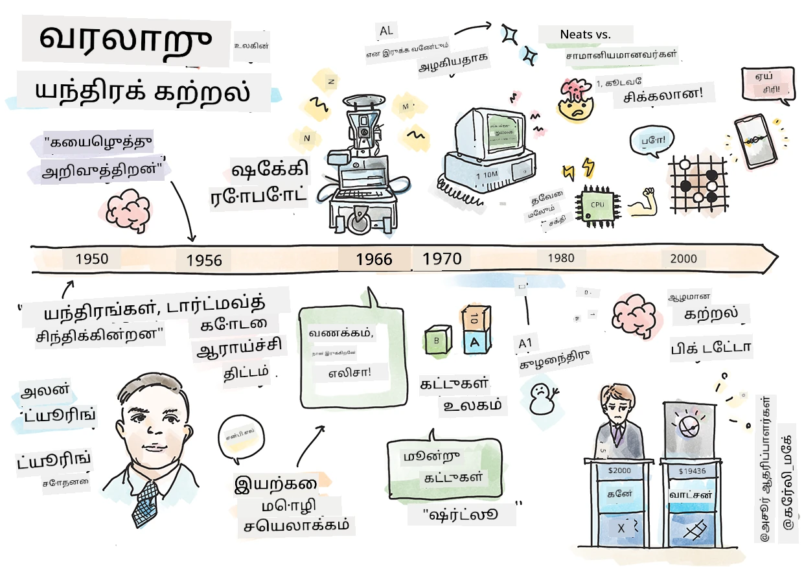
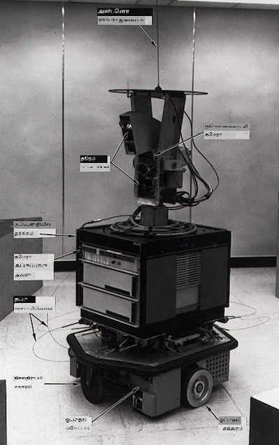
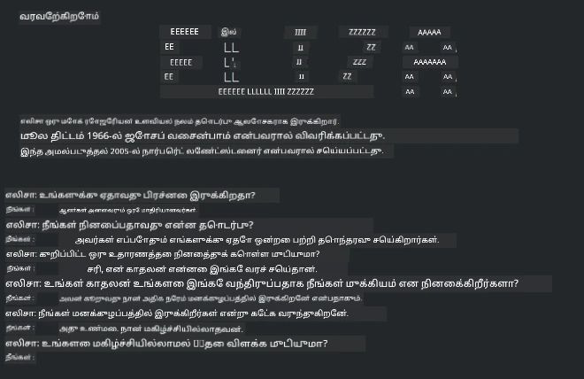

# இயந்திரக் கற்றலின் வரலாறு

> ஸ்கெட்னோட் - [டோமொமி இமுரா](https://www.twitter.com/girlie_mac)

## [முன்பாக பாடநெறி வினா](https://ff-quizzes.netlify.app/en/ml/)

---

> 🎥 இந்த பாடமாற்றை விரைவாகப் பார்க்க மேல் காணும் படத்தை அழுத்தவும்.

இதில், நாம் இயந்திரக் கற்றலும் செயற்கை நுண்ணறிவு வரலாற்றில் முக்கியமான மைல்கல் பட்டறைகளைப் பார்க்கப்போகிறோம்.

செயற்கை நுண்ணறிவு (AI) துறை வரலாறு இயந்திரக் கற்றல் வரலாற்றுடன் மேற்கொள்ளப்பட்டிருக்கிறது, ஏனெனில் இயந்திரக் கற்றலை முன்னிறுத்தும் அலகாரிதங்களும் கணக்கீட்டு முன்னேற்றங்களும் AI-வை உருவாக்க உதவியுள்ளன. இத்துறைகள் 1950-களில் தனி ஆய்வுத் துறைகளாக உருவானாலும், முக்கியமான [அலகாரிதம்கள், புள்ளியியல், கணிதம், கணக்கீடு மற்றும் தொழில்நுட்ப கண்டுபிடிப்புகள்](https://wikipedia.org/wiki/Timeline_of_machine_learning) இந்த காலப்பகுதியைத் திட்டுமிடாமல் முன்னதாகவும் ஒட்டுமொத்தமாகவும் இருந்தன என்பதை நினைவில் கொள்ள வேண்டும். உண்மையில், மக்கள் இந்த கேள்விகளை [நூற்றாண்டுகளாக](https://wikipedia.org/wiki/History_of_artificial_intelligence) யோசித்து வந்துள்ளனர்: இந்த கட்டுரை 'யோசிக்கும் இயந்திரம்' என்ற கருப்பொருளின் வரலாற்று அறிவுச் சார்ந்த அடித்தளங்கள் குறித்து விவரிக்கிறது.

---
## குறிப்பிடத்தகுந்த கண்டுபிடிப்புகள்

- 1763, 1812 [பேய்ஸ் தேர்'மைன்](https://wikipedia.org/wiki/Bayes%27_theorem) மற்றும் அதன் முன் வடிவங்கள். இந்த நிகழ்ச்சி மற்றும் அதன் பயன்பாடுகள் முன்னறிவிப்பை அடிப்படையாகக் கொண்டு நிகழ்ச்சி தோன்றும் வாய்ப்பை விவரிக்கின்றன.
- 1805 பிரெஞ்சு கணிதவியலாளர் அத்ரியன்-மாரி லெகென்றின் [குறைந்த சிறப்புப் பத்தக்கம்](https://wikipedia.org/wiki/Least_squares). இந்தக் கோட்பாட்டை, உங்கள் புள்ளிவிவரக் கணித அலகில் கற்றுக்கொள்ளப்போகிறீர்கள், தரவுகளை பொருத்த உதவும்.
- 1913 ருஷ்யப் கணிதவியலாளர் ஆண்ட்ரெய் மார்கோவின் பெயரில் அழைக்கப்படும் [மார்கோவ் சங்கிலிகள்](https://wikipedia.org/wiki/Markov_chain), இது முந்தைய நிலைக்கு அடிப்படையாக கொண்டு நிகழ்வுகளின் தொடர் வரிசையை விவரிக்க பயன்படுகிறது.
- 1957 அமெரிக்க மனோதத்துவவியலாளர் ஃப்ராங்க் ரோசென்பிளாட்டால் கண்டுபிடிக்கப்பட்ட [பெர்செப்ட்ரான்](https://wikipedia.org/wiki/Perceptron) என்ற வகை வரிசை வகைப்படுத்தி, இது ஆழ்ந்த கற்றல் முன்னேற்றங்களுக்கு அடிப்படையாக உள்ளது.

---

- 1967 [நெருங்கிய உறவினர்](https://wikipedia.org/wiki/Nearest_neighbor) என்பது முதலில் வழிகளை வரைபடமாகக் காண உருவாக்கப்பட்ட ஒரு வழிமுறை. ஒரு எம்எல் சூழலில் இது மாதிரிகளை கண்டுபிடிக்க பயன்படுத்தப்படுகிறது.
- 1970 [பின்திசைபற்றிப்பு](https://wikipedia.org/wiki/Backpropagation) என்பது [முன்னோக்கிய செயற்கை நரம்பியல் வலைப்பின்னல்கள்](https://wikipedia.org/wiki/Feedforward_neural_network) ஐ பயிற்றுவிக்க பயன்படுத்தப்படுகிறது.
- 1982 [மீண்டும் வரும் நரம்பியல் வலைப்பின்னல்கள்](https://wikipedia.org/wiki/Recurrent_neural_network) என்பது முன்னோக்கிய செயற்கை நரம்பியல் வலைப்பின்னல்களில் இருந்து பெறப்பட்டு கால முறைவரிசைக் கட்டமைப்புகளை உருவாக்கும் செயற்கை நரம்பியல் வலைப்பின்னல்கள் ஆகும்.

✅ சிறிது ஆய்வு செய்யவும். எம்எல் மற்றும் செயற்கை நுண்ணறிவின் வரலாற்றில் எந்த பிற தேதிகளும் முக்கியமானவையாக இருக்கின்றன?

---
## 1950: சிந்திக்கும் இயந்திரங்கள்

அலன் டூரிங், 20 ஆவது நூற்றாண்டின் மிகச் சிறந்த விஞ்ஞானியாக [2019 பொதுமக்கள் வாக்குவாதத்தில்](https://wikipedia.org/wiki/Icons:_The_Greatest_Person_of_the_20th_Century) தேர்ந்தெடுக்கப்பட்டவனாகும், 'சிந்திக்கக் கூடிய இயந்திரம்' என்ற கருத்துக்கான அடித்தளத்தை அமைப்பதில் அவருக்கு பெரும் பங்களிப்பு உள்ளது. இந்த கருத்தின் உண்மைமையை சோதிக்க அவர் எதிர்ப்பவர்கள் மற்றும் தன்னை சொந்தமாக சூட்சுமமான증மீட்டலில் சிக்கியது, இதற்கு [டூரிங் சோதனை](https://www.bbc.com/news/technology-18475646) என்பதைக் கொண்டு முயற்சித்தார், எங்கள் NLP பாடங்களில் இதைப் பற்றிச் சொல்லப்படும்.

---
## 1956: டார்ட்மவுத் கோடை ஆய்வு திட்டம்

"செயற்கை நுண்ணறிவுக்கான டார்ட்மவுத் கோடை ஆய்வு திட்டம் செயற்கை நுண்ணறிவு துறையில் ஒரு முக்கிய நிகழ்வாக இருக்கிறத" என்றும், இங்கே 'செயற்கை நுண்ணறிவு' என்ற சொல் உருவாக்கப்பட்டது ([மூலம்](https://250.dartmouth.edu/highlights/artificial-intelligence-ai-coined-dartmouth)).

> கற்றலும் அறிவின் பிற அம்சங்களும் அனைத்தும் மிக நுட்பமாக வரையறுக்கப்படக்கூடியவை என்பதையே அடிப்படையாகக் கொண்டு இயந்திரம் அதை மற்றுமொரு முறையாக பின்பற்ற செய்யப்படும்.

---

મુખ્ય ஆராய்ச்சியாளர், கணிதப் பேராசிரியர் ஜான் மெக்கார்தி, "காட்டவேண்டும் என்பது கற்றல் அல்லது அறிவின் மற்ற அம்சங்களின் துல்லியமான வரையறைகளை பிரதி சிங்கையில் இயந்திரம் அதனை பின்பற்ற செய்யப்படலாம்" என்பதையே அடிப்படையாக்கொண்டு முன்னேற விரும்பினார். இதில் இன்னொருவர் பிரபல நபர் மார்வின் மின்ஸ்கி இருந்தார்.

இந்த கருத்தரங்கம் "சின்னமாக்கும் முறைகள், சில துறைகளுக்கென சிறப்பு மையமான அமைப்புகள் (ஆரம்ப வல்லுநர் முறைகள்), மற்றும் கழிப்பறை முறைகள் மற்றும் ஊக்குவிக்கூடிய முறைகள்" போன்ற பல விவாதங்களைத் துவங்கி ஊக்குவித்தது என்று பாராட்டப்படுகிறது. ([மூலம்](https://wikipedia.org/wiki/Dartmouth_workshop)).

---
## 1956 - 1974: "தங்க காலங்கள்"

1950களிலிருந்து 70களின் நடுப்பகுதிவரை, செயற்கை நுண்ணறிவு பல பிரச்சினைகளை தீர்க்கும் என பெரிய எதிர்பார்ப்பு இருந்தது. 1967-இல் மார்வின் மின்ஸ்கி தன்னம்பிக்கையாக கூறினார், "ஒரு தலைமுறைக்குள் ... 'செயற்கை நுண்ணறிவு' உருவாக்கும் பிரச்சினை முக்கியமாக தீர்க்கப்படும்." (மின்ஸ்கி, மார்வின் (1967), கணினி: வரம்பு மற்றும் மிக்க இயந்திரங்கள், எங்கில்வுட் கிளிஃப்ஸ், N.J.: பிரெண்டிஸ்-ஹால்)

இயல்பான மொழி செயலாக்க ஆய்வுகள் வளர்ந்தன, தேடல் மேம்பாடு பெற்று சக்தியாக செல்வதுபோன்று செய்யப்பட்டது, மேலும் 'மைக்ரோ உலகங்கள்' என்ற கருத்து உருவாக்கப்பட்டது, இங்கு எளிய பணிகள் சுலபமான மொழி வழிமுறைகளால் முடிக்கப்பட்டன.

---

அரசாங்க நிறுவனங்களின் நிதியுதவியுடன் ஆராய்ச்சிகள் நடந்தன, கணினி மற்றும் ஆல்காரிதங்கள் மேம்பட்டன, மற்றும் நுண்ணறிவு இயந்திரங்களின் மாதிரிகள் உருவானன. அதில் சில இயந்திரங்கள்:

* [சேக்கி ரோபோட்](https://wikipedia.org/wiki/Shakey_the_robot), செயல்களை 'நுண்ணறிவூட்டிய' முறையில் செயல் படுத்த முடிந்து இயக்க முடியும்.

    
    > 1972 ஆம் ஆண்டின் சேக்கி

---

* எலிசா, ஒரு ஆரம்ப கால 'சேட்டர்'ஆகியவர், மக்களுடன் உரையாட முடியும் மற்றும் ஒரு அடிப்படையிலான 'சிகிச்சையாளர்' ஆக செயல்பட முடியும். நீங்கள் NLP பாடங்களில் எலிசாவைப் பற்றி மேலும் கற்றுக்கொள்வீர்கள்.

    
    > எலிசா என்ற ஒரு உரையாடல் பாட்டியின் பதிப்பு

---

* "பிளாக்ஸ் உலகம்" என்பது ஒரு சுட்டி உலகத்தின் உதாரணமாக இருந்தது, அங்கே பிளாக்களை ஏகப்பட்டு வரிசைப்படுத்த முடியும், மற்றும் இயந்திரங்களுக்கு முடிவெடுக்க கற்றுத்தருவதை தேர்வு செய்யப்படும். [SHRDLU](https://wikipedia.org/wiki/SHRDLU) போன்ற நூலகங்களுடன் செய்யப்பட்ட முன்னேற்றங்கள் மொழி செயலாக்கத்தை முன்னெடுத்தன.

    

    > 🎥 வீடியோவிற்காக மேலே உள்ள படத்தை கிளிக் செய்யவும்: SHRDLU உடன் பிளாக்ஸ் உலகம்

---
## 1974 - 1980: "AI குளிர்காலம்"

1970களின் நடுப்பகுதியில், 'புத்திசாலி இயந்திரங்களை' உருவாக்குவது எவ்வளவு சிக்கலானது என்பது தெளிவாகி, கிடைக்கக்கூடிய கணினி சக்தியுடன் அதன் வாக்குறுதி அதிகமாக கூறப்பட்டுள்ளது. நிதி குறைந்து இந்த துறையில் நம்பிக்கை குறைந்தது. நம்பிக்கையை பாதித்த சில பிரச்சினைகள்:
---
- **வரையறைகள்**. கணினி சக்தி மிகவும் குறைந்தது.
- **கூட்டு வெடிப்பு**. கணினிகளிடமிருந்து கேட்கப்பட்டதை அதிகரிக்கும் போது பயிற்சி பெற வேண்டிய அளவு அளவிட முடியாத முறையில் அதிகரித்தது, கணினி சக்தி மற்றும் திறன் உடனடி வளரும் இல்லாமல்.
- **தரவு குறைவு**. தரவின் தாழ்வு ஆல்கோரிதங்களின் சோதனை, மேம்பாடு, மற்றும் மேன்மைக்கு தடையாக இருந்தது.
- **நாம் சரியான கேள்விகளை கேட்குகிறோமா?**. கேட்கப்பட்ட கேள்விகள் சந்தேகிக்கப்பட்டன. ஆய்வாளர்கள் தமது அணுகுமுறைகளுக்கு விமர்சனம் எதிர்கொண்டனர்:
  - டூரிங் பரிசோதனைகள் 'சீனிய சங்கம் கோட்பாடு' உள்ளிட்ட எண்ணங்களால் கேள்விக்குறியாகலாம், இது, "டிஜிட்டல் கணினி நிரலாக்கமால் மொழி புரிந்துகொள்வதாக தோன்றலாம் ஆனால் உண்மை புரிதலை உருவாக்க முடியாது." ([மூலம்](https://plato.stanford.edu/entries/chinese-room/))
  - "சிகிச்சையாளர்" எலிசா போன்ற செயற்கை அறிவுத்திறன்களை அறிமுகப்படுத்துவதை ஒழுக்கப்பூர்வமாக வெறுக்கப்பட்டது.

---

அதே சமயத்தில், பல AI எண்ணங்கள் உருவாகத் தொடங்கின. ["கரசரமான" மற்றும் "தீவிரமான AI"](https://wikipedia.org/wiki/Neats_and_scruffies) நடைமுறைகளுக்கு இடையே பாகுபாடு ஏற்படுத்தப்பட்டது. _கரசரமான_ ஆய்வகங்கள் மணி நேரங்கள் நிரல்களை திருத்தி விரும்பிய முடிவுகளை எட்டின. _தீவிரமான_ ஆய்வகங்கள் "தர்க்கம் மற்றும் தரவரிசை பிரச்சினை தீர்வில் கவனம் செலுத்தின". எலிசா மற்றும் SHRDLU பரிச்சயமான _கரசரமான_ அமைப்புகள். 1980களில், மெஷின் கற்றல் அமைப்புகள் மறுபடியும் உருவாக்கக்கூடியதாக உருவாக்க வேண்டும் என்ற கோரிக்கையுடன், _தீவிரமான_ அணுகுமுறை முன்னணி வகித்தது மேலும் விளக்கமான முடிவுகள் வழங்கியது.

---
## 1980கள் நிபுணர் அமைப்புகள்

துறை விரிந்து வணிகத்துக்கு நன்மை தெளிவடைந்து, 1980களில் 'நிபுணர் அமைப்புகள்' பரவவும் தொடங்கின. "நிபுணர் அமைப்புகள் செயற்கை அறிவுத்திறனின் (AI) முதன்மையான வெற்றிகரமான வடிவங்களில் ஒன்றாக இருந்தன." ([மூலம்](https://wikipedia.org/wiki/Expert_system)).

இந்த அமைப்பு ஒரு _இணைவு_ ஆகும், ஒரு விதிமுறை இயக்கி வணிக தேவைகளை வரையறுக்கிறது, மற்றொரு முடிவு இயக்கி விதிமுறை அமைப்பை பயன்படுத்தி புதிய உண்மைகள் கண்டறியும்.

இந்த காலம் நரம்பியல் வலைப்பின்னல்களுக்கு அதிக கவனம் செலுத்தப்பட்டது.

---
## 1987 - 1993: AI 'அரவணைத்தல்'

சிறப்பு நிபுணர் கணினி அமைப்புகளின் பரவல் மிகவும் சிறப்பாக மாறியுள்ளது என்பது துரதிர்ஷ்டமாக்கான விளைவாக உள்ளது. தனிப்பட்ட கணினிகளின் எழுச்சியும் இவ்வெடுங்கோள்கள், சிறப்பான, மையமாக்கப்பட்ட அமைப்புகளுடன் போட்டியிட்டது. கணினி அணுகல் பொதுவானது ஆனது, இது இன்று பெரிய தரவு வெடிப்பின் வழியைத் திறந்தது.

---
## 1993 - 2011

இந்த காலகட்டத்தில், கணினி கற்றலும் மெய்நிகர் நுண்ணறிவு (AI) முன்னதாகவே தரவும் கணினி சக்தியின் குறைவால் ஏற்பட்டுள்ள சிக்கல்களை தீர்க்கும் புதிய காலத்தை கண்டது. தரவு அதிகரித்ததோடு விரைவாகவும் அதிகளவில் கிடைக்கத் தொடங்கியது, சிறப்பாகவும் குறைவாகவும், குறிப்பாக 2007ல் ஸ்மார்ட்போன் தோன்றிய பிறகு. கணினி சக்தி விகிதாச்சாரமாக வளர்ச்சி பெற்றது மற்றும் ஆண்டுரைகள் கூடவே வளர்ந்தன. கடந்த கால சுதந்திரமான நாட்கள் ஒரு இஸ்திரியம்ம் ஆக மாற தொடங்கியது, இந்த துறை பரிபக்குவத்தைக் கண்டது.

---
## இப்போது

இன்றைய தினத்தில், இயந்திர கற்றலும் AI நமது வாழ்வின் பெரும்பகுதி பகுதிகளையும் தொடுகிறது. இந்த காலகட்டத்தில், இந்த ஆண்டுரைகள் மனித வாழ்வில் ஏற்படும் ஆபத்துகள் மற்றும் சிறுபட்ட விளைவுகளை கவனமாக புரிந்துகொள்ள வேண்டும். மைக்ரோசாஃப்ட் பிராட் ஸ்மித் கூறியபடி, "தகவல் தொழில்நுட்பம் தனியுரிமை மற்றும் வெளிப்பாடு போன்ற அடிப்படை மனித உரிமைகள் தொடர்பான பிரச்சனைகளை எழுப்புகிறது. இந்த பிரச்சனைகள் இந்த தயாரிப்புகளை உருவாக்கும் தொழில்நுட்பக் நிறுவனங்களுக்கு அதிக பொறுப்பு உண்டாக்குகின்றன. நமது பார்வையில், இது சிந்தனையுடைய அரசு ஒழுங்குமுறைகளையும் ஏற்றுக்கொள்ளத்தகுந்த பயன்பாடுகளை சுற்றி நெறிமுறைகளை உருவாக்கவும் கோருகிறது" ([source](https://www.technologyreview.com/2019/12/18/102365/the-future-of-ais-impact-on-society/)).

---

எதிர்காலம் என்ன கொண்டுவரும் என்பதை இன்னும் பார்க்க வேண்டும், ஆனால் இந்த கணினி அமைப்புகளை, அதனோடு இயங்கும் மென்பொருட்களையும் ஆண்டுரைகளையும் புரிந்துகொள்வது முக்கியம். இந்த பாடத்திட்டம் உங்களுக்கான சிறந்த புரிதலை வழங்கும் என்று நம்புகிறோம், இதனால் நீங்கள் தாங்களே முடிவு செய்ய முடியும்.

> 🎥 மேலுள்ள படத்தை கிளிக் செய்வது ஒரு வீடியோக்கு: Yann LeCun இந்த கடைசியில் ஆழ்ந்த கற்றலின் வரலாற்றைப் பற்றி பேசுகிறார்

---
## 🚀சவால்

இந்த வரலாற்று நிகழ்வுகளில் ஒன்றை ஆராய்ந்து அதற்குப் பின்னணியில் உள்ள மனிதர்களைப் பற்றி மேலும் அறியவும். அங்கு விசித்திரமான கதாப்பாத்திரங்கள் பலர் உள்ளனர், மற்றும் எந்த அறிவியல் கண்டுபிடிப்பு கலாச்சார வெற்றிடத்தில் உருவாக்கப்படவில்லை. நீங்கள் என்ன கண்டறிந்து கொள்ள முடிகிறது?

## [பாடம் முடிவுக்குப் பின் கேள்வி](https://ff-quizzes.netlify.app/en/ml/)

---
## மீள்பார்வை மற்றும் சுயப் படிப்பு

காண மற்றும் கேட்க சில உருப்படிகள்:

[Amy Boyd கூறும் AI வளர்ச்சி பற்றிய இந்த போட்ட்காஸ்ட்](http://runasradio.com/Shows/Show/739)

---

## பணிபுரிதல்

[ஒரு காலவரிசை உருவாக்கவும்](assignment.md)

---

<!-- CO-OP TRANSLATOR DISCLAIMER START -->
**மறுப்பு**:
இந்த ஆவணம் AI மொழிபெயர்ப்பு சேவை [Co-op Translator](https://github.com/Azure/co-op-translator) பயன்படுத்தி மொழிபெயர்க்கப்பட்டுள்ளது. நாங்கள் துல்லியத்திற்காக முயற்சி செய்துள்ளோம், ஆனால் தானாக செய்யப்படும் மொழிபெயர்ப்புகளில் பிழைகள் அல்லது தவறுகள் இருக்கலாம் என்பதை கவனத்தில் கொள்ளவும். அசல் ஆவணம் அதன் தாய்மொழியில் அதிகாரப்பூர்வ ஆதாரமாக கருதப்பட வேண்டும். முக்கியமான தகவல்களுக்கு, தொழில்நுட்பமான மனித மொழிபெயர்ப்பு பரிந்துரைக்கப்படுகிறது. இந்த மொழிபெயர்ப்பைப் பயன்படுத்துவதால் ஏற்படும் எந்த தவறான புரிதல்கள் அல்லது தவறான விளக்கத்திற்கும் நாங்கள் பொறுப்பில்வில்லை.
<!-- CO-OP TRANSLATOR DISCLAIMER END -->