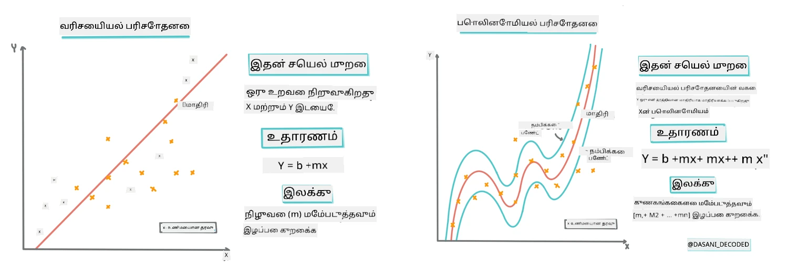
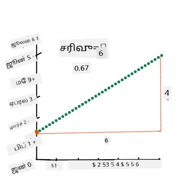
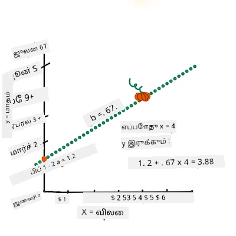
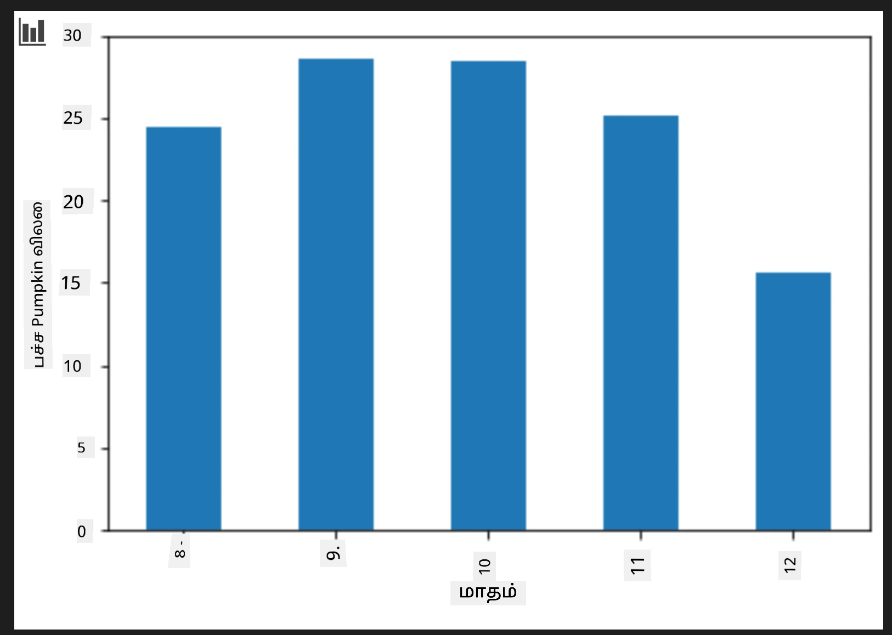
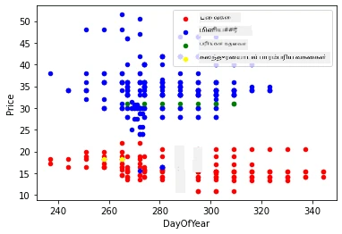

# Scikit-learn பயன்படுத்தி ஒரு ரெக்ரஷன் மாதிரியை உருவாக்குக: நான்கு விதமான ரெக்ரஷன்

## தொடக்கம் குறிப்பு

நேரியல் ரெக்ரஷன் என்பது நாம் **அளவைக் கணிக்க** விரும்பும் போது பயன்படுத்தப்படுகிறது (உதாரணமாக, வீட்டின் விலை, வெப்பநிலை, அல்லது விற்பனைகள்).  
இது உள்ளீட்டு அம்சங்களுக்கும் வெளியீட்டு மதிப்புக்கும் இடையிலான தொடர்பைக் சிறந்த முறையில் பிரதிநிதித்துவம் செய்யும் நேர்கோட்டை கண்டுபிடிப்பதன் மூலம் செயல்படுகிறது.

இந்த பாடத்தில், மேம்பட்ட ரெக்ரஷன் தொழில்நுட்பங்களை ஆராயும் முன் இந்த கருத்தைப் புரிந்துகொள்ள கவனம் செலுத்துகிறோம்.  
  
> தகவல்படம்: [டாசனி மடிபள்ளி](https://twitter.com/dasani_decoded)

## [முன்பாடக் கேள்வித்தட்டு](https://ff-quizzes.netlify.app/en/ml/)

> ### [இந்த பாடம் R மொழியிலும் கிடைக்கிறது!](../../../../2-Regression/3-Linear/solution/R/lesson_3.html)

### அறிமுகம்

இப்பொழுது வரை நீங்கள் ரெக்ரஷன் என்பது என்ன என்று கற்றுக்கொண்டது மற்றும் இந்த பாடத்தில் பயன்படுத்தப்படும் பரங்கிக்குருவி விலை தரவுகள் மூலம் எடுத்துக்காட்டு தரவுகளை ஆராய்ந்துள்ளீர்கள். நீங்கள் இந்த தரவை Matplotlib மூலம் காட்சிப்படுத்தவும் செய்துள்ளீர்கள்.

இப்பொழுது, இயந்திரக் கற்றலுக்கான ரெக்ரஷனில் ஆழமாக நுழைய தயாராக உள்ளீர்கள். காட்சிப்படுத்தல் தரவை புரிந்து கொள்ள உதவுகிறது, ஆனால் இயந்திரக் கற்றலின் உண்மையான சக்தி _மாதிரிகளை பயிற்சிசெய்யும்_ செயலிலிருந்து வருகிறது. மாதிரிகள் கடந்த கால தரவில் பயிற்சி பெற்று, தரவின் சார்புகளை தானாகவே அடையாளம் காண்கிறன, மேலும் புதிய தரவுகள் குறித்து (மாதிரி முன்பே பார்க்காதவை) முடிவுகளை கணிக்க உதவுகின்றன.

இந்த பாடத்தில், இரண்டு வகை ரெக்ரஷன்கள் பற்றி கூடுதல் கற்றுக்கொள்வீர்கள்: _அடிப்படையான நேரியல் ரெக்ரஷன்_ மற்றும் _பல்கோணம் ரெக்ரஷன்_, மற்றும் இத்தொழில்நுட்பங்களுக்கான சில கணிதங்களும். இவை பரங்கிக்குருவி விலைகளை பல்வேறு உள்ளீட்டு தரவுகளைப் பொருத்து கணிக்க உதவும்.

[](https://youtu.be/CRxFT8oTDMg "ML தொடக்கநரர்களுக்கான - நேரியல் ரெக்ரஷன் புரிதல்")

> 🎥 மேலுள்ள படத்தை கிளிக் செய்து நேரியல் ரெக்ரஷன் குறித்த ஒரு குறுகிய வீடியோக்களை பார்க்கவும்.

> இந்த பாடத்திட்டத்தில், கணிதம் குறைந்த அளவாக தெரிந்திருப்பத assumptionsஇல் உள்ளோம், மற்ற துறைகள் வந்துள்ள மாணவர்களுக்குப் புரியுமாறு செய்ய முயல்கிறோம்; எனவே குறிப்பு குறிப்புகள், 🧮 கணக்கீடுகள், வரைபடங்கள் மற்றும் பிற கற்றல் உதவிகள் மூலம் விளக்கங்களைக் கொடுக்கின்றோம்.

### முன்னோடியான அறிவு

நீங்கள் இன்று பரங்கிக்குருவி தரவு அமைப்பைப் பற்றி பழகியிருப்பீர்கள். இந்த பாடத்திட்டத்தின் _notebook.ipynb_ கோப்பில் அது முன் ஏற்றப்பட்டு சுத்தம் செய்யப்பட்டு உள்ளது. அங்கு பரங்கிக்குருவி விலை புஷல் ஒன்றுக்கு கணிக்கப்பட்டு புதிய தரவுக் கட்டத்தில் காணப்படுகிறது. Visual Studio Code இனிப்புகளில் இந்த நோட்புக்களை இயக்க முடியும் என்பதை உறுதிப்படுத்திக்கொள்ளவும்.

### தயார் செய்தல்

ஒரு நினைவூட்டல் போல, நீங்கள் இந்த தரவை ஏற்றிக் கொண்டு அதை பற்றி கேள்விகள் கேட்கவிருந்தீர்கள்.

- பரங்கிக்குருவிகளை வாங்க சிறந்த நேரம் எப்போது?  
- ஒரு சிறிய பரங்கிக்குருவி தொகுப்பின் விலை என்ன இருக்கலாம்?  
- அதைப் பாதி புஷல் கூடை அல்லது 1 1/9 புஷல் பெட்டியில் வாங்குவது நல்லதா?  
இந்த தரவை இன்னும் ஆராய பயிற்சியைத் தொடர்வோம்.

முந்தைய பாடத்தில், நீங்கள் ஒரு Pandas தரவுக் கட்டமைப்பை உருவாக்கி, அசல் தரவுத்தொகுதியின் ஒரு பகுதிக்கு விலை பொருத்தப்பட்டு படிந்துள்ளீர்கள், புஷல் எண்ணிக்கையின் அடிப்படையில் விலை நிலைத்திருத்தம் செய்யப்பட்டது. ஆனால் அதனால், சுமார் 400 தரவுப் புள்ளிகள் மட்டுமே வரிசைப்படுத்தப்பட்டன மற்றும் முந்தைய காலக் காலங்களுக்குப் பொருந்தியது.

இந்த பாடத்திட்டத்தின் கூடுதலான நோட்புக் முன் ஏற்றிய தரவை பாருங்கள். இதில் ஒரு தொடக்கமான ஸ்காட்டர்ப்ளாட் வரைபடமாக மாத விவரங்கள் காட்டப்பட்டுள்ளது. மீண்டும் அதனை சுத்தம் செய்யும்போது தரவின் இயல்பைக் குறித்த கூடுதல் விவரங்களைப் பெறலாம்.

## ஒரு நேரியல் ரெக்ரஷன் கோடு

பாடம் 1 இல் நீங்கள் கற்றுக்கொண்டது போல, நேரியல் ரெக்ரஷன் செயல்முறை நோக்கு:

- **மாறி தொடர்புகளை காட்டுக**. மாறிகளுக்கு இடையிலான தொடர்பை காண்பிக்கவும்  
- **முன்னறிவிப்புகளைச் செய்யும்**. புதிய தரவுப் புள்ளி அந்த கோட்டோடு எப்படி தொடர்புடையிருக்கும் என்பதை துல்லியமாக கணிக்கவும்

**குறைந்த இடர்களுக்கான ரெக்ரஷன் (Least-Squares Regression)** இல் இந்த வகை கோட்டை வரைப்பது சாமானியம். "குறைந்த இடர்கள்" என்பது மாதிரியிலுள்ள முழு பிழையை குறைக்க முயற்சிக்கும் செயல்முறையைக் குறிக்கும். ஒவ்வொரு தரவுப் புள்ளிக்கும், நமது ரெக்ரஷன் கோடு மற்றும் புள்ளி இடையே உள்ளது ஆகிய செங்குத்து தூரம் (அதை மீதமுள்ளவை என கூறுவர்) அளக்கப்படுகிறது.

இத்தூரங்களுக்கு மேற்கோள்கின்ற இரண்டு முக்கிய காரணங்கள்:

1. **திசை விட அளவு முக்கியம்**: -5 பிழை மற்றும் +5 பிழை இரண்டையும் சமமாக பார்க்க வேண்டும். அளவுகளின் வரம்பைக் கவனிக்க வெளிப்படுத்தல் அனைத்து மதிப்புகளையும் நேர்மறையாக மாற்றும்.

2. **மாறான புள்ளிகளுக்கு அதிக தண்டனை**: பெரும் பிழைகளுக்கு அதிக முக்கியத்துவம் கொடுத்து கோட்டை அருகில் இருக்க வைக்கிறது.

பின்பு நாங்கள் அனைத்து அளவுக் கணக்குகளையும் கூடச் சேர்ப்போம். நமது நோக்கம் இந்த கூட்டு மதிப்பின் குறைந்த விலை கொண்ட குறிப்பிட்ட கோட்டை கண்டுபிடிப்பதே (இது தான் "குறைந்த இடர்கள்" என்ற பெயரின் காரணம்).

> **🧮 கணிதத்தை காண்பி**  
> இந்த கோடு, _சிறந்த பொருத்த கோடு_ என்று அழைக்கப்படுவது, [ஒரு சமன்பாட்டில்](https://en.wikipedia.org/wiki/Simple_linear_regression) வெளிப்படுத்தலாம்:  
> 
> ```
> Y = a + bX
> ```
>  
> `X` என்பது 'விளக்க மாறி', `Y` என்பது 'பொறுப்பு மாறி'. கோட்டின் சரிவு `b`; `a` என்பது y குறுக்கு இடைநிலை. `X = 0` ஆக இருக்கும் போது `Y` மதிப்பைக் குறிக்கும்.  
> 
>  
>  
> முதலில் சரிவு `b`-ஐ கணக்கிடுக. தகவல்படம்: [ஜென் லூப்பர்](https://twitter.com/jenlooper)  
>  
> வேறு வார்த்தைகளில், நமது பரங்கிக்குருவி தரவின் அசல் கேள்வி: "ஒரு பரங்கிக்குருவி புஷல் விலையில் மாதம் அடிப்படையில் கணிதம் செய்ய", `X` விலை மற்றும் `Y` விற்பனை மாதம் ஆகும்.  
>  
>  
>  
> `Y` மதிப்பைக் கணக்கிடுக. நீங்கள் சுமார் $4 செலுத்தினால், அது ஏப்ரல் மாதமாக இருக்கலாம்! தகவல்படம்: [ஜென் லூப்பர்](https://twitter.com/jenlooper)  
>  
> கோட்டின் சரிவு மற்றும் இடைநிலையைக் கணக்கிடும் கணிதம், `X = 0` ஆகும்போது `Y` எங்கு அமைகிறது என்பதையும் கண்டறிவது அவசியம்.  
>  
> [Math is Fun](https://www.mathsisfun.com/data/least-squares-regression.html) இனிப்பது கணக்கீடுகளை கவனகரமாக பார்க்கவும். மேலும் [குறைந்த இடர் கணக்கி](https://www.mathsisfun.com/data/least-squares-calculator.html) கோட்டை மொத்த மதிப்புகளை எப்படி பாதிக்கிறது என்பதைக் காணவும்.

## தொடர்பு

மேலும் ஒரு முக்கியமான பதம் விளக்கப்பட வேண்டும் என்பது `X` மற்றும் `Y` மாறிகளுக்கு இடையேயான **தொடர்பு காரிகை**. ஸ்காட்டர்பிளாட்டின் மூலம் இக்காரிகையை எளிதில் காணலாம். ஒரு நேர்கோட்டில் சீராக விரிந்துள்ள புள்ளிகளுக்கு உயர் தொடர்பு உள்ளது; ஆனால் புள்ளிகள் பரவியிருக்கிறபோது குறைந்த தொடர்பு இருக்கும்.

சிறந்த நேரியல் ரெக்ரஷன் மாதிரி தான் பின்வரும் தன்மையை உடையது: `Least-Squares Regression` முறையுடன் ஒரு உயர் தொடர்பு காரிகை (0 விட 1க்கு நெருங்கிய) கொண்டது.

✅ இந்த பாடத்திட்டத்துடன் கூடிய நோட்புக் ஓடுங்கள் மற்றும் மாதத்திற்கான விலை ஸ்காட்டர்ப்ளாட்டைப் பாருங்கள். உங்கள் பார்வையின் படி, பரங்கிக்குருவி விற்பனைகளுக்கான மாதத்துக்கும் விலைக்கும் இடையேயான தரவு உயர் அல்லது குறைந்த தொடர்பு உள்ளதா? `Month` மாறி பதிலாக வருட நாள் (ஆதரவு காலத்தின் தொடக்கம் முதல் நாட்கள் எண்ணிக்கை) பயன்படுத்தினால் அது மாறுமா?

பின்வரும் குறியீட்டில், நாம் தரவை சுத்தமாக்கி, கீழ்க்கண்ட மாதிரியில் தோற்றம் கொண்ட `new_pumpkins` என்ற ஒரு தரவுக் கட்டமைப்பைக் கொண்டிருப்பதாக எண்ணுகிறோம்:

ID | Month | DayOfYear | Variety | City | Package | Low Price | High Price | Price  
---|-------|-----------|---------|------|---------|-----------|------------|-------  
70 | 9 | 267 | PIE TYPE | BALTIMORE | 1 1/9 bushel cartons | 15.0 | 15.0 | 13.636364  
71 | 9 | 267 | PIE TYPE | BALTIMORE | 1 1/9 bushel cartons | 18.0 | 18.0 | 16.363636  
72 | 10 | 274 | PIE TYPE | BALTIMORE | 1 1/9 bushel cartons | 18.0 | 18.0 | 16.363636  
73 | 10 | 274 | PIE TYPE | BALTIMORE | 1 1/9 bushel cartons | 17.0 | 17.0 | 15.454545  
74 | 10 | 281 | PIE TYPE | BALTIMORE | 1 1/9 bushel cartons | 15.0 | 15.0 | 13.636364  

> தரவைச் சுத்தம் செய்வதற்கான குறியீடு [`notebook.ipynb`](notebook.ipynb) இல் உள்ளது. முந்தைய பாடத்தில் செய்த நிலையான சுத்தம் செய்யும் படிகளே இங்கே பிரயோகிக்கப்பட்டுள்ளன, மேலும் `DayOfYear` நிரலை பின்வரும் சமன்பாட்டைப் பயன்படுத்தி கணக்கிட்டுள்ளோம்:

```python
day_of_year = pd.to_datetime(pumpkins['Date']).apply(lambda dt: (dt-datetime(dt.year,1,1)).days)
```
  
இப்போது, நேரியல் ரெக்ரஷன் பின்னணியில் உள்ள கணிதத்தை புரிந்துகொண்டு, எந்த பஞ்சுப் பாட்டில் தொகுப்புக்கு சிறந்த விலைகள் இருக்கும் என்பதை கணிக்க ஒரு கேள்வி மாதிரியை உருவாக்குவோம். விடுமுறை பரங்கிக்குருவி பண்ணைக்கு பரங்கிப்பொருட்கள் வாங்குபவர், இந்தத் தகவலைச் கொண்டு தங்கள் கொள்முதல் முடிவுகளை மேம்படுத்த விரும்புவர்.

## தொடர்பைத் தேடுதல்

[](https://youtu.be/uoRq-lW2eQo "ML தொடக்கநரர்கள் - தொடர்பைக் காண்பது: நேரியல் ரெக்ரஷனுக்கான முக்கியம்")

> 🎥 மேலுள்ள படத்தை கிளிக் செய்து தொடர்பு பற்றிய குறுகிய வீடியோவைப் பாருங்கள்.

முந்தைய பாடத்தில் நீங்கள் கண்டிருப்பீர்கள், வெவ்வேறு மாதங்களுக்கு சராசரி விலை இதுபோன்று காணப்படுகிறது:  



இதனால் எந்தவொரு தொடர்பும் இருக்க வேண்டும் என்று தோன்றுகிறது, மேலும் `Month` மற்றும் `Price` அல்லது `DayOfYear` மற்றும் `Price` இடையேயான உறவை கணிக்க நேரியல் ரெக்ரஷன் மாதிரியை பயிற்சி செய்தால் பலனுள்ளதாக இருக்கும். கீழே அப்படி தொடர்புடைய தரவு பார்வை:


`corr` செயல்பாட்டைப் பயன்படுத்தி தொடர்பை காண்போம்:

```python
print(new_pumpkins['Month'].corr(new_pumpkins['Price']))
print(new_pumpkins['DayOfYear'].corr(new_pumpkins['Price']))
```
  
`Month` முறையில் -0.15 மற்றும் `DayOfYear` முறையில் -0.17 என்ற அளவுக்கு குறைந்த தொடர்பு உள்ளது போலத் தெரிகிறது; ஆனால் வேறு முக்கியமான உறவு இருக்கலாம். விலை நிலைகள் வெவ்வேறு பரங்கிக்குருவி வகைகளுக்கு முரண்படுகின்றன. இந்த எண்ணத்தை உறுதிப்படுத்த, ஒவ்வொரு வகைக்கும் வேறு வண்ணத்தைப் பயன்படுத்தி ஸ்காட்டர்ப்ளாட் வரைபடத்தை இடுவோம். `scatter` வரைபட செயல்பாட்டுக்கு `ax` அளவுருவை வழங்கி அனைத்து புள்ளிகளும் ஒரே வரைபடத்தில் இருப்பதாக ஆரம்பிக்கலாம்:

```python
ax=None
colors = ['red','blue','green','yellow']
for i,var in enumerate(new_pumpkins['Variety'].unique()):
    df = new_pumpkins[new_pumpkins['Variety']==var]
    ax = df.plot.scatter('DayOfYear','Price',ax=ax,c=colors[i],label=var)
```
  
  

நமது ஆய்வு பரங்கிக்குருவி வகை விலை பருவத்தை விட விலைக்கு அதிக தாக்கம் ஏற்படுத்துகிறது என்று காட்டுகிறது. இதை ஒரு பட்டியல்படமாகவும் காணலாம்:  

```python
new_pumpkins.groupby('Variety')['Price'].mean().plot(kind='bar')
```
  
  

இப்பொழுது நாம் 'பை வகை' என்ற பரங்கிக்குருவி வகையிலேயே கவனம் செலுத்தி, விற்பனை தேதியின் விலை மீது தாக்கத்தை பார்ப்போம்:

```python
pie_pumpkins = new_pumpkins[new_pumpkins['Variety']=='PIE TYPE']
pie_pumpkins.plot.scatter('DayOfYear','Price') 
```
  
  

`corr` மூலம் `Price` மற்றும் `DayOfYear` இடையேயான தொடர்பை கணக்கிடுவோம், அது சுமார் `-0.27` இருக்கும் — அதன்படி கணிக்கும் மாதிரிகள் பயிற்சி செய்வது பொருத்தமாகும்.

> நேரியல் ரெக்ரஷன் மாதிரியை பயிற்சி செய்யும் முன் தரவு சுத்தமாக இருக்க வேண்டும். நேரியல் ரெக்ரஷன் குறைந்த மதிப்புள்ள தரவுகளுடன் சரியல்ல. ஆதலால் வெற்றிடங்களைக் கழிப்பது நல்லது:

```python
pie_pumpkins.dropna(inplace=True)
pie_pumpkins.info()
```
  
மறுபடியும், வெற்றிடங்களை நிரப்ப எதிர்கால நிலைகளின் சராசரி மதிப்புகள் கொண்டு நிரப்புவது ஒரு நடுத்தரமாக இருக்கும்.

## எளிய நேரியல் ரெக்ரஷன்

[](https://youtu.be/e4c_UP2fSjg "ML தொடக்கநரர்கள் - Scikit-learn மூலம் நேரியல் மற்றும் பல்கோணம் ரெக்ரஷன்")

> 🎥 மேலுள்ள படத்தை கிளிக் செய்து நேரியல் மற்றும் பல்கோணம் ரெக்ரஷன் குறித்த குறுகிய வீடியோக்களைப் பாருங்கள்.

நாம் எங்கள் நேரியல் ரெக்ரஷன் மாதிரியை பயிற்சி செய்ய **Scikit-learn** நூலகத்தை பயன்படுத்தப் போகிறோம்.

```python
from sklearn.linear_model import LinearRegression
from sklearn.metrics import mean_squared_error
from sklearn.model_selection import train_test_split
```
  
நீங்கள் முதலில் உள்ளீட்டு மதிப்புகளை (அம்சங்கள்) மற்றும் எதிர்பார்க்கப்படும் வெளியீட்டை (லேபிள்) தனித்தனி numpy வரிசைகளாக பிரிக்கிறோம்:

```python
X = pie_pumpkins['DayOfYear'].to_numpy().reshape(-1,1)
y = pie_pumpkins['Price']
```
  
> கவனிக்க வேண்டியது, நாம் உள்ளீட்டை Linear Regression தொகுப்பின் சரியான புரிதலுக்காக `reshape` செய்யவேண்டியிருந்தது. Linear Regression 2D வரிசையாக உள்ளீட்டை எதிர்பார்க்கிறது, அங்கு வரிசையில் ஒவ்வொரு வரிசையும் உள்ளீட்டு அம்சப்படிவத்தை வைத்திருக்கும். எங்கள் நிலைமை ஓர் உள்ளீட்டுடன் உள்ளது; எனவே N×1 வடிவிலான வரிசை ஒன்று தேவை, இதில் N என்பது தரவுத் தொகுதி அளவு ஆகும்.

பின்பு, பயிற்சி மற்றும் சோதனை தரவுக் கட்டமைப்புகளாக தரவை பிரிக்க வேண்டும், அப்படித்தான் பயிற்சி முடிந்ததும் நமது மாதிரியை சரிபார்க்க முடியும்:

```python
X_train, X_test, y_train, y_test = train_test_split(X, y, test_size=0.2, random_state=0)
```
  
கடைசியாக, நேரியல் ரெக்ரஷன் மாதிரியை பயிற்சி செய்வது இரண்டு கட்டங்களையே கொண்டது. `LinearRegression` பொருளை வரையறுக்கி, அதனை `fit` முறையால் நம் தரவுக்கு பொருத்துகிறோம்:

```python
lin_reg = LinearRegression()
lin_reg.fit(X_train,y_train)
```
  

`fit` செய்த பிறகு `LinearRegression` பொருள் ரெக்ரஷனின் அனைத்து கூட்டுறவுகளையும் கொண்டிருக்கும், அவற்றை `.coef_` சொத்து மூலம் அணுகலாம். எங்கள் வழக்கில், ஒரு மட்டுமே கூட்டுறவு உள்ளது, அது சுமார் `-0.017` இருக்க வேண்டும். இது விலை காலத்துடன் சிறிது குறையும் போன்று தெரிகிறது, ஆனால் அதிகமாக இல்லாமல், தினத்திற்கு சுமார் 2 சென்ட் 정도. நாமே ரெக்ரஷன் Y-அச்சுடன் கடிக்கும் இடத்தை `lin_reg.intercept_` மூலம் அணுகலாம் - எங்கள் வழக்கில் இது சுமார் `21` இருக்கும், ஆண்டு தொடக்கத்தின் விலையை குறிக்கின்றது.

எங்கள் மாதிரி எவ்வாறு துல்லியமாக இருக்கின்றது என்பதைப் பார்க்க, நாமே ஒரு சோதனை தரவுத்தொகுதியில் விலைகளை கணிக்கலாம், பின்னர் நமது கணிப்புகள் எதிர்பார்க்கப்பட்ட மதிப்புகளுடன் எவ்வளவு நெருக்கமாக உள்ளது என்பதை அளக்கலாம். இது ருட் மீன் ஸ்கொயர் ஏரர் (RMSE) அளவுகளால் செய்யப்படலாம், இது எதிர்பார்க்கப்பட்ட மற்றும் கணிக்கப்பட்ட மதிப்புகளுக்கு இடையேயான அனைத்து சதுர வேறுபாடுகளின் சராசரி வேரின் வரவு ஆகும்.

```python
pred = lin_reg.predict(X_test)

rmse = np.sqrt(mean_squared_error(y_test,pred))
print(f'RMSE: {rmse:3.3} ({rmse/np.mean(pred)*100:3.3}%)')
```

எமது பிழை சுமார் 2 புள்ளிகள், அதாவது ~17% ஆக இருக்கிறது. அது மிக நல்லது அல்ல. மாதிரி தரத்தின் மற்றொரு குறியீடு **coefficient of determination** ஆகும், இதைப் பிறகு பெறலாம்:

```python
score = lin_reg.score(X_train,y_train)
print('Model determination: ', score)
```

மதிப்பு 0 என்றால், மாதிரி உள்ளீட்டு தரவை கவனிக்கவில்லை என்று பொருள், அது *கெட்ட linear முன்னறிவிப்பாளர்* ஆக செயல்படும், அது வெறும் முடிவின் சராசரியான மதிப்பாகும். மதிப்பு 1 என்றால், நாம் அனைத்து எதிர்பார்க்கப்பட்ட வெளியீடுகளையும் சரியாக கணிக்க முடியும். எங்கள் வழக்கில், கூட்டுநிலைகள் சுமார் 0.06 ஆகும், இது மிகவும் குறைவாகும்.

சோதனை தரவையும் ரெக்ரஷன் கோட்டையும் ஒன்றாக வரைபடக்கூடியது, எங்கள் வழக்கில் ரெக்ரஷன் எப்படி வேலை செய்கிறது என்பதைச் சிறப்பாக காண:

```python
plt.scatter(X_test,y_test)
plt.plot(X_test,pred)
```


## பாலினோமியல் ரெக்ரஷன்

Linear Regression இன் மற்றொரு வகை பாலினோமியல் ரெக்ரஷன் ஆகும். சில நேரங்களில், வேறுபாடுகளுக்கு நேர்காணல் தொடர்பு இருக்கலாம் - அளவில் பெரிய பூசணிக்காய் விலை அதிகம் - ஆனால் சில நேரங்களில் இந்த தொடர்புகளை பிளேன் அல்லது நேர்க் கோட்டாக வரைபடமிட முடியாது.

✅ இங்கே [மேலும் சில உதாரணங்கள்](https://online.stat.psu.edu/stat501/Lesson09#polynomial-regression-examples) உள்ளன, பாலினோமியல் ரெக்ரஷனை பயன்படுத்த கூடிய தரவுக்கான.

தேதியும் விலையும் இடையேயான தொடர்பை மீண்டும் பாருங்கள். இந்த ஸ்காட்டர்பிளாட் கண்டிப்பாக நேர்க் கோட்டால் ஆய்வு செய்ய வேண்டுமா? விலைகள் மாற முடியாது என்று என்ன? இந்த வேழையில், நீங்கள் பாலினோமியல் ரெக்ரஷனை முயற்சிக்கலாம்.

✅ பாலினோம் என்பது ஒருங்கிலு அல்லது பல மாறிகள் மற்றும் கூட்டாக்களைக் கொண்ட கணித வெளிப்பாடுகள்.

பாலினோம் ரெக்ரஷன் நேர்கொண்டாட்டம் இல்லாத தரவுக்கு பொருத்தமான வளைவு கோட்டை உருவாக்கும். எங்கள் வழக்கில், நாமே உள்ளீட்டு தரவுக்கு சதுரமான `DayOfYear` மாறியை சேர்க்கும்போது, ஆண்டு முழுவதும் ஒரு குறிப்பிட்ட கட்டத்தில் குறைந்த அளவு கொண்ட பரப்பைக் கொண்ட வளைவு கோட்டை பெற்று தரவுடன் பொருந்துவோம்.

Scikit-learn ஒரு உதவியுள்ள [pipeline API](https://scikit-learn.org/stable/modules/generated/sklearn.pipeline.make_pipeline.html?highlight=pipeline#sklearn.pipeline.make_pipeline) கொண்டுள்ளது, இது தரவு செயலாக்கத்தின் வெவ்வேறு படிகளை ஒன்றிணைக்க உதவும். ஒரு **pipeline** என்பது **மதிப்பீடுகளின்** சங்கிலி ஆகும். எங்கள் வழக்கில், முதலில் பாலினோமியல் அம்சங்களை நமது மாதிரிக்கு சேர்க்கும் மற்றும் பிறகு ரெக்ரஷன் பயிற்சி செய்யும் pipeline ஒன்றை உருவாக்குவோம்:

```python
from sklearn.preprocessing import PolynomialFeatures
from sklearn.pipeline import make_pipeline

pipeline = make_pipeline(PolynomialFeatures(2), LinearRegression())

pipeline.fit(X_train,y_train)
```

`PolynomialFeatures(2)` பயன்படுத்துவது, உள்ளீட்டு தரவிலிருந்து அனைத்து இரண்டாம் நிலை பாலினோம் சேர்க்கும் என்று பொருள். எங்கள் வழக்கில் அது `DayOfYear`<sup>2</sup> மட்டுமே இருக்கும், ஆனால் இரண்டு உள்ளீட்டு மாறிகள் X மற்றும் Y இருந்தால், இது X<sup>2</sup>, XY மற்றும் Y<sup>2</sup> ஐ சேர்க்கும். நாமே அதிகநிலை பாலினோம்களையும் பயன்படுத்தலாம்.

Pipelines-ஐ முதன்மை `LinearRegression` பொருளைப் போல பயன்படுத்தலாம், அதாவது நாம் pipeline-ஐ `fit` செய்து, பின்னர் `predict` மூலம் கணிப்புகளைப் பெறலாம்:

```python
pred = pipeline.predict(X_test)

rmse = np.sqrt(mean_squared_error(y_test,pred))
print(f'RMSE: {rmse:3.3} ({rmse/np.mean(pred)*100:3.3}%)')

score = pipeline.score(X_train,y_train)
print('Model determination: ', score)
```

மென்மையான அணுகுமுறை வளைவு வரைபடம் காண, `np.linspace` பயன்படுத்தி உள்ளீட்டு மதிப்புகளின் நேர்மையான வரம்பை உருவாக்குகிறோம், நேரடியாக ஒழுங்கற்ற சோதனை தரவுக்கே இல்லாமல் (அது சுழற்படியான கோட்டைக் கொடுக்கும்):

```python
X_range = np.linspace(X_test.min(), X_test.max(), 100).reshape(-1,1)
y_range = pipeline.predict(X_range)

plt.scatter(X_test, y_test)
plt.plot(X_range, y_range)
```

சோதனை தரவும் அணுகுமுறை வளைவுக் கோட்டும் காட்டும் வரைபடம் இதோ:


பாலினோமியல் ரெக்ரஷன் மூலம், நாமே சிறிது குறைந்த RMSE மற்றும் அதிகமான நிர்ணயக்கூறாடலை பெற முடியும், ஆனால் பெரிய மாற்றம் இல்லை. நாமே வேறு அம்சங்களையும் கருத்தில் கொள்ள வேண்டும்!

> குறைந்தபட்ச பூசணிக்காய் விலைகள் ஹாலோவீனுக்கு அருகில் காணப்படுகின்றது. இதை நீங்கள் எப்படி விளக்கவிட்டீர்கள்?

🎃 வாழ்த்துக்கள், நீங்கள் பை பூசணிக்காய் விலையை கணிக்க உதவும் மாதிரியை உருவாக்கியுள்ளீர்கள். நீங்கள் அனைத்து பூசணிக்காய் வகைகளுக்குமான அதே செயல்முறையை மீளவும் செய்யலாம் என்றாலும் அது சலுகையாக இருக்கும். இப்போது பூசணிக்காய் வகைப் பிரிவை எங்கள் மாதிரியில் எவ்வாறு கருத வேண்டும் என்பதை கற்றுக்கொள்வோம்!

## வகை அம்சங்கள்

இடையில், ஒரே மாதிரியைக் கொண்டு வெவ்வேறு பூசணிக்காய் வகைகளுக்கான விலைகளைக் கணிக்கக்கூடியதாக கருதுகிறோம். ஆனால், `Variety` பத்தியில் சிலவிதமாக `Month` போன்ற பத்திகளைக் காட்டிலும் வேறுபடுகிறது, ஏனெனில் அதில் எண்காணிப்பற்ற மதிப்புகள் உள்ளன. இத்தരം பத்திகள் **வகைபடுத்தப்பட்டவை (categorical)** என அழைக்கப்படுகின்றன.

[](https://youtu.be/DYGliioIAE0 "ML for beginners - Categorical Feature Predictions with Linear Regression")

> 🎥 மேற்கண்ட படத்தை கிளிக் செய்து வகை அம்சங்களை பயன்படுத்தும் குறுந்தட நிழற்படத்தை பார்க்கலாம்.

இங்கு வகையின் அடிப்படையில் சராசரி விலை எப்படி இருக்கும் என்று காணலாம்:


வகையை கருத்தில் கொள்ள, முதலில் அதை எண்கள் வடிவத்தில் மாற்ற வேண்டியிருக்கும், அதாவது **எண் குறியீடு அளித்தல் (encoding)**. இதனை செய்வதற்கான பல வழிகள் உள்ளன:

* எளிமையான **எண் குறியீடு அளித்தல்** இயற்கை விருப்பங்களை பட்டியலிடும் அட்டவணையைக் உருவாக்கி, அதற்குப் பின்னர் அந்த அட்டவணையில் பெயரைக் குறியீட்டு எண்ணாக மாற்றும். இது ரெக்ரஷனுக்கு சிறந்தது அல்ல, ஏனெனில் ரெக்ரஷன் எதிர்கொள்ளும் நேரடிக் குறிப்பான எண் மதிப்பை எடுத்துக்கொண்டு அதற்கேற்ப பலி அளிக்கும். எங்கள் வழக்கில், குறியீட்டு எண்ணும் விலையுடனான தொடர்பு தெளிவாக நேர்க் கோட்டை அல்லாமல் இருக்கும், கூடவே குறியீட்டுக்கள் நிச்சயமான முறையில் வரிசைப்படுத்த இருந்தாலும்.
* **ஒன்-ஹாட் எண்கிறது (One-hot encoding)**, `Variety` பத்தியை 4 வேறு பத்திகளாக மாற்றும், ஒவ்வொன்றும் ஒரு வகைக்கானது. ஒவ்வொரு வரிசை விசோட்ட வகைக்கானதாக இருந்தால் பத்தி `1`, இல்லையெனில் `0` உள்ளது. இதனால் ஒரே நேர்க் ரெக்ரஷனில் நான்கு கூட்டுறுக்கள் இருக்கும், ஒவ்வொரு பூசணிக்காய் வகைக்கும் தனித்தனியான "ஆரம்ப விலை" (அல்லது "மேலும் விலை") பொறுப்பேற்கும்.

கீழ்காணும் குறியீடு வகையை ஒன்-ஹாட் ஆக்குவதற்கான உதாரணமாகும்:

```python
pd.get_dummies(new_pumpkins['Variety'])
```

 ID | FAIRYTALE | MINIATURE | MIXED HEIRLOOM VARIETIES | PIE TYPE
----|-----------|-----------|--------------------------|----------
70 | 0 | 0 | 0 | 1
71 | 0 | 0 | 0 | 1
... | ... | ... | ... | ...
1738 | 0 | 1 | 0 | 0
1739 | 0 | 1 | 0 | 0
1740 | 0 | 1 | 0 | 0
1741 | 0 | 1 | 0 | 0
1742 | 0 | 1 | 0 | 0

ஒன்-ஹாட் குறியீட்டு வகையை உள்ளீட்டு தரவாக கொண்டு லினியர் ரெக்ரஷன் பயிற்சி செய்ய, நமக்கு `X` மற்றும் `y` தரவை சரியாக ஆரம்பிப்பதே போதும்:

```python
X = pd.get_dummies(new_pumpkins['Variety'])
y = new_pumpkins['Price']
```

மீதமுள்ள குறியீடு மேலே பயன்படுத்திய லினியர் ரெக்ரஷன் பயிற்சியைப் போன்றது. நீங்கள் இதை முயற்சித்தால், சராசரி சதுர வேறுபாடு சுமார் அதேபோல் இருக்கும், ஆனால் நாமே மிக்க உயர்ந்த நிர்ணயக்கூறுகளை (~77%) பெறுவோம். கூடுதல் துல்லியமான கணிப்புகளைச் செய்ய, மேலும் வகை அம்சங்களையும், எண் அம்சங்களும் (காரணமாக `Month` அல்லது `DayOfYear`) கருதலாம். பெரிய அம்ச தொகுப்பு பெற `join` பயன்படுத்தலாம்:

```python
X = pd.get_dummies(new_pumpkins['Variety']) \
        .join(new_pumpkins['Month']) \
        .join(pd.get_dummies(new_pumpkins['City'])) \
        .join(pd.get_dummies(new_pumpkins['Package']))
y = new_pumpkins['Price']
```

இங்கு நாமே `City` மற்றும் `Package` வகையும் சேர்க்கின்றோம், இதனால் RMSE 2.84 (10.5%) மற்றும் நிர்ணயக்கூறு 0.94 பெறுகிறோம்!

## அனைத்தையும் ஒன்று சேர்ந்தாக்குதல்

சிறந்த மாதிரியை உருவாக்க, நமக்கு மேலே கூறிய ஒன்-ஹாட் குறியீடு செய்யப்பட்ட வகை + எண் அம்சங்கள் எனத் தொடர்ந்து பாலினோமியல் ரெக்ரஷன் பயன்படுத்த முடியும். கீழ்க்கண்ட முழுமையான குறியீடு உங்களுக்கு உதவும்:

```python
# பயிற்சி தரவுகளை அமைக்கவும்
X = pd.get_dummies(new_pumpkins['Variety']) \
        .join(new_pumpkins['Month']) \
        .join(pd.get_dummies(new_pumpkins['City'])) \
        .join(pd.get_dummies(new_pumpkins['Package']))
y = new_pumpkins['Price']

# பயிற்சி-சோதனை பிரிவை உருவாக்கவும்
X_train, X_test, y_train, y_test = train_test_split(X, y, test_size=0.2, random_state=0)

# குழாய்கோட்டைப் அமைத்து பயிற்சி அளிக்கவும்
pipeline = make_pipeline(PolynomialFeatures(2), LinearRegression())
pipeline.fit(X_train,y_train)

# சோதனை தரவுக்கான முடிவுகளை கணிக்கவும்
pred = pipeline.predict(X_test)

# RMSE மற்றும் தீர்மானக்கூறு கணக்கிடவும்
rmse = mean_squared_error(y_test, pred, squared=False)
print(f'RMSE: {rmse:3.3} ({rmse/pred.mean()*100:3.3}%)')

score = pipeline.score(X_train,y_train)
print('Model determination: ', score)
```

இது சுமார் 97% உயர் நிர்ணயக்கூறு மற்றும் RMSE=2.23 (~8% கணிப்பு பிழை) தர வேண்டும்.

| மாதிரி | RMSE | நிர்ணயக்கூறு |
|-------|-----|---------------|
| `DayOfYear` Linear | 2.77 (17.2%) | 0.07 |
| `DayOfYear` Polynomial | 2.73 (17.0%) | 0.08 |
| `Variety` Linear | 5.24 (19.7%) | 0.77 |
| அனைத்து அம்சங்கள் Linear | 2.84 (10.5%) | 0.94 |
| அனைத்து அம்சங்கள் Polynomial | 2.23 (8.25%) | 0.97 |

🏆 மிகச்சிறப்பு! நீங்கள் ஒரே பாடத்தில் நான்கு ரெக்ரஷன் மாதிரிகளை உருவாக்கி, மாதிரி தரத்தை 97% ஆக மேம்படுத்தியுள்ளீர்கள். ரெக்ரஷன் இறுதி பிரிவில், வாரிப் பிரிவுகளை நிர்ணயிக்கும் லாஜிஸ்டிக் ரெக்ரஷன் பற்றி கற்பீர்கள்.

---
## 🚀சவால்

இந்த நோட்புக்கில் பல்வேறு மாறிலாளர்களை சோதித்து, தொடர்பு நிலை மாதிரி துல்லியத்துடன் எப்படி பொருந்துகிறது என்று பாருங்கள்.

## [தொடர்பு பரீட்சை](https://ff-quizzes.netlify.app/en/ml/)

## விமர்சனம் & சுயபாடம்

இந்த பாடத்தில் நாமே லினியர் ரெக்ரஷன் பற்றி கற்றுக்கொண்டோம். ரெக்ரஷனின் மற்ற முக்கிய வகைகள் உள்ளன. Stepwise, Ridge, Lasso மற்றும் Elasticnet முறைகளைப் படியுங்கள். மேலும் தெரிந்துகொள்ள நல்ல பாடநெறி [ஸ்டான்போர்டு புள்ளியியல் கற்றல் பாடநெறி](https://online.stanford.edu/courses/sohs-ystatslearning-statistical-learning) ஆகும்.

## பணியியல்

[ஒரு மாதிரியை உருவாக்கவும்](assignment.md)

---

<!-- CO-OP TRANSLATOR DISCLAIMER START -->
**பணிமொழி**:  
இந்த ஆவணம் [Co-op Translator](https://github.com/Azure/co-op-translator) என்ற செயற்கை நுண்ணறிவு மொழிபெயர்ப்புச் சேவையை பயன்படுத்தி மொழிபெயர்க்கப்பட்டுள்ளது. நாங்கள் துல்லியத்திற்காக முயற்சித்தாலும், தன்னிச்சையான மொழிபெயர்ப்புகளில் தவறுகள் அல்லது துல்லியமற்ற செய்திகள் இருக்கலாம் என்பதை கவனத்தில் கொள்ளவும். துவக்கம் மொழியில் உள்ள அசல் ஆவணம் அதிகாரப்பூர்வ வளமாக கருதப்பட வேண்டும். முக்கியமான தகவலுக்காக, தொழில்முறை மனித மொழிபெயர்ப்பாளரை பரிந்துரை செய்கின்றோம். இந்த மொழிபெயர்ப்பின் பயன்படுத்தலிலிருந்து ஏற்படும் எந்த ஒரு தவறான புரிதலும் அல்லது தவறான விளக்கங்களுக்கும் நாங்கள் பொறுப்பு ஏற்கவில்லை.
<!-- CO-OP TRANSLATOR DISCLAIMER END -->