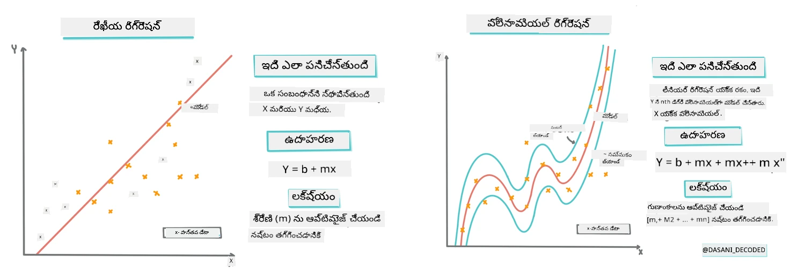
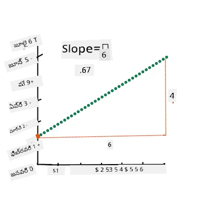
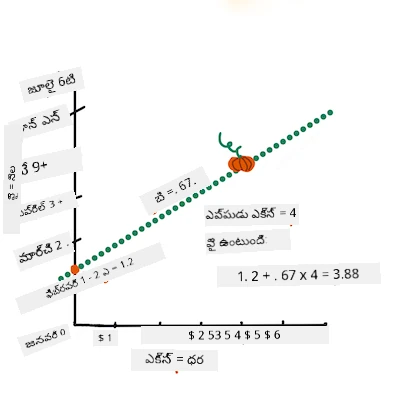
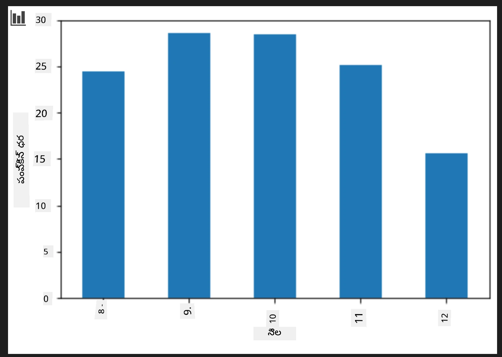
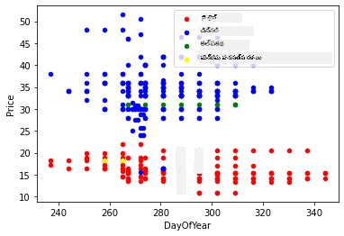

# Scikit-learn ఉపయోగించి రిగ్రెషన్ మోడల్ నిర్మించండి: రిగ్రెషన్ నలుగురు మార్గాలు

## ప్రారంభకులు కోసం గమనిక

లీనియర్ రిగ్రెషన్ మనము ఒక **సంఖ్యాత్మక విలువ** ను (ఉదాహరణకి, ఇంటి ధర, ఉష్ణోగ్రత, లేదా అమ్మకాలు) అంచనా వేయాలనుకునే సమయంలో ఉపయోగిస్తారు. ఇది ఇన్పుట్ లక్షణాలు మరియు ఔట్పుట్ మధ్య ఉన్న సంబంధాన్ని ఉత్తమంగా ప్రతిబింబించే ఒక సమరు రేఖను కనుగొనడం ద్వారా పనిచేస్తుంది.

ఈ పాఠంలో, మేము మరిన్ని అభివృద్ధి చెందిన రిగ్రెషన్ సాంకేతికతలను అధ్యయనం చేయక ముందుగా ఈ సిద్ధాంతాన్ని అర్థం చేసుకోవటానికి దృష్టి పెడతాము.

> ఇన్ఫోగ్రాఫిక్ రచయిత [Dasani Madipalli](https://twitter.com/dasani_decoded)
## [పాఠం ముందస్తు క్విజ్](https://ff-quizzes.netlify.app/en/ml/)

> ### [ఈ పాఠం R లో కూడా అందుబాటులో ఉంది!](../../../../2-Regression/3-Linear/solution/R/lesson_3.html)
### పరిచయం

ఇప్పటి వరకు మీరు pumpkin ధరల డాటాసెట్ నుండి సేకరించిన నమూనా డేటాతో రిగ్రెషన్ అంటే ఏమిటి అనేదాన్ని అన్వేషించారు. అలాగే మీరు దాన్ని Matplotlib ఉపయోగించి విజువలైజ్ చేశారు.

ఇప్పుడు మీరు ML కోసం రిగ్రెషన్ లో మరింత లోతుగా కావాలనుకుంటున్నారు. విజువలైజేషన్ డేటాను అర్థం చేసుకోవటానికి ఉపయోగపడుతుండగా, యధార్థ శక్తి మిషన్ లెర్నింగ్ లో _మోడల్స్ శిక్షణ_ లో ఉంటుంది. మోడల్స్ చరిత్రాత్మక డేటా పై శిక్షణ పొందుతాయి, ఆటోమేటిగ్గా డేటా ఆధారిత సంబంధాలను గమనిస్తాయి, మరియు కొత్త డేటా కోసం ఫలితాలను అంచనా వేయగలవు, ఆ మోడల్ ముందుగా చూడని డేటా.

ఈ పాఠంలో, మీరు రెండు రకాల రిగ్రెషన్ గురించి తెలుసుకుంటారు: _బేసిక్ లీనియర్ రిగ్రెషన్_ మరియు _పాలినోమియల్ రిగ్రెషన్_, మరియు ఈ సాంకేతికతల క్రింద ఉన్న కొంత గణితాన్ని కూడా తెలుసుకుంటారు. ఆ మోడల్స్ మనం pumpkin ధరలను వేర్వేరు ఇన్పుట్ డేటాకు అనుగుణంగా అంచనా వేయగలుగుతాయి.

[](https://youtu.be/CRxFT8oTDMg "ML for beginners - Understanding Linear Regression")

> 🎥 లీనియర్ రిగ్రెషన్ యొక్క సంక్షిప్త వీడియో అవలోకనానికి పై చిత్రంపై క్లిక్ చేయండి.

> ఈ పాఠ్యాంశంలో, గణితంపై తక్కువ పరిజ్ఞానం ఉన్న వారికి కూడా అర్థమయ్యేలా చేసేందుకు ప్రత్యేక శ్రద్ధ వహించి, గమనికలు, 🧮 కాలౌట్లు, చిత్రాలు మరియు ఇతర విద్యా సాధనాలను ఉపయోగిస్తున్నాం.

### ముందు తెలుసుకోవలసినవి

మీరెప్పటికైనా pumpkin డేటా నిర్మాణం గురించి అవగాహన కలిగి ఉండాలి. ఈ పాఠంలోని _notebook.ipynb_ ఫైల్ లో అది ముందుగా లోడ్ చేయబడింది మరియు శుభ్రపరిచింది. ఆ ఫైలులో, pumpkin ధర బుషెల్ కింద ప్రదర్శించబడింది. మీరు Visual Studio Code లో కర్నల్స్ లో ఈ నోట్‌బుక్స్ నడిపేందుకు సిద్దంగా ఉండాలి.

### సిద్ధం కావటం

మరలా గుర్తు పెట్టుకోండి, మీరు ఈ డేటాను లోడ్ చేస్తున్నప్పుడు దానిపై ప్రశ్నలు అడగటానికి.

- pumpkin లను కొనుగోలు చేయడానికి ఉత్తమ సమయం ఎప్పుడు?
- మినీచర్ pumpkin ల విలువ ఎంత ఉంటుందనే అంచనా?
- వాటిని హాఫ్-బుషెల్ బాస్కెట్లలో కొనాలి లేదా 1 1/9 బుషెల్ బాక్స్ ద్వారా కొనవలసినదా?
మరింత సమాచారం కోసం ఈ డేటాను వడపోయింది.

మునుపటి పాఠంలో, మీరు ఒక Pandas డేటాఫ్రేమ్ సృష్టించి, మూల dataset నుండి కొంత భాగాన్ని, ధరను బుషెల్ ద్వారా సాంద్రీకృతం చేసిన డేటాతో నింపారు. అయినప్పటికీ, మీరు సుమారు 400 డేటా పాయింట్లు మాత్రమే సేకరించగలిగారు, అవి కేవలం వేసవి నెలలకు సంబంధించినవి.

ఈ పాఠంకు సంబంధించిన నోట్‌బుక్ లో ముందుగా లోడ్ చేసిన డేటాను చూడండి. డేటా ముందుగా లోడ్ చేయబడింది మరియు మొదటి స్కాటర్ప్లాట్ నెలల డేటాను చూపిస్తుంది. మరింత శుభ్రపరచడం ద్వారా డేటా స్వభావం గురించి మరింత వివరాలు తెలుసుకోవచ్చు.

## లీనియర్ రిగ్రెషన్ రేఖ

మీరు పాఠం 1 లో నేర్చుకున్నట్లుగా, లీనియర్ రిగ్రెషన్ వ్యాయామంలో ఉద్దేశ్యం:

- **వేరియబుల్ సంబంధాలను చూపడం**. వేరియబుల్స్ మధ్య సంబంధాన్ని చూపించడం
- **అంచనాలు చేయడం**. కొత్త డేటా పాయింట్ ఆ రేఖకు సంబంధించిన ఎక్కడ పడుతుందో ఖచ్చితంగా అంచనా వేయడం

**లీస్ట్-స్క్వేర్ రిగ్రెషన్** ఈ రకం రేఖను గీసే విషయంలో సాంప్రదాయకం. "లీస్ట్-స్క్వేర్" అనగా మన మోడల్ లో మొత్తం లోపం పరిమాణాన్ని తగ్గించడం. ప్రతి డేటా పాయింట్ కు నిజమైన పాయింట్ మరియు మన రిగ్రెషన్ రేఖ మధ్య లంబ దూరం (రెసిడ్యువల్ అని పిలవబడేది) కొలుస్తాం.

మా ఉద్దేశ్యం ఆ దూరాలను చతురస్రం చెయ్యడం రెండు కారణాల వల్ల:  

1. **గదిలో కాకుండా పరిమాణం:** -5 లోపం ను +5 లోపంతో సమానంగా చూడాలనుకుంటాం. చతురస్రం ఈ విలువలను సానుకూలంగా మార్చుతుంది.  

2. **అగ్రస్థితి విలువలకు కఠినతరం:** చతురస్రం పెద్ద లోపాలకు ఎక్కువ బరువు ఇస్తుంది, కనుక రేఖ దూరం ఉన్న పాయింట్లకి దగ్గరగా ఉండటం అవసరం.

ఇక మొత్తం చతురస్రాలను జోడిస్తాం. ఈ మొత్తాన్ని గరిష్టంగా తగ్గించే ప్రత్యేక రేఖ కనుగొనాల్సి ఉంటుంది — అందుకే దీన్ని "లీస్ట్-స్క్వేర్" అంటారు.

> **🧮 గణితం చూపించండి**  
>  
> ఈ రేఖను, _సర్వోత్తమ సరిపోలిక రేఖ_ అనే పిలుస్తారు, దీన్ని [సమీకరణ](https://en.wikipedia.org/wiki/Simple_linear_regression) రూపంలో ఇలా తెలిపవచ్చు:  
> 
> ```
> Y = a + bX
> ```
>
> `X` అనగా ‘వివరణాత్మక వేరియబుల్’. `Y` అనగా 'ఆధారపడిన వేరియబుల్'. రేఖ యొక్క దిక్కు `b` కాగా, `a` అనగా వై-ఇంటర్‌సెప్టు, అంటే `X = 0` ఉన్నప్పుడు `Y` విలువ.
>
>
>
> ముందుగా, దిక్కు `b` ను లెక్కించండి. ఇన్ఫోగ్రాఫిక్ రచయిత [Jen Looper](https://twitter.com/jenlooper)
>
> మరో మాటలో చెప్పాలంటే, మన pumpkin డేటా యొక్క అసలు ప్రశ్న: "నెలల వారీగా బుషెల్ కొరకు pumpkin ధర అంచనా వేయండి", ఇక్కడ `X` ధరకు మరియు `Y` అమ్మకపు నెలకు సూచిస్తుంది.
>
>
>
> `Y` విలువను లెక్కించండి. మీరు సుమారు $4 చుట్టూ చెల్లిస్తుంటే, అది తప్పకుండా ఏప్రిల్! ఇన్ఫోగ్రాఫిక్ రచయిత [Jen Looper](https://twitter.com/jenlooper)
>
> ఈ రేఖ గణితంలో దిక్కు తెలిసినప్పుడు, ఇది ఇంటర్‌సెప్టు పరంగా కూడా ఆధారపడుతుంటుంది, అప్పుడు `X = 0` వద్ద `Y` విలువ ఎక్కడ ఉంటుంది.
>
> గణిత లెక్కింపు విధానాన్ని [Math is Fun](https://www.mathsisfun.com/data/least-squares-regression.html) వెబ్‌సైట్ లో చూడవచ్చు. అలాగే ఈ గణకాన్ని [Least-squares calculator](https://www.mathsisfun.com/data/least-squares-calculator.html) లో ప్రయత్నించి అర్థం చేసుకోవచ్చు.

## సహసంబంధం

మరొక అర్థం చేసుకోవలసిన పదం **కోరలేషన్ కోఎఫిషియెంట్**. ఇచ్చిన X మరియు Y వేరియబుల్స్ మధ్య ఉన్న సంబంధాన్ని సూచిస్తుంది. స్కాటర్ప్లాట్ ద్వారా మీరు ఈ కోఎఫిషియెంట్ ను వేగంగా చూడవచ్చు. ఒక రేఖల్లో సమతుల్యంగా పాయింట్లు ఉన్న స్కాటర్ప్లాట్ కు అధిక సహసంబంధం ఉంటుంది, కానీ ఎక్కడేమాలో బల్కంగా పాయింట్లు ఉంటే తక్కువ సహసంబంధం ఉంటుంది.

మంచి లీనియర్ రిగ్రెషన్ మోడల్ అంటే ఇది ఉంటుంది: లీస్ట్-స్క్వేర్ రిగ్రెషన్ పద్ధతి ఉపయోగించి అధిక (0 కంటే 1 కు దగ్గరగా) సహసంబంధ కోఎఫిషియెంట్ తో కూడిన రేఖ.

✅ ఈ పాఠానికి సంభందించిన నోట్‌బుక్ నడపండి మరియు నెల నుండి ధర వైపు స్కాటర్ప్లాట్ చూడండి. pumpkin అమ్మకాల కోసం నెల మరియు ధర మధ్య సంబంధం మీరు చూసిన స్కాటర్ప్లాట్ ద్వారా అధికం లేదా తక్కువం అనిపిస్తుందా? మీరు `నెల` బదులు *సంవత్సరంలో రోజు* (అంటే సంవత్సర ప్రారంభం నుండి వివిధ రోజుల సంఖ్య) ఉపయోగిస్తే ఇది మారుతుందా?

కోడ్ లో, మేము డేటాను శుభ్రం చేశామని మరియు `new_pumpkins` అనే డేటాఫ్రేమ్ ను పొందాము అని అనుకుంటున్నాము, ఈ క్రింద ఇవ్వబడింది:

ID | నెల | సంవత్సరం రోజు | వేరియటీ | నగరం | ప్యాకేజీ | తక్కువ ధర | ఎక్కువ ధర | ధర
---|-------|-----------|---------|------|---------|-----------|------------|-------
70 | 9 | 267 | PIE TYPE | BALTIMORE | 1 1/9 బుషెల్ కార్టన్లు | 15.0 | 15.0 | 13.636364
71 | 9 | 267 | PIE TYPE | BALTIMORE | 1 1/9 బుషెల్ కార్టన్లు | 18.0 | 18.0 | 16.363636
72 | 10 | 274 | PIE TYPE | BALTIMORE | 1 1/9 బుషెల్ కార్టన్లు | 18.0 | 18.0 | 16.363636
73 | 10 | 274 | PIE TYPE | BALTIMORE | 1 1/9 బుషెల్ కార్టన్లు | 17.0 | 17.0 | 15.454545
74 | 10 | 281 | PIE TYPE | BALTIMORE | 1 1/9 బుషెల్ కార్టన్లు | 15.0 | 15.0 | 13.636364

> డేటాను శుభ్రం చేయడానికి కోడ్ [`notebook.ipynb`](notebook.ipynb) లో ఉన్నాయి. మేము గత పాఠంలో చేయబడిన శుభ్రపరిచే దశలను పాటించి, క్రింది సూత్రం ఉపయోగించి `DayOfYear` కాలమ్ లెక్కించాం: 

```python
day_of_year = pd.to_datetime(pumpkins['Date']).apply(lambda dt: (dt-datetime(dt.year,1,1)).days)
```

లీనియర్ రిగ్రెషన్ వెనకని గణితాన్ని అర్థం చేసుకున్న తర్వాత, ఏ pumpkin ప్యాకేజీ ఉత్తమ ధర తీసుకొస్తుందో అంచనా వేయడానికి రిగ్రెషన్ మోడల్ సృష్టిద్దాం. ఎవరైనా అనుకొనేవారు తమ హాలిడే pumpkin ప్యాచ్ కోసం ఈ సమాచారం ఉపయోగించి కొనుగోలు ఆప్టిమైజ్ చేసుకోవచ్చు.

## సహసంబంధం కోసం శోధన

[](https://youtu.be/uoRq-lW2eQo "ML for beginners - Looking for Correlation: The Key to Linear Regression")

> 🎥 సహసంబంధం యొక్క సంక్షిప్త వీడియో అవలోకనానికి పై చిత్రంపై క్లిక్ చేయండి.

మునుపటి పాఠం నుండి మీరు అతివేగంగా చూసినట్లయితే, వేర్వేరు నెలల సగటు ధర ఇలానే ఉంది:



దీనివలన కొంత సహసంబంధం ఉందనే భావన వస్తుంది, మరియు మనం `నెల` మరియు `ధర` మధ్య, లేదా `DayOfYear` మరియు `ధర` మధ్య సంబంధాన్ని అంచనా వేసేందుకు లీనియర్ రిగ్రెషన్ మోడల్ శిక్షణ ఇస్తే మంచిది. క్రింద ఉన్న స్కాటర్ ప్లాట్ చివరిదాన్ని చూపిస్తుంది:

 

`corr` ఫంక్షన్ ఉపయోగించి సహసంబంధం ఉందో లేదో చూద్దాం:

```python
print(new_pumpkins['Month'].corr(new_pumpkins['Price']))
print(new_pumpkins['DayOfYear'].corr(new_pumpkins['Price']))
```

సహసంబంధం కొంచెం తక్కువగా కనిపిస్తోంది, `నెల` పరంగా -0.15 మరియు `DayOfYear` పరంగా -0.17. కాని మరో ముఖ్యమైన సంబంధం ఉండొచ్చు. వేర్వేరు pumpkin వేరియెటీలు ధరకు ప్రభావం చూపిస్తాయి. ఈ ఊహను ధృవీకరించడానికి, ప్రతి pumpkin వర్గాన్ని వేరే రంగులో చిత్రిద్దాం. `ax` పేరామితి ద్వారా `scatter` ఫంక్షన్ లో ఇచ్చి అన్ని పాయింట్లను ఒకే గ్రాఫ్ లో చూపవచ్చు:

```python
ax=None
colors = ['red','blue','green','yellow']
for i,var in enumerate(new_pumpkins['Variety'].unique()):
    df = new_pumpkins[new_pumpkins['Variety']==var]
    ax = df.plot.scatter('DayOfYear','Price',ax=ax,c=colors[i],label=var)
```

 

మా పరిశీలన ప్రకారం, pumpkin వేరియెటీ ధరపై యధార్థ విక్రయ తేదీ కంటే ఎక్కువ ప్రభావం చూపుతుంది. దీనిని బార్ గ్రాఫ్ తో చూడొచ్చు:

```python
new_pumpkins.groupby('Variety')['Price'].mean().plot(kind='bar')
```

 

ఇప్పుడు, ‘pie type’ అనే ఒకే pumpkin వేరియెటీపైన దృష్టి పెట్టి, అమ్మకాల తేదీ ధరపై ఏ ప్రభావం ఉందో చూద్దాం:

```python
pie_pumpkins = new_pumpkins[new_pumpkins['Variety']=='PIE TYPE']
pie_pumpkins.plot.scatter('DayOfYear','Price') 
```
 

ఇప్పుడు `corr` ఫంక్షన్ ఉపయోగించి `Price` మరియు `DayOfYear` మధ్య సహసంబంధం లెక్కించగా, అది సుమారు `-0.27` ఉంటుంది. అంటే శిక్షణకు అనువైన మోడల్ తయారు చేయవచ్చు.

> లీనియర్ రిగ్రెషన్ మోడల్ శిక్షణకు ముందు డేటా పద్ధతి అమర్చడమూ చాలా ముఖ్యం. లీనియర్ రిగ్రెషన్ లోపభూయిస్థితులు ఉన్న వాల్యూస్ తో బాగా పనిచేయదు, కాబట్టి ఖాళీ శ్రేణులన్నిటినీ తొలగించడం మంచిది:

```python
pie_pumpkins.dropna(inplace=True)
pie_pumpkins.info()
```

మరొక మార్గం ఖాళీ విలువలను ఆ కాలమ్ యొక్క సగటు విలువలతో భర్తీ చేయడం.

## సింపుల్ లీనియర్ రిగ్రెషన్

[](https://youtu.be/e4c_UP2fSjg "ML for beginners - Linear and Polynomial Regression using Scikit-learn")

> 🎥 లీనియర్ మరియు పాలినోమియల్ రిగ్రెషన్ పై సంక్షిప్త వీడియో అవలోకనానికి పై చిత్రంపై క్లిక్ చేయండి.

మన లీనియర్ రిగ్రెషన్ మోడల్ శిక్షణకు, మనం **Scikit-learn** లైబ్రరీని ఉపయోగిస్తాము.

```python
from sklearn.linear_model import LinearRegression
from sklearn.metrics import mean_squared_error
from sklearn.model_selection import train_test_split
```

ముందుగా ఇన్పుట్ విలువలు (లక్షణాలు) మరియు అభ్యర్థిత ఔట్పుట్ (లేబుల్) ను వేరే numpy అర్రేలుగా విడగొడతాము:

```python
X = pie_pumpkins['DayOfYear'].to_numpy().reshape(-1,1)
y = pie_pumpkins['Price']
```

> ఇక్కడ గమనించండి, లీనియర్ రిగ్రెషన్ ప్యాకేజీకు సరైన ఫార్మాట్ లో డేటా ఇచ్చేందుకు `reshape` అవసరం. లీనియర్ రిగ్రెషన్ 2D అర్రే (పంక్తులలో ఇన్పుట్ లక్షణాల వెక్టర్) కోరుతుంది. మన వద్ద ఒక్కొ ఇన్పుట్ మాత్రమే ఉన్నందున, N×1 ఆకృతి ఉన్న అర్రే అవసరం, ఇక్కడ N అనగా డేటా పరిమాణం.

తర్వాత, శిక్షణ మరియు పరీక్ష డేటాసెట్ లుగా డేటా పంచాలి, అంతేకాదు శిక్షణ తరువాత మనం మోడల్ ను పరీక్షించగలుగుతాము:

```python
X_train, X_test, y_train, y_test = train_test_split(X, y, test_size=0.2, random_state=0)
```

చివరకు, లీనియర్ రిగ్రెషన్ మోడల్ ను శిక్షణ చేయడం కేవలం రెండు కోడ్ లైన్లలో చేస్తారు. ముందుగా `LinearRegression` ఆబ్జెక్ట్ ను నిర్వచించి, `fit` మేతడ్ తో డేటాకు సరిపొడచేస్తారు:

```python
lin_reg = LinearRegression()
lin_reg.fit(X_train,y_train)
```

`fit` చేసిన తర్వాత `LinearRegression` ఆబ్జెక్ట్ అన్ని రిగ్రెషన్ యొక్క గుణకాలాన్ని కలిగి ఉంటుంది, దాన్ని `.coef_` ప్రోపర్టీ ద్వారా యాక్సెస్ చేయవచ్చు. మన సందర్భంలో, ఒక్క గుణకం ఉంటుంది, ఇది సుమారు `-0.017` ఉండాలి. దీని అర్థం, ధరలు సమయం గడచిన కొద్దిగా తగ్గుతున్నట్లు కనిపిస్తుంది, కానీ ఎక్కువగా కాదు, రోజుకు సుమారు 2 సెంట్లు. రిగ్రెషన్ రేఖ Y-అక్షంతో కలిసే బిందువు `lin_reg.intercept_` ద్వారా కూడా యాక్సెస్ చేయవచ్చు - ఇది మన సందర్భంలో సుమారు `21` ఉంటుంది, సంవత్సర ప్రారంభంలో ధరను సూచిస్తుంది.

మన మోడల్ ఎన్ని ఖచ్చితంగా ఉందో చూడటానికి, టెస్ట్ డేటాసెట్‌లో ధరలను అంచనా వేయవచ్చు, ఆ తర్వాత మన అంచనాలు ఆశించిన విలువలకు ఎంత దగ్గరగా ఉన్నాయో కొలవచ్చు. ఇది రూట్ మీన్ స్క్వేర్ ఎర్రర్ (RMSE) మెట్రిక్స్ ఉపయోగించి చేయవచ్చు, ఇది సంగీత విలువల మధ్యలో ఉన్న స్క్వేర్ తేడాల యొక్క సగటు వేరియంతరాల వేరియంట్ మూలం.

```python
pred = lin_reg.predict(X_test)

rmse = np.sqrt(mean_squared_error(y_test,pred))
print(f'RMSE: {rmse:3.3} ({rmse/np.mean(pred)*100:3.3}%)')
```

మన పొరపాటు సుమారు 2 పాయింట్లు ఉంది, ఇది ~17%. చాలా బాగూ లేదు. మోడల్ నాణ్యతకు మరొక సూచిక **నిర్ణాయక గుణకం** (coefficient of determination), దీన్ని ఇలా పొందవచ్చు:

```python
score = lin_reg.score(X_train,y_train)
print('Model determination: ', score)
```

విలువ 0 ఉంటే, అర్థం మోడల్ ఇన్‌పుట్ డేటాను పరిగణించట్లేదు, మరియు అదొక *ఎక్కువ చెడ్డ రేఖీయ అంచనా*గా పనిచేస్తోంది, ఇది ఫలితాల సాధారణ సగటు విలువ మాత్రమే. విలువ 1 ఉంటే, మనం అన్ని ఆశించిన అవుట్‌పుట్లను పూర్తిగా అంచనా వేయగలమని అర్ధం. మన సందర్భంలో గుణకం సుమారు 0.06 ఉంటుంది, ఇది చాలా తక్కువది.

రిగ్రెషన్ లైన్ తో టెస్ట్ డేటాను కలిసి ప్లాట్ చేయడం ద్వారా మన కేసులో రిగ్రెషన్ ఎలా పనిచేస్తుందో మెరుగుగా చూడవచ్చు:

```python
plt.scatter(X_test,y_test)
plt.plot(X_test,pred)
```


## పాలినోమియల్ రిగ్రెషన్

లీనియర్ రిగ్రెషన్ ఇంకొక రకం పాలినోమియల్ రిగ్రెషన్. కొన్ని సార్లు వేరియబుల్స్ మధ్య లీనియర్ సంబంధం ఉంటుంది - వాల్యూమ్ లో భారీ పంప్కిన్, ధర ఎక్కువగా ఉంటుంది - కొన్ని సార్లు ఈ సంబంధాలను స్థలంగా లేదా సరళరేఖగా ప్రదర్శించలేము.

✅ ఇక్కడ [ఇంకా కొన్ని ఉదాహరణలు](https://online.stat.psu.edu/stat501/Lesson09#polynomial-regression-examples) ఉన్నాయి, పాలినోమియల్ రిగ్రెషన్‌కు ఉపయోగపడే డేటాకు

తేదీ మరియు ధర మధ్య సంబంధాన్ని మరలా చూద్దాం. ఈ స్కాటర్‌ప్లాట్ తప్పకుండా సరళరేఖ ద్వారా విశ్లేషించాల్సి ఉందా? ధరలు మార్పు చెందలేవా? ఈ సందర్భంలో, మీరు పాలినోమియల్ రిగ్రెషన్ ప్రయత్నించవచ్చు.

✅ పాలినోమియల్స్ గణితీయ సంకేతాలు, ఇవి ఒకటి లేదా ఎక్కువ వేరియబుల్స్ మరియు గుణకాలాలతో కూడి ఉండవచ్చు

పాలినోమియల్ రిగ్రెషన్ వంకర వక్రరేఖను సృష్టిస్తుంది, లీనియర్ కాకపోయే డేటాను మెరుగైన ఫిట్ కోసం. మన సందర్భంలో, ఇన్‌పుట్ డేటాలో స్క్వేర్ చేయబడిన `DayOfYear` వేరియబుల్ చేర్చితే, మన డేటాను పారాబాలిక్ వక్రంతో సరిపోతుందనుకుంటాం, ఇది సంవత్సరంలో ఒక నిర్దిష్ట బిందువులో కనిష్టం కలిగి ఉంటుంది.

Scikit-learn దశలను కలిపే ఉపయోగకరమైన [pipeline API](https://scikit-learn.org/stable/modules/generated/sklearn.pipeline.make_pipeline.html?highlight=pipeline#sklearn.pipeline.make_pipeline)‌ను కలిగి ఉంది. ఒక **pipeline** అనేది **estimators** సంక్రమం. మన సందర్భంలో, మొదట పాలినోమియల్ ఫీచర్లను జోడించి, ఆపై రిగ్రెషన్ శిక్షణ ఇస్తున్న pipeline సృష్టించతాము:

```python
from sklearn.preprocessing import PolynomialFeatures
from sklearn.pipeline import make_pipeline

pipeline = make_pipeline(PolynomialFeatures(2), LinearRegression())

pipeline.fit(X_train,y_train)
```

`PolynomialFeatures(2)` ఉపయోగించడం అంటే మనం ఇన్‌పుట్ డేటా నుండి అన్ని రెండవ డిగ్రీ పాలినోమియల్స్‌ని చేర్చుతాము. మన సందర్భంలో ఇది కేవలం `DayOfYear`<sup>2</sup>, కానీ రెండు ఇన్‌పుట్ వేరియబుల్స్ X మరియు Y ఉంటే, ఇది X<sup>2</sup>, XY మరియు Y<sup>2</sup>ని చేర్చుతుంది. మనకు కావాలంటే మరింత గుణకాలు కూడా ఉపయోగించవచ్చు.

పipelinesను అసలు `LinearRegression` ఆబ్జెక్ట్‌లాగా ఉపయోగించవచ్చు, అంటే pipeline ని `fit` చేసి, ఆపై `predict` ఉపయోగించి అంచనాలు పొందవచ్చు:

```python
pred = pipeline.predict(X_test)

rmse = np.sqrt(mean_squared_error(y_test,pred))
print(f'RMSE: {rmse:3.3} ({rmse/np.mean(pred)*100:3.3}%)')

score = pipeline.score(X_train,y_train)
print('Model determination: ', score)
```

స్మూత్ అప్రాక్సిమేషన్ వక్రరేఖను చిత్రించడానికి, `np.linspace` ఉపయోగించి సమాన శ్రేణి ఇన్‌పుట్ విలువలను సృష్టిస్తాము, అలాగే టెస్ట్ డేటా మీద నేరుగా చిత్రించకపోవడం (దీనివల్ల జిగ్-జాగ్ లైన్లు వస్తాయి):

```python
X_range = np.linspace(X_test.min(), X_test.max(), 100).reshape(-1,1)
y_range = pipeline.predict(X_range)

plt.scatter(X_test, y_test)
plt.plot(X_range, y_range)
```

ఇది టెస్ట్ డేటా మరియు అప్రాక్సిమేషన్ వక్రరేఖను చూపిస్తున్న గ్రాఫ్:


పాలినోమియల్ రిగ్రెషన్ ఉపయోగించడం వలన కొంచెం తక్కువ RMSE మరియు ఎక్కువ నిర్ధారణను పొందవచ్చు, కానీ గణనీయంగా కాదు. మనం మరింత ఫీచర్లను పరిగణలోనికి తీసుకోవాలి!

> పంప్కిన్ ధరలు కనీసం హాలోవీన్ దగ్గరగా ఉంటున్నాయని చూడవచ్చు. దీన్ని ఎలా వివరిస్తారు?

🎃 అభినందనలు, మీకు పంప్కిన్ ధర అంచనా వేయగలిగే మోడల్ తయారైంది. మీరు ఇతర అన్ని పంప్కిన్ రకాలకూ ఇదే విధంగా చేయవచ్చు, కానీ అది చాలా కష్టంగా ఉంటుంది. ఇప్పుడు మనం పంప్కిన్ జాతి కూడా మోడల్ లో ఎలా పరిగణించాలో నేర్చుకుందాం!

## వర్గీకరణ ఫీచర్లు

ఆదర్శ ప్రపంచంలో, వేర్వేరు పంప్కిన్ జాతుల ధరలను ఒకే మోడల్ ఉపయోగించి అంచనా వేయగలగాలి. అయితే, `Variety` కాలమ్ `Month` లాంటి కాలమ్స్ నుండి కొంత భిన్నంగా ఉంటుంది, ఎందుకంటే ఇది సంఖ్యలు కాకుండా విలువలను కలిగి ఉంటుంది. ఇలాంటి కాలమ్స్ ను **వర్గీకరణ** (categorical) కాలమ్స్ అంటారు.

[](https://youtu.be/DYGliioIAE0 "ML for beginners - Categorical Feature Predictions with Linear Regression")

> 🎥 పై చిత్రాన్ని క్లిక్ చేస్తే వర్గీకరణ ఫీచర్‌లు ఉపయోగించి మోడల్ తయారీపై సంక్షిప్త వీడియో చూస్తారు.

ఇక్కడ మీరు చూడవచ్చు, సమాన ధర వేరియిటీలపై ఆధారపడి ఎలా మారుతుంది:


జాతిని పరిగణించడానికి, మొదట దాన్ని సంఖ్య రూపంలోకి మార్చాలి లేదా **ఎంకోడ్** చేయాలి. దీనికి కొన్ని విధానాలు ఉన్నాయి:

* సాదాసీదా **న్యూమరిక్ ఎంకోడింగ్** వేర్వేరు జాతుల పట్టికను తయారుచేసి, ఆ పట్టికలో జాతి పేరును ఇండెక్స్ తో బదిలీ చేయడం. ఇది లీనియర్ రిగ్రెషన్ కు సరైన ఆలోచన కాదు, ఎందుకంటే లీనియర్ రిగ్రెషన్ ఇండెక్స్ యొక్క నిజమైన సంఖ్య విలువను తీసుకొని ఫలితం లో కొంత గుణకం తో కలిపేస్తుంది. మనం చూసినా, ఇండెక్స్ సంఖ్య మరియు ధర మధ్య సంబంధం స్పష్టంగా లీనియర్ కాదు, అది సరిగ్గా క్రమంలో వుండకపోయినా.
* **వన్-హాట్ ఎంకోడింగ్** `Variety` కాలమ్ నాలుగు వేరే కాలమ్స్ తో బదిలీ చేస్తుంది, ఒక్క ఒక్క జాతికి ఒక కాలమ్ ఉంటుంది. సంబంధిత రో కృషి జాతి ఉంటే 1 ఉండి, లేనట్లయితే 0 ఉంటుంది. దీని అర్థం లీనియర్ రిగ్రెషన్‌లో నాలుగు గుణకాలు ఉంటాయి, ఒక్కొ జాతికి ఒకటి, అది ఆ జాతికి ప్రత్యేక "ప్రారంభ ధర" (లేదా "అదనపు ధర") ప్రతినిధిగా ఉంటుంది.

కింది కోడ్ వన్-హాట్ ఎంకోడింగ్ ఎలా చేస్తుందో చూపిస్తుంది:

```python
pd.get_dummies(new_pumpkins['Variety'])
```

 ID | FAIRYTALE | MINIATURE | MIXED HEIRLOOM VARIETIES | PIE TYPE
----|-----------|-----------|--------------------------|----------
70 | 0 | 0 | 0 | 1
71 | 0 | 0 | 0 | 1
... | ... | ... | ... | ...
1738 | 0 | 1 | 0 | 0
1739 | 0 | 1 | 0 | 0
1740 | 0 | 1 | 0 | 0
1741 | 0 | 1 | 0 | 0
1742 | 0 | 1 | 0 | 0

వన్-హాట్ ఎంకోడింగ్ చేసిన జాతి ఇన్‌పుట్ గా ఉపయోగించి లీనియర్ రిగ్రెషన్ శిక్షణకి `X` మరియు `y` డేటాలు సరైన విధంగా ప్రారంభించాలి:

```python
X = pd.get_dummies(new_pumpkins['Variety'])
y = new_pumpkins['Price']
```

మిగతా కోడ్ పైగా ఉపయోగించిన లీనియర్ రిగ్రెషన్ శిక్షణ కోడుతో సమానం. మీరు ప్రయత్నిస్తే, మీయిన్ స్క్వేర్ ఎర్రర్ సుమారు ఒకటే ఉంటుంది, కానీ నిర్ధారణ గుణకం చాలా ఎక్కువ (సుమారు 77%). మరింత ఖచ్చితమైన అంచనాల కోసం, మరిన్ని వర్గీకరణ ఫీచర్లను కూడా, అలాగే సంఖ్యాత్మక ఫీచర్లు (ఉదా: `Month`, `DayOfYear`) కూడా పరిగణించవచ్చు. పెద్ద ఫీచర్ అర్రే కోసం, `join` ఉపయోగించవచ్చు:

```python
X = pd.get_dummies(new_pumpkins['Variety']) \
        .join(new_pumpkins['Month']) \
        .join(pd.get_dummies(new_pumpkins['City'])) \
        .join(pd.get_dummies(new_pumpkins['Package']))
y = new_pumpkins['Price']
```

ఇక్కడ `City` మరియు `Package` రకాలను కూడా పరిగణించి, మనకు RMSE 2.84 (10.5%), నిర్ధారణ 0.94 వస్తుంది!

## మొత్తం కలిపి

మెరుగైన మోడల్ కోసం, పై ఉదాహరణలో ఉన్న కలుపుతో (వన్-హాట్ ఎంకోడెడ్ వర్గీకరణ + సంఖ్యాత్మక డేటా) పాలినోమియల్ రిగ్రెషన్ ఉపయోగించవచ్చు. ఇక్కడ మీ సౌలభ్యం కొరకు పూర్తి కోడ్:

```python
# శిక్షణ డేటాను సెటప్ చేయండి
X = pd.get_dummies(new_pumpkins['Variety']) \
        .join(new_pumpkins['Month']) \
        .join(pd.get_dummies(new_pumpkins['City'])) \
        .join(pd.get_dummies(new_pumpkins['Package']))
y = new_pumpkins['Price']

# ట్రైన్-టెస్ట్ విభజన చేయండి
X_train, X_test, y_train, y_test = train_test_split(X, y, test_size=0.2, random_state=0)

# పైప్ లైన్‌ను సెటప్ చేసి శిక్షణ ఇవ్వండి
pipeline = make_pipeline(PolynomialFeatures(2), LinearRegression())
pipeline.fit(X_train,y_train)

# ట్రస్ట్ డేటా కోసం ఫలితాలను అంచనా వేయండి
pred = pipeline.predict(X_test)

# RMSE మరియు నిర్ధారణ లెక్కించండి
rmse = mean_squared_error(y_test, pred, squared=False)
print(f'RMSE: {rmse:3.3} ({rmse/pred.mean()*100:3.3}%)')

score = pipeline.score(X_train,y_train)
print('Model determination: ', score)
```

దీంతో సుమారు 97% నిర్ధారణ గుణకం మరియు RMSE=2.23 (~8% అంచనా పొరపాటు) పొందగలుగుతాము.

| మోడల్ | RMSE | నిర్ధారణ |
|-------|-----|---------------|
| `DayOfYear` లీనియర్ | 2.77 (17.2%) | 0.07 |
| `DayOfYear` పాలినోమియల్ | 2.73 (17.0%) | 0.08 |
| `Variety` లీనియర్ | 5.24 (19.7%) | 0.77 |
| అన్ని ఫీచర్లు లీనియర్ | 2.84 (10.5%) | 0.94 |
| అన్ని ఫీచర్లు పాలినోమియల్ | 2.23 (8.25%) | 0.97 |

🏆 చాలా బాగుంది! మీరు ఒక్క పాఠంలోనే నాలుగు రిగ్రెషన్ మోడల్స్ సృష్టించి, మోడల్ నాణ్యతను 97% వరకు మెరుగుపరిచారు. రిగ్రెషన్ పై చివరి విభాగంలో, మీరు వర్గాల కోసం లాజిస్టిక్ రిగ్రెషన్ గురించి నేర్చుకోగలుగుతారు.

---
## 🚀సవాల్

ఈ నోట్‌బుక్‌లో కొన్ని వేరియబుల్స్‌తో పరీక్షించి, సహసంబంధం మోడల్ ఖచ్చితత్వంతో ఎలా అనుసంధానం అవుతుందో చూడండి.

## [ఉపన్యాసం తరువాత క్విజ్](https://ff-quizzes.netlify.app/en/ml/)

## సమీక్ష & స్వయంపఠనం

ఈ పాఠంలో మేము లీనియర్ రిగ్రెషన్ గురించి నేర్చుకున్నాము. ఇతర ముఖ్యమైన రిగ్రెషన్ రకాలు కూడా ఉన్నాయి. Stepwise, Ridge, Lasso మరియు Elasticnet సాంకేతికతల గురించి చదవండి. మరింత నేర్చుకోవడానికి మంచి కోర్సు [Stanford Statistical Learning course](https://online.stanford.edu/courses/sohs-ystatslearning-statistical-learning) ఆసక్తికరంగా ఉంటుంది.

## అసైన్‌మెంట్

[మోడల్ ను నిర్మించండి](assignment.md)

---

<!-- CO-OP TRANSLATOR DISCLAIMER START -->
**అస్పష్టత**:  
ఈ డాక్యుమెంట్‌ను AI అనువాద సేవ అయిన [Co-op Translator](https://github.com/Azure/co-op-translator) ఉపయోగించి అనువదించబడింది. మేము సరైనత కోసం ప్రయత్నిస్తూన్నా, ఆటోమేటెడ్ అనువాదాల్లో పొరపాట్లు లేదా తప్పులు ఉండవచ్చని దయచేసి గమనించండి. మూల భాషలోని డాక్యుమెంట్‌ని అధికారిక మూలంగా పరిగణించాలి. ముఖ్యమైన సమాచారం కోసం, వృత్తిపరమైన మానవ అనువాదాన్ని సిఫార్సు చేయబడింది. ఈ అనువాదాన్ని ఉపయోగించడంలో జరిగిన ఏమైనా అవగాహన లోపాలు లేదా తప్పుగా అర్థం చేసుకోవడమ్కు మేము బాధ్యులం కం కుండా ఉంటాము.
<!-- CO-OP TRANSLATOR DISCLAIMER END -->