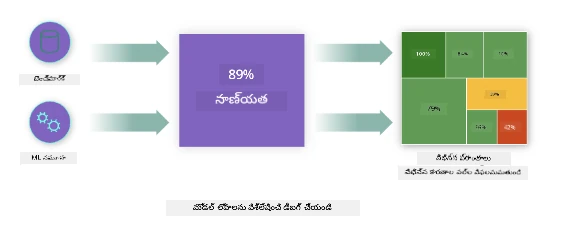
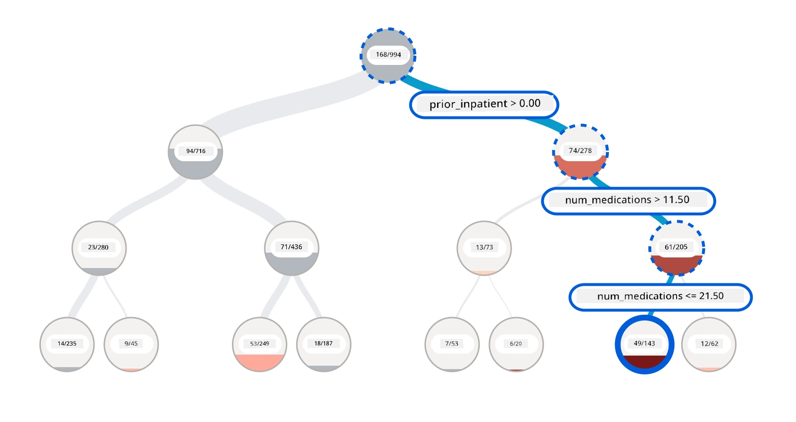
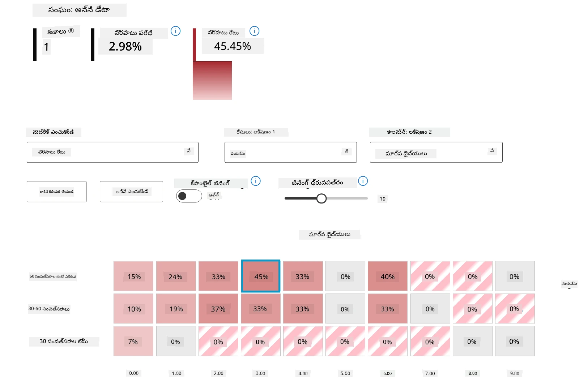
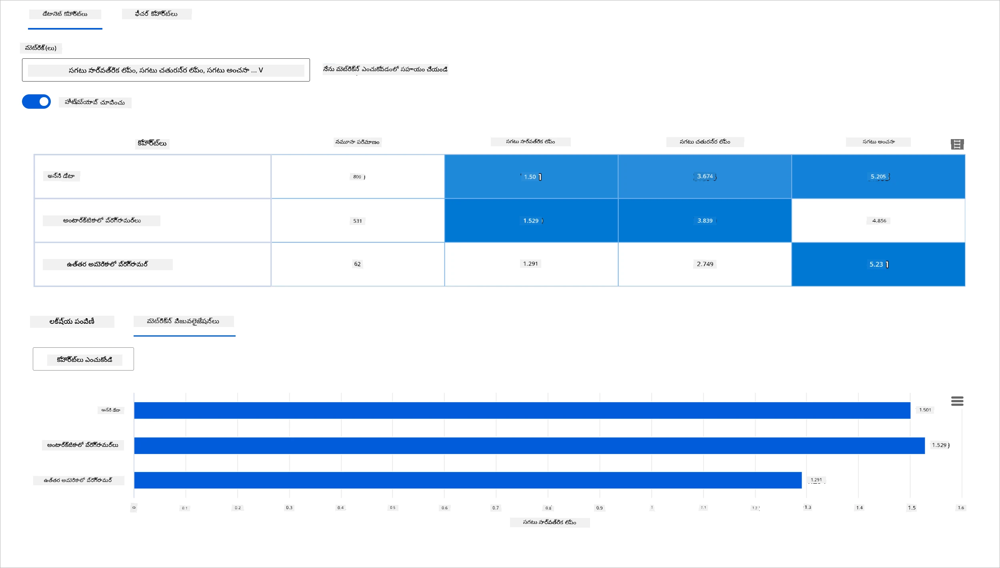
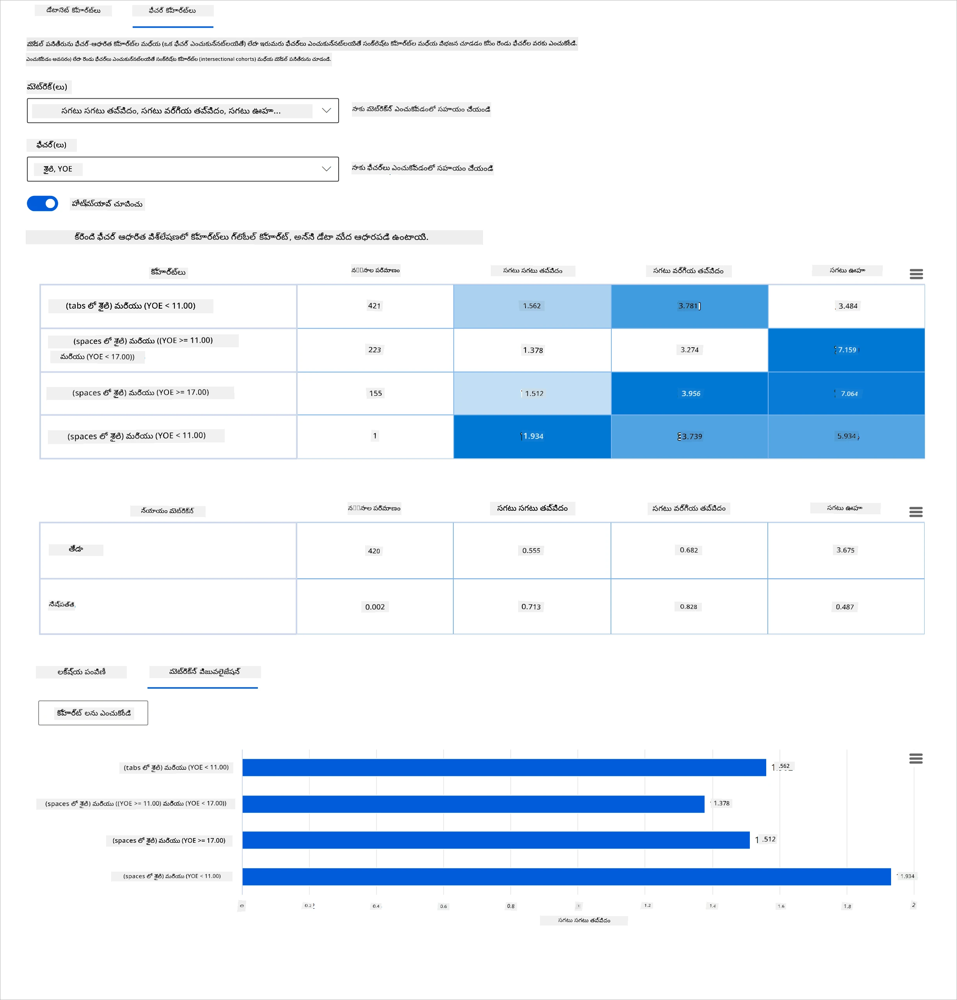
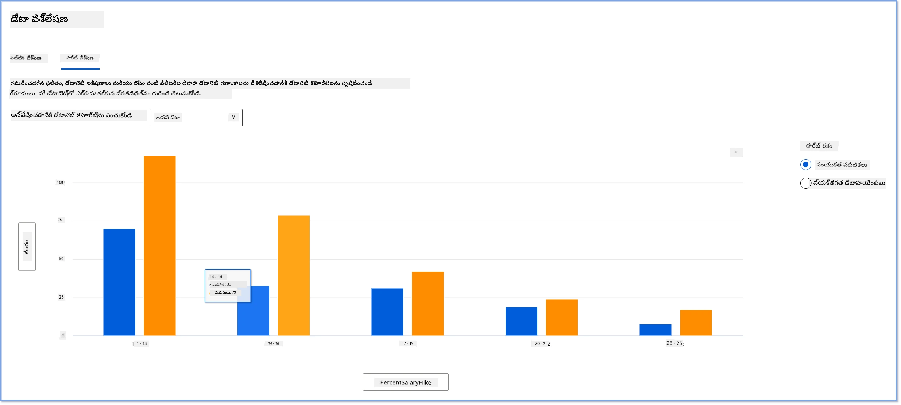
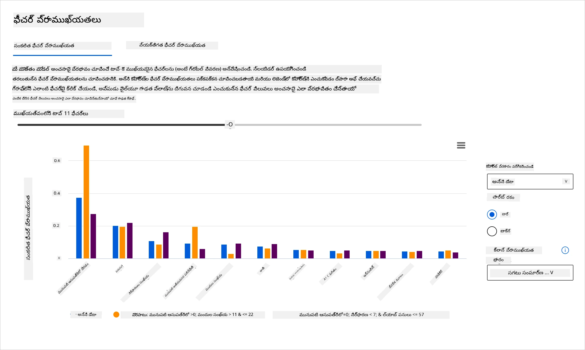
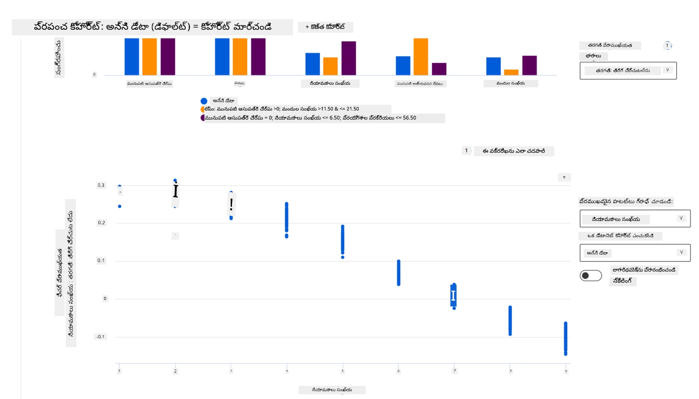

# పోస్ట్‌స్క్రిప్ట్: బాధ్యతాయుత AI డాష్‌బోర్డ్ భాగాలను ఉపయోగించి మెషీన్ లెర్నింగ్‌లో మోడల్ డీబగ్గింగ్

## [ప్రీ-లెక్చర్ క్విజ్](https://ff-quizzes.netlify.app/en/ml/)

## పరిచయం

మెషీన్ లెర్నింగ్ మన రోజువారీ జీవితాలను ప్రభావితం చేస్తోంది. AI మన వ్యక్తిగతంగా మరియు సమాజంగా ప్రభావితం చేసే ఆరోగ్య సంరక్షణ, ఆర్థిక, విద్య, ఉద్యోగాల వంటి కొన్ని అత్యంత ముఖ్యమైన వ్యవస్థల్లో దాని మార్గాన్ని కనుగొంటోంది. ఉదాహరణకు, ఆరోగ్య నిర్ధారణలు లేదా మోసం గుర్తించడం వంటి రోజువారీ నిర్ణయాల పనుల్లో వ్యవస్థలు మరియు మోడల్స్ పాల్గొంటున్నాయి. ఫలితంగా, AIలో అభివృద్ధులు మరియు వేగవంతమైన స్వీకరణతో పాటు, అభివృద్ధి చెందుతున్న సామాజిక ఆశలు మరియు పెరుగుతున్న నియంత్రణలు ఎదురవుతున్నాయి. AI వ్యవస్థలు ఆశించిన విధంగా పనిచేయకపోవడం, కొత్త సవాళ్లు ఎదుర్కోవడం, మరియు ప్రభుత్వాలు AI పరిష్కారాలను నియంత్రించడం మొదలైనవి మనం తరచూ చూస్తున్నాం. అందుకే, ఈ మోడల్స్ అందరికీ న్యాయమైన, నమ్మదగిన, సమగ్ర, పారదర్శక, మరియు బాధ్యతాయుత ఫలితాలను అందించేందుకు విశ్లేషించబడాలి.

ఈ పాఠ్యాంశంలో, మోడల్ బాధ్యతాయుత AI సమస్యలు ఉన్నాయా అని అంచనా వేయడానికి ఉపయోగించే ప్రాక్టికల్ టూల్స్‌ను చూద్దాం. సాంప్రదాయ మెషీన్ లెర్నింగ్ డీబగ్గింగ్ సాంకేతికతలు సాధారణంగా సమగ్ర ఖచ్చితత్వం లేదా సగటు లోపం నష్టంలాంటి పరిమాణాత్మక లెక్కలపై ఆధారపడి ఉంటాయి. మీరు ఈ మోడల్స్ నిర్మించడానికి ఉపయోగిస్తున్న డేటాలో జాతి, లింగం, రాజకీయ దృష్టికోణం, మతం వంటి కొన్ని జనాభా గుంపులు లేకపోతే ఏమవుతుంది అని ఊహించండి. లేదా మోడల్ అవుట్‌పుట్ కొన్ని జనాభా గుంపులను ప్రాధాన్యం ఇవ్వడానికి అనువదిస్తే? ఇది ఈ సున్నితమైన లక్షణ గుంపుల అధిక లేదా తక్కువ ప్రాతినిధ్యం కలిగించే అవకాశం కలిగించి, మోడల్ నుండి న్యాయం, సమగ్రత లేదా నమ్మకదగినత సమస్యలను సృష్టిస్తుంది. మరో అంశం ఏమిటంటే, మెషీన్ లెర్నింగ్ మోడల్స్ బ్లాక్ బాక్స్‌లుగా పరిగణించబడతాయి, అందువల్ల మోడల్ యొక్క అంచనాను ఏమి ప్రభావితం చేస్తుందో అర్థం చేసుకోవడం మరియు వివరించడం కష్టం. ఈ అన్ని సవాళ్లు డేటా శాస్త్రవేత్తలు మరియు AI అభివృద్ధికర్తలు సరైన టూల్స్ లేకుండా మోడల్ న్యాయం లేదా నమ్మకదగినతను డీబగ్ చేయడం మరియు అంచనా వేయడంలో ఎదుర్కొంటారు.

ఈ పాఠంలో, మీరు మీ మోడల్స్‌ను డీబగ్ చేయడం గురించి నేర్చుకుంటారు:

- **లోపాల విశ్లేషణ**: మీ డేటా పంపిణీలో మోడల్ ఎక్కువ లోపాలున్న ప్రాంతాలను గుర్తించండి.
- **మోడల్ అవలోకనం**: వివిధ డేటా కోహార్ట్లలో మీ మోడల్ పనితీరు మెట్రిక్స్‌లో వ్యత్యాసాలను కనుగొనడానికి తులనాత్మక విశ్లేషణ చేయండి.
- **డేటా విశ్లేషణ**: ఒక డేటా జనాభా గుంపును మరొకటి కంటే ప్రాధాన్యం ఇవ్వడానికి మీ డేటాలో అధిక లేదా తక్కువ ప్రాతినిధ్యం ఉన్న చోట్లను పరిశీలించండి.
- **లక్షణ ప్రాముఖ్యత**: గ్లోబల్ లేదా లోకల్ స్థాయిలో మీ మోడల్ అంచనాలను ప్రభావితం చేస్తున్న లక్షణాలను అర్థం చేసుకోండి.

## ముందస్తు అర్హత

ముందస్తుగా, దయచేసి సమీక్షించండి [బాధ్యతాయుత AI టూల్స్ ఫర్ డెవలపర్స్](https://www.microsoft.com/ai/ai-lab-responsible-ai-dashboard)

> 

## లోపాల విశ్లేషణ

ఖచ్చితత్వాన్ని కొలవడానికి ఉపయోగించే సాంప్రదాయ మోడల్ పనితీరు మెట్రిక్స్ ఎక్కువగా సరైన మరియు తప్పు అంచనాల ఆధారంగా లెక్కింపులు. ఉదాహరణకు, ఒక మోడల్ 89% సార్లు ఖచ్చితంగా ఉందని, లోపం నష్టం 0.001 అని నిర్ణయించడం మంచి పనితీరు అని పరిగణించవచ్చు. లోపాలు సాధారణంగా మీ ప్రాథమిక డేటాసెట్‌లో సమానంగా పంపిణీ కావు. మీరు 89% మోడల్ ఖచ్చితత్వ స్కోరు పొందవచ్చు కానీ మోడల్ 42% సార్లు విఫలమవుతున్న డేటా ప్రాంతాలు వేరుగా ఉండవచ్చు. ఈ విఫలత నమూనాలు కొన్ని డేటా గుంపులతో న్యాయం లేదా నమ్మకదగినత సమస్యలకు దారితీస్తాయి. మోడల్ బాగా పనిచేస్తున్న లేదా చేయని ప్రాంతాలను అర్థం చేసుకోవడం అవసరం. మోడల్‌లో ఎక్కువ లోపాలు ఉన్న డేటా ప్రాంతాలు ముఖ్యమైన డేటా జనాభా కావచ్చు.

RAI డాష్‌బోర్డ్‌లో లోపాల విశ్లేషణ భాగం వివిధ కోహార్ట్లలో మోడల్ విఫలత ఎలా పంపిణీ అయిందో చెట్టు విజువలైజేషన్ ద్వారా చూపిస్తుంది. ఇది మీ డేటాసెట్‌లో ఎక్కువ లోపాలున్న లక్షణాలు లేదా ప్రాంతాలను గుర్తించడంలో ఉపయోగపడుతుంది. మోడల్ లోపాల ఎక్కువగా ఎక్కడ నుండి వస్తున్నాయో చూసి, మీరు మూల కారణాన్ని పరిశీలించవచ్చు. మీరు విశ్లేషణ కోసం డేటా కోహార్ట్లను కూడా సృష్టించవచ్చు. ఈ డేటా కోహార్ట్లు డీబగ్గింగ్ ప్రక్రియలో సహాయపడతాయి, ఎందుకు ఒక కోహార్ట్‌లో మోడల్ పనితీరు మంచిది కానీ మరొకదిలో లోపభూయిష్టమో తెలుసుకోవడానికి.

చెట్టు మ్యాప్‌పై విజువల్ సూచికలు సమస్య ప్రాంతాలను త్వరగా గుర్తించడంలో సహాయపడతాయి. ఉదాహరణకు, చెట్టు నోడ్ యొక్క ఎరుపు రంగు గాఢత ఎక్కువైతే, లోపాల రేటు ఎక్కువగా ఉంటుంది.

హీట్ మ్యాప్ మరో విజువలైజేషన్ ఫంక్షనాలిటీ, ఇది ఒకటి లేదా రెండు లక్షణాలను ఉపయోగించి లోపాల రేటును పరిశీలించడానికి ఉపయోగపడుతుంది, మొత్తం డేటాసెట్ లేదా కోహార్ట్లలో మోడల్ లోపాలకు కారణం కనుగొనడానికి.

లోపాల విశ్లేషణను ఉపయోగించండి, మీరు:

* మోడల్ విఫలతలు డేటాసెట్ మరియు అనేక ఇన్‌పుట్ మరియు లక్షణ పరిమాణాలలో ఎలా పంపిణీ అయ్యాయో లోతుగా అర్థం చేసుకోవాలి.
* సమగ్ర పనితీరు మెట్రిక్స్‌ను విభజించి తప్పు ఉన్న కోహార్ట్లను ఆటోమేటిక్‌గా కనుగొని లక్ష్యిత పరిష్కార చర్యలకు దారితీయాలి.

## మోడల్ అవలోకనం

మెషీన్ లెర్నింగ్ మోడల్ పనితీరును అంచనా వేయడం అంటే దాని ప్రవర్తనను సమగ్రంగా అర్థం చేసుకోవడం. ఇది లోపాల రేటు, ఖచ్చితత్వం, రీకాల్, ప్రెసిషన్ లేదా MAE (Mean Absolute Error) వంటి metrics ను సమీక్షించడం ద్వారా సాధించవచ్చు, పనితీరు మెట్రిక్స్‌లో వ్యత్యాసాలను కనుగొనడానికి. ఒక పనితీరు మెట్రిక్ బాగుండవచ్చు, కానీ మరొక మెట్రిక్ లో లోపాలు కనిపించవచ్చు. అంతేకాక, మొత్తం డేటాసెట్ లేదా కోహార్ట్లలో metrics ను తులనాత్మకంగా పరిశీలించడం మోడల్ ఎక్కడ బాగా పనిచేస్తుందో లేదా చేయదో తెలియజేస్తుంది. ఇది ప్రత్యేకంగా సున్నితమైన లక్షణాలు (ఉదా: రోగి జాతి, లింగం, వయస్సు) ఉన్న కోహార్ట్లలో మోడల్ పనితీరును చూడటానికి ముఖ్యమైనది, ఇది మోడల్ లోపాలను వెలుగులోకి తీసుకురావచ్చు. ఉదాహరణకు, సున్నిత లక్షణాలు ఉన్న కోహార్ట్‌లో మోడల్ ఎక్కువ లోపాలు చూపిస్తే, అది మోడల్ లోపాలను సూచిస్తుంది.

RAI డాష్‌బోర్డ్‌లో మోడల్ అవలోకనం భాగం కేవలం కోహార్ట్‌లో డేటా ప్రాతినిధ్యం పనితీరు మెట్రిక్స్‌ను విశ్లేషించడంలో మాత్రమే కాకుండా, వాడుకదారులకు వివిధ కోహార్ట్లలో మోడల్ ప్రవర్తనను తులనాత్మకంగా చూడటానికి అవకాశం ఇస్తుంది.

ఈ భాగం లక్షణాల ఆధారిత విశ్లేషణ ఫంక్షనాలిటీ వాడుకదారులకు ఒక నిర్దిష్ట లక్షణంలో డేటా ఉపగుంపులను కుదించడానికి సహాయపడుతుంది, తద్వారా సూక్ష్మ స్థాయిలో అసాధారణతలను గుర్తించవచ్చు. ఉదాహరణకు, డాష్‌బోర్డ్‌లో ఒక వాడుకదారు ఎంచుకున్న లక్షణం కోసం ఆటోమేటిక్‌గా కోహార్ట్లను సృష్టించే ఇంటెలిజెన్స్ ఉంది (ఉదా: *"time_in_hospital < 3"* లేదా *"time_in_hospital >= 7"*). ఇది పెద్ద డేటా గుంపులోని ఒక లక్షణాన్ని వేరుచేసి, అది మోడల్ లోపాలపై కీలక ప్రభావం చూపుతున్నదా అని చూడటానికి సహాయపడుతుంది.

మోడల్ అవలోకనం భాగం రెండు తరహా వ్యత్యాస మెట్రిక్స్‌ను మద్దతు ఇస్తుంది:

**మోడల్ పనితీరు వ్యత్యాసం**: ఈ మెట్రిక్స్ ఎంపిక చేసిన పనితీరు మెట్రిక్ విలువలలో డేటా ఉపగుంపుల మధ్య వ్యత్యాసాన్ని లెక్కిస్తాయి. కొన్ని ఉదాహరణలు:

* ఖచ్చితత్వం రేటులో వ్యత్యాసం
* లోపాల రేటులో వ్యత్యాసం
* ప్రెసిషన్‌లో వ్యత్యాసం
* రీకాల్‌లో వ్యత్యాసం
* సగటు సార్వత్రిక లోపం (MAE)లో వ్యత్యాసం

**ఎంపిక రేటులో వ్యత్యాసం**: ఈ మెట్రిక్ ఉపగుంపుల మధ్య ఎంపిక రేటులో (అనుకూల అంచనా) వ్యత్యాసాన్ని కలిగి ఉంటుంది. ఉదాహరణకు, రుణ ఆమోద రేట్లలో వ్యత్యాసం. ఎంపిక రేటు అంటే ప్రతి తరగతిలో 1గా (బైనరీ వర్గీకరణలో) వర్గీకరించిన డేటా పాయింట్ల శాతం లేదా అంచనా విలువల పంపిణీ (రెగ్రెషన్‌లో).

## డేటా విశ్లేషణ

> "మీరు డేటాను చాలాసేపు పీడిస్తే, అది ఏదైనా ఒప్పుకుంటుంది" - రోనాల్డ్ కోస్

ఈ వాక్యం తీవ్రంగా అనిపించవచ్చు, కానీ డేటాను ఏదైనా తర్కాన్ని మద్దతు ఇవ్వడానికి మానవీయంగా మార్చవచ్చు. అలాంటి మార్పులు కొన్నిసార్లు అనుకోకుండా జరుగుతాయి. మనుషులుగా, మనందరికీ పక్షపాతం ఉంటుంది, మరియు మీరు డేటాలో పక్షపాతం ప్రవేశపెడుతున్నప్పుడు అది తెలుసుకోవడం కష్టం. AI మరియు మెషీన్ లెర్నింగ్‌లో న్యాయాన్ని హామీ చేయడం ఒక క్లిష్టమైన సవాలు.

సాంప్రదాయ మోడల్ పనితీరు మెట్రిక్స్‌లకు డేటా ఒక పెద్ద అంధ ప్రాంతం. మీరు అధిక ఖచ్చితత్వ స్కోర్లు పొందవచ్చు, కానీ ఇది మీ డేటాసెట్‌లో ఉండే డేటా పక్షపాతాన్ని ప్రతిబింబించకపోవచ్చు. ఉదాహరణకు, ఒక సంస్థలో ఉద్యోగుల డేటాసెట్‌లో 27% మహిళలు ఎగ్జిక్యూటివ్ స్థాయిలో ఉన్నారు మరియు 73% పురుషులు అదే స్థాయిలో ఉన్నారు అంటే, ఈ డేటాతో శిక్షణ పొందిన ఉద్యోగ ప్రకటన AI మోడల్ పెద్దగా పురుషుల ప్రేక్షకులను లక్ష్యంగా చేసుకోవచ్చు. ఈ అసమతుల్యత మోడల్ అంచనాను ఒక లింగాన్ని ప్రాధాన్యం ఇవ్వడానికి వక్రీకరిస్తుంది. ఇది AI మోడల్‌లో లింగ పక్షపాతం ఉన్న న్యాయ సమస్యను వెల్లడిస్తుంది.

RAI డాష్‌బోర్డ్‌లో డేటా విశ్లేషణ భాగం డేటాసెట్‌లో అధిక మరియు తక్కువ ప్రాతినిధ్యం ఉన్న ప్రాంతాలను గుర్తించడంలో సహాయపడుతుంది. ఇది వాడుకదారులకు డేటా అసమతుల్యతల వల్ల లేదా నిర్దిష్ట డేటా గుంపు ప్రాతినిధ్యం లేకపోవడం వల్ల ఏర్పడిన లోపాలు మరియు న్యాయ సమస్యల మూల కారణాన్ని నిర్ధారించడంలో సహాయపడుతుంది. ఇది వాడుకదారులకు అంచనా మరియు వాస్తవ ఫలితాల, లోపాల గుంపులు, మరియు నిర్దిష్ట లక్షణాల ఆధారంగా డేటాసెట్లను విజువలైజ్ చేయడానికి అవకాశం ఇస్తుంది. కొన్నిసార్లు తక్కువ ప్రాతినిధ్యం ఉన్న డేటా గుంపును కనుగొనడం మోడల్ బాగా నేర్చుకోలేదని కూడా వెల్లడించవచ్చు, అందువల్ల ఎక్కువ లోపాలు ఉంటాయి. డేటా పక్షపాతం ఉన్న మోడల్ కేవలం న్యాయ సమస్య మాత్రమే కాకుండా, మోడల్ సమగ్రత లేదా నమ్మకదగినత లేని దాన్ని సూచిస్తుంది.

డేటా విశ్లేషణను ఉపయోగించండి, మీరు:

* వివిధ ఫిల్టర్లను ఎంచుకుని మీ డేటాను విభిన్న పరిమాణాలుగా (కోహార్ట్లుగా) విభజించి డేటా గణాంకాలను అన్వేషించండి.
* వివిధ కోహార్ట్లు మరియు లక్షణ గుంపులలో మీ డేటాసెట్ పంపిణీని అర్థం చేసుకోండి.
* న్యాయం, లోపాల విశ్లేషణ, మరియు కారణాత్మకత (ఇతర డాష్‌బోర్డ్ భాగాల నుండి పొందిన) సంబంధిత మీ కనుగొనుటలు మీ డేటాసెట్ పంపిణీ ఫలితమా అని నిర్ణయించండి.
* ప్రాతినిధ్యం సమస్యలు, లేబుల్ శబ్దం, లక్షణ శబ్దం, లేబుల్ పక్షపాతం మరియు ఇలాంటి అంశాల వల్ల వచ్చే లోపాలను తగ్గించడానికి ఏ ప్రాంతాల్లో మరిన్ని డేటా సేకరించాలో నిర్ణయించండి.

## మోడల్ వివరణాత్మకత

మెషీన్ లెర్నింగ్ మోడల్స్ బ్లాక్ బాక్స్‌లుగా ఉంటాయి. మోడల్ అంచనాను ప్రభావితం చేసే ముఖ్యమైన డేటా లక్షణాలను అర్థం చేసుకోవడం సవాలుగా ఉంటుంది. ఒక మోడల్ ఎందుకు ఒక నిర్దిష్ట అంచనాను చేస్తుందో పారదర్శకత ఇవ్వడం ముఖ్యం. ఉదాహరణకు, ఒక AI వ్యవస్థ ఒక మధుమేహ రోగి 30 రోజుల్లో ఆసుపత్రికి తిరిగి చేరే ప్రమాదంలో ఉన్నాడని అంచనా వేస్తే, అది తన అంచనాకు కారణమైన మద్దతు డేటాను అందించగలగాలి. మద్దతు డేటా సూచికలు క్లినిషియన్లు లేదా ఆసుపత్రులకు బాగా సమాచారం ఉన్న నిర్ణయాలు తీసుకోవడంలో పారదర్శకతను తీసుకువస్తాయి. అదనంగా, ఒక వ్యక్తిగత రోగి కోసం మోడల్ ఎందుకు అంచనా వేసిందో వివరించడం ఆరోగ్య నియంత్రణలతో బాధ్యతను కలిగిస్తుంది. మీరు ప్రజల జీవితాలను ప్రభావితం చేసే విధంగా మెషీన్ లెర్నింగ్ మోడల్స్ ఉపయోగిస్తున్నప్పుడు, మోడల్ ప్రవర్తనను ప్రభావితం చేసే అంశాలను అర్థం చేసుకోవడం మరియు వివరించడం చాలా ముఖ్యం. మోడల్ వివరణాత్మకత మరియు వివరణాత్మకత ఈ పరిస్థితుల్లో ప్రశ్నలకు సమాధానాలు ఇస్తుంది:

* మోడల్ డీబగ్గింగ్: నా మోడల్ ఈ తప్పు ఎందుకు చేసింది? నేను నా మోడల్‌ను ఎలా మెరుగుపరుచుకోవచ్చు?
* మానవ-AI సహకారం: నేను మోడల్ నిర్ణయాలను ఎలా అర్థం చేసుకుని నమ్మగలను?
* నియంత్రణ అనుగుణత: నా మోడల్ చట్టపరమైన అవసరాలను తీరుస్తుందా?

RAI డాష్‌బోర్డ్‌లో లక్షణ ప్రాముఖ్యత భాగం మోడల్ డీబగ్గింగ్ మరియు మోడల్ అంచనాలు ఎలా జరుగుతున్నాయో సమగ్రంగా అర్థం చేసుకోవడంలో సహాయపడుతుంది. ఇది మెషీన్ లెర్నింగ్ నిపుణులు మరియు నిర్ణయ తీసుకునే వారు మోడల్ ప్రవర్తనను ప్రభావితం చేసే లక్షణాలను వివరించడానికి మరియు నియంత్రణ అనుగుణత కోసం సాక్ష్యాలు చూపడానికి ఉపయోగపడే టూల్. తరువాత, వాడుకదారులు గ్లోబల్ మరియు లోకల్ వివరణలను అన్వేషించి ఏ లక్షణాలు మోడల్ అంచనాలను ప్రభావితం చేస్తున్నాయో ధృవీకరించవచ్చు. గ్లోబల్ వివరణలు మోడల్ మొత్తం అంచనాపై ప్రభావం చూపిన టాప్ లక్షణాలను చూపిస్తాయి. లోకల్ వివరణలు వ్యక్తిగత కేసు కోసం మోడల్ అంచనాకు కారణమైన లక్షణాలను చూపిస్తాయి. లోకల్ వివరణలను అంచనా వేయడం ఒక నిర్దిష్ట కేసును డీబగ్ చేయడంలో లేదా ఆడిట్ చేయడంలో సహాయపడుతుంది, ఎందుకు మోడల్ ఖచ్చితమైన లేదా తప్పు అంచనాను ఇచ్చిందో అర్థం చేసుకోవడానికి.

* గ్లోబల్ వివరణలు: ఉదాహరణకు, మధుమేహ ఆసుపత్రి తిరిగి చేరే మోడల్ మొత్తం ప్రవర్తనను ఏ లక్షణాలు ప్రభావితం చేస్తున్నాయి?
* లోకల్ వివరణలు: ఉదాహరణకు, 60 సంవత్సరాల పైబడిన మధుమేహ రోగి గత ఆసుపత్రి చేర్పులతో 30 రోజుల్లో తిరిగి చేరే లేదా చేరని అంచనాకు కారణమైనది ఏమిటి?

వివిధ కోహార్ట్లలో మోడల్ పనితీరును పరిశీలించే డీబగ్గింగ్ ప్రక్రియలో, లక్షణ ప్రాముఖ్యత కోహార్ట్లలో లక్షణం ఎంత ప్రభావం చూపుతుందో చూపిస్తుంది. ఇది మోడల్ లోపభూయిష్ట అంచనాలను ప్రభావితం చేస్తున్న లక్షణం ప్రభావం స్థాయిలను పోల్చేటప్పుడు అసాధారణతలను వెలుగులోకి తీసుకువస్తుంది. లక్షణ ప్రాముఖ్యత భాగం ఒక లక్షణంలోని విలువలు మోడల్ ఫలితాన్ని సానుకూలంగా లేదా ప్రతికూలంగా ప్రభావితం చేశాయో చూపిస్తుంది. ఉదాహరణకు, ఒక మోడల్ తప్పు అంచనాను ఇచ్చినప్పుడు, ఈ భాగం మీరు లోతుగా వెళ్ళి ఏ లక్షణాలు లేదా లక్షణ విలువలు అంచనాను ప్రభావితం చేశాయో గుర్తించడానికి అవకాశం ఇస్తుంది. ఈ స్థాయి వివరాలు కేవలం డీబగ్గింగ్‌లో కాకుండా ఆడిట్ పరిస్థితుల్లో పారదర్శకత మరియు బాధ్యతను అందిస్తాయి. చివరగా, ఈ భాగం న్యాయ సమస్యలను గుర్తించడంలో సహాయపడుతుంది. ఉదాహరణకు, జాతి లేదా లింగం వంటి సున్నిత లక్షణం మోడల్ అంచనాను ఎక్కువగా ప్రభావితం చేస్తే, ఇది మోడల్‌లో జాతి లేదా లింగ పక్షపాతం సూచన కావచ్చు.

వివరణాత్మకతను ఉపయోగించండి, మీరు:

* మీ AI వ్యవస్థ అంచనాలు ఎంత నమ్మదగినవో నిర్ణయించండి, అంచనాలకు అత్యంత ముఖ్యమైన లక్షణాలు ఏమిటో అర్థం చేసుకోవడం ద్వారా.
* మీ మోడల్‌ను ముందుగా అర్థం చేసుకుని, అది ఆరోగ్యకరమైన లక్షణాలను ఉపయోగిస్తున్నదా లేదా తప్పు సంబంధాలను మాత్రమే ఉపయోగిస్తున్నదా అని గుర్తించి డీబగ్గింగ్ చేయండి.
* మోడల్ సున్నిత లక్షణాలపై ఆధారపడి అంచనాలు చేస్తున్నదా లేదా వాటితో గాఢంగా సంబంధం ఉన్న లక్షణాలపై ఆధారపడి ఉందా అని అర్థం చేసుకుని, న్యాయ సమస్యల మూలాలను కనుగొనండి.
* లోకల్ వివరణలను సృష్టించి, వాటి ఫలితాలను చూపించి మీ మోడల్ నిర్ణయాలలో వాడుకదారుల నమ్మకాన్ని పెంచండి.
* AI వ్యవస్థ యొక్క నియంత్రణ ఆడిట్ పూర్తి చేసి, మోడల్స్‌ను ధృవీకరించి, మోడల్ నిర్ణయాల మానవులపై ప్రభావాన్ని పర్యవేక్షించండి.

## ముగింపు

అన్ని RAI డాష్‌బోర్డ్ భాగాలు సమాజానికి తక్కువ హానికరమైన మరియు ఎక్కువ నమ్మదగిన మెషీన్ లెర్నింగ్ మోడల్స్ నిర్మించడంలో సహాయపడే ప్రాక్టికల్ టూల్స్. ఇది మానవ హక్కులకు ముప్పు నివారణను మెరుగుపరుస్తుంది; కొన్ని గుంపులను జీవన అవకాశాల నుండి వివక్షించడం లేదా వేరుచేయడం; మరియు శారీరక లేదా మానసిక గాయాల ప్రమాదాన్ని తగ్గిస్తుంది. ఇది లోకల్ వివరణలను సృష్టించి, వాటి ఫలితాలను చూపించి మీ మోడల్ నిర్ణయాలలో నమ్మకాన్ని పెంచడంలో సహాయపడుతుంది. కొన్ని సంభావ్య హానులు ఇలా వర్గీకరించవచ్చు:

- **విభజన**, ఉదాహరణకు ఒక లింగం లేదా జాతి మరొకదానిపై ప్రాధాన్యం పొందినప్పుడు.
- **సేవా నాణ్యత**. మీరు ఒక నిర్దిష్ట పరిస్థితికి డేటాను శిక్షణ ఇచ్చినా, వాస్తవం చాలా క్లిష్టమైనప్పుడు, అది తక్కువ పనితీరు సేవకు దారితీస్తుంది.
- **స్టీరియోటైపింగ్**. ఒక గుంపును ముందుగా కేటాయించిన లక్షణాలతో అనుసంధానం చేయడం.
- **అవమానించడం**. ఏదైనా లేదా ఎవరికైనా అన్యాయంగా విమర్శించడం మరియు లేబుల్ చేయడం.
- **అధిక లేదా తక్కువ ప్రాతినిధ్యం**. ఒక నిర్దిష్ట వృత్తిలో ఒక నిర్దిష్ట సమూహం కనిపించకపోవడం అనే ఆలోచన, మరియు దాన్ని ప్రోత్సహించే ఏ సేవ లేదా ఫంక్షన్ హానికరంగా ఉంటుంది.

### Azure RAI డాష్‌బోర్డు

[Azure RAI డాష్‌బోర్డు](https://learn.microsoft.com/en-us/azure/machine-learning/concept-responsible-ai-dashboard?WT.mc_id=aiml-90525-ruyakubu) ప్రముఖ అకాడమిక్ సంస్థలు మరియు సంస్థలు అభివృద్ధి చేసిన ఓపెన్-సోర్స్ టూల్స్‌పై నిర్మించబడింది, ఇందులో మైక్రోసాఫ్ట్ కూడా ఉంది, ఇవి డేటా శాస్త్రవేత్తలు మరియు AI డెవలపర్లకు మోడల్ ప్రవర్తనను మెరుగ్గా అర్థం చేసుకోవడానికి, AI మోడల్స్ నుండి అనుచిత సమస్యలను కనుగొని తగ్గించడానికి సహాయపడతాయి.

- RAI డాష్‌బోర్డు [డాక్యుమెంటేషన్](https://learn.microsoft.com/en-us/azure/machine-learning/how-to-responsible-ai-dashboard?WT.mc_id=aiml-90525-ruyakubu) ను పరిశీలించి వివిధ భాగాలను ఎలా ఉపయోగించాలో తెలుసుకోండి.

- Azure మెషీన్ లెర్నింగ్‌లో మరింత బాధ్యతాయుత AI సన్నివేశాలను డీబగ్గింగ్ చేయడానికి కొన్ని RAI డాష్‌బోర్డు [నమూనా నోట్బుక్స్](https://github.com/Azure/RAI-vNext-Preview/tree/main/examples/notebooks) ను చూడండి.

---
## 🚀 సవాలు

గణాంక లేదా డేటా పక్షపాతాలను మొదట్లోనే ప్రవేశపెట్టకుండా ఉండేందుకు, మనం:

- వ్యవస్థలపై పని చేసే వ్యక్తులలో వైవిధ్యమైన నేపథ్యాలు మరియు దృష్టికోణాలు ఉండాలి
- మన సమాజ వైవిధ్యాన్ని ప్రతిబింబించే డేటాసెట్‌లలో పెట్టుబడి పెట్టాలి
- పక్షపాతం సంభవించినప్పుడు దాన్ని గుర్తించి సరిచేయడానికి మెరుగైన పద్ధతులను అభివృద్ధి చేయాలి

మోడల్ నిర్మాణం మరియు ఉపయోగంలో అన్యాయం స్పష్టంగా కనిపించే వాస్తవ జీవిత సన్నివేశాల గురించి ఆలోచించండి. మేము మరేమి పరిగణించాలి?

## [పోస్ట్-లెక్చర్ క్విజ్](https://ff-quizzes.netlify.app/en/ml/)
## సమీక్ష & స్వీయ అధ్యయనం

ఈ పాఠంలో, మీరు మెషీన్ లెర్నింగ్‌లో బాధ్యతాయుత AIని అనుసరించడానికి కొన్ని ప్రాక్టికల్ టూల్స్ నేర్చుకున్నారు.

ఈ వర్క్‌షాప్‌ను చూడండి మరియు విషయాలను మరింత లోతుగా తెలుసుకోండి:

- బాధ్యతాయుత AI డాష్‌బోర్డు: ప్రాక్టీస్‌లో RAIని ఆపరేషనలైజ్ చేయడానికి ఒకే చోటు - బేస్మిరా నుషి మరియు మెహ్ర్నూష్ సమేకి

> 🎥 వీడియో కోసం పై చిత్రాన్ని క్లిక్ చేయండి: బాధ్యతాయుత AI డాష్‌బోర్డు: ప్రాక్టీస్‌లో RAIని ఆపరేషనలైజ్ చేయడానికి ఒకే చోటు - బేస్మిరా నుషి మరియు మెహ్ర్నూష్ సమేకి

బాధ్యతాయుత AI మరియు మరింత నమ్మకమైన మోడల్స్‌ను ఎలా నిర్మించాలో తెలుసుకోవడానికి క్రింది వనరులను సూచించండి:

- Microsoft యొక్క RAI డాష్‌బోర్డు టూల్స్ ML మోడల్స్ డీబగ్గింగ్ కోసం: [బాధ్యతాయుత AI టూల్స్ వనరులు](https://aka.ms/rai-dashboard)

- బాధ్యతాయుత AI టూల్‌కిట్‌ను అన్వేషించండి: [Github](https://github.com/microsoft/responsible-ai-toolbox)

- Microsoft యొక్క RAI వనరుల కేంద్రం: [బాధ్యతాయుత AI వనరులు – Microsoft AI](https://www.microsoft.com/en-us/ai/tools-practices)

- Microsoft యొక్క FATE పరిశోధనా గ్రూప్: [FATE: న్యాయం, బాధ్యత, పారదర్శకత, మరియు AIలో నైతికత - Microsoft Research](https://www.microsoft.com/research/theme/fate/)

## అసైన్‌మెంట్

[RAI డాష్‌బోర్డును అన్వేషించండి](assignment.md)

---

<!-- CO-OP TRANSLATOR DISCLAIMER START -->
**అస్పష్టత**:  
ఈ పత్రాన్ని AI అనువాద సేవ [Co-op Translator](https://github.com/Azure/co-op-translator) ఉపయోగించి అనువదించబడింది. మేము ఖచ్చితత్వానికి ప్రయత్నించినప్పటికీ, ఆటోమేటెడ్ అనువాదాల్లో పొరపాట్లు లేదా తప్పిదాలు ఉండవచ్చు. మూల పత్రం దాని స్వదేశీ భాషలో అధికారిక మూలంగా పరిగణించాలి. ముఖ్యమైన సమాచారానికి, ప్రొఫెషనల్ మానవ అనువాదం సిఫార్సు చేయబడుతుంది. ఈ అనువాదం వాడకంలో ఏర్పడిన ఏవైనా అపార్థాలు లేదా తప్పుదారుల కోసం మేము బాధ్యత వహించము.
<!-- CO-OP TRANSLATOR DISCLAIMER END -->