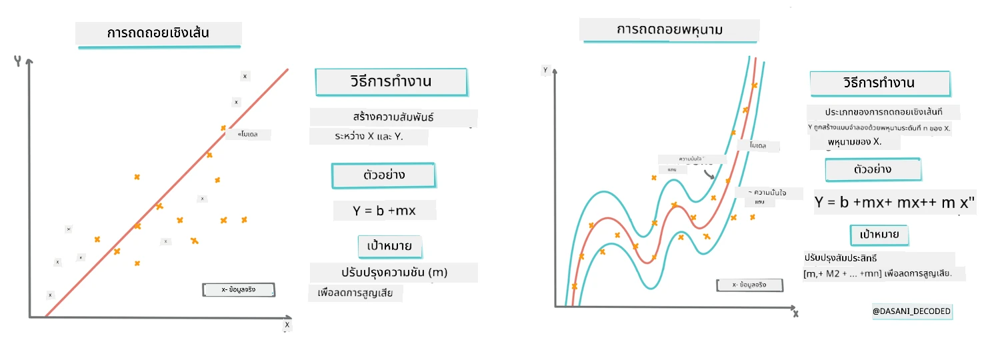
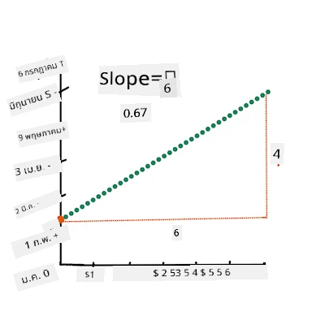
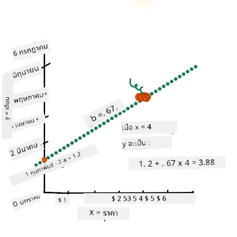
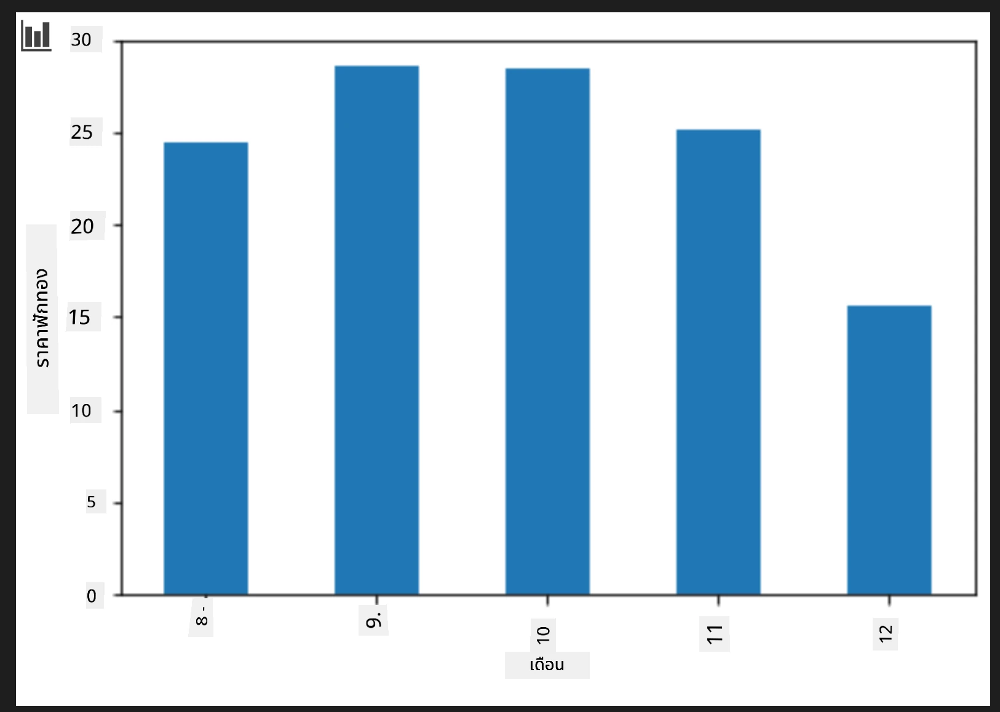
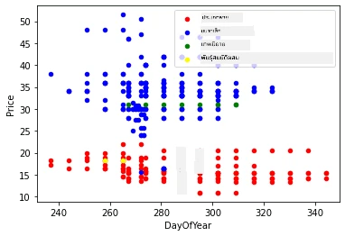

# สร้างแบบจำลองการถดถอยโดยใช้ Scikit-learn: การถดถอย 4 วิธี

## หมายเหตุสำหรับผู้เริ่มต้น

การถดถอยเชิงเส้นใช้เมื่อเราต้องการทำนายค่า **ตัวเลข** (เช่น ราคาบ้าน อุณหภูมิ หรือยอดขาย)  
มันทำงานโดยการหาค่าของเส้นตรงที่แสดงความสัมพันธ์ระหว่างลักษณะข้อมูลนำเข้าและผลลัพธ์ออกมาได้ดีที่สุด

ในบทเรียนนี้ เราเน้นไปที่การทำความเข้าใจแนวคิดก่อนจะสำรวจเทคนิคการถดถอยขั้นสูงเพิ่มเติม  
  
> อินโฟกราฟิกโดย [Dasani Madipalli](https://twitter.com/dasani_decoded)  
## [แบบทดสอบก่อนเรียน](https://ff-quizzes.netlify.app/en/ml/)

> ### [บทเรียนนี้มีให้ใช้ใน R!](../../../../2-Regression/3-Linear/solution/R/lesson_3.html)
### บทนำ

จนถึงตอนนี้คุณได้สำรวจความหมายของการถดถอยด้วยตัวอย่างข้อมูลที่เก็บรวบรวมจากชุดข้อมูลราคาฟักทองซึ่งเราจะใช้ตลอดบทเรียนนี้ อีกทั้งคุณยังได้ทำการแสดงผลข้อมูลโดยใช้ Matplotlib

ตอนนี้คุณพร้อมที่จะศึกษาลึกลงไปในเรื่องการถดถอยสำหรับ ML แล้ว ในขณะที่การแสดงผลข้อมูลช่วยให้คุณเข้าใจข้อมูลได้ง่ายขึ้น แต่พลังที่แท้จริงของ Machine Learning มาจากการ _ฝึกสอนโมเดล_ โมเดลจะถูกฝึกบนข้อมูลในอดีตเพื่อจดจำความสัมพันธ์ของข้อมูลโดยอัตโนมัติ และช่วยให้คุณทำนายผลสำหรับข้อมูลใหม่ที่โมเดลไม่เคยเห็นมาก่อน

ในบทเรียนนี้ คุณจะได้เรียนรู้เกี่ยวกับการถดถอยสองประเภท: _การถดถอยเชิงเส้นพื้นฐาน_ และ _การถดถอยพหุนาม_ พร้อมกับคณิตศาสตร์เบื้องหลังของเทคนิคเหล่านี้ โมเดลเหล่านี้จะช่วยให้เราทำนายราคาฟักทองขึ้นอยู่กับข้อมูลนำเข้าที่ต่างกัน

[](https://youtu.be/CRxFT8oTDMg "ML for beginners - Understanding Linear Regression")

> 🎥 คลิกที่รูปภาพด้านบนเพื่อชมวิดีโอสั้นๆ แนะนำการถดถอยเชิงเส้น

> ตลอดหลักสูตรนี้ เราจะตั้งพื้นฐานความรู้ทางคณิตศาสตร์ให้น้อยที่สุด และพยายามทำให้เข้าถึงง่ายสำหรับนักเรียนที่มาจากสาขาอื่นๆ ดังนั้นโปรดสังเกตหมายเหตุ 🧮 ข้อสังเกต แผนภาพ และเครื่องมือการเรียนรู้อื่นๆ เพื่อช่วยในการเข้าใจ

### ความรู้พื้นฐาน

ตอนนี้คุณควรจะคุ้นเคยกับโครงสร้างข้อมูลฟักทองที่เรากำลังตรวจสอบแล้ว คุณสามารถหาข้อมูลที่โหลดมาและทำความสะอาดไว้ล่วงหน้าในไฟล์ _notebook.ipynb_ ของบทเรียนนี้ ในไฟล์จะแสดงราคาฟักทองต่อบัชเซลใน DataFrame ใหม่ ตรวจสอบให้แน่ใจว่าคุณสามารถรันโน้ตบุ๊กเหล่านี้ในเคอร์เนลของ Visual Studio Code ได้

### การเตรียมตัว

เพื่อเป็นการเตือนความจำ คุณกำลังโหลดข้อมูลนี้เพื่อที่จะตั้งคำถามเกี่ยวกับมัน

- เวลาไหนเหมาะสมที่สุดในการซื้อฟักทอง?
- ฉันคาดหวังราคาเท่าไหร่สำหรับกล่องฟักทองมินิ?
- ฉันควรซื้อในตะกร้าครึ่งบัชเซลหรือกล่องบัชเซล 1 1/9 ดี?
เรามาลงลึกกับข้อมูลนี้กันต่อ

ในบทเรียนก่อนหน้านี้คุณได้สร้าง Pandas DataFrame และเติมข้อมูลส่วนหนึ่งของชุดข้อมูลต้นฉบับ โดยการปรับราคาต่อบัชเซล แต่ด้วยวิธีนี้คุณสามารถรวบรวมได้เพียงประมาณ 400 จุดข้อมูลและเฉพาะช่วงฤดูใบไม้ร่วงเท่านั้น

ลองดูข้อมูลที่เราโหลดไว้ล่วงหน้าในโน้ตบุ๊กของบทเรียนนี้ ข้อมูลถูกโหลดล่วงหน้าและแสดงกราฟกระจายเบื้องต้นที่แสดงข้อมูลรายเดือน บางทีเราอาจจะได้รายละเอียดเพิ่มเติมเกี่ยวกับลักษณะของข้อมูลโดยการทำความสะอาดข้อมูลเพิ่มเติมอีก

## เส้นถดถอยเชิงเส้น

อย่างที่คุณได้เรียนรู้ในบทเรียนที่ 1 เป้าหมายของการฝึกการถดถอยเชิงเส้นคือการสามารถวาดเส้นเพื่อ:

- **แสดงความสัมพันธ์ระหว่างตัวแปร** แสดงความสัมพันธ์ระหว่างตัวแปรต่าง ๆ   
- **ทำการทำนาย** ทำนายได้อย่างแม่นยำว่าจุดข้อมูลใหม่จะตกอยู่ที่ไหนเมื่อเทียบกับเส้นนั้น

โดยปกติจะใช้วิธี **Least-Squares Regression** ในการวาดเส้นแบบนี้ คำว่า Least-Squares หมายถึงกระบวนการลดข้อผิดพลาดโดยรวมของโมเดลให้ต่ำที่สุด สำหรับทุกจุดข้อมูล เราวัดระยะทางแนวตั้ง (เรียกว่า residual) ระหว่างจุดจริงกับเส้นถดถอยของเรา

เรายกกำลังสองระยะทางเหล่านี้ด้วยเหตุผล 2 ประการหลัก:

1. **ขนาดมากกว่าทิศทาง:** เราต้องการที่จะมองว่าข้อผิดพลาด -5 กับ +5 มีค่าเท่ากัน การยกกำลังสองจะทำให้ค่าทั้งหมดเป็นบวก  
2. **ลงโทษค่าผิดพลาดที่สูงกว่า:** การยกกำลังสองทำให้ข้อผิดพลาดที่ใหญ่กว่าถูกให้น้ำหนักมากขึ้น ทำให้เส้นถดถอยต้องอยู่ใกล้กับจุดที่อยู่ไกลออกไปมากกว่า

จากนั้นเราจะนำค่ากำลังสองเหล่านี้ทั้งหมดมาบวกกัน เป้าหมายของเราคือการหาค่าของเส้นที่มีผลรวมค่ากำลังสองน้อยที่สุด (ค่าน้อยสุดที่เป็นไปได้) — จึงเป็นที่มาของคำว่า "Least-Squares"

> **🧮 แสดงคณิตศาสตร์ให้ดู**  
>  
> เส้นนี้เรียกว่า _เส้นที่ทำให้เหมาะสมที่สุด_ (line of best fit) สามารถเขียนแทนด้วย [สมการ](https://en.wikipedia.org/wiki/Simple_linear_regression):  
>  
> ```
> Y = a + bX
> ```
  
> `X` คือ 'ตัวแปรอธิบาย' ส่วน `Y` คือ 'ตัวแปรตาม' ความชันของเส้นคือ `b` และ `a` คือจุดตัดแกน y ซึ่งหมายถึงค่าของ `Y` เมื่อ `X = 0`  
>
>
>
> ขั้นแรก คำนวณความชัน `b` อินโฟกราฟิกโดย [Jen Looper](https://twitter.com/jenlooper)
>
> กล่าวอีกนัยหนึ่ง และอ้างอิงกับคำถามของข้อมูลฟักทอง "ทำนายราคาฟักทองต่อบัชเซลตามเดือน" โดยที่ `X` หมายถึงราคาและ `Y` หมายถึงเดือนที่ขาย  
>
>
>
> คำนวณค่า Y ถ้าคุณจ่ายประมาณ 4 ดอลลาร์ นั่นต้องเป็นเดือนเมษายนแน่ๆ! อินโฟกราฟิกโดย [Jen Looper](https://twitter.com/jenlooper)
>
> คณิตศาสตร์ที่ใช้คำนวณเส้นนี้จำเป็นต้องแสดงความชันของเส้น ซึ่งยังขึ้นอยู่กับจุดตัด (intercept) หรือที่ที่ `Y` อยู่เมื่อ `X = 0`  
>
> คุณสามารถดูวิธีการคำนวณค่าพวกนี้ได้ที่เว็บ [Math is Fun](https://www.mathsisfun.com/data/least-squares-regression.html) และเข้าใช้ [เครื่องคิดเลข Least-squares](https://www.mathsisfun.com/data/least-squares-calculator.html) เพื่อดูว่าค่าตัวเลขต่างๆ ส่งผลต่อเส้นอย่างไร  

## ความสัมพันธ์ (Correlation)

อีกคำหนึ่งที่ควรทำความเข้าใจคือ **สัมประสิทธิ์สหสัมพันธ์ (Correlation Coefficient)** ระหว่างตัวแปร X และ Y ที่กำหนด โดยการใช้กราฟกระจาย (scatterplot) คุณสามารถเห็นค่าค่าสหสัมพันธ์นี้ได้อย่างรวดเร็ว กราฟที่จุดข้อมูลกระจายตัวอยู่ตามเส้นตรงอย่างสม่ำเสมอจะมีค่าสหสัมพันธ์สูง แต่กราฟที่จุดข้อมูลกระจัดกระจายทั่วทั้งแกน X และ Y จะมีค่าสหสัมพันธ์ต่ำ

โมเดลถดถอยเชิงเส้นที่ดีจะต้องมีค่าสหสัมพันธ์สูง (ใกล้เคียง 1 มากกว่า 0) โดยใช้วิธีการ Least-Squares Regression กับเส้นถดถอย

✅ รันโน้ตบุ๊กที่แนบมากับบทเรียนนี้ และดูกราฟกระจาย Month กับ Price ข้อมูลที่สัมพันธ์กันระหว่างเดือนและราคาของยอดขายฟักทองดูเหมือนว่ามีค่าสหสัมพันธ์สูงหรือต่ำ ตามการตีความจากการแสดงผลกราฟกระจายของคุณหรือไม่? ค่านี้เปลี่ยนแปลงหรือไม่ถ้าคุณใช้มาตรวัดที่ละเอียดขึ้นแทน `Month` เช่น *วันในปี* (จำนวนวันตั้งแต่ต้นปี)?

ในโค้ดด้านล่างนี้ เราจะสมมติว่าเราได้ทำความสะอาดข้อมูลแล้ว และได้ DataFrame ชื่อ `new_pumpkins` ซึ่งมีลักษณะดังนี้:

ID | Month | DayOfYear | Variety | City | Package | Low Price | High Price | Price  
---|-------|-----------|---------|------|---------|-----------|------------|-------  
70 | 9 | 267 | PIE TYPE | BALTIMORE | 1 1/9 bushel cartons | 15.0 | 15.0 | 13.636364  
71 | 9 | 267 | PIE TYPE | BALTIMORE | 1 1/9 bushel cartons | 18.0 | 18.0 | 16.363636  
72 | 10 | 274 | PIE TYPE | BALTIMORE | 1 1/9 bushel cartons | 18.0 | 18.0 | 16.363636  
73 | 10 | 274 | PIE TYPE | BALTIMORE | 1 1/9 bushel cartons | 17.0 | 17.0 | 15.454545  
74 | 10 | 281 | PIE TYPE | BALTIMORE | 1 1/9 bushel cartons | 15.0 | 15.0 | 13.636364  

> โค้ดสำหรับการทำความสะอาดข้อมูลอยู่ใน [`notebook.ipynb`](notebook.ipynb) เราได้ดำเนินการทำความสะอาดเหมือนในบทเรียนก่อนหน้า และคำนวณคอลัมน์ `DayOfYear` โดยใช้สมการดังนี้:  

```python
day_of_year = pd.to_datetime(pumpkins['Date']).apply(lambda dt: (dt-datetime(dt.year,1,1)).days)
```
  
ตอนนี้คุณมีความเข้าใจคณิตศาสตร์เบื้องหลังการถดถอยเชิงเส้นแล้ว เรามาสร้างโมเดลการถดถอยเพื่อดูว่าเราสามารถทำนายได้หรือไม่ว่าฟักทองแบบไหนจะมีราคาดีที่สุด ใครที่ซื้อฟักทองสำหรับแปลงฟักทองในช่วงวันหยุดอาจจะต้องการข้อมูลนี้เพื่อวางแผนการซื้อฟักทองให้เหมาะสมกับแปลงดังกล่าว

## การหาค่าสหสัมพันธ์ (Looking for Correlation)

[](https://youtu.be/uoRq-lW2eQo "ML for beginners - Looking for Correlation: The Key to Linear Regression")

> 🎥 คลิกที่ภาพด้านบนเพื่อชมวิดีโอสั้นๆ แนะนำเรื่องการหาค่าสหสัมพันธ์

จากบทเรียนก่อนหน้านี้ คุณอาจเห็นว่าราคาฟักทองเฉลี่ยสำหรับแต่ละเดือนเป็นดังนี้:



ซึ่งบ่งชี้ว่าควรมีความสัมพันธ์ และเราสามารถลองฝึกโมเดลถดถอยเชิงเส้นเพื่อทำนายความสัมพันธ์ระหว่าง `Month` กับ `Price` หรือระหว่าง `DayOfYear` กับ `Price` ได้ ดังนี้เป็นกราฟกระจายที่แสดงความสัมพันธ์หลัง:

 

มาดูว่ามีความสัมพันธ์หรือไม่โดยใช้ฟังก์ชัน `corr`:

```python
print(new_pumpkins['Month'].corr(new_pumpkins['Price']))
print(new_pumpkins['DayOfYear'].corr(new_pumpkins['Price']))
```
  
ดูเหมือนว่าค่าสหสัมพันธ์จะน้อยมาก คือ -0.15 โดย `Month` และ -0.17 โดย `DayOfYear` แต่ดูเหมือนว่าจะมีความสัมพันธ์สำคัญอีกประการหนึ่ง คือ ราคาที่แตกต่างกันมีคลัสเตอร์ที่สัมพันธ์กับพันธุ์ฟักทองต่าง ๆ เพื่อยืนยันสมมติฐานนี้ ให้ลองแสดงแต่ละหมวดหมู่ของฟักทองโดยใช้สีที่ต่างกัน การส่งพารามิเตอร์ `ax` ให้กับฟังก์ชัน `scatter` จะช่วยให้เราสามารถแสดงจุดทั้งหมดบนกราฟเดียวกันได้:

```python
ax=None
colors = ['red','blue','green','yellow']
for i,var in enumerate(new_pumpkins['Variety'].unique()):
    df = new_pumpkins[new_pumpkins['Variety']==var]
    ax = df.plot.scatter('DayOfYear','Price',ax=ax,c=colors[i],label=var)
```
  
 

การสำรวจของเราชี้ให้เห็นว่าพันธุ์ฟักทองมีผลกระทบต่อราคามากกว่าวันที่ขายจริง เราสามารถเห็นได้จากกราฟแท่ง:

```python
new_pumpkins.groupby('Variety')['Price'].mean().plot(kind='bar')
```
  
  

มุ่งความสนใจช่วงนี้ไปที่พันธุ์ฟักทองเดียวคือ 'pie type' และดูผลของวันที่มีต่อราคา:

```python
pie_pumpkins = new_pumpkins[new_pumpkins['Variety']=='PIE TYPE']
pie_pumpkins.plot.scatter('DayOfYear','Price') 
```
  
  

ถ้าเราคำนวณค่าสหสัมพันธ์ระหว่าง `Price` และ `DayOfYear` โดยใช้ฟังก์ชัน `corr` จะได้ประมาณ `-0.27` ซึ่งหมายความว่าการฝึกโมเดลทำนายนั้นมีเหตุผล

> ก่อนฝึกโมเดลถดถอยเชิงเส้น ควรแน่ใจว่าข้อมูลของเราสะอาดดี การถดถอยเชิงเส้นทำงานได้ไม่ดีเมื่อมีค่าว่าง จึงควรกำจัดช่องว่างทั้งหมดออก:

```python
pie_pumpkins.dropna(inplace=True)
pie_pumpkins.info()
```
  
อีกทางเลือกหนึ่งคือเติมช่องว่างเหล่านั้นด้วยค่าเฉลี่ยของคอลัมน์นั้น ๆ

## การถดถอยเชิงเส้นอย่างง่าย

[](https://youtu.be/e4c_UP2fSjg "ML for beginners - Linear and Polynomial Regression using Scikit-learn")

> 🎥 คลิกที่ภาพด้านบนเพื่อชมวิดีโอแนะนำการถดถอยเชิงเส้นและถดถอยพหุนาม

ในการฝึกโมเดลถดถอยเชิงเส้น เราจะใช้ไลบรารี **Scikit-learn**

```python
from sklearn.linear_model import LinearRegression
from sklearn.metrics import mean_squared_error
from sklearn.model_selection import train_test_split
```
  
เราจะเริ่มต้นโดยการแยกค่าข้อมูลนำเข้า (features) และผลลัพธ์ที่ต้องการ (label) เป็น numpy arrays แยกกัน:

```python
X = pie_pumpkins['DayOfYear'].to_numpy().reshape(-1,1)
y = pie_pumpkins['Price']
```
  
> โปรดทราบว่าเราต้องทำ `reshape` กับข้อมูลนำเข้าเพื่อให้แพ็กเกจ Linear Regression เข้าใจอย่างถูกต้อง Linear Regression คาดหวังข้อมูลนำเข้าเป็นอาร์เรย์ 2 มิติ โดยแต่ละแถวคือเวกเตอร์ของลักษณะนำเข้า กรณีของเราเนื่องจากมีข้อมูลนำเข้าเพียงตัวเดียว จึงต้องใช้อาร์เรย์ขนาด N×1 โดยที่ N คือจำนวนขนาดชุดข้อมูล

จากนั้น เราจำเป็นต้องแบ่งข้อมูลออกเป็นชุดฝึกสอนและชุดทดสอบ เพื่อที่เราจะได้ตรวจสอบโมเดลหลังจากฝึกสอนเสร็จ:

```python
X_train, X_test, y_train, y_test = train_test_split(X, y, test_size=0.2, random_state=0)
```
  
สุดท้าย การฝึกโมเดล Linear Regression จริงๆ ใช้เพียงสองบรรทัดของโค้ด เรานิยามอ็อบเจ็กต์ `LinearRegression` และทำการ fit กับข้อมูลของเราโดยใช้เมธอด `fit`:

```python
lin_reg = LinearRegression()
lin_reg.fit(X_train,y_train)
```

อ็อบเจกต์ `LinearRegression` หลังจากที่ทำการ `fit` แล้ว จะเก็บค่าสัมประสิทธิ์ของการถดถอยทั้งหมดไว้ ซึ่งสามารถเข้าถึงได้โดยใช้คุณสมบัติ `.coef_` ในกรณีของเรา จะมีค่าสัมประสิทธิ์เพียงค่าเดียว ซึ่งควรจะประมาณ `-0.017` ซึ่งหมายความว่าราคามีแนวโน้มที่จะลดลงเล็กน้อยตามเวลาที่ผ่านไป แต่ไม่มาก ประมาณ 2 เซนต์ต่อวัน เรายังสามารถเข้าถึงจุดตัดแกน Y ของเส้นถดถอยได้โดยใช้ `lin_reg.intercept_` ซึ่งในกรณีของเราจะประมาณ `21` บ่งบอกถึงราคาตั้งแต่ต้นปี

เพื่อดูว่าโมเดลของเรามีความแม่นยำเพียงใด เราสามารถทำนายราคาบนชุดข้อมูลทดสอบ จากนั้นวัดความใกล้เคียงระหว่างค่าทำนายกับค่าที่คาดไว้ ซึ่งสามารถทำได้โดยใช้เมตริก root mean square error (RMSE) ซึ่งคือรากที่สองของค่าเฉลี่ยของผลต่างกำลังสองทั้งหมดระหว่างค่าที่คาดหวังและค่าทำนาย

```python
pred = lin_reg.predict(X_test)

rmse = np.sqrt(mean_squared_error(y_test,pred))
print(f'RMSE: {rmse:3.3} ({rmse/np.mean(pred)*100:3.3}%)')
```

ข้อผิดพลาดของเราดูเหมือนจะประมาณ 2 จุด ซึ่งประมาณ ~17% ไม่ค่อยดีนัก ตัวชี้วัดอีกอย่างหนึ่งของคุณภาพโมเดลคือ **coefficient of determination** ซึ่งสามารถคำนวณได้ดังนี้:

```python
score = lin_reg.score(X_train,y_train)
print('Model determination: ', score)
```
ถ้าค่าเท่ากับ 0 หมายความว่าโมเดลไม่สนใจข้อมูลอินพุต และทำหน้าที่เป็น *ผู้ทำนายเชิงเส้นที่แย่ที่สุด* ซึ่งก็คือค่าเฉลี่ยของผลลัพธ์ ค่าที่เท่ากับ 1 หมายความว่าเราสามารถทำนายผลลัพธ์ทั้งหมดได้อย่างสมบูรณ์ ในกรณีของเราค่าสัมประสิทธิ์นี้อยู่ที่ประมาณ 0.06 ซึ่งค่อนข้างต่ำ

เรายังสามารถวาดกราฟข้อมูลทดสอบพร้อมกับเส้นถดถอยเพื่อดูว่าเส้นถดถอยทำงานอย่างไรในกรณีของเราได้ดีขึ้น:

```python
plt.scatter(X_test,y_test)
plt.plot(X_test,pred)
```


## การถดถอยเชิงพหุนาม (Polynomial Regression)

ประเภทหนึ่งของ Linear Regression คือ Polynomial Regression บางครั้งความสัมพันธ์ระหว่างตัวแปรเป็นเชิงเส้น เช่น ยิ่งฟักทองมีปริมาตรมาก ราคาก็สูงขึ้น แต่บางครั้งความสัมพันธ์เหล่านี้ไม่สามารถแสดงในรูปแบบระนาบหรือเส้นตรงได้

✅ นี่คือ [ตัวอย่างเพิ่มเติม](https://online.stat.psu.edu/stat501/Lesson09#polynomial-regression-examples) ของข้อมูลที่สามารถใช้ Polynomial Regression ได้

ลองดูความสัมพันธ์ระหว่าง Date และ Price อีกครั้ง กราฟกระจัดกระจายนี้ดูเหมือนว่าจะต้องวิเคราะห์โดยเส้นตรงเสมอหรือไม่? ราคาสามารถผันผวนได้หรือไม่? ในกรณีนี้ คุณสามารถลองใช้ polynomial regression ได้

✅ พหุนามคือสมการทางคณิตศาสตร์ที่ประกอบด้วยตัวแปรและสัมประสิทธิ์หนึ่งตัวหรือมากกว่า

Polynomial regression จะสร้างเส้นโค้งเพื่อให้เหมาะกับข้อมูลที่ไม่เชิงเส้นได้ดีขึ้น ในกรณีของเรา หากเรารวมตัวแปร `DayOfYear` กำลังสองเข้าไปในข้อมูลอินพุต เราจะสามารถฟิตข้อมูลด้วยเส้นโค้งรูปพาราโบลา ซึ่งจะมีจุดต่ำสุดในช่วงเวลาหนึ่งของปี

Scikit-learn มี [pipeline API](https://scikit-learn.org/stable/modules/generated/sklearn.pipeline.make_pipeline.html?highlight=pipeline#sklearn.pipeline.make_pipeline) ที่ช่วยให้รวมขั้นตอนการประมวลผลข้อมูลต่าง ๆ เข้าด้วยกันได้ **pipeline** คือสายโซ่ของ **estimators** ในกรณีของเรา เราจะสร้าง pipeline ที่เพิ่มคุณสมบัติพหุนามเข้าสู่โมเดลก่อน จากนั้นจึงฝึกเส้นถดถอย:

```python
from sklearn.preprocessing import PolynomialFeatures
from sklearn.pipeline import make_pipeline

pipeline = make_pipeline(PolynomialFeatures(2), LinearRegression())

pipeline.fit(X_train,y_train)
```

การใช้ `PolynomialFeatures(2)` หมายความว่าเราจะรวมพหุนามของตัวแปรอินพุตที่มีดีกรีสองทั้งหมด ในกรณีของเราหมายถึงแค่ `DayOfYear`<sup>2</sup> แต่ถ้ามีตัวแปรอินพุตสองตัวคือ X และ Y จะเพิ่ม X<sup>2</sup> , XY และ Y<sup>2</sup> นอกจากนี้เรายังสามารถใช้พหุนามที่มีดีกรีสูงกว่าถ้าต้องการ

Pipeline สามารถใช้เหมือนอ็อบเจกต์ `LinearRegression` ดั้งเดิมได้ เช่น เราสามารถ `fit` pipeline แล้วใช้ `predict` เพื่อรับผลลัพธ์การทำนาย:

```python
pred = pipeline.predict(X_test)

rmse = np.sqrt(mean_squared_error(y_test,pred))
print(f'RMSE: {rmse:3.3} ({rmse/np.mean(pred)*100:3.3}%)')

score = pipeline.score(X_train,y_train)
print('Model determination: ', score)
```

เพื่อวาดกราฟเส้นโค้งประมาณอย่างราบรื่น เราใช้ `np.linspace` เพื่อสร้างช่วงอินพุตที่สม่ำเสมอ แทนการวาดบนข้อมูลทดสอบที่ไม่เรียงลำดับโดยตรง (ซึ่งจะได้เส้นซิกแซก):

```python
X_range = np.linspace(X_test.min(), X_test.max(), 100).reshape(-1,1)
y_range = pipeline.predict(X_range)

plt.scatter(X_test, y_test)
plt.plot(X_range, y_range)
```

นี่คือกราฟแสดงข้อมูลทดสอบและเส้นโค้งประมาณ:


การใช้ Polynomial Regression จะช่วยลด RMSE ลงเล็กน้อยและเพิ่มค่าค่าสัมประสิทธิ์การกำหนด แต่ไม่มากนัก เราต้องพิจารณาคุณสมบัติอื่น ๆ ด้วย!

> คุณเห็นราคาฟักทองต่ำสุดอยู่บริเวณวันฮาโลวีนใช่ไหม? คุณอธิบายเรื่องนี้อย่างไร?

🎃 ยินดีด้วย คุณเพิ่งสร้างโมเดลที่ช่วยทำนายราคาฟักทองพายได้ คุณสามารถทำซ้ำขั้นตอนนี้สำหรับฟักทองชนิดอื่นได้ แต่จะทำงานหนักมาก ตอนนี้เรามาเรียนรู้วิธีจัดการกับพันธุ์ฟักทองในโมเดลของเรากันเถอะ!

## คุณสมบัติแบบเชิงหมวดหมู่ (Categorical Features)

ในโลกที่สมบูรณ์แบบ เราต้องการทำนายราคาสำหรับฟักทองหลากหลายพันธุ์โดยใช้โมเดลเดียวกัน อย่างไรก็ตาม คอลัมน์ `Variety` จะแตกต่างจากคอลัมน์ เช่น `Month` เพราะมีค่าที่ไม่ใช่ตัวเลข คอลัมน์เหล่านี้เรียกว่า **categorical**

[](https://youtu.be/DYGliioIAE0 "ML for beginners - Categorical Feature Predictions with Linear Regression")

> 🎥 คลิกที่ภาพด้านบนเพื่อดูวิดีโอแนะนำสั้น ๆ เกี่ยวกับการใช้คุณสมบัติแบบเชิงหมวดหมู่

นี่คือกราฟแสดงว่าราคากลางขึ้นอยู่กับพันธุ์ฟักทองอย่างไร:


เพื่อพิจารณาพันธุ์ฟักทอง เราจำเป็นต้องแปลงข้อมูลเป็นรูปแบบตัวเลข หรือที่เรียกว่า **encoding** ซึ่งมีหลายวิธีดังนี้:

* การ **เข้ารหัสตัวเลขอย่างง่าย** จะสร้างตารางของพันธุ์ต่าง ๆ แล้วแทนชื่อพันธุ์ด้วยดัชนีในตารางนั้น แต่วิธีนี้ไม่เหมาะกับ linear regression เพราะ linear regression จะใช้ค่าตัวเลขจริงของดัชนีและนำไปคูณกับสัมประสิทธิ์ ในกรณีของเรา ความสัมพันธ์ระหว่างดัชนีและราคาชัดเจนว่าไม่เป็นเชิงเส้น แม้เราจะจัดลำดับดัชนีอย่างระมัดระวัง
* การ **เข้ารหัสแบบ one-hot** จะเปลี่ยนคอลัมน์ `Variety` เป็นสี่คอลัมน์ คือแต่ละพันธุ์ มีค่า `1` หากแถวที่สอดคล้องเป็นพันธุ์นั้น และ `0` ถ้าไม่ใช่ หมายความว่าจะมีสี่ค่าสัมประสิทธิ์ในการถดถอยเชิงเส้น สำหรับแต่ละพันธุ์โดยรับผิดชอบต่อ "ราคาตั้งต้น" (หรือ "ราคาพิเศษ") สำหรับพันธุ์นั้น ๆ

โค้ดด้านล่างนี้แสดงวิธีการ one-hot encode พันธุ์ฟักทอง:

```python
pd.get_dummies(new_pumpkins['Variety'])
```

 ID | FAIRYTALE | MINIATURE | MIXED HEIRLOOM VARIETIES | PIE TYPE
----|-----------|-----------|--------------------------|----------
70 | 0 | 0 | 0 | 1
71 | 0 | 0 | 0 | 1
... | ... | ... | ... | ...
1738 | 0 | 1 | 0 | 0
1739 | 0 | 1 | 0 | 0
1740 | 0 | 1 | 0 | 0
1741 | 0 | 1 | 0 | 0
1742 | 0 | 1 | 0 | 0

เพื่อฝึก Linear Regression โดยใช้ข้อมูลพันธุ์ที่ถูก one-hot encode เป็นอินพุต เราเพียงแค่ต้องนิยามข้อมูล `X` และ `y` ให้ถูกต้อง:

```python
X = pd.get_dummies(new_pumpkins['Variety'])
y = new_pumpkins['Price']
```

ส่วนที่เหลือของโค้ดยังคงเหมือนเดิมกับที่เราใช้ฝึก Linear Regression หากลองทำจะพบว่าค่าเฉลี่ยของความผิดพลาดกำลังสองไม่เปลี่ยนแปลงมากนักแต่ค่าสัมประสิทธิ์การกำหนดสูงขึ้นมาก (~77%) เพื่อให้ทำนายได้แม่นยำยิ่งขึ้น เราสามารถนำคุณสมบัติเชิงหมวดหมู่อื่น ๆ เข้ามาร่วมกับคุณสมบัติตัวเลข เช่น `Month` หรือ `DayOfYear` เพื่อรวมคุณสมบัติทั้งหมดเป็นอาเรย์เดียวโดยใช้ `join`:

```python
X = pd.get_dummies(new_pumpkins['Variety']) \
        .join(new_pumpkins['Month']) \
        .join(pd.get_dummies(new_pumpkins['City'])) \
        .join(pd.get_dummies(new_pumpkins['Package']))
y = new_pumpkins['Price']
```

ที่นี่เรายังพิจารณา `City` และประเภท `Package` ด้วย ซึ่งให้ผล RMSE 2.84 (10.5%) และค่าสัมประสิทธิ์การกำหนด 0.94!

## สรุปรวมทั้งหมด

เพื่อสร้างโมเดลที่ดีที่สุด เราสามารถใช้ข้อมูลรวม (categorical แบบ one-hot encoded + ตัวเลข) จากตัวอย่างข้างต้นร่วมกับ Polynomial Regression นี่คือตัวอย่างโค้ดครบถ้วนเพื่อความสะดวกของคุณ:

```python
# ตั้งค่าข้อมูลสำหรับการฝึก
X = pd.get_dummies(new_pumpkins['Variety']) \
        .join(new_pumpkins['Month']) \
        .join(pd.get_dummies(new_pumpkins['City'])) \
        .join(pd.get_dummies(new_pumpkins['Package']))
y = new_pumpkins['Price']

# แบ่งข้อมูลเป็นชุดฝึกและชุดทดสอบ
X_train, X_test, y_train, y_test = train_test_split(X, y, test_size=0.2, random_state=0)

# ตั้งค่าและฝึก pipeline
pipeline = make_pipeline(PolynomialFeatures(2), LinearRegression())
pipeline.fit(X_train,y_train)

# ทำนายผลสำหรับข้อมูลทดสอบ
pred = pipeline.predict(X_test)

# คำนวณค่า RMSE และค่าตัวกำหนด
rmse = mean_squared_error(y_test, pred, squared=False)
print(f'RMSE: {rmse:3.3} ({rmse/pred.mean()*100:3.3}%)')

score = pipeline.score(X_train,y_train)
print('Model determination: ', score)
```

ซึ่งจะให้ค่าสัมประสิทธิ์การกำหนดที่ดีที่สุดเกือบ 97% และ RMSE=2.23 (~8% ความผิดพลาดในการทำนาย)

| โมเดล | RMSE | ค่าสัมประสิทธิ์การกำหนด |
|-------|-----|---------------------------|
| `DayOfYear` Linear | 2.77 (17.2%) | 0.07 |
| `DayOfYear` Polynomial | 2.73 (17.0%) | 0.08 |
| `Variety` Linear | 5.24 (19.7%) | 0.77 |
| คุณสมบัติทั้งหมด Linear | 2.84 (10.5%) | 0.94 |
| คุณสมบัติทั้งหมด Polynomial | 2.23 (8.25%) | 0.97 |

🏆 เยี่ยมมาก! คุณสร้างโมเดล Regression ถึงสี่แบบในบทเรียนเดียวและปรับปรุงคุณภาพโมเดลให้ถึง 97% ในส่วนสุดท้ายของบทเรียนเกี่ยวกับ Regression คุณจะได้เรียนรู้ Logistic Regression เพื่อกำหนดประเภท

---
## 🚀ความท้าทาย

ทดสอบตัวแปรต่าง ๆ หลายตัวในโน้ตบุ๊กนี้เพื่อดูว่า ความสัมพันธ์เชิงสหสัมพันธ์ส่งผลอย่างไรต่อความแม่นยำของโมเดล

## [แบบทดสอบหลังบทเรียน](https://ff-quizzes.netlify.app/en/ml/)

## ทบทวน & ศึกษาด้วยตนเอง

ในบทเรียนนี้เราได้เรียนรู้เกี่ยวกับ Linear Regression ยังมีประเภทสำคัญอื่น ๆ ของ Regression ได้แก่ Stepwise, Ridge, Lasso และ Elasticnet ศึกษาต่อในหลักสูตรที่ดีได้ที่ [Stanford Statistical Learning course](https://online.stanford.edu/courses/sohs-ystatslearning-statistical-learning)

## การบ้าน  

[สร้างโมเดล](assignment.md)

---

<!-- CO-OP TRANSLATOR DISCLAIMER START -->
**ข้อจำกัดความรับผิดชอบ**:  
เอกสารนี้ได้รับการแปลโดยใช้บริการแปลภาษาอัตโนมัติ [Co-op Translator](https://github.com/Azure/co-op-translator) แม้เราจะพยายามให้มีความถูกต้อง โปรดทราบว่าการแปลอัตโนมัติอาจมีข้อผิดพลาดหรือความไม่แม่นยำ เอกสารต้นฉบับในภาษาต้นทางควรถือเป็นแหล่งข้อมูลที่เชื่อถือได้ สำหรับข้อมูลสำคัญ แนะนำให้ใช้บริการแปลโดยผู้เชี่ยวชาญมนุษย์ เราไม่รับผิดชอบต่อความเข้าใจผิดหรือการตีความผิดใดๆ ที่เกิดจากการใช้การแปลนี้
<!-- CO-OP TRANSLATOR DISCLAIMER END -->