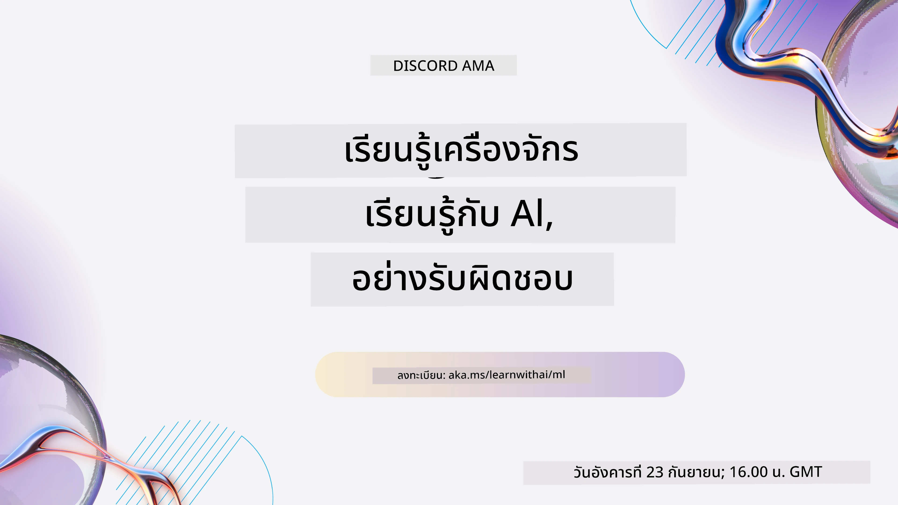
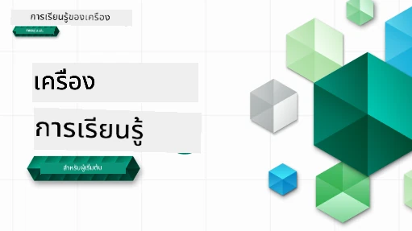

[](https://github.com/microsoft/ML-For-Beginners/blob/master/LICENSE)
[](https://GitHub.com/microsoft/ML-For-Beginners/graphs/contributors/)
[](https://GitHub.com/microsoft/ML-For-Beginners/issues/)
[](https://GitHub.com/microsoft/ML-For-Beginners/pulls/)
[](http://makeapullrequest.com)

[](https://GitHub.com/microsoft/ML-For-Beginners/watchers/)
[](https://GitHub.com/microsoft/ML-For-Beginners/network/)
[](https://GitHub.com/microsoft/ML-For-Beginners/stargazers/)

### 🌐 รองรับหลายภาษา

#### การแปลที่ดูแลโดย [Co-op Translator](https://github.com/Azure/co-op-translator)

<!-- CO-OP TRANSLATOR LANGUAGES TABLE START -->
[อาหรับ](../ar/README.md) | [เบงกาลี](../bn/README.md) | [บัลแกเรีย](../bg/README.md) | [พม่า (เมียนมา)](../my/README.md) | [จีน (ตัวย่อ)](../zh-CN/README.md) | [จีน (ตัวเต็ม, ฮ่องกง)](../zh-HK/README.md) | [จีน (ตัวเต็ม, มาเก๊า)](../zh-MO/README.md) | [จีน (ตัวเต็ม, ไต้หวัน)](../zh-TW/README.md) | [โครเอเชีย](../hr/README.md) | [เช็ก](../cs/README.md) | [เดนมาร์ก](../da/README.md) | [ดัตช์](../nl/README.md) | [เอสโตเนีย](../et/README.md) | [ฟินแลนด์](../fi/README.md) | [ฝรั่งเศส](../fr/README.md) | [เยอรมัน](../de/README.md) | [กรีก](../el/README.md) | [ฮีบรู](../he/README.md) | [ฮินดี](../hi/README.md) | [ฮังการี](../hu/README.md) | [อินโดนีเซีย](../id/README.md) | [อิตาลี](../it/README.md) | [ญี่ปุ่น](../ja/README.md) | [กันนาดา](../kn/README.md) | [เขมร](../km/README.md) | [เกาหลี](../ko/README.md) | [ลิทัวเนีย](../lt/README.md) | [มาเลย์](../ms/README.md) | [มาลายาลัม](../ml/README.md) | [มณิพุรี (เมตี มาแยก)](../mni/README.md) | [มราฐี](../mr/README.md) | [เนปาล](../ne/README.md) | [ไนจีเรีย พิดจิน](../pcm/README.md) | [นอร์เวย์](../no/README.md) | [เปอร์เซีย (ฟาร์ซี)](../fa/README.md) | [โปแลนด์](../pl/README.md) | [โปรตุเกส (บราซิล)](../pt-BR/README.md) | [โปรตุเกส (โปรตุเกส)](../pt-PT/README.md) | [ปัญจาบี (กุรมูขี)](../pa/README.md) | [โรมาเนีย](../ro/README.md) | [รัสเซีย](../ru/README.md) | [เซอร์เบีย (ซีริลลิก)](../sr/README.md) | [สโลวัก](../sk/README.md) | [สโลเวเนีย](../sl/README.md) | [สเปน](../es/README.md) | [สวาฮิลี](../sw/README.md) | [สวีเดน](../sv/README.md) | [ทากาล็อก (ฟิลิปปินส์)](../tl/README.md) | [ทมิฬ](../ta/README.md) | [เตลูกู](../te/README.md) | [ไทย](./README.md) | [ตุรกี](../tr/README.md) | [ยูเครน](../uk/README.md) | [อูรดู](../ur/README.md) | [เวียดนาม](../vi/README.md)

> **ต้องการโคลนแบบโลคอล?**
>
> ที่เก็บนี้มีการแปลกว่า 50 ภาษา ซึ่งทำให้ขนาดดาวน์โหลดเพิ่มขึ้นอย่างมาก หากต้องการโคลนโดยไม่รวมการแปล ให้ใช้ sparse checkout:
>
> **Bash / macOS / Linux:**
> ```bash
> git clone --filter=blob:none --sparse https://github.com/microsoft/ML-For-Beginners.git
> cd ML-For-Beginners
> git sparse-checkout set --no-cone '/*' '!translations' '!translated_images'
> ```
>
> **CMD (Windows):**
> ```cmd
> git clone --filter=blob:none --sparse https://github.com/microsoft/ML-For-Beginners.git
> cd ML-For-Beginners
> git sparse-checkout set --no-cone "/*" "!translations" "!translated_images"
> ```
>
> วิธีนี้จะให้คุณทุกอย่างที่จำเป็นสำหรับการเรียนคอร์สนี้โดยดาวน์โหลดเร็วขึ้นมาก
<!-- CO-OP TRANSLATOR LANGUAGES TABLE END -->

#### เข้าร่วมชุมชนของเรา

[](https://discord.gg/nTYy5BXMWG)

เรามีซีรีส์ Discord เรียนรู้กับ AI กำลังดำเนินอยู่ เรียนรู้เพิ่มเติมและเข้าร่วมได้ที่ [Learn with AI Series](https://aka.ms/learnwithai/discord) ตั้งแต่วันที่ 18 - 30 กันยายน 2025 คุณจะได้รับเคล็ดลับและเทคนิคการใช้ GitHub Copilot สำหรับ Data Science



# การเรียนรู้ของเครื่องสำหรับผู้เริ่มต้น - หลักสูตร

> 🌍 เดินทางรอบโลกในขณะที่เราสำรวจการเรียนรู้ของเครื่องผ่านวัฒนธรรมโลก 🌍

Cloud Advocates ที่ Microsoft ยินดีนำเสนอหลักสูตร 12 สัปดาห์ 26 บทเรียนที่เกี่ยวกับ **การเรียนรู้ของเครื่อง** ในหลักสูตรนี้ คุณจะได้เรียนรู้สิ่งที่บางครั้งเรียกว่า **การเรียนรู้ของเครื่องคลาสสิก** โดยใช้ไลบรารี Scikit-learn เป็นหลักและหลีกเลี่ยงการเรียนรู้ลึกซึ่งมีสอนใน [หลักสูตร AI สำหรับผู้เริ่มต้น](https://aka.ms/ai4beginners) รวมบทเรียนเหล่านี้กับหลักสูตร ['วิทยาศาสตร์ข้อมูลสำหรับผู้เริ่มต้น'](https://aka.ms/ds4beginners) ก็ได้เช่นกัน!

เดินทางไปรอบโลกกับเราในขณะที่เรานำเทคนิคคลาสสิกเหล่านี้ไปใช้กับข้อมูลจากหลายภูมิภาค บทเรียนแต่ละบทมีแบบทดสอบก่อนและหลังเรียน, คำแนะนำเป็นลายลักษณ์อักษรในการทำบทเรียนให้สำเร็จ, ตัวอย่างคำตอบ, งานมอบหมาย และอื่น ๆ การสอนโดยใช้โปรเจกต์ช่วยให้คุณเรียนรู้ไปพร้อมกับการสร้าง เป็นวิธีที่พิสูจน์แล้วว่าสามารถช่วยให้ทักษะใหม่ติดตัวได้ดีขึ้น

**✍️ ขอขอบคุณอย่างมากต่อผู้แต่งของเรา** Jen Looper, Stephen Howell, Francesca Lazzeri, Tomomi Imura, Cassie Breviu, Dmitry Soshnikov, Chris Noring, Anirban Mukherjee, Ornella Altunyan, Ruth Yakubu และ Amy Boyd

**🎨 ขอบคุณผู้วาดภาพประกอบ** Tomomi Imura, Dasani Madipalli และ Jen Looper

**🙏 ขอขอบคุณเป็นพิเศษ 🙏 แก่ Microsoft Student Ambassador ผู้แต่ง รีวิว และผู้มีส่วนร่วมเนื้อหา** โดยเฉพาะอย่างยิ่ง Rishit Dagli, Muhammad Sakib Khan Inan, Rohan Raj, Alexandru Petrescu, Abhishek Jaiswal, Nawrin Tabassum, Ioan Samuila และ Snigdha Agarwal

**🤩 ขอขอบคุณเพิ่มแก่ Microsoft Student Ambassadors Eric Wanjau, Jasleen Sondhi และ Vidushi Gupta สำหรับบทเรียน R ของเรา!**

# เริ่มต้นใช้งาน

ทำตามขั้นตอนเหล่านี้:
1. **Fork ที่เก็บ**: คลิกที่ปุ่ม "Fork" ที่มุมบนขวาของหน้านี้
2. **Clone ที่เก็บ**:   `git clone https://github.com/microsoft/ML-For-Beginners.git`

> 💡 **เคล็ดลับเริ่มต้นอย่างรวดเร็ว:** ต้องการเริ่มต้นในเบราว์เซอร์โดยไม่ต้องติดตั้ง Python ในเครื่องหรือไม่? ใช้ [GitHub Codespaces](https://github.com/features/codespaces) เพื่อสร้างสภาพแวดล้อมการพัฒนาบนคลาวด์สำหรับ fork ของคุณ เปิดเมนูเขียว **Code** แล้วเลือก **Codespaces** จากนั้นสร้าง codespace และติดตั้ง dependencies ที่จำเป็นของแต่ละบทเรียนภายในนั้นตามต้องการ

> [ค้นหาทรัพยากรเพิ่มเติมทั้งหมดสำหรับคอร์สนี้ในคอลเลคชัน Microsoft Learn ของเรา](https://learn.microsoft.com/en-us/collections/qrqzamz1nn2wx3?WT.mc_id=academic-77952-bethanycheum)

> 🔧 **ต้องการความช่วยเหลือ?** ตรวจสอบ [คู่มือแก้ไขปัญหา](TROUBLESHOOTING.md) สำหรับวิธีแก้ไขข้อผิดพลาดทั่วไปในการติดตั้ง การตั้งค่า และการรันบทเรียน


**[นักเรียน](https://aka.ms/student-page)** หากต้องการใช้หลักสูตรนี้ ให้ fork รีโปเต็มในบัญชี GitHub ของคุณและทำแบบฝึกหัดด้วยตัวเองหรือกับกลุ่ม:

- เริ่มด้วยแบบทดสอบก่อนบทเรียน
- อ่านบทเรียนและทำกิจกรรม พร้อมหยุดคิดทบทวนในแต่ละจุดตรวจสอบความรู้
- พยายามสร้างโปรเจกต์โดยทำความเข้าใจบทเรียนมากกว่าการรันโค้ดตัวอย่าง; อย่างไรก็ตาม โค้ดนั้นมีอยู่ในโฟลเดอร์ `/solution` ของแต่ละบทเรียนที่เน้นโปรเจกต์
- ทำแบบทดสอบหลังบทเรียน
- ทำความท้าทาย
- ทำงานมอบหมาย
- หลังจากทำกลุ่มบทเรียนเสร็จ ให้ไปที่ [บอร์ดอภิปราย](https://github.com/microsoft/ML-For-Beginners/discussions) และ "เรียนรู้ออกมาเป็นเสียงดัง" โดยกรอกแบบประเมิน PAT ที่เหมาะสม 'PAT' คือ เครื่องมือประเมินความก้าวหน้า ซึ่งเป็นแบบประเมินที่คุณกรอกเพื่อพัฒนาการเรียนรู้ของตนเอง คุณยังสามารถโต้ตอบกับ PAT ของคนอื่นเพื่อให้พวกเราได้เรียนรู้ร่วมกัน

> สำหรับการศึกษาเพิ่มเติม เราแนะนำให้ติดตามโมดูลและเส้นทางการเรียนรู้ [Microsoft Learn](https://docs.microsoft.com/en-us/users/jenlooper-2911/collections/k7o7tg1gp306q4?WT.mc_id=academic-77952-leestott) เหล่านี้

**ครูผู้สอน** เราได้ [รวมข้อเสนอแนะบางส่วน](for-teachers.md) เกี่ยวกับวิธีการใช้หลักสูตรนี้ไว้ให้แล้ว

---

## วิดีโอแนะนำ

บางบทเรียนมีในรูปแบบวิดีโอสั้น คุณสามารถค้นหาวิดีโอทั้งหมดนี้ได้ในบทเรียนหรือตาม [เพลย์ลิสต์ ML for Beginners บนช่อง Microsoft Developer YouTube](https://aka.ms/ml-beginners-videos) โดยคลิกที่ภาพด้านล่าง

[](https://aka.ms/ml-beginners-videos)

---

## พบกับทีมงาน

[](https://youtu.be/Tj1XWrDSYJU)

**GIF โดย** [Mohit Jaisal](https://linkedin.com/in/mohitjaisal)

> 🎥 คลิกที่ภาพด้านบนเพื่อดูวิดีโอเกี่ยวกับโครงการและผู้ที่สร้างมันขึ้นมา!

---

## หลักการสอน

เราได้เลือกหลักการสอนสองข้อตอนสร้างหลักสูตรนี้: เพื่อให้มันเป็น **โครงการที่ลงมือทำจริง** และมี **แบบทดสอบบ่อยครั้ง** นอกจากนี้ หลักสูตรนี้ยังมี **ธีม** ร่วมที่ทำให้เกิดความสอดคล้องกัน

โดยการทำให้เนื้อหาสอดคล้องกับโครงการ กระบวนการเรียนรู้จะน่าสนใจมากขึ้นสำหรับนักเรียนและช่วยเพิ่มการจดจำแนวคิด นอกจากนี้ แบบทดสอบที่มีความเสี่ยงต่ำก่อนเริ่มคลาสจะช่วยกำหนดจุดมุ่งหมายของนักเรียนในการเรียนรู้หัวข้อหนึ่ง ๆ ในขณะที่แบบทดสอบที่สองหลังจบคลาสจะช่วยเสริมการจดจำเนื้อหา หลักสูตรนี้ถูกออกแบบให้ยืดหยุ่นและสนุกสนาน และสามารถเรียนแบบครบชุดหรือบางส่วนได้ โครงการเริ่มจากขนาดเล็กและค่อย ๆ เพิ่มความซับซ้อนขึ้นเรื่อย ๆ จนถึงจบรอบ 12 สัปดาห์ หลักสูตรนี้ยังรวมถึงบทเสริมเกี่ยวกับการประยุกต์ใช้ ML ในโลกจริง ซึ่งสามารถใช้เป็นเครดิตเสริมหรือเป็นพื้นฐานสำหรับการอภิปราย

> ค้นหา [จรรยาบรรณ](CODE_OF_CONDUCT.md), [การมีส่วนร่วม](CONTRIBUTING.md), [การแปล](..) และแนวทาง [การแก้ไขปัญหา](TROUBLESHOOTING.md) ของเรา เรายินดีรับข้อเสนอแนะในเชิงสร้างสรรค์จากคุณ!

## ในแต่ละบทเรียนประกอบด้วย

- สเก็ตช์โน้ตเสริม (ถ้ามี)
- วิดีโอเสริม (ถ้ามี)
- วิดีโอแนะนำ (ในบางบทเรียนเท่านั้น)
- [แบบทดสอบอบอุ่นก่อนบรรยาย](https://ff-quizzes.netlify.app/en/ml/)
- บทเรียนแบบเขียน
- สำหรับบทเรียนที่เน้นโครงการ มีคำแนะนำทีละขั้นตอนวิธีสร้างโครงการ
- การตรวจสอบความรู้
- ความท้าทาย
- การอ่านเสริม
- การมอบหมายงาน
- [แบบทดสอบหลังบรรยาย](https://ff-quizzes.netlify.app/en/ml/)

> **ข้อสังเกตเกี่ยวกับภาษา**: บทเรียนเหล่านี้ส่วนใหญ่เขียนด้วยภาษา Python แต่หลายบทเรียนก็มีให้ในภาษา R ด้วย หากต้องการเรียนบทเรียนภาษา R ให้ไปที่โฟลเดอร์ `/solution` และค้นหาบทเรียนภาษา R ซึ่งจะมีนามสกุล .rmd ซึ่งหมายถึงไฟล์ **R Markdown** ซึ่งสามารถนิยามได้ง่าย ๆ ว่าเป็นการฝัง `code chunks` (ของภาษา R หรือภาษาอื่น ๆ) และ `YAML header` (ที่ชี้แนะวิธีการจัดรูปแบบผลลัพธ์ เช่น PDF) ลงใน `Markdown document` ดังนั้นจึงทำหน้าที่เป็นกรอบการเขียนที่เป็นตัวอย่างสำหรับวิทยาศาสตร์ข้อมูล เนื่องจากช่วยให้คุณรวมโค้ด ผลลัพธ์ และความคิดของคุณเข้าด้วยกันโดยให้คุณเขียนในรูปแบบ Markdown ยิ่งไปกว่านั้น เอกสาร R Markdown สามารถเรนเดอร์ผลลัพธ์เป็นรูปแบบไฟล์อย่าง PDF, HTML หรือ Word ได้

> **ข้อสังเกตเกี่ยวกับแบบทดสอบ**: แบบทดสอบทั้งหมดถูกเก็บไว้ใน [โฟลเดอร์แอปแบบทดสอบ](../../quiz-app) รวมทั้งหมด 52 แบบทดสอบ แต่ละแบบประกอบด้วยสามคำถาม มีการลิงก์จากในบทเรียนต่าง ๆ แต่แอปแบบทดสอบสามารถรันได้ในเครื่องของคุณเอง; ให้ทำตามคำแนะนำในโฟลเดอร์ `quiz-app` เพื่อโฮสต์ในเครื่องหรือดีพลอยไปที่ Azure

| Lesson Number |                             Topic                              |                   Lesson Grouping                   | Learning Objectives                                                                                                             |                                                              Linked Lesson                                                               |                        Author                        |
| :-----------: | :------------------------------------------------------------: | :-------------------------------------------------: | ------------------------------------------------------------------------------------------------------------------------------- | :--------------------------------------------------------------------------------------------------------------------------------------: | :--------------------------------------------------: |
|      01       |                บทนำสู่การเรียนรู้ของเครื่อง                 |      [Introduction](1-Introduction/README.md)       | เรียนรู้แนวคิดพื้นฐานเบื้องหลังการเรียนรู้ของเครื่อง                                                                           |                                             [Lesson](1-Introduction/1-intro-to-ML/README.md)                                             |                       Muhammad                       |
|      02       |                ประวัติการเรียนรู้ของเครื่อง                  |      [Introduction](1-Introduction/README.md)       | เรียนรู้ประวัติความเป็นมาของสาขานี้                                                                                             |                                            [Lesson](1-Introduction/2-history-of-ML/README.md)                                            |                     Jen and Amy                      |
|      03       |                 ความยุติธรรมและการเรียนรู้ของเครื่อง          |      [Introduction](1-Introduction/README.md)       | มีประเด็นทางปรัชญาสำคัญเรื่องความยุติธรรมอะไรบ้างที่นักเรียนควรพิจารณาเมื่อสร้างและประยุกต์ใช้โมเดล ML?                         |                                              [Lesson](1-Introduction/3-fairness/README.md)                                               |                        Tomomi                        |
|      04       |                เทคนิคสำหรับการเรียนรู้ของเครื่อง             |      [Introduction](1-Introduction/README.md)       | นักวิจัย ML ใช้เทคนิคอะไรในการสร้างโมเดล ML?                                                                                     |                                          [Lesson](1-Introduction/4-techniques-of-ML/README.md)                                           |                    Chris and Jen                     |
|      05       |                   บทนำสู่การถดถอย                            |        [Regression](2-Regression/README.md)         | เริ่มต้นกับ Python และ Scikit-learn สำหรับโมเดลการถดถอย                                                                          |         [Python](2-Regression/1-Tools/README.md) • [R](../../2-Regression/1-Tools/solution/R/lesson_1.html)         |      Jen • Eric Wanjau       |
|      06       |                ราคาฟักทองในอเมริกาเหนือ 🎃                    |        [Regression](2-Regression/README.md)         | การแสดงผลข้อมูลและทำความสะอาดข้อมูลเพื่อเตรียมตัวสำหรับ ML                                                                     |          [Python](2-Regression/2-Data/README.md) • [R](../../2-Regression/2-Data/solution/R/lesson_2.html)          |      Jen • Eric Wanjau       |
|      07       |                ราคาฟักทองในอเมริกาเหนือ 🎃                    |        [Regression](2-Regression/README.md)         | สร้างโมเดลถดถอยเชิงเส้นและถดถอยเชิงกำลังสอง                                                                                |        [Python](2-Regression/3-Linear/README.md) • [R](../../2-Regression/3-Linear/solution/R/lesson_3.html)        |      Jen and Dmitry • Eric Wanjau       |
|      08       |                ราคาฟักทองในอเมริกาเหนือ 🎃                    |        [Regression](2-Regression/README.md)         | สร้างโมเดลการถดถอยโลจิสติก                                                                                                   |     [Python](2-Regression/4-Logistic/README.md) • [R](../../2-Regression/4-Logistic/solution/R/lesson_4.html)      |      Jen • Eric Wanjau       |
|      09       |                          แอปเว็บ 🔌                            |           [Web App](3-Web-App/README.md)            | สร้างแอปเว็บเพื่อใช้โมเดลที่คุณได้ฝึกฝน                                                                                      |                                                 [Python](3-Web-App/1-Web-App/README.md)                                                  |                         Jen                          |
|      10       |                 บทนำสู่การจำแนกประเภท                        |    [Classification](4-Classification/README.md)     | ทำความสะอาด เตรียม และแสดงผลข้อมูลของคุณ; บทนำสู่การจำแนกประเภท                                                               | [Python](4-Classification/1-Introduction/README.md) • [R](../../4-Classification/1-Introduction/solution/R/lesson_10.html)  | Jen and Cassie • Eric Wanjau |
|      11       |             อาหารเอเชียและอินเดียที่อร่อย 🍜                |    [Classification](4-Classification/README.md)     | บทนำสู่ตัวจำแนก                                                                                                                | [Python](4-Classification/2-Classifiers-1/README.md) • [R](../../4-Classification/2-Classifiers-1/solution/R/lesson_11.html) | Jen and Cassie • Eric Wanjau |
|      12       |             อาหารเอเชียและอินเดียที่อร่อย 🍜                |    [Classification](4-Classification/README.md)     | ตัวจำแนกเพิ่มเติม                                                                                                               | [Python](4-Classification/3-Classifiers-2/README.md) • [R](../../4-Classification/3-Classifiers-2/solution/R/lesson_12.html) | Jen and Cassie • Eric Wanjau |
|      13       |             อาหารเอเชียและอินเดียที่อร่อย 🍜                |    [Classification](4-Classification/README.md)     | สร้างแอปเว็บสำหรับแนะนำโดยใช้โมเดลของคุณ                                                                                        |                                              [Python](4-Classification/4-Applied/README.md)                                              |                         Jen                          |
|      14       |                   บทนำสู่การจัดกลุ่ม                           |        [Clustering](5-Clustering/README.md)         | ทำความสะอาด เตรียม และแสดงผลข้อมูลของคุณ; บทนำสู่การจัดกลุ่ม                                                               |         [Python](5-Clustering/1-Visualize/README.md) • [R](../../5-Clustering/1-Visualize/solution/R/lesson_14.html)         |      Jen • Eric Wanjau       |
|      15       |              สำรวจรสนิยมดนตรีไนจีเรีย 🎧                      |        [Clustering](5-Clustering/README.md)         | สำรวจวิธี K-Means clustering                                                                                                |           [Python](5-Clustering/2-K-Means/README.md) • [R](../../5-Clustering/2-K-Means/solution/R/lesson_15.html)           |      Jen • Eric Wanjau       |
|      16       |        บทนำสู่การประมวลผลภาษาธรรมชาติ ☕️                 |   [Natural language processing](6-NLP/README.md)    | เรียนรู้พื้นฐานเกี่ยวกับ NLP โดยการสร้างบอทง่าย ๆ                                                                             |                                             [Python](6-NLP/1-Introduction-to-NLP/README.md)                                              |                       Stephen                        |
|      17       |                      งาน NLP ทั่วไป ☕️                      |   [Natural language processing](6-NLP/README.md)    | เพิ่มพูนความรู้ด้าน NLP ของคุณโดยเข้าใจงานทั่วไปที่ต้องทำเมื่อจัดการกับโครงสร้างภาษา                                          |                                                    [Python](6-NLP/2-Tasks/README.md)                                                     |                       Stephen                        |
|      18       |             การแปลและวิเคราะห์อารมณ์ ♥️                      |   [Natural language processing](6-NLP/README.md)    | การแปลและวิเคราะห์อารมณ์ด้วย Jane Austen                                                                                      |                                            [Python](6-NLP/3-Translation-Sentiment/README.md)                                             |                       Stephen                        |
|      19       |                  โรงแรมโรแมนติกในยุโรป ♥️                     |   [Natural language processing](6-NLP/README.md)    | วิเคราะห์อารมณ์ด้วยรีวิวโรงแรม 1                                                                                               |                                               [Python](6-NLP/4-Hotel-Reviews-1/README.md)                                                |                       Stephen                        |
|      20       |                  โรงแรมโรแมนติกในยุโรป ♥️                     |   [Natural language processing](6-NLP/README.md)    | วิเคราะห์อารมณ์ด้วยรีวิวโรงแรม 2                                                                                               |                                               [Python](6-NLP/5-Hotel-Reviews-2/README.md)                                                |                       Stephen                        |
|      21       |            บทนำสู่การพยากรณ์ชุดเวลาต่าง ๆ                  |        [Time series](7-TimeSeries/README.md)        | บทนำสู่การพยากรณ์ชุดเวลา                                                                                                    |                                             [Python](7-TimeSeries/1-Introduction/README.md)                                              |                      Francesca                       |
|      22       | ⚡️ การใช้ไฟฟ้าทั่วโลก ⚡️ - การพยากรณ์ชุดเวลาด้วย ARIMA       |        [Time series](7-TimeSeries/README.md)        | การพยากรณ์ชุดเวลาด้วย ARIMA                                                                                                  |                                                 [Python](7-TimeSeries/2-ARIMA/README.md)                                                 |                      Francesca                       |
|      23       |  ⚡️ การใช้ไฟฟ้าทั่วโลก ⚡️ - การพยากรณ์ชุดเวลาด้วย SVR        |        [Time series](7-TimeSeries/README.md)        | การพยากรณ์ชุดเวลาด้วย Support Vector Regressor                                                                            |                                                  [Python](7-TimeSeries/3-SVR/README.md)                                                  |                       Anirban                        |
|      24       |             บทนำสู่การเรียนรู้แบบเสริมแรง                      | [Reinforcement learning](8-Reinforcement/README.md) | บทนำสู่การเรียนรู้แบบเสริมแรงด้วย Q-Learning                                                                                  |                                             [Python](8-Reinforcement/1-QLearning/README.md)                                              |                        Dmitry                        |
|      25       |                 ช่วย Peter หลีกเลี่ยงหมาป่า! 🐺                | [Reinforcement learning](8-Reinforcement/README.md) | Gym การเรียนรู้แบบเสริมแรง                                                                                                   |                                                [Python](8-Reinforcement/2-Gym/README.md)                                                 |                        Dmitry                        |
|  Postscript   |            กรณีการใช้งานจริงของ ML                            |      [ML in the Wild](9-Real-World/README.md)       | การประยุกต์ใช้ ML แบบคลาสสิกที่น่าสนใจและเปิดเผย                                                                           |                                             [Lesson](9-Real-World/1-Applications/README.md)                                              |                         Team                         |
|  Postscript   |            การดีบักโมเดลใน ML โดยใช้แดชบอร์ด RAI               |      [ML in the Wild](9-Real-World/README.md)       | การดีบักโมเดลใน Machine Learning โดยใช้ส่วนประกอบแดชบอร์ด Responsible AI                                                             |                                             [Lesson](9-Real-World/2-Debugging-ML-Models/README.md)                                              |                     Ruth Yakubu                      |

> [ค้นหาทรัพยากรเพิ่มเติมทั้งหมดสำหรับหลักสูตรนี้ในคอลเลกชัน Microsoft Learn ของเรา](https://learn.microsoft.com/en-us/collections/qrqzamz1nn2wx3?WT.mc_id=academic-77952-bethanycheum)

## การเข้าถึงแบบออฟไลน์

คุณสามารถเรียกดูเอกสารนี้แบบออฟไลน์ได้โดยใช้ [Docsify](https://docsify.js.org/#/) ทำการ Fork รีโปนี้, [ติดตั้ง Docsify](https://docsify.js.org/#/quickstart) บนเครื่องของคุณ จากนั้นในโฟลเดอร์หลักของรีโปนี้ พิมพ์ `docsify serve` เว็บไซต์จะถูกให้บริการที่พอร์ต 3000 บน localhost ของคุณ: `localhost:3000`.

## เอกสาร PDF

ค้นหาไฟล์ pdf ของหลักสูตรพร้อมลิงก์ [ที่นี่](https://microsoft.github.io/ML-For-Beginners/pdf/readme.pdf).


## 🎒 หลักสูตรอื่น ๆ

ทีมของเราผลิตหลักสูตรอื่น ๆ! ตรวจสอบได้ที่:

<!-- CO-OP TRANSLATOR OTHER COURSES START -->
### LangChain
[](https://aka.ms/langchain4j-for-beginners)
[](https://aka.ms/langchainjs-for-beginners?WT.mc_id=m365-94501-dwahlin)
[](https://github.com/microsoft/langchain-for-beginners?WT.mc_id=m365-94501-dwahlin)
---

### Azure / Edge / MCP / Agents
[](https://github.com/microsoft/AZD-for-beginners?WT.mc_id=academic-105485-koreyst)
[](https://github.com/microsoft/edgeai-for-beginners?WT.mc_id=academic-105485-koreyst)
[](https://github.com/microsoft/mcp-for-beginners?WT.mc_id=academic-105485-koreyst)
[](https://github.com/microsoft/ai-agents-for-beginners?WT.mc_id=academic-105485-koreyst)

---
 
### ชุด Generative AI
[](https://github.com/microsoft/generative-ai-for-beginners?WT.mc_id=academic-105485-koreyst)
[-9333EA?style=for-the-badge&labelColor=E5E7EB&color=9333EA)](https://github.com/microsoft/Generative-AI-for-beginners-dotnet?WT.mc_id=academic-105485-koreyst)
[-C084FC?style=for-the-badge&labelColor=E5E7EB&color=C084FC)](https://github.com/microsoft/generative-ai-for-beginners-java?WT.mc_id=academic-105485-koreyst)
[-E879F9?style=for-the-badge&labelColor=E5E7EB&color=E879F9)](https://github.com/microsoft/generative-ai-with-javascript?WT.mc_id=academic-105485-koreyst)

---
 
### การเรียนรู้หลัก
[](https://aka.ms/ml-beginners?WT.mc_id=academic-105485-koreyst)
[](https://aka.ms/datascience-beginners?WT.mc_id=academic-105485-koreyst)
[](https://aka.ms/ai-beginners?WT.mc_id=academic-105485-koreyst)
[](https://github.com/microsoft/Security-101?WT.mc_id=academic-96948-sayoung)
[](https://aka.ms/webdev-beginners?WT.mc_id=academic-105485-koreyst)
[](https://aka.ms/iot-beginners?WT.mc_id=academic-105485-koreyst)
[](https://github.com/microsoft/xr-development-for-beginners?WT.mc_id=academic-105485-koreyst)

---
 
### ชุด Copilot
[](https://aka.ms/GitHubCopilotAI?WT.mc_id=academic-105485-koreyst)
[](https://github.com/microsoft/mastering-github-copilot-for-dotnet-csharp-developers?WT.mc_id=academic-105485-koreyst)
[](https://github.com/microsoft/CopilotAdventures?WT.mc_id=academic-105485-koreyst)
<!-- CO-OP TRANSLATOR OTHER COURSES END -->

## การขอความช่วยเหลือ

หากคุณติดขัดหรือมีคำถามขณะเรียนรู้การเรียนรู้ของเครื่องหรือการสร้างแอปพลิเคชัน AI ไม่ต้องกังวล — มีความช่วยเหลือพร้อมให้บริการ

คุณสามารถเข้าร่วมสนทนากับผู้เรียนและนักพัฒนาคนอื่น ๆ ถามคำถาม และแบ่งปันแนวคิดของคุณกับชุมชน

- เข้าร่วมชุมชนเพื่อถามคำถามและเรียนรู้ร่วมกับผู้อื่น
- สนทนาเกี่ยวกับแนวคิด Machine Learning และไอเดียโครงการ
- รับคำแนะนำจากนักพัฒนาที่มีประสบการณ์

ชุมชนที่สนับสนุนเป็นวิธีที่ยอดเยี่ยมในการพัฒนาทักษะและแก้ปัญหาได้รวดเร็วยิ่งขึ้น

[Microsoft Foundry Discord Community](https://discord.gg/nTYy5BXMWG)

หากคุณพบข้อบกพร่อง, ข้อผิดพลาด หรือมีข้อเสนอแนะสำหรับการปรับปรุง คุณยังสามารถเปิด **Issue** ในรีโปนี้เพื่อรายงานปัญหาได้

สำหรับข้อเสนอแนะผลิตภัณฑ์หรือค้นหากระทู้ชุมชนที่มีอยู่ โปรดเยี่ยมชม Developer Forum:

[](https://aka.ms/foundry/forum)

## เคล็ดลับเพิ่มเติมในการเรียนรู้

- ทบทวนสมุดบันทึกหลังจากแต่ละบทเรียนเพื่อความเข้าใจที่ดีขึ้น
- ฝึกฝนการเขียนอัลกอริทึมด้วยตนเอง
- สำรวจชุดข้อมูลจากโลกแห่งความเป็นจริงโดยใช้แนวคิดที่ได้เรียนรู้มา

---

<!-- CO-OP TRANSLATOR DISCLAIMER START -->
**ปฏิเสธความรับผิดชอบ**:
เอกสารนี้ได้รับการแปลโดยใช้บริการแปลภาษา AI [Co-op Translator](https://github.com/Azure/co-op-translator) ขณะที่เราพยายามให้ความถูกต้อง โปรดทราบว่าการแปลโดยอัตโนมัติอาจมีข้อผิดพลาดหรือความไม่ถูกต้อง เอกสารต้นฉบับในภาษาต้นทางควรถูกพิจารณาเป็นแหล่งข้อมูลที่เชื่อถือได้ สำหรับข้อมูลที่สำคัญ แนะนำให้ใช้การแปลโดยมนุษย์มืออาชีพ เราไม่รับผิดชอบต่อความเข้าใจผิดหรือการตีความที่ผิดพลาดที่เกิดขึ้นจากการใช้การแปลนี้
<!-- CO-OP TRANSLATOR DISCLAIMER END -->