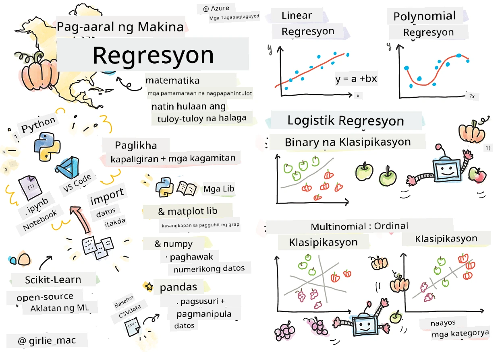
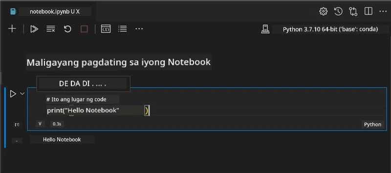
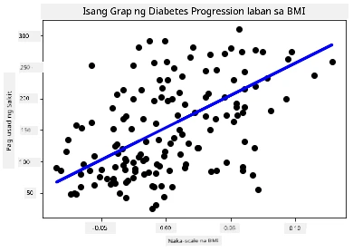

# Magsimula sa Python at Scikit-learn para sa mga regression na modelo



> Sketchnote ni [Tomomi Imura](https://www.twitter.com/girlie_mac)

## [Pre-lecture quiz](https://ff-quizzes.netlify.app/en/ml/)

> ### [Available ang araling ito sa R!](../../../../2-Regression/1-Tools/solution/R/lesson_1.html)

## Panimula

Sa apat na araling ito, matutuklasan mo kung paano bumuo ng mga regression na modelo. Tatalakayin natin kung para saan ang mga ito sa sandaling ito. Ngunit bago ka gumawa ng anumang bagay, siguraduhin na mayroon kang tamang mga kasangkapan upang simulan ang proseso!

Sa araling ito, matututo kang:

- I-configure ang iyong computer para sa mga lokal na gawain sa machine learning.
- Gumamit ng Jupyter Notebooks.
- Gumamit ng Scikit-learn, kabilang ang pag-install.
- Tuklasin ang linear regression sa isang praktikal na ehersisyo.

## Mga pag-install at pagpapasadya

[](https://youtu.be/-DfeD2k2Kj0 "ML para sa mga baguhan - Ihanda ang iyong mga kasangkapan upang makabuo ng mga modelo ng Machine Learning")

> 🎥 I-click ang larawan sa itaas para sa isang maikling video na nagpapakita ng pag-configure ng iyong computer para sa ML.

1. **I-install ang Python**. Siguraduhin na naka-install ang [Python](https://www.python.org/downloads/) sa iyong computer. Gagamitin mo ang Python para sa maraming gawain sa data science at machine learning. Karamihan sa mga sistema ng computer ay mayroon nang naka-install na Python. Mayroon ding mga kapaki-pakinabang na [Python Coding Packs](https://code.visualstudio.com/learn/educators/installers?WT.mc_id=academic-77952-leestott) na magpapadali ng setup para sa ilang mga gumagamit.

   Gayunpaman, ang ilang paggamit ng Python ay nangangailangan ng isang bersyon ng software, samantalang ang iba naman ay nangangailangan ng ibang bersyon. Dahil dito, kapaki-pakinabang na gumamit ng [virtual environment](https://docs.python.org/3/library/venv.html).

2. **I-install ang Visual Studio Code**. Siguraduhing naka-install ang Visual Studio Code sa iyong computer. Sundin ang mga tagubilin para sa [pag-install ng Visual Studio Code](https://code.visualstudio.com/) para sa pangunahing pag-install. Gagamitin mo ang Python sa Visual Studio Code sa kursong ito, kaya't maaaring nais mong pag-aralan kung paano [i-configure ang Visual Studio Code](https://docs.microsoft.com/learn/modules/python-install-vscode?WT.mc_id=academic-77952-leestott) para sa pag-develop ng Python.

   > Sanayin ang sarili sa Python sa pamamagitan ng pag-aaral gamit ang koleksyon ng mga [Learn modules](https://docs.microsoft.com/users/jenlooper-2911/collections/mp1pagggd5qrq7?WT.mc_id=academic-77952-leestott)
   >
   > [](https://youtu.be/yyQM70vi7V8 "I-setup ang Python gamit ang Visual Studio Code")
   >
   > 🎥 I-click ang larawan sa itaas para sa isang video: paggamit ng Python sa loob ng VS Code.

3. **I-install ang Scikit-learn**, sundin ang [mga tagubiling ito](https://scikit-learn.org/stable/install.html). Dahil kailangan mong tiyakin na gumagamit ka ng Python 3, inirerekomenda na gumamit ng virtual environment. Tandaan, kung ini-install mo ang library na ito sa isang M1 Mac, may espesyal na mga tagubilin sa pahina na naka-link sa itaas.

1. **I-install ang Jupyter Notebook**. Kailangan mong [i-install ang Jupyter package](https://pypi.org/project/jupyter/).

## Ang iyong kapaligiran sa paglikha ng ML

Gagamitin mo ang **notebooks** upang bumuo ng iyong Python code at lumikha ng mga machine learning na modelo. Ang ganitong uri ng file ay isang karaniwang kasangkapan para sa mga data scientist, at ito ay makikilala sa kanilang supling o extension na `.ipynb`.

Ang mga notebook ay isang interaktibong kapaligiran na nagpapahintulot sa developer na parehong mag-code at magdagdag ng mga tala at magsulat ng dokumentasyon sa paligid ng code na napaka-kapaki-pakinabang para sa mga eksperimentong proyekto o pananaliksik.

[](https://youtu.be/7E-jC8FLA2E "ML para sa mga baguhan - I-set up ang Jupyter Notebooks upang simulan ang pagbuo ng mga regression na modelo")

> 🎥 I-click ang larawan sa itaas para sa isang maikling video na nagpapakita ng gawaing ito.

### Ehersisyo - gumana gamit ang notebook

Sa folder na ito, makikita mo ang file na _notebook.ipynb_.

1. Buksan ang _notebook.ipynb_ sa Visual Studio Code.

   Magpapasimula ang isang Jupyter server na may Python 3+ na naka-activate. Makikita mo ang mga bahagi ng notebook na maaaring `run`, mga piraso ng code. Maaari mong patakbuhin ang isang block ng code sa pamamagitan ng pagpili sa icon na mukhang play button.

1. Piliin ang icon na `md` at magdagdag ng kaunting markdown, at ang sumusunod na teksto **# Welcome to your notebook**.

   Sunod, magdagdag ng ilang Python code.

1. Itype ang **print('hello notebook')** sa code block.
1. Piliin ang arrow para patakbuhin ang code.

   Makikita mo ang naka-print na pahayag:

    ```output
    hello notebook
    ```



Maaari mong interleaf ang iyong code ng mga komento upang awtomatikong idekuwento ang notebook.

✅ Isipin sandali kung gaano kaiba ang kapaligiran sa pagtatrabaho ng isang web developer kumpara sa isang data scientist.

## Nasa tamang takbo na gamit ang Scikit-learn

Ngayon na naka-set up na ang Python sa iyong lokal na kapaligiran, at komportable ka na sa Jupyter Notebooks, samantalahin din natin ang pagiging pamilyar sa Scikit-learn (bigkasin ito bilang `sci` tulad ng sa `science`). Nagbibigay ang Scikit-learn ng isang [malawak na API](https://scikit-learn.org/stable/modules/classes.html#api-ref) upang tulungan kang magsagawa ng mga gawain sa ML.

Ayon sa kanilang [website](https://scikit-learn.org/stable/getting_started.html), "Ang Scikit-learn ay isang open source na machine learning na library na sumusuporta sa supervised at unsupervised learning. Nagbibigay din ito ng iba't ibang mga kagamitan para sa pag-aayos ng modelo, preprocessing ng data, pagpili ng modelo at pagsusuri, at marami pang ibang mga gamit."

Sa kursong ito, gagamitin mo ang Scikit-learn at iba pang mga kagamitan upang bumuo ng mga machine learning na modelo upang gawin ang mga tinatawag nating 'tradisyunal na machine learning' na mga gawain. Sinadya naming iwasan ang neural networks at deep learning, dahil mas mahusay itong tinalakay sa aming darating na 'AI para sa mga Baguhan' na kurikulum.

Ginagawa ng Scikit-learn na madali ang pagbuo ng mga modelo at pagsusuri sa mga ito para magamit. Nakatuon ito sa paggamit ng numerikong data at mayroong ilang mga handang dataset para magsilbing mga kasangkapan sa pagkatuto. Kabilang din dito ang mga pre-built na modelo para subukan ng mga estudyante. Tuklasin natin ang proseso ng pag-load ng prepackaged data at paggamit ng isang built-in estimator upang gawin ang iyong unang ML model gamit ang Scikit-learn gamit ang ilang simpleng data.

## Ehersisyo - ang iyong unang notebook gamit ang Scikit-learn

> Ang tutorial na ito ay hango sa [halimbawa ng linear regression](https://scikit-learn.org/stable/auto_examples/linear_model/plot_ols.html#sphx-glr-auto-examples-linear-model-plot-ols-py) sa web site ng Scikit-learn.


[](https://youtu.be/2xkXL5EUpS0 "ML para sa mga baguhan - Ang Iyong Unang Proyekto sa Linear Regression sa Python")

> 🎥 I-click ang larawan sa itaas para sa isang maikling video na nagpapakita ng gawaing ito.

Sa file na _notebook.ipynb_ na kaugnay ng araling ito, alisin lahat ng mga cell sa pamamagitan ng pagpindot sa icon na 'basurahan'.

Sa seksyong ito, gagamitin mo ang isang maliit na dataset tungkol sa diabetes na built-in sa Scikit-learn para sa mga layunin ng pagkatuto. Isipin na gusto mong subukan ang isang paggamot para sa mga pasyenteng may diabetes. Maaaring makatulong ang mga machine learning na modelo upang matukoy kung aling mga pasyente ang mas mahusay na tumutugon sa paggamot, batay sa mga kumbinasyon ng mga variable. Kahit isang napaka-basic na regression model, kapag na-visualize, maaaring magpakita ng impormasyon tungkol sa mga variable na makakatulong sa pag-aayos ng iyong teoretikal na mga clinical trial.

✅ Maraming uri ng mga pamamaraan sa regression, at ang pipiliin mo ay depende sa sagot na hinahanap mo. Kung gusto mong hulaan ang posibleng taas ng isang tao sa isang partikular na edad, gagamit ka ng linear regression, dahil naghahanap ka ng isang **numerikong halaga**. Kung interesado kang malaman kung ang isang uri ng lutuin ay dapat ituring na vegan o hindi, naghahanap ka ng isang **kategoryang pagtatalaga** kaya gagamit ka ng logistic regression. Matututo ka pa tungkol sa logistic regression sa susunod. Isipin nang kaunti ang mga tanong na maaari mong itanong tungkol sa data, at alin sa mga pamamaraang ito ang mas angkop.

Magsimula na tayo sa gawain na ito.

### Mag-import ng mga library

Para sa gawaing ito mag-iimport tayo ng ilang mga library:

- **matplotlib**. Ito ay isang kapaki-pakinabang na [tool sa pag-guhit ng grap](https://matplotlib.org/) at gagamitin natin ito para gumawa ng line plot.
- **numpy**. Ang [numpy](https://numpy.org/doc/stable/user/whatisnumpy.html) ay isang kapaki-pakinabang na library para sa paghawak ng numerikong data sa Python.
- **sklearn**. Ito ang library ng [Scikit-learn](https://scikit-learn.org/stable/user_guide.html).

Mag-import ng ilang library upang makatulong sa iyong mga gawain.

1. Magdagdag ng imports sa pamamagitan ng pag-type ng sumusunod na code:

   ```python
   import matplotlib.pyplot as plt
   import numpy as np
   from sklearn import datasets, linear_model, model_selection
   ```

   Sa itaas nag-iimport ka ng `matplotlib`, `numpy` at nag-iimport ka ng `datasets`, `linear_model` at `model_selection` mula sa `sklearn`. Ginagamit ang `model_selection` para hatiin ang data sa training at test sets.

### Ang diabetes dataset

Ang built-in na [diabetes dataset](https://scikit-learn.org/stable/datasets/toy_dataset.html#diabetes-dataset) ay naglalaman ng 442 sample ng data tungkol sa diabetes, na may 10 feature variable, ilan dito ay:

- age: edad sa taon
- bmi: body mass index
- bp: average na presyon ng dugo
- s1 tc: T-Cells (isang uri ng mga puting selula ng dugo)

✅ Kasama sa dataset na ito ang konsepto ng 'sex' bilang isang feature variable na mahalaga sa pananaliksik tungkol sa diabetes. Maraming mga medikal na dataset ang may ganitong uri ng binary classification. Isipin nang kaunti kung paano maaaring ma-exclude ng ganitong mga kategorya ang ilang bahagi ng populasyon mula sa mga paggamot.

Ngayon, i-load ang data ng X at y.

> 🎓 Tandaan, ito ay supervised learning, at kailangan natin ng isang pinangalanang target na 'y'.

Sa isang bagong code cell, i-load ang diabetes dataset sa pamamagitan ng pagtawag sa `load_diabetes()`. Ang input na `return_X_y=True` ay nagsasaad na ang `X` ay magiging data matrix, at ang `y` ay magiging regression target.

1. Magdagdag ng ilang print commands upang ipakita ang hugis ng data matrix at ang unang elemento nito:

    ```python
    X, y = datasets.load_diabetes(return_X_y=True)
    print(X.shape)
    print(X[0])
    ```

    Ang balik na makukuha mo bilang response ay isang tuple. Ang ginagawa mo ay i-assign ang unang dalawang halaga ng tuple sa `X` at `y` ayon sa pagkakasunod. Matuto pa tungkol sa [tuples](https://wikipedia.org/wiki/Tuple).

    Makikita mo na ang data na ito ay may 442 item na nakaayos sa mga array na may 10 elemento:

    ```text
    (442, 10)
    [ 0.03807591  0.05068012  0.06169621  0.02187235 -0.0442235  -0.03482076
    -0.04340085 -0.00259226  0.01990842 -0.01764613]
    ```

    ✅ Isipin nang kaunti ang ugnayan sa pagitan ng data at regression target. Tinutukoy ng linear regression ang ugnayan sa pagitan ng feature X at target variable y. Mahahanap mo ba ang [target](https://scikit-learn.org/stable/datasets/toy_dataset.html#diabetes-dataset) para sa diabetes dataset sa dokumentasyon? Ano ang ipinapakita ng dataset na ito, ayon sa target na iyon?

2. Sunod, piliin ang bahagi ng dataset na ito para iplot sa pamamagitan ng pagpili sa ika-3 kolum ng dataset. Magagawa mo ito gamit ang operator na `:` para piliin lahat ng rows, at pagkatapos ay piliin ang ika-3 kolum gamit ang index (2). Maaari mo ring i-reshape ang data para maging isang 2D array - tulad ng kinakailangan para sa pagplot - gamit ang `reshape(n_rows, n_columns)`. Kung ang isang parameter ay -1, awtomatikong kinakalculate ang katumbas na dimensyon.

   ```python
   X = X[:, 2]
   X = X.reshape((-1,1))
   ```

   ✅ Sa anumang oras, i-print ang data upang suriin ang hugis nito.

3. Ngayon na handa na ang data para sa pag-plot, tingnan natin kung makakatulong ang machine upang tukuyin ang lohikal na paghahati sa pagitan ng mga numero sa dataset na ito. Para magawa ito, kailangan mong hatiin ang data (X) at target (y) sa test at training sets. May direktang paraan ang Scikit-learn para dito; maaari mong hatiin ang iyong test data sa isang tinukoy na punto.

   ```python
   X_train, X_test, y_train, y_test = model_selection.train_test_split(X, y, test_size=0.33)
   ```

4. Ngayon, handa ka nang i-train ang iyong modelo! I-load ang linear regression model at turuan ito gamit ang iyong X at y training sets sa pamamagitan ng `model.fit()`:

    ```python
    model = linear_model.LinearRegression()
    model.fit(X_train, y_train)
    ```

    ✅ Ang `model.fit()` ay isang function na makikita mo sa maraming ML library tulad ng TensorFlow

5. Pagkatapos, gumawa ng prediction gamit ang test data, gamit ang function na `predict()`. Ito ay gagamitin upang iguhit ang linya sa pagitan ng mga grupo ng data

    ```python
    y_pred = model.predict(X_test)
    ```

6. Ngayon ay oras na upang ipakita ang data sa isang plot. Ang Matplotlib ay isang napaka-kapaki-pakinabang na tool para sa gawaing ito. Gumawa ng scatterplot ng lahat ng X at y test data, at gamitin ang prediction upang iguhit ang linya sa pinaka-angkop na lugar, sa pagitan ng mga grupong data ng modelo.

    ```python
    plt.scatter(X_test, y_test,  color='black')
    plt.plot(X_test, y_pred, color='blue', linewidth=3)
    plt.xlabel('Scaled BMIs')
    plt.ylabel('Disease Progression')
    plt.title('A Graph Plot Showing Diabetes Progression Against BMI')
    plt.show()
    ```

   

   ✅ Isipin nang kaunti kung ano ang nangyayari dito. Isang tuwid na linya ang dumadaan sa maraming maliliit na tuldok ng data, ngunit ano nga ba ang eksaktong ginagawa nito? Nakikita mo ba kung paano mo magagamit ang linya na ito upang hulaan kung saan dapat magkasya ang isang bagong, hindi pa nakikitang datapoint kaugnay sa axis na y ng plot? Subukang ilarawan sa salita ang praktikal na gamit ng modelong ito.

Binabati kita, nabuo mo ang iyong unang linear regression na modelo, gumawa ng prediction gamit ito, at ipinakita ito sa isang plot!

---
## 🚀 Hamon

I-plot ang ibang variable mula sa dataset na ito. Pahiwatig: i-edit ang linya: `X = X[:,2]`. Batay sa target ng dataset na ito, ano ang iyong matutuklasan tungkol sa progreso ng diabetes bilang isang sakit?
## [Post-lecture quiz](https://ff-quizzes.netlify.app/en/ml/)

## Review at Pagsasarili sa Pag-aaral

Sa tutorial na ito, ginamit mo ang simpleng linear regression, sa halip na univariate o multiple linear regression. Basahin nang kaunti tungkol sa mga pagkakaiba ng mga pamamaraang ito, o panoorin ang [video na ito](https://www.coursera.org/lecture/quantifying-relationships-regression-models/linear-vs-nonlinear-categorical-variables-ai2Ef)

Basahin nang higit pa tungkol sa konsepto ng regression at pag-isipan kung anong mga uri ng tanong ang masasagot gamit ang teknik na ito. Kunin ang [tutorial](https://docs.microsoft.com/learn/modules/train-evaluate-regression-models?WT.mc_id=academic-77952-leestott) upang palalimin ang iyong pang-unawa.

## Takdang Aralin

[Isang ibang dataset](assignment.md)

---

<!-- CO-OP TRANSLATOR DISCLAIMER START -->
**Pagtatanggi**:
Ang dokumentong ito ay isinalin gamit ang serbisyo ng AI translation na [Co-op Translator](https://github.com/Azure/co-op-translator). Bagama't nagsusumikap kami para sa katumpakan, pakatandaan na ang awtomatikong pagsasalin ay maaaring maglaman ng mga pagkakamali o hindi pagkakatugma. Ang orihinal na dokumento sa orihinal nitong wika ang dapat ituring na pangunahing sanggunian. Para sa mahahalagang impormasyon, inirerekomenda ang propesyonal na pagsasalin ng tao. Hindi kami mananagot sa anumang maling pagkakaintindi o maling interpretasyon na nagmula sa paggamit ng pagsasaling ito.
<!-- CO-OP TRANSLATOR DISCLAIMER END -->