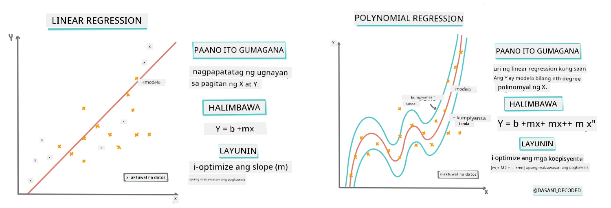
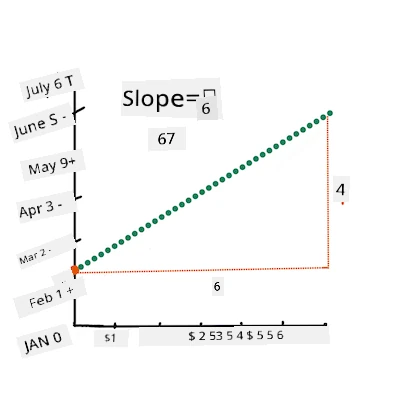
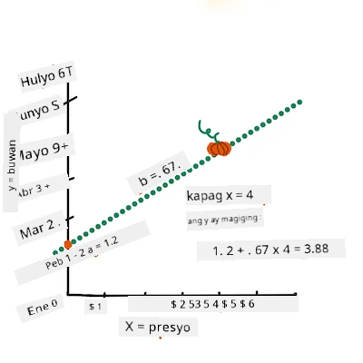
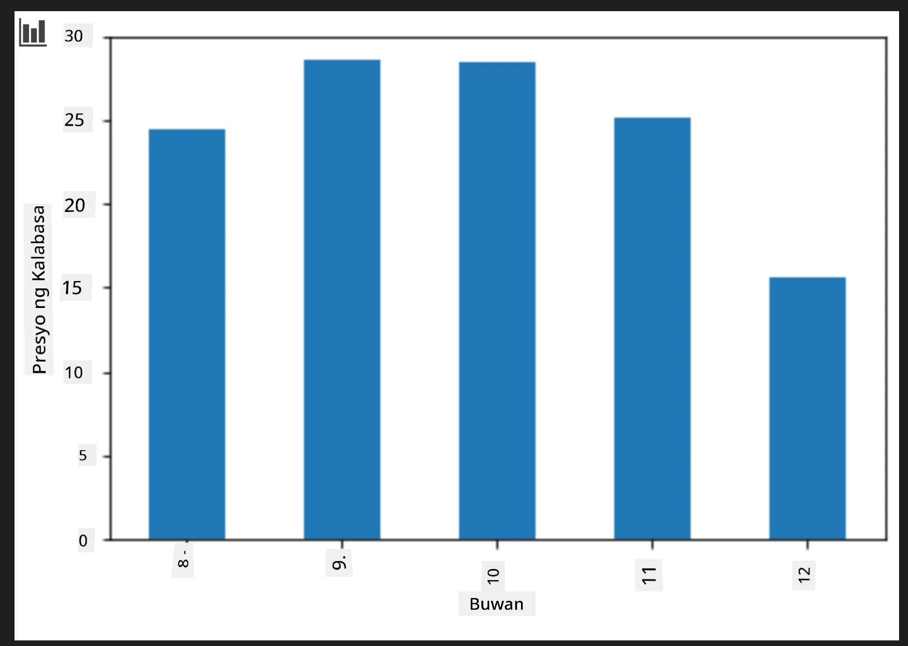
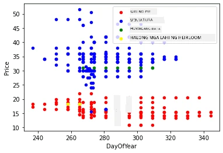

# Bumuo ng regression model gamit ang Scikit-learn: apat na paraan ng regression

## Tala para sa Baguhan

Ginagamit ang linear regression kapag nais nating hulaan ang isang **numerikal na halaga** (halimbawa, presyo ng bahay, temperatura, o benta).
Ito ay gumagana sa pamamagitan ng paghahanap ng tuwid na linya na pinakamahusay na kumakatawan sa ugnayan ng mga input na tampok at ang output.

Sa araling ito, nakatuon tayo sa pag-unawa sa konsepto bago mag-explore ng mas advanced na mga teknik sa regression.

> Infographic ni [Dasani Madipalli](https://twitter.com/dasani_decoded)
## [Pre-lecture quiz](https://ff-quizzes.netlify.app/en/ml/)

> ### [Available ang araling ito sa R!](../../../../2-Regression/3-Linear/solution/R/lesson_3.html)
### Panimula

Sa ngayon ay na-explore mo na kung ano ang regression gamit ang sample na datos mula sa pumpkin pricing dataset na gagamitin natin sa buong araling ito. Naka-visualize mo rin ito gamit ang Matplotlib.

Ngayon ay handa ka nang mas malalim na sumisid sa regression para sa ML. Habang ang visualization ay nagpapahintulot sa iyo na maintindihan ang datos, ang tunay na lakas ng Machine Learning ay nagmumula sa _pagsasanay ng mga modelo_. Ang mga modelo ay sinasanay sa makasaysayang datos upang awtomatikong mahuli ang mga depedensya ng datos, at nagpapahintulot sa iyo na hulaan ang mga resulta para sa bagong datos na hindi pa nakita ng modelo.

Sa araling ito, matututunan mo ang tungkol sa dalawang uri ng regression: _basic linear regression_ at _polynomial regression_, kasama ang ilan sa matematika sa likod ng mga teknik na ito. Ang mga modelong ito ang magpapahintulot sa atin na hulaan ang presyo ng kalabasa depende sa iba't ibang input na datos.

[](https://youtu.be/CRxFT8oTDMg "ML for beginners - Understanding Linear Regression")

> 🎥 I-click ang larawang nasa itaas para sa maikling video overview ng linear regression.

> Sa buong kurikulum na ito, inaasahan namin ang minimal na kaalaman sa matematika, at layuning gawing accessible para sa mga estudyanteng nagmula sa ibang larangan, kaya panoorin ang mga tala, 🧮 callouts, mga diagram, at iba pang mga learning tools para makatulong sa pag-unawa.

### Mga Kinakailangang Kaalaman

Dapat pamilyar ka na sa istruktura ng pumpkin data na sinusuri natin. Mahahanap mo ito nang naka-preload at na-preclean sa _notebook.ipynb_ file ng araling ito. Sa file, ang presyo ng kalabasa ay ipinapakita kada bushel sa isang bagong data frame. Siguraduhing kaya mong patakbuhin ang mga notebook na ito sa kernels sa Visual Studio Code.

### Paghahanda

Bilang paalala, niloload mo ang datos na ito upang makapagtanong tungkol dito.

- Kailan ang pinakamagandang oras para bumili ng mga kalabasa?  
- Anong presyo ang maaasahan ko para sa isang kahon ng miniature pumpkins?  
- Dapat ko ba silang bilhin sa half-bushel baskets o sa 1 1/9 bushel na kahon?  
Patuloy tayong magsiyasat sa datos na ito.

Sa nakaraang aralin, gumawa ka ng Pandas data frame at pinuno ito gamit ang bahagi ng orihinal na dataset, na standardized ang presyo sa bushel. Sa paggawa niyan, nakalap mo lamang ang humigit-kumulang 400 datapoints at para lang sa mga buwan ng tag-lagas.

Tingnan ang datos na naka-preload sa notebook na kasama ng araling ito. Ang datos ay naka-preload at may inisyal na scatterplot na nagpapakita ng data ng buwan. Marahil maaari tayong makakuha ng kaunting detalye tungkol sa kalikasan ng datos sa pamamagitan ng paglilinis nito nang mas maigi.

## Isang linya ng linear regression

Gaya ng natutunan mo sa Aralin 1, ang layunin ng linear regression exercise ay maging kaya mong i-plot ang isang linya upang:

- **Ipakita ang relasyon ng mga variable**. Ipakita ang ugnayan sa pagitan ng mga variable  
- **Gumawa ng mga hula**. Gumawa ng tumpak na mga hula kung saan babagsak ang bagong datapoint kaugnay ng linyang iyon.

Karaniwan sa **Least-Squares Regression** ang gumuhit ng ganitong uri ng linya. Ang terminong "Least-Squares" ay tumutukoy sa proseso ng pagbawas ng kabuuang error sa ating modelo. Para sa bawat data point, sinusukat natin ang patayong distansya (tinatawag na residual) sa pagitan ng aktwal na punto at ng ating regression line.

Pinapa-square natin ang mga distansyang ito para sa dalawang pangunahing dahilan:

1. **Laki higit sa Direksyon:** Gusto nating pantayin ang error ng -5 at +5. Ang pag-square ay ginagawa lahat ng halaga na positibo.

2. **Pagpaparusa sa mga Outlier:** Ang pag-square ay nagbibigay ng mas malaking timbang sa malalaking error, kaya pinipilit ang linya na manatiling mas malapit sa mga puntos na malayo.

Pinagsasama-sama natin ang lahat ng squared na mga halaga. Ang layunin ay mahanap ang partikular na linya kung saan ang kabuuang sum na ito ay pinakamababa (ang pinakamaliit na posibleng halaga)—kaya't ang pangalan na "Least-Squares."

> **🧮 Ipakita ang matematika**  
>  
> Ang linyang ito, na tinatawag na _line of best fit_ ay maaaring ipahayag gamit ang [isang ekwasyon](https://en.wikipedia.org/wiki/Simple_linear_regression):  
>  
> ```
> Y = a + bX
> ```
>  
> `X` ay ang 'explanatory variable'. `Y` ay ang 'dependent variable'. Ang slope ng linya ay `b` at ang `a` ay ang y-intercept, na tumutukoy sa halaga ng `Y` kapag `X = 0`.  
>  
>  
>  
> Una, kalkulahin ang slope na `b`. Infographic ni [Jen Looper](https://twitter.com/jenlooper)  
>  
> Sa madaling salita, at tumutukoy sa orihinal na tanong ng pumpkin data: "hulaan ang presyo ng kalabasa kada bushel kada buwan", ang `X` ay tumutukoy sa presyo at ang `Y` ay tumutukoy sa buwan ng pagbebenta.  
>  
>  
>  
> Kalkulahin ang halaga ng Y. Kung nagbabayad ka ng nasa $4, dapat ay Abril! Infographic ni [Jen Looper](https://twitter.com/jenlooper)  
>  
> Ang matematika na kinakalkula ang linya ay dapat magpakita ng slope ng linya, na nakadepende rin sa intercept, o kung saan matatagpuan ang `Y` kapag `X = 0`.  
>  
> Maaari mong obserbahan ang paraan ng pagkalkula sa [Math is Fun](https://www.mathsisfun.com/data/least-squares-regression.html) na website. Bisitahin din ang [this Least-squares calculator](https://www.mathsisfun.com/data/least-squares-calculator.html) para makita kung paano naaapektuhan ng mga halaga ng numero ang linya.

## Korelasyon

Isa pang terminong kailangan maunawaan ay ang **Correlation Coefficient** sa pagitan ng ibinigay na X at Y na mga variable. Gamit ang scatterplot, madali mong makikita ang coefficient na ito. Ang plot na may mga datapoint na nakaayos sa isang maayos na linya ay may mataas na korelasyon, ngunit ang plot na may mga datapoint na nagkalat saan-saan sa pagitan ng X at Y ay may mababang korelasyon.

Ang isang magandang linear regression model ay ang may mataas (mas malapit sa 1 kaysa 0) na Correlation Coefficient gamit ang Least-Squares Regression method at may regression line.

✅ Patakbuhin ang notebook na kasama ng araling ito at tingnan ang Month to Price scatterplot. Mukhang mataas o mababa ang korelasyon ng data ng Month to Price para sa pumpkin sales ayon sa iyong visual na interpretasyon ng scatterplot? Nagbabago ba ito kung gagamitin mo ang mas masusing sukat gaya ng `day of the year` (ibig sabihin ay bilang ng mga araw mula sa simula ng taon)?

Sa code sa ibaba, ipagpapalagay natin na nilinis na natin ang datos, at nakakuha ng data frame na tinawag na `new_pumpkins`, na katulad ng sumusunod:

ID | Month | DayOfYear | Variety | City | Package | Low Price | High Price | Price
---|-------|-----------|---------|------|---------|-----------|------------|-------
70 | 9 | 267 | PIE TYPE | BALTIMORE | 1 1/9 bushel cartons | 15.0 | 15.0 | 13.636364
71 | 9 | 267 | PIE TYPE | BALTIMORE | 1 1/9 bushel cartons | 18.0 | 18.0 | 16.363636
72 | 10 | 274 | PIE TYPE | BALTIMORE | 1 1/9 bushel cartons | 18.0 | 18.0 | 16.363636
73 | 10 | 274 | PIE TYPE | BALTIMORE | 1 1/9 bushel cartons | 17.0 | 17.0 | 15.454545
74 | 10 | 281 | PIE TYPE | BALTIMORE | 1 1/9 bushel cartons | 15.0 | 15.0 | 13.636364

> Ang code para linisin ang data ay makukuha sa [`notebook.ipynb`](notebook.ipynb). Ginawa namin ang parehong hakbang sa paglilinis tulad ng sa nakaraang aralin, at nakalkula ang `DayOfYear` column gamit ang sumusunod na ekspresyon: 

```python
day_of_year = pd.to_datetime(pumpkins['Date']).apply(lambda dt: (dt-datetime(dt.year,1,1)).days)
```
  
Ngayon na may pagkaunawa ka sa matematika sa likod ng linear regression, gumawa tayo ng Regression model upang makita kung kaya nating hulaan kung aling package ng mga kalabasa ang may pinakamagandang presyo. Ang isang bumibili ng mga kalabasa para sa isang pumpkin patch sa pista ay maaaring gustong malaman ito upang mapabuti ang kanilang mga pagbili ng mga package para sa patch.

## Naghahanap ng Korelasyon

[](https://youtu.be/uoRq-lW2eQo "ML for beginners - Looking for Correlation: The Key to Linear Regression")

> 🎥 I-click ang larawan sa itaas para sa maikling video overview ng korelasyon.

Mula sa nakaraang aralin, marahil ay nakita mo na ang average na presyo para sa iba't ibang buwan ay ganito:



Ipinapahiwatig nito na dapat mayroong ilang korelasyon, at maaari nating subukang magsanay ng linear regression model upang hulaan ang relasyon sa pagitan ng `Month` at `Price`, o sa pagitan ng `DayOfYear` at `Price`. Narito ang scatter plot na nagpapakita ng huli na relasyon:

 

Tingnan natin kung may korelasyon gamit ang `corr` function:

```python
print(new_pumpkins['Month'].corr(new_pumpkins['Price']))
print(new_pumpkins['DayOfYear'].corr(new_pumpkins['Price']))
```
  
Mukhang maliit ang korelasyon, -0.15 gamit ang `Month` at -0.17 gamit ang `DayOfYear`, ngunit maaaring may iba pang mahalagang ugnayan. Mukhang may mga ibang cluster ng mga presyo na tumutugma sa ibang iba't ibang uri ng kalabasa. Upang kumpirmahin ang hypothesis na ito, atin ipaplot ang bawat kategorya ng kalabasa gamit ang iba't ibang kulay. Sa pamamagitan ng pagpasa ng `ax` parameter sa `scatter` plotting function ay maaaring i-plot ang lahat ng puntos sa parehong graph:

```python
ax=None
colors = ['red','blue','green','yellow']
for i,var in enumerate(new_pumpkins['Variety'].unique()):
    df = new_pumpkins[new_pumpkins['Variety']==var]
    ax = df.plot.scatter('DayOfYear','Price',ax=ax,c=colors[i],label=var)
```
  
 

Ang ating pagsisiyasat ay nagpapahiwatig na ang variety ay may mas malaking epekto sa kabuuang presyo kaysa sa aktwal na petsa ng pagbebenta. Makikita natin ito gamit ang bar graph:

```python
new_pumpkins.groupby('Variety')['Price'].mean().plot(kind='bar')
```
  
 

Mag-focus muna tayo sa isang uri ng kalabasa, ang 'pie type', at tingnan kung ano ang epekto ng petsa sa presyo:

```python
pie_pumpkins = new_pumpkins[new_pumpkins['Variety']=='PIE TYPE']
pie_pumpkins.plot.scatter('DayOfYear','Price') 
```
 

Kung kakalkulahin natin ang korelasyon sa pagitan ng `Price` at `DayOfYear` gamit ang `corr` function, makakakuha tayo ng mga halagang tulad ng `-0.27` - ibig sabihin ay may saysay ang pagsasanay ng predictive model.

> Bago magsanay ng linear regression model, mahalagang siguraduhin na malinis ang ating data. Hindi maganda ang linear regression sa mga nawawalang halaga, kaya makatwiran na alisin ang lahat ng walang laman na cell:

```python
pie_pumpkins.dropna(inplace=True)
pie_pumpkins.info()
```
  
Isa pang paraan ay punuan ang mga walang laman na halaga gamit ang mean na halaga mula sa katumbas na kolum.

## Simple Linear Regression

[](https://youtu.be/e4c_UP2fSjg "ML for beginners - Linear and Polynomial Regression using Scikit-learn")

> 🎥 I-click ang larawang nasa itaas para sa maikling video overview ng linear at polynomial regression.

Para sanayin ang ating Linear Regression model, gagamit tayo ng **Scikit-learn** library.

```python
from sklearn.linear_model import LinearRegression
from sklearn.metrics import mean_squared_error
from sklearn.model_selection import train_test_split
```
  
Nagsisimula tayo sa paghihiwalay ng input na mga halaga (features) at ang inaasahang output (label) sa magkahiwalay na numpy arrays:

```python
X = pie_pumpkins['DayOfYear'].to_numpy().reshape(-1,1)
y = pie_pumpkins['Price']
```
  
> Pansinin na kailangan nating gawin ang `reshape` sa input na data upang maunawaan ito nang tama ng Linear Regression package. Inaasahan ng Linear Regression ang isang 2D-array bilang input, kung saan ang bawat hilera ng array ay tumutugma sa isang vector ng input features. Sa ating kaso, dahil isa lang ang input – kailangan natin ng array na may hugis na N×1, kung saan ang N ay ang laki ng dataset.

Pagkatapos, kailangan nating hatiin ang data sa train at test datasets, upang ma-validate natin ang modelo pagkatapos ng pagsasanay:

```python
X_train, X_test, y_train, y_test = train_test_split(X, y, test_size=0.2, random_state=0)
```
  
Sa wakas, ang pagsasanay ng aktuwal na Linear Regression model ay nangangailangan lang ng dalawang linya ng code. I-define natin ang `LinearRegression` na object, at i-fit ito sa ating data gamit ang `fit` method:

```python
lin_reg = LinearRegression()
lin_reg.fit(X_train,y_train)
```

Ang `LinearRegression` na object pagkatapos ma-`fit` ay naglalaman ng lahat ng coefficients ng regression, na maaaring ma-access gamit ang `.coef_` na property. Sa aming kaso, may isang coefficient lamang, na dapat ay nasa paligid ng `-0.017`. Ibig sabihin nito, tila bumababa ng bahagya ang mga presyo sa paglipas ng panahon, ngunit hindi masyado, mga 2 sentimo kada araw. Maaari din nating ma-access ang punto ng pag-intersect ng regression sa Y-axis gamit ang `lin_reg.intercept_` - ito ay magiging nasa paligid ng `21` sa aming kaso, na nagpapahiwatig ng presyo sa simula ng taon.

Para makita kung gaano katumpak ang ating modelo, maaari nating hulaan ang mga presyo sa test dataset, at pagkatapos ay sukatin kung gaano kalapit ang ating mga prediksyon sa mga inaasahang halaga. Maaari itong gawin gamit ang root mean square error (RMSE) metrics, na siyang root ng mean ng lahat ng squared differences sa pagitan ng inaasahan at prediktadong halaga.

```python
pred = lin_reg.predict(X_test)

rmse = np.sqrt(mean_squared_error(y_test,pred))
print(f'RMSE: {rmse:3.3} ({rmse/np.mean(pred)*100:3.3}%)')
```

Tila ang error natin ay nasa paligid ng 2 points, na humigit-kumulang ~17%. Hindi masyadong maganda. Ang isa pang indikasyon ng kalidad ng modelo ay ang **coefficient of determination**, na maaaring makuha sa ganitong paraan:

```python
score = lin_reg.score(X_train,y_train)
print('Model determination: ', score)
```

Kung ang halaga ay 0, ibig sabihin ay hindi isinasaalang-alang ng modelo ang input data, at kumikilos bilang *pinakamasamang linear predictor*, na simpleng mean value ng resulta. Ang halaga na 1 ay nangangahulugan na maaari nating perpektong mahulaan lahat ng inaasahang output. Sa aming kaso, ang coefficient ay nasa paligid ng 0.06, na medyo mababa.

Maaari din nating i-plot ang test data kasama ang regression line upang mas makita kung paano gumagana ang regression sa aming kaso:

```python
plt.scatter(X_test,y_test)
plt.plot(X_test,pred)
```


## Polynomial Regression

Isa pang uri ng Linear Regression ang Polynomial Regression. Habang minsan may linear na ugnayan sa pagitan ng mga variable - mas malaki ang kalabasa sa volume, mas mataas ang presyo - minsan ang mga ugnayang ito ay hindi maipapakita bilang isang patag o tuwid na linya.

✅ Narito ang [ilang karagdagang halimbawa](https://online.stat.psu.edu/stat501/Lesson09#polynomial-regression-examples) ng data na maaaring gumamit ng Polynomial Regression

Tingnan muli ang relasyon sa pagitan ng Date at Price. Mukhang dapat bang pag-aralan ito gamit ang isang tuwid na linya? Hindi ba pwedeng mag-iba-iba ang mga presyo? Sa kasong ito, maaari mong subukan ang polynomial regression.

✅ Ang mga polynomial ay mga matematikal na ekspresyon na maaaring binubuo ng isa o higit pang mga variable at mga coefficient

Ang polynomial regression ay lumilikha ng isang kurbadang linya upang mas angkop sa nonlinear na data. Sa aming kaso, kung isasama natin ang squared `DayOfYear` variable sa input data, dapat nating magawa na i-fit ang data gamit ang isang parabolic curve, na magkakaroon ng minimum sa isang partikular na punto sa loob ng taon.

Kasama sa Scikit-learn ang kapaki-pakinabang na [pipeline API](https://scikit-learn.org/stable/modules/generated/sklearn.pipeline.make_pipeline.html?highlight=pipeline#sklearn.pipeline.make_pipeline) upang pagsamahin ang iba't ibang hakbang ng pagproseso ng data. Ang **pipeline** ay isang chain ng mga **estimators**. Sa aming kaso, gagawa kami ng pipeline na una magdaragdag ng polynomial features sa aming modelo, at pagkatapos ay magte-train ng regression:

```python
from sklearn.preprocessing import PolynomialFeatures
from sklearn.pipeline import make_pipeline

pipeline = make_pipeline(PolynomialFeatures(2), LinearRegression())

pipeline.fit(X_train,y_train)
```

Ang paggamit ng `PolynomialFeatures(2)` ay nangangahulugan na isasama natin ang lahat ng pangalawang-degree polynomials mula sa input data. Sa aming kaso, ito ay nangangahulugan lamang ng `DayOfYear`<sup>2</sup>, ngunit kung mayroon tayong dalawang input variables na X at Y, idaragdag nito ang X<sup>2</sup>, XY at Y<sup>2</sup>. Maaari rin tayong gumamit ng mas mataas na degree polynomials kung nais.

Maaaring gamitin ang mga pipeline sa parehong paraan tulad ng orihinal na `LinearRegression` na object, ibig sabihin maaari nating `fit` ang pipeline, at pagkatapos ay gamitin ang `predict` upang makuha ang mga resulta ng prediksyon:

```python
pred = pipeline.predict(X_test)

rmse = np.sqrt(mean_squared_error(y_test,pred))
print(f'RMSE: {rmse:3.3} ({rmse/np.mean(pred)*100:3.3}%)')

score = pipeline.score(X_train,y_train)
print('Model determination: ', score)
```

Para i-plot ang smooth approximation curve, ginamit natin ang `np.linspace` upang gumawa ng uniform na range ng input values, sa halip na mag-plot direkta sa unordered test data (na magreresulta sa zigzag na linya):

```python
X_range = np.linspace(X_test.min(), X_test.max(), 100).reshape(-1,1)
y_range = pipeline.predict(X_range)

plt.scatter(X_test, y_test)
plt.plot(X_range, y_range)
```

Narito ang graph na nagpapakita ng test data, at ang approximation curve:


Sa paggamit ng Polynomial Regression, makakakuha tayo ng bahagyang mas mababang RMSE at mas mataas na determination, ngunit hindi ito malaki ang pagkakaiba. Kailangan nating isaalang-alang ang iba pang mga features!

> Makikita mo na ang pinakamababang presyo ng kalabasa ay naobserbahan sa paligid ng Halloween. Paano mo ito maipapaliwanag? 

🎃 Congratulations, nakagawa ka lang ng isang modelo na maaaring makatulong hulaan ang presyo ng pie pumpkins. Maaari mo marahil ulitin ang parehong proseso para sa lahat ng uri ng kalabasa, ngunit ito ay magiging matrabaho. Alamin natin ngayon kung paano isaalang-alang ang variety ng kalabasa sa ating modelo!

## Categorical Features

Sa ideal na mundo, nais nating mahulaan ang mga presyo para sa iba't ibang varieties ng kalabasa gamit ang parehong modelo. Gayunpaman, ang column na `Variety` ay medyo iba sa mga column tulad ng `Month`, dahil naglalaman ito ng mga hindi numerikong halaga. Ang mga ganitong column ay tinatawag na **categorical**.

[](https://youtu.be/DYGliioIAE0 "ML for beginners - Categorical Feature Predictions with Linear Regression")

> 🎥 I-click ang imahe sa itaas para sa isang maikling video overview tungkol sa paggamit ng categorical features.

Dito makikita kung paano ang average na presyo ay nakadepende sa variety:


Para isaalang-alang ang variety, kailangan muna natin itong i-convert sa numerikong anyo, o **i-encode** ito. May ilang mga paraan upang gawin ito:

* Ang simpleng **numeric encoding** ay gagawa ng isang talaan ng iba't ibang varieties, at pagkatapos ay papalitan ang pangalan ng variety ng isang index sa talaang iyon. Hindi ito ang pinakamahusay na ideya para sa linear regression, dahil kinukuha ng linear regression ang aktwal na numerikong halaga ng index, at dinadagdagan ito sa resulta, na minumultiply ng isang coefficient. Sa aming kaso, ang relasyon sa pagitan ng numero ng index at ng presyo ay malinaw na hindi linear, kahit na siguraduhin nating nakaayos ang mga indices sa isang partikular na paraan.
* Ang **one-hot encoding** ay papalitan ang column na `Variety` ng 4 na magkakaibang columns, isa para sa bawat variety. Ang bawat column ay maglalaman ng `1` kung ang katumbas na row ay mula sa isang partikular na variety, at `0` naman kung hindi. Nangangahulugan ito na mayroong apat na coefficients sa linear regression, isa para sa bawat variety ng kalabasa, na responsable para sa "starting price" (o mas tamang sabihin ay "karagdagang presyo") para sa partikular na variety na iyon.

Ipinapakita ng code sa ibaba kung paano natin magagawa ang one-hot encode ng variety:

```python
pd.get_dummies(new_pumpkins['Variety'])
```

 ID | FAIRYTALE | MINIATURE | MIXED HEIRLOOM VARIETIES | PIE TYPE
----|-----------|-----------|--------------------------|----------
70 | 0 | 0 | 0 | 1
71 | 0 | 0 | 0 | 1
... | ... | ... | ... | ...
1738 | 0 | 1 | 0 | 0
1739 | 0 | 1 | 0 | 0
1740 | 0 | 1 | 0 | 0
1741 | 0 | 1 | 0 | 0
1742 | 0 | 1 | 0 | 0

Para mag-train ng linear regression gamit ang one-hot encoded na variety bilang input, kailangan lamang natin i-initialize ang `X` at `y` data nang tama:

```python
X = pd.get_dummies(new_pumpkins['Variety'])
y = new_pumpkins['Price']
```

Ang natitirang bahagi ng code ay pareho tulad ng ginamit natin sa itaas para mag-train ng Linear Regression. Kung susubukan mo ito, makikita mong ang mean squared error ay halos pareho, ngunit nakakakuha tayo ng mas mataas na coefficient of determination (~77%). Upang makakuha ng mas tumpak na mga prediksyon, maaari nating isaalang-alang pa ang mas maraming categorical features, pati na rin ang mga numeric features tulad ng `Month` o `DayOfYear`. Para makabuo ng isang malaking array ng mga features, maaari nating gamitin ang `join`:

```python
X = pd.get_dummies(new_pumpkins['Variety']) \
        .join(new_pumpkins['Month']) \
        .join(pd.get_dummies(new_pumpkins['City'])) \
        .join(pd.get_dummies(new_pumpkins['Package']))
y = new_pumpkins['Price']
```

Dito kinokonsidera rin natin ang `City` at `Package` type, na nagreresulta sa RMSE na 2.84 (10.5%), at determination na 0.94!

## Pagsasama-sama ng lahat

Para gumawa ng pinakamahusay na modelo, maaari nating gamitin ang pinagsamang (one-hot encoded categorical + numeric) data mula sa naunang halimbawa kasama ang Polynomial Regression. Narito ang kumpletong code para sa iyong kaginhawaan:

```python
# ihanda ang data para sa pagsasanay
X = pd.get_dummies(new_pumpkins['Variety']) \
        .join(new_pumpkins['Month']) \
        .join(pd.get_dummies(new_pumpkins['City'])) \
        .join(pd.get_dummies(new_pumpkins['Package']))
y = new_pumpkins['Price']

# gawin ang paghahati ng train at test
X_train, X_test, y_train, y_test = train_test_split(X, y, test_size=0.2, random_state=0)

# ayusin at sanayin ang pipeline
pipeline = make_pipeline(PolynomialFeatures(2), LinearRegression())
pipeline.fit(X_train,y_train)

# hulaan ang mga resulta para sa test na data
pred = pipeline.predict(X_test)

# kalkulahin ang RMSE at determinasyon
rmse = mean_squared_error(y_test, pred, squared=False)
print(f'RMSE: {rmse:3.3} ({rmse/pred.mean()*100:3.3}%)')

score = pipeline.score(X_train,y_train)
print('Model determination: ', score)
```

Dapat itong magbigay sa atin ng pinakamahusay na determination coefficient na halos 97%, at RMSE=2.23 (~8% prediction error).

| Modelo | RMSE | Determination |
|-------|-----|---------------|
| `DayOfYear` Linear | 2.77 (17.2%) | 0.07 |
| `DayOfYear` Polynomial | 2.73 (17.0%) | 0.08 |
| `Variety` Linear | 5.24 (19.7%) | 0.77 |
| Lahat ng features Linear | 2.84 (10.5%) | 0.94 |
| Lahat ng features Polynomial | 2.23 (8.25%) | 0.97 |

🏆 Magaling! Nakagawa ka ng apat na Regression models sa isang lesson, at napabuti ang kalidad ng modelo hanggang 97%. Sa huling bahagi tungkol sa Regression, matututuhan mo ang tungkol sa Logistic Regression upang matukoy ang mga kategorya.

---
## 🚀Challenge

Subukan ang iba't ibang variables sa notebook na ito upang makita kung paano naaayon ang correlation sa katumpakan ng modelo.

## [Post-lecture quiz](https://ff-quizzes.netlify.app/en/ml/)

## Review & Self Study

Sa lesson na ito natutunan natin ang tungkol sa Linear Regression. May iba pang mahahalagang uri ng Regression. Basahin ang tungkol sa Stepwise, Ridge, Lasso at Elasticnet na mga teknik. Isang magandang kurso na pag-aralan para matuto pa ay ang [Stanford Statistical Learning course](https://online.stanford.edu/courses/sohs-ystatslearning-statistical-learning)

## Assignment 

[Build a Model](assignment.md)

---

<!-- CO-OP TRANSLATOR DISCLAIMER START -->
**Paunawa**:  
Ang dokumentong ito ay isinalin gamit ang AI translation service na [Co-op Translator](https://github.com/Azure/co-op-translator). Bagama't nagsusumikap kami para sa kawastuhan, pakatandaan na ang mga awtomatikong pagsasalin ay maaaring maglaman ng mga pagkakamali o kamalian. Ang orihinal na dokumento sa orihinal nitong wika ang dapat ituring na pinagmulan ng katotohanan. Para sa mahahalagang impormasyon, inirerekomenda ang propesyonal na pagsasalin ng tao. Hindi kami mananagot sa anumang hindi pagkakaintindihan o maling interpretasyon na maaaring magmula sa paggamit ng pagsasaling ito.
<!-- CO-OP TRANSLATOR DISCLAIMER END -->