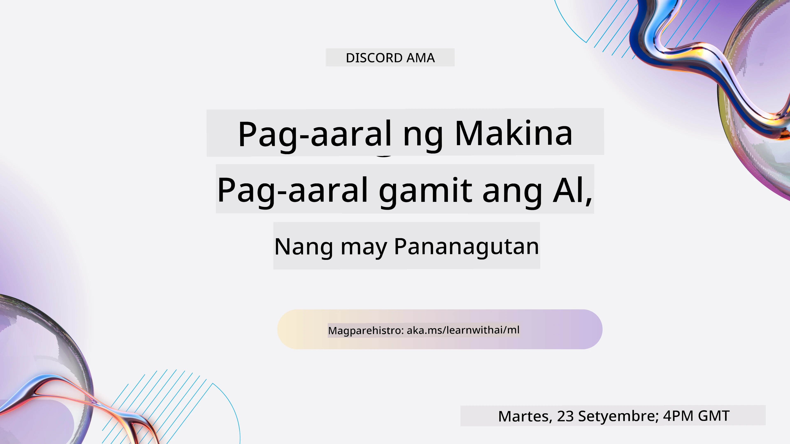
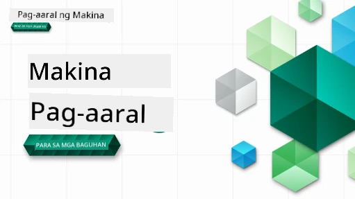

[](https://github.com/microsoft/ML-For-Beginners/blob/master/LICENSE)
[](https://GitHub.com/microsoft/ML-For-Beginners/graphs/contributors/)
[](https://GitHub.com/microsoft/ML-For-Beginners/issues/)
[](https://GitHub.com/microsoft/ML-For-Beginners/pulls/)
[](http://makeapullrequest.com)

[](https://GitHub.com/microsoft/ML-For-Beginners/watchers/)
[](https://GitHub.com/microsoft/ML-For-Beginners/network/)
[](https://GitHub.com/microsoft/ML-For-Beginners/stargazers/)

### 🌐 Suporta sa Maramihang Wika

#### Mga pagsasalin ay pinananatili gamit ang [Co-op Translator](https://github.com/Azure/co-op-translator)

<!-- CO-OP TRANSLATOR LANGUAGES TABLE START -->
[Arabic](../ar/README.md) | [Bengali](../bn/README.md) | [Bulgarian](../bg/README.md) | [Burmese (Myanmar)](../my/README.md) | [Chinese (Simplified)](../zh-CN/README.md) | [Chinese (Traditional, Hong Kong)](../zh-HK/README.md) | [Chinese (Traditional, Macau)](../zh-MO/README.md) | [Chinese (Traditional, Taiwan)](../zh-TW/README.md) | [Croatian](../hr/README.md) | [Czech](../cs/README.md) | [Danish](../da/README.md) | [Dutch](../nl/README.md) | [Estonian](../et/README.md) | [Finnish](../fi/README.md) | [French](../fr/README.md) | [German](../de/README.md) | [Greek](../el/README.md) | [Hebrew](../he/README.md) | [Hindi](../hi/README.md) | [Hungarian](../hu/README.md) | [Indonesian](../id/README.md) | [Italian](../it/README.md) | [Japanese](../ja/README.md) | [Kannada](../kn/README.md) | [Khmer](../km/README.md) | [Korean](../ko/README.md) | [Lithuanian](../lt/README.md) | [Malay](../ms/README.md) | [Malayalam](../ml/README.md) | [Manipuri (Meitei Mayek)](../mni/README.md) | [Marathi](../mr/README.md) | [Nepali](../ne/README.md) | [Nigerian Pidgin](../pcm/README.md) | [Norwegian](../no/README.md) | [Persian (Farsi)](../fa/README.md) | [Polish](../pl/README.md) | [Portuguese (Brazil)](../pt-BR/README.md) | [Portuguese (Portugal)](../pt-PT/README.md) | [Punjabi (Gurmukhi)](../pa/README.md) | [Romanian](../ro/README.md) | [Russian](../ru/README.md) | [Serbian (Cyrillic)](../sr/README.md) | [Slovak](../sk/README.md) | [Slovenian](../sl/README.md) | [Spanish](../es/README.md) | [Swahili](../sw/README.md) | [Swedish](../sv/README.md) | [Tagalog (Filipino)](./README.md) | [Tamil](../ta/README.md) | [Telugu](../te/README.md) | [Thai](../th/README.md) | [Turkish](../tr/README.md) | [Ukrainian](../uk/README.md) | [Urdu](../ur/README.md) | [Vietnamese](../vi/README.md)

> **Mas gusto mo bang Mag-clone Lokal?**
>
> Kasama sa repositoryong ito ang 50+ na pagsasalin ng wika na malaking bahagi sa pagtaas ng laki ng download. Para mag-clone nang walang mga pagsasalin, gamitin ang sparse checkout:
>
> **Bash / macOS / Linux:**
> ```bash
> git clone --filter=blob:none --sparse https://github.com/microsoft/ML-For-Beginners.git
> cd ML-For-Beginners
> git sparse-checkout set --no-cone '/*' '!translations' '!translated_images'
> ```
>
> **CMD (Windows):**
> ```cmd
> git clone --filter=blob:none --sparse https://github.com/microsoft/ML-For-Beginners.git
> cd ML-For-Beginners
> git sparse-checkout set --no-cone "/*" "!translations" "!translated_images"
> ```
>
> Binibigyan ka nito ng lahat ng kailangan mo para makumpleto ang kurso nang mas mabilis ang pag-download.
<!-- CO-OP TRANSLATOR LANGUAGES TABLE END -->

#### Sumali sa Aming Komunidad

[](https://discord.gg/nTYy5BXMWG)

Mayroon kaming serye ng pag-aaral gamit ang AI sa Discord, alamin pa at sumali sa amin sa [Learn with AI Series](https://aka.ms/learnwithai/discord) mula Setyembre 18 - 30, 2025. Makakakuha ka ng mga tips at tricks sa paggamit ng GitHub Copilot para sa Data Science.



# Machine Learning para sa mga Nagsisimula - Isang Kurikulum

> 🌍 Maglakbay sa buong mundo habang tinutuklasan natin ang Machine Learning sa pamamagitan ng mga kultura sa daigdig 🌍

Ang mga Cloud Advocates sa Microsoft ay nagagalak na mag-alok ng 12-linggong, 26-lesson na kurikulum tungkol sa **Machine Learning**. Sa kurikulums na ito, matututuhan mo ang tinatawag na **classic machine learning**, gamit ang pangunahing Scikit-learn bilang library at iwas sa deep learning, na sakop sa aming [AI for Beginners' curriculum](https://aka.ms/ai4beginners). Isabay ang mga leksyon na ito sa aming ['Data Science for Beginners' curriculum](https://aka.ms/ds4beginners)!

Maglakbay kasama namin sa buong mundo habang inilalapat natin ang mga klasikong teknik na ito sa data mula sa maraming bahagi ng mundo. Ang bawat aralin ay may pre- at post-lesson quizzes, mga isinulat na tagubilin para matapos ang aralin, solusyon, takdang-aralin, at iba pa. Ang aming pedagohiya na nakatuon sa proyekto ay nagpapahintulot sa'yo na matuto habang gumagawa, isang subok na paraan para maka-"stick" ang mga bagong kasanayan.

**✍️ Taos-pusong pasasalamat sa aming mga may-akda** Jen Looper, Stephen Howell, Francesca Lazzeri, Tomomi Imura, Cassie Breviu, Dmitry Soshnikov, Chris Noring, Anirban Mukherjee, Ornella Altunyan, Ruth Yakubu at Amy Boyd

**🎨 Salamat din sa aming mga ilustrador** Tomomi Imura, Dasani Madipalli, at Jen Looper

**🙏 Espesyal na pasasalamat 🙏 sa aming mga Microsoft Student Ambassador na may-akda, tagasuri, at kontribyutor ng nilalaman**, lalo na kina Rishit Dagli, Muhammad Sakib Khan Inan, Rohan Raj, Alexandru Petrescu, Abhishek Jaiswal, Nawrin Tabassum, Ioan Samuila, at Snigdha Agarwal

**🤩 Karagdagang pasasalamat sa Microsoft Student Ambassadors Eric Wanjau, Jasleen Sondhi, at Vidushi Gupta para sa aming mga leksyon sa R!**

# Pagsisimula

Sundin ang mga hakbang na ito:
1. **I-fork ang Repositoryo**: Pindutin ang buton na "Fork" sa itaas-kanang bahagi ng pahinang ito.
2. **I-clone ang Repositoryo**:   `git clone https://github.com/microsoft/ML-For-Beginners.git`

> 💡 **Mabilis na Tip sa Pagsisimula:** Nais bang magsimula sa browser nang hindi nagsesetup ng Python sa lokal? Gamitin ang [GitHub Codespaces](https://github.com/features/codespaces) upang gumawa ng cloud development environment para sa iyong fork. Buksan ang berdeng **Code** menu, piliin ang **Codespaces**, at gumawa ng codespace; i-install ang mga kinakailangang dependency ng bawat leksyon dito kapag kailangan.

> [hanapin ang lahat ng karagdagang resources para sa kursong ito sa aming Microsoft Learn collection](https://learn.microsoft.com/en-us/collections/qrqzamz1nn2wx3?WT.mc_id=academic-77952-bethanycheum)

> 🔧 **Kailangan ng tulong?** Tingnan ang aming [Troubleshooting Guide](TROUBLESHOOTING.md) para sa mga solusyon sa mga karaniwang problema sa pag-install, setup, at pagpapatakbo ng mga leksyon.


**[Mga Estudyante](https://aka.ms/student-page)**, para gamitin ang kurikulums na ito, i-fork ang buong repo sa iyong sariling GitHub account at tapusin ang mga pagsasanay mag-isa o kasama ang grupo:

- Magsimula sa isang pre-lecture quiz.
- Basahin ang lektura at tapusin ang mga gawain, huminto at magnilay sa bawat knowledge check.
- Subukang likhain ang mga proyekto sa pamamagitan ng pag-unawa sa mga aralin sa halip na patakbuhin ang solution code; gayunpaman ang code na iyon ay makikita sa `/solution` na mga folder sa bawat lesson na nakatuon sa proyekto.
- Kunin ang post-lecture quiz.
- Tapusin ang challenge.
- Tapusin ang assignment.
- Pagkatapos matapos ang isang grupo ng leksyon, bumisita sa [Discussion Board](https://github.com/microsoft/ML-For-Beginners/discussions) at "matuto nang malakas" sa pamamagitan ng pagpuno ng angkop na PAT rubric. Ang 'PAT' ay isang Progress Assessment Tool na rubrik na pinupunan mo upang higit pang matuto. Maaari ka ring mag-react sa ibang mga PAT para sabay tayong matuto.

> Para sa karagdagang pag-aaral, inirerekomenda naming sundan ang mga [Microsoft Learn](https://docs.microsoft.com/en-us/users/jenlooper-2911/collections/k7o7tg1gp306q4?WT.mc_id=academic-77952-leestott) na modules at learning paths.

**Mga Guro**, naglagay kami ng [ilang mga suhestiyon](for-teachers.md) kung paano gamitin ang kurikulums na ito.

---

## Mga walkthrough na video

Ang ilang mga aralin ay available bilang mga maikling video. Makikita mo silang lahat sa loob ng mga aralin, o sa [ML for Beginners playlist sa Microsoft Developer YouTube channel](https://aka.ms/ml-beginners-videos) sa pamamagitan ng pag-click sa larawan sa ibaba.

[](https://aka.ms/ml-beginners-videos)

---

## Kilalanin ang Team

[](https://youtu.be/Tj1XWrDSYJU)

**Gif by** [Mohit Jaisal](https://linkedin.com/in/mohitjaisal)

> 🎥 I-click ang larawan sa itaas para sa isang video tungkol sa proyekto at sa mga taong gumawa nito!

---

## Pedagohiya

Pinili namin ang dalawang prinsipyo ng pagtuturo habang ginagawa ang kurikulums na ito: siguraduhing ito ay hands-on **project-based** at may kasamang **madalas na mga pagsusulit**. Bukod dito, ang kurikulums na ito ay may karaniwang **tema** upang magkaroon ng pagkakaisa.

Sa pagsigurong ang nilalaman ay naka-align sa mga proyekto, nagiging mas nakakaengganyo ang proseso para sa mga estudyante at nadadagdagan ang pagkatanda sa mga konsepto. Bukod pa rito, ang mababang-taya na pagsusulit bago ang klase ay nagseset ng intensyon ng estudyante para matuto ng isang paksa, samantalang ang pangalawang pagsusulit pagkatapos ng klase ay nagsisiguro ng dagdag na retention. Dinisenyo ang kurikulums na ito upang maging flexible at masaya at maaaring kunin nang buo o bahagi. Ang mga proyekto ay nagsisimula sa maliit at unti-unting lumalalim sa katapusan ng 12-linggong siklo. Kasama rin sa kurikulums ito ang isang postscript sa mga tunay na aplikasyon ng ML, na maaaring gamitin bilang extra credit o batayan ng diskusyon.

> Hanapin ang aming [Code of Conduct](CODE_OF_CONDUCT.md), [Contributing](CONTRIBUTING.md), [Translations](..), at [Troubleshooting](TROUBLESHOOTING.md) na mga patnubay. Malugod naming tinatanggap ang iyong makabuluhang feedback!

## Kasama sa bawat aralin

- opsyonal na sketchnote
- opsyonal na karagdagang video
- video walkthrough (ilang aralin lamang)
- [pre-lecture warmup quiz](https://ff-quizzes.netlify.app/en/ml/)
- nakasulat na aralin
- para sa mga proyekto, mga hakbang-hakbang na gabay kung paano gawin ang proyekto
- knowledge checks
- isang challenge
- karagdagang pagbasa
- takdang-aralin
- [post-lecture quiz](https://ff-quizzes.netlify.app/en/ml/)

> **Tungkol sa mga wika**: Ang mga aralin ay pangunahing nakasulat sa Python, ngunit marami rin ang available sa R. Para matapos ang isang aralin sa R, pumunta sa `/solution` na folder at hanapin ang mga aralin sa R. Mayroon silang .rmd na extension na kumakatawan sa isang **R Markdown** file na simpleng maipaliwanag bilang isang pagsasama ng `code chunks` (ng R o ibang mga wika) at isang `YAML header` (na gumagabay kung paano i-format ang mga output tulad ng PDF) sa isang `Markdown document`. Kaya, nagsisilbi itong exemplar na framework para sa pagsusulat ng mga dokumento sa data science dahil pinapayagan kang pagsamahin ang iyong code, ang output nito, at ang iyong mga ideya sa pagsusulat gamit ang Markdown. Bukod pa rito, ang mga dokumento ng R Markdown ay maaaring ma-render sa output formats tulad ng PDF, HTML, o Word.

> **Tungkol sa mga pagsusulit**: Lahat ng mga pagsusulit ay nasa [Quiz App folder](../../quiz-app), para sa kabuuang 52 na pagsusulit na may tig-3 tanong bawat isa. Nakalink sila mula sa loob ng mga aralin ngunit ang quiz app ay maaaring patakbuhin nang lokal; sundin ang mga tagubilin sa `quiz-app` na folder para i-host nang lokal o i-deploy sa Azure.

| Lesson Number |                             Topic                              |                   Lesson Grouping                   | Learning Objectives                                                                                                             |                                                              Linked Lesson                                                               |                        Author                        |
| :-----------: | :------------------------------------------------------------: | :-------------------------------------------------: | ------------------------------------------------------------------------------------------------------------------------------- | :--------------------------------------------------------------------------------------------------------------------------------------: | :--------------------------------------------------: |
|      01       |                Introduction to machine learning                |      [Introduction](1-Introduction/README.md)       | Matutunan ang mga pangunahing konsepto sa likod ng machine learning                                                                |                                             [Lesson](1-Introduction/1-intro-to-ML/README.md)                                             |                       Muhammad                       |
|      02       |                The History of machine learning                 |      [Introduction](1-Introduction/README.md)       | Alamin ang kasaysayan sa likod ng larangang ito                                                                                   |                                            [Lesson](1-Introduction/2-history-of-ML/README.md)                                            |                     Jen and Amy                      |
|      03       |                 Fairness and machine learning                  |      [Introduction](1-Introduction/README.md)       | Ano ang mga mahahalagang pilosopikal na isyu tungkol sa pagiging patas na dapat isaalang-alang ng mga estudyante sa pagbuo at paggamit ng mga modelo ng ML? |                                              [Lesson](1-Introduction/3-fairness/README.md)                                               |                        Tomomi                        |
|      04       |                Techniques for machine learning                 |      [Introduction](1-Introduction/README.md)       | Anong mga teknik ang ginagamit ng mga mananaliksik sa ML para bumuo ng mga ML model?                                            |                                          [Lesson](1-Introduction/4-techniques-of-ML/README.md)                                           |                    Chris and Jen                     |
|      05       |                   Introduction to regression                   |        [Regression](2-Regression/README.md)         | Magsimula sa Python at Scikit-learn para sa mga modelo ng regression                                                           |         [Python](2-Regression/1-Tools/README.md) • [R](../../2-Regression/1-Tools/solution/R/lesson_1.html)         |      Jen • Eric Wanjau       |
|      06       |                North American pumpkin prices 🎃                |        [Regression](2-Regression/README.md)         | I-visualize at linisin ang data bilang paghahanda sa ML                                                                          |          [Python](2-Regression/2-Data/README.md) • [R](../../2-Regression/2-Data/solution/R/lesson_2.html)          |      Jen • Eric Wanjau       |
|      07       |                North American pumpkin prices 🎃                |        [Regression](2-Regression/README.md)         | Bumuo ng linear at polynomial regression models                                                                                  |        [Python](2-Regression/3-Linear/README.md) • [R](../../2-Regression/3-Linear/solution/R/lesson_3.html)        |      Jen and Dmitry • Eric Wanjau       |
|      08       |                North American pumpkin prices 🎃                |        [Regression](2-Regression/README.md)         | Bumuo ng logistic regression model                                                                                               |     [Python](2-Regression/4-Logistic/README.md) • [R](../../2-Regression/4-Logistic/solution/R/lesson_4.html)      |      Jen • Eric Wanjau       |
|      09       |                          A Web App 🔌                          |           [Web App](3-Web-App/README.md)            | Bumuo ng web app upang magamit ang iyong na-train na modelo                                                                     |                                                 [Python](3-Web-App/1-Web-App/README.md)                                                  |                         Jen                          |
|      10       |                 Introduction to classification                 |    [Classification](4-Classification/README.md)     | Linisin, ihanda, at i-visualize ang iyong data; panimula sa classification                                                     | [Python](4-Classification/1-Introduction/README.md) • [R](../../4-Classification/1-Introduction/solution/R/lesson_10.html)  | Jen and Cassie • Eric Wanjau |
|      11       |             Delicious Asian and Indian cuisines 🍜             |    [Classification](4-Classification/README.md)     | Panimula sa mga classifier                                                                                                       | [Python](4-Classification/2-Classifiers-1/README.md) • [R](../../4-Classification/2-Classifiers-1/solution/R/lesson_11.html) | Jen and Cassie • Eric Wanjau |
|      12       |             Delicious Asian and Indian cuisines 🍜             |    [Classification](4-Classification/README.md)     | Marami pang mga classifier                                                                                                       | [Python](4-Classification/3-Classifiers-2/README.md) • [R](../../4-Classification/3-Classifiers-2/solution/R/lesson_12.html) | Jen and Cassie • Eric Wanjau |
|      13       |             Delicious Asian and Indian cuisines 🍜             |    [Classification](4-Classification/README.md)     | Bumuo ng recommender web app gamit ang iyong modelo                                                                             |                                              [Python](4-Classification/4-Applied/README.md)                                              |                         Jen                          |
|      14       |                   Introduction to clustering                   |        [Clustering](5-Clustering/README.md)         | Linisin, ihanda, at i-visualize ang iyong data; panimula sa clustering                                                         |         [Python](5-Clustering/1-Visualize/README.md) • [R](../../5-Clustering/1-Visualize/solution/R/lesson_14.html)         |      Jen • Eric Wanjau       |
|      15       |              Exploring Nigerian Musical Tastes 🎧              |        [Clustering](5-Clustering/README.md)         | Tuklasin ang K-Means clustering method                                                                                         |           [Python](5-Clustering/2-K-Means/README.md) • [R](../../5-Clustering/2-K-Means/solution/R/lesson_15.html)           |      Jen • Eric Wanjau       |
|      16       |        Introduction to natural language processing ☕️         |   [Natural language processing](6-NLP/README.md)    | Matutunan ang mga batayan ng NLP sa pamamagitan ng paggawa ng simpleng bot                                                     |                                             [Python](6-NLP/1-Introduction-to-NLP/README.md)                                              |                       Stephen                        |
|      17       |                      Common NLP Tasks ☕️                      |   [Natural language processing](6-NLP/README.md)    | Palalimin ang iyong kaalaman sa NLP sa pamamagitan ng pag-unawa sa mga karaniwang gawain na kailangan sa paghawak ng mga istruktura ng wika |                                                    [Python](6-NLP/2-Tasks/README.md)                                                     |                       Stephen                        |
|      18       |             Translation and sentiment analysis ♥️              |   [Natural language processing](6-NLP/README.md)    | Pagsasalin at pagsusuri ng damdamin gamit si Jane Austen                                                                        |                                            [Python](6-NLP/3-Translation-Sentiment/README.md)                                             |                       Stephen                        |
|      19       |                  Romantic hotels of Europe ♥️                  |   [Natural language processing](6-NLP/README.md)    | Pagsusuri ng damdamin gamit ang mga review ng hotel 1                                                                           |                                               [Python](6-NLP/4-Hotel-Reviews-1/README.md)                                                |                       Stephen                        |
|      20       |                  Romantic hotels of Europe ♥️                  |   [Natural language processing](6-NLP/README.md)    | Pagsusuri ng damdamin gamit ang mga review ng hotel 2                                                                           |                                               [Python](6-NLP/5-Hotel-Reviews-2/README.md)                                                |                       Stephen                        |
|      21       |            Introduction to time series forecasting             |        [Time series](7-TimeSeries/README.md)        | Panimula sa time series forecasting                                                                                            |                                             [Python](7-TimeSeries/1-Introduction/README.md)                                              |                      Francesca                       |
|      22       | ⚡️ World Power Usage ⚡️ - time series forecasting with ARIMA |        [Time series](7-TimeSeries/README.md)        | Time series forecasting gamit ang ARIMA                                                                                        |                                                 [Python](7-TimeSeries/2-ARIMA/README.md)                                                 |                      Francesca                       |
|      23       |  ⚡️ World Power Usage ⚡️ - time series forecasting with SVR  |        [Time series](7-TimeSeries/README.md)        | Time series forecasting gamit ang Support Vector Regressor                                                                      |                                                  [Python](7-TimeSeries/3-SVR/README.md)                                                  |                       Anirban                        |
|      24       |             Introduction to reinforcement learning             | [Reinforcement learning](8-Reinforcement/README.md) | Panimula sa reinforcement learning gamit ang Q-Learning                                                                        |                                             [Python](8-Reinforcement/1-QLearning/README.md)                                              |                        Dmitry                        |
|      25       |                 Help Peter avoid the wolf! 🐺                  | [Reinforcement learning](8-Reinforcement/README.md) | Reinforcement learning Gym                                                                                                     |                                                [Python](8-Reinforcement/2-Gym/README.md)                                                 |                        Dmitry                        |
|  Postscript   |            Real-World ML scenarios and applications            |      [ML in the Wild](9-Real-World/README.md)       | Mga kawili-wili at nagpapakita ng mga totoong aplikasyon ng klasikong ML                                                       |                                             [Lesson](9-Real-World/1-Applications/README.md)                                              |                         Team                         |
|  Postscript   |            Model Debugging in ML using RAI dashboard            |      [ML in the Wild](9-Real-World/README.md)       | Pag-debug ng modelo sa Machine Learning gamit ang Responsible AI dashboard components                                           |                                             [Lesson](9-Real-World/2-Debugging-ML-Models/README.md)                                              |                     Ruth Yakubu                      |

> [hanapin lahat ng karagdagang resources para sa kursong ito sa aming koleksyon sa Microsoft Learn](https://learn.microsoft.com/en-us/collections/qrqzamz1nn2wx3?WT.mc_id=academic-77952-bethanycheum)

## Offline access

Maaari mong patakbuhin ang dokumentasyong ito offline gamit ang [Docsify](https://docsify.js.org/#/). I-fork ang repo na ito, [i-install ang Docsify](https://docsify.js.org/#/quickstart) sa iyong lokal na makina, at pagkatapos sa root folder ng repo na ito, i-type ang `docsify serve`. Ang website ay ihahain sa port 3000 sa iyong localhost: `localhost:3000`.

## PDFs

Hanapin ang pdf ng kurikulum na may mga link [dito](https://microsoft.github.io/ML-For-Beginners/pdf/readme.pdf).


## 🎒 Iba pang mga Kurso 

Gumagawa ang aming koponan ng iba pang mga kurso! Tingnan:

<!-- CO-OP TRANSLATOR OTHER COURSES START -->
### LangChain
[](https://aka.ms/langchain4j-for-beginners)
[](https://aka.ms/langchainjs-for-beginners?WT.mc_id=m365-94501-dwahlin)
[](https://github.com/microsoft/langchain-for-beginners?WT.mc_id=m365-94501-dwahlin)
---

### Azure / Edge / MCP / Agents
[](https://github.com/microsoft/AZD-for-beginners?WT.mc_id=academic-105485-koreyst)
[](https://github.com/microsoft/edgeai-for-beginners?WT.mc_id=academic-105485-koreyst)
[](https://github.com/microsoft/mcp-for-beginners?WT.mc_id=academic-105485-koreyst)
[](https://github.com/microsoft/ai-agents-for-beginners?WT.mc_id=academic-105485-koreyst)

---
 
### Generative AI Series
[](https://github.com/microsoft/generative-ai-for-beginners?WT.mc_id=academic-105485-koreyst)
[-9333EA?style=for-the-badge&labelColor=E5E7EB&color=9333EA)](https://github.com/microsoft/Generative-AI-for-beginners-dotnet?WT.mc_id=academic-105485-koreyst)
[-C084FC?style=for-the-badge&labelColor=E5E7EB&color=C084FC)](https://github.com/microsoft/generative-ai-for-beginners-java?WT.mc_id=academic-105485-koreyst)
[-E879F9?style=for-the-badge&labelColor=E5E7EB&color=E879F9)](https://github.com/microsoft/generative-ai-with-javascript?WT.mc_id=academic-105485-koreyst)

---
 
### Core Learning
[](https://aka.ms/ml-beginners?WT.mc_id=academic-105485-koreyst)
[](https://aka.ms/datascience-beginners?WT.mc_id=academic-105485-koreyst)
[](https://aka.ms/ai-beginners?WT.mc_id=academic-105485-koreyst)
[](https://github.com/microsoft/Security-101?WT.mc_id=academic-96948-sayoung)
[](https://aka.ms/webdev-beginners?WT.mc_id=academic-105485-koreyst)
[](https://aka.ms/iot-beginners?WT.mc_id=academic-105485-koreyst)
[](https://github.com/microsoft/xr-development-for-beginners?WT.mc_id=academic-105485-koreyst)

---
 
### Copilot Series
[](https://aka.ms/GitHubCopilotAI?WT.mc_id=academic-105485-koreyst)
[](https://github.com/microsoft/mastering-github-copilot-for-dotnet-csharp-developers?WT.mc_id=academic-105485-koreyst)
[](https://github.com/microsoft/CopilotAdventures?WT.mc_id=academic-105485-koreyst)
<!-- CO-OP TRANSLATOR OTHER COURSES END -->

## Pagkuha ng Tulong

Kung ikaw ay maiipit o may mga katanungan habang nag-aaral ng Machine Learning o gumagawa ng mga AI na aplikasyon, huwag mag-alala — mayroong tulong na magagamit.

Maaari kang sumali sa mga talakayan kasama ang ibang mga nag-aaral at mga developer, magtanong, at ibahagi ang iyong mga ideya sa komunidad.

- Sumali sa komunidad upang magtanong at matuto kasama ang iba
- Talakayin ang mga konsepto ng Machine Learning at mga ideya sa proyekto
- Kumunsulta sa mga bihasang developer

Ang isang sumusuportang komunidad ay isang mahusay na paraan upang lumago ang iyong mga kasanayan at mas mabilis na maresolba ang mga problema.

[Microsoft Foundry Discord Community](https://discord.gg/nTYy5BXMWG)

Kung makatagpo ka ng mga bug, error, o mayroong mga mungkahi para sa pagpapabuti, maaari ka ring magbukas ng **Isyu** sa repository na ito upang i-report ang problema.

Para sa feedback sa produkto o upang maghanap sa mga umiiral na post ng komunidad, bisitahin ang Developer Forum:

[](https://aka.ms/foundry/forum)

## Karagdagang Mga Tip sa Pag-aaral

- Balikan ang mga notebook pagkatapos ng bawat aralin para sa mas mahusay na pag-unawa.
- Magpraktis sa pag-implementa ng mga algorithm mag-isa.
- Tuklasin ang mga totoong dataset gamit ang mga natutunang konsepto.

---

<!-- CO-OP TRANSLATOR DISCLAIMER START -->
**Pagtatanggi**:
Ang dokumentong ito ay isinalin gamit ang serbisyo ng AI translation na [Co-op Translator](https://github.com/Azure/co-op-translator). Bagama't nagsusumikap kami para sa katumpakan, pakatandaan na ang awtomatikong pagsasalin ay maaaring maglaman ng mga pagkakamali o hindi pagkakatugma. Ang orihinal na dokumento sa orihinal nitong wika ang dapat ituring na pangunahing sanggunian. Para sa mahahalagang impormasyon, inirerekomenda ang propesyonal na pagsasalin ng tao. Hindi kami mananagot sa anumang maling pagkakaintindi o maling interpretasyon na nagmula sa paggamit ng pagsasaling ito.
<!-- CO-OP TRANSLATOR DISCLAIMER END -->