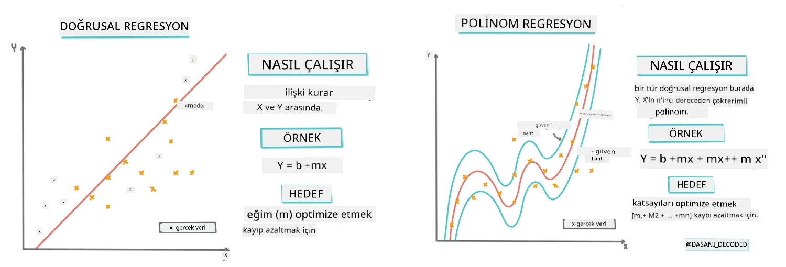
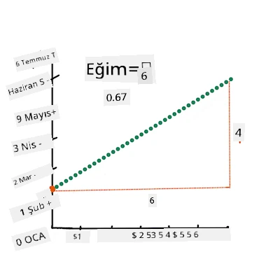
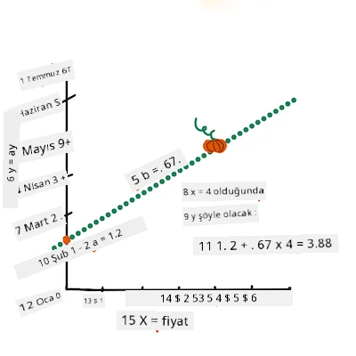
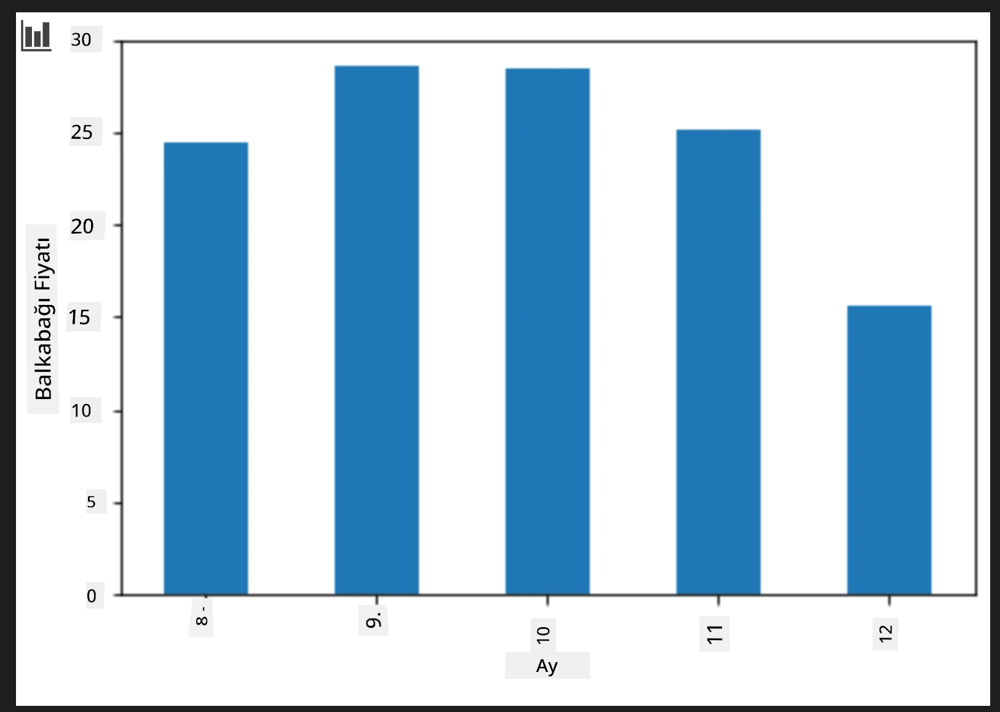
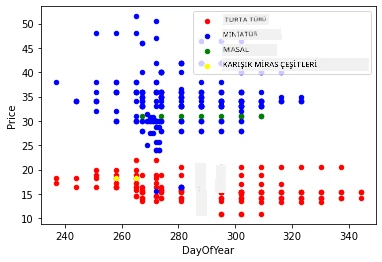

# Scikit-learn kullanarak regresyon modeli oluşturma: regresyonun dört yolu

## Yeni Başlayanlar Notu

Lineer regresyon, **sayısal bir değer** tahmin etmek istediğimizde kullanılır (örneğin, ev fiyatı, sıcaklık veya satışlar).  
Girdi özellikleri ile çıktı arasındaki ilişkiyi en iyi temsil eden düz bir çizgi bulmak için çalışır.

Bu derste, daha gelişmiş regresyon tekniklerini keşfetmeden önce kavramı anlamaya odaklanıyoruz.  
  
> Infografik [Dasani Madipalli](https://twitter.com/dasani_decoded) tarafından

## [Ders Öncesi Quiz](https://ff-quizzes.netlify.app/en/ml/)

> ### [Bu ders R dilinde de mevcuttur!](../../../../2-Regression/3-Linear/solution/R/lesson_3.html)  
### Giriş

Şimdiye kadar, bu ders boyunca kullanacağımız kabak fiyatlandırma veri kümesinden örnek veri ile regresyonun ne olduğunu keşfettiniz. Ayrıca bunu Matplotlib ile görselleştirdiniz.

Artık makine öğrenmesi için regresyona daha derinlemesine dalmaya hazırsınız. Görselleştirme veri anlamanıza olanak sağlarken, Makine Öğrenmesinin gerçek gücü _modellerin eğitilmesi_ üzerinden gelir. Modeller, verilerdeki bağımlılıkları otomatik yakalamak için geçmiş veriler üzerinde eğitilir ve modele daha önce görmediği yeni veriler için sonuçlar tahmin etme olanağı tanır.

Bu derste, _temel lineer regresyon_ ve _polinom regresyon_ olmak üzere iki regresyon türünü ve bu tekniklerin altında yatan matematiği öğreneceksiniz. Bu modeller, farklı giriş verilerine bağlı olarak kabak fiyatlarını tahmin etmemize olanak sağlayacak.

[](https://youtu.be/CRxFT8oTDMg "Yeni başlayanlar için ML - Lineer Regresyonu Anlamak")

> 🎥 Lineer regresyonun kısa video genel bakışı için yukarıdaki görsele tıklayın.

> Bu müfredat boyunca, matematik bilgisinin minimum seviyede olacağını varsayıyor ve diğer alanlardan gelen öğrenciler için erişilebilir hale getirmeyi amaçlıyoruz. Anlamaya yardımcı notlar, 🧮 çağrılar, diyagramlar ve diğer öğrenme araçlarına dikkat edin.

### Ön Koşul

Artık incelediğimiz kabak verisinin yapısına aşina olmalısınız. Veriyi bu dersin _notebook.ipynb_ dosyasında önceden yüklenmiş ve temizlenmiş bulabilirsiniz. Dosyada kabak fiyatı, bushel başına yeni bir veri çerçevesinde gösterilmiştir. Bu not defterlerini Visual Studio Code'da çekirdeklerde çalıştırabildiğinizden emin olun.

### Hazırlık

Hatırlatma olarak, bu veriyi yüklüyorsunuz ki ona sorular sorabilesiniz.

- Kabakları satın almak için en iyi zaman ne zamandır?  
- Mini kabak kasası için hangi fiyatı bekleyebilirim?  
- Bunları yarım bushel sepetlerde mi yoksa 1 1/9 bushel kutuda mı almalıyım?  
Veri üzerinde kazmaya devam edelim.

Önceki derste, Pandas veri çerçevesi oluşturdunuz ve fiyatlandırmayı bushel bazında standartlaştırarak orijinal veri kümesinin bir kısmı ile doldurdunuz. Ancak bu, sadece yaklaşık 400 veri noktası ve yalnızca sonbahar ayları için veri toplamanıza olanak sağladı.

Bu dersin eşlik eden not defterinde önceden yüklenmiş veriye bir göz atın. Veri yüklü olarak geliyor ve ay verisini göstermek için ilk bir dağılım grafiği çiziliyor. Verinin doğası hakkında biraz daha ayrıntı öğrenmek için onu daha fazla temizleyebiliriz.

## Bir lineer regresyon doğrusu

Ders 1'de öğrendiğiniz gibi, lineer regresyon egzersizinin amacı:

- **Değişken ilişkilerini göstermek**. Değişkenler arasındaki ilişkiyi göstermek  
- **Tahmin yapmak**. Yeni bir veri noktasının o çizgiye göre nerede olacağını doğru tahmin etmek  

**En Küçük Kareler Regresyonu** ile bu tür bir çizgi çizmek tipiktir. "En Küçük Kareler" terimi, modelimizdeki toplam hatanın en aza indirilmesi sürecini ifade eder. Veri noktasının her biri için gerçek nokta ile regresyon çizgisi arasındaki dikey mesafeyi (rezidü olarak adlandırılır) ölçeriz.

Bu mesafeleri iki ana nedenle kare alırız:

1. **Yön yerine büyüklük:** -5 hata ile +5 hata aynı muameleyi görmeli. Kare alma tüm değerleri pozitif yapar.

2. **Aykırı değerleri cezalandırmak:** Kare alma, büyük hatalara daha fazla ağırlık verir, çizginin uzak noktaların yanında kalmasını zorlar.

Sonra bu kareli değerleri toplarız. Amacımız, bu toplamın en küçük olduğu (en düşük mümkün değer) çizgiyi bulmaktır — bu yüzden "En Küçük Kareler" denir.

> **🧮 Matematiği Göster**  
>  
> Bu çizgiye _en iyi uyum çizgisi_ adı verilir ve [bir denklemle](https://en.wikipedia.org/wiki/Simple_linear_regression) ifade edilir:  
>  
> ```
> Y = a + bX
> ```
>  
> `X`, 'açıklayıcı değişken'dir. `Y`, 'bağımlı değişken'dir. Çizginin eğimi `b` ve `a` ise y-kesişimidir; `X = 0` iken `Y` değerini ifade eder.  
>  
>  
>  
> Önce `b` eğimini hesaplayın. Infografik [Jen Looper](https://twitter.com/jenlooper) tarafından  
>  
> Başka bir deyişle ve kabak verimizin orijinal sorusuna atıfta bulunursak: "ay bazında bushel başına kabak fiyatını tahmin etme" durumunda, `X` fiyatı, `Y` ise satış ayını ifade eder.  
>  
>  
>  
> `Y` değerini hesaplayın. Yaklaşık 4 dolar ödüyorsanız, kesin Nisan ayıdır! Infografik [Jen Looper](https://twitter.com/jenlooper) tarafından  
>  
> Çizgiyi hesaplayan matematik, ayrıca kesişim noktasına bağlı olan eğimi veya `X=0` iken `Y`nin yerini gösterir.  
>  
> Bu değerlerin hesaplama yöntemini [Math is Fun](https://www.mathsisfun.com/data/least-squares-regression.html) sitesinde görebilirsiniz. Ayrıca sayısal değerlerin çizgi üzerindeki etkisini izlemek için [bu En Küçük Kareler hesaplayıcısını](https://www.mathsisfun.com/data/least-squares-calculator.html) ziyaret edin.

## Korelasyon

Anlaşılması gereken bir başka terim, verilen X ve Y değişkenleri arasındaki **Korelasyon Katsayısı**dır. Bir dağılım grafiği kullanarak bu katsayıyı hızlıca görselleştirebilirsiniz. Veri noktalarının düzgün bir çizgi etrafında dağılması yüksek korelasyon, noktaların her yere saçılması ise düşük korelasyonu gösterir.

İyi bir lineer regresyon modeli, En Küçük Kareler Regresyon yöntemiyle oluşturulmuş ve regresyon çizgisi olan yüksek (0'a değil 1'e yakın) Korelasyon Katsayısına sahip olacaktır.

✅ Bu dersin eşlik eden not defterini çalıştırın ve Ay ile Fiyat arasındaki dağılım grafiğine bakın. Kabak satışları için Ay ile Fiyat arasındaki veriler, sizce dağılım grafiğinin görsel yorumuna göre yüksek mi yoksa düşük mü korelasyona sahip? Eğer `Month` yerine *yılın günü* gibi daha ince bir ölçüt kullanırsanız değişir mi?

Aşağıdaki kodda, veriyi temizlediğimizi ve aşağıdaki gibi `new_pumpkins` adlı bir veri çerçevesine sahip olduğumuzu varsayalım:

ID | Month | DayOfYear | Variety | City | Package | Low Price | High Price | Price  
---|-------|-----------|---------|------|---------|-----------|------------|-------  
70 | 9 | 267 | PIE TYPE | BALTIMORE | 1 1/9 bushel cartons | 15.0 | 15.0 | 13.636364  
71 | 9 | 267 | PIE TYPE | BALTIMORE | 1 1/9 bushel cartons | 18.0 | 18.0 | 16.363636  
72 | 10 | 274 | PIE TYPE | BALTIMORE | 1 1/9 bushel cartons | 18.0 | 18.0 | 16.363636  
73 | 10 | 274 | PIE TYPE | BALTIMORE | 1 1/9 bushel cartons | 17.0 | 17.0 | 15.454545  
74 | 10 | 281 | PIE TYPE | BALTIMORE | 1 1/9 bushel cartons | 15.0 | 15.0 | 13.636364  

> Veriyi temizlemek için kullanılan kod [`notebook.ipynb`](notebook.ipynb) dosyasında mevcuttur. Önceki derste yapılan aynı temizleme işlemlerini yaptık ve `DayOfYear` sütununu aşağıdaki ifade ile hesapladık:  
>  
```python
day_of_year = pd.to_datetime(pumpkins['Date']).apply(lambda dt: (dt-datetime(dt.year,1,1)).days)
```
  
Şimdi lineer regresyonun matematiğini anladığınıza göre, hangi kabak paketinin en iyi fiyatı vereceğini tahmin etmeye çalışmak için bir Regresyon modeli oluşturalım. Tatil zamanı kabak sergisi için kabak satın alan biri, kabak paketlerini en iyi şekilde satın almak için bu bilgiyi isteyebilir.

## Korelasyon Arayışı

[](https://youtu.be/uoRq-lW2eQo "Yeni başlayanlar için ML - Korelasyon Arayışı: Lineer Regresyonun Anahtarı")

> 🎥 Korelasyonun kısa video özeti için yukarıdaki görsele tıklayın.

Önceki dersten muhtemelen farklı aylar için ortalama fiyatların şöyle göründüğünü gördünüz:



Bu durum biraz korelasyon olması gerektiğini düşündürür ve `Month` ile `Price` arasında veya `DayOfYear` ile `Price` arasında ilişkiyi tahmin etmek için lineer regresyon modeli eğitmeyi deneyebiliriz. İşte ikincisini gösteren dağılım grafiği:

 

`corr` fonksiyonuyla korelasyona bakalım:

```python
print(new_pumpkins['Month'].corr(new_pumpkins['Price']))
print(new_pumpkins['DayOfYear'].corr(new_pumpkins['Price']))
```
  
Görünüşe göre korelasyon oldukça küçük, `Month` için -0.15 ve `DayOfYear` için -0.17, ancak başka önemli bir ilişki olabilir. Farklı kabak çeşitlerine karşılık gelen farklı fiyat kümeleri var gibi duruyor. Bu hipotezi doğrulamak için her kabak kategorisini farklı bir renkle çizelim. `scatter` çizim fonksiyonuna `ax` parametresi vererek tüm noktaları aynı grafikte gösterebiliriz:

```python
ax=None
colors = ['red','blue','green','yellow']
for i,var in enumerate(new_pumpkins['Variety'].unique()):
    df = new_pumpkins[new_pumpkins['Variety']==var]
    ax = df.plot.scatter('DayOfYear','Price',ax=ax,c=colors[i],label=var)
```
  
 

Araştırmamız, çeşidin satış tarihinden daha fazla fiyat üzerinde etkisi olduğunu gösteriyor. Bunu bir çubuk grafikle görebiliriz:

```python
new_pumpkins.groupby('Variety')['Price'].mean().plot(kind='bar')
```
  
 

Şu an için sadece bir kabak çeşidi olan 'pie type'a odaklanalım ve tarihin fiyat üzerindeki etkisine bakalım:

```python
pie_pumpkins = new_pumpkins[new_pumpkins['Variety']=='PIE TYPE']
pie_pumpkins.plot.scatter('DayOfYear','Price') 
```
 

`corr` fonksiyonu kullanarak `Price` ile `DayOfYear` arasındaki korelasyonu şimdi hesaplasak, yaklaşık `-0.27` alırız - bu da tahmine dayalı model eğitmenin mantıklı olduğunu gösterir.

> Lineer regresyon modeli eğitmeden önce, verimizin temiz olduğundan emin olmak önemlidir. Lineer regresyon eksik verilerle iyi çalışmaz, bu nedenle tüm boş hücrelerden kurtulmak mantıklıdır:

```python
pie_pumpkins.dropna(inplace=True)
pie_pumpkins.info()
```
  
Başka bir yaklaşım, bu boş değerleri, karşılık gelen sütunun ortalama değerleriyle doldurmaktır.

## Basit Lineer Regresyon

[](https://youtu.be/e4c_UP2fSjg "Yeni başlayanlar için ML - Scikit-learn kullanarak Lineer ve Polinom Regresyon")

> 🎥 Lineer ve polinom regresyonun kısa video genel bakışı için yukarıdaki görsele tıklayın.

Lineer Regresyon modelimizi eğitmek için **Scikit-learn** kütüphanesini kullanacağız.

```python
from sklearn.linear_model import LinearRegression
from sklearn.metrics import mean_squared_error
from sklearn.model_selection import train_test_split
```
  
Girdi değerlerini (özellikler) ve beklenen çıktıyı (etiket) ayrı numpy dizilerine ayırarak başlıyoruz:

```python
X = pie_pumpkins['DayOfYear'].to_numpy().reshape(-1,1)
y = pie_pumpkins['Price']
```
  
> Dikkat edin, Linear Regression paketinin doğru anlayabilmesi için giriş verisine `reshape` uygulamak zorunda kaldık. Linear Regression, her satırı bir özellik vektörüne karşılık gelen 2D diziyi bekler. Bizim durumumuzda, sadece bir girdi olduğundan, N×1 şeklinde bir dizi gerekir, burada N veri boyutudur.

Sonra veriyi eğitim ve test veri setlerine ayırmamız gerekir, böylece eğitim sonrası modelimizi doğrulayabiliriz:

```python
X_train, X_test, y_train, y_test = train_test_split(X, y, test_size=0.2, random_state=0)
```
  
Son olarak, Lineer Regresyon modelini gerçek anlamda eğitmek sadece iki satır kod alır. `LinearRegression` nesnesini tanımlarız ve `fit` metodu ile verimize uyarlarız:

```python
lin_reg = LinearRegression()
lin_reg.fit(X_train,y_train)
```

`fit` işleminden sonra `LinearRegression` nesnesi regresyonun tüm katsayılarını içerir ve bunlara `.coef_` özelliği ile erişilebilir. Bizim örneğimizde sadece bir katsayı var ve bu değer yaklaşık `-0.017` civarında olmalı. Bu, fiyatların zamanla biraz düştüğünü, ancak çok fazla olmadığını, günde yaklaşık 2 sent kadar azaldığını gösterir. Regresyonun Y ekseni ile kesişim noktasına ise `lin_reg.intercept_` ile erişebiliriz - bizim durumumuzda bu değer yaklaşık `21` olacak ve yılın başındaki fiyatı gösterir.

Modelimizin ne kadar doğru olduğunu görmek için test veri seti üzerinde fiyat tahminleri yapabiliriz ve ardından tahminlerin beklenen değerlerle ne kadar yakın olduğunu ölçebiliriz. Bu, beklenen ve tahmin edilen değerler arasındaki tüm kare farkların ortalamasının karekökü olan root mean square error (RMSE) metriğiyle yapılabilir.

```python
pred = lin_reg.predict(X_test)

rmse = np.sqrt(mean_squared_error(y_test,pred))
print(f'RMSE: {rmse:3.3} ({rmse/np.mean(pred)*100:3.3}%)')
```

Hata yaklaşık 2 puan civarında görünüyor, bu da yaklaşık %17. Çok iyi değil. Model kalitesinin bir diğer göstergesi ise **determination katsayısı**dır ve şöyle elde edilir:

```python
score = lin_reg.score(X_train,y_train)
print('Model determination: ', score)
```
 Eğer değer 0 ise, model girdi verilerini dikkate almıyor demektir ve *en kötü lineer tahmin edici* gibi davranır, bu da sonuçların sadece ortalama değeridir. 1 değeri ise tüm beklenen çıktıları mükemmel tahmin edebileceğimiz anlamına gelir. Bizde katsayı yaklaşık 0.06 civarında, bu oldukça düşük.

Test verilerini ve regresyon doğrusunu birlikte çizerek regresyonun nasıl çalıştığını daha iyi görebiliriz:

```python
plt.scatter(X_test,y_test)
plt.plot(X_test,pred)
```


## Polinom Regresyonu

Lineer regresyonun diğer bir türü Polinom Regresyonudur. Bazen değişkenler arasında lineer bir ilişki olsa da - hacimce kabak ne kadar büyükse fiyat o kadar yüksek - bazen bu ilişkiler düzlem veya doğru olarak çizilemez.

✅ İşte Polinom Regresyonu kullanılabilecek [başka bazı örnekler](https://online.stat.psu.edu/stat501/Lesson09#polynomial-regression-examples)

Tarih ve Fiyat arasındaki ilişkiye tekrar bakalım. Bu saçılım grafiği mutlaka bir doğru ile mi analiz edilmeli? Fiyatlar dalgalanamaz mı? Bu durumda polinom regresyonu deneyebilirsiniz.

✅ Polinomlar, bir veya daha fazla değişken ve katsayıdan oluşabilen matematiksel ifadelerdir.

Polinom regresyon, doğrusal olmayan verilere daha iyi uyum sağlamak için eğri bir doğrusu oluşturur. Bizim durumumuzda, girdi verilerine karesel `DayOfYear` değişkenini eklersek, verilerimizi minimum noktasının yıl içinde belirli bir yerde olduğu parabolik bir eğriyle uydurabiliriz.

Scikit-learn, veri işleme adımlarını birleştirmek için faydalı bir [pipeline API](https://scikit-learn.org/stable/modules/generated/sklearn.pipeline.make_pipeline.html?highlight=pipeline#sklearn.pipeline.make_pipeline) içerir. Bir **pipeline**, birbirine bağlı **estimator** zinciridir. Bizim örneğimizde, önce modele polinom özellikler ekleyen sonra regresyonu eğiten bir pipeline oluşturacağız:

```python
from sklearn.preprocessing import PolynomialFeatures
from sklearn.pipeline import make_pipeline

pipeline = make_pipeline(PolynomialFeatures(2), LinearRegression())

pipeline.fit(X_train,y_train)
```

`PolynomialFeatures(2)` kullanımı, girdi verilerinden tüm ikinci dereceden polinomları dahil edeceğimiz anlamına gelir. Bizim örneğimizde sadece `DayOfYear`<sup>2</sup> olacak, ancak iki girdi değişkeni X ve Y için bu X<sup>2</sup>, XY ve Y<sup>2</sup> eklemek anlamına gelir. İsterseniz daha yüksek dereceli polinomlar da kullanabilirsiniz.

Pipeline nesneleri, orijinal `LinearRegression` nesnesi gibi kullanılabilir, yani pipeline'ı `fit` edebilir, ardından `predict` ile tahmin sonuçlarını alabiliriz:

```python
pred = pipeline.predict(X_test)

rmse = np.sqrt(mean_squared_error(y_test,pred))
print(f'RMSE: {rmse:3.3} ({rmse/np.mean(pred)*100:3.3}%)')

score = pipeline.score(X_train,y_train)
print('Model determination: ', score)
```

Düzensiz test verileri üzerinde doğrudan çizim yapmak yerine, `np.linspace` ile düzgün bir giriş değeri aralığı oluşturarak düzgün bir yaklaşık eğri çizeriz (aksi halde zikzak çizgi oluşur):

```python
X_range = np.linspace(X_test.min(), X_test.max(), 100).reshape(-1,1)
y_range = pipeline.predict(X_range)

plt.scatter(X_test, y_test)
plt.plot(X_range, y_range)
```

Aşağıda test verilerini ve yaklaşık eğriyi gösteren grafik var:


Polinom Regresyon kullanarak biraz daha düşük RMSE ve daha yüksek determination elde etmek mümkün fakat çok büyük bir fark değil. Diğer özellikleri de dikkate almamız gerekiyor!

> Minimum kabak fiyatlarının genellikle Cadılar Bayramı civarında gözlendiğini görebilirsiniz. Bunu nasıl açıklarsınız? 

🎃 Tebrikler, turta kabakları fiyatını tahmin etmeye yardımcı olacak bir model oluşturdunuz. Muhtemelen tüm kabak türleri için aynı prosedürü tekrarlayabilirsiniz, ama bu zahmetli olur. Şimdi modelimize kabak çeşidini nasıl dahil edeceğimizi öğrenelim!

## Kategorik Özellikler

İdeal dünyada, farklı kabak çeşitlerinin fiyatlarını aynı modelle tahmin edebilmek isteriz. Ancak `Variety` sütunu, `Month` gibi sayısal sütunlardan biraz farklıdır çünkü sayısal olmayan değerler içerir. Bu tür sütunlara **kategorik** denir.

[](https://youtu.be/DYGliioIAE0 "ML for beginners - Categorical Feature Predictions with Linear Regression")

> 🎥 Kategorik özelliklerin kullanımı hakkında kısa video açıklaması için yukarıdaki görsele tıklayın.

Burada ortalama fiyatın çeşide göre nasıl değiştiğini görebilirsiniz:


Çeşidi hesaba katmak için önce onu sayısal forma dönüştürmeli veya **kodlamalıyız**. Bunu yapmanın birkaç yolu var:

* Basit **sayısal kodlama**, farklı çeşitler tablosu oluşturur ve sonra o tablodaki indeksi çeşidin adıyla değiştirir. Ancak bu lineer regresyon için en iyi fikir değildir çünkü lineer regresyon indeksin gerçek sayısal değerini alır ve bazı katsayılarla çarpıp sonuca ekler. Bizim durumumuzda indeks numarası ile fiyat arasındaki ilişki açıkça doğrusal değildir, indeksler belli bir sıraya göre ayarlansa bile.
* **One-hot encoding**, `Variety` sütununu her çeşit için bir sütun olmak üzere 4 farklı sütunla değiştirir. Her sütun, karşılık gelen satır o çeşide ait ise `1`, değilse `0` içerir. Bu şekilde lineer regresyonda dört katsayı olur, her kabak çeşidi için "başlangıç fiyatı" (veya daha doğrusu o çeşide ait "ek fiyat") sorumludur.

Aşağıdaki kod, çeşidi one-hot encode ile nasıl kodlayabileceğimizi gösteriyor:

```python
pd.get_dummies(new_pumpkins['Variety'])
```

 ID | FAIRYTALE | MINIATURE | MIXED HEIRLOOM VARIETIES | PIE TYPE
----|-----------|-----------|--------------------------|----------
70 | 0 | 0 | 0 | 1
71 | 0 | 0 | 0 | 1
... | ... | ... | ... | ...
1738 | 0 | 1 | 0 | 0
1739 | 0 | 1 | 0 | 0
1740 | 0 | 1 | 0 | 0
1741 | 0 | 1 | 0 | 0
1742 | 0 | 1 | 0 | 0

Lineer regresyonu one-hot encode edilmiş çeşit kullanarak eğitmek için `X` ve `y` verilerini doğru şekilde başlatmamız yeterlidir:

```python
X = pd.get_dummies(new_pumpkins['Variety'])
y = new_pumpkins['Price']
```

Kalan kod, yukarıda lineer regresyonu eğitmek için kullandığımızla aynı. Denersek, ortalama kare hatanın yaklaşık aynı olduğunu ama belirleme katsayısının (~77%) çok daha yüksek olduğunu göreceğiz. Daha doğru tahminler için daha fazla kategorik ve sayısal özellikleri, örneğin `Month` veya `DayOfYear`'i de dikkate alabiliriz. Tüm özellikleri tek büyük bir dizi haline getirmek için `join` kullanabiliriz:

```python
X = pd.get_dummies(new_pumpkins['Variety']) \
        .join(new_pumpkins['Month']) \
        .join(pd.get_dummies(new_pumpkins['City'])) \
        .join(pd.get_dummies(new_pumpkins['Package']))
y = new_pumpkins['Price']
```

Burada ayrıca `City` ve `Package` tipi de hesaba katılıyor ve bu sayede RMSE 2.84 (%10.5), belirleme 0.94 oluyor!

## Hepsini Bir Araya Getirmek

En iyi modeli oluşturmak için yukarıdaki örnekteki birleştirilmiş (one-hot encode edilmiş kategorik + sayısal) verileri Polinom Regresyon ile birlikte kullanabiliriz. İşte kolayca kullanmanız için tam kod:

```python
# eğitim verisini ayarla
X = pd.get_dummies(new_pumpkins['Variety']) \
        .join(new_pumpkins['Month']) \
        .join(pd.get_dummies(new_pumpkins['City'])) \
        .join(pd.get_dummies(new_pumpkins['Package']))
y = new_pumpkins['Price']

# eğitim-test bölümü yap
X_train, X_test, y_train, y_test = train_test_split(X, y, test_size=0.2, random_state=0)

# boru hattını kur ve eğit
pipeline = make_pipeline(PolynomialFeatures(2), LinearRegression())
pipeline.fit(X_train,y_train)

# test verisi için sonuçları tahmin et
pred = pipeline.predict(X_test)

# RMSE ve belirleme hesapla
rmse = mean_squared_error(y_test, pred, squared=False)
print(f'RMSE: {rmse:3.3} ({rmse/pred.mean()*100:3.3}%)')

score = pipeline.score(X_train,y_train)
print('Model determination: ', score)
```

Bu, neredeyse %97 belirleme katsayısı ve RMSE=2.23 (%8 tahmin hatası) verecektir.

| Model | RMSE | Belirleme |
|-------|-----|---------------|
| `DayOfYear` Lineer | 2.77 (17.2%) | 0.07 |
| `DayOfYear` Polinom | 2.73 (17.0%) | 0.08 |
| `Variety` Lineer | 5.24 (19.7%) | 0.77 |
| Tüm özellikler Lineer | 2.84 (10.5%) | 0.94 |
| Tüm özellikler Polinom | 2.23 (8.25%) | 0.97 |

🏆 Aferin! Tek derste dört tane Regresyon modeli oluşturdunuz ve model kalitesini %97'ye çıkardınız. Regresyonun final bölümünde, kategorileri belirlemek için Lojistik Regresyon öğrenilecektir.

---
## 🚀Challenge

Bu defterde farklı değişkenleri test edin ve korelasyonun model doğruluğuna etkisini görün.

## [Ders sonrası sınav](https://ff-quizzes.netlify.app/en/ml/)

## Tekrar & Kendi Kendine Çalışma

Bu derste Lineer Regresyondan bahsettik. Başka önemli Regresyon türleri de vardır. Stepwise, Ridge, Lasso ve Elasticnet tekniklerini okuyun. Daha fazla öğrenmek için iyi bir kaynak [Stanford İstatistiksel Öğrenme kursu](https://online.stanford.edu/courses/sohs-ystatslearning-statistical-learning)

## Ödev

[Model Oluşturma](assignment.md)

---

<!-- CO-OP TRANSLATOR DISCLAIMER START -->
**Feragatname**:  
Bu belge, AI çeviri hizmeti [Co-op Translator](https://github.com/Azure/co-op-translator) kullanılarak çevrilmiştir. Doğruluk için çaba gösterilse de, otomatik çevirilerin hatalar veya yanlışlıklar içerebileceğini lütfen göz önünde bulundurun. Yetkili kaynak olarak orijinal belgenin kendi dilindeki versiyonu kabul edilmelidir. Kritik bilgiler için profesyonel insan çevirisi tavsiye edilir. Bu çevirinin kullanımı sonucunda oluşabilecek yanlış anlamalar veya yorum hatalarından sorumlu değiliz.
<!-- CO-OP TRANSLATOR DISCLAIMER END -->