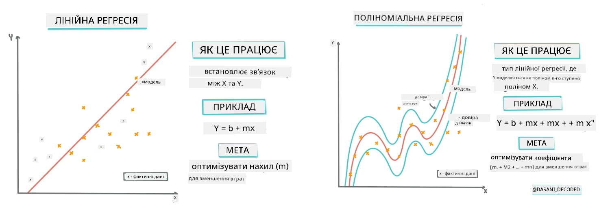
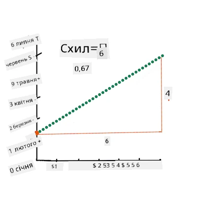
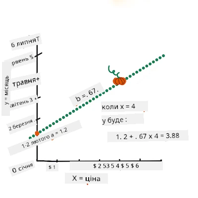
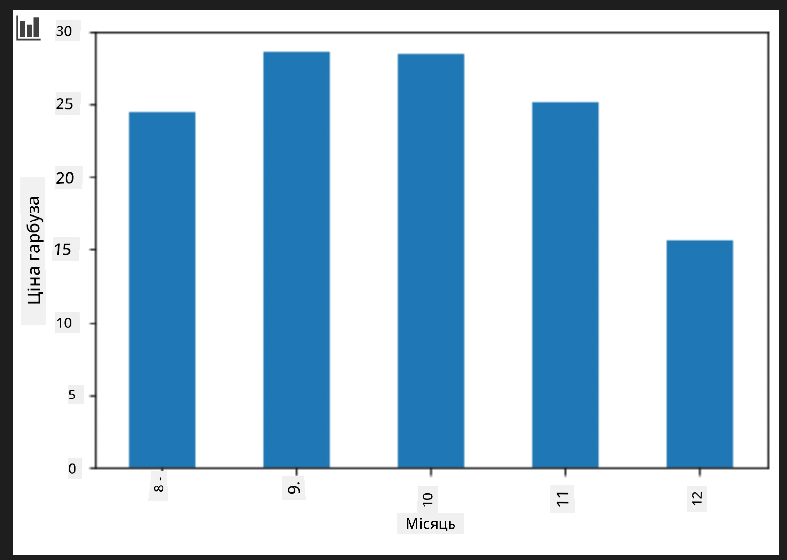
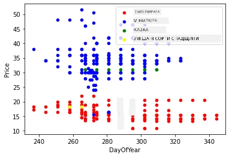

# Побудова регресійної моделі за допомогою Scikit-learn: регресія чотирма способами

## Примітка для початківців

Лінійна регресія використовується, коли ми хочемо передбачити **числове значення** (наприклад, ціну будинку, температуру чи продажі).
Вона працює шляхом пошуку прямої лінії, яка найкраще описує зв’язок між вхідними ознаками та результатом.

У цьому уроці ми зосереджуємося на розумінні концепції перед тим, як вивчати більш просунуті методи регресії.

> Інфографіка від [Dasani Madipalli](https://twitter.com/dasani_decoded)
## [Передлекційний тест](https://ff-quizzes.netlify.app/en/ml/)

> ### [Цей урок доступний також на R!](../../../../2-Regression/3-Linear/solution/R/lesson_3.html)
### Вступ

Поки що ви ознайомилися з тим, що таке регресія на прикладі зібраних даних із датасету цін на гарбуза, який ми використовуватимемо протягом усього уроку. Ви також візуалізували їх за допомогою Matplotlib.

Тепер ви готові зануритися глибше в регресію для ML. Хоча візуалізація дозволяє розуміти дані, справжня сила машинного навчання полягає в _навчанні моделей_. Моделі навчаються на історичних даних, щоб автоматично захоплювати залежності у даних і дозволяють передбачати результати для нових даних, з якими модель раніше не стикалась.

У цьому уроці ви дізнаєтеся більше про два типи регресії: _базову лінійну регресію_ та _поліноміальну регресію_, а також про математику, що лежить в основі цих методів. Ці моделі дозволять нам передбачати ціни гарбузів залежно від різних вхідних даних.

[](https://youtu.be/CRxFT8oTDMg "ML for beginners - Understanding Linear Regression")

> 🎥 Натисніть на зображення вище для короткого відеоогляду лінійної регресії.

> Протягом цієї навчальної програми ми припускаємо мінімальні знання математики і намагаємося зробити матеріал доступним для студентів з інших галузей, тож звертайте увагу на примітки, 🧮 пояснення, діаграми та інші інструменти навчання для кращого розуміння.

### Передумови

Ви вже повинні бути знайомі зі структурою даних про гарбузи, які ми аналізуємо. Вони попередньо завантажені і очищені у файлі _notebook.ipynb_ цього уроку. У файлі ціна гарбуза показана за бушель у новому датафреймі. Переконайтеся, що ви можете запускати ці ноутбуки у Visual Studio Code.

### Підготовка

Нагадаємо, що ви завантажуєте ці дані, щоб ставити до них запитання.

- Коли найкращий час купувати гарбузи?
- Яку ціну можна очікувати за коробку мініатюрних гарбузів?
- Чи краще купувати їх у півбушельних кошиках чи в коробках місткістю 1 1/9 бушеля?
Давайте продовжимо досліджувати ці дані.

У попередньому уроці ви створили Pandas DataFrame і заповнили його частиною вихідного датасету, стандартизуючи ціну за бушель. Проте таким чином вдалося зібрати близько 400 точок даних лише за осінні місяці.

Погляньте на дані, які ми попередньо завантажили у ноутбуці до цього уроку. Дані вже завантажені, і початковий scatterplot показує місячні дані. Можливо, ми зможемо краще зрозуміти природу цих даних, якщо їх більше почистимо.

## Лінійна регресійна лінія

Як ви дізналися в Уроці 1, мета лінійної регресії — побудувати лінію, яка:

- **Показує взаємозв’язки змінних**. Відображає відношення між змінними
- **Дозволяє робити прогнози**. Точні прогнози, де буде знаходитися нова точка відносно цієї лінії.

Зазвичай для побудови такої лінії використовують **метод найменших квадратів**. Терміни "найменших квадратів" стосуються процесу мінімізації загальної похибки у моделі. Для кожної точки даних вимірюється вертикальна відстань (звана залишком) між фактичною точкою та лінією регресії.

Ці відстані підносять у квадрат з двох основних причин:

1. **Величина важливіша за напрямок:** Ми хочемо трактувати помилки -5 і +5 однаково. Квадрат усіх значень робить їх додатними.

2. **Штрафування викидів:** Квадрати надають більшу вагу більшим помилкам, вимушуючи лінію бути ближчою до точок, що знаходяться далеко.

Потім ми сумуємо усі ці квадрати. Наша мета — знайти таку лінію, де ця сума буде мінімальною — звідси й назва "найменших квадратів".

> **🧮 Пояснення математики**  
> 
> Цю лінію, яку називають _лінією найкращого приросту_, можна описати [рівнянням](https://en.wikipedia.org/wiki/Simple_linear_regression):  
> 
> ```
> Y = a + bX
> ```
>
> `X` — це «пояснювальна змінна». `Y` — «залежна змінна». Кут нахилу лінії позначається `b`, а `a` — це точка перетину з віссю Y, тобто значення `Y` при `X = 0`.  
>
>
>
> Спершу обчислюємо нахил `b`. Інфографіка від [Jen Looper](https://twitter.com/jenlooper)
>
> По-простому та у контексті нашого запитання про гарбузи: "передбачити ціну гарбуза за бушель за місяць", `X` відповідатиме за ціну, а `Y` — за місяць продажу.
>
>
>
> Обчислюємо значення Y. Якщо ви платите близько $4, це мусить бути квітень! Інфографіка від [Jen Looper](https://twitter.com/jenlooper)
>
> Математика обчислює цю лінію, враховуючи нахил і перетин, тобто де розташоване `Y` при `X = 0`.
>
> Детальніше про цей метод можна почитати на сайті [Math is Fun](https://www.mathsisfun.com/data/least-squares-regression.html). Також відвідайте [цей калькулятор найменших квадратів](https://www.mathsisfun.com/data/least-squares-calculator.html), щоб побачити, як значення впливають на лінію.

## Кореляція

Ще один термін, який варто знати, — це **коефіцієнт кореляції** між змінними X і Y. Використовуючи scatterplot, ви швидко побачите цей коефіцієнт. Точки, розкидані впорядковано вздовж лінії, мають високу кореляцію, а точки, розкидані хаотично, — низьку.

Гарна модель лінійної регресії матиме високий коефіцієнт кореляції (ближчий до 1, а не до 0) з використанням методу найменших квадратів з лінією регресії.

✅ Запустіть ноутбук для цього уроку та подивіться на scatterplot між місяцем і ціною. Чи здається вам, що між місяцем та ціною гарбузів є висока чи низька кореляція, з огляду на вашу візуальну інтерпретацію цього графіку? Чи зміниться це, якщо замінити `Month` більш точним показником, наприклад, *день року* (кількість днів з початку року)?

У коді нижче ми припускаємо, що дані очищені, і одержали датафрейм `new_pumpkins`, схожий на такий:

ID | Місяць | ДеньРоку | Сорт | Місто | Упаковка | Мінімальна ціна | Максимальна ціна | Ціна
---|--------|----------|-------|-------|-----------|-----------------|------------------|-------
70 | 9 | 267 | PIE TYPE | BALTIMORE | 1 1/9 бушеля картонна коробка | 15.0 | 15.0 | 13.636364
71 | 9 | 267 | PIE TYPE | BALTIMORE | 1 1/9 бушеля картонна коробка | 18.0 | 18.0 | 16.363636
72 | 10 | 274 | PIE TYPE | BALTIMORE | 1 1/9 бушеля картонна коробка | 18.0 | 18.0 | 16.363636
73 | 10 | 274 | PIE TYPE | BALTIMORE | 1 1/9 бушеля картонна коробка | 17.0 | 17.0 | 15.454545
74 | 10 | 281 | PIE TYPE | BALTIMORE | 1 1/9 бушеля картонна коробка | 15.0 | 15.0 | 13.636364

> Код для очищення даних доступний у файлі [`notebook.ipynb`](notebook.ipynb). Ми виконали такі ж кроки очищення, як і в попередньому уроці, а колонку `DayOfYear` обчислили за формулою: 

```python
day_of_year = pd.to_datetime(pumpkins['Date']).apply(lambda dt: (dt-datetime(dt.year,1,1)).days)
```

Тепер, коли ви маєте базове розуміння математики лінійної регресії, давайте створимо модель регресії, щоб спробувати передбачити, яка упаковка гарбузів матиме найкращі ціни. Хтось, хто купує гарбузи для святкової ділянки, може зацікавитись цією інформацією для оптимізації покупки.

## Пошук кореляції

[](https://youtu.be/uoRq-lW2eQo "ML for beginners - Looking for Correlation: The Key to Linear Regression")

> 🎥 Натисніть на зображення вище для короткого відеоогляду кореляції.

З попереднього уроку ви, мабуть, бачили, що середня ціна по місяцях виглядає так:



Це натякає на існування певної кореляції, і ми можемо спробувати натренувати модель лінійної регресії для передбачення зв’язку між `Month` і `Price` або між `DayOfYear` і `Price`. Ось scatter plot для останньої залежності:

 

Перевіримо кореляцію за допомогою функції `corr`:

```python
print(new_pumpkins['Month'].corr(new_pumpkins['Price']))
print(new_pumpkins['DayOfYear'].corr(new_pumpkins['Price']))
```

Кореляція невелика: -0,15 за `Month` і -0,17 за `DayOfYear`, але можлива інша важлива залежність. Схоже, що різні кластери цін відповідають різним сортам гарбуза. Щоб підтвердити цю гіпотезу, відобразимо кожну категорію гарбузів різними кольорами. Передаючи параметр `ax` у функцію `scatter`, ми можемо нанести всі точки на один графік:

```python
ax=None
colors = ['red','blue','green','yellow']
for i,var in enumerate(new_pumpkins['Variety'].unique()):
    df = new_pumpkins[new_pumpkins['Variety']==var]
    ax = df.plot.scatter('DayOfYear','Price',ax=ax,c=colors[i],label=var)
```

 

Наша перевірка показує, що сорт впливає сильніше на загальну ціну, ніж дата продажу. Це підтверджується графіком:

```python
new_pumpkins.groupby('Variety')['Price'].mean().plot(kind='bar')
```

 

Наразі зосередимось лише на одному сорті гарбузів — 'pie type' — і подивимось, як дата впливає на ціну:

```python
pie_pumpkins = new_pumpkins[new_pumpkins['Variety']=='PIE TYPE']
pie_pumpkins.plot.scatter('DayOfYear','Price') 
```
 

Якщо тепер обчислити кореляцію між `Price` та `DayOfYear` за допомогою `corr`, отримаємо приблизно `-0.27` — це означає, що навчання предиктивної моделі має сенс.

> Перед навчанням лінійної регресійної моделі важливо переконатися, що наші дані чисті. Лінійна регресія погано працює з пропущеними значеннями, тому варто позбутися пустих клітинок:

```python
pie_pumpkins.dropna(inplace=True)
pie_pumpkins.info()
```

Альтернативний підхід — заповнити порожні значення середніми по стовпцю.

## Проста лінійна регресія

[](https://youtu.be/e4c_UP2fSjg "ML for beginners - Linear and Polynomial Regression using Scikit-learn")

> 🎥 Натисніть на зображення вище для короткого відеоогляду лінійної та поліноміальної регресії.

Для навчання нашої моделі лінійної регресії використаємо бібліотеку **Scikit-learn**.

```python
from sklearn.linear_model import LinearRegression
from sklearn.metrics import mean_squared_error
from sklearn.model_selection import train_test_split
```

Почнемо з розділення вхідних значень (ознаки) та очікуваних результатів (мітки) у окремі масиви numpy:

```python
X = pie_pumpkins['DayOfYear'].to_numpy().reshape(-1,1)
y = pie_pumpkins['Price']
```

> Зверніть увагу, що нам довелося застосувати `reshape` до вхідних даних, щоб пакет Linear Regression коректно їх зрозумів. Лінійна регресія очікує 2-вимірний масив, де кожен рядок — це вектор вхідних ознак. У нашому випадку, маючи лише одну ознаку, потрібен масив розміру N&times;1, де N — розмір датасету.

Далі потрібно розділити дані на тренувальний і тестовий набори, щоб перевірити модель після навчання:

```python
X_train, X_test, y_train, y_test = train_test_split(X, y, test_size=0.2, random_state=0)
```

Нарешті, навчання власне моделі лінійної регресії — це лише два рядки коду. Створюємо об’єкт `LinearRegression` і навчаємо його методом `fit`:

```python
lin_reg = LinearRegression()
lin_reg.fit(X_train,y_train)
```

Об'єкт `LinearRegression` після виконання методу `fit` містить усі коефіцієнти регресії, до яких можна звернутися за допомогою властивості `.coef_`. У нашому випадку є лише один коефіцієнт, який має бути близько до `-0.017`. Це означає, що ціни, схоже, трохи падають із часом, але не надто сильно, приблизно на 2 центи на день. Ми також можемо отримати точку перетину регресії з віссю Y за допомогою `lin_reg.intercept_` – вона буде близько до `21` у нашому випадку, що вказує на ціну на початку року.

Щоб побачити, наскільки точна наша модель, ми можемо передбачити ціни на тестовому наборі даних, а потім виміряти, наскільки близькі наші прогнози до очікуваних значень. Це можна зробити за допомогою метрики кореня середнього квадратичного відхилення (RMSE), яка є коренем з середнього значення усіх квадратів різниць між очікуваним та передбаченим значеннями.

```python
pred = lin_reg.predict(X_test)

rmse = np.sqrt(mean_squared_error(y_test,pred))
print(f'RMSE: {rmse:3.3} ({rmse/np.mean(pred)*100:3.3}%)')
```

Наша помилка становить приблизно 2 пункти, що приблизно ~17%. Не дуже добре. Іншим показником якості моделі є **коефіцієнт детермінації**, який можна отримати так:

```python
score = lin_reg.score(X_train,y_train)
print('Model determination: ', score)
```
Якщо значення дорівнює 0, це означає, що модель не бере до уваги вхідні дані та діє як *найгірший лінійний предиктор*, тобто просто середнє значення результату. Значення 1 означає, що ми можемо ідеально передбачити всі очікувані виходи. У нашому випадку коефіцієнт близько 0.06, що досить низько.

Ми також можемо побудувати графік тестових даних разом із лінією регресії, щоб краще побачити, як працює регресія у нашому випадку:

```python
plt.scatter(X_test,y_test)
plt.plot(X_test,pred)
```


## Поліноміальна регресія

Інший тип лінійної регресії — поліноміальна регресія. Хоч інколи існує лінійний зв’язок між змінними — чим більша гарбуз за обсягом, тим вища ціна — інколи ці зв’язки не можна зобразити як площину або пряму лінію.

✅ Ось [ще деякі приклади](https://online.stat.psu.edu/stat501/Lesson09#polynomial-regression-examples) даних, для яких можна застосувати поліноміальну регресію

Ще раз погляньте на зв’язок між Датою та Ціною. Чи справді цей розсіювальний графік потрібно аналізувати виключно прямою лінією? Хіба ціни не можуть коливатися? У такому випадку можна спробувати поліноміальну регресію.

✅ Поліноми — це математичні вирази, які можуть складатися з однієї або кількох змінних і коефіцієнтів

Поліноміальна регресія створює криву лінію, щоб краще підходити нелінійним даним. У нашому випадку, якщо додати до вхідних даних змінну `DayOfYear` у квадраті, ми зможемо апроксимувати дані параболічною кривою, яка матиме мінімум у певній точці протягом року.

Scikit-learn включає корисний [pipeline API](https://scikit-learn.org/stable/modules/generated/sklearn.pipeline.make_pipeline.html?highlight=pipeline#sklearn.pipeline.make_pipeline) для поєднання різних етапів обробки даних. **Пайплайн** — це ланцюжок **оцінювачів**. У нашому випадку ми створимо пайплайн, який спочатку додає поліноміальні ознаки до моделі, а потім навчає регресію:

```python
from sklearn.preprocessing import PolynomialFeatures
from sklearn.pipeline import make_pipeline

pipeline = make_pipeline(PolynomialFeatures(2), LinearRegression())

pipeline.fit(X_train,y_train)
```

Використання `PolynomialFeatures(2)` означає, що ми включимо всі поліноми другого ступеня з вхідних даних. У нашому випадку це просто `DayOfYear`<sup>2</sup>, але, якщо є дві вхідні змінні X та Y, це додасть X<sup>2</sup>, XY і Y<sup>2</sup>. Ми також можемо використати поліноми вищого ступеня, якщо хочемо.

Пайплайни можна використовувати так само, як і об'єкт `LinearRegression`, тобто ми можемо `fit` пайплайн, а потім застосовувати `predict` для отримання результатів прогнозу:

```python
pred = pipeline.predict(X_test)

rmse = np.sqrt(mean_squared_error(y_test,pred))
print(f'RMSE: {rmse:3.3} ({rmse/np.mean(pred)*100:3.3}%)')

score = pipeline.score(X_train,y_train)
print('Model determination: ', score)
```

Для побудови гладкої апроксимуючої кривої ми використовуємо `np.linspace` для створення рівномірного діапазону вхідних значень, замість прямого побудови по неупорядкованих тестових даних (що дало б зубчасту лінію):

```python
X_range = np.linspace(X_test.min(), X_test.max(), 100).reshape(-1,1)
y_range = pipeline.predict(X_range)

plt.scatter(X_test, y_test)
plt.plot(X_range, y_range)
```

Ось графік з тестовими даними та апроксимуючою кривою:


Використовуючи поліноміальну регресію, ми можемо отримати трохи нижче значення RMSE і вищий коефіцієнт детермінації, але не суттєво. Потрібно враховувати інші ознаки!

> Ви можете побачити, що мінімальні ціни на гарбузи спостерігаються приблизно наприкінці жовтня. Як ви це поясните? 

🎃 Вітаємо, ви щойно створили модель, яка допоможе передбачати ціну гарбузів для пирогів. Ви, мабуть, можете повторити ту саму процедуру для всіх типів гарбузів, але це буде нудно. Тепер навчаємося враховувати сорт гарбуза у нашій моделі!

## Категоріальні ознаки

В ідеалі ми хочемо мати змогу передбачати ціни для різних сортів гарбуза, використовуючи одну й ту саму модель. Однак стовпець `Variety` дещо відрізняється від таких, як `Month`, бо містить нечислові значення. Такі стовпці називаються **категоріальними**.

[](https://youtu.be/DYGliioIAE0 "ML для початківців - Передбачення категоріальних ознак з лінійною регресією")

> 🎥 Клікніть на зображення вище, щоб переглянути короткий відеоогляд використання категоріальних ознак.

Тут ви бачите, як середня ціна залежить від сорту:


Щоб врахувати сорт, спершу потрібно перетворити його у числову форму, або **закодувати**. Є кілька способів це зробити:

* Просте **числове кодування** створює таблицю з різними сортами, а потім замінює назву сорту індексом із цієї таблиці. Це не найкраща ідея для лінійної регресії, оскільки регресія враховує саме числове значення індексу і додає його до результату, помноженого на якийсь коефіцієнт. У нашому випадку зв’язок між номером індексу та ціною явно нелінійний, навіть якщо ми впевнимося, що індекси впорядковані певним чином.
* **One-hot кодування** замінить стовпець `Variety` на 4 окремі стовпці, по одному для кожного сорту. Кожен стовпець матиме `1`, якщо відповідний рядок відноситься до цього сорту, і `0` інакше. Це означає, що буде чотири коефіцієнти у лінійній регресії, по одному для кожного сорту гарбуза, які відповідальні за "початкову ціну" (або скоріше "додаткову ціну") для цього сорту.

Код нижче показує, як можна застосувати one-hot кодування для сорту:

```python
pd.get_dummies(new_pumpkins['Variety'])
```

 ID | FAIRYTALE | MINIATURE | MIXED HEIRLOOM VARIETIES | PIE TYPE
----|-----------|-----------|--------------------------|----------
70 | 0 | 0 | 0 | 1
71 | 0 | 0 | 0 | 1
... | ... | ... | ... | ...
1738 | 0 | 1 | 0 | 0
1739 | 0 | 1 | 0 | 0
1740 | 0 | 1 | 0 | 0
1741 | 0 | 1 | 0 | 0
1742 | 0 | 1 | 0 | 0

Щоб навчати лінійну регресію, використовуючи one-hot закодований сорт як вхід, нам потрібно правильно ініціалізувати дані `X` і `y`:

```python
X = pd.get_dummies(new_pumpkins['Variety'])
y = new_pumpkins['Price']
```

Решта коду така ж, як і в попередніх прикладах для навчання лінійної регресії. Якщо спробувати, ви побачите, що середньоквадратична помилка приблизно така сама, але коефіцієнт детермінації набагато вищий (~77%). Щоб отримати більш точні передбачення, можна враховувати більше категоріальних ознак, а також числові, таких як `Month` або `DayOfYear`. Щоб отримати один великий масив ознак, можна використовувати `join`:

```python
X = pd.get_dummies(new_pumpkins['Variety']) \
        .join(new_pumpkins['Month']) \
        .join(pd.get_dummies(new_pumpkins['City'])) \
        .join(pd.get_dummies(new_pumpkins['Package']))
y = new_pumpkins['Price']
```

Тут ми також враховуємо `City` і тип `Package`, що дає RMSE 2.84 (10.5%) і детермінацію 0.94!

## Підсумовуючі результати

Щоб отримати найкращу модель, можна використати комбіновані (one-hot закодовані категоріальні + числові) дані з попереднього прикладу разом із поліноміальною регресією. Ось повний код для зручності:

```python
# налаштувати тренувальні дані
X = pd.get_dummies(new_pumpkins['Variety']) \
        .join(new_pumpkins['Month']) \
        .join(pd.get_dummies(new_pumpkins['City'])) \
        .join(pd.get_dummies(new_pumpkins['Package']))
y = new_pumpkins['Price']

# зробити розподіл на тренувальні та тестові дані
X_train, X_test, y_train, y_test = train_test_split(X, y, test_size=0.2, random_state=0)

# налаштувати і натренувати конвеєр
pipeline = make_pipeline(PolynomialFeatures(2), LinearRegression())
pipeline.fit(X_train,y_train)

# передбачити результати для тестових даних
pred = pipeline.predict(X_test)

# обчислити RMSE та коефіцієнт детермінації
rmse = mean_squared_error(y_test, pred, squared=False)
print(f'RMSE: {rmse:3.3} ({rmse/pred.mean()*100:3.3}%)')

score = pipeline.score(X_train,y_train)
print('Model determination: ', score)
```

Це має дати нам найкращий коефіцієнт детермінації майже 97% та RMSE=2.23 (~8% похибки прогнозу).

| Модель | RMSE | Детермінація |
|-------|-----|---------------|
| Лінійна за `DayOfYear` | 2.77 (17.2%) | 0.07 |
| Поліноміальна за `DayOfYear` | 2.73 (17.0%) | 0.08 |
| Лінійна за `Variety` | 5.24 (19.7%) | 0.77 |
| Лінійна за всіма ознаками | 2.84 (10.5%) | 0.94 |
| Поліноміальна за всіма ознаками | 2.23 (8.25%) | 0.97 |

🏆 Чудова робота! Ви створили чотири моделі регресії в одному уроці та покращили якість моделі до 97%. У фінальному розділі про регресію ви дізнаєтеся про логістичну регресію для визначення категорій.

---
## 🚀Виклик

Перевірте декілька різних змінних у цьому блокноті, щоб побачити, як кореляція відповідає якості моделі.

## [Квіз після лекції](https://ff-quizzes.netlify.app/en/ml/)

## Огляд і самостійне вивчення

У цьому уроці ми вивчили лінійну регресію. Є й інші важливі типи регресії. Прочитайте про методи Stepwise, Ridge, Lasso та Elasticnet. Хорошим курсом для навчання є [Stanford Statistical Learning course](https://online.stanford.edu/courses/sohs-ystatslearning-statistical-learning)

## Завдання

[Побудувати модель](assignment.md)

---

<!-- CO-OP TRANSLATOR DISCLAIMER START -->
**Відмова від відповідальності**:  
Цей документ було перекладено за допомогою сервісу машинного перекладу [Co-op Translator](https://github.com/Azure/co-op-translator). Хоч ми і прагнемо до точності, зверніть увагу, що автоматичні переклади можуть містити помилки або неточності. Оригінальний документ рідною мовою слід вважати авторитетним джерелом. Для критично важливої інформації рекомендується професійний людський переклад. Ми не несемо відповідальності за будь-які непорозуміння або неправильні тлумачення, що виникли внаслідок використання цього перекладу.
<!-- CO-OP TRANSLATOR DISCLAIMER END -->