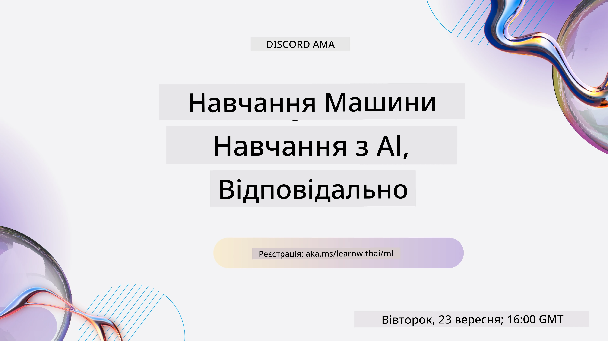
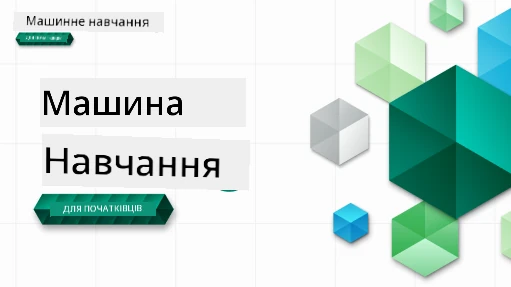

[](https://github.com/microsoft/ML-For-Beginners/blob/master/LICENSE)
[](https://GitHub.com/microsoft/ML-For-Beginners/graphs/contributors/)
[](https://GitHub.com/microsoft/ML-For-Beginners/issues/)
[](https://GitHub.com/microsoft/ML-For-Beginners/pulls/)
[](http://makeapullrequest.com)

[](https://GitHub.com/microsoft/ML-For-Beginners/watchers/)
[](https://GitHub.com/microsoft/ML-For-Beginners/network/)
[](https://GitHub.com/microsoft/ML-For-Beginners/stargazers/)

### 🌐 Підтримка багатьох мов

#### Переклади підтримуються за допомогою [Co-op Translator](https://github.com/Azure/co-op-translator)

<!-- CO-OP TRANSLATOR LANGUAGES TABLE START -->
[Арабська](../ar/README.md) | [Бенгальська](../bn/README.md) | [Болгарська](../bg/README.md) | [Бірманська (М’янма)](../my/README.md) | [Китайська (спрощена)](../zh-CN/README.md) | [Китайська (традиційна, Гонконг)](../zh-HK/README.md) | [Китайська (традиційна, Макао)](../zh-MO/README.md) | [Китайська (традиційна, Тайвань)](../zh-TW/README.md) | [Хорватська](../hr/README.md) | [Чеська](../cs/README.md) | [Данська](../da/README.md) | [Нідерландська](../nl/README.md) | [Естонська](../et/README.md) | [Фінська](../fi/README.md) | [Французька](../fr/README.md) | [Німецька](../de/README.md) | [Грецька](../el/README.md) | [Гебрейська](../he/README.md) | [Гінді](../hi/README.md) | [Угорська](../hu/README.md) | [Індонезійська](../id/README.md) | [Італійська](../it/README.md) | [Японська](../ja/README.md) | [Каннада](../kn/README.md) | [Кхмер](../km/README.md) | [Корейська](../ko/README.md) | [Литовська](../lt/README.md) | [Малайська](../ms/README.md) | [Малаялам](../ml/README.md) | [Маніпурі (Мейтей Майек)](../mni/README.md) | [Маратхі](../mr/README.md) | [Непальська](../ne/README.md) | [Нігерійський Піджін](../pcm/README.md) | [Норвезька](../no/README.md) | [Перська (фарсі)](../fa/README.md) | [Польська](../pl/README.md) | [Португальська (Бразилія)](../pt-BR/README.md) | [Португальська (Португалія)](../pt-PT/README.md) | [Пенджабі (гурмухі)](../pa/README.md) | [Румунська](../ro/README.md) | [Російська](../ru/README.md) | [Сербська (кирилиця)](../sr/README.md) | [Словацька](../sk/README.md) | [Словенська](../sl/README.md) | [Іспанська](../es/README.md) | [Свахілі](../sw/README.md) | [Шведська](../sv/README.md) | [Тагальська (філіппінська)](../tl/README.md) | [Тамільська](../ta/README.md) | [Телугу](../te/README.md) | [Тайська](../th/README.md) | [Турецька](../tr/README.md) | [Українська](./README.md) | [Урду](../ur/README.md) | [В’єтнамська](../vi/README.md)

> **Віддаєте перевагу клонувати локально?**
>
> Цей репозиторій містить більше 50 перекладів мов, що суттєво збільшує розмір завантаження. Щоб клонувати без перекладів, використовуйте sparse checkout:
>
> **Bash / macOS / Linux:**
> ```bash
> git clone --filter=blob:none --sparse https://github.com/microsoft/ML-For-Beginners.git
> cd ML-For-Beginners
> git sparse-checkout set --no-cone '/*' '!translations' '!translated_images'
> ```
>
> **CMD (Windows):**
> ```cmd
> git clone --filter=blob:none --sparse https://github.com/microsoft/ML-For-Beginners.git
> cd ML-For-Beginners
> git sparse-checkout set --no-cone "/*" "!translations" "!translated_images"
> ```
>
> Це дає вам усе необхідне для завершення курсу з набагато швидшим завантаженням.
<!-- CO-OP TRANSLATOR LANGUAGES TABLE END -->

#### Приєднуйтесь до нашої спільноти

[](https://discord.gg/nTYy5BXMWG)

У нас триває серія «Вчимося з AI» на Discord, дізнайтесь більше і приєднуйтеся до нас на [Learn with AI Series](https://aka.ms/learnwithai/discord) з 18 по 30 вересня 2025 року. Ви отримаєте поради та трюки щодо використання GitHub Copilot для Data Science.



# Машинне навчання для початківців - навчальна програма

> 🌍 Подорожуйте світом, досліджуючи машинне навчання через культури світу 🌍

Спільнота Cloud Advocates у Microsoft радо пропонує 12-тижневу навчальну програму з 26 уроків, присвячену **Машинному навчанню**. У цій програмі ви дізнаєтеся про те, що іноді називають **класичним машинним навчанням**, використовуючи в основному бібліотеку Scikit-learn і уникаючи глибинного навчання, яке розглядається в нашій [навчальній програмі AI для початківців](https://aka.ms/ai4beginners). Поєднуйте ці уроки з нашою [навчальною програмою «Data Science для початківців»](https://aka.ms/ds4beginners)!

Подорожуйте з нами світом, застосовуючи ці класичні методи до даних із різних куточків світу. Кожен урок містить тести перед та після уроку, письмові інструкції для виконання уроку, розв'язок, завдання та інше. Наша проєктна педагогіка дозволяє навчатися у процесі створення, що є перевіреним способом закріплення нових навичок.

**✍️ Щира подяка нашим авторам** Джен Лупер, Стівен Гауелл, Франческа Лаццері, Томомі Імура, Кессі Бревіу, Дмитру Сошникову, Крісу Норінгу, Анірбану Мукерджі, Орнеллі Альтун’ян, Рут Якубу та Емі Бойд

**🎨 Подяка також нашим ілюстраторам** Томомі Імурі, Дасані Мадіпаллі та Джен Лупер

**🙏 Особлива подяка 🙏 нашим студентським амбасадорам Microsoft – авторам, рецензентам та контент-співавторам, зокрема Рішиту Даглі, Мухаммаду Сакібу Хану Інану, Рохану Раджу, Александру Петреску, Абхішеку Джайсвалу, Наврін Табассум, Іоану Самуїла та Снігдха Агарвал**

**🤩 Особлива вдячність студентським амбасадорам Microsoft Еріку Ванджау, Джасліну Сондхі та Відуші Гупті за уроки з R!**

# Початок роботи

Виконайте ці кроки:
1. **Форк репозиторію**: натисніть кнопку «Fork» у верхньому правому куті цієї сторінки.
2. **Клонувати репозиторій**:   `git clone https://github.com/microsoft/ML-For-Beginners.git`

> 💡 **Порада для швидкого старту:** Хочете розпочати у браузері без налаштування Python локально? Використовуйте [GitHub Codespaces](https://github.com/features/codespaces) для створення хмарного середовища розробки для вашого форку. Відкрийте зелене меню **Code**, оберіть **Codespaces** і створіть codespace; за потреби встановіть потрібні залежності для кожного уроку.

> [знайдіть всі додаткові ресурси до цього курсу в нашій колекції Microsoft Learn](https://learn.microsoft.com/en-us/collections/qrqzamz1nn2wx3?WT.mc_id=academic-77952-bethanycheum)

> 🔧 **Потрібна допомога?** Перегляньте наш [Посібник з усунення неполадок](TROUBLESHOOTING.md) для вирішення поширених проблем з встановленням, налаштуванням та запуском уроків.


**[Студенти](https://aka.ms/student-page)**, щоб використовувати цю навчальну програму, зробіть форк у свій обліковий запис GitHub і виконуйте вправи самостійно або в групі:

- Починайте з попереднього тесту перед лекцією.
- Читайте лекцію та виконуйте завдання, зупиняючись і розмірковуючи на кожній перевірці знань.
- Спробуйте створити проєкти, розуміючи уроки, а не лише запускаючи код розв'язку; однак код доступний у папках `/solution` кожного уроку, орієнтованого на проєкти.
- Пройдіть тест після лекції.
- Виконайте виклик.
- Виконайте домашнє завдання.
- Після завершення групи уроків відвідайте [Дошку обговорень](https://github.com/microsoft/ML-For-Beginners/discussions) і "вчіться вголос", заповнюючи відповідну рубрику PAT. 'PAT' — це інструмент оцінювання прогресу, який ви заповнюєте для поглиблення навчання. Ви також можете реагувати на інші PAT, щоб навчатися разом.

> Для подальшого навчання рекомендуємо проходити ці модулі та шляхи навчання [Microsoft Learn](https://docs.microsoft.com/en-us/users/jenlooper-2911/collections/k7o7tg1gp306q4?WT.mc_id=academic-77952-leestott).

**Вчителі**, ми включили [деякі рекомендації](for-teachers.md) щодо використання цієї навчальної програми.

---

## Відеоогляди

Деякі уроки доступні у вигляді коротких відео. Ви можете знайти всі їх безпосередньо в уроках або на [плейлисті ML для початківців на каналі Microsoft Developer YouTube](https://aka.ms/ml-beginners-videos), натиснувши на зображення нижче.

[](https://aka.ms/ml-beginners-videos)

---

## Знайомтеся з командою

[](https://youtu.be/Tj1XWrDSYJU)

**Гіф від** [Мохіт Джайсол](https://linkedin.com/in/mohitjaisal)

> 🎥 Натисніть на зображення вище, щоб переглянути відео про проєкт та людей, які його створили!

---

## Педагогія

Під час створення цієї навчальної програми ми обрали два педагогічні принципи: забезпечення практичності через **проєктно-орієнтоване** навчання та включення **частих тестів**. Окрім того, ця програма має спільну **тематику** для надання цілісності.

Забезпечуючи відповідність матеріалу проєктам, процес навчання стає цікавішим для студентів, а засвоєння концепцій підвищується. Крім того, легкий тест перед заняттям налаштовує студента на вивчення теми, а тест після заняття забезпечує подальше закріплення знань. Ця програма призначена бути гнучкою та цікавою, її можна пройти повністю або частково. Проєкти починаються з простих і стають складнішими до кінця 12-тижневого циклу. Програма також містить післямову про реальні застосування машинного навчання, яку можна використовувати як додаткові бали або базу для обговорень.

> Знайдіть наші рекомендації [Кодекс поведінки](CODE_OF_CONDUCT.md), [Співпраця](CONTRIBUTING.md), [Переклади](..) та [Усунення неполадок](TROUBLESHOOTING.md). Ми радо приймаємо ваші конструктивні відгуки!

## Кожен урок містить

- необов’язковий скетчнот
- необов’язкове додаткове відео
- відеоогляд (лише деякі уроки)
- [розминка перед лекцією](https://ff-quizzes.netlify.app/en/ml/)
- письмовий урок
- для уроків із проєктами, покрокові інструкції з побудови проєкту
- перевірки знань
- виклик
- додаткове читання
- домашнє завдання
- [тест після лекції](https://ff-quizzes.netlify.app/en/ml/)

> **Щодо мов:** Ці уроки переважно написані на Python, але багато з них доступні також на R. Щоб пройти урок R, перейдіть до папки `/solution` і знайдіть уроки R. Вони мають розширення .rmd, що представляє **R Markdown** файл, який можна просто визначити як вбудування `code chunks` (R або інших мов) та `YAML header` (який керує форматуванням виводу, наприклад PDF) в `Markdown document`. Таким чином, це є зразковим авторським середовищем для науки про дані, оскільки дозволяє поєднувати ваш код, його вивід і думки, записані у Markdown. Крім того, документи R Markdown можна виводити у формати PDF, HTML або Word.

> **Щодо тестів:** Усі тести містяться в папці [Quiz App folder](../../quiz-app), загалом 52 тести по три питання кожен. Вони пов’язані з уроками, але додаток для тестування можна запустити локально; дотримуйтеся інструкцій у папці `quiz-app` для локального хостингу або розгортання в Azure.

| Номер уроку |                             Тема                              |                   Групування уроків                   | Навчальні цілі                                                                                                             |                                                              Пов'язаний урок                                                               |                        Автор                        |
| :-----------: | :------------------------------------------------------------: | :-------------------------------------------------: | ------------------------------------------------------------------------------------------------------------------------------- | :--------------------------------------------------------------------------------------------------------------------------------------: | :--------------------------------------------------: |
|      01       |                Вступ до машинного навчання                |      [Вступ](1-Introduction/README.md)       | Ознайомитись із базовими поняттями машинного навчання                                                                                |                                             [Урок](1-Introduction/1-intro-to-ML/README.md)                                             |                       Muhammad                       |
|      02       |                Історія машинного навчання                 |      [Вступ](1-Introduction/README.md)       | Дізнатись історію, що лежить в основі цієї галузі                                                                                         |                                            [Урок](1-Introduction/2-history-of-ML/README.md)                                            |                     Jen and Amy                      |
|      03       |                 Справедливість та машинне навчання                  |      [Вступ](1-Introduction/README.md)       | Які важливі філософські питання щодо справедливості студентам варто враховувати при створенні та застосуванні моделей МН? |                                              [Урок](1-Introduction/3-fairness/README.md)                                               |                        Tomomi                        |
|      04       |                Техніки машинного навчання                 |      [Вступ](1-Introduction/README.md)       | Якими техніками користуються дослідники МН для побудови моделей?                                                                       |                                          [Урок](1-Introduction/4-techniques-of-ML/README.md)                                           |                    Chris and Jen                     |
|      05       |                   Вступ до регресії                   |        [Регресія](2-Regression/README.md)         | Почніть працювати з Python та Scikit-learn для регресійних моделей                                                                  |         [Python](2-Regression/1-Tools/README.md) • [R](../../2-Regression/1-Tools/solution/R/lesson_1.html)         |      Jen • Eric Wanjau       |
|      06       |                Північноамериканські ціни на гарбузи 🎃                |        [Регресія](2-Regression/README.md)         | Візуалізуйте та очистіть дані для підготовки до МН                                                                                  |          [Python](2-Regression/2-Data/README.md) • [R](../../2-Regression/2-Data/solution/R/lesson_2.html)          |      Jen • Eric Wanjau       |
|      07       |                Північноамериканські ціни на гарбузи 🎃                |        [Регресія](2-Regression/README.md)         | Побудуйте лінійні та поліноміальні регресійні моделі                                                                                   |        [Python](2-Regression/3-Linear/README.md) • [R](../../2-Regression/3-Linear/solution/R/lesson_3.html)        |      Jen and Dmitry • Eric Wanjau       |
|      08       |                Північноамериканські ціни на гарбузи 🎃                |        [Регресія](2-Regression/README.md)         | Побудуйте модель логістичної регресії                                                                                               |     [Python](2-Regression/4-Logistic/README.md) • [R](../../2-Regression/4-Logistic/solution/R/lesson_4.html)      |      Jen • Eric Wanjau       |
|      09       |                          Веб-застосунок 🔌                          |           [Веб-застосунок](3-Web-App/README.md)            | Створіть веб-застосунок для використання вашої навченої моделі                                                                                       |                                                 [Python](3-Web-App/1-Web-App/README.md)                                                  |                         Jen                          |
|      10       |                 Вступ до класифікації                 |    [Класифікація](4-Classification/README.md)     | Очищення, підготовка та візуалізація даних; вступ до класифікації                                                            | [Python](4-Classification/1-Introduction/README.md) • [R](../../4-Classification/1-Introduction/solution/R/lesson_10.html)  | Jen and Cassie • Eric Wanjau |
|      11       |             Смачні азійські та індійські кухні 🍜             |    [Класифікація](4-Classification/README.md)     | Вступ до класифікаторів                                                                                                     | [Python](4-Classification/2-Classifiers-1/README.md) • [R](../../4-Classification/2-Classifiers-1/solution/R/lesson_11.html) | Jen and Cassie • Eric Wanjau |
|      12       |             Смачні азійські та індійські кухні 🍜             |    [Класифікація](4-Classification/README.md)     | Більше класифікаторів                                                                                                                | [Python](4-Classification/3-Classifiers-2/README.md) • [R](../../4-Classification/3-Classifiers-2/solution/R/lesson_12.html) | Jen and Cassie • Eric Wanjau |
|      13       |             Смачні азійські та індійські кухні 🍜             |    [Класифікація](4-Classification/README.md)     | Побудуйте веб-застосунок-рекомендацію за допомогою вашої моделі                                                                                    |                                              [Python](4-Classification/4-Applied/README.md)                                              |                         Jen                          |
|      14       |                   Вступ до кластеризації                   |        [Кластеризація](5-Clustering/README.md)         | Очищення, підготовка та візуалізація даних; вступ до кластеризації                                                                |         [Python](5-Clustering/1-Visualize/README.md) • [R](../../5-Clustering/1-Visualize/solution/R/lesson_14.html)         |      Jen • Eric Wanjau       |
|      15       |              Дослідження музичних смаків Нігерії 🎧              |        [Кластеризація](5-Clustering/README.md)         | Ознайомлення з методом кластеризації K-Means                                                                                           |           [Python](5-Clustering/2-K-Means/README.md) • [R](../../5-Clustering/2-K-Means/solution/R/lesson_15.html)           |      Jen • Eric Wanjau       |
|      16       |        Вступ до обробки природної мови ☕️         |   [Обробка природної мови](6-NLP/README.md)    | Навчіться основам NLP, створивши простого бота                                                                             |                                             [Python](6-NLP/1-Introduction-to-NLP/README.md)                                              |                       Stephen                        |
|      17       |                      Типові завдання NLP ☕️                      |   [Обробка природної мови](6-NLP/README.md)    | Поглибте свої знання NLP, вивчаючи загальні завдання, пов'язані з мовними структурами                          |                                                    [Python](6-NLP/2-Tasks/README.md)                                                     |                       Stephen                        |
|      18       |             Переклад та аналіз настроїв ♥️              |   [Обробка природної мови](6-NLP/README.md)    | Переклад і аналіз настроїв на прикладі текстів Джейн Остін                                                                             |                                            [Python](6-NLP/3-Translation-Sentiment/README.md)                                             |                       Stephen                        |
|      19       |                  Романтичні готелі Європи ♥️                  |   [Обробка природної мови](6-NLP/README.md)    | Аналіз настроїв у відгуках про готелі 1                                                                                         |                                               [Python](6-NLP/4-Hotel-Reviews-1/README.md)                                                |                       Stephen                        |
|      20       |                  Романтичні готелі Європи ♥️                  |   [Обробка природної мови](6-NLP/README.md)    | Аналіз настроїв у відгуках про готелі 2                                                                                         |                                               [Python](6-NLP/5-Hotel-Reviews-2/README.md)                                                |                       Stephen                        |
|      21       |            Вступ до прогнозування часових рядів             |        [Часові ряди](7-TimeSeries/README.md)        | Вступ до прогнозування часових рядів                                                                                         |                                             [Python](7-TimeSeries/1-Introduction/README.md)                                              |                      Francesca                       |
|      22       | ⚡️ Світове споживання електроенергії ⚡️ - прогнозування часових рядів за допомогою ARIMA |        [Часові ряди](7-TimeSeries/README.md)        | Прогнозування часових рядів за допомогою ARIMA                                                                                              |                                                 [Python](7-TimeSeries/2-ARIMA/README.md)                                                 |                      Francesca                       |
|      23       |  ⚡️ Світове споживання електроенергії ⚡️ - прогнозування часових рядів за допомогою SVR  |        [Часові ряди](7-TimeSeries/README.md)        | Прогнозування часових рядів за допомогою регресора опорних векторів                                                                           |                                                  [Python](7-TimeSeries/3-SVR/README.md)                                                  |                       Anirban                        |
|      24       |             Вступ до підкріплювального навчання             | [Підкріплювальне навчання](8-Reinforcement/README.md) | Вступ до підкріплювального навчання з Q-Learning                                                                          |                                             [Python](8-Reinforcement/1-QLearning/README.md)                                              |                        Dmitry                        |
|      25       |                 Допоможіть Пітеру уникнути вовка! 🐺                  | [Підкріплювальне навчання](8-Reinforcement/README.md) | Підкріплювальне навчання у Gym                                                                                                      |                                                [Python](8-Reinforcement/2-Gym/README.md)                                                 |                        Dmitry                        |
|  Постскриптум   |            Реальні сценарії та застосування МН            |      [МН у реальному житті](9-Real-World/README.md)       | Цікаві та показові приклади застосувань класичного МН у реальному житті                                                               |                                             [Урок](9-Real-World/1-Applications/README.md)                                              |                         Команда                         |
|  Постскриптум   |            Відлагодження моделей МН за допомогою RAI dashboard            |      [МН у реальному житті](9-Real-World/README.md)       | Відлагодження моделей машинного навчання за допомогою компонентів панелі відповідального ШІ                                                              |                                             [Урок](9-Real-World/2-Debugging-ML-Models/README.md)                                              |                     Ruth Yakubu                      |

> [знайдіть усі додаткові ресурси для цього курсу у нашій колекції Microsoft Learn](https://learn.microsoft.com/en-us/collections/qrqzamz1nn2wx3?WT.mc_id=academic-77952-bethanycheum)

## Офлайн доступ

Ви можете запускати цю документацію офлайн за допомогою [Docsify](https://docsify.js.org/#/). Форкніть це сховище, [встановіть Docsify](https://docsify.js.org/#/quickstart) на ваш локальний комп’ютер, а потім у кореневій папці цього сховища виконайте `docsify serve`. Вебсайт буде доступний на порті 3000 на вашому localhost: `localhost:3000`.

## PDF-файли

Знайдіть pdf з навчальною програмою з посиланнями [тут](https://microsoft.github.io/ML-For-Beginners/pdf/readme.pdf).


## 🎒 Інші курси

Наша команда створює й інші курси! Подивіться:

<!-- CO-OP TRANSLATOR OTHER COURSES START -->
### LangChain
[](https://aka.ms/langchain4j-for-beginners)
[](https://aka.ms/langchainjs-for-beginners?WT.mc_id=m365-94501-dwahlin)
[](https://github.com/microsoft/langchain-for-beginners?WT.mc_id=m365-94501-dwahlin)
---

### Azure / Edge / MCP / Агенти
[](https://github.com/microsoft/AZD-for-beginners?WT.mc_id=academic-105485-koreyst)
[](https://github.com/microsoft/edgeai-for-beginners?WT.mc_id=academic-105485-koreyst)
[](https://github.com/microsoft/mcp-for-beginners?WT.mc_id=academic-105485-koreyst)
[](https://github.com/microsoft/ai-agents-for-beginners?WT.mc_id=academic-105485-koreyst)

---
 
### Серія Генеративного ШІ
[](https://github.com/microsoft/generative-ai-for-beginners?WT.mc_id=academic-105485-koreyst)
[-9333EA?style=for-the-badge&labelColor=E5E7EB&color=9333EA)](https://github.com/microsoft/Generative-AI-for-beginners-dotnet?WT.mc_id=academic-105485-koreyst)
[-C084FC?style=for-the-badge&labelColor=E5E7EB&color=C084FC)](https://github.com/microsoft/generative-ai-for-beginners-java?WT.mc_id=academic-105485-koreyst)
[-E879F9?style=for-the-badge&labelColor=E5E7EB&color=E879F9)](https://github.com/microsoft/generative-ai-with-javascript?WT.mc_id=academic-105485-koreyst)

---
 
### Основне навчання
[](https://aka.ms/ml-beginners?WT.mc_id=academic-105485-koreyst)
[](https://aka.ms/datascience-beginners?WT.mc_id=academic-105485-koreyst)
[](https://aka.ms/ai-beginners?WT.mc_id=academic-105485-koreyst)
[](https://github.com/microsoft/Security-101?WT.mc_id=academic-96948-sayoung)
[](https://aka.ms/webdev-beginners?WT.mc_id=academic-105485-koreyst)
[](https://aka.ms/iot-beginners?WT.mc_id=academic-105485-koreyst)
[](https://github.com/microsoft/xr-development-for-beginners?WT.mc_id=academic-105485-koreyst)

---
 
### Серія Copilot
[](https://aka.ms/GitHubCopilotAI?WT.mc_id=academic-105485-koreyst)
[](https://github.com/microsoft/mastering-github-copilot-for-dotnet-csharp-developers?WT.mc_id=academic-105485-koreyst)
[](https://github.com/microsoft/CopilotAdventures?WT.mc_id=academic-105485-koreyst)
<!-- CO-OP TRANSLATOR OTHER COURSES END -->

## Отримання допомоги

Якщо ви застрягли або маєте запитання під час вивчення машинного навчання або створення AI-застосунків, не хвилюйтеся — допомога доступна.

Ви можете приєднуватися до обговорень з іншими учнями та розробниками, ставити запитання та ділитися ідеями з спільнотою.

- Приєднуйтесь до спільноти, щоб ставити питання та навчатися разом
- Обговорюйте концепції машинного навчання та ідеї проектів
- Отримуйте поради від досвідчених розробників

Підтримуюча спільнота є чудовим способом розвивати навички та швидше вирішувати проблеми.

[Спільнота Microsoft Foundry Discord](https://discord.gg/nTYy5BXMWG)

Якщо ви виявите помилки, збої або у вас є пропозиції щодо покращень, ви також можете відкрити **Issue** у цьому репозиторії, щоб повідомити про проблему.

Для відгуків про продукт або пошуку існуючих дописів спільноти відвідайте Форум розробників:

[](https://aka.ms/foundry/forum)

## Додаткові поради для навчання

- Переглядайте ноутбуки після кожного уроку для кращого розуміння.
- Практикуйте власне впровадження алгоритмів.
- Досліджуйте реальні набори даних, використовуючи вивчені концепції.

---

<!-- CO-OP TRANSLATOR DISCLAIMER START -->
**Відмова від відповідальності**:
Цей документ було перекладено за допомогою сервісу штучного інтелекту для перекладу [Co-op Translator](https://github.com/Azure/co-op-translator). Хоча ми прагнемо до точності, будь ласка, майте на увазі, що автоматичні переклади можуть містити помилки або неточності. Оригінальний документ рідною мовою слід вважати авторитетним джерелом. Для критично важливої інформації рекомендується професійний людський переклад. Ми не несемо відповідальності за будь-які непорозуміння або неправильні тлумачення, що виникли внаслідок використання цього перекладу.
<!-- CO-OP TRANSLATOR DISCLAIMER END -->