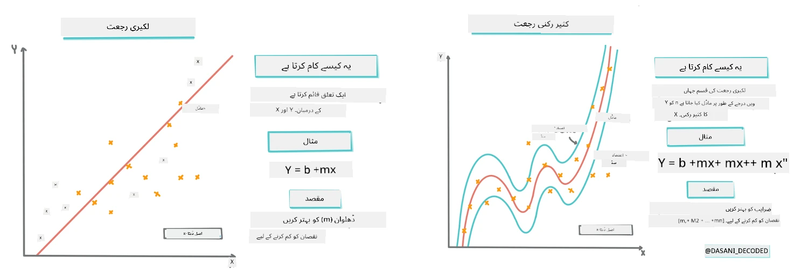
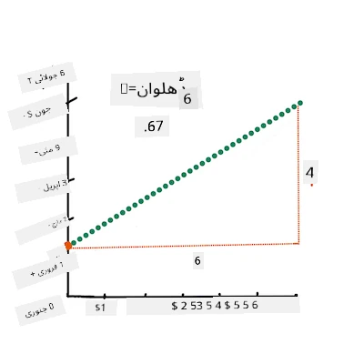
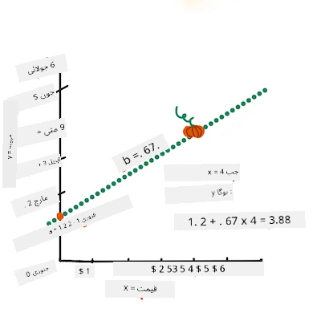
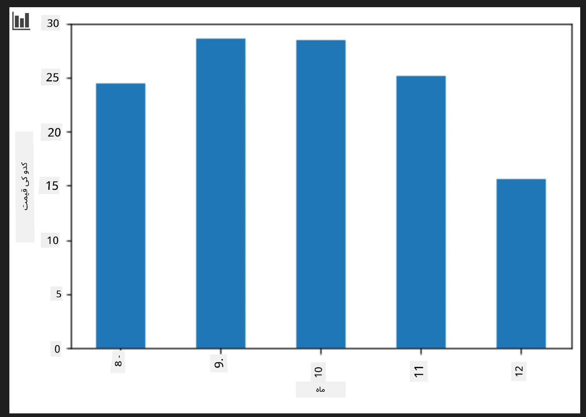
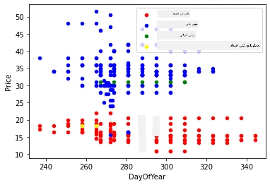

# سکائیکیٹ لرن کا استعمال کرتے ہوئے ریگریشن ماڈل بنائیں: ریگریشن چار طریقے

## ابتدائی نوٹ

لینیئر ریگریشن اس وقت استعمال ہوتی ہے جب ہم کسی **عدداتی قیمت** (مثلاً، گھر کی قیمت، درجہ حرارت، یا فروخت) کی پیش گوئی کرنا چاہتے ہوں۔
یہ کام ان پٹ خصوصیات اور آؤٹ پٹ کے درمیان تعلق کی بہترین نمائندگی کرنے والی سیدھی لائن تلاش کرکے کرتا ہے۔

اس سبق میں، ہم تصور کو سمجھنے پر توجہ مرکوز کرتے ہیں اس سے پہلے کہ جدید ریگریشن تکنیکوں کو دریافت کریں۔

> انفورگرافک بذریعہ [داسانی مادپلی](https://twitter.com/dasani_decoded)
## [پری-لیکچر کوئز](https://ff-quizzes.netlify.app/en/ml/)

> ### [یہ سبق R میں بھی دستیاب ہے!](../../../../2-Regression/3-Linear/solution/R/lesson_3.html)
### تعارف

اب تک آپ نے یہ دریافت کیا ہے کہ ریگریشن کیا ہے، ساتھ ہی ہم نے کدو کی قیمتوں کے ڈیٹا سے نمونہ لیا ہوا ڈیٹا استعمال کیا ہے جسے ہم پورے سبق میں استعمال کریں گے۔ آپ نے اسے میٹ پلوٹ لائبراڑی کا استعمال کرتے ہوئے ویژولائز بھی کیا ہے۔

اب آپ مشین لرننگ کے لیے ریگریشن میں گہرائی میں جانے کے لیے تیار ہیں۔ جب کہ ویژولائزیشن آپ کو ڈیٹا کو سمجھنے کے قابل بناتی ہے، مشین لرننگ کی اصل طاقت _ماڈلز کی تربیت_ میں ہے۔ ماڈلز تاریخی ڈیٹا پر تربیت دیے جاتے ہیں تاکہ خودکار طریقے سے ڈیٹا کی انحصاریوں کو پکڑ سکیں، اور یہ آپ کو نئے ڈیٹا کے لیے نتائج پیش گوئی کرنے کی اجازت دیتے ہیں، جو ماڈل نے پہلے کبھی نہیں دیکھا۔

اس سبق میں، آپ ریگریشن کی دو اقسام کے بارے میں مزید جانیں گے: _بنیادی لینیئر ریگریشن_ اور _پولینومیئل ریگریشن_، ساتھ ہی ان تکنیکوں کے پیچھے موجود کچھ ریاضی بھی۔ یہ ماڈلز ہمیں مختلف ان پٹ ڈیٹا کے مطابق کدو کی قیمتوں کی پیشنگوئی کرنے کی اجازت دیں گے۔

[](https://youtu.be/CRxFT8oTDMg "مشق کے لیے مشین لرننگ - لینیئر ریگریشن کو سمجھنا")

> 🎥 اوپر تصویر پر کلک کریں لینیئر ریگریشن کے بارے میں ایک مختصر ویڈیو جائزہ کے لیے۔

> اس نصاب کے دوران، ہم ریاضی کے بارے میں کم از کم معلومات فرض کرتے ہیں، اور اسے دوسرے شعبوں سے آنے والے طلباء کے لیے قابل رسائی بنانے کی کوشش کرتے ہیں، اس لیے نوٹس، 🧮 کالمز، خاکے، اور دیگر تعلیمی اوزار دیکھتے رہیں تاکہ سمجھ بوجھ میں مدد ملے۔

### پیشگی شرط

اب تک آپ کو کدو کے ڈیٹا کی ساخت سے واقف ہونا چاہیے جس کا ہم جائزہ لے رہے ہیں۔ آپ اسے اس سبق کے _notebook.ipynb_ فائل میں پہلے سے لوڈ اور صاف شدہ حالت میں پا سکتے ہیں۔ اس فائل میں، کدو کی قیمت فی بشل نئے ڈیٹا فریم میں دکھائی گئی ہے۔ یقینی بنائیں کہ آپ یہ نوٹ بکس ویژول اسٹوڈیو کوڈ کے کرنلز میں چلا سکتے ہیں۔

### تیاری

یاد دہانی کے طور پر، آپ یہ ڈیٹا لوڈ کر رہے ہیں تاکہ اس سے سوالات پوچھ سکیں۔

- کدو خریدنے کا بہترین وقت کب ہے؟
- منی ایچر کدو کے ایک کیس کی قیمت کیا ہو سکتی ہے؟
- کیا مجھے انہیں آدھے بشل ٹوکریوں میں خریدنا چاہیے یا 1 1/9 بشل کے ڈبے میں؟
آئیے اس ڈیٹا میں مزید کھود کرتے ہیں۔

پچھلے سبق میں، آپ نے پانڈاز کا ڈیٹا فریم بنایا اور اسے اصل ڈیٹا سیٹ کے ایک حصے سے بھرا، قیمتوں کو بشل کے اعتبار سے معیاری بنایا۔ تاہم ایسا کرنے سے آپ تقریباً 400 ڈیٹا پوائنٹس تک محدود رہے اور صرف خزاں کے مہینوں کے لیے۔

اس سبق کے ساتھ دی گئی نوٹ بک میں پہلے سے لوڈ کیے گئے ڈیٹا کو دیکھیں۔ ڈیٹا پہلے سے لوڈ کیا گیا ہے اور مہینہ کے ڈیٹا کو دکھانے کے لیے ایک ابتدائی سکریٹر پلاٹ بنایا گیا ہے۔ شاید ہم ڈیٹا کی نوعیت کے بارے میں مزید تفصیل حاصل کر سکیں اگر ہم اسے مزید صاف کریں۔

## لینیئر ریگریشن لائن

جیسا کہ آپ نے سبق 1 میں سیکھا، لینیئر ریگریشن مشق کا مقصد یہ ہے کہ ایک لائن پلاٹ کریں تاکہ:

- **متغیرات کے تعلقات دکھائیں۔** متغیرات کے تعلقات کو ظاہر کریں۔
- **پیشگوئیاں کریں۔** اس بات کی درست پیش گوئی کریں کہ کوئی نیا ڈیٹا پوائنٹ اس لائن کے حوالے سے کہاں آئے گا۔

**لِیسٹ اسکوائرز ریگریشن** کے لیے عام طور پر اس قسم کی لائن کھینچی جاتی ہے۔ "لِیسٹ اسکوائرز" اصطلاح ماڈل میں کل غلطی کو کم کرنے کے عمل کی طرف اشارہ کرتی ہے۔ ہر ڈیٹا پوائنٹ کے لیے، ہم اصل نقطہ اور ہمارے ریگریشن لائن کے درمیان عمودی فاصلے (جسے بقایا کہتے ہیں) کو ناپتے ہیں۔

ہم ان فاصلات کو دو بنیادی وجوہات کی بناء پر مربع کرتے ہیں:

1. **مقدار فوقِ سمت:** ہم چاہتے ہیں کہ -5 کی غلطی کو +5 کی غلطی کی طرح سمجھا جائے۔ مربع کرنے سے تمام اقدار مثبت ہو جاتی ہیں۔

2. **آؤٹ لائرز کو سزا دینا:** مربع کرنے سے بڑی غلطیوں کو زیادہ وزن ملتا ہے، لائن کو دور کے نقطہ جات کے قریب رکھنے پر مجبور کرتا ہے۔

پھر ہم ان تمام مربع اقدار کو جمع کرتے ہیں۔ ہمارا مقصد خاص لائن تلاش کرنا ہے جہاں یہ مجموعہ اپنی کم سے کم قیمت پر ہو (سب سے چھوٹی ممکنہ قیمت) — اسی لیے اسے "لِیسٹ اسکوائرز" کہتے ہیں۔

> **🧮 مجھے ریاضی دکھائیں**  
>  
> یہ لائن، جسے _بہترین فٹ لائن_ کہتے ہیں، [ایک مساوات](https://en.wikipedia.org/wiki/Simple_linear_regression) سے ظاہر کی جا سکتی ہے:
>  
> ```
> Y = a + bX
> ```
>
> `X` 'وضاحتی متغیر' ہے۔ `Y` 'تابع متغیر' ہے۔ لائن کی ڈھلوان `b` ہے اور `a` y-انٹرسیپٹ ہے، جو اس وقت `Y` کی قیمت ظاہر کرتا ہے جب `X = 0` ہو۔ 
>
>
>
> سب سے پہلے، ڈھلوان `b` کو حساب کریں۔ انفورگرافک بذریعہ [جین لوپر](https://twitter.com/jenlooper)
>
> دوسرے الفاظ میں، اور ہمارے کدو کے ڈیٹا کے اصل سوال کی طرف اشارہ کرتے ہوئے: "مہینے کے حساب سے فی بشل کدو کی قیمت کی پیشنگوئی کریں"، `X` قیمت کی نمائندگی کرے گا اور `Y` فروخت کے مہینے کی نمائندگی کرے گا۔
>
>
>
> Y کی قیمت کا حساب لگائیں۔ اگر آپ تقریباً $4 ادا کر رہے ہیں، تو یہ یقیناً اپریل ہونا چاہیے! انفورگرافک بذریعہ [جین لوپر](https://twitter.com/jenlooper)
>
> لائن کا حساب لگانے کے لیے ریاضیات کو ڈھلوان دکھانا چاہیے، جو انٹرسپٹ پر بھی منحصر ہے، یعنی جہاں `Y` اس وقت ہوتا ہے جب `X = 0`۔
>
> آپ ان اقدار کے حساب کے طریقہ کار کو [Math is Fun](https://www.mathsisfun.com/data/least-squares-regression.html) ویب سائٹ پر دیکھ سکتے ہیں۔ مزید برآں، [یہ لِیسٹ-اسکوائرز کیلکولیٹر](https://www.mathsisfun.com/data/least-squares-calculator.html) وزٹ کریں تاکہ دیکھیے کہ اعداد کی قیمتیں لائن کو کیسے متاثر کرتی ہیں۔

## تعلق

ایک اور اصطلاح جسے سمجھنا ضروری ہے وہ ہے دیے گئے X اور Y متغیرات کے درمیان **تعلق کا کوفی شینٹ**۔ سکریٹر پلاٹ کے ذریعے آپ اس کوفی شینٹ کو جلدی سے دیکھ سکتے ہیں۔ ایک ایسا پلاٹ جس میں ڈیٹا پوائنٹس ایک صاف لائن میں بکھرے ہوتے ہیں تعلق زیادہ ہوتا ہے، لیکن ایک ایسا پلاٹ جس میں ڈیٹا پوائنٹس X اور Y کے درمیان ہر جگہ بکھرے ہوں تعلق کم ہوتا ہے۔

ایک اچھا لینیئر ریگریشن ماڈل وہ ہوگا جس کا تعلق کا کوفی شینٹ (0 کے مقابلے میں 1 کے قریب تر) زیادہ ہو، اور وہ لِیسٹ اسکوائرز ریگریشن کے تحت ریگریشن لائن کے ساتھ ہو۔

✅ اس سبق کے ساتھ دی گئی نوٹ بک چلائیں اور ماہ سے قیمت کے سکریٹر پلاٹ کو دیکھیں۔ آپ کی نظر میں ماہ سے قیمت کے تعلق کی کتنی شدت ہے، یہ آپ کی بصری تشریح کے مطابق کیا تعلق زیادہ ہے یا کم؟ کیا یہ بدلتا ہے اگر آپ زیادہ باریک پیمانے مثلاً _سال کا دن_ (یعنی سال کے آغاز سے گزرے دنوں کی تعداد) استعمال کریں؟

ذیل میں کوڈ میں فرض کرتے ہیں کہ ہم نے ڈیٹا صاف کر لیا ہے، اور ایک ڈیٹا فریم `new_pumpkins` حاصل کیا ہے، جو درج ذیل کی مماثل ہے:

ID | Month | DayOfYear | Variety | City | Package | Low Price | High Price | Price
---|-------|-----------|---------|------|---------|-----------|------------|-------
70 | 9 | 267 | PIE TYPE | BALTIMORE | 1 1/9 bushel cartons | 15.0 | 15.0 | 13.636364
71 | 9 | 267 | PIE TYPE | BALTIMORE | 1 1/9 bushel cartons | 18.0 | 18.0 | 16.363636
72 | 10 | 274 | PIE TYPE | BALTIMORE | 1 1/9 bushel cartons | 18.0 | 18.0 | 16.363636
73 | 10 | 274 | PIE TYPE | BALTIMORE | 1 1/9 bushel cartons | 17.0 | 17.0 | 15.454545
74 | 10 | 281 | PIE TYPE | BALTIMORE | 1 1/9 bushel cartons | 15.0 | 15.0 | 13.636364

> ڈیٹا صاف کرنے کا کوڈ [`notebook.ipynb`](notebook.ipynb) میں دستیاب ہے۔ ہم نے پچھلے سبق کی طرح یہی صفائی کے اقدامات کیے ہیں، اور `DayOfYear` کالم کو درج ذیل اظہار سے حساب کیا ہے: 

```python
day_of_year = pd.to_datetime(pumpkins['Date']).apply(lambda dt: (dt-datetime(dt.year,1,1)).days)
```

اب جبکہ آپ کو لینیئر ریگریشن کے پیچھے ریاضی کی سمجھ ہے، آئیں ایک ریگریشن ماڈل بنائیں تاکہ دیکھ سکیں کہ ہم پیش گوئی کر سکتے ہیں کہ کس کدو کے پیکیج کی قیمت سب سے بہتر ہوگی۔ کوئی جو تعطیلات کے کدو کی پیٹیچ کے لیے کدو خرید رہا ہو، اسے یہ معلومات اپنی خریداری کو بہتر بنانے کے لیے فائدہ دے سکتی ہے۔

## تعلق کی تلاش

[](https://youtu.be/uoRq-lW2eQo "مشق کے لیے مشین لرننگ - تعلق کی تلاش: لینیئر ریگریشن کی کنجی")

> 🎥 اوپر تصویر پر کلک کریں تعلق کے بارے میں مختصر ویڈیو جائزہ کے لیے۔

پچھلے سبق میں آپ نے شاید دیکھا ہوگا کہ مختلف مہینوں کے لیے اوسط قیمت اس طرح نظر آتی ہے:



یہ اشارہ دیتا ہے کہ کوئی تعلق ہونا چاہیے، اور ہم لینیئر ریگریشن ماڈل کی تربیت کر کے `Month` اور `Price` یا `DayOfYear` اور `Price` کے درمیان تعلق پیش گوئی کر سکتے ہیں۔ ذیل میں وہ سکریٹر پلاٹ ہے جو بعد والے تعلق کو ظاہر کرتا ہے:

 

آئیے `corr` فنکشن کا استعمال کر کے دیکھتے ہیں کیا تعلق ہے:

```python
print(new_pumpkins['Month'].corr(new_pumpkins['Price']))
print(new_pumpkins['DayOfYear'].corr(new_pumpkins['Price']))
```

دیکھتے ہیں تعلق نسبتا چھوٹا ہے، -0.15 `Month` کے لحاظ سے اور -0.17 `DayOfYear` کے لحاظ سے، لیکن ایک اور اہم تعلق ہو سکتا ہے۔ ایسا لگتا ہے کہ قیمتوں کے مختلف گروہ مختلف کدو کی اقسام سے متعلق ہیں۔ اس مفروضے کی تصدیق کے لیے، آئیے ہر کدو کی قسم کو مختلف رنگ سے پلاٹ کریں۔ `scatter` فنکشن کو ایک `ax` پیرا میٹر دے کر ہم تمام پوائنٹس کو ایک ہی گراف پر پلاٹ کر سکتے ہیں:

```python
ax=None
colors = ['red','blue','green','yellow']
for i,var in enumerate(new_pumpkins['Variety'].unique()):
    df = new_pumpkins[new_pumpkins['Variety']==var]
    ax = df.plot.scatter('DayOfYear','Price',ax=ax,c=colors[i],label=var)
```

 

ہماری تحقیق سے ظاہر ہوتا ہے کہ مجموعی قیمت پر چیز کی قسم کا زیادہ اثر ہوتا ہے بنسبت اصل فروخت کی تاریخ کے۔ ہم اسے بار گراف کے ذریعے بھی دیکھ سکتے ہیں:

```python
new_pumpkins.groupby('Variety')['Price'].mean().plot(kind='bar')
```

 

چند لمحے کے لیے ہم صرف ایک کدو کی قسم، 'پائی ٹائپ' پر توجہ مرکوز کرتے ہیں، اور دیکھتے ہیں کہ تاریخ کا قیمت پر کیا اثر ہے:

```python
pie_pumpkins = new_pumpkins[new_pumpkins['Variety']=='PIE TYPE']
pie_pumpkins.plot.scatter('DayOfYear','Price') 
```
 

اگر ہم اب `Price` اور `DayOfYear` کے درمیان تعلق `corr` فنکشن کے ذریعے نکالیں، تو ہمیں کچھ ایسا ملے گا: `-0.27` — جس کا مطلب ہے کہ پیش گو ماڈل کی تربیت مفید ہے۔

> لینیئر ریگریشن ماڈل کو تربیت دینے سے پہلے، یہ ضروری ہے کہ ہمارا ڈیٹا صاف ہو۔ لینیئر ریگریشن گمشدہ اقدار کے ساتھ اچھا کام نہیں کرتا، اس لیے تمام خالی سیلز کو ہٹانا مناسب ہے:

```python
pie_pumpkins.dropna(inplace=True)
pie_pumpkins.info()
```

دوسری حکمت عملی یہ ہو سکتی ہے کہ ان خالی اقدار کو متعلقہ کالم کے اوسط سے بھر دیا جائے۔

## سادہ لینیئر ریگریشن

[](https://youtu.be/e4c_UP2fSjg "مشق کے لیے مشین لرننگ - سکائیکیٹ لرن کا استعمال کرتے ہوئے لینیئر اور پولینومیئل ریگریشن")

> 🎥 اوپر تصویر پر کلک کریں لینیئر اور پولینومیئل ریگریشن کے بارے میں مختصر ویڈیو جائزہ کے لیے۔

اپنے لینیئر ریگریشن ماڈل کی تربیت کے لیے، ہم **سکائیکیٹ لرن** لائبریری استعمال کریں گے۔

```python
from sklearn.linear_model import LinearRegression
from sklearn.metrics import mean_squared_error
from sklearn.model_selection import train_test_split
```

ہم انپٹ ویلیوز (خصوصیات) اور متوقع آؤٹ پٹ (لیبل) کو الگ الگ numpy ارے میں تقسیم کرتے ہیں:

```python
X = pie_pumpkins['DayOfYear'].to_numpy().reshape(-1,1)
y = pie_pumpkins['Price']
```

> نوٹ کریں کہ ہمیں انپٹ ڈیٹا پر `reshape` کرنا پڑا تاکہ لینیئر ریگریشن پیکیج اسے صحیح طریقے سے سمجھے۔ لینیئر ریگریشن 2D-ارے کی توقع کرتی ہے جس میں ہر قطار انپٹ فیچرز کے ویکٹر کے مساوی ہو۔ چونکہ ہمارے پاس صرف ایک انپٹ ہے، ہمیں N×1 شیپ والا ارے چاہیے، جہاں N ڈیٹا سیٹ کا سائز ہو۔

پھر، ہمیں ڈیٹا کو ٹرین اور ٹیسٹ ڈیٹا سیٹس میں تقسیم کرنا ہوگا تاکہ ہم تربیت کے بعد اپنے ماڈل کی تصدیق کر سکیں:

```python
X_train, X_test, y_train, y_test = train_test_split(X, y, test_size=0.2, random_state=0)
```

آخر میں، اصلی لینیئر ریگریشن ماڈل کی تربیت صرف دو لائنوں کوڈ کی ضرورت ہے۔ ہم `LinearRegression` آبجیکٹ بناتے ہیں، اور `fit` طریقہ کار کے ذریعے اسے اپنے ڈیٹا پر فٹ کرتے ہیں:

```python
lin_reg = LinearRegression()
lin_reg.fit(X_train,y_train)
```

`LinearRegression` آبجیکٹ جو کہ `fit` کرنے کے بعد ہوتا ہے، اس میں تمام رگریشن کے کوفیشینٹس شامل ہوتے ہیں، جن تک `.coef_` پراپرٹی کے ذریعے رسائی حاصل کی جا سکتی ہے۔ ہمارے کیس میں، صرف ایک کوفیشینٹ ہے، جو تقریباً `-0.017` ہونا چاہیے۔ اس کا مطلب ہے کہ قیمتیں وقت کے ساتھ تھوڑا سا کم ہوتی نظر آتی ہیں، لیکن زیادہ نہیں، روزانہ تقریباً 2 سینٹ کی کمی۔ ہم رگریشن کے تخصیص نقطہ کو Y- محور کے ساتھ `lin_reg.intercept_` کے ذریعے بھی حاصل کر سکتے ہیں — یہ ہمارے کیس میں تقریباً `21` ہوگا، جو سال کے شروع میں قیمت کی نشاندہی کرتا ہے۔

یہ دیکھنے کے لیے کہ ہمارا ماڈل کتنا درست ہے، ہم ٹیسٹ ڈیٹا سیٹ پر قیمتوں کی پیش گوئی کر سکتے ہیں، اور پھر دیکھ سکتے ہیں کہ ہماری پیش گوئیاں متوقع اقدار کے کتنی قریب ہیں۔ یہ کام روٹ مین اسکوائر ایرر (RMSE) میٹرک کے ذریعے کیا جا سکتا ہے، جو متوقع اور پیش گو کردہ قدر کے درمیان تمام مربع فرقوں کا اوسط لے کر اس کی جذر ہے۔

```python
pred = lin_reg.predict(X_test)

rmse = np.sqrt(mean_squared_error(y_test,pred))
print(f'RMSE: {rmse:3.3} ({rmse/np.mean(pred)*100:3.3}%)')
```

ہمارا ایرر تقریباً 2 پوائنٹس کے قریب ہے، جو کہ تقریباً 17% ہے۔ یہ زیادہ اچھا نہیں۔ ماڈل کے معیار کا ایک اور اشارہ **coefficient of determination** ہوتا ہے، جو اس طرح حاصل کیا جا سکتا ہے:

```python
score = lin_reg.score(X_train,y_train)
print('Model determination: ', score)
```

اگر اس کی قیمت 0 ہو، تو اس کا مطلب ہے کہ ماڈل ان پٹ ڈیٹا کو مدنظر نہیں رکھتا، اور *worst linear predictor* کے طور پر کام کرتا ہے، جو بس نتیجہ کا اوسط ہوتا ہے۔ قیمت 1 ہونے کا مطلب ہے کہ ہم تمام متوقع آؤٹ پٹ کو بالکل صحیح پیش گوئی کر سکتے ہیں۔ ہمارے کیس میں، کوفیشینٹ تقریباً 0.06 ہے، جو کہ بہت کم ہے۔

ہم ٹیسٹ ڈیٹا کو رگریشن لائن کے ساتھ پلاٹ بھی کر سکتے ہیں تاکہ بہتر طور پر دیکھ سکیں کہ ہمارے کیس میں رگریشن کس طرح کام کرتی ہے:

```python
plt.scatter(X_test,y_test)
plt.plot(X_test,pred)
```


## پولینومیئل رگریشن

لکیری رگریشن کی ایک قسم پولینومیئل رگریشن ہے۔ جہاں کبھی کبھار متغیرات کے درمیان لکیری تعلق ہوتا ہے — جتنا بڑا کدو حجم میں ہو، اتنی زیادہ قیمت — وہاں یہ تعلقات ہمیشہ ایک ہموار سطح یا سیدھی لائن کی صورت میں ہونے لازمی نہیں ہیں۔

✅ یہاں [کچھ دیگر مثالیں](https://online.stat.psu.edu/stat501/Lesson09#polynomial-regression-examples) دی گئی ہیں جو پولینومیئل رگریشن استعمال کر سکتی ہیں

تاریخ اور قیمت کے تعلق پر دوبارہ نظر ڈالیں۔ کیا یہ اسکیٹر پلاٹ لازمی طور پر ایک سیدھی لائن سے تجزیہ ہونا چاہیے؟ کیا قیمتوں میں اتار چڑھاؤ نہیں ہو سکتا؟ اس صورت میں، آپ پولینومیئل رگریشن آزما سکتے ہیں۔

✅ پولینومیلز ریاضیاتی اظہار ہوتے ہیں جو ایک یا زیادہ متغیرات اور کوفیشینٹس پر مشتمل ہو سکتے ہیں

پولینومیئل رگریشن نان لکیری ڈیٹا کے بہتر فٹ کے لیے ایک مڑھی ہوئی لائن بناتی ہے۔ ہمارے کیس میں، اگر ہم ان پٹ ڈیٹا میں مربع شدہ `DayOfYear` متغیر کو شامل کریں، تو ہم اپنے ڈیٹا کو ایک پیرا بولا کرف کے ساتھ فٹ کر سکیں گے، جس کی ایک مخصوص پوائنٹ پر سال کے دوران کم از کم قیمت ہوگی۔

سکائیکٹ-لرن ایک مفید [پائپ لائن API](https://scikit-learn.org/stable/modules/generated/sklearn.pipeline.make_pipeline.html?highlight=pipeline#sklearn.pipeline.make_pipeline) فراہم کرتا ہے تاکہ ڈیٹا پروسیسنگ کے مختلف مراحل کو ایک ساتھ جوڑا جا سکے۔ **پائپ لائن** مختلف **Estimator** کا سلسلہ ہوتی ہے۔ ہمارے کیس میں، ہم ایسی پائپ لائن بنائیں گے جو پہلے پولینومیئل فیچرز ماڈل میں شامل کرے، اور پھر رگریشن کو ٹرین کرے:

```python
from sklearn.preprocessing import PolynomialFeatures
from sklearn.pipeline import make_pipeline

pipeline = make_pipeline(PolynomialFeatures(2), LinearRegression())

pipeline.fit(X_train,y_train)
```

`PolynomialFeatures(2)` استعمال کرنے کا مطلب ہے کہ ہم ان پٹ ڈیٹا کے تمام دوم درجے کے پولینومیلز شامل کریں گے۔ ہمارے کیس میں یہ صرف `DayOfYear`<sup>2</sup> ہوگا، لیکن اگر دو ان پٹ متغیرات X اور Y ہوں، تو یہ X<sup>2</sup>، XY اور Y<sup>2</sup> شامل کرے گا۔ ہم اعلیٰ درجے کے پولینومیلز بھی استعمال کر سکتے ہیں اگر چاہیں۔

پائپ لائنز کو اصل `LinearRegression` آبجیکٹ کی طرح استعمال کیا جا سکتا ہے، یعنی ہم پائپ لائن کو `fit` کر سکتے ہیں، اور پھر `predict` سے پیش گوئی کے نتائج حاصل کر سکتے ہیں:

```python
pred = pipeline.predict(X_test)

rmse = np.sqrt(mean_squared_error(y_test,pred))
print(f'RMSE: {rmse:3.3} ({rmse/np.mean(pred)*100:3.3}%)')

score = pipeline.score(X_train,y_train)
print('Model determination: ', score)
```

سموتھ اپروکسیمیشن کرف کو پلاٹ کرنے کے لیے، ہم `np.linspace` استعمال کرتے ہیں تاکہ ان پٹ قدروں کی یکساں رینج بنائی جائے، بجائے اس کے کہ بےترتیب ٹیسٹ ڈیٹا پر براہ راست پلاٹنگ کریں (جو جگزگ لائن پیدا کرتا):

```python
X_range = np.linspace(X_test.min(), X_test.max(), 100).reshape(-1,1)
y_range = pipeline.predict(X_range)

plt.scatter(X_test, y_test)
plt.plot(X_range, y_range)
```

یہاں گراف ہے جو ٹیسٹ ڈیٹا اور اپروکسیمیشن کرف دکھاتا ہے:


پولینومیئل رگریشن استعمال کرتے ہوئے، ہم کچھ کم RMSE اور زیادہ determination حاصل کر سکتے ہیں، لیکن خاص فرق نہیں۔ ہمیں دیگر فیچرز کو بھی مدنظر رکھنا ہوگا!

> آپ دیکھ سکتے ہیں کہ سب سے کم کدو کی قیمتیں تقریباً ہالووین کے قریب دیکھی جاتی ہیں۔ آپ اسے کیسے سمجھائیں گے؟ 

🎃 مبارک ہو، آپ نے ایک ایسا ماڈل بنایا ہے جو پائی کدو کی قیمت پیش کرنے میں مدد کر سکتا ہے۔ شاید آپ یہ عمل تمام کدو کی اقسام کے لیے دہرا سکتے ہیں، لیکن یہ تھوڑا مشکل ہوگا۔ اب سیکھتے ہیں کہ کس طرح اپنے ماڈل میں کدو کی قسم کو مدنظر رکھیں!

## زمرہ وار فیچرز

ایک مثالی دنیا میں، ہم چاہتے ہیں کہ مختلف کدو کی اقسام کی قیمتیں ایک ہی ماڈل سے پیش کی جا سکیں۔ تاہم، `Variety` کالم کچھ مختلف ہے جیسے کہ `Month` کالم، کیونکہ اس میں عددی نہیں بلکہ غیر عددی اقدار ہوتی ہیں۔ ایسے کالمز کو **categorical** کہا جاتا ہے۔

[](https://youtu.be/DYGliioIAE0 "ML for beginners - Categorical Feature Predictions with Linear Regression")

> 🎥 اوپر کی تصویر پر کلک کریں تاکہ categorical فیچرز کے استعمال کا مختصر ویڈیو جائزہ دیکھا جا سکے۔

یہاں دکھایا گیا ہے کہ اوسط قیمت قسم کے لحاظ سے کس طرح ہے:


قسم کو مدنظر رکھنے کے لیے، سب سے پہلے ہمیں اسے عددی شکل میں تبدیل یا **encode** کرنا ہوگا۔ ہم اس کے کئی طریقے استعمال کر سکتے ہیں:

* سادہ **numeric encoding** مختلف قسموں کی ایک ٹیبل بنائے گا، اور پھر قسم کے نام کی جگہ ٹیبل میں اس کا انڈیکس لگا دے گا۔ یہ لکیری رگریشن کے لیے بہترین طریقہ نہیں کیونکہ لکیری رگریشن انڈیکس کی اصل عددی قیمت لیتا ہے اور اسے نتیجہ میں کچھ کوفیشینٹ سے ضرب دے کر شامل کرتا ہے۔ ہمارے کیس میں، انڈیکس نمبر اور قیمت کے درمیان تعلق واضح طور پر غیر لکیری ہے، چاہے انڈیکس کسی مخصوص ترتیب میں ہی ہوں۔
* **One-hot encoding** `Variety` کالم کی جگہ 4 مختلف کالم ڈالے گا، ہر قسم کے لیے ایک۔ ہر کالم میں وہی قطار ہوگی جس میں متعلقہ قسم کی موجودگی 1 ہوگی اور بقیہ 0۔ اس کا مطلب ہے کہ لکیری رگریشن میں چار کوفیشینٹس ہوں گے، ہر کدو کی قسم کے لیے ایک، جو اس خاص قسم کی "ابتدائی قیمت" (یا اضافی قیمت) کی نمائندگی کرے گا۔

ذیل میں کوڈ دکھاتا ہے کہ ہم کیسے قسم کو one-hot encode کر سکتے ہیں:

```python
pd.get_dummies(new_pumpkins['Variety'])
```

 ID | FAIRYTALE | MINIATURE | MIXED HEIRLOOM VARIETIES | PIE TYPE
----|-----------|-----------|--------------------------|----------
70 | 0 | 0 | 0 | 1
71 | 0 | 0 | 0 | 1
... | ... | ... | ... | ...
1738 | 0 | 1 | 0 | 0
1739 | 0 | 1 | 0 | 0
1740 | 0 | 1 | 0 | 0
1741 | 0 | 1 | 0 | 0
1742 | 0 | 1 | 0 | 0

لکیری رگریشن کو one-hot encoded قسم کے ان پٹ کے ساتھ ٹرین کرنے کے لیے، ہمیں صرف `X` اور `y` ڈیٹا کو صحیح طریقے سے initialize کرنا ہوگا:

```python
X = pd.get_dummies(new_pumpkins['Variety'])
y = new_pumpkins['Price']
```

باقی کوڈ وہی ہے جو ہم نے اوپر لکیری رگریشن کو ٹرین کرنے کے لیے استعمال کیا تھا۔ اگر آپ اس کا تجربہ کریں گے، تو آپ دیکھیں گے کہ مین اسکوائر ایرر تقریباً وہی ہے، لیکن ہمیں کوفیشینٹ آف ڈٹرمنیشن بہت زیادہ ملتا ہے (~77%)۔ زیادہ درست پیش گوئیاں حاصل کرنے کے لیے، ہم مزید categorical اور عددی فیچرز جیسے `Month` یا `DayOfYear` کو مدنظر رکھ سکتے ہیں۔ سب فیچرز کو ایک بڑی array میں جمع کرنے کے لیے، ہم `join` استعمال کر سکتے ہیں:

```python
X = pd.get_dummies(new_pumpkins['Variety']) \
        .join(new_pumpkins['Month']) \
        .join(pd.get_dummies(new_pumpkins['City'])) \
        .join(pd.get_dummies(new_pumpkins['Package']))
y = new_pumpkins['Price']
```

یہاں ہم `City` اور `Package` ٹائپ کو بھی مدنظر لیتے ہیں، جو ہمیں RMSE 2.84 (10.5%) اور determination 0.94 دیتا ہے!

## سب کچھ اکٹھا کرنا

بہترین ماڈل بنانے کے لیے، ہم اوپر دی گئی مثال سے مشترکہ (one-hot encoded categorical + numeric) ڈیٹا کو پولینومیئل رگریشن کے ساتھ استعمال کر سکتے ہیں۔ آپ کی سہولت کے لیے مکمل کوڈ یہاں ہے:

```python
# تربیتی ڈیٹا مرتب کریں
X = pd.get_dummies(new_pumpkins['Variety']) \
        .join(new_pumpkins['Month']) \
        .join(pd.get_dummies(new_pumpkins['City'])) \
        .join(pd.get_dummies(new_pumpkins['Package']))
y = new_pumpkins['Price']

# تربیتی اور تجرباتی ڈیٹا تقسیم کریں
X_train, X_test, y_train, y_test = train_test_split(X, y, test_size=0.2, random_state=0)

# پائپ لائن مرتب کریں اور تربیت دیں
pipeline = make_pipeline(PolynomialFeatures(2), LinearRegression())
pipeline.fit(X_train,y_train)

# تجرباتی ڈیٹا کے لیے نتائج کی پیش گوئی کریں
pred = pipeline.predict(X_test)

# RMSE اور تعیناتی کا حساب لگائیں
rmse = mean_squared_error(y_test, pred, squared=False)
print(f'RMSE: {rmse:3.3} ({rmse/pred.mean()*100:3.3}%)')

score = pipeline.score(X_train,y_train)
print('Model determination: ', score)
```

یہ ہمیں تقریباً 97% determination کوفیشینٹ اور RMSE=2.23 (~8% پیش گوئی کی غلطی) دے گا۔

| ماڈل | RMSE | Determination |
|-------|-----|---------------|
| `DayOfYear` Linear | 2.77 (17.2%) | 0.07 |
| `DayOfYear` Polynomial | 2.73 (17.0%) | 0.08 |
| `Variety` Linear | 5.24 (19.7%) | 0.77 |
| تمام فیچرز Linear | 2.84 (10.5%) | 0.94 |
| تمام فیچرز Polynomial | 2.23 (8.25%) | 0.97 |

🏆 بہت خوب! آپ نے ایک سبق میں چار رگریشن ماڈلز بنائے، اور ماڈل کے معیار کو 97% تک بہتر کیا۔ رگریشن کے آخری حصے میں، آپ لاجسٹک رگریشن کے بارے میں سیکھیں گے تاکہ زمرہ بندی کی جا سکے۔

---
## 🚀چیلنج

اس نوٹ بک میں مختلف متغیرات آزما کر دیکھیں کہ تعلق ماڈل کی درستگی سے کیسے مطابقت رکھتا ہے۔

## [لیکچر کے بعد کا کوئز](https://ff-quizzes.netlify.app/en/ml/)

## جائزہ اور خود تعلیم

اس سبق میں ہم نے لکیری رگریشن کے بارے میں سیکھا۔ دیگر اہم رگریشن کی اقسام بھی ہیں۔ Stepwise, Ridge, Lasso اور Elasticnet تکنیکوں کے بارے میں پڑھیں۔ مزید سیکھنے کے لیے ایک اچھا کورس [Stanford Statistical Learning course](https://online.stanford.edu/courses/sohs-ystatslearning-statistical-learning) ہے۔

## اسائنمنٹ

[ماڈل بنائیں](assignment.md)

---

<!-- CO-OP TRANSLATOR DISCLAIMER START -->
**ڈس کلیمر**:  
اس دستاویز کا ترجمہ AI ترجمہ سروس [Co-op Translator](https://github.com/Azure/co-op-translator) کے ذریعے کیا گیا ہے۔ اگرچہ ہم درستگی کے لیے کوشاں ہیں، براہ کرم آگاہ رہیں کہ خودکار ترجموں میں غلطیاں یا عدم مطابقت ہو سکتی ہیں۔ اصل دستاویز کو اس کی مادری زبان میں مستند ذریعہ سمجھا جانا چاہیے۔ اہم معلومات کے لیے پیشہ ورانہ انسانی ترجمہ کی سفارش کی جاتی ہے۔ اس ترجمے کے استعمال سے ہونے والی کسی بھی غلط فہمی یا بدفہمی کی ذمہ داری ہم پر عائد نہیں ہوتی۔
<!-- CO-OP TRANSLATOR DISCLAIMER END -->