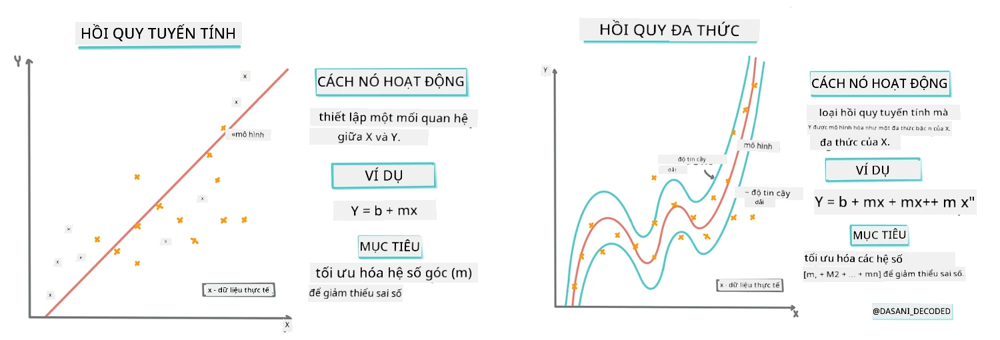
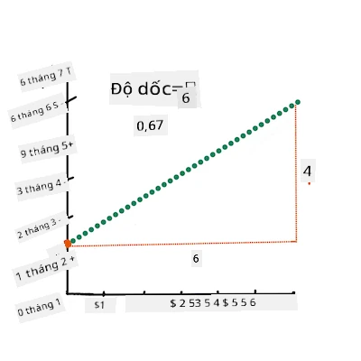
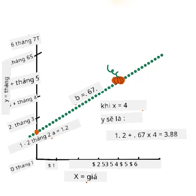
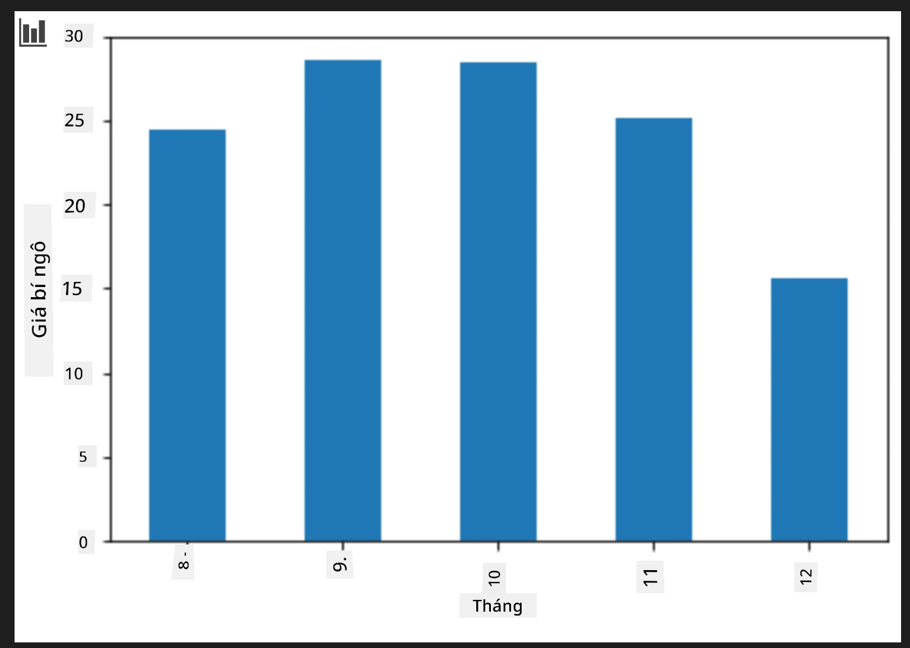
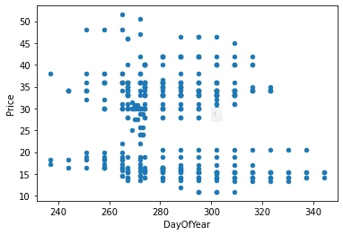
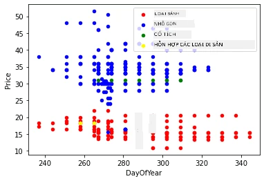

# Xây dựng mô hình hồi quy sử dụng Scikit-learn: hồi quy theo bốn cách

## Ghi chú cho người mới bắt đầu

Hồi quy tuyến tính được sử dụng khi chúng ta muốn dự đoán một **giá trị số** (ví dụ, giá nhà, nhiệt độ hoặc doanh số).
Nó hoạt động bằng cách tìm ra đường thẳng đại diện tốt nhất cho mối quan hệ giữa các đặc trưng đầu vào và đầu ra.

Trong bài học này, chúng ta tập trung vào việc hiểu khái niệm trước khi khám phá các kỹ thuật hồi quy nâng cao hơn.

> Biểu đồ thông tin bởi [Dasani Madipalli](https://twitter.com/dasani_decoded)
## [Trắc nghiệm trước bài giảng](https://ff-quizzes.netlify.app/en/ml/)

> ### [Bài học này có sẵn bằng R!](../../../../2-Regression/3-Linear/solution/R/lesson_3.html)
### Giới thiệu

Cho đến nay bạn đã khám phá hồi quy là gì với dữ liệu mẫu thu thập từ bộ dữ liệu giá bí ngô mà chúng ta sẽ sử dụng trong suốt bài học này. Bạn cũng đã trực quan hóa nó bằng Matplotlib.

Bây giờ bạn đã sẵn sàng để đi sâu hơn vào hồi quy trong ML. Trong khi trực quan hóa giúp bạn hiểu dữ liệu, sức mạnh thực sự của Machine Learning đến từ việc _huấn luyện mô hình_. Các mô hình được huấn luyện trên dữ liệu lịch sử để tự động nắm bắt các phụ thuộc dữ liệu, và cho phép bạn dự đoán kết quả cho dữ liệu mới mà mô hình chưa từng thấy trước đó.

Trong bài học này, bạn sẽ tìm hiểu thêm về hai loại hồi quy: _hồi quy tuyến tính cơ bản_ và _hồi quy đa thức_, cùng với một số toán học nền tảng của các kỹ thuật này. Những mô hình đó sẽ cho phép chúng ta dự đoán giá bí ngô tùy theo dữ liệu đầu vào khác nhau.

[](https://youtu.be/CRxFT8oTDMg "ML cho người mới bắt đầu - Hiểu hồi quy tuyến tính")

> 🎥 Click vào hình bên trên để xem video tóm tắt ngắn về hồi quy tuyến tính.

> Trong suốt chương trình học này, chúng ta giả định kiến thức toán học tối thiểu, và cố gắng làm cho nó dễ tiếp cận cho sinh viên đến từ các lĩnh vực khác, vì vậy hãy chú ý đến các ghi chú, 🧮 chú thích, sơ đồ và các công cụ học tập khác nhằm hỗ trợ hiểu bài.

### Điều kiện tiên quyết

Bạn nên quen với cấu trúc dữ liệu bí ngô mà chúng ta đang xem xét. Bạn có thể tìm thấy nó được tải sẵn và làm sạch sẵn trong file _notebook.ipynb_ của bài học này. Trong file, giá bí ngô được hiển thị trên mỗi bushel trong một khung dữ liệu mới. Hãy chắc chắn bạn có thể chạy các notebook này trong các kernel của Visual Studio Code.

### Chuẩn bị

Như lời nhắc nhở, bạn đang tải dữ liệu này để có thể đặt câu hỏi cho nó.

- Khi nào là thời điểm tốt nhất để mua bí ngô?
- Tôi có thể mong đợi giá bao nhiêu cho một thùng bí ngô mini?
- Tôi có nên mua chúng trong giỏ nửa bushel hay hộp 1 1/9 bushel?
Hãy tiếp tục khám phá dữ liệu này.

Trong bài học trước, bạn đã tạo một khung dữ liệu Pandas và điền dữ liệu với một phần của bộ dữ liệu gốc, chuẩn hóa giá theo bushel. Tuy nhiên, bằng cách đó, bạn chỉ lấy được khoảng 400 điểm dữ liệu và chỉ trong các tháng mùa thu.

Hãy xem dữ liệu được tải sẵn trong notebook kèm theo bài học này. Dữ liệu được tải sẵn và biểu đồ phân tán ban đầu được vẽ để hiển thị dữ liệu theo tháng. Có thể chúng ta có thể có thêm một chút chi tiết về tính chất của dữ liệu bằng cách làm sạch nó hơn nữa.

## Đường hồi quy tuyến tính

Như bạn đã học trong Bài học 1, mục tiêu của bài tập hồi quy tuyến tính là có thể vẽ một đường để:

- **Hiển thị mối quan hệ biến số**. Hiển thị mối quan hệ giữa các biến.
- **Dự đoán**. Dự đoán chính xác vị trí mà một điểm dữ liệu mới sẽ nằm trên đường đó.

Thông thường, **Hồi quy bình phương tối thiểu (Least-Squares Regression)** được dùng để vẽ loại đường này. Thuật ngữ "Bình phương tối thiểu" đề cập đến quá trình tối thiểu hóa tổng sai số trong mô hình của chúng ta. Với mỗi điểm dữ liệu, ta đo khoảng cách dọc (gọi là độ dư) giữa điểm thực tế và đường hồi quy của chúng ta.

Chúng ta bình phương các khoảng cách này vì hai lý do chính:

1. **Độ lớn không tính hướng:** Chúng ta muốn xử lý lỗi bằng -5 tương tự như lỗi bằng +5. Bình phương sẽ biến tất cả giá trị thành số dương.

2. **Phạt điểm ngoại lai:** Bình phương sẽ tăng trọng số cho các lỗi lớn hơn, buộc đường phải nằm gần các điểm xa hơn hơn.

Sau đó, ta cộng tất cả các giá trị bình phương này lại. Mục tiêu của ta là tìm ra đường cụ thể mà tổng cuối cùng này là nhỏ nhất (giá trị nhỏ nhất có thể) — do đó mới gọi là "Bình phương tối thiểu".

> **🧮 Cho tôi xem toán học**
> 
> Đường này, gọi là _đường phù hợp nhất_ có thể được biểu diễn bằng [một phương trình](https://en.wikipedia.org/wiki/Simple_linear_regression):
> 
> ```
> Y = a + bX
> ```
>
> `X` là 'biến giải thích'. `Y` là 'biến phụ thuộc'. Độ dốc của đường là `b` và `a` là điểm cắt y, nghĩa là giá trị của `Y` khi `X = 0`.
>
>
>
> Đầu tiên, tính độ dốc `b`. Biểu đồ thông tin bởi [Jen Looper](https://twitter.com/jenlooper)
>
> Nói cách khác, và tham khảo câu hỏi gốc về dữ liệu bí ngô của chúng ta: "dự đoán giá bí ngô trên mỗi bushel theo tháng", `X` sẽ tương ứng với giá và `Y` sẽ tương ứng với tháng bán.
>
>
>
> Tính giá trị Y. Nếu bạn trả khoảng 4 đô la, chắc chắn là tháng Tư! Biểu đồ thông tin bởi [Jen Looper](https://twitter.com/jenlooper)
>
> Phép toán tính đường phải biểu diễn được độ dốc của đường, cũng phụ thuộc vào điểm cắt, hoặc vị trí của `Y` khi `X = 0`.
>
> Bạn có thể xem phương pháp tính các giá trị này trên trang web [Math is Fun](https://www.mathsisfun.com/data/least-squares-regression.html). Cũng truy cập [Máy tính bình phương tối thiểu này](https://www.mathsisfun.com/data/least-squares-calculator.html) để xem giá trị các số ảnh hưởng như thế nào đến đường.

## Tương quan

Một thuật ngữ nữa cần hiểu là **Hệ số tương quan** giữa các biến X và Y cho trước. Sử dụng biểu đồ phân tán, bạn có thể nhanh chóng trực quan hóa hệ số này. Một biểu đồ với các điểm dữ liệu nằm rải rác theo một đường gọn gàng sẽ có tương quan cao, nhưng biểu đồ với các điểm dữ liệu phân tán khắp nơi giữa X và Y thì có tương quan thấp.

Một mô hình hồi quy tuyến tính tốt sẽ có Hệ số tương quan cao (gần 1 hơn là 0) sử dụng phương pháp Hồi quy bình phương tối thiểu với một đường hồi quy.

✅ Chạy notebook kèm theo bài học này và nhìn biểu đồ phân tán Tháng so với Giá. Dữ liệu liên kết Tháng với Giá cho doanh số bí ngô có vẻ có tương quan cao hay thấp, theo cách bạn nhìn hình? Liệu điều đó có thay đổi nếu bạn sử dụng thước đo chi tiết hơn thay vì `Month`, ví dụ *ngày trong năm* (số ngày kể từ đầu năm)?

Trong đoạn mã dưới đây, chúng ta giả sử đã làm sạch dữ liệu, và có một khung dữ liệu gọi là `new_pumpkins`, tương tự như sau:

ID | Month | DayOfYear | Variety | City | Package | Low Price | High Price | Price
---|-------|-----------|---------|------|---------|-----------|------------|-------
70 | 9 | 267 | PIE TYPE | BALTIMORE | 1 1/9 bushel cartons | 15.0 | 15.0 | 13.636364
71 | 9 | 267 | PIE TYPE | BALTIMORE | 1 1/9 bushel cartons | 18.0 | 18.0 | 16.363636
72 | 10 | 274 | PIE TYPE | BALTIMORE | 1 1/9 bushel cartons | 18.0 | 18.0 | 16.363636
73 | 10 | 274 | PIE TYPE | BALTIMORE | 1 1/9 bushel cartons | 17.0 | 17.0 | 15.454545
74 | 10 | 281 | PIE TYPE | BALTIMORE | 1 1/9 bushel cartons | 15.0 | 15.0 | 13.636364

> Mã làm sạch dữ liệu có sẵn trong [`notebook.ipynb`](notebook.ipynb). Chúng tôi đã thực hiện các bước làm sạch giống như bài học trước, và đã tính cột `DayOfYear` bằng biểu thức sau:

```python
day_of_year = pd.to_datetime(pumpkins['Date']).apply(lambda dt: (dt-datetime(dt.year,1,1)).days)
```

Bây giờ bạn đã hiểu toán học đằng sau hồi quy tuyến tính, hãy tạo một mô hình Hồi quy để xem liệu chúng ta có thể dự đoán gói bí ngô nào sẽ có giá tốt nhất hay không. Người mua bí ngô để trang trí cho dịp lễ có thể muốn biết điều này để tối ưu hóa việc mua các gói bí ngô cho khu vực trang trí.

## Tìm kiếm Tương quan

[](https://youtu.be/uoRq-lW2eQo "ML cho người mới bắt đầu - Tìm Tương quan: Chìa khóa của Hồi quy tuyến tính")

> 🎥 Click vào hình bên trên để xem video tóm tắt ngắn về tương quan.

Từ bài học trước, bạn có thể đã thấy rằng giá trung bình theo các tháng trông như sau:



Điều này gợi ý rằng nên có một mức tương quan nào đó, và chúng ta có thể thử huấn luyện mô hình hồi quy tuyến tính để dự đoán mối quan hệ giữa `Month` và `Price`, hoặc giữa `DayOfYear` và `Price`. Đây là biểu đồ phân tán cho thấy mối quan hệ sau:

 

Hãy xem liệu có tương quan hay không bằng hàm `corr`:

```python
print(new_pumpkins['Month'].corr(new_pumpkins['Price']))
print(new_pumpkins['DayOfYear'].corr(new_pumpkins['Price']))
```

Có vẻ như hệ số tương quan khá nhỏ, -0.15 đối với `Month` và -0.17 đối với `DayOfYear`, nhưng có thể tồn tại một mối quan hệ quan trọng khác. Có vẻ có các nhóm giá khác nhau tương ứng với các loại bí ngô khác nhau. Để xác nhận giả thuyết này, hãy vẽ mỗi loại bí ngô dùng màu khác nhau. Bằng cách truyền tham số `ax` vào hàm vẽ `scatter`, ta có thể vẽ tất cả các điểm trên cùng một biểu đồ:

```python
ax=None
colors = ['red','blue','green','yellow']
for i,var in enumerate(new_pumpkins['Variety'].unique()):
    df = new_pumpkins[new_pumpkins['Variety']==var]
    ax = df.plot.scatter('DayOfYear','Price',ax=ax,c=colors[i],label=var)
```

 

Điều tra của chúng ta cho thấy loại bí ngô có ảnh hưởng nhiều hơn đến giá tổng thể so với ngày bán thực tế. Chúng ta có thể thấy điều này qua biểu đồ thanh:

```python
new_pumpkins.groupby('Variety')['Price'].mean().plot(kind='bar')
```

 

Hãy tạm thời tập trung chỉ vào một loại bí ngô duy nhất, loại 'pie type', và xem ngày bán ảnh hưởng như thế nào đến giá:

```python
pie_pumpkins = new_pumpkins[new_pumpkins['Variety']=='PIE TYPE']
pie_pumpkins.plot.scatter('DayOfYear','Price') 
```
 

Nếu bây giờ chúng ta tính hệ số tương quan giữa `Price` và `DayOfYear` bằng hàm `corr`, ta sẽ được khoảng `-0.27` - nghĩa là việc huấn luyện mô hình dự đoán là hợp lý.

> Trước khi huấn luyện mô hình hồi quy tuyến tính, quan trọng là phải đảm bảo dữ liệu của ta sạch. Hồi quy tuyến tính không hoạt động tốt với các giá trị thiếu, do đó hợp lý khi loại bỏ tất cả các ô trống:

```python
pie_pumpkins.dropna(inplace=True)
pie_pumpkins.info()
```

Một phương pháp khác là điền các giá trị trống đó bằng giá trị trung bình của cột tương ứng.

## Hồi quy tuyến tính đơn giản

[](https://youtu.be/e4c_UP2fSjg "ML cho người mới bắt đầu - Hồi quy tuyến tính và đa thức sử dụng Scikit-learn")

> 🎥 Click vào hình bên trên để xem video tóm tắt ngắn về hồi quy tuyến tính và đa thức.

Để huấn luyện mô hình Hồi quy tuyến tính, ta sẽ sử dụng thư viện **Scikit-learn**.

```python
from sklearn.linear_model import LinearRegression
from sklearn.metrics import mean_squared_error
from sklearn.model_selection import train_test_split
```

Chúng ta bắt đầu bằng cách tách giá trị đầu vào (đặc trưng) và đầu ra mong muốn (nhãn) thành các mảng numpy riêng biệt:

```python
X = pie_pumpkins['DayOfYear'].to_numpy().reshape(-1,1)
y = pie_pumpkins['Price']
```

> Lưu ý rằng ta phải thực hiện `reshape` đối với dữ liệu đầu vào để gói Linear Regression có thể hiểu đúng. Hồi quy tuyến tính mong đợi một mảng 2 chiều làm đầu vào, trong đó mỗi hàng tương ứng với một vector đặc trưng đầu vào. Trong trường hợp của ta, vì chỉ có một đầu vào duy nhất - ta cần một mảng với kích thước N×1, trong đó N là kích thước của bộ dữ liệu.

Sau đó, ta cần chia dữ liệu thành tập huấn luyện và tập kiểm tra để có thể kiểm tra mô hình sau khi huấn luyện:

```python
X_train, X_test, y_train, y_test = train_test_split(X, y, test_size=0.2, random_state=0)
```

Cuối cùng, việc huấn luyện mô hình Hồi quy tuyến tính thực sự chỉ mất hai dòng mã. Ta định nghĩa đối tượng `LinearRegression`, và dùng phương thức `fit` để phù hợp với dữ liệu:

```python
lin_reg = LinearRegression()
lin_reg.fit(X_train,y_train)
```

Đối tượng `LinearRegression` sau khi `fit` chứa tất cả các hệ số của hồi quy, có thể truy cập bằng thuộc tính `.coef_`. Trong trường hợp của chúng ta, chỉ có một hệ số, khoảng `-0.017`. Điều này có nghĩa là giá dường như giảm nhẹ theo thời gian, nhưng không nhiều, khoảng 2 cent mỗi ngày. Chúng ta cũng có thể truy cập điểm giao nhau của hồi quy với trục Y bằng `lin_reg.intercept_` - sẽ khoảng `21` trong trường hợp của chúng ta, cho thấy giá vào đầu năm.

Để xem mô hình của chúng ta chính xác đến mức nào, chúng ta có thể dự đoán giá trên bộ dữ liệu kiểm tra, sau đó đo mức độ gần giữa dự đoán và giá trị mong đợi. Việc này có thể được thực hiện bằng cách sử dụng chỉ số lỗi bình phương trung bình căn bậc hai (RMSE), là căn bậc hai của trung bình tất cả các hiệu số bình phương giữa giá trị mong đợi và dự đoán.

```python
pred = lin_reg.predict(X_test)

rmse = np.sqrt(mean_squared_error(y_test,pred))
print(f'RMSE: {rmse:3.3} ({rmse/np.mean(pred)*100:3.3}%)')
```

Lỗi của chúng ta dường như khoảng 2 điểm, tương đương ~17%. Không quá tốt. Một chỉ số khác về chất lượng mô hình là **hệ số xác định (coefficient of determination)**, có thể lấy được như sau:

```python
score = lin_reg.score(X_train,y_train)
print('Model determination: ', score)
```

Nếu giá trị là 0, có nghĩa mô hình không tính đến dữ liệu đầu vào, và hoạt động như *bộ dự đoán tuyến tính tệ nhất*, đơn giản là giá trị trung bình của kết quả. Giá trị 1 nghĩa là chúng ta có thể dự đoán hoàn hảo tất cả các đầu ra mong muốn. Trong trường hợp của chúng ta, hệ số khoảng 0.06, khá thấp.

Chúng ta cũng có thể vẽ dữ liệu kiểm tra cùng với đường hồi quy để thấy rõ hơn cách hồi quy hoạt động trong trường hợp này:

```python
plt.scatter(X_test,y_test)
plt.plot(X_test,pred)
```


## Hồi Quy Đa Thức

Một loại hồi quy tuyến tính khác là Hồi Quy Đa Thức. Trong khi đôi khi có một mối quan hệ tuyến tính giữa các biến - quả bí ngô càng to về thể tích thì giá càng cao - đôi khi những mối quan hệ này không thể biểu diễn trên một mặt phẳng hay đường thẳng.

✅ Dưới đây là [một số ví dụ khác](https://online.stat.psu.edu/stat501/Lesson09#polynomial-regression-examples) về dữ liệu có thể sử dụng Hồi Quy Đa Thức

Hãy xem lại mối quan hệ giữa Ngày và Giá. Biểu đồ điểm này có nhất thiết phải được phân tích bằng một đường thẳng không? Giá có thể dao động mà? Trong trường hợp này, bạn có thể thử hồi quy đa thức.

✅ Đa thức là các biểu thức toán học có thể bao gồm một hay nhiều biến và hệ số

Hồi quy đa thức tạo ra một đường cong để phù hợp với dữ liệu phi tuyến tốt hơn. Trong trường hợp của chúng ta, nếu thêm biến `DayOfYear` bình phương vào dữ liệu đầu vào, ta có thể khớp dữ liệu bằng một đường cong parabol, có điểm cực tiểu tại một thời điểm nhất định trong năm.

Scikit-learn có một API [pipeline](https://scikit-learn.org/stable/modules/generated/sklearn.pipeline.make_pipeline.html?highlight=pipeline#sklearn.pipeline.make_pipeline) hữu ích để kết hợp các bước xử lý dữ liệu. Một **pipeline** là chuỗi các **estimator**. Trong trường hợp của chúng ta, sẽ tạo pipeline trước để thêm các đặc trưng đa thức vào mô hình, sau đó huấn luyện hồi quy:

```python
from sklearn.preprocessing import PolynomialFeatures
from sklearn.pipeline import make_pipeline

pipeline = make_pipeline(PolynomialFeatures(2), LinearRegression())

pipeline.fit(X_train,y_train)
```

Sử dụng `PolynomialFeatures(2)` có nghĩa là chúng ta sẽ bao gồm tất cả đa thức bậc hai từ dữ liệu đầu vào. Trong trường hợp của chúng ta sẽ chỉ là `DayOfYear`<sup>2</sup>, nhưng với hai biến đầu vào X và Y, điều này sẽ thêm X<sup>2</sup>, XY và Y<sup>2</sup>. Chúng ta cũng có thể dùng đa thức bậc cao hơn nếu muốn.

Pipeline có thể dùng giống như đối tượng `LinearRegression` gốc, tức là có thể `fit` pipeline rồi dùng `predict` để lấy kết quả dự đoán:

```python
pred = pipeline.predict(X_test)

rmse = np.sqrt(mean_squared_error(y_test,pred))
print(f'RMSE: {rmse:3.3} ({rmse/np.mean(pred)*100:3.3}%)')

score = pipeline.score(X_train,y_train)
print('Model determination: ', score)
```

Để vẽ đường cong gần đúng mượt mà, ta dùng `np.linspace` tạo dải giá trị đầu vào đồng đều, thay vì vẽ trực tiếp trên dữ liệu kiểm tra không theo thứ tự (sẽ tạo ra đường zíc zắc):

```python
X_range = np.linspace(X_test.min(), X_test.max(), 100).reshape(-1,1)
y_range = pipeline.predict(X_range)

plt.scatter(X_test, y_test)
plt.plot(X_range, y_range)
```

Đây là đồ thị hiển thị dữ liệu kiểm tra và đường cong gần đúng:


Sử dụng Hồi Quy Đa Thức, chúng ta có thể có RMSE thấp hơn và hệ số xác định cao hơn một chút, nhưng không đáng kể. Cần xem xét các đặc trưng khác!

> Bạn có thấy giá bí ngô thấp nhất vào khoảng lễ Halloween không? Bạn có thể giải thích lý do không?

🎃 Chúc mừng bạn đã tạo mô hình giúp dự đoán giá bí ngô nướng. Có thể bạn sẽ lặp lại thao tác này cho các loại bí ngô khác, nhưng sẽ rất mất công sức. Giờ hãy cùng học cách đưa loại bí ngô vào mô hình!

## Các Đặc Trưng Phân Loại

Trong thế giới lý tưởng, ta muốn dự đoán giá của các loại bí ngô khác nhau bằng cùng một mô hình. Nhưng cột `Variety` khác với các cột như `Month` vì chứa các giá trị không phải số. Các cột như vậy gọi là **phân loại (categorical)**.

[](https://youtu.be/DYGliioIAE0 "ML cho người mới - Dự đoán đặc trưng phân loại với Hồi Quy Tuyến Tính")

> 🎥 Nhấn vào hình trên để xem video ngắn về cách dùng đặc trưng phân loại.

Dưới đây là đồ thị cho thấy giá trung bình theo từng loại:


Để đưa loại vào mô hình, trước hết phải chuyển nó về dạng số, hay còn gọi là **mã hóa (encode)**. Có vài cách để làm:

* Mã hóa số đơn giản sẽ tạo một bảng các loại, sau đó thay tên loại bằng chỉ số trong bảng đó. Điều này không tốt cho hồi quy tuyến tính, vì hồi quy lấy giá trị số thực của chỉ số và nhân với hệ số để cộng vào kết quả. Trong trường hợp ta, mối quan hệ giữa số chỉ số và giá rõ ràng không phải tuyến tính, dù có sắp xếp chỉ số theo cách nào.
* **One-hot encoding** sẽ thay cột `Variety` bằng 4 cột khác nhau, mỗi cột cho một loại. Mỗi cột sẽ chứa `1` nếu hàng đó thuộc loại tương ứng, và `0` nếu không. Điều này có nghĩa hồi quy tuyến tính có 4 hệ số, mỗi hệ số ứng với một loại bí ngô, chịu trách nhiệm cho "giá khởi đầu" (hay chính xác là "giá cộng thêm") cho loại đó.

Đoạn mã dưới đây cho thấy cách chúng ta có thể mã hóa one-hot một loại:

```python
pd.get_dummies(new_pumpkins['Variety'])
```

 ID | FAIRYTALE | MINIATURE | MIXED HEIRLOOM VARIETIES | PIE TYPE
----|-----------|-----------|--------------------------|----------
70 | 0 | 0 | 0 | 1
71 | 0 | 0 | 0 | 1
... | ... | ... | ... | ...
1738 | 0 | 1 | 0 | 0
1739 | 0 | 1 | 0 | 0
1740 | 0 | 1 | 0 | 0
1741 | 0 | 1 | 0 | 0
1742 | 0 | 1 | 0 | 0

Để huấn luyện hồi quy tuyến tính với dữ liệu một-hot mã hóa làm đầu vào, ta chỉ cần khởi tạo dữ liệu `X` và `y` đúng cách:

```python
X = pd.get_dummies(new_pumpkins['Variety'])
y = new_pumpkins['Price']
```

Phần còn lại của mã giống như khi đã dùng hồi quy tuyến tính ở trên. Nếu bạn thử, sẽ thấy lỗi bình phương trung bình tương đương, nhưng hệ số xác định cao hơn nhiều (~77%). Để dự đoán chính xác hơn nữa, ta có thể đưa nhiều đặc trưng phân loại vào cùng với các đặc trưng số, như `Month` hay `DayOfYear`. Để có một mảng đặc trưng lớn, ta dùng `join`:

```python
X = pd.get_dummies(new_pumpkins['Variety']) \
        .join(new_pumpkins['Month']) \
        .join(pd.get_dummies(new_pumpkins['City'])) \
        .join(pd.get_dummies(new_pumpkins['Package']))
y = new_pumpkins['Price']
```

Ở đây ta cũng đưa vào `City` và loại `Package`, dẫn đến RMSE = 2.84 (10.5%) và hệ số xác định 0.94!

## Tổng Hợp Tất Cả

Để tạo mô hình tốt nhất, ta kết hợp dữ liệu (đặc trưng phân loại one-hot + số) ở ví dụ trên cùng với Hồi Quy Đa Thức. Đây là mã đầy đủ để bạn tiện theo dõi:

```python
# thiết lập dữ liệu huấn luyện
X = pd.get_dummies(new_pumpkins['Variety']) \
        .join(new_pumpkins['Month']) \
        .join(pd.get_dummies(new_pumpkins['City'])) \
        .join(pd.get_dummies(new_pumpkins['Package']))
y = new_pumpkins['Price']

# chia tách dữ liệu thành tập huấn luyện và kiểm tra
X_train, X_test, y_train, y_test = train_test_split(X, y, test_size=0.2, random_state=0)

# thiết lập và huấn luyện pipeline
pipeline = make_pipeline(PolynomialFeatures(2), LinearRegression())
pipeline.fit(X_train,y_train)

# dự đoán kết quả cho dữ liệu kiểm tra
pred = pipeline.predict(X_test)

# tính RMSE và hệ số xác định
rmse = mean_squared_error(y_test, pred, squared=False)
print(f'RMSE: {rmse:3.3} ({rmse/pred.mean()*100:3.3}%)')

score = pipeline.score(X_train,y_train)
print('Model determination: ', score)
```

Điều này sẽ cho hệ số xác định tốt nhất gần 97% và RMSE=2.23 (~8% sai số dự đoán).

| Mô hình | RMSE | Hệ số xác định |
|-------|-----|---------------|
| `DayOfYear` Linear | 2.77 (17.2%) | 0.07 |
| `DayOfYear` Polynomial | 2.73 (17.0%) | 0.08 |
| `Variety` Linear | 5.24 (19.7%) | 0.77 |
| Tất cả đặc trưng Linear | 2.84 (10.5%) | 0.94 |
| Tất cả đặc trưng Polynomial | 2.23 (8.25%) | 0.97 |

🏆 Tuyệt vời! Bạn đã tạo 4 mô hình hồi quy trong một bài học, và cải thiện độ chính xác lên 97%. Ở phần cuối về Hồi Quy, bạn sẽ học về Hồi Quy Logistic để phân loại.

---
## 🚀Thử Thách

Thử nghiệm các biến khác nhau trong notebook này để xem mối tương quan ảnh hưởng thế nào đến độ chính xác mô hình.

## [Bài kiểm tra sau bài giảng](https://ff-quizzes.netlify.app/en/ml/)

## Ôn Tập & Tự Học

Trong bài học này, chúng ta đã học về Hồi Quy Tuyến Tính. Còn nhiều loại hồi quy quan trọng khác. Bạn có thể đọc về các kỹ thuật Stepwise, Ridge, Lasso và Elasticnet. Một khóa học tốt để học thêm là [Khóa học Học Thống Kê Stanford](https://online.stanford.edu/courses/sohs-ystatslearning-statistical-learning)

## Bài Tập 

[Xây dựng một mô hình](assignment.md)

---

<!-- CO-OP TRANSLATOR DISCLAIMER START -->
**Tuyên bố từ chối trách nhiệm**:
Tài liệu này đã được dịch bằng dịch vụ dịch thuật AI [Co-op Translator](https://github.com/Azure/co-op-translator). Mặc dù chúng tôi cố gắng đảm bảo độ chính xác, xin lưu ý rằng các bản dịch tự động có thể chứa lỗi hoặc không chính xác. Tài liệu gốc bằng ngôn ngữ mẹ đẻ của nó nên được coi là nguồn tham khảo chính xác nhất. Đối với các thông tin quan trọng, nên sử dụng bản dịch chuyên nghiệp do con người thực hiện. Chúng tôi không chịu trách nhiệm về bất kỳ sự hiểu lầm hoặc giải thích sai nào phát sinh từ việc sử dụng bản dịch này.
<!-- CO-OP TRANSLATOR DISCLAIMER END -->