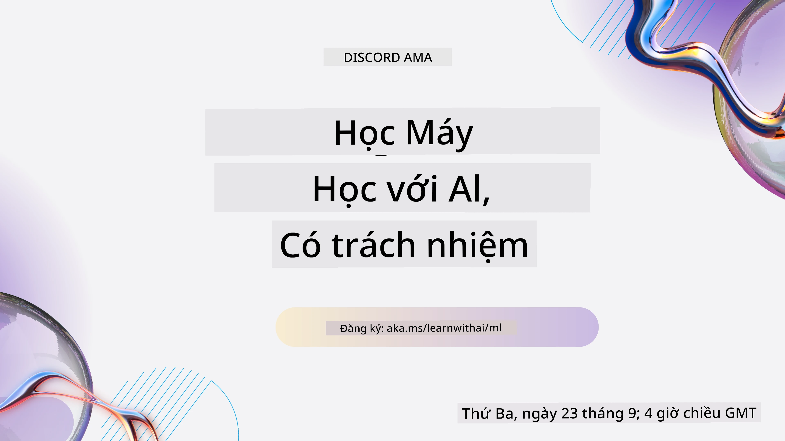
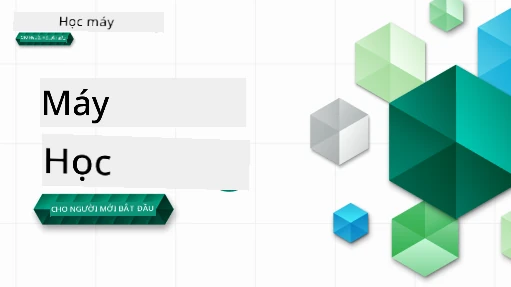

[](https://github.com/microsoft/ML-For-Beginners/blob/master/LICENSE)
[](https://GitHub.com/microsoft/ML-For-Beginners/graphs/contributors/)
[](https://GitHub.com/microsoft/ML-For-Beginners/issues/)
[](https://GitHub.com/microsoft/ML-For-Beginners/pulls/)
[](http://makeapullrequest.com)

[](https://GitHub.com/microsoft/ML-For-Beginners/watchers/)
[](https://GitHub.com/microsoft/ML-For-Beginners/network/)
[](https://GitHub.com/microsoft/ML-For-Beginners/stargazers/)

### 🌐 Hỗ trợ đa ngôn ngữ

#### Các bản dịch được duy trì bởi [Co-op Translator](https://github.com/Azure/co-op-translator)

<!-- CO-OP TRANSLATOR LANGUAGES TABLE START -->
[Tiếng Ả Rập](../ar/README.md) | [Tiếng Bengal](../bn/README.md) | [Tiếng Bungari](../bg/README.md) | [Tiếng Miến Điện (Myanmar)](../my/README.md) | [Tiếng Trung (Giản thể)](../zh-CN/README.md) | [Tiếng Trung (Phồn thể, Hồng Kông)](../zh-HK/README.md) | [Tiếng Trung (Phồn thể, Macau)](../zh-MO/README.md) | [Tiếng Trung (Phồn thể, Đài Loan)](../zh-TW/README.md) | [Tiếng Croatia](../hr/README.md) | [Tiếng Séc](../cs/README.md) | [Tiếng Đan Mạch](../da/README.md) | [Tiếng Hà Lan](../nl/README.md) | [Tiếng Estonia](../et/README.md) | [Tiếng Phần Lan](../fi/README.md) | [Tiếng Pháp](../fr/README.md) | [Tiếng Đức](../de/README.md) | [Tiếng Hy Lạp](../el/README.md) | [Tiếng Hebrew](../he/README.md) | [Tiếng Hindi](../hi/README.md) | [Tiếng Hungary](../hu/README.md) | [Tiếng Indonesia](../id/README.md) | [Tiếng Ý](../it/README.md) | [Tiếng Nhật](../ja/README.md) | [Tiếng Kannada](../kn/README.md) | [Tiếng Khmer](../km/README.md) | [Tiếng Hàn](../ko/README.md) | [Tiếng Litva](../lt/README.md) | [Tiếng Mã Lai](../ms/README.md) | [Tiếng Malayalam](../ml/README.md) | [Tiếng Manipuri (Meitei Mayek)](../mni/README.md) | [Tiếng Marathi](../mr/README.md) | [Tiếng Nepal](../ne/README.md) | [Tiếng Pidgin Nigeria](../pcm/README.md) | [Tiếng Na Uy](../no/README.md) | [Tiếng Ba Tư (Farsi)](../fa/README.md) | [Tiếng Ba Lan](../pl/README.md) | [Tiếng Bồ Đào Nha (Brazil)](../pt-BR/README.md) | [Tiếng Bồ Đào Nha (Bồ Đào Nha)](../pt-PT/README.md) | [Tiếng Punjabi (Gurmukhi)](../pa/README.md) | [Tiếng Romania](../ro/README.md) | [Tiếng Nga](../ru/README.md) | [Tiếng Serbia (Chữ Cyrillic)](../sr/README.md) | [Tiếng Slovakia](../sk/README.md) | [Tiếng Slovenia](../sl/README.md) | [Tiếng Tây Ban Nha](../es/README.md) | [Tiếng Swahili](../sw/README.md) | [Tiếng Thụy Điển](../sv/README.md) | [Tiếng Tagalog (Filipino)](../tl/README.md) | [Tiếng Tamil](../ta/README.md) | [Tiếng Telugu](../te/README.md) | [Tiếng Thái](../th/README.md) | [Tiếng Thổ Nhĩ Kỳ](../tr/README.md) | [Tiếng Ukraina](../uk/README.md) | [Tiếng Urdu](../ur/README.md) | [Tiếng Việt](./README.md)

> **Ưu tiên nhân bản cục bộ?**
>
> Kho lưu trữ này bao gồm hơn 50 bản dịch ngôn ngữ, làm tăng đáng kể kích thước tải xuống. Để nhân bản mà không có bản dịch, hãy sử dụng sparse checkout:
>
> **Bash / macOS / Linux:**
> ```bash
> git clone --filter=blob:none --sparse https://github.com/microsoft/ML-For-Beginners.git
> cd ML-For-Beginners
> git sparse-checkout set --no-cone '/*' '!translations' '!translated_images'
> ```
>
> **CMD (Windows):**
> ```cmd
> git clone --filter=blob:none --sparse https://github.com/microsoft/ML-For-Beginners.git
> cd ML-For-Beginners
> git sparse-checkout set --no-cone "/*" "!translations" "!translated_images"
> ```
>
> Điều này cung cấp cho bạn mọi thứ cần thiết để hoàn thành khóa học với tốc độ tải nhanh hơn nhiều.
<!-- CO-OP TRANSLATOR LANGUAGES TABLE END -->

#### Tham gia cộng đồng của chúng tôi

[](https://discord.gg/nTYy5BXMWG)

Chúng tôi có một chuỗi học cùng AI trên Discord, tìm hiểu thêm và tham gia tại [Chuỗi Học cùng AI](https://aka.ms/learnwithai/discord) từ ngày 18 - 30 tháng 9 năm 2025. Bạn sẽ nhận được các mẹo và thủ thuật sử dụng GitHub Copilot cho Khoa học Dữ liệu.



# Học Máy cho Người Mới Bắt Đầu - Một chương trình học

> 🌍 Du lịch vòng quanh thế giới khi chúng ta khám phá Học Máy thông qua các nền văn hóa thế giới 🌍

Các Cloud Advocates tại Microsoft vui mừng cung cấp một chương trình học 12 tuần, gồm 26 bài học, tất cả về **Học Máy**. Trong chương trình này, bạn sẽ học về cái gọi là **học máy cổ điển**, chủ yếu sử dụng thư viện Scikit-learn và tránh học sâu, phần này được đề cập trong chương trình [AI cho Người mới bắt đầu](https://aka.ms/ai4beginners) của chúng tôi. Kết hợp các bài học này với chương trình ['Khoa học dữ liệu cho người mới bắt đầu'](https://aka.ms/ds4beginners) cũng rất tốt!

Du lịch với chúng tôi quanh thế giới khi áp dụng các kỹ thuật cổ điển này cho dữ liệu từ nhiều khu vực trên thế giới. Mỗi bài học bao gồm bài kiểm tra trước và sau bài học, hướng dẫn bằng văn bản để hoàn thành bài học, một giải pháp, một bài tập và nhiều hơn nữa. Phương pháp giảng dạy dựa trên dự án của chúng tôi cho phép bạn học trong khi xây dựng, một cách đã được chứng minh để kỹ năng mới 'được ghi nhớ'.

**✍️ Lời cảm ơn chân thành đến các tác giả** Jen Looper, Stephen Howell, Francesca Lazzeri, Tomomi Imura, Cassie Breviu, Dmitry Soshnikov, Chris Noring, Anirban Mukherjee, Ornella Altunyan, Ruth Yakubu và Amy Boyd

**🎨 Cảm ơn các họa sĩ minh họa** Tomomi Imura, Dasani Madipalli và Jen Looper

**🙏 Lời cảm ơn đặc biệt 🙏 tới các tác giả đại sứ sinh viên Microsoft, các người đánh giá, và những người đóng góp nội dung**, nổi bật là Rishit Dagli, Muhammad Sakib Khan Inan, Rohan Raj, Alexandru Petrescu, Abhishek Jaiswal, Nawrin Tabassum, Ioan Samuila, và Snigdha Agarwal

**🤩 Thêm lời cảm ơn đến các Đại sứ sinh viên Microsoft Eric Wanjau, Jasleen Sondhi và Vidushi Gupta cho các bài học R của chúng tôi!**

# Bắt đầu

Làm theo các bước sau:
1. **Fork kho lưu trữ**: Nhấn nút "Fork" ở góc trên bên phải của trang này.
2. **Nhân bản kho lưu trữ**:   `git clone https://github.com/microsoft/ML-For-Beginners.git`

> 💡 **Mẹo bắt đầu nhanh:** Muốn bắt đầu trên trình duyệt mà không cần thiết lập Python cục bộ? Sử dụng [GitHub Codespaces](https://github.com/features/codespaces) để tạo môi trường phát triển đám mây cho fork của bạn. Mở menu **Code** màu xanh lá, chọn **Codespaces**, và tạo một codespace; cài đặt các phụ thuộc cần thiết cho từng bài học trong đó nếu cần.

> [tìm tất cả tài nguyên bổ sung cho khóa học này trong bộ sưu tập Microsoft Learn của chúng tôi](https://learn.microsoft.com/en-us/collections/qrqzamz1nn2wx3?WT.mc_id=academic-77952-bethanycheum)

> 🔧 **Cần trợ giúp?** Xem [Hướng dẫn khắc phục sự cố](TROUBLESHOOTING.md) để có giải pháp cho các vấn đề phổ biến về cài đặt, thiết lập và chạy bài học.


**[Học sinh](https://aka.ms/student-page)**, để sử dụng chương trình này, hãy fork toàn bộ repo vào tài khoản GitHub của bạn và hoàn thành các bài tập một mình hoặc theo nhóm:

- Bắt đầu với bài kiểm tra trước bài giảng.
- Đọc bài giảng và hoàn thành các hoạt động, tạm dừng và suy ngẫm ở mỗi điểm kiểm tra kiến thức.
- Cố gắng tạo các dự án bằng cách hiểu bài học thay vì chạy code giải pháp; tuy nhiên, code đó có sẵn trong các thư mục `/solution` ở mỗi bài học dự án.
- Làm bài kiểm tra sau bài giảng.
- Hoàn thành thử thách.
- Hoàn thành bài tập.
- Sau khi hoàn thành nhóm bài học, hãy truy cập [Bảng Thảo luận](https://github.com/microsoft/ML-For-Beginners/discussions) và "học to lên" bằng cách điền vào bảng điểm PAT tương ứng. 'PAT' là Công cụ Đánh giá Tiến độ mà bạn điền để thúc đẩy việc học của mình. Bạn cũng có thể phản hồi các PAT khác để chúng ta cùng học.

> Để học thêm, chúng tôi khuyên bạn theo dõi các mô-đun và lộ trình học [Microsoft Learn](https://docs.microsoft.com/en-us/users/jenlooper-2911/collections/k7o7tg1gp306q4?WT.mc_id=academic-77952-leestott).

**Giáo viên**, chúng tôi đã [bao gồm một số đề xuất](for-teachers.md) về cách sử dụng chương trình học này.

---

## Video hướng dẫn

Một số bài học có dưới dạng video ngắn. Bạn có thể tìm thấy tất cả các video này trong bài học hoặc trên [playlist ML cho người mới bắt đầu trên kênh YouTube Microsoft Developer](https://aka.ms/ml-beginners-videos) bằng cách nhấn vào hình ảnh bên dưới.

[](https://aka.ms/ml-beginners-videos)

---

## Gặp gỡ đội ngũ

[](https://youtu.be/Tj1XWrDSYJU)

**Gif bởi** [Mohit Jaisal](https://linkedin.com/in/mohitjaisal)

> 🎥 Nhấn vào hình ảnh trên để xem video về dự án và những người tạo ra nó!

---

## Phương pháp giảng dạy

Chúng tôi đã chọn hai nguyên tắc giảng dạy khi xây dựng chương trình này: đảm bảo nó là dựa trên **dự án thực hành** và bao gồm **các bài kiểm tra thường xuyên**. Thêm vào đó, chương trình còn có một **chủ đề chung** để tạo sự liên kết.

Bằng cách đảm bảo nội dung liên quan đến dự án, quá trình học tập trở nên hấp dẫn hơn cho học sinh và tăng khả năng ghi nhớ khái niệm. Bài kiểm tra nhẹ trước giờ học giúp học sinh xác định mục tiêu học tập, trong khi bài kiểm tra thứ hai sau giờ học giúp tăng sự lưu giữ kiến thức. Chương trình thiết kế linh hoạt, vui nhộn và có thể học toàn bộ hoặc một phần. Dự án bắt đầu nhỏ rồi dần tăng độ phức tạp trong 12 tuần. Chương trình cũng có phần phụ lục về ứng dụng thực tế của ML, có thể dùng làm điểm cộng hoặc cơ sở thảo luận.

> Tìm các hướng dẫn [Quy tắc ứng xử](CODE_OF_CONDUCT.md), [Đóng góp](CONTRIBUTING.md), [Bản dịch](..), và [Khắc phục sự cố](TROUBLESHOOTING.md). Chúng tôi hoan nghênh phản hồi xây dựng của bạn!

## Mỗi bài học bao gồm

- phác họa tùy chọn
- video bổ sung tùy chọn
- video hướng dẫn (chỉ một số bài học)
- [bài kiểm tra khởi động trước bài giảng](https://ff-quizzes.netlify.app/en/ml/)
- bài học viết
- đối với các bài học dự án, hướng dẫn từng bước về cách xây dựng dự án
- kiểm tra kiến thức
- thử thách
- đọc bổ sung
- bài tập
- [bài kiểm tra sau bài giảng](https://ff-quizzes.netlify.app/en/ml/)

> **Lưu ý về ngôn ngữ**: Các bài học chủ yếu viết bằng Python, nhưng nhiều bài cũng có sẵn bằng R. Để hoàn thành bài học R, vào thư mục `/solution` và tìm bài học R. Chúng có đuôi .rmd, đại diện cho một tệp **R Markdown**, có thể được định nghĩa đơn giản là một tập hợp nhúng `code chunks` (của R hoặc các ngôn ngữ khác) và một `YAML header` (hướng dẫn cách định dạng đầu ra như PDF) trong một `Markdown document`. Vì vậy, nó là khung tác giả mẫu cho khoa học dữ liệu vì cho phép bạn kết hợp code, đầu ra và suy nghĩ bằng cách viết trong Markdown. Ngoài ra, tài liệu R Markdown có thể xuất ra định dạng PDF, HTML hoặc Word.

> **Lưu ý về các bài kiểm tra**: Tất cả bài kiểm tra nằm trong [thư mục Ứng dụng Quiz](../../quiz-app), tổng cộng 52 bài kiểm tra, mỗi bài gồm ba câu hỏi. Chúng được liên kết trong các bài học, nhưng ứng dụng bài kiểm tra có thể chạy cục bộ; theo hướng dẫn trong thư mục `quiz-app` để chạy cục bộ hoặc triển khai lên Azure.

| Số bài học |                             Chủ đề                              |                   Nhóm bài học                   | Mục tiêu học tập                                                                                                             |                                                              Bài học liên quan                                                               |                        Tác giả                        |
| :-----------: | :------------------------------------------------------------: | :-------------------------------------------------: | ------------------------------------------------------------------------------------------------------------------------------- | :--------------------------------------------------------------------------------------------------------------------------------------: | :--------------------------------------------------: |
|      01       |                Giới thiệu về học máy                |      [Giới thiệu](1-Introduction/README.md)       | Tìm hiểu các khái niệm cơ bản về học máy                                                                                |                                             [Bài học](1-Introduction/1-intro-to-ML/README.md)                                             |                       Muhammad                       |
|      02       |                Lịch sử của học máy                 |      [Giới thiệu](1-Introduction/README.md)       | Tìm hiểu lịch sử cơ sở của lĩnh vực này                                                                                         |                                            [Bài học](1-Introduction/2-history-of-ML/README.md)                                            |                     Jen và Amy                      |
|      03       |                 Công bằng và học máy                  |      [Giới thiệu](1-Introduction/README.md)       | Những vấn đề triết học quan trọng về công bằng mà học viên cần xem xét khi xây dựng và áp dụng các mô hình ML? |                                              [Bài học](1-Introduction/3-fairness/README.md)                                               |                        Tomomi                        |
|      04       |                Các kỹ thuật học máy                 |      [Giới thiệu](1-Introduction/README.md)       | Các nhà nghiên cứu học máy dùng những kỹ thuật gì để xây dựng mô hình ML?                                                                       |                                          [Bài học](1-Introduction/4-techniques-of-ML/README.md)                                           |                    Chris và Jen                     |
|      05       |                   Giới thiệu về hồi quy                   |        [Hồi quy](2-Regression/README.md)         | Bắt đầu với Python và Scikit-learn cho các mô hình hồi quy                                                                  |         [Python](2-Regression/1-Tools/README.md) • [R](../../2-Regression/1-Tools/solution/R/lesson_1.html)         |      Jen • Eric Wanjau       |
|      06       |                Giá bí đỏ Bắc Mỹ 🎃                |        [Hồi quy](2-Regression/README.md)         | Trực quan hóa và làm sạch dữ liệu để chuẩn bị cho ML                                                                                  |          [Python](2-Regression/2-Data/README.md) • [R](../../2-Regression/2-Data/solution/R/lesson_2.html)          |      Jen • Eric Wanjau       |
|      07       |                Giá bí đỏ Bắc Mỹ 🎃                |        [Hồi quy](2-Regression/README.md)         | Xây dựng các mô hình hồi quy tuyến tính và đa thức                                                                                   |        [Python](2-Regression/3-Linear/README.md) • [R](../../2-Regression/3-Linear/solution/R/lesson_3.html)        |      Jen và Dmitry • Eric Wanjau       |
|      08       |                Giá bí đỏ Bắc Mỹ 🎃                |        [Hồi quy](2-Regression/README.md)         | Xây dựng một mô hình hồi quy logistic                                                                                               |     [Python](2-Regression/4-Logistic/README.md) • [R](../../2-Regression/4-Logistic/solution/R/lesson_4.html)      |      Jen • Eric Wanjau       |
|      09       |                          Ứng dụng Web 🔌                          |           [Web App](3-Web-App/README.md)            | Xây dựng một ứng dụng web để sử dụng mô hình bạn đã huấn luyện                                                                                       |                                                 [Python](3-Web-App/1-Web-App/README.md)                                                  |                         Jen                          |
|      10       |                 Giới thiệu về phân loại                 |    [Phân loại](4-Classification/README.md)     | Làm sạch, chuẩn bị và trực quan hóa dữ liệu của bạn; giới thiệu phân loại                                                            | [Python](4-Classification/1-Introduction/README.md) • [R](../../4-Classification/1-Introduction/solution/R/lesson_10.html)  | Jen và Cassie • Eric Wanjau |
|      11       |             Các món ăn ngon Châu Á và Ấn Độ 🍜             |    [Phân loại](4-Classification/README.md)     | Giới thiệu về các bộ phân loại                                                                                                     | [Python](4-Classification/2-Classifiers-1/README.md) • [R](../../4-Classification/2-Classifiers-1/solution/R/lesson_11.html) | Jen và Cassie • Eric Wanjau |
|      12       |             Các món ăn ngon Châu Á và Ấn Độ 🍜             |    [Phân loại](4-Classification/README.md)     | Thêm nhiều bộ phân loại hơn                                                                                                                | [Python](4-Classification/3-Classifiers-2/README.md) • [R](../../4-Classification/3-Classifiers-2/solution/R/lesson_12.html) | Jen và Cassie • Eric Wanjau |
|      13       |             Các món ăn ngon Châu Á và Ấn Độ 🍜             |    [Phân loại](4-Classification/README.md)     | Xây dựng ứng dụng web đề xuất sử dụng mô hình của bạn                                                                                    |                                              [Python](4-Classification/4-Applied/README.md)                                              |                         Jen                          |
|      14       |                   Giới thiệu về phân cụm                   |        [Phân cụm](5-Clustering/README.md)         | Làm sạch, chuẩn bị và trực quan hóa dữ liệu của bạn; giới thiệu về phân cụm                                                                |         [Python](5-Clustering/1-Visualize/README.md) • [R](../../5-Clustering/1-Visualize/solution/R/lesson_14.html)         |      Jen • Eric Wanjau       |
|      15       |              Khám phá thị hiếu âm nhạc Nigeria 🎧              |        [Phân cụm](5-Clustering/README.md)         | Khám phá phương pháp phân cụm K-Means                                                                                           |           [Python](5-Clustering/2-K-Means/README.md) • [R](../../5-Clustering/2-K-Means/solution/R/lesson_15.html)           |      Jen • Eric Wanjau       |
|      16       |        Giới thiệu về xử lý ngôn ngữ tự nhiên ☕️         |   [Xử lý ngôn ngữ tự nhiên](6-NLP/README.md)    | Tìm hiểu những kiến thức cơ bản về NLP bằng cách xây dựng một bot đơn giản                                                                             |                                             [Python](6-NLP/1-Introduction-to-NLP/README.md)                                              |                       Stephen                        |
|      17       |                      Các tác vụ NLP phổ biến ☕️                      |   [Xử lý ngôn ngữ tự nhiên](6-NLP/README.md)    | Nâng cao kiến thức NLP bằng cách hiểu các tác vụ phổ biến cần thiết khi làm việc với cấu trúc ngôn ngữ                          |                                                    [Python](6-NLP/2-Tasks/README.md)                                                     |                       Stephen                        |
|      18       |             Dịch thuật và phân tích cảm xúc ♥️              |   [Xử lý ngôn ngữ tự nhiên](6-NLP/README.md)    | Dịch thuật và phân tích cảm xúc với Jane Austen                                                                             |                                            [Python](6-NLP/3-Translation-Sentiment/README.md)                                             |                       Stephen                        |
|      19       |                  Khách sạn lãng mạn Châu Âu ♥️                  |   [Xử lý ngôn ngữ tự nhiên](6-NLP/README.md)    | Phân tích cảm xúc với đánh giá khách sạn 1                                                                                         |                                               [Python](6-NLP/4-Hotel-Reviews-1/README.md)                                                |                       Stephen                        |
|      20       |                  Khách sạn lãng mạn Châu Âu ♥️                  |   [Xử lý ngôn ngữ tự nhiên](6-NLP/README.md)    | Phân tích cảm xúc với đánh giá khách sạn 2                                                                                         |                                               [Python](6-NLP/5-Hotel-Reviews-2/README.md)                                                |                       Stephen                        |
|      21       |            Giới thiệu về dự báo chuỗi thời gian             |        [Chuỗi thời gian](7-TimeSeries/README.md)        | Giới thiệu về dự báo chuỗi thời gian                                                                                         |                                             [Python](7-TimeSeries/1-Introduction/README.md)                                              |                      Francesca                       |
|      22       | ⚡️ Sử dụng điện năng thế giới ⚡️ - dự báo chuỗi thời gian với ARIMA |        [Chuỗi thời gian](7-TimeSeries/README.md)        | Dự báo chuỗi thời gian với ARIMA                                                                                              |                                                 [Python](7-TimeSeries/2-ARIMA/README.md)                                                 |                      Francesca                       |
|      23       |  ⚡️ Sử dụng điện năng thế giới ⚡️ - dự báo chuỗi thời gian với SVR  |        [Chuỗi thời gian](7-TimeSeries/README.md)        | Dự báo chuỗi thời gian với Hồi quy vector hỗ trợ                                                                           |                                                  [Python](7-TimeSeries/3-SVR/README.md)                                                  |                       Anirban                        |
|      24       |             Giới thiệu về học tăng cường             | [Học tăng cường](8-Reinforcement/README.md) | Giới thiệu học tăng cường với Q-Learning                                                                          |                                             [Python](8-Reinforcement/1-QLearning/README.md)                                              |                        Dmitry                        |
|      25       |                 Giúp Peter tránh con sói! 🐺                  | [Học tăng cường](8-Reinforcement/README.md) | Gym học tăng cường                                                                                                      |                                                [Python](8-Reinforcement/2-Gym/README.md)                                                 |                        Dmitry                        |
|  Lời kết   |            Các tình huống và ứng dụng thực tế của ML            |      [ML trong thực tế](9-Real-World/README.md)       | Các ứng dụng thú vị và khai mở thực tế của học máy cổ điển                                                               |                                             [Bài học](9-Real-World/1-Applications/README.md)                                              |                         Nhóm                         |
|  Lời kết   |            Gỡ lỗi mô hình trong ML bằng bảng điều khiển RAI            |      [ML trong thực tế](9-Real-World/README.md)       | Gỡ lỗi mô hình trong học máy sử dụng các thành phần bảng điều khiển Responsible AI                                                              |                                             [Bài học](9-Real-World/2-Debugging-ML-Models/README.md)                                              |                     Ruth Yakubu                      |

> [tìm tất cả các tài nguyên bổ sung cho khóa học này trong bộ sưu tập Microsoft Learn của chúng tôi](https://learn.microsoft.com/en-us/collections/qrqzamz1nn2wx3?WT.mc_id=academic-77952-bethanycheum)

## Truy cập ngoại tuyến

Bạn có thể chạy tài liệu này ngoại tuyến bằng cách sử dụng [Docsify](https://docsify.js.org/#/). Sao chép kho lưu trữ này, [cài Docsify](https://docsify.js.org/#/quickstart) trên máy của bạn, sau đó trong thư mục gốc của kho lưu trữ này, gõ `docsify serve`. Trang web sẽ được phục vụ trên cổng 3000 trên máy chủ cục bộ của bạn: `localhost:3000`.

## Tài liệu PDF

Tìm bản pdf của chương trình học kèm liên kết [tại đây](https://microsoft.github.io/ML-For-Beginners/pdf/readme.pdf).


## 🎒 Các Khóa học khác 

Nhóm của chúng tôi sản xuất các khóa học khác! Hãy xem:

<!-- CO-OP TRANSLATOR OTHER COURSES START -->
### LangChain
[](https://aka.ms/langchain4j-for-beginners)
[](https://aka.ms/langchainjs-for-beginners?WT.mc_id=m365-94501-dwahlin)
[](https://github.com/microsoft/langchain-for-beginners?WT.mc_id=m365-94501-dwahlin)
---

### Azure / Edge / MCP / Đại lý
[](https://github.com/microsoft/AZD-for-beginners?WT.mc_id=academic-105485-koreyst)
[](https://github.com/microsoft/edgeai-for-beginners?WT.mc_id=academic-105485-koreyst)
[](https://github.com/microsoft/mcp-for-beginners?WT.mc_id=academic-105485-koreyst)
[](https://github.com/microsoft/ai-agents-for-beginners?WT.mc_id=academic-105485-koreyst)

---
 
### Chuỗi Generative AI
[](https://github.com/microsoft/generative-ai-for-beginners?WT.mc_id=academic-105485-koreyst)
[-9333EA?style=for-the-badge&labelColor=E5E7EB&color=9333EA)](https://github.com/microsoft/Generative-AI-for-beginners-dotnet?WT.mc_id=academic-105485-koreyst)
[-C084FC?style=for-the-badge&labelColor=E5E7EB&color=C084FC)](https://github.com/microsoft/generative-ai-for-beginners-java?WT.mc_id=academic-105485-koreyst)
[-E879F9?style=for-the-badge&labelColor=E5E7EB&color=E879F9)](https://github.com/microsoft/generative-ai-with-javascript?WT.mc_id=academic-105485-koreyst)

---
 
### Học tập cốt lõi
[](https://aka.ms/ml-beginners?WT.mc_id=academic-105485-koreyst)
[](https://aka.ms/datascience-beginners?WT.mc_id=academic-105485-koreyst)
[](https://aka.ms/ai-beginners?WT.mc_id=academic-105485-koreyst)
[](https://github.com/microsoft/Security-101?WT.mc_id=academic-96948-sayoung)
[](https://aka.ms/webdev-beginners?WT.mc_id=academic-105485-koreyst)
[](https://aka.ms/iot-beginners?WT.mc_id=academic-105485-koreyst)
[](https://github.com/microsoft/xr-development-for-beginners?WT.mc_id=academic-105485-koreyst)

---
 
### Chuỗi Copilot
[](https://aka.ms/GitHubCopilotAI?WT.mc_id=academic-105485-koreyst)
[](https://github.com/microsoft/mastering-github-copilot-for-dotnet-csharp-developers?WT.mc_id=academic-105485-koreyst)
[](https://github.com/microsoft/CopilotAdventures?WT.mc_id=academic-105485-koreyst)
<!-- CO-OP TRANSLATOR OTHER COURSES END -->

## Nhận trợ giúp

Nếu bạn gặp khó khăn hoặc có câu hỏi trong quá trình học Học máy hoặc xây dựng các ứng dụng AI, đừng lo — có sự hỗ trợ dành cho bạn.

Bạn có thể tham gia các cuộc thảo luận với những người học và các nhà phát triển khác, đặt câu hỏi và chia sẻ ý tưởng với cộng đồng.

- Tham gia cộng đồng để đặt câu hỏi và học cùng người khác
- Thảo luận các khái niệm học máy và ý tưởng dự án
- Nhận sự hướng dẫn từ các nhà phát triển có kinh nghiệm

Một cộng đồng hỗ trợ là cách tuyệt vời để nâng cao kỹ năng và giải quyết vấn đề nhanh hơn.

[Cộng đồng Discord Microsoft Foundry](https://discord.gg/nTYy5BXMWG)

Nếu bạn gặp lỗi, sự cố hoặc có đề xuất cải tiến, bạn cũng có thể mở một **Vấn đề** trong kho lưu trữ này để báo cáo.

Để phản hồi về sản phẩm hoặc tìm kiếm các bài đăng trong cộng đồng hiện có, hãy truy cập Diễn đàn Nhà phát triển:

[](https://aka.ms/foundry/forum)

## Mẹo học tập bổ sung

- Ôn lại các sổ tay sau mỗi bài học để hiểu sâu hơn.
- Luyện tập tự mình triển khai các thuật toán.
- Khám phá các bộ dữ liệu thực tế sử dụng các khái niệm đã học.

---

<!-- CO-OP TRANSLATOR DISCLAIMER START -->
**Tuyên bố miễn trừ trách nhiệm**:
Tài liệu này đã được dịch bằng dịch vụ dịch thuật AI [Co-op Translator](https://github.com/Azure/co-op-translator). Mặc dù chúng tôi cố gắng đảm bảo độ chính xác, xin lưu ý rằng bản dịch tự động có thể chứa lỗi hoặc sai sót. Tài liệu gốc bằng ngôn ngữ gốc nên được coi là nguồn tin chính thức. Đối với thông tin quan trọng, nên sử dụng dịch vụ dịch thuật chuyên nghiệp bởi con người. Chúng tôi không chịu trách nhiệm về bất kỳ hiểu lầm hoặc giải thích sai nào phát sinh từ việc sử dụng bản dịch này.
<!-- CO-OP TRANSLATOR DISCLAIMER END -->